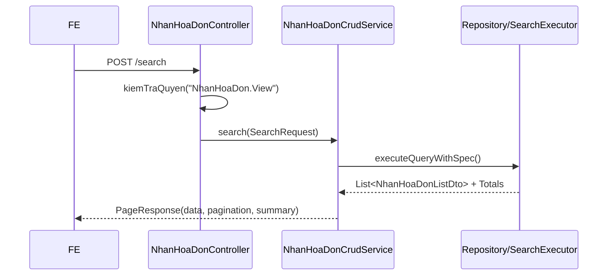

# F01 — Kế hoạch API Xem danh sách Hóa đơn mua hàng

> **Trạng thái:** BẢN NHÁP CHỜ REVIEW · **Ngày:** 2026-08-07  
> **Use Case:** PMKT-U-01161  
> **Màn hình:** `SCR_HDMH_DanhSach.md`  
> **Tài liệu nguồn:** `pmkt-docs/ba/PMKT-E-00542-HoaDonMuaHang/` (`4.usecases/PMKT-U-01161_XemDanhSach/`, `5.screens/SCR_HDMH_DanhSach.md`, `6.messages.md`)  

---

## 0. Các quyết định thiết kế

| # | Quyết định | Hệ quả |
|---|---|---|
| **D1** | Kế thừa `POST /search`, `GET /cot`, và `POST /export` từ base `BaseChungTuController` | Giảm tải code Controller; search động đi qua DynamicSpecification và whitelist registry. |
| **D2** | Sử dụng DTO danh sách chuyên biệt (`NhanHoaDonListDto`) tách rời khỏi DTO chi tiết | Tối ưu hóa hiệu năng; không nạp collection dòng chi tiết hoặc tính toán định khoản khi hiển thị bảng danh sách. |
| **D3** | Sort mặc định kế thừa cơ chế đa khóa của base | Mặc định sắp xếp theo `ngayHachToan DESC, ngayChungTu DESC, soChungTu ASC` (kèm `id ASC` làm tie-break). |
| **D4** | Metadata về Action (Xem chi tiết, Sửa, Xóa, Ghi sổ, Bỏ ghi sổ) tính toán tại BE | Trả cờ `allow*` trong DTO để FE chỉ việc ẩn/hiện nút tương ứng theo BR6 và BR7. |

---

## 1. Phạm vi

### 1.1 Trong phạm vi
- Lấy danh sách hóa đơn mua hàng (Nhận hóa đơn), phân trang, tìm kiếm keyword (`soHoaDon`, `tenNhaCungCap`, `soChungTu`).
- Lọc theo: `nhaCungCapId`, `tuNgay`, `denNgay` (theo `ngayHachToan`), `status` (Trạng thái chứng từ), `laHDVeSau` (Loại hóa đơn).
- Dòng tổng cộng (Summary row): Tính tổng trước thuế, tổng thuế, tổng sau thuế trên toàn bộ tập dữ liệu thỏa mãn bộ lọc.
- Tính toán action metadata cho từng dòng.

### 1.2 Ngoài phạm vi
- Logic thực thi sửa/xóa/ghi sổ/bỏ ghi sổ (xem F02-F07).
- Lưu cấu hình ẩn/hiện cột hoặc bộ lọc gần nhất (xử lý ở FE local storage).

---

## 2. Hiện trạng đã khảo sát

### 2.1 Code hiện có
- Chưa có Controller/Service/Repository cụ thể cho nghiệp vụ Nhận hóa đơn mua hàng.
- Base class `BaseChungTuController` và `AbstractChungTuCrudService` đã định hình sẵn luồng đọc.
- Bảng DB `pur_chung_tu_nhan_hoa_don` và `pur_hoa_don_mua` đã được dựng ở `V61`, cột header đã chuẩn hóa ở `V345` và `V351`.

### 2.2 Hiện trạng DB
- `pur_chung_tu_nhan_hoa_don` (Master): `id`, `tenant_id`, `so_chung_tu`, `ngay_chung_tu`, `ngay_hach_toan`, `status`, `da_xoa`.
- `pur_hoa_don_mua` (Con 1-1): `id`, `chung_tu_nhan_hoa_don_id`, `la_hd_ve_sau`, `so_hoa_don`, `ngay_hoa_don`, `ky_hieu_hoa_don`, `mau_so_hoa_don`, `tong_truoc_thue_vnd`, `tong_thue_gtgt_vnd`, `tong_sau_thue_vnd`.

---

## 3. Kiến trúc
```text
POST /nhan-hoa-don/search 
  → NhanHoaDonController extends BaseChungTuController
    → NhanHoaDonCrudService extends AbstractChungTuCrudService
      → SearchExecutor (Core)
        → pur_chung_tu_nhan_hoa_don 1-1 pur_hoa_don_mua
```

---

## 4. Hợp đồng API
Base path: `/api/mua-hang/nhan-hoa-don`

### 4.1 `POST /search`
**Request Body**:
```json
{
  "keyword": "HD-0001",
  "filters": [
    {"field": "ngayHachToan", "operator": "GTE", "value": "2026-08-01"},
    {"field": "ngayHachToan", "operator": "LTE", "value": "2026-08-07"},
    {"field": "laHDVeSau", "operator": "EQ", "value": "true"}
  ],
  "sorts": [
    {"field": "ngayHachToan", "direction": "DESC"}
  ],
  "page": 0,
  "size": 20
}
```

**Response 200**:
```json
{
  "success": true,
  "data": {
    "content": [
      {
        "id": "a1b2c3d4-e5f6-7a8b-9c0d-1e2f3a4b5c6d",
        "soChungTu": "NHD-2026-0001",
        "ngayChungTu": "2026-08-07",
        "ngayHachToan": "2026-08-07",
        "tenNhaCungCap": "Công ty TNHH Cung ứng Vật tư Dopai",
        "soHoaDon": "0001234",
        "kyHieuHoaDon": "1C26TAA",
        "mauSoHoaDon": "1/001",
        "tongTruocThueVnd": 10000000.00,
        "tongThueGtgtVnd": 1000000.00,
        "tongSauThueVnd": 11000000.00,
        "trangThaiChungTu": "NHAP",
        "laHDVeSau": true,
        "allowDetail": true,
        "allowEdit": true,
        "allowDelete": true,
        "allowPost": true,
        "allowUnpost": false,
        "allowRedirectToOrigin": false
      }
    ],
    "pagination": {
      "page": 0,
      "size": 20,
      "totalElements": 1,
      "totalPages": 1
    },
    "summary": {
      "tongTruocThueVnd": 10000000.00,
      "tongThueGtgtVnd": 1000000.00,
      "tongSauThueVnd": 11000000.00
    }
  }
}
```

---

## 5. Ánh xạ cột (BA ↔ DB ↔ DTO)

| Cột BA | DB/Nguồn | Field DTO | Lọc | Sắp xếp |
|---|---|---|:---:|:---:|
| Số chứng từ | `pur_chung_tu_nhan_hoa_don.so_chung_tu` | `soChungTu` | Y / keyword | Y |
| Ngày chứng từ | `pur_chung_tu_nhan_hoa_don.ngay_chung_tu` | `ngayChungTu` | Y | Y |
| Ngày hạch toán | `pur_chung_tu_nhan_hoa_don.ngay_hach_toan` | `ngayHachToan` | Y | Y |
| Tên nhà cung cấp | `pur_hoa_don_mua.ten_nha_cung_cap` | `tenNhaCungCap` | Y / keyword | Y |
| Số hóa đơn | `pur_hoa_don_mua.so_hoa_don` | `soHoaDon` | Y / keyword | Y |
| Ký hiệu | `pur_hoa_don_mua.ky_hieu_hoa_don` | `kyHieuHoaDon` | Y | Y |
| Mẫu số | `pur_hoa_don_mua.mau_so_hoa_don` | `mauSoHoaDon` | Y | Y |
| Tổng tiền trước thuế | `pur_hoa_don_mua.tong_truoc_thue_vnd` | `tongTruocThueVnd` | N | Y |
| Tổng tiền thuế | `pur_hoa_don_mua.tong_thue_gtgt_vnd` | `tongThueGtgtVnd` | N | Y |
| Tổng tiền sau thuế | `pur_hoa_don_mua.tong_sau_thue_vnd` | `tongSauThueVnd` | N | Y |
| Trạng thái chứng từ | `pur_chung_tu_nhan_hoa_don.status` | `trangThaiChungTu` | Y | Y |
| Loại hóa đơn | `pur_hoa_don_mua.la_hd_ve_sau` | `laHDVeSau` | Y | Y |

---

## 6. Lọc, Sắp xếp, Phân trang & Dòng tổng
- **Lọc mặc định**: Lọc soft-delete (`da_xoa = false`) và cách ly tenant được BE áp dụng ngầm qua RLS.
- **Sắp xếp mặc định**: `ngayHachToan DESC, ngayChungTu DESC, soChungTu ASC`.
- **Dòng tổng cộng**: Tính tổng `tong_truoc_thue_vnd`, `tong_thue_gtgt_vnd`, và `tong_sau_thue_vnd` trên toàn bộ tập dữ liệu sau lọc.

---

## 7. Action Metadata (Tính toán cờ action)
- `allowDetail`: Luôn `true`.
- `allowEdit`: `laHDVeSau == true` và `status == "NHAP"`.
- `allowDelete`: `laHDVeSau == true` và `status == "NHAP"`.
- `allowPost`: `laHDVeSau == true` và `status == "NHAP"`.
- `allowUnpost`: `laHDVeSau == true` và `status == "DA_GHI_SO"` và `trangThaiThanhToan == "ChuaThanhToan"`.
- `allowRedirectToOrigin`: `laHDVeSau == false`.

---

## 8. Luồng xử lý chính



---

## 9. Kiểm thử (Verification Plan)
- **Unit test**: Test mapper DTO và logic tính cờ action.
- **Integration test**: Mock DB, chèn mẫu hóa đơn độc lập và hóa đơn kèm chứng từ, gọi API `POST /search` kiểm tra số lượng bản ghi trả về, bộ lọc loại hóa đơn, và tính chính xác của dòng tổng cộng.
