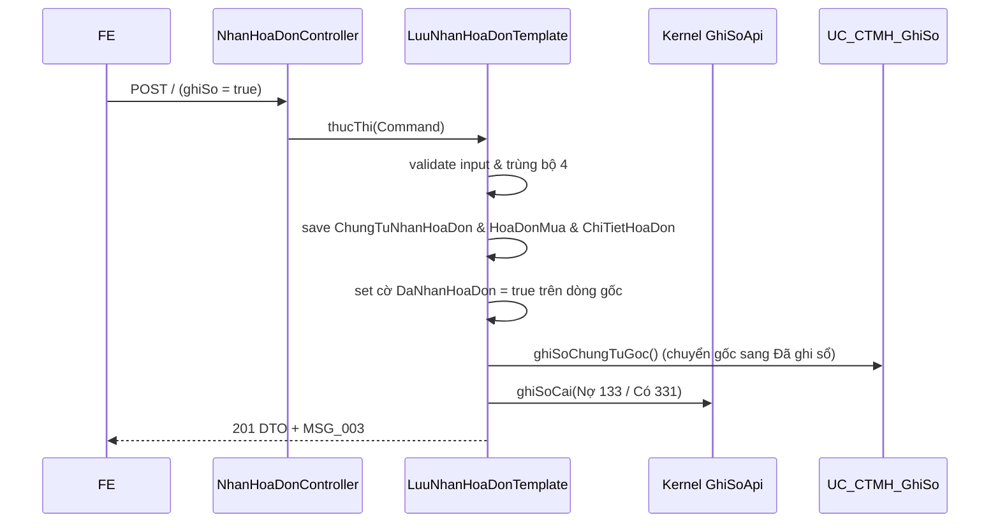

# F02 — Kế hoạch API Thêm mới Hóa đơn mua hàng

> **Trạng thái:** BẢN NHÁP CHỜ REVIEW · **Ngày:** 2026-08-07  
> **Use Case:** PMKT-U-01162  
> **Màn hình:** `SCR_HDMH_ThemMoi.md` & `SCR_HDMH_PopupChonChungTu.md`  
> **Tài liệu nguồn:** `4.usecases/PMKT-U-01162_ThemMoi/UC_HDMH_ThemMoi.md`, `5.screens/SCR_HDMH_ThemMoi.md`, `6.messages.md`  

---

## 0. Các quyết định thiết kế

| # | Quyết định | Hệ quả |
|---|---|---|
| **D1** | Sử dụng `ChungTuTemplate` để quản lý transaction hạch toán và lưu trữ dữ liệu Nhận hóa đơn | Đảm bảo tính nhất quán dữ liệu; logic nghiệp vụ được đóng gói trong template, không gọi trực tiếp repository.save |
| **D2** | **Rollback trọn gói khi "Lưu và ghi sổ"**: Việc lưu hóa đơn + ghi sổ chứng từ gốc + sinh bút toán thuế GTGT đầu vào cùng chạy trong một Transaction | Nếu bất kỳ chứng từ gốc nào lỗi ghi sổ (ví dụ: kỳ khóa sổ), toàn bộ đợt nhận hóa đơn bị hủy. |
| **D3** | Validate Loại tiền & Tỷ giá đồng nhất của các chứng từ gốc tại Server | Ngăn chặn việc trộn lẫn chứng từ khác loại tiền hoặc khác tỷ giá trong 1 hóa đơn nhận. |
| **D4** | Tự động chuyển chứng từ gốc sang "Đã ghi sổ" khi Lưu và ghi sổ thành công | Đồng bộ hóa trạng thái nhận hóa đơn và ghi sổ giữa chứng từ gốc và hóa đơn. |

---

## 1. Phạm vi

### 1.1 Trong phạm vi
- Endpoint `/lay-chung-tu-goc` để lấy các chứng từ mua hàng chưa nhận hóa đơn (`daNhanHoaDon = false`).
- Validate cùng NCC, cùng Loại tiền và Tỷ giá.
- Tạo mới chứng từ `ChungTuNhanHoaDon`, `HoaDonMua` (`laHDVeSau = true`), và các dòng chi tiết `ChiTietHoaDon` từ dòng hàng hóa/dịch vụ của các chứng từ gốc được chọn.
- Hỗ trợ lưu nháp (`status = NHAP`, chưa ghi sổ, không sinh bút toán) và "Lưu và ghi sổ" (ghi sổ ngay, sinh bút toán Nợ 133 / Có 331, gọi `UC_CTMH_GhiSo` cho các chứng từ gốc liên quan).
- Cập nhật trạng thái nhận hóa đơn của các dòng gốc và header gốc (`DaNhanHoaDon = true`, `TrangThaiNhanHoaDon = "Đã có hóa đơn"`).

### 1.2 Ngoài phạm vi
- Chỉnh sửa hoặc xóa hóa đơn (xem F03, F04).

---

## 2. Hiện trạng đã khảo sát
- DB bảng `pur_chung_tu_nhan_hoa_don`, `pur_hoa_don_mua`, `pur_chi_tiet_hoa_don` đã có sẵn các trường liên kết.
- Cờ `DaNhanHoaDon` trên `ChiTietChungTuMuaHang` đã được định nghĩa.
- Bảng `pur_chung_tu_mua_hang` có trường `trang_thai_nhan_hoa_don` để tổng hợp.

---

## 3. Kiến trúc
```text
POST /nhan-hoa-don/ 
  → NhanHoaDonController.create
    → NhanHoaDonCrudService.create
      → LuuNhanHoaDonTemplate extends ChungTuTemplate
        → validates & calculates
        → save entities (ChungTuNhanHoaDon, HoaDonMua, ChiTietHoaDon)
        → update ChungTuMuaHang & ChiTietChungTuMuaHang
        → IF ghiSoNgay: calls GhiSoApi (Nợ 133 / Có 331) & UC_CTMH_GhiSo (gốc)
```

---

## 4. Hợp đồng API

### 4.1 `POST /lay-chung-tu-goc`
Lấy danh sách chứng từ gốc chưa nhận hóa đơn của Nhà cung cấp.

**Request Body**:
```json
{
  "nhaCungCapId": "c6a2b8e8-71e8-466d-8c10-fa2cde64848d",
  "tuNgay": "2026-08-01",
  "denNgay": "2026-08-07"
}
```

**Response 200**:
```json
{
  "success": true,
  "data": [
    {
      "id": "e5b8d4f6-82c9-4cf5-99d9-482a9386d8cf",
      "soChungTu": "CTMH-2026-0089",
      "ngayChungTu": "2026-08-05",
      "ngayHachToan": "2026-08-05",
      "loaiTienId": "d8a1b2c3-e4f5-6a7b-8c9d-0e1f2a3b4c5d",
      "tyGia": 1.0,
      "tongTienThanhToanQuyDoi": 5000000.00
    }
  ]
}
```

### 4.2 `POST /` (Thêm mới hóa đơn)
**Request Body**:
```json
{
  "ghiSo": true,
  "soChungTu": "NHD-2026-0001",
  "ngayChungTu": "2026-08-07",
  "ngayHachToan": "2026-08-07",
  "dienGiai": "Nhận hóa đơn mua hàng đợt 1",
  "nhaCungCapId": "c6a2b8e8-71e8-466d-8c10-fa2cde64848d",
  "loaiTienId": "d8a1b2c3-e4f5-6a7b-8c9d-0e1f2a3b4c5d",
  "tyGia": 1.0,
  "soHoaDon": "0001234",
  "ngayHoaDon": "2026-08-07",
  "kyHieuHoaDon": "1C26TAA",
  "mauSoHoaDon": "1/001",
  "chungTuMuaHangIds": [
    "e5b8d4f6-82c9-4cf5-99d9-482a9386d8cf"
  ],
  "chiTiet": [
    {
      "chiTietChungTuMuaHangId": "f7d9e8b2-6c8f-4cf5-a1a1-9876543210ab",
      "chungTuMuaHangId": "e5b8d4f6-82c9-4cf5-99d9-482a9386d8cf",
      "taiKhoanThueGtgtId": "3c2d1b0a-f9e8-8d7c-6b5a-4f3e2d1c0b9a",
      "thueSuatGtgt": 10.0,
      "tienThueGtgtVnd": 500000.00,
      "tienThueGtgtQuyDoi": 500000.00,
      "nhomHhdvMuaVao": "Nhóm 1"
    }
  ]
}
```

**Response 201**:
```json
{
  "success": true,
  "messageId": "MSG_PMKT-E-00542_003",
  "message": "Lưu hóa đơn thành công",
  "data": {
    "id": "b3e8c9a1-7d8b-4c5a-a1b2-c3d4e5f67a8b",
    "soChungTu": "NHD-2026-0001",
    "status": "DA_GHI_SO"
  }
}
```

---

## 5. Ánh xạ trường nhập liệu

| Tên DTO Request | Cột DB đích | Validate / Logic |
|---|---|---|
| `soChungTu` | `pur_chung_tu_nhan_hoa_don.so_chung_tu` | Max 50, Bắt buộc, Unique trong tenant |
| `ngayHachToan` | `pur_chung_tu_nhan_hoa_don.ngay_hach_toan` | Phải >= `ngayChungTu` |
| `soHoaDon` | `pur_hoa_don_mua.so_hoa_don` | Max 20, Check trùng bộ 4 (BR1) |
| `kyHieuHoaDon` | `pur_hoa_don_mua.ky_hieu_hoa_don` | Max 20, Check trùng bộ 4 (BR1) |
| `mauSoHoaDon` | `pur_hoa_don_mua.mau_so_hoa_don` | Max 20, Check trùng bộ 4 (BR1) |
| `chungTuMuaHangIds` | - | Server dùng để load các dòng chi tiết gốc |

---

## 6. Logic Nghiệp vụ & Validation
- **BR1 Check trùng hóa đơn**: Cảnh báo trùng bộ 4 (NCC, Số HĐ, Ký hiệu, Mẫu số). Trả cảnh báo `MSG_PMKT-E-00542_002` để hiển thị popup xác nhận tiếp tục.
- **BR4 Đồng nhất Loại tiền và Tỷ giá**: Tất cả các `chungTuMuaHangIds` truyền vào phải có cùng `loaiTienId` và `tyGia`. Lệch → Lỗi `MSG_PMKT-E-00542_008`.
- **Tổng hợp trạng thái nhận hóa đơn**: Sau khi lưu, toàn bộ các dòng chi tiết chứng từ mua hàng gốc tương ứng được set `da_nhan_hoa_don = true`. Cập nhật `trang_thai_nhan_hoa_don` trên header `pur_chung_tu_mua_hang` thành `'DA_CO_HOA_DON'`.

---

## 7. Bút toán hạch toán GTGT (Khi `ghiSo = true`)
- **Nợ TK 133**: Thuế GTGT đầu vào được khấu trừ.
- **Có TK 331**: Phải trả cho người bán.
- Số tiền = Tổng tiền thuế GTGT trên hóa đơn.

---

## 8. Luồng xử lý chính



---

## 9. Kiểm thử (Verification Plan)
- **Unit test**: Kiểm tra hàm validate đồng nhất tiền tệ, kiểm tra logic tạo bút toán thuế GTGT.
- **Integration test**:
  - Gọi API tạo mới hóa đơn với cờ `ghiSo = true` cho 1 chứng từ mua hàng gốc đang ở trạng thái `NHAP`.
  - Verify: Chứng từ nhận hóa đơn tạo thành công ở trạng thái `DA_GHI_SO`, chứng từ mua hàng gốc tự động chuyển sang `DA_GHI_SO`, và bút toán `Nợ 133 / Có 331` được ghi vào sổ cái.
  - Gọi API với chứng từ bị lệch tỷ giá hoặc thiếu NCC, verify ném đúng lỗi `MSG_PMKT-E-00542_008`.
