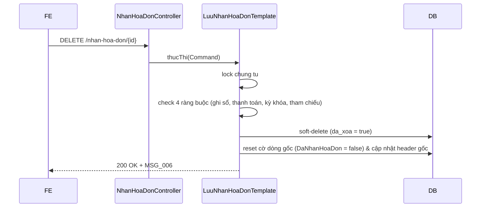

# F04 — Kế hoạch API Xóa Hóa đơn mua hàng

> **Trạng thái:** BẢN NHÁP CHỜ REVIEW · **Ngày:** 2026-08-07  
> **Use Case:** PMKT-U-01164 (Xóa đơn lẻ & hàng loạt)  
> **Màn hình:** `SCR_HDMH_Xoa` (Hộp thoại xác nhận trên danh sách)  
> **Tài liệu nguồn:** `4.usecases/PMKT-U-01164_Xoa/UC_HDMH_Xoa.md`, `5.screens/SCR_HDMH_DanhSach.md`, `6.messages.md`  

---

## 0. Các quyết định thiết kế

| # | Quyết định | Hệ quả |
|---|---|---|
| **D1** | Sử dụng cơ chế **xóa mềm (soft-delete)** thông qua đặt cờ `da_xoa = true` | Bản ghi không bị xóa vật lý khỏi DB; giữ vững audit log và lịch sử dữ liệu hạch toán. |
| **D2** | Giải phóng toàn bộ liên kết dòng gốc và khôi phục trạng thái chứng từ gốc | Trả cờ dòng `ChiTietChungTuMuaHang.DaNhanHoaDon = false` và cập nhật lại trạng thái của CTMH thành Chưa có hóa đơn. |
| **D3** | Kiểm tra nghiêm ngặt 4 ràng buộc chặn xóa tại tầng BE | Chống việc xóa hóa đơn đã thanh toán hoặc đã ghi sổ; ném mã lỗi đặc thù cho từng trường hợp. |

---

## 1. Phạm vi

### 1.1 Trong phạm vi
- Xóa đơn lẻ hóa đơn chưa ghi sổ: `DELETE /nhan-hoa-don/{id}`.
- Xóa hàng loạt hóa đơn chưa ghi sổ: `POST /nhan-hoa-don/xoa-hang-loat`.
- Kiểm tra 4 ràng buộc: đã ghi sổ, đã thanh toán, kỳ khóa sổ, và có chứng từ khác tham chiếu.
- Đặt `da_xoa = true` trên `ChungTuNhanHoaDon`, `HoaDonMua`, và `ChiTietHoaDon`.
- Reset cờ `DaNhanHoaDon = false` và clear `hoaDonMuaId` trên các dòng chi tiết gốc của các chứng từ gốc liên quan. Cập nhật lại `TrangThaiNhanHoaDon = "Chưa có hóa đơn"` trên header CTMH gốc.

### 1.2 Ngoài phạm vi
- Xóa hóa đơn kèm chứng từ (`laHDVeSau = false`) -> Bị chặn, người dùng phải xóa CTMH gốc.

---

## 2. Hiện trạng đã khảo sát
- DB bảng `pur_chung_tu_nhan_hoa_don` có sẵn cột `da_xoa boolean NOT NULL DEFAULT false` và trigger `trg_audit_pur_chung_tu_nhan_hoa_don` tự động cập nhật audit.
- Sổ công nợ và sổ cái kiểm tra dữ liệu theo cờ trạng thái chứng từ; bản ghi xóa mềm không tham gia báo cáo.

---

## 3. Kiến trúc
```text
DELETE /nhan-hoa-don/{id} 
  → NhanHoaDonController.delete
    → NhanHoaDonCrudService.delete
      → LuuNhanHoaDonTemplate extends ChungTuTemplate (hanhDong = XOA)
        → lock chung tu (ChungTuKhoaApi)
        → validate constraints (posted, payment link, period locked, references)
        → soft-delete entities (da_xoa = true)
        → release source documents link (daNhanHoaDon = false)
```

---

## 4. Hợp đồng API

### 4.1 `DELETE /{id}` (Xóa đơn lẻ)
**Response 200**:
```json
{
  "success": true,
  "messageId": "MSG_PMKT-E-00542_006",
  "message": "Xóa hóa đơn thành công"
}
```

### 4.2 `POST /xoa-hang-loat` (Xóa hàng loạt)
**Request Body**:
```json
{
  "ids": [
    "b3e8c9a1-7d8b-4c5a-a1b2-c3d4e5f67a8b",
    "c4f9e8a1-7d8b-4c5a-a1b2-c3d4e5f67a8b"
  ]
}
```

**Response 200**:
```json
{
  "success": true,
  "data": {
    "thanhCong": 2,
    "thatBai": 0,
    "errors": []
  }
}
```

---

## 5. Ràng buộc chặn xóa & Mã thông báo lỗi

| Ràng buộc | Xử lý | Mã thông báo |
|---|---|---|
| Hóa đơn đã ghi sổ | Chặn nếu `status = "DA_GHI_SO"` | `MSG_PMKT-E-00542_012` |
| Hóa đơn đã thanh toán | Chặn nếu `trangThaiThanhToan != "ChuaThanhToan"` | `MSG_PMKT-E-00542_013` |
| Kỳ kế toán đã khóa | Chặn nếu ngày hạch toán thuộc kỳ đã khóa | `MSG_PMKT-E-00542_014` |
| Có chứng từ khác tham chiếu | Chặn nếu tồn tại dòng tham chiếu hợp lệ | `MSG_PMKT-E-00542_015` |

---

## 6. Luồng xử lý chính



---

## 7. Kiểm thử (Verification Plan)
- **Unit test**: Test logic kiểm tra 4 ràng buộc chặn xóa.
- **Integration test**:
  - Gửi request xóa hóa đơn đã ghi sổ, verify trả về mã lỗi `MSG_PMKT-E-00542_012`.
  - Gửi request xóa hóa đơn hợp lệ. Verify: Bảng `pur_hoa_don_mua` cập nhật `da_xoa = true`, cờ `da_nhan_hoa_don` trên dòng gốc trở lại thành `false`, và trạng thái nhận hóa đơn của CTMH gốc quay lại thành `Chưa có hóa đơn`.
