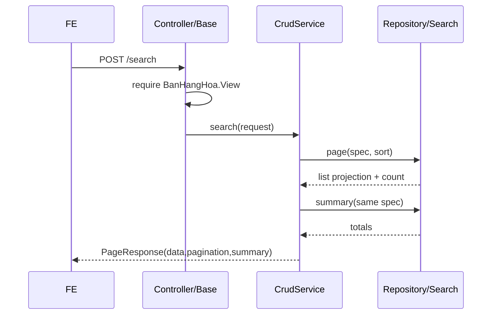

# F01 — Kế hoạch API Xem danh sách Chứng từ bán hàng

> **Trạng thái:** BẢN NHÁP CHỜ REVIEW  
> **Ngày cập nhật:** 2026-08-07  
> **Review:** BA chốt §11; Dev BE chốt §3, §9, §10

| Mục | Nội dung |
|---|---|
| Use case | `UC_CTBH_DanhSach`, PMKT-U-06396 |
| Màn hình | `SCR_CTBH_DanhSach.md` |
| Module | `cell-app/.../chung_tu_ban_hang` |
| Bảng chính | `sal_chung_tu_ban_hang`, `sal_chi_tiet_chung_tu_ban_hang` |

## 0. Các quyết định thiết kế

| # | Quyết định | Hệ quả |
|---|---|---|
| D1 | Kế thừa `POST /search`, `/cot`, `/export` từ `BaseCrudController` | Không viết controller/query filter riêng; mọi alias đi qua whitelist |
| D2 | Tách list DTO khỏi detail DTO | Trang danh sách không nạp collection/dựng định khoản cho từng bản ghi |
| D3 | Sort mặc định là ba khóa đúng BR00 | Mở rộng hook sort của base theo hướng tương thích ngược |
| D4 | Filter đầu tháng → hiện tại do FE gửi | Export/tích hợp vẫn có lối lấy toàn bộ; BE không chèn điều kiện ẩn |
| D5 | Summary dùng đúng `Specification` của list và toàn bộ tập sau lọc | Không cộng trang hiện tại, không dựng lại filter bằng tay |
| D6 | Điều kiện action do BE trả; quyền phiên người dùng trả dạng capability | FE không so sánh chuỗi trạng thái rải rác |

## 1. Phạm vi

### 1.1 Trong phạm vi

| # | Chức năng | Nguồn |
|---|---|---|
| F1 | Danh sách 14 cột, phân trang | SCR dòng 19-36 |
| F2 | Lọc ngày, số CT/HĐ, khách hàng, trạng thái | UC AC3; SCR BR00 |
| F3 | Sort mặc định và sort theo cột | SCR dòng 87-90 |
| F4 | Summary CK, GTGT, thanh toán | SCR BR03a dòng 118-124 |
| F5 | Metadata action dòng/hàng loạt | SCR BR03 dòng 111-116 |
| F6 | Export theo bộ lọc | endpoint base hiện có |

### 1.2 Ngoài phạm vi

Thêm/sửa/xóa/ghi sổ/bỏ ghi sổ chỉ được **hiển thị khả năng thao tác**; xử lý nằm ở F03-F07. Thu tiền/HĐ/PXK nằm ở F09. Lưu filter lần gần nhất là state FE, không lưu DB tại API này.

## 2. Hiện trạng đã khảo sát

### 2.1 Code hiện có

```bash
rg -n "defaultSortAlias|summary|@Searchable" \
  cell-app/src/main/java/vn/dopai/pmkt/cell/{core,chung_tu_ban_hang}
```

- `BaseCrudController.java:120-135,167-189` đã có search/cột/export và kiểm quyền.
- `AbstractCrudService.java:60-81,165-178,224` đã có sort một khóa, page và hook summary.
- `ChungTuBanHangCrudService.java:78-87` mới sort `ngayHachToan DESC`; `:163-174` đã tính summary đúng specification.
- `ChungTuBanHangRepositoryImpl.java:30-68` SUM bốn cột, tập rỗng → 0.
- `ChungTuBanHang.java:38-40,48-239` có whitelist phần lớn cột nhưng thiếu `soHoaDon`.
- `ChungTuBanHangDto.java:9-17` dùng chung list/detail; cần tách để kiểm soát query.

Kết luận: **brownfield**, phần nền đã đúng nhưng thiếu contract/list projection và một số BR.

### 2.2 DB

Header dựng ở V75, chuẩn cột ở V349/V351; RLS đã bật từ V75 và phạm vi dữ liệu ở V319. Số HĐ trực tiếp chưa có; HĐ lập sau thuộc bảng module HĐ và phải aggregate qua liên kết dòng/header.

| Bảng | Vai trò | Khóa nối |
|---|---|---|
| `sal_chung_tu_ban_hang` | header/list/tổng | `id`, `tenant_id` |
| `sal_chi_tiet_chung_tu_ban_hang` | counter/liên kết dòng | `chung_tu_ban_hang_id` |
| `sal_hoa_don_ban_hang` + chi tiết | số HĐ lập kèm/lập sau | CTBH/dòng nguồn — phải chốt ở F09 |

### 2.3 Base tái sử dụng

| Cần | Base | Vị trí |
|---|---|---|
| Request/filter/page | `SearchRequest` | `core/request/SearchRequest.java` |
| Whitelist/filter | `DynamicSpecification`, `SearchExecutor` | `core/shared/search/**` |
| Page wrapper | `PageResponse` | `core/response/PageResponse.java` |
| Quyền | `QuyenChecker` | `core/controller/QuyenChecker.java` |
| Tenant/RLS | `TenantRlsAspect` | `core/config/TenantRlsAspect.java` |
| Excel | `BaseCrudController.export` | `BaseCrudController.java:167-189` |

## 3. Kiến trúc

```text
ChungTuBanHangController extends BaseChungTuController
  → ChungTuBanHangCrudService extends AbstractChungTuCrudService
    → SearchExecutor + ChungTuBanHangRepositoryCustom
      → sal_chung_tu_ban_hang / read projection HĐ
```

| | A — dùng DTO detail hiện tại | **B — list projection (chọn)** |
|---|---|---|
| Dòng chi tiết | dễ bị nạp/dựng thừa | không tải |
| Số HĐ nhiều giá trị | nối Java, dễ N+1 | `string_agg`/read model một query |
| Mapper | dùng lại | thêm mapper nhỏ |
| Rủi ro | response lớn, chậm | projection lệch whitelist |
| Chốt | — | contract/search test pin từng alias |

Không chọn A vì comment DTO hiện tại nói list bỏ qua `chiTiet`, nhưng mapper vẫn có khả năng duyệt aggregate; hiệu năng phải được đảm bảo bằng query, không bằng việc FE bỏ field.

## 4. Hợp đồng API

Base path `/api/ban-hang/chung-tu-ban-hang`; enum wire là chuỗi DB tiếng Việt qua converter.

| # | Nguồn | Method/path | Quyền | Trả về |
|---|---|---|---|---|
| A1 | base + override service | `POST /search` | `.View` | `PageResponse<ListItemDto>` |
| A2 | base | `GET /cot` | `.View` | `ApiResponse<List<CotMoTa>>` |
| A3 | base | `POST /export` | `.Export` | XLSX |

### 4.1 A1 — Search

```jsonc
{
  "keyword": "BH-000124",
  "filters": [
    {"field":"ngayHachToan","operator":"GTE","value":"2026-08-01"},
    {"field":"ngayHachToan","operator":"LTE","value":"2026-08-07"},
    {"field":"trangThaiChungTu","operator":"EQ","value":"Chưa ghi sổ"}
  ],
  "sorts": [{"field":"ngayHachToan","direction":"DESC"}],
  "page": 0,
  "size": 20
}
```

Response giữ wrapper thực tế của `PageResponse`: `data`, `pagination`, `summary`. `summary` gồm ba cột BA yêu cầu và có thể giữ thêm `tongTienHangHoaQuyDoi` nếu FE đang dùng.

Lỗi: `403` thiếu `.View`; `400` giá trị/toán tử không hợp lệ theo chính sách base; lỗi hệ thống không lộ SQL.

### 4.2 A2 — Cột

Trả alias, label, type, searchable/sortable từ registry. `soHoaDon` chỉ được công bố khi query đã cài thật; không công bố alias rồi âm thầm bỏ filter.

### 4.3 A3 — Export

Body cùng A1 nhưng bỏ pagination; xuất toàn bộ sau lọc, có giới hạn `MAX_EXPORT_ROWS` từ base. Thứ tự cột: ngày HT, ngày CT, số CT, số HĐ, khách hàng, bốn cột tiền, bốn trạng thái.

### 4.4 Endpoint thừa do base

`POST /import` không thuộc BA và module không hỗ trợ. Override trả `IMPORT_NOT_SUPPORTED` hoặc gỡ mapping có kiểm thử; không seed `.Import` để biến endpoint thừa thành tính năng.

## 5. Mapping BA ↔ DB ↔ DTO

| Cột BA | DB/nguồn | DTO/alias | Lọc | Sort |
|---|---|---|:---:|:---:|
| Ngày HT | `ngay_hach_toan` base | `ngayHachToan` | Y | Y |
| Ngày CT | `ngay_chung_tu` base | `ngayChungTu` | Y | Y |
| Số CT | `so_chung_tu` base | `soChungTu` | Y/keyword | Y |
| Số HĐ | snapshot + HĐ liên kết | `soHoaDon` | Y | Y sau khi có read model |
| Khách hàng | `khach_hang_id`, `ten_khach_hang` | cùng tên | Y/keyword | Y |
| Thành tiền | `tong_tien_hang_hoa_quy_doi` | cùng alias | Y | Y |
| CK/GTGT/Thanh toán | các cột `*_quy_doi` | cùng alias | Y | Y |
| Trạng thái CT | `status` (**lệch tên BA**) | `trangThaiChungTu` | Y | Y |
| 3 trạng thái phụ | `trang_thai_*` | cùng alias | Y | Y |

Không đổi tên cột `status`; đây là cột chuẩn của `BaseChungTuEntity` từ V349.

## 6. Lọc, sort, page, tổng

- Filter kết hợp AND; `keyword` tìm `soChungTu`, `tenKhachHang`, MST, diễn giải, số HĐ sau khi read model hỗ trợ.
- Sort mặc định: `ngayHachToan DESC, ngayChungTu DESC, soChungTu ASC`. Nếu request có sort thì dùng request, thêm `id ASC` làm tie-break ổn định.
- Page 0-based theo base; size whitelist/cap theo `SearchRequest`/`SearchExecutor`, không nhận giá trị vô hạn.
- Summary tính trên toàn tập sau filter và RLS; SUM tập rỗng = 0, FE ẩn footer khi `totalElements=0`.

## 7. Cột khó: Số hóa đơn

Nguồn có thể gồm HĐ lập kèm và nhiều HĐ lập sau. Kết quả là danh sách số HĐ distinct, sort theo ngày/số rồi nối `, `. Chọn projection/read model; không dùng vòng lặp repository theo từng CTBH. Filter dùng `EXISTS` trên liên kết, không filter chuỗi đã nối.

## 8. Action metadata

| Action | Điều kiện dữ liệu |
|---|---|
| edit/post/delete | `status=NHAP` |
| unpost | `status=DA_GHI_SO` |
| collect | đã ghi và thanh toán chưa đủ |
| createInvoice | đã ghi và HĐ chưa đủ |
| createDelivery | đã ghi, xuất chưa đủ, không phải bán dịch vụ |

Quyền không thay thế kiểm tra trong endpoint ghi; metadata chỉ phục vụ UX.

## 9. Migration

Không cần migration riêng nếu Số HĐ dùng schema HĐ chuẩn. Nếu chọn materialized/read table, migration phải có index tenant + source CTBH và cơ chế cập nhật trong transaction. Quyền `.View/.Export` đã seed V10/V350; rà mapping role trên môi trường.

## 10. Rủi ro

| # | Rủi ro | Mức | Giảm thiểu |
|---|---|---|---|
| R1 | N+1 từ HĐ/chi tiết | Cao | projection + query-count test |
| R2 | Mở rộng sort base ảnh hưởng màn khác | Cao | hook tương thích + test toàn `cell-app` |
| R3 | Filter Số HĐ trên chuỗi aggregate chậm | TB | `EXISTS` + index nguồn |
| R4 | Trạng thái bán dịch vụ chưa có discriminator | Cao | BA/model chốt Q2 trước code |

## 11. Điểm BA xác nhận

| # | Vấn đề | Bằng chứng | Tạm xử lý |
|---|---|---|---|
| Q1 | Số HĐ có gồm HĐ đã xóa/hủy không? | SCR dòng 26 chỉ nói “nhiều HĐ”, không định nghĩa vòng đời | chỉ HĐ hiệu lực, chưa xóa |
| Q2 | Cách nhận diện “Chứng từ bán dịch vụ” | SCR dòng 34/67 yêu cầu hành vi riêng; entity chỉ có loại trong nước/xuất khẩu | chưa trả `null` nếu chưa có discriminator |
| Q3 | Filter mặc định do FE hay BE | BR00 nói tự lọc và lưu lần truy cập; không chỉ tầng sở hữu | FE gửi, BE xử lý tường minh |

## 12. Luồng chính



## 13. Quy ước dữ liệu

Tiền danh sách luôn là đồng tiền hạch toán (`*_quy_doi`). Enum filter/data dùng chuỗi DB qua `AttributeConverter`; không dùng tên enum Java. Soft-delete, tenant, owner không nhận từ request.

## 14. Message

| messageId | Dùng ở |
|---|---|
| `MSG_PMKT-E-06194_007` | thiếu quyền |
| `MSG_PMKT-E-06194_026` | lỗi tải không xác định ở UI; server vẫn dùng handler chung |

## 15. Kiểm thử

- Unit: `SapXepDanhSachBanHangTest`, `ActionBanHangTest`, whitelist alias.
- Integration: filter/sort/page/summary/tenant; aggregate HĐ; query count; export.
- Chạy: `cd cell-app && ./gradlew unitTest`, sau đó `./gradlew build` trong CI có Docker.

## 16. Bàn giao

List DTO/projection, repository fragment, service sort/summary, controller export columns, test và Postman Search/Cột/Export. Không sửa `master_data/**`.

## 17. Thứ tự

Chốt Q1-Q3 → thiết kế read model HĐ → list DTO/query → hook sort base + hồi quy → metadata action → export → integration/performance test.

## 18. Definition of Done

- [ ] Đủ cột, filter, sort ba khóa và summary đúng BR.
- [ ] Không N+1; tenant/soft-delete đúng; action đúng trạng thái/quyền.
- [ ] Số HĐ nhiều giá trị đúng vòng đời BA chốt.
- [ ] Unit/integration/arch test xanh; Postman/OpenAPI cập nhật.

## 19. Tham chiếu

`UC_CTBH_DanhSach.md`, `SCR_CTBH_DanhSach.md`, `3.crud-matrix.puml`, `6.messages.md`; `BaseCrudController.java`, `AbstractCrudService.java`, `ChungTuBanHangCrudService.java`, `ChungTuBanHangRepositoryImpl.java`.

