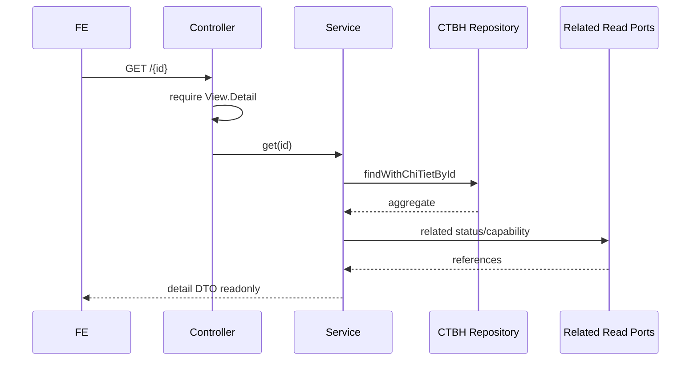

# F02 — Kế hoạch API Xem chi tiết Chứng từ bán hàng

> **Trạng thái:** BẢN NHÁP CHỜ REVIEW · **Ngày:** 2026-08-07

| Mục | Nội dung |
|---|---|
| Use case | `UC_CTBH_XemChiTiet`, PMKT-U-06400/06401/06402/06985 |
| Màn hình | `SCR_CTBH_XemChiTiet`, ma trận ẩn/hiện tương ứng |
| Bảng | CTBH + dòng + sổ cái + tham chiếu HĐ/PXK/PT |

## 0. Quyết định

| # | Quyết định | Hệ quả |
|---|---|---|
| D1 | `GET /{id}` trả aggregate readonly đầy đủ | FE mở popup bằng một request chính |
| D2 | Tách “định khoản dự kiến” và “sổ cái đã ghi” | Không hiển thị dữ liệu tính toán như bút toán chính thức |
| D3 | Dòng và tham chiếu có endpoint phụ để lazy-load | Detail chính vẫn tương thích; grid lớn không làm response bắt buộc phình |
| D4 | `availableActions` do service tính | FE chỉ render; endpoint ghi vẫn kiểm quyền/trạng thái lại |
| D5 | Không truy cập bảng `internal` module khác | Dùng read port công khai cho tham chiếu/trạng thái |

## 1. Phạm vi

- Header, mọi tab và dòng như màn Thêm mới nhưng readonly; counter/còn lại theo BR17.
- Các nút Sửa/Ghi/Bỏ ghi/Lập HĐ/(Lập PXK chờ Q1)/Đóng.
- Tab Hạch toán dự kiến và sổ cái đã ghi; tab tham chiếu.
- Ngoài phạm vi: thực thi các nút; layout/ẩn hiện là FE dựa DTO + matrix.

## 2. Hiện trạng

```bash
rg -n "public ChungTuBanHangDto get|dongChiTiet|thongTinHachToan" \
  cell-app/src/main/java/vn/dopai/pmkt/cell
```

- `BaseCrudController.java:137-141` cấp `GET /{id}` và `.View.Detail`.
- `BaseChungTuController.java:127-150` cấp sổ cái và dòng chi tiết, có kiểm tồn tại.
- `ChungTuBanHangCrudService.java:95-105,141-145` nạp entity graph và map dòng.
- `ChungTuBanHangRepository.java:23-30` nạp `chiTiet` một query.
- `ChungTuBanHangDto.java:19-105` đã chứa phần lớn header/dòng/định khoản nhưng thiếu snapshot 3 tab và action/nguồn `daLapHoaDon`.

DB hiện có header/dòng và `acc_so_cai`; trường riêng HĐ/PXK/PT cần migration F03. Đây là brownfield.

## 3. Kiến trúc

```text
Controller(base endpoints)
 → ChungTuBanHangCrudService.get/layDongChiTiet
 → Repository @EntityGraph
 → Mapper + DinhKhoanBanHang
 → Read ports tham chiếu / SoCaiApi
```

| | A — query join tất cả | **B — aggregate chính + endpoint/read port phụ (chọn)** |
|---|---|---|
| Cardinality | HĐ×PXK×dòng làm nhân bản | từng tập độc lập |
| FE | một response rất lớn | lazy-load được |
| Rủi ro | duplicate/N+1 | nhiều request |
| Chốt | — | cache/query song song phía FE; contract rõ |

## 4. API

| # | Nguồn | Method/path | Quyền | Trả về |
|---|---|---|---|---|
| A1 | base + service override | `GET /{id}` | `.View.Detail` | `ChungTuBanHangDetailDto` |
| A2 | accounting base | `GET /{id}/dong-chi-tiet` | `.View.Detail` | `List<ChiTietDto>` |
| A3 | accounting base | `GET /{id}/thong-tin-hach-toan` | `.View.Detail` | `List<DongSoCaiDto>` |
| A4 | mới | `GET /{id}/tham-chieu` | `.View.Detail` | `List<ChungTuThamChieuDto>` |

### 4.1 A1

Response tối thiểu:

```jsonc
{
  "code":"SUCCESS",
  "data":{
    "id":"...", "soChungTu":"BH-0001", "trangThaiChungTu":"Chưa ghi sổ",
    "loaiNghiepVu":"Bán hàng trong nước",
    "kiemPhieuXuatKho":true, "lapKemHoaDon":false, "thuTienNgay":false,
    "chiTiet":[{"id":"...","soLuong":10,"soLuongDaXuatHd":3,
      "soLuongConLaiXuatHd":7}],
    "dinhKhoanDuKien":[],
    "availableActions":{"edit":true,"post":true,"unpost":false},
    "phienBan":2,"updatedAt":"2026-08-07T01:00:00Z"
  }
}
```

### 4.2 A2

Trả cả dòng hàng và ghi chú theo `stt`; dùng khi grid lazy-load. ID không tồn tại phải 404, không trả `[]`.

### 4.3 A3

Chỉ trả `acc_so_cai` thật qua `SoCaiApi.theoChungTu`. CT chưa ghi trả `[]`; ID bịa/khác tenant trả 404 nhờ `kiemTraTonTai` (`BaseChungTuController.java:139-143`).

### 4.4 A4

DTO chung: `loaiChungTu`, `id`, `soChungTu`, `ngayChungTu`, `trangThai`, `nguonLienKet`, `daXoa`. Không trả entity module khác.

Envelope lỗi theo `GlobalExceptionHandler`: `code`, `messageId`, `message`, `timestamp`.

## 5. Mapping dữ liệu

| Khối BA | Nguồn | DTO |
|---|---|---|
| Header/options/khách hàng/tiền | header CTBH | field cùng tên |
| HĐ/PXK/PT | snapshot CTBH + read port con | nhóm `hoaDon/phieuXuat/phieuThu` |
| Dòng hàng | chi tiết CTBH | `chiTiet[]` |
| Số còn lại | không lưu | `max(soLuong-counter,0)` |
| Trạng thái | header + counter | 4 field trạng thái |
| Tab dự kiến | `DinhKhoanBanHang.dung` | `dinhKhoanDuKien[]` |
| Tab đã ghi | `acc_so_cai` | A3 |
| Tham chiếu | module con | A4 |

## 6. Lọc/sort/page/summary

Không áp dụng cho A1/A3. A2 sort `stt ASC`; nếu số dòng vượt ngưỡng mới bổ sung pagination mà không đổi semantics. A4 sort ngày/số chứng từ ổn định.

## 7. Field khó: nguồn `DaLapHoaDon`

BR15 phân biệt người dùng tự tích và hệ thống tích từ HĐ; boolean hiện tại không biểu diễn được. Thêm enum nguồn `KHONG/NGUOI_DUNG/LAP_KEM/HE_THONG_TU_HOA_DON`, hoặc tối thiểu `daLapHoaDonTuHeThong`. Chọn enum vì tránh hai boolean mâu thuẫn; cần migration/backfill.

## 8. Available actions

Tính từ trạng thái dữ liệu và capability quyền. Đặc biệt `createInvoice/createDelivery` dùng counter còn lại; không dựa riêng boolean header. Hành động chỉ là gợi ý UI, không là authorization token.

## 9. Migration

Đi cùng migration F03 cho snapshot và nguồn HĐ. Không thêm bảng chỉ cho màn detail. Nếu thêm enum nguồn, backfill: `lap_kem_hoa_don=true → LAP_KEM`; `da_lap_hoa_don=true` không có liên kết → `NGUOI_DUNG`; có liên kết → cần script kiểm chứng trước, không đoán âm thầm.

## 10. Rủi ro

| # | Rủi ro | Mức | Giảm thiểu |
|---|---|---|---|
| R1 | Join nhiều collection nhân bản dòng | Cao | D3/read port riêng |
| R2 | Dự kiến lệch sổ cái | Cao | đặt tên/endpoint riêng, test đối chiếu |
| R3 | Backfill nguồn HĐ sai | Cao | query báo cáo + BA duyệt |
| R4 | LazyInitialization/N+1 | TB | entity graph + query-count test |

## 11. Điểm BA xác nhận

| # | Vấn đề | Bằng chứng mâu thuẫn | Tạm xử lý |
|---|---|---|---|
| Q1 | Có nút Lập PXK ở detail? | `SCR_CTBH_XemChiTiet` dòng 23-29 không có; BR17 dòng 911-945 nói có | DTO trả capability, FE chưa bật |
| Q2 | Nút grid ẩn hay disable | screen dòng 19 nói “không có”; matrix nêu đối chiếu màn mua hàng | trả readonly, không trả action grid |
| Q3 | Tab Hạch toán detail hiển thị dự kiến hay đã ghi | screen tham chiếu màn thêm; base có endpoint sổ thật | nháp=dự kiến, đã ghi=sổ thật và nhãn rõ |

## 12. Luồng



## 13. Quy ước dữ liệu

Counter là số theo ĐVT dòng CTBH; hai counter HĐ/PXK độc lập. `updatedAt/phienBan` chỉ là token cho thao tác sau. Tiền gốc và quy đổi không trộn. Enum wire là chuỗi DB.

## 14. Message

`_007` thiếu quyền, `_011` không tìm thấy, `_026` lỗi tải UI. Không dùng `_026` để che lỗi nghiệp vụ có mã riêng.

## 15. Test

- Unit mapper/counter/action/nguồn HĐ.
- Integration detail 6 cấu hình, RLS, soft-delete, query count; A3 nháp/đã ghi/UUID bịa; A4 nhiều tham chiếu.
- `./gradlew unitTest`, `./gradlew build` trong CI.

## 16. Bàn giao

Detail DTO, mapper, source enum/migration, read port tham chiếu, endpoint A4, contract/integration test, Postman 4 request. Không đụng `master_data/**`.

## 17. Thứ tự

BA chốt Q1-Q3 → migration/source → DTO/mapper → read ports → controller A4 → query/performance/security tests.

## 18. Definition of Done

- [ ] Hiển thị đủ mọi tab/cấu hình; readonly và action đúng.
- [ ] Counter/còn lại/trạng thái/tham chiếu đúng; không N+1.
- [ ] Dự kiến và sổ thật không bị trộn; 404/403/RLS đúng.
- [ ] Test/OpenAPI/Postman hoàn tất.

## 19. Tham chiếu

`UC_CTBH_XemChiTiet.md`, `SCR_CTBH_XemChiTiet.md`, matrix detail, `SCR_CTBH_ThemMoi.md` BR12/15/17; `BaseChungTuController.java`, `ChungTuBanHangCrudService.java`, `ChungTuBanHangMapper.java`.

