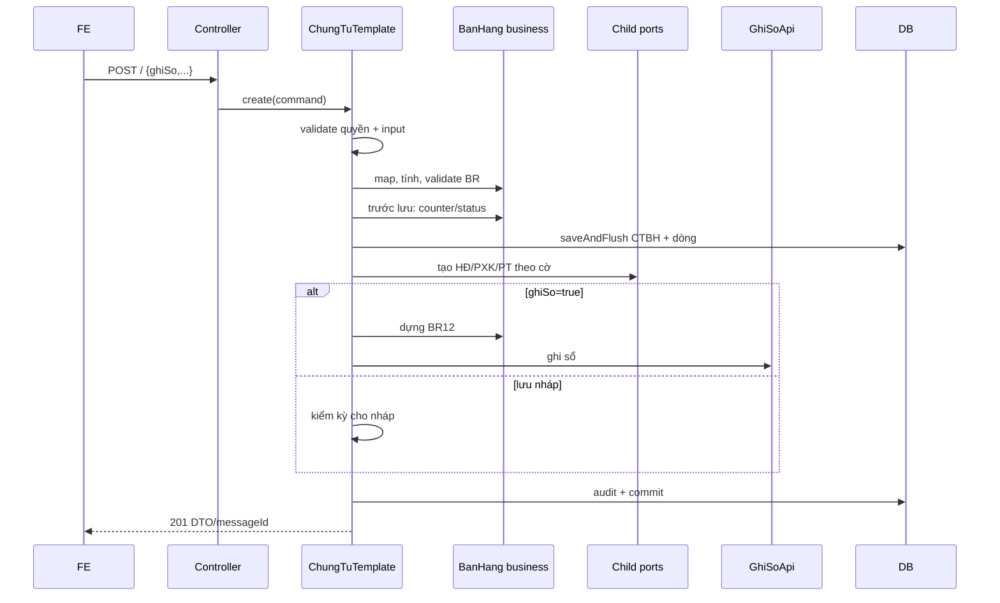

# F03 — Kế hoạch API Thêm mới Chứng từ bán hàng

> **Trạng thái:** BẢN NHÁP CHỜ REVIEW · **Ngày:** 2026-08-07

| Mục | Nội dung |
|---|---|
| Use case | PMKT-U-06397/06398/06399/06461/06982 |
| Màn hình | `SCR_CTBH_ThemMoi`, hai popup PBCK, ma trận ẩn/hiện |
| Module/bảng | `chung_tu_ban_hang`; header + chi tiết + chứng từ con + sổ cái |

## 0. Quyết định

| # | Quyết định | Hệ quả |
|---|---|---|
| D1 | Giữ module brownfield, mọi ghi qua `ChungTuTemplate` | Không dùng CRUD save trực tiếp |
| ~~D2~~ | ✅ **Đã xong** — hook `truocKhiLuu` gọi một lần từ `ChungTuTemplate.luuChungTu():418` | Counter/status chạy đúng cho cả tạo/sửa/ghi sổ |
| D3 | Một request cho Lưu và Lưu & ghi sổ | `ghiSo=true` kiểm thêm `.Post`; rollback nguyên tử |
| D4 | Tổng/header và trạng thái là server-owned | Client gửi tổng CK chỉ để đối chiếu; không tin tổng tiền khác |
| D5 | Chứng từ con phải được tạo thật qua port | Thiếu adapter mà cờ bật → fail-fast, không counter giả |
| D6 | Snapshot tab lưu trên header có prefix | Đọc detail không thêm 3 bảng snapshot; unique HĐ dễ cưỡng chế |

## 1. Phạm vi

Trong phạm vi: trong nước/xuất khẩu; ghi nợ/thu ngay TM-CK; kiêm PXK; lập kèm/đã lập HĐ; dòng hàng/dịch vụ/KM/CKTM/ghi chú; ngoại tệ; thuế; năm loại CK; 7 định khoản; validation/message; sinh con và rollback.

Ngoài phạm vi: tính giá xuất kho chi tiết của PMKT-E-03629, kết nối CQT, UI ẩn/hiện. Tuy nhiên adapter kho và giá vốn tối thiểu để nghiệm thu phải theo quyết định Q4.

## 2. Hiện trạng

```bash
rg -n "class TaoChungTuBanHang|class LuuChungTuBanHangTemplate|TAM-TAT|truocKhiLuu" \
  cell-app/src/main/java/vn/dopai/pmkt/cell
```

- `ChungTuBanHangController.java:127-136` đã có `POST /` và message `_001/_004`.
- `TaoChungTuBanHang` + `LuuChungTuBanHangTemplate.java:51-146` đã có quyền kép, validate, counter/status, lưu, dựng định khoản.
- P0: `ChungTuTemplate.java:151,177,201,219,243` comment hook nên logic `Luu...:92-103` không chạy.
- P0: `KiemTraBanHang.java:37,79,260` tắt hai validation.
- `package-info.java:16-22` xác nhận chưa sinh chứng từ con/tồn kho.
- Entity/request thiếu mẫu-ký hiệu-số-ngày HĐ và số/ngày riêng PXK/PT.

DB: V75/V343/V349/V351 đã có aggregate nền; migration mới phải lấy số sau migration mới nhất tại lúc code, không cố định V354.

Base dùng lại: transaction/template (`ChungTuTemplate.java:92-137`), quyền (`:298-301`), cấp số (`:320-329`), kernel `GhiSoApi`, khóa, kỳ, audit; base entity lifecycle (`BaseChungTuEntity.java:165-179`).

## 3. Kiến trúc

```text
POST / → Controller
 → ChungTuBanHangCrudService.create
 → TaoChungTuBanHang extends LuuChungTuBanHangTemplate
 → Mapper/TinhToan/KiemTra/TrangThai/DinhKhoan
 → Repository.saveAndFlush
 → LapChungTuConPort × HĐ/PXK/PT
 → GhiSoApi (nếu ghiSo=true)
```

| | A — CTBH gọi service internal module con | **B — public port/adapter (chọn)** |
|---|---|---|
| Biên module | vi phạm Modulith | đúng ownership |
| Transaction | dễ nhưng coupling | `MANDATORY`, vẫn cùng transaction |
| Thiếu module | không compile | fail-fast khi option dùng |
| Rủi ro | vòng phụ thuộc | registry thiếu/trùng adapter |
| Chốt | — | startup/integration test registry |

## 4. Hợp đồng API

| # | Method/path | Quyền | Trả về |
|---|---|---|---|
| A1 | `POST /api/ban-hang/chung-tu-ban-hang` | `.Create` + `.Post` nếu ghi ngay | `201 ApiResponse<DetailDto>` |
| A2 | `POST /lookup` | `.View` | enum/options |

### 4.1 A1 request theo khối

```jsonc
{
  "ghiSo": false,
  "loaiNghiepVu":"Bán hàng trong nước",
  "kiemPhieuXuatKho":true,"lapKemHoaDon":true,"daLapHoaDon":false,
  "thuTienNgay":true,"hinhThucThanhToan":"Tiền mặt",
  "soChungTu":"BH-0001","ngayChungTu":"2026-08-07","ngayHachToan":"2026-08-07",
  "khachHangId":"...","tenKhachHang":"ABC","loaiTienId":"...","tyGia":1,
  "mauSoHoaDonId":"...","kyHieuHoaDon":"1C26TA","soHoaDon":"00000001",
  "ngayHoaDon":"2026-08-07","hinhThucThanhToanHoaDon":"Tiền mặt",
  "soChungTuXuatKho":"PXK-1","ngayChungTuXuatKho":"2026-08-07",
  "ngayHachToanXuatKho":"2026-08-07",
  "soChungTuPhieuThu":"PT-1","ngayChungTuPhieuThu":"2026-08-07",
  "ngayHachToanPhieuThu":"2026-08-07","taiKhoanTienId":"...",
  "loaiChietKhau":"Theo mặt hàng","tongTienChietKhau":50000,
  "chiTiet":[{"loaiDongHang":true,"maHangId":"...","soLuong":10,"donGia":100000,
    "thueSuatGtgt":"10","taiKhoanNoId":"...","taiKhoanCoId":"..."}]
}
```

Response `_001` và `NHAP` khi `ghiSo=false`; `_004`, `DA_GHI_SO`, dấu vết và sổ cái khi true. Lỗi theo §14; mọi lỗi giữ DB nguyên trạng, việc giữ form là trách nhiệm FE.

### 4.2 A2

Trả `loaiNghiepVu`, `loaiChietKhau`, `hinhThucThanhToan`, `hinhThucThanhToanHoaDon`, `thueSuatGtgt`. Giá trị enum là chuỗi DB; HTTT HĐ cho nhập ngoài combo nên field lưu text, options chỉ là gợi ý.

## 5. Mapping trường mới

| Tab/BA | DB mới | Request/DTO | Bắt buộc |
|---|---|---|---|
| HĐ mẫu/ký hiệu/số/ngày | `mau_so_hoa_don_id`, `ky_hieu_hoa_don`, `so_hoa_don`, `ngay_hoa_don` | camelCase | khi lập kèm |
| HTTT HĐ | `hinh_thuc_thanh_toan_hoa_don` | cùng tên | khi lập kèm |
| PXK số/ngày/ngày HT/mô tả | `so/ngay/ngay_ht/mo_ta_xuat_kho` | nhóm `...XuatKho` | khi kiêm PXK |
| PT số/ngày/ngày HT | `so/ngay/ngay_ht_phieu_thu` | nhóm `...PhieuThu` | khi thu ngay |
| Nguồn đã lập HĐ | `nguon_da_lap_hoa_don` | enum server | server-owned |

Nhóm khách hàng `hd_*` phụ thuộc Q1. Không đổi các cột chuẩn base.

## 6. Validation và tính toán

- Bean validation trường chung; conditional validation ở `KiemTraBanHang`.
- Khách hàng/vật tư/kho/ĐVT/tài khoản phải tồn tại, hoạt động; TK cấp cuối.
- Ngày CT không tương lai; trùng số CT; unique HĐ `(tenant,mẫu,ký hiệu,số)`.
- `lapKemHoaDon` và `daLapHoaDon` loại trừ nhau; thu ngay bắt buộc HTTT/TK tiền.
- Dòng ghi chú được dọn field số; dịch vụ dọn kho/lô/hạn; kiêm PXK toàn dịch vụ bị chặn.
- Trường dẫn xuất mức dòng: `null` để server tính, có giá trị giữ theo BR nhập ngược; tổng header luôn tính lại.
- Số lượng/đơn giá ≥0; thuế/CK/tiền quy đổi/giá vốn theo BR09-BR21.

## 7. Trạng thái/counter

> **Viết lại 2026-08-10.** Bản cũ mô tả "cờ bật ⇒ counter = số lượng" — đúng là hành vi đã tồn tại
> trong code và **đã bị gỡ**, vì nó tuyên bố hàng đã xuất khi chưa có chứng từ con nào, khiến dòng
> đó vĩnh viễn không lập được hóa đơn thật.

Quy tắc hiện hành:

- **Counter chỉ tăng khi có liên kết thật** trong `ctu_quan_he_chung_tu`. Không cờ nào trên header
  được phép tự đặt counter.
- `khoiTaoCounter` chỉ đặt **0** cho dòng mới; dòng đã ghi sổ rồi bỏ ghi sổ để sửa **giữ nguyên**
  counter đã có.
- Ba cờ `lapKemHoaDon` / `kiemPhieuXuatKho` / `thuTienNgay` hiện **fail-fast** (`NOT_SUPPORTED_YET`)
  vì module HĐ/PXK/PT chưa tồn tại ở tầng Java.
- `daLapHoaDon` **không** bị chặn: đó là hóa đơn ngoài hệ thống do người dùng tự xác nhận, không
  đòi chứng từ con — và vì thế nó vẫn cho `trangThaiHoaDon = DA_LAP_DU` mà không cần counter.
- Không cộng counter HĐ và counter kho: cùng một lượng hàng vật lý đi qua hai loại chứng từ, mọi
  so sánh dùng `MAX` (BR17 §2).

## 8. Định khoản

BR12 gồm doanh thu, CK, CKTM, GTGT, thuế XK, giá vốn, thu ngay. Group cặp Nợ-Có theo đồng tiền hạch toán; giữ reference dòng. Owner bút toán thu ngay/giá vốn phải chốt Q4/Q5 để tránh ghi đôi với PT/PXK.

## 9. Migration

- `ADD COLUMN IF NOT EXISTS` snapshot/nguồn; FK danh mục mẫu HĐ.
- Partial unique index HĐ khi `da_xoa=false` và số HĐ không null; index số PXK/PT.
- Comment từng cột; query duplicate trước khi index; không khai lại RLS/GRANT/audit.
- Sửa entity/request/DTO/mapper/repository/lookup/message tương ứng.

## 10. Rủi ro

| # | Rủi ro | Mức | Giảm thiểu |
|---|---|---|---|
| R1 | Sửa base ảnh hưởng CT mua hàng | Cao | PR riêng + toàn bộ unit tests |
| R2 | Tạo counter nhưng con thất bại | Cao | một transaction, adapter mandatory |
| R3 | Trùng HĐ đồng thời | Cao | unique index + map constraint |
| R4 | Ngày HT date/datetime | TB | Q3, không đổi base lẻ |
| R5 | Ghi đôi giá vốn/thu tiền | Cao | chốt owner trước PR adapter |

## 11. BA xác nhận

| # | Vấn đề | Mâu thuẫn | Tạm xử lý |
|---|---|---|---|
| Q1 | KH tab HĐ có khác header? | BR07 mục 3.2 nói có; DB một bộ | thêm `hd_*` |
| Q2 | Số PXK/PT nhập hay sinh | SCR ghi cả “thủ công/tự động” | nhận request; sinh chỉ qua base sau chốt |
| Q3 | Ngày HT date hay datetime | BR21 nói datetime; DB/base date | giữ date |
| Q4 | Owner giá vốn/sổ kho | BR21 tự đánh CXM; UC nói CTBH cập nhật kho | chặn nghiệm thu kho |
| Q5 | Owner bút toán thu ngay | BR12 #7 và phiếu thu đều có đối ứng | một owner duy nhất |
| Q6 | Lưu nháp có tạo HĐ/PXK/PT nháp? | BR15 nói lập đồng thời cả “Lưu”; module con có thể đòi đã ghi | tạo nháp nếu hỗ trợ, nếu không disable option |

## 12. Luồng



## 13. Quy ước dữ liệu

Enum wire = chuỗi DB; HTTT HĐ = text. Tiền gốc theo loại tiền, `*_quy_doi` theo tiền hạch toán. Dòng CKTM hiển thị dương nhưng giá trị hạch toán âm tại một hàm chuẩn. Server không nhận tenant/audit/status/counter từ client.

## 14. Message

Thành công `_001/_004`; quyền `_007`; bắt buộc `_008/_010`; trùng CT `_035`; ngày `_036`; danh mục `_037-039`; SL/giá `_040-041`; tồn `_042/_103`; CK `_043-046`; MST `_050`; trùng HĐ `_101`; vượt HĐ `_102`; TK `_107`; toàn dịch vụ `_109`. Không bịa mã ngoài `6.messages.md`.

## 15. Test

- Unit: `KiemTraBanHangTest`, `TrangThaiBanHangTest`, tính/định khoản/diễn giải, lifecycle base.
- IT: ma trận cờ × nút × nội địa/xuất khẩu; unique đồng thời; adapter/ghi sổ rollback; RLS/audit/migration.
- Chạy `./gradlew unitTest`, `./gradlew build` CI.

## 16. Bàn giao

PR base; migration; request/DTO/entity/mapper; validation/tính/trạng thái/định khoản; 3 adapters; tests; OpenAPI/Postman. Chi tiết field đầy đủ tiếp tục tham khảo `docs/doing/ctbh-them-moi-api-plan.md`.

## 17. Thứ tự

Chốt Q1-Q6 → sửa base → khôi phục validate → migration → mapping/lookup → business tests → adapters → E2E rollback → docs/Postman.

## 18. DoD

- [ ] Mọi tổ hợp lưu đúng dữ liệu, trạng thái, con và sổ cái; lỗi rollback sạch.
- [ ] BR01-BR21 được test hoặc ghi owner cross-epic.
- [ ] Không validation tắt/counter giả/dependency internal.
- [ ] Migration/security/tenant/audit/test/OpenAPI hoàn tất.

## 19. Tham chiếu

`UC_CTBH_ThemMoi.md`, `SCR_CTBH_ThemMoi.md` BR01-BR21, hai popup/matrix, `6.messages.md`, `TaiLieuMappingSoCai.md`; `ChungTuTemplate`, `LuuChungTuBanHangTemplate`, `KiemTraBanHang`, `TinhToanBanHang`, `DinhKhoanBanHang`.

