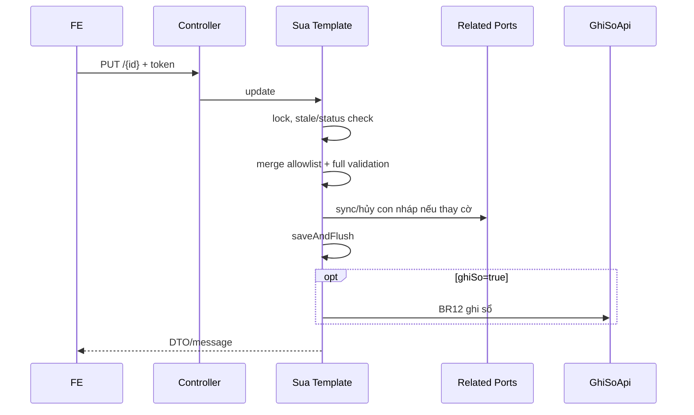

# F04 — Kế hoạch API Chỉnh sửa Chứng từ bán hàng

> **Trạng thái:** BẢN NHÁP CHỜ REVIEW · **Ngày:** 2026-08-07

| Mục | Nội dung |
|---|---|
| Use case | PMKT-U-06403/06404/06405/06983 |
| Màn hình | `SCR_CTBH_CapNhat`, tham chiếu toàn bộ Thêm mới |
| API | `PUT /api/ban-hang/chung-tu-ban-hang/{id}` |

## 0. Quyết định

| # | Quyết định | Hệ quả |
|---|---|---|
| D1 | Dùng chung business template với tạo mới | Không sao chép BR; update chỉ khác nạp/merge/lock |
| D2 | Counter/FK/status/audit là server-owned | Request update không được ghi đè |
| D3 | Optimistic token bắt buộc | Chặn ghi đè form cũ; thống nhất một token wire |
| D4 | Sửa và ghi sổ là một request/transaction | `.Edit + .Post`, rollback toàn bộ |
| D5 | Sửa và lập HĐ/PXK serialize trên cùng khóa CTBH | Không giảm SL dưới counter do race |

## 1. Phạm vi

Nạp dữ liệu; sửa header/dòng/tùy chọn; thêm-xóa-sắp dòng; lưu nháp/lưu & ghi; validation như F03; đồng bộ chứng từ con nháp; lock/concurrency. Ngoài phạm vi: sửa CT đã ghi (phải bỏ ghi), sửa trực tiếp chứng từ con đã ghi, UI confirm đóng form.

## 2. Hiện trạng

- `ChungTuBanHangController.java:138-147` override PUT, message `_002/_004`.
- `ChungTuBanHangCrudService.java:113-116` ủy quyền `SuaChungTuBanHang`.
- `SuaChungTuBanHang.java:25-...` nạp/merge và chặn đã ghi; `BanHangSupport.java:119` có stale check.
- `LuuChungTuBanHangTemplate.java` dùng chung quyền/validate/lưu/định khoản nhưng bị blocker hook base F03.
- Entity có `@Version` ở base; `touch()` ở `Luu...:113-119` để tăng version khi chỉ đổi dòng.

DB không cần bảng update riêng; phụ thuộc migration snapshot/nguồn HĐ F03.

## 3. Kiến trúc/lựa chọn

```text
PUT → CrudService.update → SuaChungTuBanHang
 → lock + merge existing aggregate
 → LuuChungTuBanHangTemplate chung
```

| | A — thay toàn aggregate từ request | **B — merge allowlist (chọn)** |
|---|---|---|
| Server-owned field | dễ mất counter/link | giữ nguyên |
| Dòng | đơn giản | đối chiếu ID/ownership |
| Rủi ro | mất dữ liệu liên kết | mapper phức tạp |
| Chốt | — | unit test field-by-field |

Không chọn A vì request hiện không mang đầy đủ counter/FK; xóa rồi tạo lại dòng sẽ làm gãy liên kết line-level BR17.

## 4. Contract

Request giống F03, bổ sung `updatedAt` hoặc `phienBan`, và `chiTiet[].id` cho dòng cũ. Chọn `phienBan` làm token chuẩn nếu FE hỗ trợ; tạm giữ `updatedAt` tương thích và deprecate có lộ trình, không yêu cầu cả hai.

Response `_002`/`NHAP` hoặc `_004`/`DA_GHI_SO`; 409 stale, `_016` đã ghi, lỗi F03. Thiếu `.Post` khi `ghiSo=true` trả 403 dù có `.Edit`.

## 5. Mapping/merge

| Nhóm | Cho client sửa | Quy tắc |
|---|:---:|---|
| Header/tab/tiền/chi tiết nhập | Y | validate/tính lại |
| ID CT, tenant, audit, status | N | giữ entity |
| Counter, FK HĐ/PXK/PT | N | chỉ port F09 cập nhật |
| ID dòng cũ | tham chiếu | phải thuộc đúng CTBH/tenant |
| Dòng mới | Y | ID null; server cấp |
| Dòng bị bỏ | có điều kiện | cấm nếu đã tham chiếu |

## 6. Validation đặc thù update

- Status phải cho phép sửa; lock token khớp.
- `soLuongMoi >= max(daXuatHd, daXuatKho)` từng dòng.
- Không xóa dòng có liên kết/counter >0; không chuyển thành ghi chú/dịch vụ để né counter.
- Đổi true→false cờ sinh con chỉ khi con nháp thuộc vòng đời CTBH và port hủy thành công.
- `daLapHoaDon` do hệ thống tích thì disable theo nguồn HĐ; do người dùng tích được sửa.
- Sau merge chạy lại toàn bộ F03, tổng, trạng thái, định khoản.

## 7. Luồng khó: thay đổi dòng

Map dòng bằng ID, không bằng mã hàng/STT. Dòng cùng mã có thể khác kho/đơn giá. Sắp thứ tự chỉ đổi `stt`; orphan removal chỉ sau khi policy xác nhận không tham chiếu.

## 8. Luồng khó: concurrency

Update và `apDungHoaDon/apDungPhieuXuat` dùng cùng advisory/pessimistic lock theo CTBH. `@Version` là lớp chặn thứ hai. Port counter phải `touch()` header để phiên bản đổi.

## 9. Migration

Không migration riêng ngoài F03/F09. Nếu chọn `phienBan` wire thì cột đã có từ base; không tạo token thứ hai. Rà index/foreign key line source để chặn xóa dòng được tham chiếu.

## 10. Rủi ro

| # | Rủi ro | Mức | Giảm thiểu |
|---|---|---|---|
| R1 | Mapper xóa/recreate dòng làm gãy FK | Cao | merge ID + FK restrict + test |
| R2 | Race với lập HĐ/PXK | Cao | cùng khóa CTBH |
| R3 | Hai optimistic token gây mơ hồ | TB | chốt một token, deprecate |
| R4 | Đồng bộ con nháp thất bại | Cao | transaction mandatory/rollback |

## 11. BA xác nhận

| # | Vấn đề | Bằng chứng | Tạm xử lý |
|---|---|---|---|
| Q1 | Khi bỏ cờ lập kèm, xóa hay tách con nháp? | UC chỉ nói sửa đầy đủ, không mô tả vòng đời con | xóa mềm con thuộc CTBH, chặn con đã dùng |
| Q2 | Token stale hiển thị `_105` hay mã core? | `6.messages` có `_105`; code stale đang messageId null | map `_105` |
| Q3 | Checkbox HĐ hệ thống tích có sửa được? | BR15 mục 4 nói không; schema chưa lưu nguồn | enum nguồn như F02 |

## 12. Luồng



## 13. Quy ước

ID dòng là identity ổn định; client không gửi tenant/audit/counter. Lỗi API rollback DB nhưng FE giữ request form. Enum/tiền/rounding dùng chung F03.

## 14. Message

`_002`, `_004`, `_007`, `_008/_010`, `_016`, `_017`, `_105` và toàn bộ validation F03.

## 15. Test

Unit merge field/dòng/status/source; IT stale, hai update đồng thời, update vs lập HĐ/PXK, xóa dòng tham chiếu, lưu&ghi rollback, RLS. Chạy unit/build chuẩn.

## 16. Bàn giao

Update request/mapper merge/policy dòng, `SuaChungTuBanHang`, related ports, tests, Postman update happy/error/concurrency.

## 17. Thứ tự

Hoàn tất F03/base → chốt token/source → mapper merge → policy dòng → sync con → concurrency/E2E → docs.

## 18. DoD

- [ ] Không sửa CT đã ghi; stale/race bị chặn.
- [ ] Không mất counter/link/ID dòng; SL không dưới counter.
- [ ] Lưu & ghi nguyên tử; con nháp đồng bộ đúng.
- [ ] Test/security/audit/OpenAPI hoàn tất.

## 19. Tham chiếu

`UC_CTBH_ChinhSua.md`, `SCR_CTBH_CapNhat.md`, `SCR_CTBH_ThemMoi.md` BR15/17; `SuaChungTuBanHang`, `LuuChungTuBanHangTemplate`, `BanHangSupport`, base version entity.

