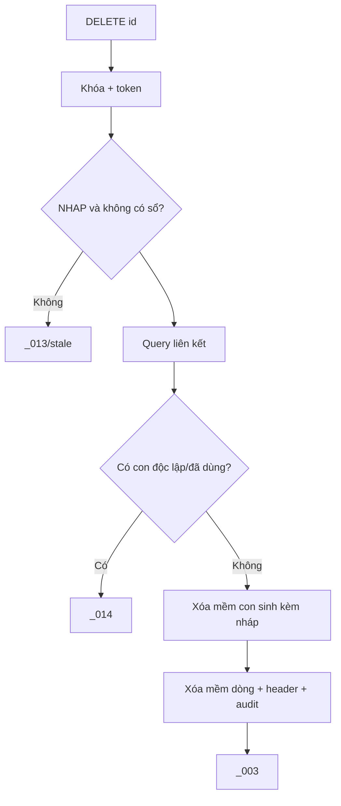

# F05 — Kế hoạch API Xóa Chứng từ bán hàng

> **Trạng thái:** BẢN NHÁP CHỜ REVIEW · **Ngày:** 2026-08-07

| Mục | Nội dung |
|---|---|
| Use case | PMKT-U-06406/06407/06408/06984 |
| Màn hình | Danh sách + `SCR_CTBH_PopupXacNhanXoa` |
| API | `DELETE /{id}`, `POST /xoa-hang-loat` |

## 0. Quyết định

| # | Quyết định | Hệ quả |
|---|---|---|
| D1 | Xóa mềm header, dòng và con thuộc vòng đời | Giữ audit; không hard delete |
| D2 | Phân biệt con “sinh kèm” và chứng từ “lập sau” | Sinh kèm nháp có thể cascade; lập sau thì chặn |
| D3 | Batch lỗi từng phần theo base | Mỗi ID một transaction, response chi tiết |
| D4 | API kiểm lại mọi điều kiện | FE disable không phải hàng rào nghiệp vụ |
| D5 | Xóa đơn dùng optimistic token | Chặn xóa dữ liệu vừa thay đổi |

## 1. Phạm vi

Xóa đơn/hàng loạt, popup result, trạng thái/quyền/liên kết, cascade con tự sinh, audit/RLS. Ngoài phạm vi: phục hồi bản ghi đã xóa, purge vật lý, xóa HĐ/PXK/PT độc lập.

## 2. Hiện trạng

- `BaseCrudController.java:155-164` có DELETE body token.
- `BaseChungTuController.java:177-183` có batch delete.
- `HangLoatChungTuService.java:54-87` xử lý từng phần, không transaction ngoài vòng.
- `XoaChungTuBanHang.java:56-88` khóa/check status-liên kết, đánh xóa CTBH+dòng.
- `TrangThaiBanHang.java:117-137` suy luận “đã dùng” từ counter/UUID; chưa đọc vòng đời/trạng thái con.
- Khoảng trống: UC dòng 108 yêu cầu xóa mềm con tự sinh, code chưa làm.

DB soft-delete có sẵn; cần cột `origin/nguon_lien_ket` ở chứng từ con hoặc bảng liên kết F09 để phân biệt ownership.

## 3. Kiến trúc

```text
DELETE/batch → CrudService.delete
 → XoaChungTuBanHang extends ChungTuTemplate
 → ChungTuLienQuanQuery/DeletePort
 → soft-delete aggregate + audit
```

| | A — dựa UUID/counter CTBH | **B — query port + origin (chọn)** |
|---|---|---|
| Biết trạng thái con | không | có |
| Cascade đúng owner | không | có |
| Coupling | thấp nhưng sai | port công khai |
| Rủi ro | chặn/xóa nhầm | cần schema origin |

## 4. Contract

### A1 — `DELETE /{id}`

Quyền `.Delete`; body `{"updatedAt":"..."}` trong giai đoạn tương thích, chuyển về token chuẩn F04. Thành công `ApiResponse<Void>`, `_003`.

Lỗi: 403 `_007`; 404 `_012`/`_011` cần chốt một mã cho delete; 409 `_013` đã ghi, `_014` đã dùng, stale `_105`; hệ thống `_015` chỉ ở UI/handler.

### A2 — `POST /xoa-hang-loat`

```jsonc
{"ids":["uuid-1","uuid-2"]}
```

Response: `{thanhCong,thatBai,loi:[{id,soChungTu,code,messageId,message}]}`. Chuẩn hóa duplicate ID; giới hạn batch constant. Thiếu lựa chọn là bean validation, không chạy vòng rỗng thành “thành công”.

## 5. Dữ liệu và điều kiện

| Điều kiện | Nguồn | Kết quả |
|---|---|---|
| status `NHAP` | header | cho bước tiếp |
| có sổ cái | `SoCaiApi` đối soát base | chặn lệch |
| con lập sau/tham chiếu | query port | `_014` |
| con sinh kèm nháp | origin + status | xóa mềm cùng transaction |
| con sinh kèm đã ghi | status con | chặn/đòi bỏ ghi theo BA |

## 6. Batch

FE có thể disable nếu selection chứa dòng bất hợp lệ theo UC, nhưng API vẫn xử lý từng phần để chống stale/race. Không transaction bao toàn batch; một dòng lỗi không rollback dòng đã thành công.

## 7. Cột khó: `daSuDung`

Không lưu boolean dễ stale. Tính từ liên kết hiệu lực: HĐ/PXK/PT lập sau, tham chiếu khác, counter ngoài phần tự sinh. Chọn query port thay vì boolean materialized; nếu hiệu năng list cần metadata, projection riêng có cơ chế cập nhật transaction.

## 8. Cascade

Thứ tự: khóa CTBH → đọc con → xóa mềm con tự sinh nháp → dòng CTBH → header → audit. Nếu bất kỳ con lỗi, rollback. Không xóa con `EXTERNAL/CREATED_LATER`.

## 9. Migration

Thêm/chuẩn hóa `origin` và FK nguồn ở module con/F09; index nguồn + `da_xoa`. Không thêm cascade `ON DELETE CASCADE` vật lý. Quyền `.Delete` đã seed V10.

## 10. Rủi ro

| # | Rủi ro | Mức | Giảm thiểu |
|---|---|---|---|
| R1 | Xóa nhầm chứng từ độc lập | Cao | origin + port + tests |
| R2 | Batch rất lớn giữ tài nguyên | TB | max size, từng transaction |
| R3 | ID lặp xử lý hai lần | TB | distinct giữ thứ tự |
| R4 | Link xuất hiện sau lúc FE disable | Cao | khóa và recheck server |

## 11. BA xác nhận

| # | Vấn đề | Bằng chứng | Tạm xử lý |
|---|---|---|---|
| Q1 | Con sinh kèm nháp có cascade không? | UC dòng 108 nói có; rule liên kết dòng 97-103 nói đã dùng thì chặn | cascade chỉ origin sinh kèm |
| Q2 | Batch disable toàn bộ hay partial | UC AC1/BR nút nói disable; base/ghi sổ dùng partial | UI disable, API partial |
| Q3 | Not found dùng `_011` hay `_012` | messages có cả hai | delete dùng `_012`, detail `_011` |

## 12. Luồng



## 13. Quy ước

Xóa mềm `da_xoa=true`; dữ liệu xóa không xuất hiện search/detail do base specification/repository. Token/batch IDs không mang tenant.

## 14. Message

`_003`, `_007`, `_012`, `_013`, `_014`, `_015`, `_104-106` cho cảnh báo UI/batch; stale `_105`.

## 15. Test

Unit policy origin/link; IT xóa nháp, đã ghi, con nháp/đã ghi/độc lập, stale, tenant, rollback cascade, batch mixed/duplicate/max-size, audit.

## 16. Bàn giao

Policy/query/delete port, origin migration, service delete, batch normalize, tests, Postman đơn/batch.

## 17. Thứ tự

Chốt Q1-Q3 → origin/link F09 → policy test → delete đơn → cascade → batch → E2E/security/docs.

## 18. DoD

- [ ] Chỉ xóa nháp hợp lệ; không xóa nhầm liên kết.
- [ ] Header/dòng/con/audit nhất quán; rollback khi lỗi.
- [ ] Batch partial đúng contract; RLS/quyền/token đúng.
- [ ] Test/OpenAPI/Postman hoàn tất.

## 19. Tham chiếu

`UC_CTBH_Xoa.md`, `SCR_CTBH_PopupXacNhanXoa.md`, `6.messages.md`; `XoaChungTuBanHang`, `TrangThaiBanHang`, `HangLoatChungTuService`, base soft-delete entities.

