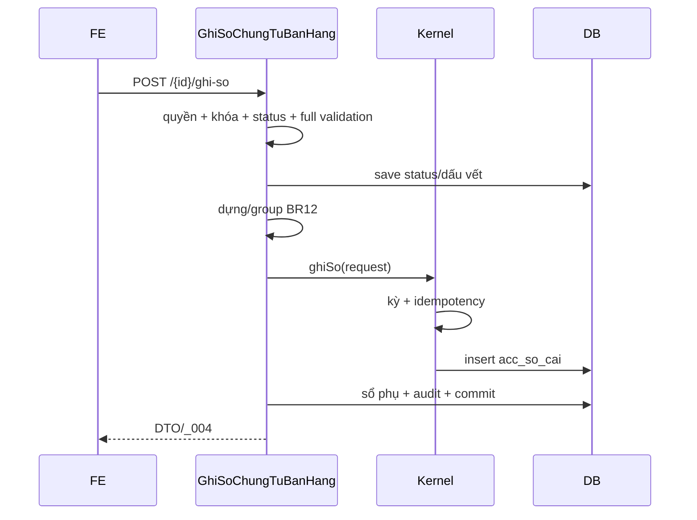

# F06 — Kế hoạch API Ghi sổ Chứng từ bán hàng

> **Trạng thái:** BẢN NHÁP CHỜ REVIEW · **Ngày:** 2026-08-07

| Mục | Nội dung |
|---|---|
| Use case | PMKT-U-06430 — Ghi sổ đơn/hàng loạt |
| Nguồn | `UC_CTBH_GhiSo`, SCR Danh sách/Thêm mới BR12-BR13 |
| Bảng | CTBH, `acc_so_cai`, audit; sổ kho/công nợ/thuế theo owner |

## 0. Quyết định

| # | Quyết định | Hệ quả |
|---|---|---|
| D1 | Mọi ghi sổ qua `ChungTuTemplate`/`GhiSoApi` | Không insert sổ cái tại module |
| D2 | Tính và validate lại từ DB trước ghi | Không tin số tổng lưu bởi phiên bản cũ |
| D3 | Ghi sổ đơn idempotent dưới khóa CT | Không phát sinh bút toán đôi |
| D4 | Batch lỗi từng phần, từng transaction | Một CT lỗi không kéo đổ cả mẻ |
| D5 | Một owner cho giá vốn và thu tiền | Tránh CTBH + PXK/PT cùng ghi một nghiệp vụ |

## 1. Phạm vi

API đơn, batch, lưu&ghi từ F03/F04; validate; 7 nhóm BR12; kỳ khóa, khóa đồng thời, sổ phụ, audit, rollback và message. Ngoài phạm vi: thuật toán tính giá kho cuối kỳ; nhưng hook cập nhật bút toán sau tính giá phải có owner/ticket.

## 2. Hiện trạng

> **Cập nhật 2026-08-10.** Mục này đã được đối chiếu lại với code sau đợt refactor định khoản
> ngày 2026-08-09.

- `BaseChungTuController.java:90-108,153-174` có endpoint/quyền đơn và batch.
- `GhiSoChungTuBanHang` nạp, tính, validate, đổi trạng thái (`truocKhiLuu`), dựng định khoản
  (`sauKhiLuu` — phải sau vì định khoản cần id dòng chi tiết).
- **Định khoản nay khai báo bằng dữ liệu, không còn vòng lặp trong module.** Kernel
  `TaoDinhKhoanApi.taoDoiTuongSoCai(maLoaiChungTu, dongChiTiet)` ghép cặp Nợ/Có, bỏ qua nghiệp vụ
  thiếu tài khoản, đảo chiều cho số âm và gộp cặp trùng **trong phạm vi từng dòng**;
  `QuyTacBanHang implements BoQuyTacButToan` khai 7 quy tắc BR12 dưới dạng
  `(nghiệp vụ, vai trò Nợ, vai trò Có)`; `DinhKhoanBanHang` chỉ còn phần bán hàng — dòng có những
  `VaiTroTaiKhoan` nào và nghiệp vụ nào phát sinh bao nhiêu tiền.
- ✅ Hook `truocKhiLuu` **đã sửa** — gọi một lần từ `ChungTuTemplate.luuChungTu()` (`:418`),
  dùng chung cả 5 luồng. Rủi ro R1 dưới đây đã đóng.
- `HangLoatChungTuService.java:15-28,44-87` đúng chính sách partial.
- Chưa có kernel kho/module con đầy đủ; nguy cơ owner trùng — xem Q1/Q2 §11.

## 3. Kiến trúc

```text
POST ghi-so → CrudService → GhiSoChungTuBanHang
 → lock/validate/save status
 → DinhKhoanBanHang (vai trò TK + số tiền theo nghiệp vụ)
     → TaoDinhKhoanApi + QuyTacBanHang (bảng BR12 dạng dữ liệu)
 → GhiSoApi → acc_so_cai → audit/commit
```

| | A — module tự ghi SQL sổ | **B — kernel base (chọn)** |
|---|---|---|
| Kỳ/idempotency/lock | tự làm, dễ lệch | dùng chung |
| Audit/transaction | phân tán | template cưỡng chế |
| Rủi ro | sai sổ | base ảnh hưởng rộng |
| Chốt | — | test kernel + module |

## 4. Contract

| # | API | Quyền | Response |
|---|---|---|---|
| A1 | `POST /{id}/ghi-so` | `.Post` | DTO, `_004` |
| A2 | `POST /ghi-so-hang-loat` body `{ids}` | `.Post` | `KetQuaHangLoatDto`, `_108` |
| A3 | `POST /` hoặc `PUT /{id}` với `ghiSo=true` | `.Create/.Edit + .Post` | DTO nguyên tử |

A1 không cần body; nếu cần chống form cũ, bổ sung token có versioning API, không tự ý đổi contract base. A2 trả 200 dù có dòng lỗi vì lỗi là dữ liệu popup; request sai schema/quyền vẫn 4xx.

## 5. Mapping BR12

| # | Nợ/Có | Nguồn tiền | Điều kiện |
|---|---|---|---|
| 1 | 131 / doanh thu | thành tiền QĐ | dương, không CKTM |
| 2 | TK CK / 131 | CK QĐ | >0 |
| 3 | doanh thu / 131 | trị tuyệt đối CKTM | dòng CKTM |
| 4 | 131 / thuế GTGT | GTGT QĐ | trong nước, >0 |
| 5 | doanh thu / thuế XK | thuế XK QĐ | xuất khẩu |
| 6 | giá vốn / kho | tiền vốn QĐ | kiêm PXK, dòng hợp lệ |
| 7 | tiền / 131 | phải thu QĐ | thu ngay, theo owner Q2 |

Mapping chung ngày/số/tenant/tài khoản/nguồn theo `TaiLieuMappingSoCai.md`; group cùng cặp nhưng giữ `chiTietChungTuId`/metadata cần truy vết.

**Bảng trên nay là bản dịch của `QuyTacBanHang.QUY_TAC` sang ngôn ngữ BA — sửa mapping thì sửa ở
đó, không sửa rải trong `DinhKhoanBanHang`.** Cột "Điều kiện" không được khai ở quy tắc: nó thể hiện
bằng việc `DinhKhoanBanHang` **có nạp số tiền** cho nghiệp vụ đó hay không (nghiệp vụ 0 tiền tự bị
bỏ qua). Riêng #7 nạp tiền **có dấu** để bộ sinh tự đảo Nợ/Có khi phải thu âm; các nghiệp vụ khác
chỉ nạp khi dương. Gộp cặp trùng chỉ diễn ra **trong một dòng chi tiết** — BR36 cấm gộp giữa các dòng.

## 6. Validation

Status nháp; đủ field; ngày/kỳ; danh mục/TK cấp cuối; số CT/HĐ; CK/thuế; counter; tồn kho; chứng từ con. Kernel kiểm kỳ ngay trước insert. Không bỏ validation chỉ vì chứng từ đã lưu.

## 7. Trạng thái/dấu vết

`ct.ghiSo()` đặt `DA_GHI_SO`, `nguoiGhiSo`; lifecycle đóng `thoiGianGhiSo`. Status chỉ commit nếu sổ/sổ phụ thành công. Sau ghi, update/delete bị chặn.

## 8. Batch

Distinct IDs, max size constant; nạp số CT trước; gọi service qua proxy từng ID. Không đặt `@Transactional` ngoài vòng. Runtime exception được log, response không lộ nội bộ.

## 9. Migration/quyền

Không migration riêng cho sổ cái. Bảo đảm mã loại CTBH/quyển số/cấu hình loại CT tồn tại; `.Post` đã seed V10. Nếu sổ phụ cần outbox/bảng liên kết, migration thuộc owner và phải giữ transaction semantics đã duyệt.

## 10. Rủi ro

| # | Rủi ro | Mức | Giảm thiểu |
|---|---|---|---|
| ~~R1~~ | ~~hook base chết~~ | ✅ **đã đóng** | `ChungTuTemplate.luuChungTu():418` gọi một lần cho cả 5 luồng |
| R2 | ghi đôi giá vốn/thu tiền | Cao | BA/architect chốt owner |
| R3 | batch vô tình chung transaction | Cao | proxy + test mixed result |
| R4 | dữ liệu cũ tính lại khác | TB | report/dry-run trước release |

## 11. BA xác nhận

| # | Vấn đề | Mâu thuẫn | Tạm xử lý |
|---|---|---|---|
| Q1 | Giá vốn do CTBH hay PXK | BR21 CXM; UC nói cập nhật kho | **Đã có đề xuất — chờ BA duyệt: PXK sở hữu.** Chi tiết và lập luận ở [00-ke-hoach-tong.md](00-ke-hoach-tong.md) §8 Q4. ⚠️ lệch BR12 |
| Q2 | Thu ngay do CTBH hay Phiếu thu ghi | BR12 #7 đồng thời nói sinh phiếu thu | **Đã có đề xuất — chờ BA duyệt: phiếu thu sở hữu**, CTBH luôn ghi Nợ 131. Chi tiết ở §8 Q4b. ⚠️ lệch BR12 #7 |
| Q3 | Lưu nháp trong kỳ khóa có chặn | template comment nói chặn; UC ghi validate khi ghi | giữ hành vi base, BA xác nhận |

## 12. Luồng



## 13. Quy ước

Sổ cái luôn tiền hạch toán; nguyên tệ đi metadata. Không sinh dòng tiền 0. Bỏ trống định khoản bắt buộc là lỗi ghi sổ, không lặng lẽ bỏ qua như preview.

## 14. Message

`_004`, `_007/_008/_010`, `_020`, `_021`, `_035`, `_042-046`, `_101-103`, `_107`, `_108`.

## 15. Test

Unit từng nhóm/group/ngoại tệ/trạng thái; IT sổ thật, kỳ khóa, double-click/đồng thời, rollback sổ phụ, batch mixed, RLS/audit. Chạy unit/build chuẩn.

## 16. Bàn giao

PR base, service/định khoản/validation, owner adapters, batch guard, tests, Postman đơn/batch/lưu&ghi.

## 17. Thứ tự

Chốt Q1-Q3 → sửa base → pin BR12 tests → owner sổ phụ → đơn → concurrency → batch → E2E/docs.

## 18. DoD

- [ ] Status/sổ/sổ phụ/audit nguyên tử; không ghi đôi.
- [ ] 7 nhóm đúng mapping; kỳ/quyền/idempotency đúng.
- [ ] Batch partial đúng; test/OpenAPI/Postman xanh.

## 19. Tham chiếu

`UC_CTBH_GhiSo.md`, SCR BR12/13/21, `TaiLieuMappingSoCai.md`; `GhiSoChungTuBanHang`, `DinhKhoanBanHang`, `ChungTuTemplate`, `GhiSoApi`, `HangLoatChungTuService`.

