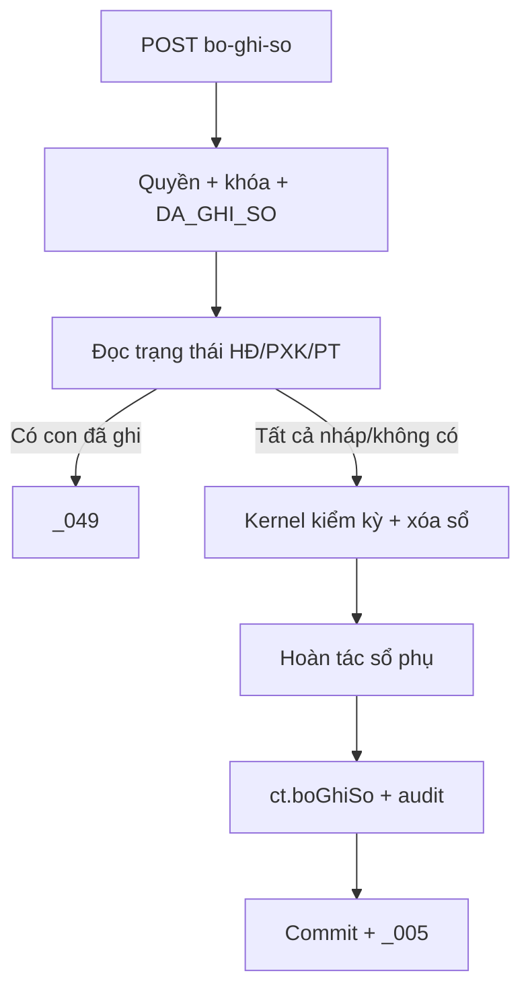

# F07 — Kế hoạch API Bỏ ghi sổ Chứng từ bán hàng

> **Trạng thái:** BẢN NHÁP CHỜ REVIEW · **Ngày:** 2026-08-07

| Mục | Nội dung |
|---|---|
| Use case | PMKT-U-06431 |
| API | `POST /{id}/bo-ghi-so`, `POST /bo-ghi-so-hang-loat` |
| Bảng | CTBH, `acc_so_cai`, sổ phụ, liên kết con, audit |

## 0. Quyết định

| # | Quyết định | Hệ quả |
|---|---|---|
| D1 | Kernel xóa vật lý dòng sổ; CTBH vẫn soft lifecycle | Dùng `GhiSoApi.boGhiSo`, kiểm kỳ từng dòng |
| D2 | Chỉ chặn khi con liên quan **đã ghi sổ** | Có liên kết nháp vẫn bỏ ghi được theo UC |
| D3 | Không reset counter/link | Bỏ ghi không hoàn tác HĐ/PXK đã thực hiện |
| D4 | Batch partial từng transaction | Giống F06 |

## 1. Phạm vi

Bỏ ghi đơn/batch; kiểm quyền/status/kỳ/con; xóa sổ cái, hoàn tác sổ phụ, đổi status/dấu vết, audit/rollback. Ngoài phạm vi: xóa con, reset counter, tự mở kỳ.

## 2. Hiện trạng

- Base controller endpoint ở `BaseChungTuController.java:101-108,168-175`.
- `BoGhiSoChungTuBanHang.java:58-118` đã đổi status và dùng template kernel.
- Lỗi hiện tại `:78-96`: chỉ cần có UUID liên kết là ném `_049`, không đọc trạng thái thật; trái UC AC2.
- `ChungTuTemplate.java:227-248` đúng thứ tự xóa sổ trước đổi trạng thái. ✅ Hook `truocKhiLuu` **đã sửa** (2026-08-10) — gọi một lần từ `luuChungTu():418`; PR base đã hoàn tất.

## 3. Kiến trúc

```text
Controller → BoGhiSo template
 → RelatedStatusQueryPort
 → GhiSoApi.boGhiSo
 → owner ports hoàn tác sổ phụ
 → ct.boGhiSo + audit
```

Chọn query port thay vì dựa UUID CTBH: UUID chỉ chứng minh có liên kết, không chứng minh `DA_GHI_SO`. Không import repository internal con.

## 4. Contract

A1 `POST /{id}/bo-ghi-so`, quyền `.Unpost`, response DTO `_005`. A2 batch body `{ids}`, quyền `.Unpost`, response counts/errors; 200 với mixed result. Lỗi `_023` chưa ghi, `_049` con đã ghi, `_022` hệ thống, kỳ khóa dùng mã kernel chuẩn.

## 5. Điều kiện/mapping

| Kiểm | Nguồn | Xử lý |
|---|---|---|
| CTBH `DA_GHI_SO` | header | nếu không `_023` |
| HĐ/PXK/PT liên quan | query port | bất kỳ `DA_GHI_SO` → `_049` |
| kỳ của từng dòng sổ | kernel | khóa → chặn |
| sổ phụ owner | ports | phải hoàn tác thành công |

## 6. Trạng thái sau thành công

`status=NHAP` (hoặc trạng thái duyệt theo base nếu áp dụng), xóa người/thời gian ghi sổ; `acc_so_cai` không còn dòng nguồn; counter/link/snapshot giữ nguyên; version tăng.

## 7. Luồng khó: sổ phụ

Owner nào tạo tác động thì owner đó hoàn tác. Nếu sổ công nợ/thuế là view từ sổ cái thì không ghi bù; nếu là bảng vật hóa phải port rollback trong cùng transaction. Không “sửa trạng thái rồi gửi event best-effort”.

## 8. Batch

Giống F06: distinct/max size, số CT preload, từng proxy transaction. CT đã nháp là lỗi riêng, không làm dừng vòng.

## 9. Migration

Không migration CTBH; F09 phải cung cấp trạng thái con/index nguồn. Quyền `.Unpost` đã seed V10. Nếu audit cần action code, dùng hằng base hiện có, không seed message.

## 10. Rủi ro

| # | Rủi ro | Mức | Giảm thiểu |
|---|---|---|---|
| R1 | Chặn nhầm mọi liên kết | Cao | query status port |
| R2 | Xóa sổ nhưng hoàn tác phụ lỗi | Cao | một transaction + fault IT |
| R3 | Reset counter làm cho xuất trùng | Cao | pin test D3 |
| R4 | Kỳ khóa nhiều ngày dòng | TB | để kernel kiểm từng dòng |

## 11. BA xác nhận

| # | Vấn đề | Bằng chứng | Tạm xử lý |
|---|---|---|---|
| Q1 | Liên kết nháp có cho bỏ ghi? | UC AC2 nói tất cả con chưa ghi thì cho; code đang chặn | cho phép |
| Q2 | CT đã bỏ ghi có được sửa SL dưới counter? | BR17 mục 9 nói không | chặn ở F04 |
| Q3 | Batch popup khi tất cả thành công | SCR danh sách nói không cảnh báo | API luôn trả data, FE tự ẩn popup |

## 12. Luồng



## 13. Quy ước

Xóa dòng sổ vật lý theo quyết định kernel; không tạo bút toán đảo. Counter theo nghiệp vụ thực hiện, không theo status ghi sổ CTBH.

## 14. Message

`_005`, `_007`, `_022`, `_023`, `_049`; lỗi kỳ/sổ lệch dùng mã base/kernel có tài liệu.

## 15. Test

Unit policy trạng thái con; IT không link/link nháp/từng con đã ghi, kỳ khóa, rollback sổ phụ, counter giữ nguyên, concurrent, batch mixed, RLS/audit.

## 16. Bàn giao

Related status port, sửa `BoGhiSoChungTuBanHang`, owner rollback ports, tests, Postman đơn/batch.

## 17. Thứ tự

Chốt Q1-Q3/owner → F09 port → sửa policy → đơn + fault tests → batch → docs.

## 18. DoD

- [ ] Chỉ con đã ghi mới chặn; link/counter giữ đúng.
- [ ] Sổ chính/phụ/status/audit nguyên tử.
- [ ] Batch/quyền/kỳ/RLS/test/OpenAPI hoàn tất.

## 19. Tham chiếu

`UC_CTBH_BoGhiSo.md`, SCR BR13/17, `6.messages.md`; `BoGhiSoChungTuBanHang`, `ChungTuTemplate`, `GhiSoApi`, `BaseChungTuEntity`.

