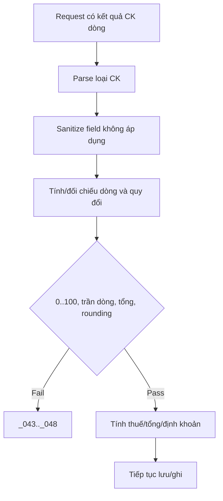

# F08 — Kế hoạch xử lý Chứng từ bán hàng có Chiết khấu

> **Trạng thái:** BẢN NHÁP CHỜ REVIEW · **Ngày:** 2026-08-07

| Mục | Nội dung |
|---|---|
| Chức năng | PMKT-U-06966, BR03/BR11, PBCK/PBCK_MHHD |
| API | Không tạo API popup; dùng request F03/F04 và preview nếu BA yêu cầu |
| Bảng | Header/dòng CTBH, không tạo bảng phân bổ mặc định |

## 0. Quyết định

| # | Quyết định | Hệ quả |
|---|---|---|
| D1 | Popup phân bổ là FE, BE xác minh kết quả | Không thêm endpoint stateful |
| D2 | Tổng header server tính lại | Client total chỉ dùng đối chiếu `_046` |
| D3 | Dọn field không thuộc loại CK | Đổi loại không rò dữ liệu cũ |
| D4 | CK mặt hàng áp trước CK hóa đơn | Thuế/tổng/định khoản theo đúng cơ sở |
| D5 | Dùng `SoTien` chung cho scale/rounding | Dòng cuối nhận sai số theo quy tắc chốt |

## 1. Phạm vi

Năm loại CK, dòng CKTM, phân bổ theo SL/giá trị/thủ công, ngoại tệ, validation `_043-048`, thuế sau CK, định khoản #2/#3. Ngoài phạm vi: UX popup; lưu lịch sử lần phân bổ nếu BA không yêu cầu audit allocation.

## 2. Hiện trạng

- `LoaiChietKhau`, request/detail đã có phần lớn field.
- `TinhToanBanHang.java:138-...` cố ý không cài 5 thuật toán popup, nhận kết quả dòng.
- `KiemTraBanHang.java:259-264` validation tổng CKTM **vẫn đang tắt** (marker `TAM-TAT-VALIDATE-DE-TEST`, kiểm lại 2026-08-10); `:274-…` có mức dòng.
- Bút toán CK/CKTM nay khai ở `QuyTacBanHang.QUY_TAC` (nghiệp vụ #2 và #3); `DinhKhoanBanHang` chỉ nạp số tiền. Nghiệp vụ #3 dùng **chung cặp vai trò** với #1 nhưng ngược chiều — sửa một trong hai phải kiểm lại cái kia.
- Request hiện không mang tỷ lệ phân bổ popup, nên BE không chứng minh được `_047/_048` nếu chỉ nhận số tiền cuối.

## 3. Kiến trúc/lựa chọn

| | A — endpoint phân bổ lưu state | **B — hàm FE + validator BE (chọn)** |
|---|---|---|
| Latency/UX | nhiều roundtrip | tức thời |
| Audit thuật toán | có | chỉ audit kết quả |
| Consistency | server quyết định | cần validator chặt |
| Rủi ro | session/rác | FE/BE rounding lệch |
| Chốt | — | công thức/scale contract + golden tests |

Nếu BA yêu cầu BE tính preview chuẩn tuyệt đối, thêm endpoint thuần `POST /chiet-khau/preview` không ghi DB, dùng cùng calculator; không tạo session phân bổ.

## 4. Contract dữ liệu

F03/F04 nhận `loaiChietKhau`, `giaTriChietKhau`, `tongTienChietKhau`; dòng nhận `%/tiền CK`, nhóm CK hàng/HĐ và quy đổi. Với loại không áp dụng, field bị dọn về 0/null.

Preview tùy chọn trả các dòng phân bổ và totals, quyền `.View`/`.Create` cần chốt; không thuộc contract release nếu BA không yêu cầu.

## 5. Ma trận loại CK

| Loại | Input chuẩn | Server kiểm/tính |
|---|---|---|
| Không | không | mọi CK=0 |
| Theo mặt hàng | `%` hoặc tiền dòng | 0..100, tiền ≤ thành tiền dòng thường |
| Theo % HĐ | `giaTriChietKhau` | tổng mục tiêu và phân bổ dòng |
| Theo tiền tổng | tổng tiền | tổng dòng = mục tiêu |
| Theo mặt hàng và HĐ | hai nhóm dòng | CK HĐ trên sau CK hàng |

## 6. Phân bổ/rounding

Theo số lượng: trọng số SL; theo giá trị: thành tiền phù hợp; thủ công: người dùng nhập. Bỏ dòng ghi chú và dòng không đủ điều kiện theo BA. Tổng phần được làm tròn phải bằng mục tiêu; sai số gán dòng hợp lệ cuối cùng theo thứ tự `stt`, không gán dòng 0/trị giá âm nếu BA không cho.

## 7. Dòng đặc biệt

CKTM có giá trị hạch toán âm và định khoản #3, không đồng thời doanh thu #1. KM/CKTM có CK vượt thành tiền chỉ cảnh báo Yes/No theo BR11.f; BE cho qua khi không có cờ xác nhận, chờ Q2. SL=0 nhưng thành tiền khác 0 vẫn tham gia cơ sở giá trị theo BR18.

## 8. Thuế/định khoản

Cơ sở GTGT sau CK theo BR10/11. CK thường → Nợ TK CK/Có 131; CKTM → Nợ doanh thu/Có 131. Tiền quy đổi dùng tỷ giá và scale chung.

## 9. Migration

Không migration nếu chỉ lưu kết quả hiện có. Nếu cần audit allocation/tỷ lệ `_047/_048`, thêm DTO và bảng/JSON snapshot có lý do; không thêm chỉ để phục vụ popup tạm thời.

## 10. Rủi ro

| # | Rủi ro | Mức | Giảm thiểu |
|---|---|---|---|
| R1 | Validation `_045` đang tắt | Cao | khôi phục + negative tests |
| R2 | FE/BE lệch rounding | Cao | scale contract + golden vectors |
| R3 | Field loại cũ ảnh hưởng tổng | Cao | sanitize theo loại |
| R4 | Không xác minh `_047/_048` | TB | Q1, bổ sung allocation DTO hoặc FE-only rõ |

## 11. BA xác nhận

| # | Vấn đề | Bằng chứng | Tạm xử lý |
|---|---|---|---|
| Q1 | `_047/_048` BE hay FE | messages có mã; request không có tỷ lệ phân bổ | FE-only đến khi có DTO |
| Q2 | Cảnh báo KM/CKTM cần cờ xác nhận BE? | BR11.f là tương tác Yes/No; API một bước | FE xác nhận trước call |
| Q3 | Quy tắc nhận sai số làm tròn | popup mô tả phân bổ nhưng chưa chốt dòng nhận sai số | dòng hợp lệ cuối |

## 12. Luồng

## 13. Quy ước

BigDecimal, không double; scale/rounding qua `SoTien`. `null` và 0 có nghĩa khác ở field người dùng override; header totals không nhận override.

## 14. Message

`_018/_019` legacy cần map/thống nhất với `_043/_044`; `_043-048`, `_203` không có dữ liệu phân bổ. Không tái dùng mã epic khác.

## 15. Test

Golden tests 5 loại × 3 phương thức, rounding, ngoại tệ, SL=0, KM, CKTM, ghi chú, đổi loại; IT lưu/sửa/ghi sổ và message.

## 16. Bàn giao

Calculator/sanitizer/validator, request DTO nếu BA chốt, tests, Postman 5 loại + lỗi; không tạo controller nếu không có preview.

## 17. Thứ tự

Chốt Q1-Q3 → khôi phục validate → contract rounding → sanitizer/calculator → tax/posting tests → E2E/docs.

## 18. DoD

- [ ] Năm loại và phân bổ đúng, tổng/thuế/sổ khớp.
- [ ] Không field rò/validation tắt/lệch rounding.
- [ ] Mã lỗi, test, OpenAPI/Postman đầy đủ.

## 19. Tham chiếu

`SCR_CTBH_ThemMoi.md` BR03/11/12/18, `SCR_CTBH_PBCK*`, matrix popup, `6.messages.md`; `TinhToanBanHang`, `KiemTraBanHang`, `DinhKhoanBanHang`, `SoTien`.

