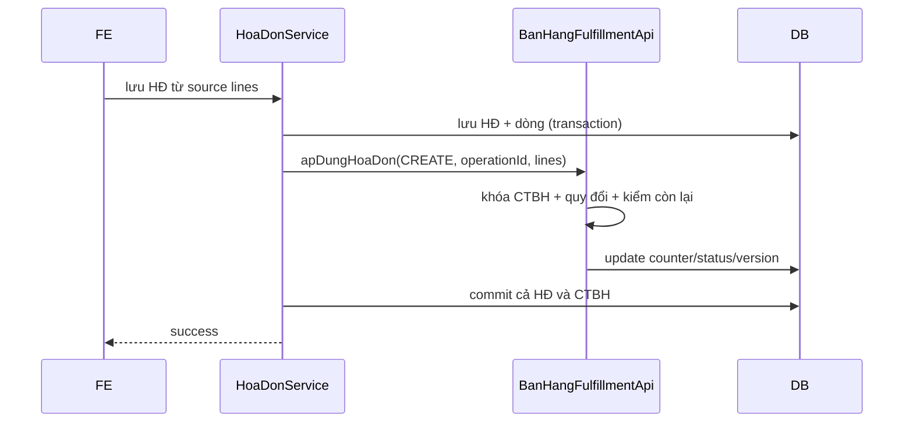

# F09 — Kế hoạch tích hợp Thu tiền, Hóa đơn và Phiếu xuất kho

> **Trạng thái:** BẢN NHÁP CHỜ REVIEW KIẾN TRÚC LIÊN MODULE · **Ngày:** 2026-08-07

| Mục | Nội dung |
|---|---|
| Nguồn | UC Danh sách luồng Thu tiền/HĐ/PXK; Thêm mới; Xóa; Bỏ ghi; BR15/17/21 |
| Module | CTBH + module HĐ bán hàng + PXK + Phiếu thu TM/TG |
| Mục tiêu | auto-fill nguồn, liên kết dòng, counter/status nguyên tử, vòng đời/rollback |

## 0. Quyết định

| # | Quyết định | Hệ quả |
|---|---|---|
| D1 | Mỗi module sở hữu aggregate/repository của mình | Không import package `internal` chéo |
| D2 | Giao tiếp bằng public query/command port | Arch/Modulith test cưỡng chế ranh giới |
| D3 | Liên kết bắt buộc ở line-level | Cùng mã hàng nhiều dòng vẫn cập nhật đúng |
| D4 | ✏️ **Đã thay** — không update counter nữa mà **khóa dòng nguồn** `ORDER BY id FOR UPDATE` rồi cộng từ `ctu_quan_he_chung_tu`; `lienKet` chạy `Propagation.MANDATORY` để khóa sống hết transaction của caller | Chống hai request cùng xuất vượt, không cần hàng nào để update |
| D5 | ✏️ **Đã thay — không có delta.** Sửa dòng đích = sửa bảng chi tiết của nó; liên kết chỉ có `lienKet` / `goLienKet` | Retry không thể cộng đôi vì không có phép cộng nào |
| ~~D6~~ | ❌ **Đã bỏ cột `tu_dong`.** Sự tồn tại của một dòng liên kết **đã** chứng minh có chứng từ con thật; hóa đơn ngoài hệ thống không có liên kết nào | Không cần phân biệt "sinh kèm" và "lập sau" |
| D7 | Thiếu adapter khi option bật là lỗi | Không trả trạng thái “đã đủ” giả |

## 1. Phạm vi

- Nguồn tạo HĐ/PXK/PT từ CTBH; auto-fill; quyền/trạng thái nguồn.
- Tạo kèm trong F03 và tạo sau từ danh sách/detail.
- Cập nhật counter/trạng thái/đã thanh toán khi con create/update/delete.
- Query trạng thái dùng cho action, xóa, bỏ ghi; concurrency/rollback.
- Ngoài phạm vi: UI form module đích, CQT, thuật toán giá kho, nghiệp vụ phiếu thu không từ CTBH.

## 2. Hiện trạng

```bash
rg -n "phieuXuatKhoId|phieuThuId|hoaDonBanHangId|soLuongDaXuat" \
  cell-app/src/main/java/vn/dopai/pmkt/cell/chung_tu_ban_hang
```

> **Cập nhật 2026-08-10.**

- Header có `phieu_xuat_kho_id`, `phieu_thu_id`; dòng có `hoa_don_ban_hang_id` và 2 counter — đều là
  **cột cũ sẽ bỏ ở pha P3**, thay bằng `ctu_quan_he_chung_tu`.
- `TrangThaiBanHang.khoiTaoCounter` nay chỉ đặt 0 (counter giả đã gỡ); `capNhatTrangThai` và
  `daSuDungBoiNghiepVuKhac` vẫn đọc từ counter trong giai đoạn dual-write.
- ✅ **Đã có command API công khai**: `QuanHeChungTuApi` (`lienKet` / `goLienKet` /
  `goToanBoTheoDich` / `daTieuThu` / `theoNguon` / `theoDich` / `coLienKet`) và SPI
  `DongChungTuPort`. **Chưa module nào implement port** ⇒ chưa ai ghi vào bảng.
- Cố ý **không có** `capNhatLienKet`: sửa số lượng là sửa dòng đích, bảng quan hệ không đụng tới —
  nhờ đó không có delta nào để cộng nhầm khi retry.
- `package-info` xác nhận module HĐ/PXK/PT chưa tồn tại; ba cờ tương ứng đang fail-fast.
- BA BR17 dòng 863-870 yêu cầu line link, ĐVT và atomic concurrency; dòng 882-945 mô tả create/update/delete.
- Schema module con có thể tồn tại nhưng tầng Java/owner chưa hoàn chỉnh; phải khảo sát lại tại lúc code.

## 3. Kiến trúc

```text
HĐ/PXK/PT Controller → Service module đích
  → lưu aggregate con
  → BanHangFulfillmentApi (public)
      → khóa CTBH → validate delta → update counter/status/version

CTBH → BanHangSourceQueryApi / ChungTuLienQuanQueryApi
CTBH create-kèm → LapChungTuConPort registry → adapter module đích
```

| | A — gọi REST nội bộ giữa module cùng app | **B — Java port cùng transaction (chọn)** |
|---|---|---|
| Transaction | phân tán/saga | một DB transaction |
| Type safety | wire | compile-time DTO |
| Coupling | URL/auth | interface công khai |
| Rủi ro | partial failure | vòng bean/dependency |
| Chốt | outbox nếu khác service | package API + registry, không import internal |

Nếu module đích chạy service khác, D4 phải thay bằng outbox/saga/idempotency được kiến trúc duyệt; không giả định `@Transactional` xuyên HTTP.

## 4. Contract API/port

### 4.1 REST nguồn cho FE

| # | Method/path | Quyền | Response |
|---|---|---|---|
| A1 | `GET /{id}/nguon-lap-hoa-don` | `.View.Detail` + capability HĐ | header + dòng còn HĐ |
| A2 | `GET /{id}/nguon-lap-phieu-xuat` | `.View.Detail` + capability PXK | dòng hàng còn kho |
| A3 | `GET /{id}/nguon-thu-tien` | `.View.Detail` + capability thu | phải thu/đã thu/còn lại |

Response nguồn luôn có `sourceVersion` và line ID; module đích không tin số còn lại này khi lưu, chỉ dùng hiển thị.

### 4.2 Public Java ports

```text
BanHangSourceQueryApi.layNguonHoaDon/PhieuXuat/ThuTien(id)
BanHangFulfillmentApi.apDungHoaDon/PhieuXuat/ThanhToan(command)
ChungTuLienQuanQueryApi.trangThaiVaNguon(id)
LapChungTuConPort.hoTro(loai), lap(command)
```

Command fulfillment: `operationId` idempotency, `sourceDocumentId`, `sourceVersion`, `childId`, `origin`, `action CREATE|UPDATE|DELETE`, lines `{sourceLineId, oldQuantity, newQuantity, unitId, conversionFactor}` hoặc amount cũ/mới.

## 5. Mapping liên kết

> ⚠️ **ĐÃ THAY** — mọi quan hệ dưới đây chuyển sang bảng dùng chung `ctu_quan_he_chung_tu`.
> Xem [thiet-ke-quan-he-chung-tu.md](../../done/thiet-ke-quan-he-chung-tu.md).

| Quan hệ | Bản ghi trong `ctu_quan_he_chung_tu` | Số lượng đọc từ | Trạng thái header |
|---|---|---|---|
| HĐ → CTBH | `dong_nguon_id`=dòng CTBH, `dong_dich_id`=dòng HĐ, `loai_chung_tu_dich='SAL_HOA_DON_BAN_HANG'` | `sal_hoa_don_ban_hang_chi_tiet.so_luong` | `trangThaiHoaDon` |
| PXK → CTBH | tương tự, `loai_chung_tu_dich='INV_PHIEU_XUAT_KHO'` | `inv_phieu_xuat_kho_chi_tiet.so_luong_xuat(_quy_doi)` | `trangThaiXuatHang` |
| PT → CTBH | grain mức header (`dong_*` NULL) | tiền trên chính phiếu thu | `trangThaiThanhToan` |

**Bảng quan hệ KHÔNG lưu số lượng** — chỉ lưu quan hệ. Cần số lượng thì đọc từ dòng chi tiết của
chứng từ đích qua `DongChungTuPort` (mỗi module biết tên cột của mình: `so_luong` / `so_luong_xuat` /
`so_luong_tang`). Counter `soLuongDaXuatHd`/`soLuongDaXuatKho` **bị bỏ**.

Ba cột `trangThaiXxx` **giữ lại** vì là cột lọc/sort của màn danh sách F01, tính lại từ aggregate.

Back-pointer đơn trị `hoaDonBanHangId` trên dòng CTBH (`V75:126`) là khiếm khuyết L1 — không đủ cho
nhiều HĐ; deprecate ở pha P3, đọc ngược bằng `theoNguon(...)`.

## 6. Nguồn/filter

- HĐ: chỉ dòng còn `soLuong − đã tiêu thụ > 0` (tính qua bảng quan hệ + port, xem §7); chọn một phần được.
- PXK: chỉ hàng hóa, không dịch vụ/CKTM/ghi chú; KM được giữ theo BR08/21; còn kho >0.
- Thu: CT đã ghi, chưa thanh toán đủ; trả tiền còn lại theo nguyên tệ/quy đổi.
- Mọi query tenant/RLS, soft-delete, status; sort dòng `stt`.

## 7. Nguyên tử — thiết kế lại vì bỏ counter

> ⚠️ Cơ chế cũ (conditional UPDATE trên counter, kiểm `rowcount`) **không dùng được nữa** —
> không còn hàng counter nào để update. Chi tiết ở [thiet-ke-quan-he-chung-tu.md](../../done/thiet-ke-quan-he-chung-tu.md) §6.1.

1. **Khóa dòng nguồn tường minh**: `SELECT id, so_luong FROM <bảng dòng nguồn> WHERE id = ANY(:ids)
   ORDER BY id FOR UPDATE` — sắp tăng dần chống deadlock; khóa mà không ghi hàng là hợp lệ, và là
   điểm serialize duy nhất còn lại. Đi qua SPI `DongChungTuPort`, không import `internal` module khác.
2. Quy đổi old/new về ĐVT dòng nguồn.
3. Tra `ctu_quan_he_chung_tu` theo `dong_nguon_id` → danh sách `dong_dich_id` (index I1), rồi gọi
   `DongChungTuPort.laySoLuong(...)` trên từng bảng đích để cộng.
4. Kiểm `0 <= đã tiêu thụ + lượng mới <= soLuong`; `_102` HĐ, `_103` PXK.
5. `INSERT … ON CONFLICT (U1) DO NOTHING` — U1 `(tenant_id, dong_dich_id)` **chính là idempotency**,
   không cần khóa yêu cầu riêng.
6. Tính lại `trangThaiXxx` header từ aggregate; commit cùng aggregate con.
7. **Sửa số lượng dòng đích không phải đụng bảng quan hệ** — không còn logic delta `-cũ +mới`.

⚠️ Mất `CHECK (counter <= soLuong)` ở DB (hàng rào cuối) — bù bằng job quét vượt nguồn hàng đêm.

## 8. Thanh toán

Delta amount tương tự counter. Không cho âm; vượt tổng phải thu xử lý theo BA (chặn hoặc ghi tiền thừa ở nghiệp vụ khác). Khi sửa/xóa PT, trừ amount cũ rồi cộng mới. Chốt owner bút toán 111/112-131 với F06.

## 9. Migration

- Thêm FK nguồn line trên chi tiết HĐ/PXK nếu thiếu; FK header nguồn/allocation PT.
- Thêm `origin` (`CREATED_WITH_CTBH`, `CREATED_LATER`, `EXTERNAL`) và `operation_id` unique theo tenant/loại.
- Index `(tenant_id, source_ctbh_id, da_xoa)` và source line.
- Backfill liên kết cũ chỉ bằng bằng chứng FK hiện hữu; dữ liệu không xác định → report/manual, không đoán.
- Không cascade vật lý; FK `RESTRICT` bảo vệ line nguồn.

## 10. Rủi ro

| # | Rủi ro | Mức | Giảm thiểu |
|---|---|---|---|
| R1 | Hai request vượt counter | Cao | cùng khóa + conditional/version test |
| R2 | Retry cộng delta hai lần | Cao | operation id/idempotency table |
| R3 | Một field HĐ trên dòng không hỗ trợ 1-n | Cao | quan hệ ở dòng con, deprecate field cũ |
| R4 | Module khác process | Cao | outbox/saga thay transaction giả |
| R5 | Backfill origin sai | Cao | report + BA/manual |

## 11. BA/kiến trúc xác nhận

| # | Vấn đề | Bằng chứng | Tạm xử lý |
|---|---|---|---|
| Q1 | Owner ghi sổ giá vốn/thu tiền | BR12/21 và UC con có khả năng trùng | một owner duy nhất trước E2E |
| Q2 | CTBH nháp có được tạo con nháp | BR15 nói lập khi Lưu; action lập sau đòi CT đã ghi | con nháp chỉ ở luồng sinh kèm |
| Q3 | Xóa con làm counter giảm và `daLapHoaDon` bỏ tích khi HĐ cuối | BR15 mục 3 nói có; cần xử lý HĐ ngoài hệ thống | chỉ bỏ nguồn hệ thống, giữ nguồn người dùng |
| Q4 | Thu vượt phải thu | tài liệu CTBH chưa nêu | chặn trong phạm vi này |
| Q5 | Deployment cùng process/DB? | quyết định transaction phụ thuộc topology | mặc định cùng `cell-app`; nếu khác phải redesign |

## 12. Luồng create HĐ sau



## 13. Quy ước

Counter lưu theo ĐVT CTBH; quantity command phải kèm đủ dữ liệu quy đổi và server xác minh với danh mục. `origin`/operation ID là server-owned. Source preview không phải reservation; chỉ lock lúc save mới quyết định.

## 14. Message

`_014` đã dùng, `_029-034` nguồn đã dùng/không thấy, `_042` tồn, `_049` con đã ghi, `_102/_103` vượt, `_110` vượt nguồn đơn đặt hàng nếu đi qua chuỗi nguồn. Cần message cấu hình thiếu adapter; nếu BA chưa cấp mã, dùng mã core rõ ràng và đề nghị bổ sung, không bịa `_xxx`.

## 15. Test

- Unit delta create/update/delete, ĐVT, trạng thái, source filter, origin.
- IT HĐ/PXK/PT E2E; hai request đồng thời; retry operation ID; rollback fault; xóa/sửa con; RLS/FK/migration/backfill.
- Contract tests giữa ports; Modulith test cấm internal imports.

## 16. Bàn giao

Public API package/DTO, registry/adapters, REST source endpoints, schema link/origin/idempotency, tests, OpenAPI/Postman và sequence contract cho từng module.

## 17. Thứ tự

Chốt Q1-Q5/topology → inventory schema/module → public contracts → migration → source reads → fulfillment delta → adapters từng con → concurrency/fault E2E → docs.

## 18. DoD

- [ ] Tạo/sửa/xóa HĐ/PXK/PT cập nhật đúng dòng/counter/status.
- [ ] Không vượt khi đồng thời, không cộng đôi khi retry, rollback nguyên tử.
- [ ] Xóa/bỏ ghi/action dùng trạng thái/origin thật.
- [ ] Không dependency internal; migration/RLS/security/test/docs hoàn tất.

## 19. Tham chiếu

`UC_CTBH_DanhSach.md` luồng Thu/HĐ/PXK, `UC_CTBH_Xoa/BoGhiSo`, `SCR_CTBH_ThemMoi.md` BR08/15/17/21, `6.messages.md`; `TrangThaiBanHang`, entity CTBH/dòng, module đích sau khi owner xác nhận.

