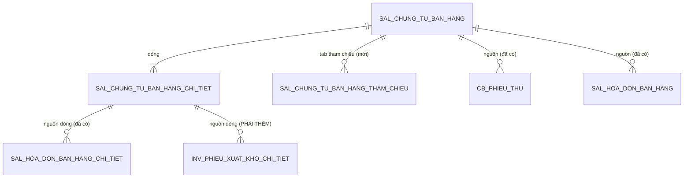

# F10 — Thiết kế chi tiết DB cho toàn epic Chứng từ bán hàng

> **Trạng thái:** BẢN NHÁP CHỜ USER/DBA REVIEW — **chốt mục này trước khi code bất kỳ PR nào chạm DB**
> **Ngày khảo sát schema:** 2026-08-08 · **Cập nhật quy ước tên bảng:** 2026-08-09
> **Phạm vi:** toàn bộ PMKT-E-06194 (F01–F09). Đây là mục duy nhất được quyết định hình dạng dữ liệu;
> phần `## 9. Migration` trong các file F0x chỉ được **dịch** mục này sang SQL, không phát sinh cột mới.

| Mục | Nội dung |
|---|---|
| Bảng chính | `sal_chung_tu_ban_hang`, `sal_chung_tu_ban_hang_chi_tiet` |
| Bảng liên quan | `sal_hoa_don_ban_hang`, `sal_hoa_don_ban_hang_chi_tiet`, `inv_phieu_xuat_kho`, `inv_phieu_xuat_kho_chi_tiet`, `cb_phieu_thu` |
| Migration mới nhất hiện tại | **V356** (`ctu_quan_he_chung_tu`, đã viết 2026-08-10) ⇒ file mới bắt đầu từ **V357**. Con số này trôi rất nhanh — chạy `ls db/migration \| sort -V \| tail -1` ngay trước khi đặt tên file, đừng tin số ghi ở đây |
| Chi tiết entity luồng Thêm mới | [ctbh-them-moi-data-entity-design.md](../ctbh-them-moi-data-entity-design.md) — không lặp lại ở đây |

> ⚠️ **Tên bảng trong tài liệu này là tên SAU khi đổi theo §2.** Bốn bảng đổi tên thật:
> `sal_chung_tu_ban_hang_chi_tiet`, `sal_hoa_don_ban_hang_chi_tiet`, `inv_phieu_xuat_kho`,
> `inv_phieu_xuat_kho_chi_tiet` — tra bảng ánh xạ §2.2 trước khi đối chiếu với migration cũ.

---

## 0. Quyết định thiết kế DB

| # | Quyết định | Hệ quả |
|---|---|---|
| **DB0** | Tên bảng `<module>_<nghiệp vụ>[_<bảng con>]`: `chi_tiet` là hậu tố, không viết tắt/lặp/thừa. **Không** bắt buộc tiền tố `chung_tu` (bỏ sau họp 2026-08-09) | Xem §2 — kèm migration rename cho bảng đã có |
| **DB1** | Header kế thừa `BaseChungTuEntity`; **không** khai lại cột base trong migration mới | `so_chung_tu`, `ngay_chung_tu`, `ngay_hach_toan`, `status`, `nguoi_ghi_so`, `thoi_gian_ghi_so`, `chi_nhanh_id`, `loai_chung_tu_id`, `giao_dich_chung_tu_id` đã có từ `V349__sal_ctbh_chuan_cot_chung_tu.sql:63-70` |
| **DB2** | Tiền dùng domain `public.money_vnd`, lượng dùng `public.quantity`; tỷ lệ % dùng `numeric(7,4)` | Không khai `numeric` trần — BR7 |
| **DB3** | ⚠️ **ĐÃ THAY** — quan hệ CTBH ↔ chứng từ con chuyển sang bảng dùng chung `ctu_quan_he_chung_tu`, xem [thiet-ke-quan-he-chung-tu.md](../../done/thiet-ke-quan-he-chung-tu.md) | Cột `chi_tiet_chung_tu_ban_hang_id` trên bảng con (`V77:134`) bị deprecate ở P3; cột nguồn PXK ở §4.2 **không còn cần thêm** |
| **DB4** | Cột `so_hoa_don` **không** snapshot lên header CTBH | Xem §3.1 — đã có unique index trên bảng hóa đơn, snapshot sẽ tạo nguồn sự thật thứ hai |
| **DB5** | `hoa_don_ban_hang_id` trên dòng CTBH bị **deprecate** (khiếm khuyết L1 — back-pointer đơn trị) | Một dòng CTBH sinh nhiều dòng HĐ; thay bằng `QuanHeChungTuApi.theoNguon(...)`. Drop ở P3 của thiết kế quan hệ |
| **DB6** | ⚠️ **ĐÃ THAY** — counter `so_luong_da_xuat_*` **bị bỏ**. Bảng `ctu_quan_he_chung_tu` chỉ lưu **quan hệ, không lưu số lượng**; số lượng đọc từ dòng chi tiết chứng từ đích. Cột `trang_thai_*` **giữ lại** (cột lọc/sort của F01), tính lại từ aggregate | Mất `CHECK (counter <= so_luong)` ở DB → chống xuất vượt chuyển sang khóa `FOR UPDATE` dòng nguồn |
| **DB7** | Bảng tham chiếu tab "Tham chiếu" là bảng con riêng, mirror `V266__cb_phieu_thu_tham_chieu.sql` | Không dùng JSONB / uuid[] |

---

## 1. Hiện trạng bảng (nguồn sự thật đã khảo sát)

### 1.1 `sal_chung_tu_ban_hang`

Dựng ở `V75__sal_chung_tu_ban_hang_schema.sql:12`, chuẩn hóa cột chứng từ ở V343/V349, đổi tên cột
thời gian → ngày ở V351, bật phạm vi dữ liệu ở V319.
Entity: `chung_tu_ban_hang/internal/entity/ChungTuBanHang.java` (844 dòng).

| Nhóm | Cột đã có | Ai ghi |
|---|---|---|
| Base chứng từ | theo `core/entity/BaseChungTuEntity.java:45-84` | base |
| Cờ nghiệp vụ | `loai_nghiep_vu`, `kiem_phieu_xuat_kho`, `lap_kem_hoa_don`, `da_lap_hoa_don`, `thu_tien_ngay`, `hinh_thuc_thanh_toan` | client |
| Khách hàng | `khach_hang_id`, `ten_khach_hang`, `dia_chi`, `nguoi_lien_he`, `so_dien_thoai`, `ma_so_thue`, `ma_so_dvqhns`, `cccd`, `ho_chieu`, `nguoi_mua_hang`, `nguoi_nhan`, `nguoi_nop` | client |
| Thanh toán | `dieu_khoan_thanh_toan_id`, `so_ngay_duoc_no`, `han_thanh_toan`, `tai_khoan_tien_id`, `tai_khoan_ngan_hang_thu_id` | client |
| Tiền tệ | `loai_tien_id`, `ty_gia` | client |
| Chiết khấu | `loai_chiet_khau`, `gia_tri_chiet_khau` | client |
| Tổng (7 cặp) | `tong_tien_hang_hoa`, `tong_tien_chiet_khau`, `…_chiet_khau_hang`, `…_chiet_khau_hoa_don`, `…_thue_gtgt`, `…_sau_thue`, `…_thanh_toan` + bản `_quy_doi` | **server tính** |
| Counter/trạng thái | `so_tien_da_thanh_toan(_quy_doi)`, `trang_thai_hoa_don`, `trang_thai_thanh_toan`, `trang_thai_xuat_hang` | **server tính** |
| Liên kết con (cũ) | `phieu_xuat_kho_id`, `phieu_thu_id`, `mieu_ta_phieu_thu` | server |
| Xuất khẩu/HĐ ngoại | `so_hop_dong`, `ngay_hop_dong`, `dia_diem_giao/nhan`, `so_van_don`, `so_container`, `don_vi_van_chuyen` | client |
| Nội bộ tập đoàn | `la_giao_dich_noi_bo_tap_doan`, `doi_tac_tenant_id` | client |

### 1.2 `sal_chung_tu_ban_hang_chi_tiet`

Dựng ở `V75:117`; `stt` đổi sang `integer` ở `V349:90`.
Đã có đủ 3 loại dòng (`loai_dong_hang`, `hang_khuyen_mai`, `chiet_khau_thuong_mai`), 5 tài khoản
(`tai_khoan_no/co/chiet_khau/gia_von/kho_id`), thuế GTGT, thuế XK, giá vốn, counter
(`so_luong_da_xuat_hd`, `so_luong_da_xuat_kho(_quy_doi)`) và 4 chiều phân bổ (`don_vi_id`,
`hop_dong_id`, `khoan_muc_chi_phi_id`, `vu_viec_id`).

### 1.3 Bảng module con — **phát hiện quan trọng**

| Bảng (tên mới) | Có sẵn? | Liên kết về CTBH |
|---|---|---|
| `sal_hoa_don_ban_hang` | ✅ `V77:48` | `chung_tu_ban_hang_id` (header) |
| `sal_hoa_don_ban_hang_chi_tiet` | ✅ `V77:134` | `chi_tiet_chung_tu_ban_hang_id` — **đã đúng line-level, khớp F09-D3** |
| `cb_phieu_thu` | ✅ `V57:57` | `chung_tu_ban_hang_id` (header) |
| `inv_phieu_xuat_kho` | ✅ `V70:19` | ❌ **không có cột nguồn nào** |
| `inv_phieu_xuat_kho_chi_tiet` | ✅ `V70:72` | ❌ **không có cột nguồn nào** |

⚠️ **Schema module con đã tồn tại nhưng tầng Java chưa có** — thư mục `cell/` chỉ có
`accounting_core, chung_tu_ban_hang, chung_tu_mua_hang, common, core, integration_ops, master_data,
platform_iam, reporting`. F09 vì vậy bị chặn ở tầng Java, **không** ở tầng DB.

---

## 2. Chuẩn hóa tên bảng chứng từ

### 2.1 Quy ước (DB0)

```
<module>_<nghiệp vụ>[_<bảng con>]
   │          │            └── chi_tiet · tham_chieu · thao_tac_idempotent
   │          └── viết đầy đủ, không viết tắt, không lặp tiền tố module, không phần thừa
   └── sal_ · pur_ · inv_ · cb_ · fa_ … (giữ nguyên, để biết module nào sở hữu bảng)
```

Hai luật: **`chi_tiet` là hậu tố** · **không viết tắt/lặp/thừa**.
Yêu cầu bắt buộc tiền tố `chung_tu` **đã bị bỏ sau cuộc họp 2026-08-09** — bảng nào đang có `chung_tu`
thì giữ nguyên, bảng nào không có thì không thêm vào.
Bảng danh mục (`mst_*`), cấu hình và hạ tầng **không** áp quy ước này.

### 2.2 Ánh xạ tên cũ → mới (phần giao với epic này)

| # | Tên hiện tại | Tên mới | Ghi chú |
|---|---|---|---|
| 1 | `sal_chung_tu_ban_hang` | *(giữ nguyên)* | |
| 2 | `sal_chi_tiet_chung_tu_ban_hang` | `sal_chung_tu_ban_hang_chi_tiet` | `chi_tiet` → hậu tố |
| 3 | `sal_hoa_don_ban_hang` | *(giữ nguyên)* | trước đây định đổi, nay không còn |
| 4 | `sal_chi_tiet_hd_ban_hang` | `sal_hoa_don_ban_hang_chi_tiet` | hậu tố + bỏ viết tắt `hd` |
| 5 | `inv_phieu_xuat_kho_module_kho` | `inv_phieu_xuat_kho` | bỏ hậu tố `_module_kho` thừa |
| 6 | `inv_chi_tiet_phieu_xuat_kho` | `inv_phieu_xuat_kho_chi_tiet` | |
| 7 | `cb_phieu_thu` | *(giữ nguyên)* | |
| 8 | `cb_phieu_thu_tham_chieu` | *(giữ nguyên)* | |
| 9 | *(mới)* | `sal_chung_tu_ban_hang_tham_chieu` | §4.1 — theo tên bảng cha |
| 10 | ~~*(mới)*~~ | ~~`sal_chung_tu_ban_hang_thao_tac_idempotent`~~ | **bỏ** — unique `(tenant_id, dong_dich_id)` của bảng quan hệ đã là idempotency |
| 11 | *(mới, module khác)* | `ctu_quan_he_chung_tu` | [thiet-ke-quan-he-chung-tu.md](../../done/thiet-ke-quan-he-chung-tu.md) |

✅ **DB-Q6 đã chốt — phương án (a): chuẩn hóa toàn hệ thống.** Bảng trên chỉ là phần giao với epic
này. Kế hoạch đầy đủ (52 bảng, 5 đợt PR theo module, query rà soát, nghiệm thu) nằm ở
**[docs/chuan-hoa-ten-bang-chung-tu.md](../../chuan-hoa-ten-bang-chung-tu.md)** — đọc file đó trước
khi viết migration rename. Epic này chỉ phụ thuộc **đợt 1 (`sal_`)** và **đợt 3 (`inv_`, `cb_`)`**.

### 2.3 Phạm vi ảnh hưởng đã khảo sát

| Bảng phải đổi tên | File `.sql` tham chiếu | File `.java` tham chiếu |
|---|---:|---:|
| `sal_chi_tiet_chung_tu_ban_hang` | 13 | 3 |
| `sal_chi_tiet_hd_ban_hang` | 7 | 0 |
| `inv_phieu_xuat_kho_module_kho` | 5 | 1 |
| `inv_chi_tiet_phieu_xuat_kho` | 4 | 0 |

Tổng cho toàn hệ thống: **52 bảng · 1.038 lượt `.sql` · 13 file `.java`**. Ngoài ra **11 câu lệnh
`CREATE POLICY`** (RLS) tham chiếu trực tiếp nhóm bảng bán hàng.

🚫 **Chạm vùng đóng băng.** File dùng native query có tên bảng cứng trong `master_data/**`:

| File | Dòng | Tham chiếu |
|---|---|---|
| `master_data/ly_do_nhap_xuat/repository/LyDoNhapXuatRepository.java` | 74 | `inv_phieu_xuat_kho_module_kho` |
| ~~`master_data/tai_khoan_ngan_hang/repository/TaiKhoanNganHangRepository.java`~~ | 30, 34 | `cb_phieu_thu`, `sal_hoa_don_ban_hang` — **hết ảnh hưởng**, hai bảng này giữ nguyên tên |
| ~~`master_data/muc_dich_thu_chi/service/MucDichThuChiServiceImpl.java`~~ | 33 | `cb_phieu_thu` — **hết ảnh hưởng** |

Sau khi bỏ luật `chung_tu`, chỉ còn **một** file vùng đóng băng phải sửa. Nếu bỏ qua, delete-guard
"lý do nhập xuất" sẽ ném lỗi SQL runtime (không phải lỗi biên dịch, nên test đơn vị không bắt được).

✅ **DB-Q7 đã chốt — user đồng ý sửa `master_data`** cho đợt chuẩn hóa. Cần gỡ tạm
`permissions.deny` trong `.claude/settings.json` và **khôi phục ngay sau khi PR merge**.
Vẫn giữ nguyên lệnh cấm sao chép kiến trúc/pattern từ `master_data` — đây chỉ là đổi tên bảng.

### 2.4 Migration rename — nội dung bắt buộc

PR riêng, **không gộp** với bất kỳ thay đổi nghiệp vụ nào (cùng lý do PR-0 ở kế hoạch tổng).

| # | Việc | Vì sao |
|---|---|---|
| 1 | `ALTER TABLE … RENAME TO …` cho 8 bảng | |
| 2 | Đổi tên **constraint** PK/FK/unique và **index** theo tên bảng mới | Postgres giữ nguyên tên cũ sau RENAME → tra cứu sau này sai lệch |
| 3 | Rà lại **RLS policy** (11 chỗ) | Policy bám theo OID nên không vỡ, nhưng tên policy chứa tên bảng cũ |
| 4 | `COMMENT ON TABLE` cập nhật | |
| 5 | Rà **view / materialized view / function** có tham chiếu | Query kiểm tra ở §2.5 |
| 6 | Sửa `@Table(name=…)` và mọi native query trong Java | Gồm ba file vùng đóng băng ở §2.3 |
| 7 | **Không** tạo view tương thích tên cũ | Giữ hai tên song song sẽ khiến code mới tiếp tục dùng tên cũ |

Rename là thao tác metadata, không rewrite dữ liệu → nhanh, nhưng lấy `ACCESS EXCLUSIVE lock`; chạy
vào cửa sổ bảo trì. **Không** dùng `IF EXISTS` im lặng: nếu bảng không tồn tại thì migration phải đỏ.

### 2.5 Query rà soát trước khi rename

```sql
-- view/function còn tham chiếu tên bảng cũ
SELECT c.relname, c.relkind
FROM pg_class c JOIN pg_rewrite r ON r.ev_class = c.oid
JOIN pg_depend d ON d.objid = r.oid
JOIN pg_class t ON t.oid = d.refobjid
WHERE t.relname IN ('sal_chi_tiet_chung_tu_ban_hang','sal_hoa_don_ban_hang',
                    'sal_chi_tiet_hd_ban_hang','inv_phieu_xuat_kho_module_kho',
                    'inv_chi_tiet_phieu_xuat_kho','cb_phieu_thu','cb_phieu_thu_tham_chieu')
  AND c.relkind IN ('v','m');

-- constraint/index còn mang tên bảng cũ (chạy lại SAU rename để soát mục 2)
SELECT conname, conrelid::regclass FROM pg_constraint WHERE conname LIKE '%chi_tiet_chung_tu_ban_hang%'
UNION ALL
SELECT indexname, tablename::regclass FROM pg_indexes WHERE indexname LIKE '%hd_ban_hang%';
```

---

## 3. Cột thêm mới / sửa trên bảng đã có

### 3.1 ⚠️ Xét lại: `so_hoa_don` trên header CTBH

Plan F03 §5 và F01 §7 đề xuất snapshot `mau_so_hoa_don_id`, `ky_hieu_hoa_don`, `so_hoa_don`,
`ngay_hoa_don` lên header CTBH kèm partial unique index. Khảo sát cho thấy bảng hóa đơn
**đã có đủ 3 cột này** và **đã có** partial unique index (`V77:106-107`):

```
(tenant_id, khach_hang_id, so_hoa_don, coalesce(ky_hieu_hoa_don,''), coalesce(mau_so_hoa_don_id, '000…'))
WHERE da_xoa = false AND so_hoa_don <> ''
```

| | A — snapshot lên CTBH (plan hiện tại) | **B — chỉ đọc qua liên kết (đề xuất)** |
|---|---|---|
| Nguồn sự thật | hai nơi, phải đồng bộ khi sửa/xóa HĐ | một nơi |
| Unique số HĐ | index thứ hai, phạm vi khác index V77 → hai luật trùng nhau | dùng index đã có |
| Cột `SoHoaDon` ở danh sách | đọc thẳng, nhanh | cần projection/`string_agg` (F01 §7 đã thiết kế) |
| HĐ lập sau (nhiều HĐ) | snapshot không diễn tả được 1-n | đúng bản chất |

**Cần user quyết định (DB-Q1).** Phần còn lại của tài liệu này viết theo phương án B; nếu chọn A
thì phải trả lời: giữ đồng bộ khi HĐ bị sửa/xóa bằng cách nào, và luật unique nào thắng.

### 3.2 Cột thêm mới trên `sal_chung_tu_ban_hang`

> ✅ **Dòng 1-7 (snapshot PXK/PT) đã chốt BỎ** — số chứng từ con tự sinh qua `SoChungTuApi`, ngày lấy
> theo chứng từ con thật. Chỉ còn dòng 8, 9 và (nếu Q1 xác nhận) dòng 10.

| # | Cột | Kiểu | NULL | Default | Ai ghi | DTO | Vì sao | Chặn bởi |
|---|---|---|---|---|---|---|---|---|
| 1 | `so_chung_tu_xuat_kho` | `text` | Y | — | client | `soChungTuXuatKho` | tab PXK, F03 §5 | Q2 (nhập tay/tự sinh) |
| 2 | `ngay_chung_tu_xuat_kho` | `date` | Y | — | client | `ngayChungTuXuatKho` | tab PXK | — |
| 3 | `ngay_hach_toan_xuat_kho` | `date` | Y | — | client | `ngayHachToanXuatKho` | tab PXK | Q3 |
| 4 | `mo_ta_xuat_kho` | `text` | Y | — | client | `moTaXuatKho` | tab PXK | — |
| 5 | `so_chung_tu_phieu_thu` | `text` | Y | — | client | `soChungTuPhieuThu` | tab PT | Q2 |
| 6 | `ngay_chung_tu_phieu_thu` | `date` | Y | — | client | `ngayChungTuPhieuThu` | tab PT | — |
| 7 | `ngay_hach_toan_phieu_thu` | `date` | Y | — | client | `ngayHachToanPhieuThu` | tab PT | Q3 |
| 8 | `hinh_thuc_thanh_toan_hoa_don` | `text` | Y | — | client | `hinhThucThanhToanHoaDon` | HTTT HĐ cho nhập ngoài combo → lưu text, không enum | — |
| 9 | `nguon_da_lap_hoa_don` | `text` | Y | — | **server** | read-only | phân biệt HĐ hệ thống ↔ HĐ ngoài, phục vụ F09-Q3 | — |
| ~~10~~ | ~~`hd_*` (khách hàng riêng tab HĐ)~~ | — | — | — | — | — | ✅ **BỎ HẲN** — `sal_hoa_don_ban_hang` đã có bộ khách hàng riêng (`khach_hang_id NOT NULL`, `ten_khach_hang`, `dia_chi`, `ma_so_thue`, `nguoi_mua_hang` — `V77:54-62`). Thêm `hd_*` lên CTBH là nguồn sự thật thứ hai | — |

> ✅ Cột 1-7 **đã bỏ**: số PXK/phiếu thu tự sinh qua `SoChungTuApi`, không nhận từ request; ngày và mô
> tả đọc ngược từ chứng từ con thật. Request DTO cũng bỏ các trường `...XuatKho` / `...PhieuThu`.

### 3.3 Cột sửa / deprecate

| Cột | Việc | Xử lý dữ liệu cũ |
|---|---|---|
| `sal_chung_tu_ban_hang_chi_tiet.hoa_don_ban_hang_id` | deprecate (DB5) | giữ nguyên dữ liệu, thêm `COMMENT` ghi rõ "deprecated — dùng `sal_hoa_don_ban_hang_chi_tiet.chi_tiet_chung_tu_ban_hang_id`"; gỡ ở migration sau khi F09 chạy ổn định |
| `sal_chung_tu_ban_hang.phieu_xuat_kho_id`, `phieu_thu_id` | giữ tạm | 1-1 không đủ cho nhiều PXK/PT; đánh dấu deprecate cùng lúc với DB5 nếu BA xác nhận nhiều PXK/PT |
| `sal_chung_tu_ban_hang_chi_tiet.thu_tu` | `numeric` → `integer` | V349 đã làm cho `stt`; kiểm còn sót `thu_tu` (`V75:119`) |

---

## 4. Bảng mới

### 4.1 `sal_chung_tu_ban_hang_tham_chieu` — tab Tham chiếu

Mirror `cb_phieu_thu_tham_chieu` (V266) và `pur_chung_tu_tham_chieu`.

| Cột | Kiểu | NULL | Ghi chú |
|---|---|---|---|
| `id` | `uuid` | N | PK, `gen_random_uuid()` |
| `tenant_id` | `uuid` | N | RLS |
| `chung_tu_ban_hang_id` | `uuid` | N | FK → `sal_chung_tu_ban_hang(id)`, cascade theo aggregate |
| `loai_chung_tu_nguon` | `text` | N | đơn đặt hàng / báo giá / hợp đồng… |
| `chung_tu_nguon_id` | `uuid` | Y | null khi nguồn ngoài hệ thống |
| `so_chung_tu_nguon` | `text` | Y | snapshot hiển thị |
| `ngay_chung_tu_nguon` | `date` | Y | |
| `thu_tu` | `integer` | N | default 1 |
| audit/soft-delete | | | `da_xoa`, `ngay_tao`, `nguoi_tao`, … theo mẫu V266 |

Index: `(tenant_id, chung_tu_ban_hang_id)`. RLS bật. Không search cross-voucher (theo ghi chú V266).

### 4.2 ~~`inv_phieu_xuat_kho_chi_tiet` — bổ sung cột nguồn~~ — **KHÔNG CÒN ÁP DỤNG**

> Thay bằng `ctu_quan_he_chung_tu` với `loai_chung_tu_dich='INV_PHIEU_XUAT_KHO'` —
> xem [thiet-ke-quan-he-chung-tu.md](../../done/thiet-ke-quan-he-chung-tu.md). Giữ mục này để
> người review biết đã cân nhắc. Nội dung cũ:

| Cột thêm | Kiểu | NULL | Vì sao |
|---|---|---|---|
| `chi_tiet_chung_tu_ban_hang_id` | `uuid` | Y | line-level link, F09-D3; FK `ON DELETE RESTRICT` bảo vệ dòng nguồn |
| `chung_tu_ban_hang_id` (trên header `inv_phieu_xuat_kho`) | `uuid` | Y | truy vấn ngược nhanh + filter nguồn |

Không đặt NOT NULL vì PXK còn dùng cho xuất SX/xuất khác không có nguồn CTBH.

> Thứ tự thực hiện: migration rename (§2.4) chạy **trước**, migration này viết thẳng trên tên mới.
> Đợt 3 (`inv_`) của kế hoạch chuẩn hóa phải merge trước migration này.

### 4.3 ~~`sal_chung_tu_ban_hang_thao_tac_idempotent`~~ — **KHÔNG CÒN ÁP DỤNG**

> Idempotency là unique index `(tenant_id, dong_dich_id)` của `ctu_quan_he_chung_tu` — gửi lại cùng
> dòng đích thì `ON CONFLICT DO NOTHING`, không cần bảng hay cột riêng.
> **DB-Q3 đã tự tiêu.** Nội dung cũ giữ để người review biết đã cân nhắc:

Phục vụ F09 §7 bước 6 (`operationId`). Cần chốt **DB-Q3**: dùng bảng riêng hay cột
`operation_id` unique ngay trên bảng con.

| Cột | Kiểu | Ghi chú |
|---|---|---|
| `tenant_id`, `operation_id`, `loai_thao_tac` | | unique `(tenant_id, loai_thao_tac, operation_id)` |
| `chung_tu_ban_hang_id`, `ket_qua`, `ngay_tao` | | |

---

## 5. Ràng buộc · index · khóa ngoại

| # | Loại | Định nghĩa | Phục vụ query nào | Ghi chú |
|---|---|---|---|---|
| 1 | index | `sal_chung_tu_ban_hang(tenant_id, ngay_hach_toan DESC, ngay_chung_tu DESC, so_chung_tu) WHERE da_xoa=false` | sort mặc định F01 §6 (3 khóa) | thay index 1 khóa nếu có |
| 2 | index | `sal_chung_tu_ban_hang(tenant_id, status) WHERE da_xoa=false` | filter trạng thái + action metadata F01 §8 | mẫu đã có ở V352 cho CTMH |
| 3 | index | `sal_hoa_don_ban_hang_chi_tiet(tenant_id, chi_tiet_chung_tu_ban_hang_id) WHERE da_xoa=false` | cột Số HĐ (F01 §7) + counter HĐ (F09) | |
| 4 | ~~index~~ | ~~`inv_phieu_xuat_kho_chi_tiet(...)`~~ | — | **bỏ** — thay bằng index I1 của `ctu_quan_he_chung_tu` |
| 5 | index | `cb_phieu_thu(tenant_id, chung_tu_ban_hang_id) WHERE da_xoa=false` | counter thanh toán (F09) | |
| 6 | ~~FK~~ | ~~các cột nguồn ở §4.2 → `RESTRICT`~~ | — | **bỏ** — bảng đa hình không FK được; chặn xóa chuyển sang guard `coLienKet()` ở service |
| 7 | check | `so_luong >= 0`, `don_gia >= 0` | BR/F03 §6 | rà dữ liệu cũ trước (§6) |
| 8 | ~~check~~ | ~~`so_luong_da_xuat_hd <= so_luong`~~ | — | **KHÔNG CÒN KHẢ THI** — counter bị bỏ nên không còn cột nội-hàng để CHECK. **DB-Q4 tự tiêu**; bất biến chuyển sang khóa `FOR UPDATE` + job đối soát, xem thiết kế quan hệ §3.4 |
| 9 | unique | **không thêm** unique số HĐ mới | — | đã có ở `V77:106` (xem §3.1) |

> Mọi partial index phải kèm `WHERE da_xoa = false` cho khớp soft-delete, nếu không bản ghi đã xóa
> sẽ chặn bản ghi mới. RLS/GRANT **không khai lại** — đã có từ V75/V319.
> Index tạo mới phải dùng tên theo bảng mới; index cũ đổi tên ở §2.4 mục 2.

---

## 6. Dữ liệu hiện có · backfill

| # | Việc | Query kiểm tra trước | Xử lý |
|---|---|---|---|
| 1 | Trước khi thêm check §5-7 | `SELECT count(*) FROM sal_chung_tu_ban_hang_chi_tiet WHERE so_luong < 0 OR don_gia < 0` | có dữ liệu vi phạm → báo BA, **không** tự sửa |
| 2 | Trước khi thêm check §5-8 | so sánh counter với `so_luong` từng dòng | như trên |
| 3 | Backfill `nguon_da_lap_hoa_don` | `da_lap_hoa_don=true` nhưng không có HĐ liên kết | đặt `EXTERNAL`; có liên kết → `HE_THONG`; không đoán trường hợp còn lại |
| 4 | Backfill quan hệ CTBH→PXK | dữ liệu cũ chỉ có `sal_chung_tu_ban_hang.phieu_xuat_kho_id` (header, đơn trị) | chỉ backfill được header, **không** suy ra line-level → xuất report cho vận hành. Chi tiết ở thiết kế quan hệ §8.1 |

---

## 7. Enum ⇄ giá trị lưu trong DB

| Enum Java | Cột | Giá trị lưu | Ghi chú |
|---|---|---|---|
| `LoaiNghiepVuBanHang` | `loai_nghiep_vu` | chuỗi tiếng Việt | default `TRONG_NUOC` ở entity |
| `HinhThucThanhToan` | `hinh_thuc_thanh_toan` | chuỗi | default `TIEN_MAT` |
| `LoaiChietKhau` | `loai_chiet_khau` | chuỗi | default `KHONG_CHIET_KHAU` |
| `TrangThaiHoaDon/ThanhToan/XuatHang` | `trang_thai_*` | chuỗi | server-owned |
| `TrangThaiChungTu` | `status` | `'NHAP'`/`'DA_GHI_SO'` | **tên hằng, không phải chuỗi tiếng Việt** — lệch quy ước các cột enum khác, giữ nguyên theo `V349:105` |

⚠️ `inv_phieu_xuat_kho.trang_thai_chung_tu` mặc định `'Chưa ghi sổ'` (chuỗi tiếng Việt),
khác `sal_chung_tu_ban_hang.status` (`'NHAP'`). Khi F09 đọc trạng thái chứng từ con phải map, không so
sánh chuỗi trực tiếp.

---

## 8. Ánh xạ Entity ↔ bảng

| Bảng | Entity | Kế thừa | Quan hệ | Fetch |
|---|---|---|---|---|
| `sal_chung_tu_ban_hang` | `ChungTuBanHang` | `BaseChungTuEntity` | aggregate root; `@OneToMany` cascade ALL + orphanRemoval tới dòng và tham chiếu | LAZY |
| `sal_chung_tu_ban_hang_chi_tiet` | `ChiTietChungTuBanHang` | `BaseChiTietChungTuEntity` | không repository ghi riêng | — |
| `sal_chung_tu_ban_hang_tham_chieu` | `ThamChieuChungTuBanHang` (mới) | `TenantedEntity` | con của aggregate | LAZY |
| bảng module con | **không** map vào aggregate CTBH | — | chỉ gọi qua port (F09-D1) | — |

Optimistic lock đặt ở header; sửa dòng phải `touch()` header.
Tên bảng chỉ được khai ở `@Table(name=…)`; không hardcode tên bảng trong chuỗi query ngoài repository.

---

## 9. ERD



---

## 10. Câu hỏi chặn — phải chốt trước khi viết migration

| # | Câu hỏi | Ảnh hưởng nếu chốt sai |
|---|---|---|
| ~~DB-Q1~~ | ✅ **Đã chốt: phương án (B)** — không snapshot, đọc qua liên kết. Bảng HĐ đã có unique index sẵn (`V77:106`) | — |
| ~~DB-Q3~~ | ✅ Tự tiêu — idempotency là cột `khoa_yeu_cau` trên `ctu_quan_he_chung_tu` | — |
| ~~DB-Q4~~ | ✅ Tự tiêu — counter bị bỏ, không còn cột nội-hàng để CHECK. Bất biến giữ bằng khóa `FOR UPDATE` + job đối soát | — |
| ~~DB-Q2~~ | ✅ **Đã chốt: bỏ cả 7 cột snapshot PXK/PT.** Số chứng từ con **tự sinh** qua `SoChungTuApi` (`accounting_core/hach_toan/api/SoChungTuApi.java:12`), không nhận từ request | — |
| ~~DB-Q5~~ | ✅ **Đã chốt: có nhiều PXK/PT.** Quan hệ đọc từ `ctu_quan_he_chung_tu`; `phieu_xuat_kho_id`, `phieu_thu_id`, `mieu_ta_phieu_thu` deprecate, drop ở P3 | — |
| ~~DB-Q6~~ | ✅ Đã chốt: chuẩn hóa **toàn hệ thống** — xem [chuan-hoa-ten-bang-chung-tu.md](../../chuan-hoa-ten-bang-chung-tu.md) | — |
| ~~DB-Q7~~ | ✅ Đã chốt: được sửa `master_data/**`, gỡ tạm `permissions.deny`, khôi phục sau merge | — |
| ~~Q1~~ | ✅ **Đã chốt: không thêm `hd_*`** — hóa đơn đã có khách hàng riêng (`V77:54-62`). Lập kèm thì copy từ CTBH, sửa trên hóa đơn không đổi CTBH | — |
| ~~Q3~~ | ✅ **Đã chốt: giữ `date`** — toàn hệ thống và kernel đang là `date` (`V70:25` "DB-008: date (khớp kernel + BR17)"); V351 còn đổi ngược cột thời gian về ngày. Cần thứ tự trong ngày thì dùng `stt`/`ngay_tao`, không đổi kiểu | — |

---

## 11. Điều kiện nghiệm thu mục này

- [ ] **Mọi DB-Q và Q1/Q3 đã chốt.** Còn lại: BA duyệt hai đề xuất lệch BR12 về owner bút toán (giá vốn, thu ngay) — xem [00-ke-hoach-tong.md](00-ke-hoach-tong.md) §8.
- [ ] Câu hỏi A…E trong [thiet-ke-quan-he-chung-tu.md](../../done/thiet-ke-quan-he-chung-tu.md) §10 đã chốt, và **benchmark P0 đạt**.
- [ ] Q-A1…Q-A6 trong [chuan-hoa-ten-bang-chung-tu.md](../../chuan-hoa-ten-bang-chung-tu.md) §6 đã chốt.
- [ ] Mọi cột ở §3, §4 có đủ: kiểu, NULL, default, ai ghi, DTO tương ứng.
- [ ] Mọi index ở §5 trỏ được về một câu query cụ thể trong F01–F09.
- [ ] Query rà soát §2.5 và query kiểm tra dữ liệu §6 đã chạy trên môi trường có dữ liệu thật, kết quả đính kèm.
- [ ] Đợt 1 (`sal_`) và đợt 3 (`inv_`, `cb_`) của kế hoạch chuẩn hóa đã merge trước khi bắt đầu PR-2.
- [ ] Sau rename: `grep -rn "<tên bảng cũ>" cell-app/src` không còn kết quả nào ngoài chính file migration rename.
- [x] Số hiệu migration được lấy lại tại thời điểm code — V356 đã dùng; file sau bắt đầu từ V357.

---

## 12. Tham chiếu

- Migration: V57, V70, V75, V77, V163, V266, V319, V343, V346, V349, V351, V352.
- Entity: `ChungTuBanHang.java`, `ChiTietChungTuBanHang.java`, `core/entity/BaseChungTuEntity.java:45-84`.
- Plan: [00-ke-hoach-tong.md](00-ke-hoach-tong.md) §7 §8, [01](01-xem-danh-sach.md) §7 §9,
  [03](03-them-moi.md) §5 §9, [09](09-chung-tu-lien-quan.md) §5 §9.
- Thiết kế entity luồng Thêm mới: [ctbh-them-moi-data-entity-design.md](../ctbh-them-moi-data-entity-design.md).
- `pmkt-docs/ba/Common/business_rules.md` — BR7, BR17, BR19, BR20, BR28, BR29, BR46.
- `CLAUDE.md` §"Vùng đóng băng", `.claude/settings.json` (`permissions.deny`).
