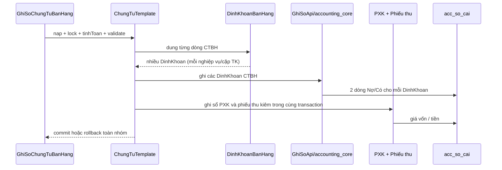

# Kế hoạch hoàn thiện ghi sổ chứng từ bán hàng

> **Trạng thái:** BẢN NHÁP CHỜ REVIEW  
> **Ngày cập nhật:** 2026-09-08  
> **Người review cần có:** 1 BA chốt Q1–Q3 + 1 Dev BE/DBA chốt transaction, sổ cái và migration

| Mục | Nội dung |
|---|---|
| Use case | `PMKT-U-06430` — Ghi sổ chứng từ bán hàng; `UC_CTBH_ThemMoi` — Lưu và ghi sổ |
| Màn hình | `SCR_CTBH_ThemMoi`, `SCR_CTBH_DanhSach`, `SCR_CTBH_ChiTiet` |
| Tài liệu nguồn | `docs/doing/PMKT-E-06194-chung-tu-ban-hang-spec/02-rules.md`, `03-scenarios.md` |
| Module BE | `cell-app/src/main/java/vn/vtt/pmkt/cell/ban_hang/chung_tu_ban_hang/` + `accounting_core` |
| Bảng DB | `sal_chung_tu_ban_hang`, `sal_chung_tu_ban_hang_chi_tiet`, `acc_so_cai`, sổ công nợ, phiếu xuất kho, phiếu thu; dùng schema hiện có, chỉ thêm migration nếu BA chốt Q2 |

## 0. Các quyết định cần chốt

| # | Quyết định | Hệ quả lên code | Vì sao không chọn phương án kia |
|---|---|---|---|
| D1 | Giữ kiến trúc `ChungTuTemplate → DinhKhoanBanHang → GhiSoApi`; không ghi trực tiếp `acc_so_cai` từ module bán hàng | Chỉ mở rộng DTO mapping và orchestration hiện có; kernel vẫn là nơi duy nhất insert sổ cái | Ghi trực tiếp sẽ phá invariant cân đối, idempotency và trigger DB của `accounting_core` |
| D2 | Một nghiệp vụ trên một dòng chi tiết tạo một `DinhKhoan`; mỗi `DinhKhoan` tạo đúng 2 dòng sổ cái | Giữ `sttDongChiTiet` + `sttButToan`, kiểm tổng Nợ = Có | Không gộp toàn chứng từ vì R-CTBH-095 yêu cầu mỗi dòng sinh riêng |
| D3 | Chứng từ lập kèm đầy đủ bộ ghi sổ theo nhóm: CTBH ghi doanh thu/thuế/CK; PXK ghi giá vốn; phiếu thu ghi tiền; hóa đơn không ghi sổ | Sửa/giữ `coPhieuXuatKho`, `coPhieuThu`, `ghiSoChungTuCon`; thêm test nhóm và rollback | Ghi giá vốn/thu tiền lại trên CTBH gây trùng bút toán; ghi hóa đơn trái R-CTBH-099 |
| D4 | Bổ sung đầy đủ chiều phân tích đã có nguồn ở dòng CTBH (`donViId`, `vuViecId`, `hopDongId`) vào `DinhKhoan`; `doiTuongTapHopChiPhiId` và `donDatHangId` chỉ thêm sau khi BA xác nhận nguồn dữ liệu | `sangDinhKhoan()` phải gọi các builder `voiDonVi`, `voiVuViec`, `voiHopDong`; không để mất dữ liệu đã có | Không tự thêm cột/request field chưa có nguồn BA; tránh migration tạo dữ liệu không thể backfill |
| D5 | Không thay đổi schema `acc_so_cai` trong lượt đầu; chỉ tạo migration cho bảng chi tiết nếu Q2 chốt cần thêm nguồn | Tách phần chắc chắn (mapping hiện có) khỏi phần cần BA quyết định | Thêm cột mà không có màn hình/nguồn dữ liệu sẽ tạo cột chết và không giải quyết được báo cáo |

## 1. Phạm vi

### 1.1 Trong phạm vi

| # | Chức năng | Nguồn |
|---|---|---|
| F1 | Hoàn thiện 5 bút toán CTBH: doanh thu, chiết khấu, CKTM, thuế GTGT, thuế XK | R-CTBH-093, S-067, S-068 |
| F2 | Truyền đúng tài khoản theo từng dòng, không tra lại tài khoản ngầm định | R-CTBH-093 |
| F3 | Tách nhiều cặp tài khoản trên cùng dòng và sinh đúng 2 dòng `acc_so_cai`/cặp | R-CTBH-094, R-CTBH-095 |
| F4 | Ghi sổ nhóm CTBH + PXK kiêm + phiếu thu kiêm trong một transaction | R-CTBH-097, R-CTBH-098, S-070, S-071 |
| F5 | Không chạm trạng thái/hạch toán hóa đơn lập kèm | R-CTBH-099 |
| F6 | Bổ sung chiều phân tích vào `DinhKhoan` khi nguồn đã tồn tại | BR20.2a và ghi chú hiện trạng `DinhKhoanBanHang.java:222` |
| F7 | Bổ sung unit/integration test và kiểm rollback, idempotency, ngoại tệ, dòng đặc biệt | INV-001, INV-002, S-067–S-075 |

### 1.2 NGOÀI phạm vi

- Xóa/sửa chứng từ và các conflict C01–C06; các luật bị chặn vẫn giữ nguyên trạng thái trong `01-conflict.md`.
- Ghi sổ hóa đơn lập kèm: R-CTBH-099 quy định hóa đơn có vòng đời riêng và không sinh bút toán.
- Thay đổi kernel `accounting_core` hoặc thiết kế lại `acc_so_cai`.
- Ghi sổ hàng loạt partial success F96; cần một plan riêng cho `ChungTuBanHangHangLoatService` nếu kiểm tra cho thấy còn thiếu.

## 2. Hiện trạng đã khảo sát

### 2.1 Code hiện có

Lệnh đã chạy:

```text
rg -n 'DinhKhoanBanHang|sangDinhKhoan|ghiSoChungTuCon|acc_so_cai' cell-app/src/main/java/vn/vtt/pmkt/cell/ban_hang cell-app/src/main/java/vn/vtt/pmkt/cell/accounting_core
```

Kết quả chính:

| Thành phần | Hiện trạng | Bằng chứng |
|---|---|---|
| Orchestration ghi sổ | Đã dùng `ChungTuTemplate`, tính lại, validate, lưu entity rồi tạo định khoản | `GhiSoChungTuBanHang.java:58-117` |
| Mapping nghiệp vụ | Đã có #1–#7, điều kiện bỏ #6/#7 khi chứng từ con gánh | `DinhKhoanBanHang.java:120-200` |
| Gộp/bù trừ cặp TK | Đã có trong kernel | `TaoDinhKhoanService.java:76-110, 113-151` |
| Ghi `acc_so_cai` | Kernel tạo đúng vế Nợ + Có | `GhiSoService.java:132-174` |
| Ghi nhóm phiếu con | Đã gọi PXK; phiếu thu được ghi sau sổ công nợ; hóa đơn không gọi ghi sổ | `ChungTuConBanHang.java:508-513`, `GhiSoChungTuBanHang.java:146-153` |
| Chiều phân tích | `DinhKhoan` đã hỗ trợ nhưng CTBH mới truyền khách hàng + khoản mục chi phí | `DinhKhoanBanHang.java:244-260` |

Kết luận: **brownfield**. Không viết lại luồng ghi sổ; bổ sung mapping, guard, test và chỉ migration khi Q2 được chốt.

### 2.2 Hiện trạng DB

- `acc_so_cai` đã có các cột chiều phân tích qua `V1064__acc_so_cai_chieu_phan_tich.sql:14-153`.
- `sal_chung_tu_ban_hang_chi_tiet` hiện có `don_vi_id`, `vu_viec_id`, `hop_dong_id`, `khoan_muc_chi_phi_id` theo entity/migration hợp nhất tại `V1012__sal_ctbh_gop_ban_dich_vu_va_kiem_chung_tu.sql:187-206`.
- Entity `ChiTietChungTuBanHang` chưa có `doiTuongTapHopChiPhiId` và `donDatHangId`; chưa được thêm migration khi BA chưa chốt nguồn.
- Không tạo migration trong phần chắc chắn của plan. Nếu Q2 trả lời “có nguồn và cần lưu”, tạo migration số theo quy ước `cell-app/CLAUDE.md` và bổ sung file `02-thiet-ke-db.md`.

### 2.3 Hạ tầng base đã có sẵn

| Cần | Đã có | Vị trí |
|---|---|---|
| Tạo định khoản từ nhiều vai trò TK | `TaoDinhKhoanApi`/`TaoDinhKhoanService` | `accounting_core/hach_toan/api/TaoDinhKhoanApi.java:39-43`, `.../TaoDinhKhoanService.java:55-110` |
| Ghi duy nhất vào `acc_so_cai` | `GhiSoApi`/`GhiSoService` | `accounting_core/hach_toan/api/GhiSoApi.java:8-16`, `.../GhiSoService.java:147-174` |
| Transaction, khóa chứng từ, rollback | `ChungTuTemplate` | `accounting_core/chung_tu/service/ChungTuTemplate.java` |
| Dòng nguồn + thứ tự bút toán | `DinhKhoan` | `accounting_core/hach_toan/api/dto/DinhKhoan.java:49-67` |

## 3. Kiến trúc

### 3.1 Phân tầng

```text
BaseChungTuController
        ↓
GhiSoChungTuBanHang / LuuChungTuBanHangTemplate
        ↓
DinhKhoanBanHang + ChungTuConBanHang + CongNoBanHangService
        ↓
GhiSoApi (accounting_core)
        ↓
acc_so_cai / sổ công nợ / sổ kho
```

### 3.2 Lựa chọn kiến trúc

| Tiêu chí | Phương án A | **Phương án B — chọn** |
|---|---|---|
| Tạo dòng sổ cái | CTBH tự `repository.save(acc_so_cai)` | Đẩy `DinhKhoan` qua `GhiSoApi` |
| Gộp cặp đảo chiều | Tự viết lại trong CTBH | Dùng `TaoDinhKhoanService` |
| Đồng bộ nhóm | Gọi nhiều transaction | Dùng một `ChungTuTemplate` transaction |
| Rủi ro | Trùng logic và bypass trigger/idempotency | Phụ thuộc contract kernel, nhưng đã có test và constraint DB |

Chọn B vì đây là cổng bắt buộc của `accounting_core`; không tạo API/repository mới trong module bán hàng.

### 3.3 Cây file dự kiến

```text
cell-app/src/main/java/vn/vtt/pmkt/cell/ban_hang/chung_tu_ban_hang/internal/
├── entity/ChiTietChungTuBanHang.java              (sửa nếu Q2)
├── dto/LuuChiTietChungTuBanHangRequest.java        (sửa nếu Q2)
├── service/business/DinhKhoanBanHang.java         (sửa)
├── service/business/GhiSoChungTuBanHang.java      (guard/orchestration nếu cần)
└── service/business/ChungTuConBanHang.java        (chỉ sửa nếu test nhóm phát hiện thiếu)

cell-app/src/test/java/vn/vtt/pmkt/cell/ban_hang/chung_tu_ban_hang/
├── internal/service/TinhToanVaDinhKhoanBanHangTest.java (mở rộng)
├── internal/service/business/GhiSoChungTuBanHangUnitTest.java (mới)
└── .../GhiSoChungTuBanHangIntegrationTest.java (mới, DB thật/CI)
```

## 4. API mục tiêu

Không thêm endpoint. Luồng dùng endpoint kế thừa `BaseChungTuController`/`BaseChungTuController` hiện có:

| # | Method | Path | Quyền | Mục |
|---|---|---|---|---|
| A1 | `POST` | endpoint ghi sổ hiện có của `BaseChungTuController` | `BanHangHoa.Post` | F4 |
| A2 | `POST` | endpoint lưu và ghi sổ hiện có | `BanHangHoa.Create` + `Post` | F1–F7 |
| A3 | `POST` | endpoint bỏ ghi sổ hiện có | `BanHangHoa.Unpost` | kiểm rollback nhóm, ngoài phần tạo mới nhưng bắt buộc regression |

Contract path và envelope giữ nguyên controller hiện tại; không tạo endpoint mới chỉ để phục vụ định khoản.

## 5. Ma trận luật → code/test

| Luật | Code mục tiêu | Test bắt buộc |
|---|---|---|
| R-CTBH-093 | `DinhKhoanBanHang.dungDong` | #1/#2/#3/#4/#5, dòng KM/CKTM, xuất khẩu |
| R-CTBH-094 | `GhiSoService.taoDongSoCai` | assert đúng 2 dòng/cặp, đối ứng đảo chiều |
| R-CTBH-095 | `sangDinhKhoan` + `sttDongChiTiet` | nhiều dòng, mỗi dòng độc lập |
| R-CTBH-097 | `GhiSoChungTuBanHang.sauKhiLuu` + child ports | S-070 |
| R-CTBH-098 | transaction/group guard | S-071 |
| R-CTBH-099 | không gọi ghi sổ hóa đơn | S-070 |
| INV-001 | DB balance trigger + unit | S-067 |
| INV-002 | transaction rollback | S-057, S-071, S-075 |

## 6. Luồng tổng thể



## 7. Migration dự kiến

**Không áp dụng cho phần chắc chắn.** `acc_so_cai` đã có schema cần thiết. Chỉ tạo migration mới nếu Q2 chốt phải lưu `doi_tuong_tap_hop_chi_phi_id` hoặc `don_dat_hang_id` trên `sal_chung_tu_ban_hang_chi_tiet`; khi đó version phải lấy tại thời điểm code bằng quy ước migration hiện hành, kèm backfill và kiểm dữ liệu trước khi set constraint.

## 8. Thứ tự thực hiện

1. BA chốt Q1–Q3; không code phần đang thiếu nguồn.
2. Bổ sung mapping các field đã có (`donViId`, `vuViecId`, `hopDongId`) vào `DinhKhoan`.
3. Nếu Q2 có, thêm request/entity/migration cho hai chiều còn thiếu.
4. Khóa hành vi #1–#5: không tra tài khoản ngầm định, đúng điều kiện theo tiền và loại dòng.
5. Kiểm tra nhóm lập kèm: CTBH/PXK/phiếu thu ghi một transaction; hóa đơn không đổi.
6. Bổ sung unit test cho mapping/gộp/bù trừ/thứ tự.
7. Bổ sung integration test kiểm `acc_so_cai`, sổ công nợ, sổ kho và rollback.
8. Chạy `cd cell-app && ./gradlew unitTest`; test Testcontainers chỉ chạy CI/IntelliJ có DB, không chạy Docker ở môi trường này.
9. Chạy trace/spec compliance sau khi code: `./docs/rules/trace.sh docs/doing/PMKT-E-06194-chung-tu-ban-hang-spec be`.

## 9. Rủi ro kỹ thuật

| # | Rủi ro | Mức | Giảm thiểu |
|---|---|---|---|
| R1 | Ghi trùng giá vốn/thu tiền khi child đã ghi | Cao | Test `coPhieuXuatKho`/`coPhieuThu` hai chiều và assert số dòng sổ cái |
| R2 | Mất chiều phân tích khi `DinhKhoan` dựng lại | Cao | Test từng builder và assert trực tiếp cột `acc_so_cai` |
| R3 | Một child lỗi nhưng header đã ghi | Cao | Integration test rollback S-071; giữ một transaction template |
| R4 | Gộp cặp TK làm mất truy vết nghiệp vụ | Trung bình | Chỉ gộp trong cùng dòng; giữ nghiệp vụ đầu tiên theo kernel; assert `sttButToan` |
| R5 | Hóa đơn bị chạm trạng thái khi ghi sổ CTBH | Cao | Test S-070 snapshot trước/sau; cấm gọi port ghi sổ hóa đơn |
| R6 | Schema thiếu nguồn cho hai chiều phân tích | Cao | Chặn bằng Q2, không tự migration |

## 10. Quyền

Dùng quyền hiện có `BanHangHoa.Post`, `BanHangHoa.Create`, `BanHangHoa.Unpost`; kiểm tra seed qua migration/permission hiện hành trước khi test. Không thêm quyền mới.

## 11. Mã thông báo

| Tình huống | Mã theo spec |
|---|---|
| Ghi sổ hàng loạt có lỗi | `MSG_PMKT-E-06194_108` |
| Kỳ kế toán khóa | `MSG_PMKT-E-07528_026` theo R-CTBH-092 |
| Lỗi nghiệp vụ nhóm/PXK | Mã đã có trong `6.messages.md`, không tự tạo mã mới |

## 12. ⚠️ Điểm cần BA xác nhận

| # | Câu hỏi | Bằng chứng | Xử lý tạm |
|---|---|---|---|
| Q1 | `sttButToan` của CTBH chốt là 5 bút toán #1–#5 hay cho phép #6/#7 khi không có child? | R-CTBH-093 chỉ liệt kê #1–#5; code vẫn có fallback #6/#7 tại `DinhKhoanBanHang.java:173-199` | Giữ fallback để tương thích chứng từ cũ; test riêng và báo rõ khi review |
| Q2 | `DoiTuongTapHopChiPhiId` và `DonDatHangId` lấy từ field nào của màn/DB CTBH? | `DinhKhoan` có field nhưng `ChiTietChungTuBanHang`/request chưa có field tương ứng | Chưa thêm DB/code cho đến khi BA chỉ rõ nguồn |
| Q3 | Khi một chứng từ con lỗi lúc ghi sổ, có bắt buộc rollback cả nhóm trong mọi endpoint (Ghi sổ, Lưu và ghi sổ, Ghi sổ hàng loạt) không? | R-CTBH-097/098 chốt cho nhóm; R-CTBH-096 lại cho partial success ở hàng loạt | Áp atomic cho từng nhóm; hàng loạt partial success theo từng chứng từ/nhóm sau khi BA chốt boundary |

## 13. Điều kiện nghiệm thu

### BA xác nhận

- [ ] S-067: 1 dòng có CK + thuế sinh đúng 6 dòng `acc_so_cai`.
- [ ] S-068: xuất khẩu sinh #5, không sinh #4.
- [ ] S-070: CTBH + PXK + phiếu thu ghi sổ; hóa đơn không đổi.
- [ ] S-071: một child lỗi thì không chứng từ nào trong nhóm đổi trạng thái.
- [ ] Q1–Q3 được trả lời và ghi vào spec/conflict.

### Dev BE xác nhận

- [ ] Không insert `acc_so_cai` ngoài `GhiSoApi`.
- [ ] Mỗi `DinhKhoan` tạo đúng 2 dòng, tổng Nợ = tổng Có.
- [ ] Mỗi dòng sổ cái gắn đúng `chiTietChungTuId`, `sttDongChiTiet`, `sttButToan`.
- [ ] Dùng đúng tài khoản trên dòng, không fallback ngầm định.
- [ ] Unit test và integration test có tên/mã luật tương ứng.
- [ ] `cd cell-app && ./gradlew unitTest` xanh; báo riêng phần Testcontainers chưa chạy.

## 14. BR áp dụng

BR12 (định khoản), BR17 (kỳ kế toán/xuất kho), BR18 (chứng từ con), BR20 (bút toán và sổ cái), BR21 (ghi sổ theo nhóm), BR22/BR23 (trạng thái/counter), BR25 (đánh số), BR45 (xử lý hàng loạt nếu mở rộng).

## 15. Tài liệu tham chiếu

- `docs/doing/PMKT-E-06194-chung-tu-ban-hang-spec/02-rules.md`
- `docs/doing/PMKT-E-06194-chung-tu-ban-hang-spec/03-scenarios.md`
- `cell-app/.../DinhKhoanBanHang.java`
- `cell-app/.../GhiSoChungTuBanHang.java`
- `cell-app/.../ChungTuConBanHang.java`
- `cell-app/.../accounting_core/hach_toan/internal/ghi_so/GhiSoService.java`
- `cell-app/src/main/resources/db/migration/V1064__acc_so_cai_chieu_phan_tich.sql`

## 16. Kiểm thử

Chi tiết ở `01-ghi-so-chung-tu-ban-hang.md`.

## 17. Sản phẩm bàn giao

| # | File | Loại |
|---|---|---|
| 1 | `DinhKhoanBanHang.java` | sửa |
| 2 | `ChiTietChungTuBanHang.java` + request/mapper | sửa nếu Q2 |
| 3 | test unit + integration ghi sổ | mới/sửa |
| 4 | migration | chỉ khi Q2 chốt |

## 18. Tài liệu kế hoạch chức năng

Xem `01-ghi-so-chung-tu-ban-hang.md`.

