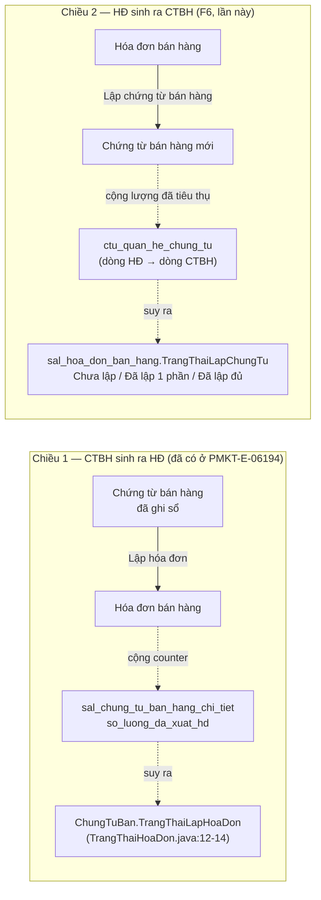
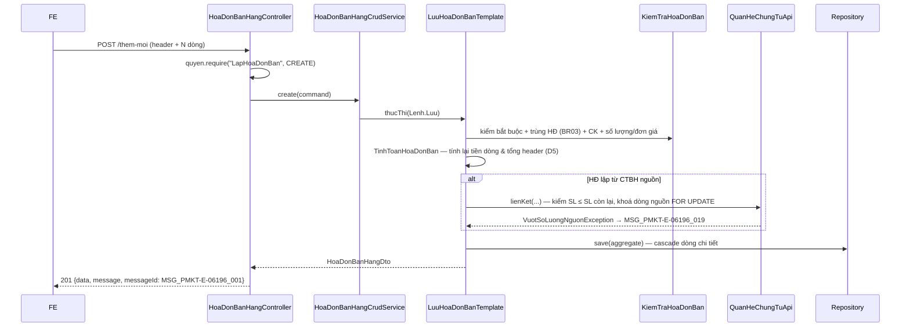

# Kế hoạch triển khai API — Hóa đơn bán hàng (PMKT-E-06196)

> **Trạng thái:** `BẢN NHÁP CHỜ REVIEW` — F1 (danh sách) đã có code, F2–F6 (thêm/sửa/xóa/chi tiết/lập chứng từ) **chưa cài đặt**, controller chặn tường minh (xem §0-bis bên dưới).
> **Ngày cập nhật:** 2026-08-20 (rà soát lại lần 2 — đối chiếu commit BA `d23d1e20d`, `25f9a7ca6` ngày 17/08 + code Java hiện có; lần đầu 2026-08-14)
> **Người review cần có:** 1 BA (chốt §12) + 1 Dev BE/DBA (chốt §7, §9, §10)

| Mục | Nội dung |
|---|---|
| Use case | `PMKT-U-06456 DanhSach` · `PMKT-U-06457 ThemMoi` (thư mục `ThemMoi/`, BA chưa đánh mã — xem §12-Q1) · `PMKT-U-06466 ChiTiet` · `PMKT-U-06458 CapNhat` · `PMKT-U-06459 Xoa` |
| Màn hình | `SCR_HDBanHang_DanhSach.md` · `SCR_HDBanHang_ThemMoi.md` · `SCR_HDBanHang_ChiTiet.md` · `SCR_HDBanHang_CapNhat.md` · `SCR_HDBanHang_Xoa.md` |
| Tài liệu nguồn | `pmkt-docs/ba/PMKT-E-06196_HoaDonBanHang/` + `pmkt-docs/ba/PMKT-E-06194_ChungTuBanHang/5.screens/SCR_CTBH_ThemMoi.md` (logic chuẩn) + `pmkt-docs/ba/Common/business_rules.md` |
| Module BE | `cell-app/src/main/java/vn/vtt/pmkt/cell/hoa_don_ban_hang/` (**đã scaffold** — entity/dto/repository/controller/service của **F1 danh sách** đã có code; F2–F6 chưa cài, xem §0-bis) |
| Bảng DB | `sal_hoa_don_ban_hang` (**61 cột** — đã thêm đủ 4 cột của kế hoạch) · `sal_hoa_don_ban_hang_chi_tiet` (**47 cột** — còn thiếu 7 cột), xem [07-thiet-ke-db.md](07-thiet-ke-db.md) |

**Bộ file của kế hoạch này**

| File | Nội dung | Trạng thái |
|---|---|---|
| `00-ke-hoach-tong.md` | file này — quyết định, phạm vi, kiến trúc, danh mục endpoint, rủi ro, câu hỏi BA | — |
| [`01-xem-danh-sach-hoa-don.md`](01-xem-danh-sach-hoa-don.md) | F1 — `POST /search`, `GET /cot`, `POST /export`; **11 cột** BA, 2 cột dẫn xuất, khu vực chi tiết BR09 | ✅ **ĐÃ CÀI** (còn 4 delta) |
| [`02-them-moi-hoa-don.md`](02-them-moi-hoa-don.md) | F2 — `POST /them-moi`; toàn bộ tính toán CK/thuế/quy đổi + check trùng | ⬜ chưa cài |
| [`03-xem-chi-tiet-hoa-don.md`](03-xem-chi-tiet-hoa-don.md) | F3 — `GET /{id}`; field điều khiển ẩn/hiện nút của FE + BR49 | 🟡 cài **một nửa** (header) |
| [`04-cap-nhat-hoa-don.md`](04-cap-nhat-hoa-don.md) | F4 — `PUT /{id}`; hệ quả BR02 khi HĐ đã lập chứng từ | ⬜ chưa cài (chặn 400) |
| [`05-xoa-hoa-don.md`](05-xoa-hoa-don.md) | F5 — `DELETE /{id}` + `POST /xoa-hang-loat` | ⬜ chưa cài (chặn 400) |
| [`06-lap-chung-tu-tu-hoa-don.md`](06-lap-chung-tu-tu-hoa-don.md) | F6 — nạp dữ liệu HĐ sang màn CTBH + đồng bộ `TrangThaiLapChungTu` | ⬜ chưa cài |
| [`07-thiet-ke-db.md`](07-thiet-ke-db.md) | migration **`V1033`** — 7 cột chi tiết, unique index, CHECK, seed quyền | 🟡 làm **một phần** ở baseline |

---

## 0-bis. Rà soát **lần trước** (2026-08-20) — giữ lại làm lịch sử

> ⚠️ Lần rà soát đó chỉ soi **2 commit BA ngày 17/08** và kết luận "không đổi logic". Đợt rà **2026-08-21** (khối ⚠️ ở đầu file) rộng hơn nhiều: 15 file BA / +1.186 dòng, cây `cell-app` đổi base package, migration squash lần hai, và **BR09 + BR49 là quy tắc mới có sinh endpoint**. Đọc khối C1–C4 ở đầu file trước; mục 0-bis này chỉ để tra lại đã sửa gì ở đợt trước.

Chạy lại `/plan-be` vì tài liệu BA của epic đổi sau ngày sinh plan lần đầu (14/08), qua hai commit
17/08 trong `pmkt-docs`:

- `d23d1e20d` — "đồng bộ tên entity ldm - scr field": đổi cách viết tên field BA từ bí danh
  `HoaDonBan.X` sang tên bảng/entity chuẩn LDM `sal_hoa_don_ban_hang.X` (và `mst_mau_so_hoa_don`,
  `sal_hoa_don_ban_hang_chi_tiet`) trong `5.screens/SCR_HDBanHang_DanhSach.md`,
  `5.screens/SCR_HDBanHang_ThemMoi.md`, `Matrix/…/SCR_HDBanHang_ThemMoi_MaTranAnHien.md`.
- `25f9a7ca6` — "gom mô tả sinh bút toán về BR20…": phía 06196 chỉ sửa 2 dòng ghi chú (bỏ "Tab Hạch
  toán" khỏi danh sách tab bị lược trong `Matrix/…/_scope.md` và
  `SCR_HDBanHang_ThemMoi_MaTranAnHien.md`) vì màn Hóa đơn **không có** tab này.

**Kết luận: cả hai commit đều là chuẩn hóa CÁCH VIẾT tài liệu, KHÔNG đổi logic/trường/luật nghiệp
vụ nào của 06196.** Đối chiếu cụ thể:

| # | Điểm kiểm | Kết quả | Bằng chứng |
|---|---|---|---|
| 1 | Code Java (`HoaDonBanHang.java`, `HoaDonBanHangDto.java`) có dùng tên field/bảng sai chuẩn LDM không? | **KHÔNG có drift.** Entity đã `@Table(name = "sal_hoa_don_ban_hang")` và mọi `@Column` map đúng snake_case của bảng thật (vd `so_hoa_don`, `ngay_hoa_don`, `trang_thai_lap_chung_tu`…) theo đúng quy ước Java (`cell-app/CLAUDE.md` §Đặt tên), độc lập với việc tài liệu BA gọi bảng bằng bí danh `HoaDonBan` hay tên chuẩn `sal_hoa_don_ban_hang` — hai cách viết chỉ là bề mặt tài liệu, quy về cùng một bảng/cột vật lý. | `cell-app/src/main/java/vn/vtt/pmkt/cell/hoa_don_ban_hang/internal/entity/HoaDonBanHang.java:21,37,44,55,69` |
| 2 | Code có giả định sai "Hóa đơn có Tab Hạch toán" không? | **KHÔNG.** Entity kế thừa `AggregateRootEntity` chứ không `BaseChungTuEntity` (đúng D2 §0), không có field/logic ghi sổ, không import `hach_toan`/`GhiSoApi`; comment ở `package-info.java` và entity nói rõ "không có ghi sổ/bỏ ghi sổ". Controller cũng chưa cài luồng ghi nào có thể sinh bút toán. | `cell-app/src/main/java/vn/vtt/pmkt/cell/hoa_don_ban_hang/package-info.java:8-12` · `internal/entity/HoaDonBanHang.java:23-27` · `internal/controller/HoaDonBanHangController.java:70-88` |
| 3 | Plan cũ (00, 01, 07) có trích dẫn `file:dòng` bằng bí danh `HoaDonBan.X` đã lỗi thời không? | **CÓ, đã sửa trong bản này** — thuần túy cập nhật cách trích dẫn cho khớp tài liệu BA mới nhất, không đổi bất kỳ quyết định/thiết kế nào. | Xem danh sách sửa bên dưới |
| 4 | Plan cũ có giả định "Tab Hạch toán" ở đâu không? | **KHÔNG** — grep toàn bộ `docs/doing/PMKT-E-06196-hoa-don-ban-hang-api/*.md` cũ không có chuỗi "Tab Hạch toán". D2 (§0) đã đúng ngay từ đầu: Hóa đơn không hạch toán. | — |
| 5 | Package Java trong plan cũ đúng chưa? | **SAI, đã sửa trong bản này** — 5 chỗ ở `00-ke-hoach-tong.md` và `06-lap-chung-tu-tu-hoa-don.md` ghi package `vn.dopai.pmkt…` (theo `CLAUDE.md` gốc, đã lỗi thời), trong khi code thật và `cell-app/CLAUDE.md:8` dùng `vn.vtt.pmkt`. Lỗi này **không liên quan** hai commit BA — là sai sót còn sót lại từ lần sinh plan đầu. | `cell-app/src/main/java/vn/vtt/pmkt/cell/hoa_don_ban_hang/package-info.java:1` (thực tế) so với `00-ke-hoach-tong.md:12,94,241,505` và `06-lap-chung-tu-tu-hoa-don.md:210` (cũ) |
| 6 | Phạm vi code đã cài so với 6 chức năng (F1–F6) trong plan? | Chỉ **F1 (xem danh sách)** có code chạy được (`HoaDonBanHangController` kế thừa `BaseCrudController` cho `search`/`cot`/`{id}`/`export`). **F2 (thêm mới), F4 (cập nhật), F5 (xóa)** bị chặn tường minh — `create()`/`update()`/`delete()` override ném `ApiException.badRequest(MaLoiHoaDonBanHang.CHUA_HO_TRO, …)`. **F3 (chi tiết)** dùng chung endpoint `GET /{id}` của base nhưng response DTO đầy đủ 41 field (`HoaDonBanHangDto`) kể cả phần "chỉ có nghĩa cho Thêm/Sửa" — cần đối chiếu lại với `03-xem-chi-tiet-hoa-don.md` khi cài thật. **F6 (lập chứng từ từ hóa đơn)** chưa có endpoint nào. | `internal/controller/HoaDonBanHangController.java:70-88` |

**Sửa cụ thể trong lần rà soát này** (đổi bí danh field, không đổi nội dung/quyết định):

| File | Vị trí | Trước | Sau |
|---|---|---|---|
| `00-ke-hoach-tong.md` | dòng mermaid "Chiều 2" | `HoaDonBan.TrangThaiLapChungTu` | `sal_hoa_don_ban_hang.TrangThaiLapChungTu` |
| `00-ke-hoach-tong.md` | bảng migration (nay là §7) | `HoaDonBan.ChungTuBanId` | `sal_hoa_don_ban_hang.ChungTuBanId` |
| `01-xem-danh-sach-hoa-don.md` | bảng "Ánh xạ cột BA ↔ DB ↔ DTO" (mục 2–9) | `HoaDonBan.NgayHoaDon`, `.SoHoaDon`, `.TenKhachHang`, `.TrangThaiLapChungTu`, `.TrangThaiPhatHanh`, `.TongThueGTGT`/`.TongThueGTGTQuyDoi`, `.TrangThaiHoaDon` | đổi tiền tố `HoaDonBan.` → `sal_hoa_don_ban_hang.` cho toàn bộ 7 dòng |
| `07-thiet-ke-db.md` | bảng "Cột thiếu" — cột `chung_tu_ban_id` | `HoaDonBan.ChungTuBanId`; trích `SCR_CTBH_ThemMoi.md:1305` | `sal_hoa_don_ban_hang.ChungTuBanId`; trích dòng đã cập nhật `SCR_CTBH_ThemMoi.md:1436` (số dòng đổi vì tài liệu 06194 đã được viết lại nhiều đợt kể từ 14/08) |
| `00-ke-hoach-tong.md` · `06-lap-chung-tu-tu-hoa-don.md` | 5 chỗ package Java | `vn.dopai.pmkt…` (theo `CLAUDE.md` gốc, đã lỗi thời) | `vn.vtt.pmkt…` |

*(Kết luận trên đúng với phạm vi đợt 20/08. Đợt 21/08 thì **có** đổi nội dung: D12/D13/D14 mới, §2 viết lại, §4 thêm A11/A12, §7 rút còn 4 việc, §12 thêm Q10–Q14.)*

---

## 0. Các quyết định đã chốt

| # | Quyết định | Hệ quả |
|---|---|---|
| **D1** ✅ | Tạo **module Modulith mới** `cell/hoa_don_ban_hang/` với tiền tố bảng `sal_` (dùng chung tiền tố với `chung_tu_ban_hang` vì hai bảng đã mang tiền tố `sal_` từ baseline — `V1__create_database.sql:16919`, `:16874`). KHÔNG nhét vào `chung_tu_ban_hang/`. | Thư mục mới + `package-info.java` khai `@ApplicationModule`. `chung_tu_ban_hang` không phải sửa gì trừ việc gỡ chú thích "module Hoá đơn chưa có" ở `ChiTietChungTuBanHang.java:213`. Ranh giới Modulith phải **sạch tuyệt đối** (cell-app/CLAUDE.md §Ranh giới). |
| **D2** ✅ | Kế thừa **`core.controller.BaseCrudController`**, **KHÔNG** kế thừa `accounting_core.chung_tu.controller.BaseChungTuController`. | Hóa đơn bán hàng **không hạch toán** (`UC_HDBanHang_ThemMoi.md:20`, `SCR_HDBanHang_ThemMoi.md:69`) → không có ghi sổ/bỏ ghi sổ/số chứng từ/kỳ khóa. Bảng `sal_hoa_don_ban_hang` cũng **không có** cột `so_chung_tu`/`ngay_hach_toan`/`status`/`loai_chung_tu_id` mà `BaseChungTuEntity` đòi (đối chiếu `sal_dieu_chinh_hoa_don_ban_hang` — `V1__create_database.sql:16738-16747` — thì CÓ). **Vì sao không chọn `BaseChungTuController`:** nó sẽ lộ ra `/ghi-so`, `/bo-ghi-so`, `/nhan-ban` — 3 endpoint vô nghĩa với chứng từ thương mại, và ép entity mang 8 cột không tồn tại trong DB. |
| **D3** 🟡 | Entity `HoaDonBanHang extends core.entity.AggregateRootEntity` (`core/entity/AggregateRootEntity.java:18`), chi tiết là `@OneToMany(cascade = ALL, orphanRemoval = true)` — **không** có repository riêng cho dòng chi tiết. | Bảng đã có `phien_ban integer DEFAULT 1 NOT NULL` (`V1__create_database.sql:16845`) đúng hợp đồng `@Version` của lớp này. Sửa chỉ chạm dòng con vẫn phải `touch()` header (mẫu: `ChungTuBanHang.java:32-36`). ⚠️ **Thực tế đang cài:** entity `HoaDonBanHang.java` mới ánh xạ **phần header** (39 field), **chưa có** `ChiTietHoaDonBanHang` và chưa có `@OneToMany` — `GET /{id}` hiện trả `chiTiet` rỗng. Đây là việc của F2. |
| **D4** | Phần **GHI** (thêm/sửa/xóa) **override toàn bộ** `AbstractCrudService`, đi qua 4 template `TaoHoaDonBan`/`SuaHoaDonBan`/`XoaHoaDonBan` + `LuuHoaDonBanTemplate`. Phần **ĐỌC** (search/cột/chi tiết/export) dùng nguyên base. | Cùng kiến trúc lai của `ChungTuBanHangCrudService.java:28-33`. Lý do: thứ tự "validate trùng → tính lại tiền → kiểm số lượng nguồn → lưu → cập nhật liên kết/counter" là bất biến, `AbstractCrudService.create` chỉ biết `repository.save`. |
| **D5** | Toàn bộ **tính toán tiền** (thành tiền, chiết khấu 4 loại, thuế GTGT, thuế XK, quy đổi tỷ giá) **tính lại ở BE khi lưu**, không tin số FE gửi lên — trừ các trường BA cho phép sửa tay (`Tiền thuế GTGT`, `Tiền thuế XK`, `Giá trị tính thuế XK`, các cột quy đổi) thì **giữ nguyên giá trị client gửi**. | `TinhToanHoaDonBan` là lớp thuần JVM, test `@Tag("unit")`. Danh sách chính xác trường nào tính lại / trường nào tôn trọng client: [02-them-moi-hoa-don.md §4](02-them-moi-hoa-don.md). **Vì sao không tính toàn bộ ở BE:** `SCR_CTBH_ThemMoi.md:695-701` (BR11 mục 5) và `:855-865` (BR14) nói rõ người dùng sửa tay cột quy đổi/thuế thì **không tính ngược**, ghi đè hết là làm sai BA. |
| **D6** | **KHÔNG viết lại** logic tính toán của `chung_tu_ban_hang` — copy có chọn lọc sang `TinhToanHoaDonBan` của module mới thay vì import chéo. | `chung_tu_ban_hang/internal/service/business/TinhToanBanHang.java` nằm trong `internal/` → import chéo là vi phạm Modulith. Tách chung ra `accounting_core` cũng sai vì HĐ không hạch toán. Trùng lặp có kiểm soát ~200 dòng, chấp nhận và ghi vào §11-R4. |
| **D7** | Liên kết **HĐ ↔ chứng từ** đi qua `quan_he_chung_tu.api.QuanHeChungTuApi` (`quan_he_chung_tu/api/QuanHeChungTuApi.java:36`), **không** tự viết bảng liên kết. Riêng chiều **HĐ là nguồn của CTBH** hiện `LoaiChungTu.SAL_CHUNG_TU_BAN_HANG(true, false)` (`LoaiChungTu.java:19`) chưa cho phép làm đích → phải mở rộng enum + CHECK constraint. | Migration `V3` sửa `ck_ctu_qhct_loai_dich`; enum sửa thành `SAL_CHUNG_TU_BAN_HANG(true, true)`. Chi tiết + rủi ro: [06-lap-chung-tu-tu-hoa-don.md](06-lap-chung-tu-tu-hoa-don.md), §11-R2. |
| **D8** ✅ | `TrangThaiLapChungTu` của hóa đơn dùng **3 giá trị** `Chưa lập` / `Đã lập 1 phần` / `Đã lập đủ` theo `SCR_HDBanHang_DanhSach.md:61-63`, **không** dùng 2 giá trị của CHECK constraint hiện tại. | Migration `V3` phải `DROP` rồi `ADD` lại `sal_hoa_don_ban_hang_trang_thai_lap_chung_tu_check` + backfill dữ liệu cũ. Xem [07-thiet-ke-db.md §2](07-thiet-ke-db.md). **Xung đột nội bộ tài liệu BA** — `UC_HDBanHang_ThemMoi.md:39` và `SCR_HDBanHang_ThemMoi.md:96` lại nói 2 giá trị (`"Chưa lập chứng từ"` / `"Đã lập chứng từ"`) → §12-Q2. |
| **D9** | **Phát hành hóa đơn điện tử NGOÀI phạm vi.** Trường `trang_thai_phat_hanh_hoa_don` chỉ được BE set = `"Chưa phát hành"` lúc tạo, và chỉ **đọc** để chặn Sửa/Xóa. | Quyền `LapHoaDonBan.PhatHanh` đã seed (`V2__seed_data.sql`) nhưng **không** có endpoint nào dùng lần này. `SCR_HDBanHang_ThemMoi.md:7`: "chưa kết nối API CQT để phát hành (sẽ triển khai sau)". |
| **D10** ✅ | **Không mở `POST /import`.** `cotMacDinh(LoaiMau.IMPORT)` trả `List.of()` → base tự trả 400 `IMPORT_NOT_SUPPORTED` (`BaseCrudController.java:113-116`). Mở `POST /export`. | Cùng lý do với `ChungTuBanHangController.java:183-185`. Quyền `.Export` **chưa seed** cho `LapHoaDonBan` → migration `V1033` phải seed, nếu không mọi user kể cả Admin nhận 403 (§10). |
| **D11** | Hai chiều **HĐ→CTBH** và **CTBH→HĐ** là **hai counter khác nhau**, không gộp. `sal_chung_tu_ban_hang_chi_tiet.so_luong_da_xuat_hd` (`ChiTietChungTuBanHang.java:204`) là counter của chiều CTBH→HĐ; `TrangThaiLapChungTu` của hóa đơn là chiều HĐ→CTBH. | Hai luồng nghiệp vụ độc lập, xem sơ đồ §6. Nhầm hai chiều này là lỗi thiết kế đắt nhất của epic — ghi rõ vào §11-R1. |

| **D12** ✅ | **Enum trên wire trả TÊN HẰNG Java** (`CHUA_PHAT_HANH`, `TRONG_NUOC`), **KHÔNG** phải chuỗi tiếng Việt lưu trong CHECK constraint. | ⚠️ **Đảo ngược quyết định của bản nháp 2026-08-14** (bản cũ chọn chuỗi tiếng Việt). Lý do đổi — đã ghi ở `hoa_don_ban_hang/package-info.java:26-30`: bộ lọc động ép giá trị bằng `Enum.valueOf(name)` (`core/shared/search/ValueConverter.java`), trả chuỗi tiếng Việt ra FE sẽ cho một dropdown mà **chính bộ lọc từ chối bằng 400**. Hệ quả: `POST /lookup` (A4) và mọi ví dụ JSON ở [02](02-them-moi-hoa-don.md)…[05](05-xoa-hoa-don.md) phải dùng tên hằng. |
| **D13** ✅ | Alias `@Searchable` của cột phát hành là **`trangThaiPhatHanhHoaDon`** (giữ nguyên tên cột DB), không phải `trangThaiPhatHanh`. | FE đã khai cứng tên này ở `client/src/features/banHang/hoaDonBanHang/api/model.ts` — `HoaDonBanHang.java:170-171`. DTO cũng dùng `trangThaiPhatHanhHoaDon` (`HoaDonBanHangDto.java:67`). |
| **D14** | **Migration mới đánh số `V1033`** (max hiện tại `V1032`), KHÔNG phải `V3`. | Xem C3 ở đầu file và [07 §1](07-thiet-ke-db.md). |

> ⚠️ **Cảnh báo môi trường:** `db/migration/` đã bị squash **hai lần**. Hiện trạng (2026-08-21): `V1__create_database.sql` · `V2__seed_data.sql` · `V3__gop_thay_doi_sau_baseline.sql` · `V1000__moc_chan_code_cu_phai_pull_lai.sql` … `V1032__tknd_va_cau_hinh_danh_so.sql`. **Số hiệu mới là `V1033`.** Đọc lại `ls db/migration/` ngay trước khi code — thư mục này đã đổi 2 lần trong 8 ngày.

---

## 1. Phạm vi

### 1.1 Trong phạm vi

| # | Chức năng | Nguồn | File chi tiết |
|---|---|---|---|
| **F1** ✅ | Xem danh sách HĐ — tìm kiếm động, phân trang, sắp xếp, xuất Excel, **+ khu vực chi tiết dưới lưới (BR09 mới)** | `UC_HDBanHang_DanhSach.md` · `SCR_HDBanHang_DanhSach.md:130-172` | [01](01-xem-danh-sach-hoa-don.md) |
| **F2** | Thêm mới HĐ (header + N dòng chi tiết), check trùng, tính tiền | `UC_HDBanHang_ThemMoi.md` · `SCR_HDBanHang_ThemMoi.md` | [02](02-them-moi-hoa-don.md) |
| **F3** 🟡 | Xem chi tiết HĐ (readonly) **+ điều hướng trước/sau (BR49 mới — chờ Q12)** | `UC_HDBanHang_ChiTiet.md` · `SCR_HDBanHang_ChiTiet.md` · `Common/business_rules.md` BR49 | [03](03-xem-chi-tiet-hoa-don.md) |
| **F4** | Cập nhật HĐ (chỉ khi "Chưa phát hành") + hệ quả BR02 | `UC_HDBanHang_CapNhat.md` · `SCR_HDBanHang_CapNhat.md` | [04](04-cap-nhat-hoa-don.md) |
| **F5** | Xóa mềm 1 HĐ + xóa hàng loạt (lỗi từng phần) | `UC_HDBanHang_Xoa.md` · `SCR_HDBanHang_Xoa.md` | [05](05-xoa-hoa-don.md) |
| **F6** | Nạp dữ liệu HĐ để lập Chứng từ bán hàng + đồng bộ `TrangThaiLapChungTu` | `UC_HDBanHang_DanhSach.md:41-46` · `SCR_HDBanHang_DanhSach.md:70-77` (BR04) | [06](06-lap-chung-tu-tu-hoa-don.md) |
| — | Migration **`V1033`** (7 cột chi tiết + unique index + CHECK + seed `.Export`) | §7, §10 | [07](07-thiet-ke-db.md) |

### 1.2 NGOÀI phạm vi (không cài lần này)

| Việc bị loại | Nguồn | Endpoint có lộ ra không |
|---|---|---|
| **Phát hành hóa đơn điện tử** (chuyển `Chưa phát hành` → `Đã phát hành`, kết nối CQT) | `SCR_HDBanHang_ThemMoi.md:7` nói rõ "sẽ triển khai sau"; epic không có UC nào cho việc này | Không có endpoint. `trangThaiPhatHanh` luôn = `"Chưa phát hành"` với mọi HĐ tạo qua API này. |
| **Lập Chứng từ bán dịch vụ từ HĐ** (BR05 màn danh sách — `SCR_HDBanHang_DanhSach.md:79-86`) | Module Java `chung_tu_ban_dich_vu` **chưa tồn tại** (`ls cell/` chỉ có `chung_tu_ban_hang`, `chung_tu_mua_hang`) dù bảng `sal_chung_tu_ban_dich_vu` đã có ở baseline | BE **có** trả `coDongDichVu: boolean` trong DTO danh sách để FE ẩn/hiện nút, nhưng **không** có endpoint nạp dữ liệu. Bấm nút → FE tự mở màn CTBDV khi module đó ra đời. §12-Q6. |
| **Hóa đơn điều chỉnh / thay thế** (`BR06`, `BR07` màn danh sách — `SCR_HDBanHang_DanhSach.md:88-104`) | Là epic riêng **PMKT-E-06197** (`V1__create_database.sql:16760` — comment bảng `sal_dieu_chinh_hoa_don_ban_hang` ghi rõ "PMKT-E-06197"). Bảng "hóa đơn thay thế" **chưa tồn tại** trong DB. | Cột `trangThaiHoaDon` và `hoaDonLienQuan` **có** trong response danh sách nhưng lần này BE chỉ suy được **3/5** giá trị (`Hóa đơn gốc`, `Hóa đơn bị điều chỉnh`, `Hóa đơn điều chỉnh`); hai giá trị `thay thế` luôn không xuất hiện. §12-Q3. |
| **Nhập Excel** | Chưa có thiết kế mẫu file | `POST /import` **có** (kế thừa base) nhưng trả `400 IMPORT_NOT_SUPPORTED` — `BaseCrudController.java:113-116`. |
| **Popup phân bổ chiết khấu** (`SCR_CTBH_PBCK.md`, `SCR_CTBH_PBCK_MHHD.md`) | Tính toán phân bổ chạy **hoàn toàn ở FE**; BE chỉ nhận `tienChietKhau` từng dòng đã phân bổ xong và validate tổng | Không có endpoint. Validate `MSG_PMKT-E-06196_017`, `_018` vẫn chạy ở BE — [02 §5](02-them-moi-hoa-don.md). |
| **Nhân bản hóa đơn** | Epic không có UC nhân bản; `6.messages.md` không cấp mã nào | Không có endpoint (khác `BaseChungTuController` — xem D2). |

---

## 2. Hiện trạng đã khảo sát

### 2.1 Code hiện có — **BROWNFIELD** (đổi so với bản 2026-08-14)

```bash
ls cell-app/src/main/java/vn/vtt/pmkt/cell/
# accounting_core chi_phi_tra_truoc chung_tu_ban_hang chung_tu_mua_hang common cong_cu_dung_cu
# core dieu_chinh_gia_hang_ban dieu_chinh_gia_hang_mua fixed_asset hoa_don_ban_hang integration_ops
# ke_toan_tong_hop kho master_data platform_iam quan_he_chung_tu reporting so_du_ban_dau
# tien_mat_tien_gui tinh_gia_xuat_kho tra_lai_hang_ban tra_lai_hang_mua
```

**Module `hoa_don_ban_hang` đã tồn tại — 19 file, 1.404 dòng.** Cây thực tế:

| File | Vai trò | Khớp kế hoạch? |
|---|---|---|
| `package-info.java` | `@ApplicationModule(displayName = "hoa_don_ban_hang")`, tiền tố `sal_` | ✅ đúng D1 |
| `internal/controller/HoaDonBanHangController.java` | `extends BaseCrudController<HoaDonBanHang, HoaDonBanHangDto, Void, Void>`; **3 endpoint ghi bị chặn tường minh** trả 400 `HOA_DON_BAN_HANG_CHUA_HO_TRO` (`:72-93`) | ✅ đúng D2 |
| `internal/entity/HoaDonBanHang.java` | `extends AggregateRootEntity`, `@Table("sal_hoa_don_ban_hang")`, whitelist 7 `@Searchable` | ✅ đúng D3 — **nhưng chỉ header** |
| `internal/dto/HoaDonBanHangDto.java` | record 39 field, dùng chung cho danh sách + chi tiết; **chưa có** `chiTiet` | 🟡 |
| `internal/dto/TongHopHoaDonDto.java` | **chỉ 1 field** `tongTienThueGtgt` | ⚠️ khác kế hoạch — xem [01 §8.4](01-xem-danh-sach-hoa-don.md) |
| `internal/dto/HoaDonLienQuanDto.java` | `(UUID id, String soHoaDon)` — BR07 | ✅ |
| `internal/model/` ×7 | `LoaiNghiepVuHoaDon`, `LoaiChietKhauHoaDon`, `HinhThucThanhToanHoaDon`, `TrangThaiPhatHanh`, `TrangThaiLapChungTu`, `TrangThaiHoaDon`, `MaDb` (converter), `MaLoiHoaDonBanHang` | 🟡 **chỉ 3 hằng** mã lỗi (`KHONG_TIM_THAY`, `CHUA_HO_TRO`, `MSG_LOI_HE_THONG`) — thiếu 18 hằng của §11 |
| `internal/repository/` ×3 | `Repository` + `Custom` + `Impl` (`tongHop(spec)`, `hoaDonLienQuanTheoGoc(ids)` — 1 query cho cả trang) | ✅ đúng [01 §8.4, §8.5](01-xem-danh-sach-hoa-don.md) |
| `internal/service/HoaDonBanHangCrudService.java` | override `search()` (ghép HĐ liên quan), `get()`, `summary()`, `defaultSortAlias()` | ✅ đúng D4 phần ĐỌC |
| `internal/service/business/HoaDonBanHangMapper.java` | entity → DTO | ✅ |

**Chưa có** (so với cây thiết kế ở §3.3): `entity/ChiTietHoaDonBanHang`, `dto/Luu*Request`, `port/`, `service/business/{LuuHoaDonBanTemplate, TaoHoaDonBan, SuaHoaDonBan, XoaHoaDonBan, KiemTraHoaDonBan, TinhToanHoaDonBan, TrangThaiHoaDonBan, HoaDonBanSupport}`, `HoaDonBanHangHangLoatService`.

```bash
find cell-app/src/test -ipath "*HoaDonBanHang*"
# (rỗng)
```
⚠️ **Module chưa có một test nào** — kể cả test pin whitelist `@Searchable` mà [01 §11.1](01-xem-danh-sach-hoa-don.md) yêu cầu. Ghi vào §9-R9.

**Phía FE:** `client/src/features/banHang/hoaDonBanHang/` đã tồn tại; controller và DTO đang bám theo hợp đồng FE đã code (`api/hoaDonBanHangApi.ts`, `api/model.ts`) — đây là lý do của D12 và D13.

### 2.2 Hiện trạng DB — đã apply một phần của kế hoạch

```bash
ls cell-app/src/main/resources/db/migration/
# V1__create_database.sql  V2__seed_data.sql  V3__gop_thay_doi_sau_baseline.sql
# V1000__… … V1032__tknd_va_cau_hinh_danh_so.sql
```
**Số hiệu lớn nhất hiện tại: `V1032` ⇒ file mới là `V1033`** (D14).

| Bảng | Vị trí | Trạng thái so với kế hoạch |
|---|---|---|
| `sal_hoa_don_ban_hang` | `V1__create_database.sql:16919-16986` | **61 cột** — đã có đủ `tong_tien_thue_xk`, `tong_tien_thue_xk_quy_doi`, `trang_thai_hoa_don` (DEFAULT `'Hóa đơn gốc'`), `chung_tu_ban_id` ✅ |
| `sal_hoa_don_ban_hang_chi_tiet` | `V1__create_database.sql:17031-17080` | **47 cột** — **vẫn thiếu đủ 7 cột** của [07 §2.2](07-thiet-ke-db.md) ❌ |
| CHECK `trang_thai_lap_chung_tu` | `V1:16983` | ✅ đã mở lên **3 giá trị** `'Chưa lập'` / `'Đã lập 1 phần'` / `'Đã lập đủ'`; comment cột ghi rõ *"V4 mở từ 2 lên 3 giá trị… Chuỗi cũ của baseline đã backfill"* |
| CHECK `trang_thai_hoa_don` | `V1:16982` | ✅ đã có, đủ **5 giá trị** BR06 |
| CHECK `loai_nghiep_vu` | `V1:16981` | ❌ vẫn **2 giá trị**, chưa thêm `'Bán dịch vụ'` (chờ §12-Q5) |
| `fn_bang_cua_loai_chung_tu` | sửa ở `V3__gop_thay_doi_sau_baseline.sql:3018-3020` | ✅ **đã sửa** — nay trả `'sal_hoa_don_ban_hang_chi_tiet'` (rủi ro R3 của bản cũ đã đóng) |
| Unique `uq_sal_hdbh_so_hd` | `V1:23665` | ❌ **vẫn còn `khach_hang_id`** trong khóa — trái BR03 (§12-Q4) |
| CHECK `ck_ctu_qhct_loai_dich` | `V1:7339` | ❌ **chưa** có `'SAL_CHUNG_TU_BAN_HANG'` — F6 vẫn bị chặn |
| Quyền `LapHoaDonBan.*` | `V2__seed_data.sql` | Có `View`, `ViewList` (**mới**), `View.Detail`, `Create`, `Edit`, `Delete`, `PhatHanh`. ❌ **`Export` vẫn chưa seed** |
| Index / RLS / trigger | `V1:21789`, `:21719`, `:31727`, `:25492` | ✅ nguyên vẹn |

⚠️ **`LapHoaDonBan.ViewList` là quyền MỚI** xuất hiện trong seed, trong khi `BaseCrudController.java:123` vẫn kiểm `QuyenChecker.VIEW` (`"View"`) cho `POST /search`. Hai mã quyền cùng tồn tại mà `QuyenChecker` không có hằng nào cho `ViewList` — xem §12-Q10.

### 2.3 Hạ tầng base đã có sẵn những gì

| Cần | Đã có ở base | Vị trí |
|---|---|---|
| 8 endpoint chuẩn (`/search`, `/cot`, `GET /{id}`, `/them-moi`, `PUT /{id}`, `DELETE /{id}`, `/export`, `/import`) | `BaseCrudController<E,D,C,U>` | `core/controller/BaseCrudController.java:121,131,137,143,149,159,171,197` |
| Body tìm kiếm chuẩn `{page,pageSize,sort,keyword,filters,logic}` | `SearchRequest` record | `core/request/SearchRequest.java:33` |
| Envelope danh sách `{data,pagination,summary}` | `PageResponse<T>` | `core/response/PageResponse.java:21` |
| Envelope thành công `{data,message,messageId}` | `ApiResponse<T>` | `core/response/ApiResponse.java:22` |
| Envelope lỗi `{error:{code,message,messageId,details}}` | `ApiError` + `GlobalExceptionHandler` | `core/shared/error/ApiError.java:11` · `core/config/GlobalExceptionHandler.java:29` |
| Lọc/sắp xếp động theo whitelist, tự bơm `tenant_id` + `da_xoa=false` | `DynamicSpecification` (`MAX_FILTERS=20`) | `core/shared/search/DynamicSpecification.java:51,75,78` |
| Whitelist cột cho filter/sort/keyword | `@Searchable` | `core/shared/search/Searchable.java:36` |
| Tìm không dấu (BR11.1) | `bo_dau()` SQL function qua `unaccentLower` | `core/shared/search/DynamicSpecification.java:234-240` |
| Kiểm quyền `View/View.Detail/Create/Edit/Delete/Export` | `QuyenChecker` | gọi ở `core/controller/BaseCrudController.java:123,139,145,151,163,176` |
| Lock lạc quan `@Version` | `AggregateRootEntity.phienBan` | `core/entity/AggregateRootEntity.java:21-22` |
| Kiểm token lock từ client (`updatedAt` → 409 `STALE_DATA`) | mẫu `BanHangSupport.kiemTraLock` | `chung_tu_ban_hang/internal/service/business/BanHangSupport.java:120-130` |
| Xuất Excel toàn bộ bản ghi sau lọc | `ExcelExporter` + `cotMacDinh(LoaiMau.EXPORT)` | `core/controller/BaseCrudController.java:171-190` |
| Dòng tổng toàn cục (BR31) | `AbstractCrudService.summary(SearchRequest)` | mẫu `chung_tu_ban_hang/internal/service/ChungTuBanHangCrudService.java:191-195` |
| Đồ thị liên kết chứng từ + guard xóa + đếm số lượng đã tiêu thụ | `QuanHeChungTuApi` | `quan_he_chung_tu/api/QuanHeChungTuApi.java:36,46,54,57,60,69` |
| Kiểu số chuẩn BR7 | DOMAIN `money_vnd(18,2)`, `quantity(18,3)`, `percent_rate(5,2)`, `exchange_rate(18,6)` | `V1__create_database.sql:73,94,80,48` |
| Enum ⇄ chuỗi tiếng Việt trong DB | ✅ **đã có ở module** — `MaDb` + `MaDb.Converter` | `hoa_don_ban_hang/internal/model/MaDb.java` (đã copy theo D6; tên khác `GiaTriDb` của `chung_tu_ban_hang`) |

**Không viết lại:** phân trang, lọc động, sort đa cột, export Excel, envelope, RLS, audit trigger, đồ thị quan hệ chứng từ.

---

## 3. Kiến trúc

### 3.1 Phân tầng

```
HoaDonBanHangController                    extends core.controller.BaseCrudController
  │  + POST /xoa-hang-loat  (mới)
  │  + POST /lookup         (mới — bộ giá trị enum cho combo)
  │  + GET  /{id}/du-lieu-lap-chung-tu (mới — F6)
  ▼
HoaDonBanHangCrudService                   extends core.service.AbstractCrudService
  │  ├── kế thừa : search() · moTaCot() · duLieuExport()
  │  ├── override: get() (nạp kèm chi tiết) · create() · update() · delete() · summary() · defaultSortAlias()
  │  └── cài mới : xoaHangLoat() · duLieuLapChungTu()
  ▼
service/business/  LuuHoaDonBanTemplate · TaoHoaDonBan · SuaHoaDonBan · XoaHoaDonBan
                   KiemTraHoaDonBan · TinhToanHoaDonBan · TrangThaiHoaDonBan
                   HoaDonBanMapper · HoaDonBanSupport
  ▼
HoaDonBanHangRepository                    extends core.repository.BaseRepository<HoaDonBanHang, UUID>
  + HoaDonBanHangRepositoryCustom/Impl     (query tổng hợp §6.4 của file 01)
  ▼
HoaDonBanHang (@Table "sal_hoa_don_ban_hang")     extends core.entity.AggregateRootEntity
  └─ @OneToMany ChiTietHoaDonBanHang (@Table "sal_hoa_don_ban_hang_chi_tiet")
```

### 3.2 Lựa chọn kiến trúc + lý do

| Tiêu chí | Phương án A — nhét vào `chung_tu_ban_hang/` | Phương án B — kế thừa `BaseChungTuController` | **Phương án C (CHỌN) — module mới + `BaseCrudController`** |
|---|---|---|---|
| Ranh giới Modulith | Vỡ: 2 aggregate root khác nhau trong 1 module, HĐ phải import `internal/` của CTBH | Sạch | Sạch — module mới, ranh giới đủ điều kiện "sạch tuyệt đối" ngay từ ngày đầu |
| Khớp DB | — | ❌ `BaseChungTuEntity` đòi `so_chung_tu`, `ngay_hach_toan`, `status`, `loai_chung_tu_id`, `chi_nhanh_id` — bảng `sal_hoa_don_ban_hang` **không có cột nào** trong số đó (`V1:16919-16858`) | ✅ `AggregateRootEntity` chỉ đòi `id`, `tenant_id`, `phien_ban`, audit, `da_xoa` — bảng có đủ |
| Endpoint thừa | — | ❌ lộ `/ghi-so`, `/bo-ghi-so`, `/nhan-ban`, `/thong-tin-hach-toan` cho một chứng từ không hạch toán | ✅ đúng 8 endpoint + 3 endpoint riêng |
| Chi phí | Thấp nhất | Trung bình | **Cao nhất** — phải copy ~200 dòng tính toán từ `TinhToanBanHang` (D6) |
| Rủi ro | Sửa CTBH có thể làm vỡ HĐ và ngược lại | Endpoint chết gây hiểu nhầm cho FE | Trùng lặp code tính toán ⇒ **chốt an toàn:** test đối chiếu song song `TinhToanHoaDonBanTest` dùng chung bộ case với `TinhToanBanHangTest` (§16 của file 02) |

### 3.3 Cấu trúc thư mục (Modulith, đúng `cell-app/CLAUDE.md`)

```
cell/hoa_don_ban_hang/
├── package-info.java                    @ApplicationModule(displayName = "hoa_don_ban_hang")
└── internal/                            KHÔNG tạo api/ — chưa module nào cần gọi vào (§12-Q6)
    ├── controller/
    │   └── HoaDonBanHangController.java            (package-private)
    ├── dto/
    │   ├── HoaDonBanHangDto.java                    (chi tiết + danh sách)
    │   ├── ChiTietHoaDonBanHangDto.java
    │   ├── LuuHoaDonBanHangRequest.java             (dùng chung Thêm & Sửa — D4)
    │   ├── LuuChiTietHoaDonBanHangRequest.java
    │   ├── TongHopHoaDonBanDto.java                 (dòng tổng — BR31)
    │   ├── XoaHangLoatRequest.java
    │   ├── KetQuaXoaHangLoatDto.java
    │   └── DuLieuLapChungTuDto.java                 (F6)
    ├── entity/
    │   ├── HoaDonBanHang.java
    │   └── ChiTietHoaDonBanHang.java
    ├── model/
    │   ├── MaDb.java                               ✅ đã có (copy — D6)
    │   ├── LoaiNghiepVuHoaDon.java
    │   ├── LoaiChietKhauHoaDon.java
    │   ├── HinhThucThanhToanHoaDon.java
    │   ├── ThueSuatGtgtHoaDon.java
    │   ├── TrangThaiPhatHanh.java
    │   ├── TrangThaiLapChungTu.java
    │   ├── TrangThaiHoaDonKind.java                 (BR06 — Hóa đơn gốc/điều chỉnh/…)
    │   └── MaLoiHoaDonBan.java
    ├── port/
    │   └── DongHoaDonBanPort.java                   (cắm vào quan_he_chung_tu — D7)
    ├── repository/
    │   ├── HoaDonBanHangRepository.java
    │   ├── HoaDonBanHangRepositoryCustom.java
    │   └── HoaDonBanHangRepositoryImpl.java
    └── service/
        ├── HoaDonBanHangCrudService.java
        ├── HoaDonBanHangHangLoatService.java
        └── business/
            ├── HoaDonBanSupport.java
            ├── LuuHoaDonBanTemplate.java
            ├── TaoHoaDonBan.java · SuaHoaDonBan.java · XoaHoaDonBan.java
            ├── LenhHoaDonBan.java
            ├── KiemTraHoaDonBan.java
            ├── TinhToanHoaDonBan.java
            ├── TrangThaiHoaDonBan.java
            ├── HoaDonBanMapper.java
            └── SoTienHoaDon.java
```

Test đặt song ánh: `src/test/java/vn/vtt/pmkt/cell/hoa_don_ban_hang/internal/service/business/…`

---

## 4. Danh mục API mục tiêu

Base path: **`/api/ban-hang/hoa-don-ban-hang`**. Mã chức năng: **`LapHoaDonBan`** (`common/constant/MaChucNang.java:220`).

| # | Nguồn | Method | Path | Quyền | Trả về | UC | File | Trạng thái |
|---|---|---|---|---|---|---|---|---|
| **A1** | base | `POST` | `/search` (alias `/tim-kiem`) | `.View` | `PageResponse<HoaDonBanHangDto>` | U-06456 | [01](01-xem-danh-sach-hoa-don.md) | ✅ **đã cài** |
| **A2** | base | `GET` | `/cot` | `.View` | `ApiResponse<List<CotMoTa>>` | U-06456 | [01](01-xem-danh-sach-hoa-don.md) | ✅ **đã cài** |
| **A3** | base | `POST` | `/export` | `.Export` ⚠ chưa seed | file `.xlsx` | U-06456 (BR39) | [01](01-xem-danh-sach-hoa-don.md) | 🟡 lộ ra nhưng **403 mọi user**; `cotMacDinh(EXPORT)` chưa cài |
| **A4** | mới | `POST` | `/lookup` | `.View` | `ApiResponse<Map<String,List<String>>>` | U-06457 | [02](02-them-moi-hoa-don.md) | ⬜ |
| **A5** | base (override messageId) | `POST` | `/them-moi` | `.Create` | `201 ApiResponse<HoaDonBanHangDto>` | U-06457 | [02](02-them-moi-hoa-don.md) | ⬜ **chặn 400** `HOA_DON_BAN_HANG_CHUA_HO_TRO` |
| **A6** | base (override nạp chi tiết) | `GET` | `/{id}` | `.View.Detail` | `ApiResponse<HoaDonBanHangDto>` | U-06466 | [03](03-xem-chi-tiet-hoa-don.md) | 🟡 **cài một nửa** — trả header, `chiTiet` rỗng |
| **A7** | base (override messageId) | `PUT` | `/{id}` | `.Edit` | `ApiResponse<HoaDonBanHangDto>` | U-06458 | [04](04-cap-nhat-hoa-don.md) | ⬜ **chặn 400** |
| **A8** | base (override messageId) | `DELETE` | `/{id}` | `.Delete` | `ApiResponse<Void>` | U-06459 | [05](05-xoa-hoa-don.md) | ⬜ **chặn 400** |
| **A9** | mới | `POST` | `/xoa-hang-loat` | `.Delete` | `ApiResponse<KetQuaXoaHangLoatDto>` | U-06459 | [05](05-xoa-hoa-don.md) | ⬜ |
| **A10** | mới | `GET` | `/{id}/du-lieu-lap-chung-tu` | `.View.Detail` | `ApiResponse<DuLieuLapChungTuDto>` | U-06456 (BR04) | [06](06-lap-chung-tu-tu-hoa-don.md) | ⬜ |
| **A11** 🆕 | mới | `POST` | `/{id}/chi-tiet/search` | `.View.Detail` | `PageResponse<ChiTietHoaDonBanHangDto>` | U-06456 (**BR09 mới**) | [01](01-xem-danh-sach-hoa-don.md) | ⬜ |
| **A12** 🆕 | mới | `POST` | `/{id}/dieu-huong` | `.View.Detail` | `ApiResponse<DieuHuongDto>` | U-06466 (**BR49 mới**) | [03](03-xem-chi-tiet-hoa-don.md) | ⬜ |
| — | base | `POST` | `/import` | `.Import` | `400 IMPORT_NOT_SUPPORTED` | — | ngoài phạm vi (D10) | ✅ đúng ý đồ |

**A11 và A12 là hai endpoint MỚI phát sinh từ tài liệu BA cập nhật** (C4) — chưa có trong bản nháp 2026-08-14.

**Envelope thành công:** `{"data": …, "message": "…", "messageId": "MSG_PMKT-E-06196_00x"}` (`core/response/ApiResponse.java:22`).
**Envelope danh sách:** `{"data": [...], "pagination": {page,pageSize,totalItems,totalPages}, "summary": {...}}` (`core/response/PageResponse.java:21`).
**Envelope lỗi:** `{"error": {"code": "…", "message": "…", "messageId": "MSG_PMKT-E-06196_0xx", "details": [{field, message}]}}` (`core/shared/error/ApiError.java:11`).

**Quy ước enum trên wire (D12 — ĐÃ ĐỔI so với bản nháp cũ):** dùng **TÊN HẰNG Java** (`TRONG_NUOC`, `CHUA_PHAT_HANH`, `DA_LAP_MOT_PHAN`), **KHÔNG** dùng chuỗi tiếng Việt lưu trong `CHECK` constraint (`V1:16979-16984`). Dùng chung cho cả `filters` lẫn `data`.

Lý do (nguyên văn `hoa_don_ban_hang/package-info.java:26-30`): *"bộ lọc động ép giá trị bằng `Enum.valueOf(name)` (`core.shared.search.ValueConverter`) — trả chuỗi tiếng Việt ra FE sẽ cho một dropdown mà chính bộ lọc từ chối bằng 400."* Việc dịch tên hằng ⇄ chuỗi DB do `MaDb.Converter` (JPA converter) lo, client không bao giờ thấy chuỗi tiếng Việt.

`POST /lookup` (A4) trả bộ **tên hằng** hợp lệ để FE không hardcode; nhãn tiếng Việt hiển thị do FE tự dịch qua i18n.

---

## 5. Ma trận UC → endpoint → tài liệu

| UC | Tên | Endpoint | Màn hình | File chi tiết |
|---|---|---|---|---|
| `PMKT-U-06456` | Xem danh sách HĐ | A1, A2, A3, A10 | `SCR_HDBanHang_DanhSach` | 01, 06 |
| `ThemMoi` (chưa có mã — §12-Q1) | Thêm mới HĐ | A4, A5 | `SCR_HDBanHang_ThemMoi` | 02 |
| `PMKT-U-06466` | Xem chi tiết HĐ | A6 | `SCR_HDBanHang_ChiTiet` | 03 |
| `PMKT-U-06458` | Cập nhật HĐ | A6 (nạp) + A7 (lưu) | `SCR_HDBanHang_CapNhat` | 04 |
| `PMKT-U-06459` | Xóa HĐ | A8, A9 | `SCR_HDBanHang_Xoa` | 05 |

Mọi UC trong `4.usecases/` xuất hiện đúng 1 lần. Không UC nào bị bỏ.

---

## 6. Luồng tổng thể — hai chiều liên kết (D11)



Luồng lưu một hóa đơn (F2/F4):



---

## 7. Migration còn lại — **`V1033`**

**`V1033__sal_hoa_don_ban_hang_luong_ghi.sql`** (số hiệu = max hiện tại `V1032` + 1 — D14). Chi tiết + SQL chạy được: [07-thiet-ke-db.md §5](07-thiet-ke-db.md).

**Đã làm rồi, KHÔNG lặp lại** (đã nuốt vào `V1__create_database.sql` sau đợt squash — xem §2.2):

| Việc của bản nháp cũ | Trạng thái |
|---|---|
| 4 cột header `tong_tien_thue_xk`, `…_quy_doi`, `trang_thai_hoa_don`, `chung_tu_ban_id` | ✅ đã có |
| CHECK `trang_thai_lap_chung_tu` → 3 giá trị + backfill | ✅ đã có |
| CHECK `trang_thai_hoa_don` 5 giá trị | ✅ đã có |
| Sửa `fn_bang_cua_loai_chung_tu` (rủi ro R3 cũ) | ✅ đã sửa ở `V3__gop_thay_doi_sau_baseline.sql:3018-3020` |

**Còn phải làm — 4 việc:**

| # | Việc | Vì sao bắt buộc |
|---|---|---|
| 1 | Thêm **7 cột chi tiết**: `dien_giai`, `dien_giai_thue`, `khong_tong_hop_to_khai_gtgt`, `chiet_khau_hang_phan_tram`, `chiet_khau_hoa_don_phan_tram`, `gia_tri_tinh_thue_xk`, `gia_tri_tinh_thue_xk_quy_doi` | `SCR_HDBanHang_ThemMoi.md:44-45` · `SCR_CTBH_ThemMoi.md:711-793` (BR12d) · `:859-877` (BR14). **F2 không lưu nổi một dòng hóa đơn đầy đủ nếu thiếu.** |
| 2 | **Thay** `uq_sal_hdbh_so_hd` — bỏ `khach_hang_id` khỏi khóa unique | BR03 (`SCR_HDBanHang_ThemMoi.md:89`) — chờ §12-Q4, **có bước kiểm dữ liệu trùng trước** |
| 3 | Sửa CHECK `ck_ctu_qhct_loai_dich` — cho `SAL_CHUNG_TU_BAN_HANG` làm đích | D7, F6 — **phải đi cùng commit sửa `LoaiChungTu.java:19`** |
| 4 | Seed quyền `LapHoaDonBan.Export` | `POST /export` (A3) đang **403 với mọi user kể cả Admin** |

**Tùy chọn, chờ BA:** thêm `'Bán dịch vụ'` vào CHECK `loai_nghiep_vu` (§12-Q5).

## 8. Thứ tự thực hiện (còn lại)

**Bước 0 đã xong:** module + entity header + repository + service đọc + controller + F1 (§2.1).

1. **Đọc lại** `ls db/migration/` (đã đổi 2 lần trong 8 ngày) và chữ ký `AbstractCrudService`, `BaseCrudController` trong cây `vn.vtt.pmkt`.
2. **Migration `V1033`** (§7, 4 việc) → chạy các query kiểm dữ liệu ở [07 §6](07-thiet-ke-db.md) **trước**, đặc biệt K1.
3. **Bù nợ F1** — 4 delta ở [01 §0](01-xem-danh-sach-hoa-don.md): 2 cột BA mới (Mẫu số, Ký hiệu sortable), `cotMacDinh(EXPORT)`, `TongHopHoaDonDto`, và **test pin whitelist** (R9).
4. `model/MaLoiHoaDonBanHang` — bổ sung **18 hằng** messageId còn thiếu (§11) + unit test pin.
5. `entity/ChiTietHoaDonBanHang` + `@OneToMany` trên `HoaDonBanHang` → hoàn tất A6 (`chiTiet`).
6. `dto/LuuHoaDonBanHangRequest` + `LuuChiTietHoaDonBanHangRequest`.
7. `service/business/` — `TinhToanHoaDonBan` → `KiemTraHoaDonBan` → `TrangThaiHoaDonBan` → mở rộng `HoaDonBanHangMapper` → 3 template + `HoaDonBanSupport`. **Unit test song song từng lớp** (phần dày nhất).
8. Đổi `HoaDonBanHangCrudService` từ `<…, Void, Void>` sang `<…, LuuHoaDonBanHangRequest, LuuHoaDonBanHangRequest>`; **gỡ 3 method chặn** ở controller (`HoaDonBanHangController.java:72-93`) → F2, F4, F5.
9. `HoaDonBanHangHangLoatService` + `POST /xoa-hang-loat` (A9).
10. **A11** (khu vực chi tiết BR09) và **A12** (điều hướng BR49) — hai endpoint mới từ BA cập nhật.
11. F6 (`06`) — **sau cùng**, phụ thuộc bước 5 và migration mục 3 của §7. **Xin phép user trước khi chạm `chung_tu_ban_hang`**.
12. `./gradlew unitTest` → smoke-test trên DB dev → xuất Postman → PR.

**Phụ thuộc:** 02 là gốc (tính toán + validate) — 03, 04, 05 dùng lại. 01 độc lập. 06 phụ thuộc bước 5 + 8.

## 9. Rủi ro kỹ thuật

| # | Rủi ro | Mức | Giảm thiểu |
|---|---|---|---|
| **R1** | **Nhầm hai chiều liên kết** (D11): lập trình viên cộng `so_luong_da_xuat_hd` của CTBH khi HĐ sinh ra CTBH, hoặc ngược lại. Hệ quả: số lượng còn lại sai, cho xuất trùng. | **Cao** | Đặt tên tường minh (`daXuatHoaDon` vs `daLapChungTu`); unit test riêng cho từng chiều; sơ đồ §6 dán vào javadoc của `TrangThaiHoaDonBan`. |
| **R2** | `LoaiChungTu.SAL_CHUNG_TU_BAN_HANG` đang là `(true, false)` — nguồn-only. Đổi thành `(true, true)` **có test đồng bộ đọc `pg_constraint`** (`LoaiChungTu.java:8-11`) → sửa enum mà quên sửa CHECK là **đỏ build**, sửa CHECK mà quên enum là lỗi runtime ở production. | **Cao** | Sửa cả hai trong cùng một PR; migration mục 6 và enum đi cùng commit; chạy đúng test đồng bộ đó qua IntelliJ trước khi push (test này cần DB → không nằm trong `unitTest`). |
| **R3** | `fn_bang_cua_loai_chung_tu('SAL_HOA_DON_BAN_HANG', true)` trả `'sal_chi_tiet_hd_ban_hang'` — **bảng không tồn tại** (`V1:313` vs `:16874`). Bất cứ chỗ nào (audit, ghi sổ, báo cáo) dùng hàm này với loại HĐ sẽ lỗi `relation does not exist` lúc chạy. | **Trung bình** | Sửa trong `V3` (mục 8 của §7). Trước khi sửa, `grep -rn "fn_bang_cua_loai_chung_tu" cell-app/src` để biết ai đang gọi. |
| **R4** | Trùng lặp ~200 dòng logic tính tiền giữa `TinhToanHoaDonBan` và `TinhToanBanHang` (D6) — sửa một bên quên bên kia. | Trung bình | Test đối chiếu dùng chung bộ case; javadoc hai lớp trỏ chéo nhau; ghi vào `docs/` mục nợ kỹ thuật. |
| **R5** | Sửa `uq_sal_hdbh_so_hd` (bỏ `khach_hang_id`) có thể **thất bại** nếu DB dev/prod đã có 2 HĐ cùng (số + ký hiệu + mẫu số) khác khách hàng. | Trung bình | Query kiểm trước ([07 §6](07-thiet-ke-db.md)); nếu có trùng → **báo BA**, không tự xóa. Chờ §12-Q4. |
| **R6** | Module `chung_tu_ban_dich_vu` chưa tồn tại → BR05 màn danh sách không nghiệm thu được đầy đủ. | Thấp | Đã tuyên bố ngoài phạm vi (§1.2); BE vẫn trả `coDongDichVu` để FE dựng nút. |
| **R7** | **Môi trường:** máy dev không có Docker → mọi test Testcontainers (~25 lớp) không chạy được; `./gradlew build` luôn đỏ. Cổng xanh thực tế là `./gradlew unitTest`. | Trung bình | Báo cáo hoàn thành phải **ghi rõ** phần tích hợp chưa chạy. Test cần DB thật chạy qua IntelliJ (`mcp__idea__execute_run_configuration`). |
| **R8** | Module mới phải **sạch tuyệt đối** về ranh giới Modulith (`cell-app/CLAUDE.md`), trong khi repo còn nợ cũ. `ProxyModularityTest` chỉ soi vi phạm nhắc tới module mình → module mới bị soi 100%. | Thấp | Bản đang cài chỉ import `core.*` — sạch. Khi làm F6 thì chỉ được thêm `quan_he_chung_tu.api.*` (có `@NamedInterface`). **Tuyệt đối không** import `chung_tu_ban_hang.internal.*`. |
| **R9** 🆕 | **Module chưa có một test nào** (`find src/test -ipath "*HoaDonBanHang*"` → rỗng). F1 đã lên nhánh mà không có test pin whitelist `@Searchable`, không có test mapper, không có test dòng tổng. Sửa entity sau này sẽ âm thầm đổi bề mặt API. | **Cao** | Bù test ở bước 3 của §8 **trước khi** viết F2 — không để nợ test chồng lên nợ test. |
| **R10** 🆕 | **Tài liệu rule bị lệch**: `CLAUDE.md` gốc repo (dòng 15, 101) vẫn ghi base package `vn.dopai.pmkt`, trong khi cây thật là `vn.vtt.pmkt` (`cell-app/CLAUDE.md:8` đã đúng). Người mới đọc rule gốc sẽ tạo package sai. | Thấp | Báo user sửa `CLAUDE.md` gốc — **không thuộc phạm vi kế hoạch này**. |
| **R11** 🆕 | Tài liệu BA của epic 06194/06196 đổi **1.186 dòng trong 8 ngày**, gồm cả đổi quy ước tên entity và tách BR18/BR20. Số dòng trích dẫn trong bộ kế hoạch này sẽ **lại lệch** ở đợt sửa BA tiếp theo. | **Trung bình** | Trích dẫn ưu tiên bám **mã BR** (ổn định) hơn số dòng; chạy lại đợt rà như hôm nay trước mỗi lần bắt tay code một chức năng mới. |

---

## 10. Quyền — BR25

Mã chức năng: `LapHoaDonBan` (`common/constant/MaChucNang.java:220`).

| Quyền | Endpoint | Đã seed chưa | Vị trí seed |
|---|---|---|---|
| `LapHoaDonBan.View` | A1, A2, A4 | ✅ | `V2__seed_data.sql` |
| `LapHoaDonBan.View.Detail` | A6, A10, **A11**, **A12** | ✅ | `V2__seed_data.sql` |
| `LapHoaDonBan.Create` | A5 | ✅ | `V2__seed_data.sql` |
| `LapHoaDonBan.Edit` | A7 | ✅ | `V2__seed_data.sql` |
| `LapHoaDonBan.Delete` | A8, A9 | ✅ | `V2__seed_data.sql` |
| `LapHoaDonBan.Export` | **A3** | ❌ **VẪN CHƯA SEED** | phải thêm ở `V1033` — hiện `POST /export` **403 cho mọi user kể cả Admin** |
| `LapHoaDonBan.PhatHanh` | — | ✅ | **không dùng lần này** (D9) |
| `LapHoaDonBan.ViewList` 🆕 | — | ✅ đã seed | ⚠️ Quyền **mới xuất hiện** trong seed nhưng `QuyenChecker` **không có hằng nào** cho nó và `BaseCrudController.java:123` vẫn kiểm `"View"`. Không endpoint nào của epic dùng — xem §12-Q10. |

Hành vi khi thiếu quyền (BR25.2): `QuyenChecker` ném 403; FE hiển thị `MSG_PMKT-E-06196_011` "Không có quyền truy cập".

---

## 11. Mã thông báo (nguyên văn `6.messages.md`)

| Hằng `MaLoiHoaDonBan` | messageId | Nội dung (nguyên văn) | Dùng ở |
|---|---|---|---|
| `MSG_TAO_THANH_CONG` | `MSG_PMKT-E-06196_001` | Thêm mới Hóa đơn thành công | A5 |
| `MSG_CAP_NHAT_THANH_CONG` | `MSG_PMKT-E-06196_002` | Cập nhật Hóa đơn thành công | A7 |
| `MSG_XOA_THANH_CONG` | `MSG_PMKT-E-06196_003` | Xóa hóa đơn bán hàng thành công | A8 |
| `MSG_TRUNG_HOA_DON` | `MSG_PMKT-E-06196_006` | Hóa đơn đã tồn tại ({soHD}-{kyHieuHD}-{mauSoHD}) | A5, A7 |
| `MSG_THIEU_DONG_CHI_TIET` | `MSG_PMKT-E-06196_007` | Phải có ít nhất 1 dòng chi tiết hàng hóa | A5, A7 |
| `MSG_SO_LUONG_AM` | `MSG_PMKT-E-06196_009` | Số lượng không được âm | A5, A7 |
| `MSG_DA_PHAT_HANH_KHONG_XOA` | `MSG_PMKT-E-06196_010` | Hóa đơn đã phát hành, không được xóa | A8, A9 |
| `MSG_KHONG_CO_QUYEN` | `MSG_PMKT-E-06196_011` | Không có quyền truy cập | mọi endpoint (403) |
| `MSG_KHONG_TIM_THAY` | `MSG_PMKT-E-06196_012` | Hóa đơn không tồn tại | A6, A7, A8, A10 (404) |
| `MSG_LOI_HE_THONG` | `MSG_PMKT-E-06196_013` | Lỗi hệ thống | 500 |
| `MSG_PHAN_TRAM_CK_VUOT_100` | `MSG_PMKT-E-06196_015` | % Chiết khấu không được vượt quá 100% | A5, A7 |
| `MSG_TIEN_CK_VUOT_THANH_TIEN` | `MSG_PMKT-E-06196_016` | Tiền CK không được vượt quá thành tiền của dòng | A5, A7 |
| `MSG_TONG_CK_KHONG_KHOP` | `MSG_PMKT-E-06196_017` | Tổng tiền chiết khấu các dòng không khớp với tổng tiền chiết khấu của hóa đơn | A5, A7 |
| `MSG_TONG_TY_LE_PHAN_BO` | `MSG_PMKT-E-06196_018` | Tổng tỷ lệ phân bổ phải bằng 100% | A5, A7 |
| `MSG_VUOT_SL_XUAT_HD` | `MSG_PMKT-E-06196_019` | Số lượng xuất hóa đơn ({soLuong_nhap}) vượt quá số lượng còn lại được phép xuất ({soLuong_con_lai}) cho mặt hàng {maHang} | A5, A7 |
| `MSG_DON_GIA_AM` | `MSG_PMKT-E-06196_020` | Đơn giá không được âm | A5, A7 |
| `MSG_XOA_THAT_BAI` | `MSG_PMKT-E-06196_033` | Xóa hóa đơn thất bại | A8, A9 |
| `MSG_XAC_NHAN_XOA` | `MSG_PMKT-E-06196_027` | Bạn có chắc chắn muốn xóa hóa đơn bán hàng này không? | **FE only** |
| `MSG_KET_QUA_XOA_HANG_LOAT` | `MSG_PMKT-E-06196_054` | Xóa thành công {x}/{n} hóa đơn. {y} hóa đơn đã phát hành không được xóa. | A9 |
| `MSG_CANH_BAO_XOA_DA_LAP_CT` | `MSG_PMKT-E-06196_055` | Hóa đơn này đã được lập chứng từ bán hàng/dịch vụ. Việc thay đổi/xóa hóa đơn có thể ảnh hưởng đến số liệu chứng từ. Bạn có chắc chắn muốn tiếp tục? | **FE only** — BE cấp cờ `daLapChungTu` ở A6 |
| `MSG_CANH_BAO_SUA_DA_LAP_CT` | `MSG_PMKT-E-06196_056` | Hóa đơn này đã được lập chứng từ bán hàng/dịch vụ. Việc thay đổi mã khách hàng, mã hàng sẽ làm mất liên kết giữa hóa đơn và chứng từ, đồng thời thay đổi trạng thái của chứng từ. Nếu thêm mới mặt hàng, trạng thái lập chứng từ của hóa đơn sẽ bị thay đổi. Bạn có chắc chắn muốn tiếp tục? | **FE only** — BE cấp cờ `daLapChungTu` ở A6 |

⚠️ `6.messages.md` **không có mã** cho: "Hóa đơn đã lập chứng từ, không được xóa" (BR ở `UC_HDBanHang_Xoa.md:55` chỉ ghi "hiển thị thông báo lỗi") → §12-Q7. Tuyệt đối **không bịa mã mới**.

---

## 12. ⚠️ Điểm cần BA xác nhận

| # | Vấn đề | Bằng chứng mâu thuẫn (cả hai phía) | Xử lý tạm để code tiếp |
|---|---|---|---|
| **Q1** | UC Thêm mới **chưa có mã `PMKT-U-xxxxx`** — thư mục tên trần `ThemMoi/`, trong khi 4 UC còn lại đều có mã. | Có mã: `4.usecases/PMKT-U-06458_CapNhat/`, `PMKT-U-06459_Xoa/`, `PMKT-U-06466_ChiTiet/`, `PMKT-u-06456_DanhSach/`. Không mã: `4.usecases/ThemMoi/`. (Bonus: `PMKT-u-06456` viết thường chữ `u`.) | Dùng nhãn `ThemMoi` trong tài liệu; **không** bịa mã. BA cấp mã thì sửa §5. |
| **Q2** | `TrangThaiLapChungTu` có **2 hay 3** giá trị? | **3 giá trị:** `SCR_HDBanHang_DanhSach.md:61-63` — "Chưa lập" / "Đã lập 1 phần" / "Đã lập đủ"; `SCR_HDBanHang_CapNhat.md:40` — "thuộc 'Đã lập 1 phần' hoặc 'Đã lập đủ'"; `SCR_HDBanHang_DanhSach.md:47` — nút Lập CT hiện khi ∈ {"Chưa lập","Đã lập 1 phần"}. **2 giá trị:** `UC_HDBanHang_ThemMoi.md:39` — `TrangThaiLapChungTu = "Chưa lập chứng từ"`; `SCR_HDBanHang_ThemMoi.md:96` — 'chỉ chuyển "Đã lập chứng từ" khi HĐ được chọn vào một CTBH'; **DB CHECK** `V1__create_database.sql:16856` cũng chỉ có 2. | **Chọn 3 giá trị** (D8) vì màn Danh sách + Cập nhật là nơi dùng thật và nói rõ ngưỡng "1 phần". Migration `V3` mở CHECK. Nếu BA chốt 2 → bỏ mục 3 của §7 và đơn giản hóa `TrangThaiHoaDonBan`. |
| **Q3** | Cột **"Trạng thái hóa đơn"** (BR06) có 5 giá trị nhưng DB chỉ đỡ được 3. | BA: `SCR_HDBanHang_DanhSach.md:90-95` — 5 giá trị gồm `Hóa đơn thay thế` / `Hóa đơn bị thay thế`. DB: chỉ có `sal_dieu_chinh_hoa_don_ban_hang` (`V1:16706`, comment ghi **PMKT-E-06197**) + cột `da_bi_dieu_chinh boolean` (`V1:16836`) — **không có bảng/cột nào cho "thay thế"**. | Lần này BE suy được 3 giá trị (`Hóa đơn gốc` / `Hóa đơn bị điều chỉnh` / `Hóa đơn điều chỉnh`). Hai giá trị "thay thế" **luôn không xuất hiện** cho tới khi có epic tương ứng. Xác nhận có chấp nhận nghiệm thu một phần không. |
| **Q4** | **Khóa check trùng hóa đơn** có gồm khách hàng không? | BA: `SCR_HDBanHang_ThemMoi.md:89` — "Số hóa đơn + Ký hiệu hóa đơn + Mẫu số hóa đơn trong cùng 1 tenant"; `SCR_CTBH_ThemMoi.md:576` (BR06b) nói y hệt. DB: `uq_sal_hdbh_so_hd` (`V1:23665`) unique trên **`(tenant_id, khach_hang_id, so_hoa_don, ky_hieu, mau_so)`** — **có** `khach_hang_id`. | **Theo BA** — bỏ `khach_hang_id` (chặt hơn). Migration mục 5 của §7 kèm query kiểm dữ liệu trùng. Nếu DB đang có dữ liệu vi phạm → dừng, báo BA (R5). |
| **Q5** | `LoaiNghiepVu` của hóa đơn có nhận giá trị `"Bán dịch vụ"` không? | Có: `SCR_HDBanHang_ThemMoi.md:21` — "Hóa đơn **lập kèm** từ chứng từ nguồn thì **kế thừa** `LoaiNghiepVu` của chứng từ đó", mà `SCR_CTBH_ThemMoi.md:1422` khai `LoaiNghiepVu` có 3 giá trị gồm `Bán dịch vụ`. Không: cùng dòng `:21` nói HĐ lập trực tiếp "chỉ chọn giữa *Bán hàng trong nước* và *Bán hàng xuất khẩu*"; **DB CHECK** (`V1:16855`) chỉ có 2 giá trị. | Mở CHECK lên 3 giá trị (migration mục 4) nhưng `POST /lookup` chỉ trả 2 giá trị cho màn lập trực tiếp. Nếu BA chốt HĐ không bao giờ mang `Bán dịch vụ` → bỏ mục 4 của §7. |
| **Q6** | Nút **"Lập chứng từ bán dịch vụ"** (`SCR_HDBanHang_DanhSach.md:79-86`) — làm gì khi module CTBDV chưa tồn tại? | BA yêu cầu nút hiển thị khi HĐ có ≥1 dòng "Dịch vụ". Code: không có module `chung_tu_ban_dich_vu` trong `cell/`; bảng `sal_chung_tu_ban_dich_vu` đã có (`V1__create_database.sql`, FK ở `:28113`). | BE trả cờ `coDongDichVu` để FE dựng nút; bấm vào chưa có đích. Xác nhận: **ẩn nút** hay **hiện nhưng báo "chưa hỗ trợ"**? |
| **Q7** | Xóa HĐ **đã lập chứng từ** — chặn hay cảnh báo rồi cho xóa? Và dùng mã message nào? | Chặn: `UC_HDBanHang_Xoa.md:71` — "`TrangThaiLapChungTu = 'Đã lập chứng từ'` → **KHÔNG được xóa**"; `:55` — "Không cho phép xóa, hiển thị thông báo lỗi" (**không cấp mã**). Cho xóa: `SCR_HDBanHang_Xoa.md:81-82` (BR10) — "nội dung cảnh báo đổi thành **MSG_055**… Nếu người dùng vẫn tiếp tục chọn Yes: **Hệ thống thực hiện xóa hóa đơn**, mọi liên kết bị gỡ bỏ". | **Theo `SCR_HDBanHang_Xoa.md` BR10** (cụ thể hơn, là màn phụ trách xóa): cho xóa kèm gỡ liên kết. `UC` chặn thì cần một mã lỗi mới mà `6.messages.md` không có. Chi tiết: [05-xoa-hoa-don.md §5](05-xoa-hoa-don.md). |
| **Q8** | `MSG_PMKT-E-06196_054` viết "**{y} hóa đơn đã phát hành** không được xóa" — nhưng lý do bỏ qua còn có "đã lập chứng từ". | `6.messages.md:37` chỉ nhắc lý do "đã phát hành". `SCR_HDBanHang_Xoa.md:55` yêu cầu bảng kết quả có cột **"Lý do lỗi"** cho từng dòng. | BE trả `KetQuaXoaHangLoatDto` có `lyDo` từng dòng; FE dùng `_054` cho câu tóm tắt. Xác nhận có cần sửa nguyên văn `_054` không. |
| **Q9** | Trường **"Loại nghiệp vụ"** của hóa đơn có được sửa sau khi lưu không? | `SCR_HDBanHang_ThemMoi.md:21`: HĐ lập kèm "kế thừa… và **không cho sửa**". `SCR_HDBanHang_CapNhat.md:16-17`: màn Cập nhật "tham chiếu **đầy đủ** các trường của Thêm mới" — tức mặc định cho sửa. `SCR_CTBH_ThemMoi.md:1437`: chứng từ "đã lưu **không đổi được** `LoaiNghiepVu`". | Chặn sửa `loaiNghiepVu` ở `PUT /{id}` khi HĐ có `chungTuBanId ≠ null` (lập kèm). HĐ lập trực tiếp thì cho đổi giữa trong nước ↔ xuất khẩu. Xác nhận. |

---

| **Q10** 🆕 | Quyền **`LapHoaDonBan.ViewList`** mới xuất hiện trong seed — dùng để làm gì? | Seed: `V2__seed_data.sql` có cả `LapHoaDonBan.View` **và** `LapHoaDonBan.ViewList`. Code: `QuyenChecker.java:28-45` **không có** hằng `ViewList`; `BaseCrudController.java:123` kiểm `"View"` cho `POST /search`. `UC_HDBanHang_DanhSach.md:8` chỉ nhắc `LapHoaDonBan.View`. | Giữ nguyên `.View` cho A1/A2. Nếu BA/IAM chốt `ViewList` là quyền thật của màn danh sách thì phải sửa `QuyenChecker` + mọi controller — **việc toàn hệ thống, không riêng epic này**. |
| **Q11** 🆕 | **BR09 mới** (`SCR_HDBanHang_DanhSach.md:130-172`) — "Khu vực chi tiết dưới lưới danh sách" có **phân trang riêng**. Trang bao nhiêu dòng? Sắp xếp theo gì? | BA nói *"lưới trong khu vực chi tiết có phân trang độc lập với lưới danh sách phía trên"* nhưng **không nói** page size mặc định hay thứ tự. | A11 dùng mặc định BR1 (20/trang) và sắp theo `thuTu` tăng dần. Xem [01 §12](01-xem-danh-sach-hoa-don.md). |
| **Q12** 🆕 | **BR49 mới** (`Common/business_rules.md`) — điều hướng chứng từ trước/sau ở màn chi tiết. Epic 06196 **không nhắc**, nhưng BR chung mặc định áp dụng (luật 2 của `CLAUDE.md`). Có áp cho Hóa đơn bán hàng không? | BR49.1: *"Phạm vi áp dụng: Màn hình **Xem chi tiết** của các chứng từ."* Hóa đơn là chứng từ thương mại — không rõ có nằm trong "các chứng từ" không. `SCR_HDBanHang_ChiTiet.md:23-26` chỉ có 2 nút Cập nhật/Đóng. | Thiết kế sẵn **A12** ở [03 §9](03-xem-chi-tiet-hoa-don.md) nhưng **chưa cài** cho tới khi BA xác nhận. |
| **Q13** 🆕 | **BR48** (Xem dữ liệu ghi sổ) có áp cho Hóa đơn không? | BR48 mô tả form xem bút toán `SoCai` của chứng từ. Hóa đơn **không sinh bút toán** (`SCR_HDBanHang_ThemMoi.md:69`). | **Không áp dụng** — không cài. Ghi ở §14. |
| **Q14** 🆕 | BA đổi quy ước đặt tên entity sang **tên bảng thật** (`ENT_sal_hoa_don_ban_hang`), nhưng vẫn giữ tên field kiểu PascalCase (`sal_hoa_don_ban_hang.SoHoaDon`) trong khi cột DB thật là `so_hoa_don`. Có phải mọi field BA đều map 1-1 snake_case không? | BA mới: `sal_hoa_don_ban_hang.TongThueGTGT` (`SCR_HDBanHang_DanhSach.md:121`); cột DB thật: `tong_tien_thue_gtgt`. **Không** map 1-1 — thiếu chữ `tien`. | Giữ bảng ánh xạ thủ công ở [01 §3](01-xem-danh-sach-hoa-don.md) và [02 §3](02-them-moi-hoa-don.md). Đề nghị BA **không** dùng tên bảng làm tiền tố field nếu tên field không khớp cột thật — dễ gây hiểu nhầm là map máy móc được. |

## 13. Điều kiện nghiệm thu

### BA xác nhận
- [ ] Danh sách đủ 9 cột `SCR_HDBanHang_DanhSach.md:21-29`, sort mặc định ngày HĐ giảm dần (`UC_HDBanHang_DanhSach.md:11`).
- [ ] Nút Sửa/Xóa/Lập chứng từ ẩn/hiện đúng điều kiện — BE cấp đủ field cờ ([01 §5.3](01-xem-danh-sach-hoa-don.md)).
- [ ] 9 luật validate của `SCR_HDBanHang_ThemMoi.md:109-119` đều chặn được, đúng mã message.
- [ ] Xóa hàng loạt trả đủ dữ liệu dựng bảng "Danh sách không xóa được" (`SCR_HDBanHang_Xoa.md:49-55`).
- [ ] Đã chốt Q1…Q9.

### Dev BE xác nhận
- [ ] Controller không gọi repository; Entity không lọt ra ngoài Controller.
- [ ] Dùng lại `SearchRequest` / `DynamicSpecification` / `PageResponse` / `ApiResponse` / `QuyenChecker` / `ExcelExporter` / RLS thay vì tự viết.
- [ ] Mọi filter/sort whitelist bằng `@Searchable`; `tenant_id` và `da_xoa` không nhận từ client.
- [ ] Mọi handler gọi `quyen.require(...)`.
- [ ] Không hardcode magic value; enum ⇄ chuỗi DB qua converter.
- [ ] Không N+1: chi tiết nạp bằng `@EntityGraph`, dòng tổng là query aggregate riêng.
- [ ] Module mới **0 vi phạm** ranh giới Modulith.
- [ ] `./gradlew unitTest` xanh; **báo trung thực** phần Testcontainers chưa chạy (R7).

---

## 14. Quy chuẩn nghiệp vụ (BR) áp dụng

| BR | Áp ở đâu |
|---|---|
| **BR1** Phân trang | A1 — mặc định 20/trang, whitelist 10/20/50/100 (`SearchRequest.java:52`) — [01 §8](01-xem-danh-sach-hoa-don.md) |
| **BR2** Hiển thị & sắp xếp | A1 — sort mặc định `ngayHoaDon:desc`, STT do FE tính theo trang — [01 §8](01-xem-danh-sach-hoa-don.md) |
| **BR3** Popup | FE — BE chỉ cấp cờ cho popup xác nhận |
| **BR7** Precision & làm tròn | Toàn bộ cột số: `money_vnd(18,2)`, `quantity(18,3)`, `percent_rate(5,2)`, `exchange_rate(18,6)` — [07 §2](07-thiet-ke-db.md) |
| **BR8** Khoảng thời gian | A1 — filter `ngayHoaDon` toán tử `between` — [01 §5.2](01-xem-danh-sach-hoa-don.md) |
| **BR11** Tìm kiếm/lọc/sắp xếp | A1 — `keyword` không dấu, `filters` AND, sort server-side — [01 §5.2, §8](01-xem-danh-sach-hoa-don.md) |
| **BR13.1** Nút thao tác danh sách | A1 — field cờ ẩn/hiện — [01 §5.3](01-xem-danh-sach-hoa-don.md) |
| **BR14** Chế độ & hành vi form | A5/A7 — lỗi validate **không** rollback dữ liệu FE đang nhập (BE chỉ trả 400) |
| **BR15** Validation trường | A5/A7 — `details[]` của `ApiError` trỏ đúng `field` để FE focus — [02 §5](02-them-moi-hoa-don.md) |
| **BR16** Cảnh báo nghiệp vụ | A6 cấp cờ `daLapChungTu` cho popup `_055`/`_056` |
| **BR18** Ngoại tệ | Cột `…QuyDoi` = giá trị gốc × `tyGia`, trừ thuế GTGT/XK theo công thức riêng — [02 §4](02-them-moi-hoa-don.md) |
| **BR19** Kiểm tra trùng | A5/A7 — BR03 của epic, khóa (soHoaDon + kyHieu + mauSo) trong tenant — [02 §5](02-them-moi-hoa-don.md) |
| **BR20** Số chứng từ & mã | `so_hoa_don` nhập tay, ≤ 50 ký tự, không dấu tiếng Việt — [02 §3](02-them-moi-hoa-don.md) |
| **BR21** Grid chi tiết con | `thu_tu` do client gửi, BE đánh lại liên tục khi lưu — [02 §6](02-them-moi-hoa-don.md) |
| **BR25** Phân quyền | §10 |
| **BR26** Toast | `messageId` trong envelope |
| **BR28** Multi-tenant | RLS `tenant_isolation` (`V1:31727`, `:31715`) + `DynamicSpecification` tự bơm `tenant_id` |
| **BR29** Chính sách xóa | A8/A9 — xóa **mềm** (`UC_HDBanHang_Xoa.md:75`), cascade mềm xuống dòng chi tiết — [05 §6](05-xoa-hoa-don.md) |
| **BR30** Ẩn/hiện cột | `GET /cot` (A2) sinh từ whitelist `@Searchable` |
| **BR31** Dòng tổng | A1 — `summary` tính trên toàn bộ bản ghi sau lọc — [01 §8.4](01-xem-danh-sach-hoa-don.md) |
| **BR39** Xuất Excel | A3 — `cotMacDinh(EXPORT)` 9 cột của màn danh sách — [01 §9](01-xem-danh-sach-hoa-don.md) |
| **BR43** Trim | BE `trim()` mọi field text trước khi lưu và trước khi check trùng — [02 §5](02-them-moi-hoa-don.md) |
| **BR45** Thao tác hàng loạt | A9 — lỗi từng phần, transaction riêng mỗi HĐ — [05 §7](05-xoa-hoa-don.md) |
| **BR46** Trường hệ thống bắt buộc | `id`, `tenant_id`, `phien_ban`, audit 6 cột, `da_xoa` — kế thừa `AggregateRootEntity` |
| **BR48** Xem dữ liệu ghi sổ 🆕 | **KHÔNG áp dụng** — hóa đơn không sinh bút toán (§12-Q13) |
| **BR49** Điều hướng chứng từ trước/sau 🆕 | A12 — thiết kế sẵn ở [03 §9](03-xem-chi-tiet-hoa-don.md), **chưa cài**, chờ §12-Q12 |

**BR chưa xử lý được lần này:** BR4 (loại chứng từ — HĐ không đăng ký `mst_loai_chung_tu`), BR9 (mã chứng từ — HĐ dùng `so_hoa_don` nhập tay, không sinh theo quy tắc), BR12/BR17/BR33/BR36/BR37/BR41/BR42 (vòng đời ghi sổ, kỳ kế toán, ngày hạch toán — **HĐ không hạch toán**, D2), BR5/BR6/BR10 (combogrid & chọn nguồn — thuộc FE và module master data), BR22/BR23/BR40 (dữ liệu cây — không áp dụng), BR32/BR34/BR38/BR44 (thuần FE).

---

## 15. Tài liệu tham chiếu

- `pmkt-docs/ba/PMKT-E-06196_HoaDonBanHang/1.function-breakdown.md`, `3.crud-matrix.md`, `6.messages.md`
- `pmkt-docs/ba/PMKT-E-06196_HoaDonBanHang/4.usecases/**` (5 UC)
- `pmkt-docs/ba/PMKT-E-06196_HoaDonBanHang/5.screens/**` (5 SCR)
- `pmkt-docs/ba/PMKT-E-06196_HoaDonBanHang/Matrix/PMKT-E-06196_HoaDonBanHang/_scope.md`
- `pmkt-docs/ba/PMKT-E-06194_ChungTuBanHang/5.screens/SCR_CTBH_ThemMoi.md` — BR06, BR07, BR08, BR09, BR10, BR11, BR12, BR13, BR14, BR15, BR23, BR24
- `pmkt-docs/ba/Common/business_rules.md` — BR1, BR2, BR3, BR7, BR8, BR11, BR13, BR14, BR15, BR16, BR18, BR19, BR20, BR21, BR25, BR26, BR28, BR29, BR30, BR31, BR39, BR43, BR45, BR46
- `CLAUDE.md`, `cell-app/CLAUDE.md`, `docs/conventions.md`, `docs/be-khung-kien-truc-chuan.md`
- Mẫu code tham khảo: `cell-app/src/main/java/vn/vtt/pmkt/cell/chung_tu_ban_hang/`, `.../core/`, `.../quan_he_chung_tu/`
