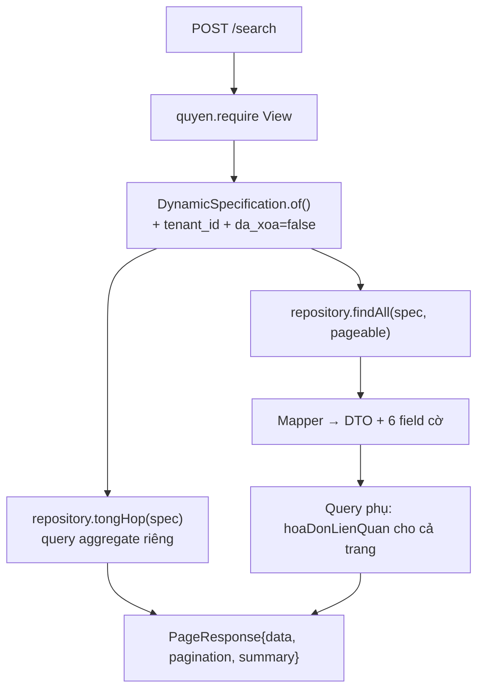

# F1 — Xem danh sách Hóa đơn bán hàng

| | |
|---|---|
| **Mã chức năng** | `F1` |
| **UC nguồn** | `PMKT-U-06456` — [`UC_HDBanHang_DanhSach.md`](../../../pmkt-docs/ba/PMKT-E-06196_HoaDonBanHang/4.usecases/PMKT-u-06456_DanhSach/UC_HDBanHang_DanhSach.md) |
| **Màn hình nguồn** | `SCR_HDBanHang_DanhSach.md` |
| **Endpoint phụ trách** | **A1** `POST /search` · **A2** `GET /cot` · **A3** `POST /export` · **A11** `POST /{id}/chi-tiet/search` 🆕 |
| **File gốc** | [`00-ke-hoach-tong.md`](00-ke-hoach-tong.md) |
| **Trạng thái** | ✅ **A1, A2 ĐÃ CÀI** · 🟡 A3 lộ ra nhưng 403 · ⬜ A11 chưa cài |

---

## 0. Đã cài gì rồi — và còn thiếu gì (rà soát 2026-08-21)

Code thực tế: `cell-app/src/main/java/vn/vtt/pmkt/cell/hoa_don_ban_hang/`.

| Mục của kế hoạch | Trạng thái | Bằng chứng |
|---|---|---|
| A1 `POST /search` + ghép cột "Hóa đơn liên quan" 1 query/trang | ✅ | `HoaDonBanHangCrudService.java:71-94` · `HoaDonBanHangRepositoryImpl.java:38` |
| A2 `GET /cot` | ✅ | kế thừa `BaseCrudController.java:131` |
| Sort mặc định | ✅ nhưng **khác kế hoạch** | `HoaDonBanHangCrudService.java:50-52` dùng `"ngayHoaDon:desc,soHoaDon:asc"` — bản nháp cũ đề xuất `soHoaDon:desc`. **Code đúng hơn**: BR2 nói cùng ngày sắp Số chứng từ **tăng dần**, và javadoc giải thích số hóa đơn trong ngày cấp tuần tự. §8.2 đã sửa theo code. |
| Dòng tổng `summary` toàn cục | ✅ nhưng **thu hẹp** | `TongHopHoaDonDto` chỉ có **1 field** `tongTienThueGtgt` (lấy từ cột `…_quy_doi`), thay vì 5 chỉ tiêu như §8.4 dự kiến — bám đúng `tongHopHoaDonSchema` của FE. Xem delta **Δ3**. |
| Whitelist `@Searchable` | 🟡 **thiếu 2 cột BA mới** | `HoaDonBanHang.java:43-180` có 7 alias. Xem **Δ1**. |
| Enum trên wire | ✅ **TÊN HẰNG** | `package-info.java:26-30` — [00 §0-D12](00-ke-hoach-tong.md). Bản nháp cũ ghi chuỗi tiếng Việt: **sai, đã sửa trong file này**. |
| Cột `tienThueGtgtHienThi` (F1-c cũ) | ❌ **không cài** | DTO trả thẳng `tongTienThueGtgtQuyDoi`. Xem **Δ4**. |
| A3 `cotMacDinh(EXPORT)` | ❌ | Controller chỉ override `tenFileExport()` (`:66-68`); `cotMacDinh` chưa cài ⇒ base trả 400 "chưa bật xuất Excel" — mà thực tế người dùng gặp **403** trước vì quyền chưa seed. Xem **Δ2**. |
| Test | ❌ **không có test nào** | `find src/test -ipath "*HoaDonBanHang*"` → rỗng ([00 §9-R9](00-ke-hoach-tong.md)) |

### 4 delta phải bù cho F1

| # | Việc | Nguồn |
|---|---|---|
| **Δ1** | Thêm 2 cột BA mới vào lưới + whitelist: **Mẫu số hóa đơn** (JOIN `mst_mau_so_hoa_don.MauSo`) và **Ký hiệu hóa đơn** — cả hai BA đánh **Tìm kiếm Y, Sắp xếp Y**. Hiện `kyHieuHoaDon` chỉ có `keyword = true`, **không** `sortable`; `mauSoHoaDon` chỉ trả `mauSoHoaDonId` (uuid), FE không hiển thị được mẫu số. | `SCR_HDBanHang_DanhSach.md:23-24` (bảng cột) · `:118-119` (BR08 nguồn dữ liệu) — **cột mới thêm vào BA ngày 2026-08-20** |
| **Δ2** | Cài `cotMacDinh(LoaiMau.EXPORT)` (§9) + seed quyền `.Export` ở `V1033`. | BR39 |
| **Δ3** | Xác nhận `summary` chỉ cần 1 ô dưới cột "Tiền thuế GTGT" hay cần đủ 5 chỉ tiêu (§8.4, §12-Q-F1-2). | BR31 |
| **Δ4** | Bù **test**: pin whitelist, mapper, dòng tổng rỗng (§11.1). | [00 §9-R9](00-ke-hoach-tong.md) |

---

## 1. Quyết định riêng của chức năng

| # | Quyết định | Trỏ về |
|---|---|---|
| F1-a | Dùng nguyên 3 endpoint của `BaseCrudController` (`core/controller/BaseCrudController.java:121, 131, 171`), **không** viết controller method mới. Chỉ override `defaultSortAlias()`, `summary()`, `cotMacDinh(EXPORT)`. | D2, D4 |
| F1-b | Hai cột dẫn xuất (`trangThaiHoaDon`, `hoaDonLienQuan`) tính bằng **query phụ trên `sal_dieu_chinh_hoa_don_ban_hang`**, KHÔNG thêm cột vật lý cho `hoaDonLienQuan`. `trangThaiHoaDon` thì **có** cột vật lý (§7). | §7, §8 |
| ~~F1-c~~ | ~~BE trả sẵn `tienThueGtgtHienThi`~~ — **ĐÃ BỎ khi cài**: DTO trả thẳng `tongTienThueGtgtQuyDoi` cho mọi hóa đơn, vì lưới vốn hiển thị số đã quy đổi (`TongHopHoaDonDto.java:9-11`). BA (`SCR_HDBanHang_DanhSach.md:121`) nói *"hóa đơn ngoại tệ lấy `TongThueGTGTQuyDoi`"* — hóa đơn VND thì hai cột bằng nhau nên dùng cột quy đổi là an toàn. | Δ4 |
| F1-e | Cột **Mẫu số hóa đơn** (BA mới) phải JOIN `mst_mau_so_hoa_don` để lấy `MauSo` — `mst_*` thuộc **vùng đóng băng**, chỉ dùng tên bảng/cột SQL, không đọc code Java module đó. | Δ1 |
| F1-d | **STT do FE tính** theo công thức BR2 (`(page−1) × pageSize + vị trí`). BE không trả STT. | BR2 |

---

## 2. Hợp đồng API

### A1 — `POST /api/ban-hang/hoa-don-ban-hang/search`

**Quyền:** `LapHoaDonBan.View` (`BaseCrudController.java:123`).

```jsonc
// Request — SearchRequest (core/request/SearchRequest.java:33)
{
  "page": 1,
  "pageSize": 20,
  "sort": "ngayHoaDon:desc",
  "keyword": "CTY ABC",
  "logic": "AND",
  "filters": [
    { "field": "ngayHoaDon",            "op": "between", "value": ["2026-08-01", "2026-08-31"] },
    { "field": "trangThaiPhatHanhHoaDon","op": "in",     "value": ["CHUA_PHAT_HANH"] },
    { "field": "trangThaiLapChungTu",   "op": "in",      "value": ["CHUA_LAP", "DA_LAP_MOT_PHAN"] },
    { "field": "soHoaDon",              "op": "contains","value": "00012" }
  ]
}
```

```jsonc
// Response 200 — PageResponse<HoaDonBanHangDto> (core/response/PageResponse.java:21)
{
  "data": [
    {
      "id": "7f1c…",
      "ngayHoaDon": "2026-08-12",
      "soHoaDon": "0000123",
      "kyHieuHoaDon": "K26TAA",
      "mauSoHoaDonId": "b21e…",
      "khachHangId": "9a03…",
      "tenKhachHang": "CÔNG TY TNHH ABC",
      "trangThaiLapChungTu": "DA_LAP_MOT_PHAN",
      "trangThaiPhatHanhHoaDon": "CHUA_PHAT_HANH",
      "trangThaiHoaDon": "GOC",
      "tongTienThueGtgtQuyDoi": 1250000.00,
      "hoaDonLienQuan": [],
      "loaiNghiepVu": "TRONG_NUOC",
      "loaiTienId": "0001…",
      "tyGia": 1.000000,
      "tongTienHangHoaQuyDoi": 12500000.00,
      "tongTienChietKhauQuyDoi": 0.00,
      "tongTienThueXkQuyDoi": null,
      "tongTienThanhToanQuyDoi": 13750000.00,
      "phienBan": 1,

      // --- field điều khiển ẩn/hiện nút (§5.3) ---
      "choPhepSua": true,          // ⬜ CHƯA CÀI — xem §5.3
      "choPhepXoa": true,
      "choPhepLapChungTuBanHang": true,
      "choPhepLapChungTuBanDichVu": false,
      "coDongDichVu": false,
      "daLapChungTu": true,
      "chungTuBanId": null,
      "updatedAt": "2026-08-13T04:11:02.451Z"
    }
  ],
  "pagination": { "page": 1, "pageSize": 20, "totalItems": 137, "totalPages": 7 },
  "summary": { "tongTienThueGtgt": 121500000.00 }   // ĐANG CÀI: đúng 1 ô — xem §8.4 và Δ3
}
```

| Lỗi | HTTP | `code` | `messageId` |
|---|---|---|---|
| Thiếu quyền `.View` | 403 | `FORBIDDEN` | `MSG_PMKT-E-06196_011` |
| Lỗi hệ thống | 500 | `INTERNAL_ERROR` | `MSG_PMKT-E-06196_013` |

> Filter theo field **không nằm trong whitelist `@Searchable`** → `DynamicSpecification` **bỏ qua và log warn**, KHÔNG ném 400 (`core/shared/search/Searchable.java:11-13`). Quá 20 filter → cắt bớt (`DynamicSpecification.java:51`).

### A2 — `GET /api/ban-hang/hoa-don-ban-hang/cot`

**Quyền:** `LapHoaDonBan.View`. Sinh tự động từ whitelist `@Searchable` của entity (`BaseCrudController.java:131-135`) — FE dựng bộ lọc động + màn ẩn/hiện cột (BR30) từ đây, **không hardcode**.

```jsonc
{
  "data": [
    { "alias": "ngayHoaDon",          "label": "Ngày hóa đơn",            "kieu": "DATE",   "sortable": true, "keyword": false },
    { "alias": "soHoaDon",            "label": "Số hóa đơn",              "kieu": "TEXT",   "sortable": true, "keyword": true  },
    { "alias": "tenKhachHang",        "label": "Tên khách hàng",          "kieu": "TEXT",   "sortable": true, "keyword": true  },
    { "alias": "trangThaiLapChungTu", "label": "Trạng thái lập chứng từ", "kieu": "TEXT",   "sortable": true, "keyword": false },
    { "alias": "trangThaiPhatHanhHoaDon", "label": "Trạng thái phát hành HĐ", "kieu": "TEXT", "sortable": true, "keyword": false },
    { "alias": "kyHieuHoaDon",        "label": "Ký hiệu hóa đơn",         "kieu": "TEXT",   "sortable": false,"keyword": true  },   // Δ1: cần sortable
    { "alias": "maSoThue",            "label": "Mã số thuế",              "kieu": "TEXT",   "sortable": false,"keyword": true  },
    { "alias": "loaiNghiepVu",        "label": "Loại nghiệp vụ",          "kieu": "TEXT",   "sortable": true, "keyword": false },
    { "alias": "trangThaiHoaDon",     "label": "Trạng thái hóa đơn",      "kieu": "TEXT",   "sortable": true, "keyword": false },
    { "alias": "tongTienThueGtgt",    "label": "Tiền thuế GTGT",          "kieu": "SO",     "sortable": false,"keyword": false }
  ],
  "message": null, "messageId": null
}
```

### A3 — `POST /api/ban-hang/hoa-don-ban-hang/export`

**Quyền:** `LapHoaDonBan.Export` — ⚠️ **chưa seed**, xem [00 §10](00-ke-hoach-tong.md). Body = `SearchRequest` giống A1; xuất **toàn bộ** bản ghi khớp bộ lọc (không chỉ trang đang xem) — `BaseCrudController.java:168-170`. Trả `application/vnd.openxmlformats-officedocument.spreadsheetml.sheet`, tên file `Hoa-don-ban-hang.xlsx`.

---

## 3. Ánh xạ cột BA ↔ DB ↔ DTO

| # | Cột BA (`SCR_…DanhSach.md:21-31`) | Field BA (BR08, `:114-124`) | Cột DB thật | Field DTO / alias lọc | Lọc | Sort | Đã cài |
|---|---|---|---|---|---|---|---|
| 1 | STT | `-` | — | — (FE tính, BR2) | N | N | ✅ |
| 2 | Ngày hóa đơn | `sal_hoa_don_ban_hang.NgayHoaDon` | `ngay_hoa_don date` | `ngayHoaDon` | Y | Y | ✅ |
| 3 | **Mẫu số hóa đơn** 🆕 | `sal_hoa_don_ban_hang.MauSoHoaDonId` → **`mst_mau_so_hoa_don.MauSo`** | `mau_so_hoa_don_id uuid` (+ JOIN) | `mauSoHoaDonId` (đang có) → **cần thêm `mauSoHoaDon: string`** | **Y** | **Y** | ❌ **Δ1** |
| 4 | **Ký hiệu hóa đơn** 🆕 | `sal_hoa_don_ban_hang.KyHieuHoaDon` | `ky_hieu_hoa_don text` | `kyHieuHoaDon` | Y | **Y** | 🟡 có field, **thiếu `sortable`** — **Δ1** |
| 5 | Số hóa đơn | `sal_hoa_don_ban_hang.SoHoaDon` | `so_hoa_don text` | `soHoaDon` | Y | Y | ✅ |
| 6 | Tên khách hàng | `sal_hoa_don_ban_hang.TenKhachHang` | `ten_khach_hang text` | `tenKhachHang` | Y | Y | ✅ |
| 7 | Trạng thái lập chứng từ | `sal_hoa_don_ban_hang.TrangThaiLapChungTu` | `trang_thai_lap_chung_tu text` (CHECK 3 giá trị ✅) | `trangThaiLapChungTu` | Y | Y | ✅ |
| 8 | Trạng thái phát hành HĐ | `sal_hoa_don_ban_hang.TrangThaiPhatHanh` | **`trang_thai_phat_hanh_hoa_don text`** ⚠ tên DB **lệch** tên BA | alias **`trangThaiPhatHanhHoaDon`** (D13 — FE khai cứng) | Y | Y | ✅ |
| 9 | Tiền thuế GTGT | `sal_hoa_don_ban_hang.TongThueGTGT`; ngoại tệ lấy `TongThueGTGTQuyDoi` | **`tong_tien_thue_gtgt`** / **`tong_tien_thue_gtgt_quy_doi`** ⚠ tên DB **lệch** BA (thiếu chữ `tien`) | `tongTienThueGtgtQuyDoi` (chỉ cột quy đổi — F1-c) | N | N | ✅ |
| 10 | Trạng thái hóa đơn | `sal_hoa_don_ban_hang.TrangThaiHoaDon` | `trang_thai_hoa_don text` (CHECK 5 giá trị ✅) | `trangThaiHoaDon` | Y | Y | ✅ |
| 11 | Hóa đơn liên quan | `sal_hoa_don_ban_hang.SoHoaDon` của HĐ điều chỉnh/thay thế | **không có cột** — suy từ `sal_dieu_chinh_hoa_don_ban_hang.hoa_don_ban_hang_goc_id` | `hoaDonLienQuan: [{id, soHoaDon}]` | Y (§8.5) | N | ✅ |

> ⚠️ **Không tạo migration đổi tên cột** cho mục 6 và 7 — cột đã có dữ liệu, đổi tên là rủi ro thừa. Chỉ ánh xạ ở `@Column(name = …)` của entity và alias `@Searchable`.

---

## 4. Whitelist `@Searchable` — **code thật vs BA mới**

Đang cài (`HoaDonBanHang.java`):

| Alias | Dòng | `sortable` | `keyword` | BA yêu cầu |
|---|---|---|---|---|
| `soHoaDon` | `:43` | ✅ | ✅ | Y / Y — ✅ khớp |
| `kyHieuHoaDon` | `:47` | ❌ | ✅ | **Y / Y** — ❌ **thiếu `sortable`** (Δ1) |
| `ngayHoaDon` | `:54` | ✅ | — | Y / Y — ✅ |
| `loaiNghiepVu` | `:58` | ✅ | — | không có trên lưới — thừa nhưng vô hại (FE cần lọc theo nghiệp vụ) |
| `tenKhachHang` | `:68` | ✅ | ✅ | Y / Y — ✅ |
| `maSoThue` | `:72` | ❌ | ✅ | không có trên lưới — dùng cho tìm nhanh |
| `trangThaiLapChungTu` | `:165` | ✅ | — | Y / Y — ✅ |
| `trangThaiPhatHanhHoaDon` | `:171` | ✅ | — | Y / Y — ✅ (alias giữ tên DB, D13) |
| `trangThaiHoaDon` | `:177` | ✅ | — | Y / Y — ✅ |
| **`mauSoHoaDon`** | — | — | — | **Y / Y** — ❌ **chưa có** (Δ1) |

**Δ1 — hai việc cụ thể:**

1. `kyHieuHoaDon`: đổi `@Searchable(keyword = true, …)` → `@Searchable(sortable = true, keyword = true, …)`.
2. `mauSoHoaDon`: cột hiển thị là `mst_mau_so_hoa_don.MauSo`, **không phải** `mau_so_hoa_don_id`. Hai cách:

| | A — `@ManyToOne` sang entity `MauSoHoaDon` rồi `@Searchable(alias="mauSoHoaDon", path="mauSoHoaDon.mauSo", sortable=true)` | **B (đề xuất) — cột snapshot `mau_so_hoa_don` trên chính bảng HĐ** |
|---|---|---|
| Cách chạy | `DynamicSpecification` tự `LEFT JOIN` theo `path` (`Searchable.java:20-23`) | Lưu chuỗi mẫu số lúc tạo/sửa hóa đơn |
| Ranh giới | Buộc module HĐ import entity của `master_data` — **vùng đóng băng**, cấm | Sạch |
| Lọc/sort | Được | Được, nhanh hơn (không JOIN) |
| Nhược | Vi phạm rule vùng đóng băng | Thêm 1 cột + phải đồng bộ khi danh mục đổi mẫu số |

⚠️ **Chưa chốt** — đây là câu hỏi cho Dev BE/DBA, xem §12-Q-F1-1. Phương án B cần thêm cột vào `V1033`, phương án A cần lách rule vùng đóng băng. Cách thứ ba: giữ `mauSoHoaDonId` và để FE tra qua API danh mục — nhưng khi đó **lọc và sắp xếp theo mẫu số ở BE là bất khả**, trái BA.

**Cột KHÔNG khai `@Searchable`:****Cột KHÔNG khai `@Searchable`:** mọi cột tiền, mọi id ngoại, mọi cột thông tin xuất khẩu. Lý do: BA không cho lọc/sort chúng (`SCR_…DanhSach.md:27` — `Tiền thuế GTGT` cột Tìm kiếm/Sắp xếp đều `N`), và whitelist thừa là lộ bề mặt tấn công dò dữ liệu.

`@SearchableAudit` khai ở mức class để mở `ngayTao`/`ngayCapNhat` (mẫu `ChungTuBanHang.java:42`).

---

## 5. Bộ tiêu chí tìm kiếm & field điều khiển nút

### 5.2 Bộ lọc (BR11.2)

| Field BA | Control | Alias BE | Toán tử |
|---|---|---|---|
| Ngày hóa đơn | DateRange (BR8) | `ngayHoaDon` | `between`, `gte`, `lte`, `eq` |
| Mẫu số hóa đơn 🆕 | Text | `mauSoHoaDon` — **chưa cài** (Δ1) | `contains`, `eq` |
| Ký hiệu hóa đơn 🆕 | Text | `kyHieuHoaDon` | `contains`, `eq` |
| Số hóa đơn | Text | `soHoaDon` | `contains`, `startsWith`, `endsWith`, `eq`, `ne` |
| Tên khách hàng | Text | `tenKhachHang` | `contains`, `startsWith`, `endsWith`, `eq`, `ne` |
| Trạng thái lập chứng từ | Multi-select | `trangThaiLapChungTu` | `in` |
| Trạng thái phát hành | Multi-select | **`trangThaiPhatHanhHoaDon`** (D13) | `in` |
| Trạng thái hóa đơn | Multi-select | `trangThaiHoaDon` | `in` |
| — (tìm nhanh) | Search box | `keyword` | tìm không dấu, case-insensitive trên `soHoaDon`, `kyHieuHoaDon`, `tenKhachHang`, `maSoThue` (đúng 4 field `keyword=true` đang cài) |

**Cách ghép:** các `filters` ghép bằng `AND` (mặc định `logic`); `keyword` **luôn** ghép `AND` với cả nhóm (`SearchRequest.java:28-29`) — thu hẹp kết quả, không nới. Tìm không dấu qua SQL function `bo_dau()` (`DynamicSpecification.java:234-240`) đúng BR11.1 "gõ không dấu vẫn trả kết quả có dấu".

**Bộ lọc thời gian mặc định (BR11.2.1 — "Đầu tháng tới hiện tại"):** **FE gửi lên**, BE **không tự bơm**. Lý do: BE bơm thầm thì không có cách nào lấy toàn bộ dữ liệu (vd để đối chiếu tổng), và `POST /export` sẽ xuất thiếu bản ghi mà người dùng không biết. Lối thoát: FE gửi `filters: []`.

### 5.3 Field phụ trong DTO để FE ẩn/hiện nút — ⬜ **CHƯA CÀI**

⚠️ `HoaDonBanHangDto` hiện **không có** field cờ nào (`choPhepSua`, `choPhepXoa`, `choPhepLapChungTuBanHang`, `coDongDichVu`, `daLapChungTu`). FE đang tự suy từ `trangThaiPhatHanhHoaDon` / `trangThaiLapChungTu` trả về. Chấp nhận được cho màn danh sách (logic một dòng), nhưng **phải bổ sung `coDongDichVu`** khi làm F6 vì FE không tự tính được (cần biết dòng chi tiết có mã hàng loại "Dịch vụ" — §8.6).


| Nút (`SCR_…DanhSach.md:43-48`) | Điều kiện BA | Field DTO |
|---|---|---|
| Xem chi tiết | luôn (nếu có quyền) | — (FE dựa quyền) |
| Chỉnh sửa | có quyền **và** `Chưa phát hành` (BR01) | `choPhepSua = (trangThaiPhatHanh == CHUA_PHAT_HANH)` |
| Xóa | có quyền **và** `Chưa phát hành` (BR01) | `choPhepXoa = (trangThaiPhatHanh == CHUA_PHAT_HANH)` |
| Xóa hàng loạt (disable) | disable nếu có ≥1 HĐ đã phát hành **hoặc** `trangThaiLapChungTu ≠ "Chưa lập"` | FE tự tổng hợp từ `choPhepXoa` + `daLapChungTu` của các dòng đã tích |
| Lập chứng từ bán hàng | `trangThaiLapChungTu ∈ {"Chưa lập","Đã lập 1 phần"}` (BR04) | `choPhepLapChungTuBanHang` |
| Lập chứng từ bán dịch vụ | như trên **và** có ≥1 dòng "Dịch vụ" (BR05) | `choPhepLapChungTuBanDichVu`, `coDongDichVu` — ⚠️ ngoài phạm vi, xem [00 §12-Q6](00-ke-hoach-tong.md) |
| Cảnh báo `_055` / `_056` khi sửa/xóa | HĐ đã lập chứng từ | `daLapChungTu = (trangThaiLapChungTu ≠ CHUA_LAP)` |

> Field cờ tính ở **mapper**, không phải ở SQL — tránh làm phình query danh sách. `coDongDichVu` là ngoại lệ: cần biết dòng chi tiết có mã hàng loại "Dịch vụ" không → xem §8.6.

---

## 6. Luồng xử lý

1. `HoaDonBanHangController.search(request)` — kế thừa `BaseCrudController.java:121`.
2. `quyen.require("LapHoaDonBan", VIEW)` — base tự gọi.
3. `HoaDonBanHangCrudService.search(request)` — **kế thừa nguyên** `AbstractCrudService`:
   - `specCuaRequest(request)` → `DynamicSpecification.of(HoaDonBanHang.class, request)`; base tự thêm `tenant_id = fn_current_tenant()` (`DynamicSpecification.java:75`) và `da_xoa = false` (`:78`).
   - `SortResolver` áp `defaultSortAlias()` khi client không gửi `sort`, tự nối `id asc` cho phân trang ổn định.
4. **override `summary(request)`** → `repository.tongHop(specCuaRequest(request))` — một query aggregate riêng trên **cùng spec** (§8.4).
5. `HoaDonBanHangMapper.toDto(entity)` — ⬜ **chưa tính** 5 field cờ (§5.3); `tienThueGtgtHienThi` đã bỏ (F1-c).
6. **Query phụ 1 lượt** cho `hoaDonLienQuan` của cả trang (§8.5) → tránh N+1.
7. Trả `PageResponse.of(page, pageNumber, summary)`.



---

## 7. Cột dẫn xuất `trangThaiHoaDon` (BR06)

**Quy tắc BA nguyên văn** (`SCR_HDBanHang_DanhSach.md:90-95`):
> - **Hóa đơn gốc**: Hóa đơn được lập ban đầu, chưa phát sinh điều chỉnh hoặc thay thế.
> - **Hóa đơn điều chỉnh**: Hóa đơn được lập để điều chỉnh thông tin của một hóa đơn đã phát hành trước đó.
> - **Hóa đơn thay thế**: Hóa đơn được lập để thay thế hoàn toàn một hóa đơn đã phát hành trước đó.
> - **Hóa đơn bị điều chỉnh**: Hóa đơn gốc đã được điều chỉnh bởi một hóa đơn điều chỉnh khác.
> - **Hóa đơn bị thay thế**: Hóa đơn gốc đã được thay thế bởi một hóa đơn thay thế khác.

**Dữ liệu nguồn:**

| Giá trị | Suy từ | Khả thi lần này |
|---|---|---|
| `Hóa đơn gốc` | mặc định | ✅ |
| `Hóa đơn bị điều chỉnh` | `sal_hoa_don_ban_hang.da_bi_dieu_chinh = true` (`V1:16836`) — được set khi có bản ghi `sal_dieu_chinh_hoa_don_ban_hang` trỏ về | ✅ (đọc; **ai set** thuộc PMKT-E-06197) |
| `Hóa đơn điều chỉnh` | bản ghi nằm ở bảng `sal_dieu_chinh_hoa_don_ban_hang` — **không** phải bảng này | ⚠️ HĐ điều chỉnh là **entity khác bảng**, không lên danh sách này. Xem Q3. |
| `Hóa đơn thay thế` / `bị thay thế` | **không có bảng/cột nào** trong baseline | ❌ [00 §12-Q3](00-ke-hoach-tong.md) |

**Phương án chọn:** thêm **cột vật lý** `trang_thai_hoa_don text` (`V3`, [07 §2](07-thiet-ke-db.md)), mặc định `'Hóa đơn gốc'`, CHECK 5 giá trị (khai đủ để epic PMKT-E-06197 dùng tiếp mà không phải sửa CHECK lần nữa). Lần này BE chỉ ghi 2 giá trị: `'Hóa đơn gốc'` lúc tạo; job/luồng của PMKT-E-06197 sẽ ghi `'Hóa đơn bị điều chỉnh'`.

**Vì sao KHÔNG chọn cột dẫn xuất thuần (tính từ `da_bi_dieu_chinh` lúc map):** BA yêu cầu cột này **lọc được và sắp xếp được** (`SCR_…DanhSach.md:28` — Tìm kiếm `Y`, Sắp xếp `Y`). Cột tính ở tầng Java không đưa vào `@Searchable` được → phải là cột vật lý. Đổi lại có nợ: cột này phải được cập nhật đồng bộ với `da_bi_dieu_chinh` — ràng buộc bàn giao cho epic PMKT-E-06197, ghi ở [00 §12-Q3](00-ke-hoach-tong.md).

---

## 8. Phân trang · sắp xếp · lọc · dòng tổng

### 8.1 Bộ lọc mặc định
FE gửi (§5.2). BE không bơm. BR11.2.1.

### 8.2 Sắp xếp mặc định — BR2 + `UC_HDBanHang_DanhSach.md:11`
> "sắp xếp mặc định theo **ngày hóa đơn từ mới nhất tới cũ nhất**"

```java
// HoaDonBanHangCrudService.java:50-57 — ĐANG CÀI
@Override protected String defaultSortAlias()           { return "ngayHoaDon:desc,soHoaDon:asc"; }
@Override protected Sort.Direction defaultSortDirection(){ return Sort.Direction.DESC; }
```

Khóa phụ `soHoaDon:desc` **không** để phân trang ổn định (`SortResolver` đã tự nối `id asc` cho việc đó) mà để các HĐ **cùng ngày** hiện theo số hóa đơn thay vì theo UUID ngẫu nhiên — cùng lý do đã ghi ở `ChungTuBanHangCrudService.java:84-88`.

**Sửa so với bản nháp cũ:** bản 2026-08-14 đề xuất khóa phụ `soHoaDon:desc` và tự nhận là "lệch BR2 có chủ ý". Code cài `soHoaDon:asc` — **đúng BR2** ("cùng ngày sắp theo Số chứng từ tăng dần") và có lý do nghiệp vụ chắc hơn (javadoc `:43-47`: số hóa đơn trong ngày cấp tuần tự nên đọc xuôi mới đúng thứ tự phát hành). Ngoài ra nó **khớp `DEFAULT_SORT` FE đang gửi**, để render lạc quan không nhảy thứ tự. Không còn lệch BR2.

### 8.3 Phân trang — BR1
Mặc định **20**/trang, whitelist `10/20/50/100/200`, giá trị lạ → 20 (`SearchRequest.java:52`). `page` **1-based** cả chiều gửi lẫn chiều nhận (`PageResponse.PageInfo`). Tổng số bản ghi/trang có sẵn trong `pagination`.

### 8.4 Dòng tổng cộng — BR31 (**ĐANG CÀI hẹp hơn kế hoạch — Δ3**)

**Code thật** (`TongHopHoaDonDto.java`): đúng **một** field.

```java
public record TongHopHoaDonDto(BigDecimal tongTienThueGtgt) {}
```
Tên field theo FE, giá trị lấy từ cột **đã quy đổi** `tong_tien_thue_gtgt_quy_doi` — javadoc `:9-11` giải thích: hóa đơn nhiều loại tiền chỉ cộng được sau khi quy đổi, và chính lưới cũng hiển thị cột quy đổi.

**Kế hoạch cũ đề xuất 5 chỉ tiêu** (`tongTienHangHoaQuyDoi`, `tongTienChietKhauQuyDoi`, `tongTienThueGtgtQuyDoi`, `tongTienThanhToanQuyDoi`, `soBanGhi`). Đối chiếu BA:

- `SCR_HDBanHang_DanhSach.md:17-31` — bảng cột **chỉ có một cột tiền**: "Tiền thuế GTGT". Bốn chỉ tiêu kia **không có cột nào trên lưới** để đặt tổng xuống dưới.
- BR31 nói dòng tổng đặt dưới **cột tương ứng** của lưới.

⇒ **Code đúng, kế hoạch cũ thừa.** Giữ 1 field. **Δ3 chỉ còn là việc xác nhận với BA** (§12-Q-F1-2), không phải việc sửa code.

**Phạm vi:** TOÀN BỘ bản ghi khớp bộ lọc (`HoaDonBanHangCrudService.java:100-104` → `repository.tongHop(specCuaRequest(req))`) — không phải trang hiện tại. ✅ đúng BR31.

**Tập rỗng:** ⚠️ **chưa kiểm chứng** — `SUM` trên tập rỗng trả `NULL`. Cần một unit/IT test khẳng định DTO trả `0` chứ không `null` (§11.1). Đây là một trong 4 việc của Δ4.

### 8.5 Cột `hoaDonLienQuan` — chống N+1

```sql
SELECT dc.hoa_don_ban_hang_goc_id, dc.id, dc.so_hoa_don
  FROM sal_dieu_chinh_hoa_don_ban_hang dc
 WHERE dc.da_xoa = false
   AND dc.hoa_don_ban_hang_goc_id = ANY(:idsCuaTrangHienTai)
```
Một query cho cả trang (≤ 200 id), map vào DTO ở tầng service. **Vì sao không `@OneToMany`:** quan hệ này thuộc epic khác (PMKT-E-06197), khai `@OneToMany` sẽ buộc module HĐ biết entity của module chưa tồn tại → vi phạm ranh giới.

**Lọc theo `hoaDonLienQuan`** (BA cho Tìm kiếm `Y`, Sắp xếp `N` — `SCR_…DanhSach.md:29`): cài bằng filter đặc biệt `coHoaDonLienQuan: true/false` map sang `EXISTS(...)`, **không** cho lọc theo nội dung số hóa đơn liên quan. Lý do: `@Searchable` không diễn tả được subquery. Nếu BA cần lọc theo nội dung → phải viết `RepositoryCustom` riêng, đưa vào phạm vi sau.

### 8.6 Cột `coDongDichVu`
```sql
SELECT ct.hoa_don_ban_hang_id
  FROM sal_hoa_don_ban_hang_chi_tiet ct
  JOIN mst_vat_tu vt ON vt.id = ct.ma_hang_id
 WHERE ct.da_xoa = false AND ct.loai_dong_hang = true
   AND vt.loai_hang_hoa = 'Dịch vụ'
   AND ct.hoa_don_ban_hang_id = ANY(:idsCuaTrangHienTai)
 GROUP BY ct.hoa_don_ban_hang_id
```
⚠️ `mst_vat_tu` thuộc `master_data` (**vùng đóng băng**) — chỉ dùng **tên bảng/cột SQL**, tuyệt đối không đọc/không import code Java của module đó. Tên cột `loai_hang_hoa` **cần xác nhận lại bằng migration** trước khi code (`grep -n "CREATE TABLE public.mst_vat_tu" -A80 V1__create_database.sql`).

---

## 9. Xuất Excel — BR39 (⬜ **CHƯA CÀI** — Δ2)

Controller mới override `tenFileExport()` (`HoaDonBanHangController.java:66-68`); `cotMacDinh(LoaiMau.EXPORT)` chưa cài nên base trả `List.of()` ⇒ 400 "chưa bật xuất Excel". Thực tế người dùng gặp **403** trước đó vì `LapHoaDonBan.Export` chưa seed. Cần làm cả hai.

Bộ cột đề xuất (đã cập nhật theo 11 cột BA mới):

```java
@Override
protected List<ColumnDef> cotMacDinh(LoaiMau loai) {
    if (loai != LoaiMau.EXPORT) return List.of();          // chặn import — D10
    return List.of(
        ColumnDef.of("ngayHoaDon", "Ngày hóa đơn", ColumnType.NGAY).voiDoRong(16),
        ColumnDef.of("mauSoHoaDon", "Mẫu số hóa đơn").voiDoRong(16),      // cần Δ1
        ColumnDef.of("kyHieuHoaDon", "Ký hiệu hóa đơn").voiDoRong(16),
        ColumnDef.of("soHoaDon", "Số hóa đơn").voiDoRong(18),
        ColumnDef.of("tenKhachHang", "Tên khách hàng").voiDoRong(32),
        ColumnDef.of("trangThaiLapChungTu", "Trạng thái lập chứng từ").voiDoRong(22),
        ColumnDef.of("trangThaiPhatHanhHoaDon", "Trạng thái phát hành HĐ").voiDoRong(22),
        ColumnDef.of("tongTienThueGtgtQuyDoi", "Tiền thuế GTGT", ColumnType.SO).voiDoRong(18),
        ColumnDef.of("trangThaiHoaDon", "Trạng thái hóa đơn").voiDoRong(20));
}
```
Đúng 9/11 cột của màn (bỏ `STT` — Excel tự đánh; bỏ `Hóa đơn liên quan` — là mảng, không đổ được vào một ô phẳng). Người dùng lưu mẫu riêng thì `ExcelUtil.resolveColumns` ưu tiên mẫu đó (`BaseCrudController.java:177-178`).

---

## 9b. A11 🆕 — Khu vực chi tiết dưới lưới danh sách (BR09 MỚI)

> **BR09 là mục MỚI của BA**, thêm ngày 2026-08-20 (`SCR_HDBanHang_DanhSach.md:130-172`). Không có trong bản nháp kế hoạch 2026-08-14.

### 9b.1 BA yêu cầu gì

| Quy tắc BA (nguyên văn rút gọn) | Hệ quả lên BE |
|---|---|
| "chỉ hiển thị khi người dùng có quyền Xem chi tiết `LapHoaDonBan.View.Detail`… **kiểm tra quyền trước khi trả dữ liệu chi tiết, không chỉ ẩn hiện trên giao diện**" (`:134-136`) | Endpoint riêng, `quyen.require(…, VIEW_DETAIL)` — **không** nhét dòng chi tiết vào response của A1 |
| "Nội dung đưa xuống: chỉ hiển thị **Bảng chi tiết hàng hóa**… Không đưa xuống: Thông tin hóa đơn · Thông tin xuất khẩu · Lựa chọn Loại tiền, Chiết khấu · Tổng hợp tiền tệ" (`:150-153`) | Response chỉ chở **dòng chi tiết**, không chở header |
| "**Phân trang riêng**: lưới trong khu vực chi tiết có phân trang độc lập với lưới danh sách phía trên" (`:166`) | Endpoint phải nhận `SearchRequest` riêng → `PageResponse` |
| "Dòng **Tổng** giữ đúng như màn Thêm mới, theo BR31" (`:170`) | `summary` của trang chi tiết = Σ trên **toàn bộ dòng của hóa đơn đó**, không phải trang đang xem |
| "bản ghi không có dòng chi tiết nào thì section **vẫn hiển thị**, lưới bên trong để trống" (`:158`) | Trả `data: []` + `summary` toàn số 0, **không** 404 |
| "Trong lúc chờ dữ liệu, khu vực hiển thị **trạng thái đang tải**" (`:145`) | Thuần FE |
| "tiêu điểm dòng, tách khỏi checkbox" (`:138-145`) | Thuần FE — BE không giữ trạng thái tiêu điểm |

### 9b.2 A11 — `POST /api/ban-hang/hoa-don-ban-hang/{id}/chi-tiet/search`

**Quyền:** `LapHoaDonBan.View.Detail`.

**Vì sao endpoint riêng chứ không nhét vào A6 (`GET /{id}`):** BA đòi **phân trang độc lập** cho lưới chi tiết; `GET /{id}` trả cả cụm aggregate một lần, không phân trang được. Ngược lại, vì sao không nhét vào A1: A1 chạy dưới quyền `.View`, còn khu vực chi tiết đòi `.View.Detail` — trộn hai mức quyền vào một response là chỗ rò rỉ dữ liệu.

```jsonc
// Request — SearchRequest (dùng lại nguyên contract của core)
{ "page": 1, "pageSize": 20, "sort": "thuTu:asc" }
```

```jsonc
// Response 200 — PageResponse<ChiTietHoaDonBanHangDto>
{
  "data": [ /* … dòng chi tiết, hình dạng như [03 §2](03-xem-chi-tiet-hoa-don.md) … */ ],
  "pagination": { "page": 1, "pageSize": 20, "totalItems": 7, "totalPages": 1 },
  "summary": {
    "soLuong": 320.000,
    "thanhTien": 27200000.00,
    "thanhTienQuyDoi": 27200000.00,
    "chietKhau": 1360000.00,
    "chietKhauQuyDoi": 1360000.00,
    "tienThueGtgt": 2584000.00,
    "tienThueGtgtQuyDoi": 2584000.00,
    "tienThueXk": null,
    "tienThueXkQuyDoi": null
  }
}
```

Dòng tổng bám đúng "Dòng tổng tiền" của lưới CTBH (`SCR_CTBH_ThemMoi.md:266-296`), **trừ** các cột hạch toán hóa đơn không có (Tiền vốn) và các cột đơn giá/tỷ lệ % (BA nói rõ **không có dòng tổng**). Cột thuế XK chỉ hiện khi `loaiNghiepVu = XUAT_KHAU`.

| Lỗi | HTTP | `code` | `messageId` |
|---|---|---|---|
| Thiếu quyền `.View.Detail` | 403 | `FORBIDDEN` | `MSG_PMKT-E-06196_011` |
| HĐ không tồn tại / đã xóa | 404 | `NOT_FOUND` | `MSG_PMKT-E-06196_012` |

### 9b.3 Phụ thuộc

A11 **không cài được trước F2**: nó cần entity `ChiTietHoaDonBanHang` và 7 cột chi tiết của `V1033`. Xếp ở bước 10 của [00 §8](00-ke-hoach-tong.md).

---

## 10. Tương tranh & transaction
`POST /search`, `GET /cot`, `POST /export` đều `@Transactional(readOnly = true)`. Không khóa. `POST /export` stream qua `StreamingResponseBody` — transaction phải bao trọn việc ghi stream, nếu không `LazyInitializationException`; base đã xử ở `AbstractCrudService.duLieuExport` (đọc lại chữ ký trước khi code).

---

## 11. Kiểm thử

> ⚠️ **Hiện tại module không có test nào** — `find cell-app/src/test -ipath "*HoaDonBanHang*"` trả rỗng. Toàn bộ bảng dưới là **nợ phải trả (Δ4)**, không phải mô tả cái đã có.

### 11.1 Unit (`@Tag("unit")`, không cần Docker)

| Lớp test | Case |
|---|---|
| `HoaDonBanMapperTest` | `choPhepSua`/`choPhepXoa` = true khi `Chưa phát hành`, false khi `Đã phát hành` |
| | `choPhepLapChungTuBanHang` = true với `Chưa lập` và `Đã lập 1 phần`, false với `Đã lập đủ` |
| | `daLapChungTu` = false chỉ khi `Chưa lập` |
| | `TongHopHoaDonDto.tongTienThueGtgt` lấy từ cột `tong_tien_thue_gtgt_quy_doi`, **không** phải cột gốc |
| `HoaDonBanHangSearchableTest` | pin whitelist: đúng 8 alias, không thừa không thiếu (chống lộ cột ngoài ý muốn) |
| `TongHopHoaDonBanDtoTest` | `SUM` trả `null` (tập rỗng) → DTO trả `ZERO`, không `null` |
| `SortMacDinhTest` | `defaultSortAlias()` == `"ngayHoaDon:desc,soHoaDon:desc"` |

### 11.2 Tích hợp (cần Docker — **không chạy được trên máy dev**, R7)

| Lớp | Kiểm |
|---|---|
| `HoaDonBanHangSearchIT` | RLS: user tenant A không thấy HĐ tenant B; `da_xoa=true` không lọt vào kết quả |
| | filter `between` trên `ngayHoaDon`; `keyword` không dấu ("cong ty" → "CÔNG TY") |
| | `summary` tính trên toàn bộ sau lọc, không phải trang hiện tại |
| | `hoaDonLienQuan` — 1 query phụ cho cả trang (đếm query bằng Hibernate statistics) |
| `HoaDonBanHangExportIT` | export lấy đủ bản ghi ngoài trang 1 |

---

## 12. BR đã áp dụng

| BR | Áp ở bước nào |
|---|---|
| BR1 | §8.3 — mặc định 20, whitelist page size |
| BR2 | §8.2 sort mặc định · F1-d STT do FE tính · cột Hành động cuối bảng (FE) |
| BR7 | Cột tiền trả nguyên `numeric(18,2)`, không làm tròn ở BE (BR7.2 mục 3 — "lưu giá trị đầy đủ") |
| BR8 | §5.2 — filter `ngayHoaDon` toán tử `between` |
| BR11.1 | §5.2 — `keyword` không dấu, case-insensitive, trim |
| BR11.2 | §5.2 — filter theo cột, ghép AND, badge số filter do FE |
| BR11.3 | §8.2 — sort server-side trên toàn bộ bản ghi sau lọc, từng cột một |
| BR13.1 | §5.3 — field cờ ẩn/hiện nút |
| BR28 | §6 bước 3 — RLS + `DynamicSpecification` tự bơm `tenant_id` |
| BR29.1 | §6 bước 3 — `da_xoa = false` tự bơm |
| BR30 | A2 `GET /cot` sinh từ whitelist |
| BR31 | §8.4 — dòng tổng toàn cục |
| BR39 | §9 — xuất Excel toàn bộ sau lọc |
| BR43 | `keyword` được trim (`SearchRequest.isOrLogic`/`hasKeyword` + `DynamicSpecification`) |

**Chưa đạt:** BR11.2.1 "bộ lọc thời gian mặc định Đầu tháng tới hiện tại" — cố ý đẩy về FE (§8.1); BR2 "cùng ngày sắp theo số chứng từ **tăng dần**" — chọn `desc`, lệch có chủ ý (§8.2); lọc theo **nội dung** cột `Hóa đơn liên quan` — chỉ hỗ trợ lọc có/không (§8.5).

---

## 12. Câu hỏi phát sinh từ chức năng này

| # | Vấn đề | Bằng chứng | Xử lý tạm |
|---|---|---|---|
| **Q-F1-1** 🆕 | Cột **Mẫu số hóa đơn** cần lọc/sắp xếp được ở BE, nhưng giá trị nằm ở `mst_mau_so_hoa_don.MauSo` — bảng thuộc **vùng đóng băng**. Chọn phương án nào (§4)? | BA: `SCR_HDBanHang_DanhSach.md:23` (Tìm kiếm Y, Sắp xếp Y) · `:118` (nguồn `→ mst_mau_so_hoa_don.MauSo`). Rule: `CLAUDE.md` cấm lấy `master_data` làm mẫu và `Read` bị deny. | Đề xuất **B — cột snapshot `mau_so_hoa_don text`** trên `sal_hoa_don_ban_hang`, thêm ở `V1033`. Cần **Dev BE/DBA chốt**, vì nó thêm một cột không có trong LDM của BA. |
| **Q-F1-2** | Dòng tổng của màn danh sách: **1 chỉ tiêu** (Tiền thuế GTGT — như code đang cài) hay đủ 5? | BA `SCR_HDBanHang_DanhSach.md:17-31` chỉ có **một** cột tiền trên lưới; BR31 đặt tổng dưới cột tương ứng. | Giữ 1 chỉ tiêu (§8.4). Chỉ cần BA gật đầu, không phải sửa code. |
| **Q-F1-3** 🆕 | **BR09**: lưới chi tiết dưới lưới danh sách phân trang **bao nhiêu dòng/trang**, sắp xếp theo gì? | `SCR_HDBanHang_DanhSach.md:166` chỉ nói "phân trang độc lập", không nói page size hay thứ tự. | A11 dùng BR1 (20/trang, whitelist 10/20/50/100) và `thuTu:asc`. |
| **Q-F1-4** 🆕 | **BR09**: nhãn đầu khu vực chi tiết BA gọi là "**Số chứng từ** của dòng đang chọn" (`:164`) — nhưng hóa đơn **không có** trường Số chứng từ, chỉ có Số hóa đơn. | `SCR_HDBanHang_DanhSach.md:164` vs bảng cột `:19-31` (không có cột Số chứng từ) và DB `sal_hoa_don_ban_hang` không có `so_chung_tu`. | Hiểu là **Số hóa đơn**. BE không cần trả gì thêm — FE đã có `soHoaDon` của dòng đang chọn từ A1. |
