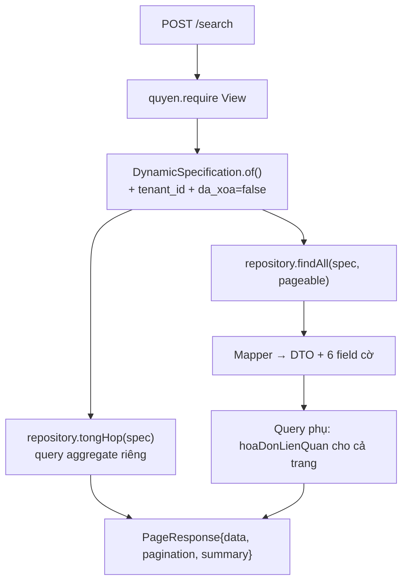

# F1 — Xem danh sách Hóa đơn bán hàng

| | |
|---|---|
| **Mã chức năng** | `F1` |
| **UC nguồn** | `PMKT-U-06456` — [`UC_HDBanHang_DanhSach.md`](../../../pmkt-docs/ba/PMKT-E-06196_HoaDonBanHang/4.usecases/PMKT-u-06456_DanhSach/UC_HDBanHang_DanhSach.md) |
| **Màn hình nguồn** | `SCR_HDBanHang_DanhSach.md` |
| **Endpoint phụ trách** | **A1** `POST /search` · **A2** `GET /cot` · **A3** `POST /export` |
| **File gốc** | [`00-ke-hoach-tong.md`](00-ke-hoach-tong.md) |

---

## 1. Quyết định riêng của chức năng

| # | Quyết định | Trỏ về |
|---|---|---|
| F1-a | Dùng nguyên 3 endpoint của `BaseCrudController` (`core/controller/BaseCrudController.java:121, 131, 171`), **không** viết controller method mới. Chỉ override `defaultSortAlias()`, `summary()`, `cotMacDinh(EXPORT)`. | D2, D4 |
| F1-b | Hai cột dẫn xuất (`trangThaiHoaDon`, `hoaDonLienQuan`) tính bằng **query phụ trên `sal_dieu_chinh_hoa_don_ban_hang`**, KHÔNG thêm cột vật lý cho `hoaDonLienQuan`. `trangThaiHoaDon` thì **có** cột vật lý (§7). | §7, §8 |
| F1-c | Cột `Tiền thuế GTGT` hiển thị: hóa đơn **ngoại tệ** lấy `tongTienThueGtgtQuyDoi`, còn lại lấy `tongTienThueGtgt` (`SCR_HDBanHang_DanhSach.md:120`). Việc chọn cột do **BE** làm (trả sẵn field `tienThueGtgtHienThi`), không để FE tự đoán. | §5.1 |
| F1-d | **STT do FE tính** theo công thức BR2 (`(page−1) × pageSize + vị trí`). BE không trả STT. | BR2 |

---

## 2. Hợp đồng API

### A1 — `POST /api/ban-hang/hoa-don-ban-hang/search`

**Quyền:** `LapHoaDonBan.View` (`BaseCrudController.java:123`).

```jsonc
// Request — SearchRequest (core/request/SearchRequest.java:33)
{
  "page": 1,
  "pageSize": 20,
  "sort": "ngayHoaDon:desc",
  "keyword": "CTY ABC",
  "logic": "AND",
  "filters": [
    { "field": "ngayHoaDon",            "op": "between", "value": ["2026-08-01", "2026-08-31"] },
    { "field": "trangThaiPhatHanh",     "op": "in",      "value": ["Chưa phát hành"] },
    { "field": "trangThaiLapChungTu",   "op": "in",      "value": ["Chưa lập", "Đã lập 1 phần"] },
    { "field": "soHoaDon",              "op": "contains","value": "00012" }
  ]
}
```

```jsonc
// Response 200 — PageResponse<HoaDonBanHangDto> (core/response/PageResponse.java:21)
{
  "data": [
    {
      "id": "7f1c…",
      "ngayHoaDon": "2026-08-12",
      "soHoaDon": "0000123",
      "kyHieuHoaDon": "K26TAA",
      "mauSoHoaDonId": "b21e…",
      "khachHangId": "9a03…",
      "tenKhachHang": "CÔNG TY TNHH ABC",
      "trangThaiLapChungTu": "Đã lập 1 phần",
      "trangThaiPhatHanh": "Chưa phát hành",
      "tongTienThueGtgt": 1250000.00,
      "tongTienThueGtgtQuyDoi": 1250000.00,
      "tienThueGtgtHienThi": 1250000.00,
      "trangThaiHoaDon": "Hóa đơn gốc",
      "hoaDonLienQuan": [],
      "loaiNghiepVu": "Bán hàng trong nước",
      "loaiTienId": "0001…",
      "tongTienThanhToanQuyDoi": 13750000.00,

      // --- field điều khiển ẩn/hiện nút (§5.3) ---
      "choPhepSua": true,
      "choPhepXoa": true,
      "choPhepLapChungTuBanHang": true,
      "choPhepLapChungTuBanDichVu": false,
      "coDongDichVu": false,
      "daLapChungTu": true,
      "chungTuBanId": null,
      "ngayCapNhat": "2026-08-13T04:11:02.451Z"
    }
  ],
  "pagination": { "page": 1, "pageSize": 20, "totalItems": 137, "totalPages": 7 },
  "summary": {
    "tongTienHangHoaQuyDoi": 1250000000.00,
    "tongTienChietKhauQuyDoi":  35000000.00,
    "tongTienThueGtgtQuyDoi":  121500000.00,
    "tongTienThanhToanQuyDoi": 1336500000.00,
    "soBanGhi": 137
  }
}
```

| Lỗi | HTTP | `code` | `messageId` |
|---|---|---|---|
| Thiếu quyền `.View` | 403 | `FORBIDDEN` | `MSG_PMKT-E-06196_011` |
| Lỗi hệ thống | 500 | `INTERNAL_ERROR` | `MSG_PMKT-E-06196_013` |

> Filter theo field **không nằm trong whitelist `@Searchable`** → `DynamicSpecification` **bỏ qua và log warn**, KHÔNG ném 400 (`core/shared/search/Searchable.java:11-13`). Quá 20 filter → cắt bớt (`DynamicSpecification.java:51`).

### A2 — `GET /api/ban-hang/hoa-don-ban-hang/cot`

**Quyền:** `LapHoaDonBan.View`. Sinh tự động từ whitelist `@Searchable` của entity (`BaseCrudController.java:131-135`) — FE dựng bộ lọc động + màn ẩn/hiện cột (BR30) từ đây, **không hardcode**.

```jsonc
{
  "data": [
    { "alias": "ngayHoaDon",          "label": "Ngày hóa đơn",            "kieu": "DATE",   "sortable": true, "keyword": false },
    { "alias": "soHoaDon",            "label": "Số hóa đơn",              "kieu": "TEXT",   "sortable": true, "keyword": true  },
    { "alias": "tenKhachHang",        "label": "Tên khách hàng",          "kieu": "TEXT",   "sortable": true, "keyword": true  },
    { "alias": "trangThaiLapChungTu", "label": "Trạng thái lập chứng từ", "kieu": "TEXT",   "sortable": true, "keyword": false },
    { "alias": "trangThaiPhatHanh",   "label": "Trạng thái phát hành HĐ", "kieu": "TEXT",   "sortable": true, "keyword": false },
    { "alias": "trangThaiHoaDon",     "label": "Trạng thái hóa đơn",      "kieu": "TEXT",   "sortable": true, "keyword": false },
    { "alias": "tongTienThueGtgt",    "label": "Tiền thuế GTGT",          "kieu": "SO",     "sortable": false,"keyword": false }
  ],
  "message": null, "messageId": null
}
```

### A3 — `POST /api/ban-hang/hoa-don-ban-hang/export`

**Quyền:** `LapHoaDonBan.Export` — ⚠️ **chưa seed**, xem [00 §10](00-ke-hoach-tong.md). Body = `SearchRequest` giống A1; xuất **toàn bộ** bản ghi khớp bộ lọc (không chỉ trang đang xem) — `BaseCrudController.java:168-170`. Trả `application/vnd.openxmlformats-officedocument.spreadsheetml.sheet`, tên file `Hoa-don-ban-hang.xlsx`.

---

## 3. Ánh xạ cột BA ↔ DB ↔ DTO

| # | Cột BA (`SCR_…DanhSach.md:21-29`) | Field BA (`BR08`, dòng 114-122) | Cột DB thật | Field DTO / alias lọc | Lọc | Sort |
|---|---|---|---|---|---|---|
| 1 | STT | `-` | — | — (FE tính, BR2) | N | N |
| 2 | Ngày hóa đơn | `sal_hoa_don_ban_hang.NgayHoaDon` | `ngay_hoa_don date` | `ngayHoaDon` | Y | Y |
| 3 | Số hóa đơn | `sal_hoa_don_ban_hang.SoHoaDon` | `so_hoa_don text` | `soHoaDon` | Y | Y |
| 4 | Tên khách hàng | `sal_hoa_don_ban_hang.TenKhachHang` | `ten_khach_hang text` | `tenKhachHang` | Y | Y |
| 5 | Trạng thái lập chứng từ | `sal_hoa_don_ban_hang.TrangThaiLapChungTu` | **`trang_thai_lap_chung_tu text`** ⚠ CHECK phải mở lên 3 giá trị ([07 §2](07-thiet-ke-db.md)) | `trangThaiLapChungTu` | Y | Y |
| 6 | Trạng thái phát hành HĐ | `sal_hoa_don_ban_hang.TrangThaiPhatHanh` | **`trang_thai_phat_hanh_hoa_don text`** ⚠ tên DB **lệch** tên BA (`…_hoa_don` thừa) | `trangThaiPhatHanh` | Y | Y |
| 7 | Tiền thuế GTGT | `sal_hoa_don_ban_hang.TongThueGTGT` / `TongThueGTGTQuyDoi` | **`tong_tien_thue_gtgt`** / **`tong_tien_thue_gtgt_quy_doi`** ⚠ tên DB **lệch** tên BA (`tong_tien_…` vs `TongThue…`) | `tongTienThueGtgt`, `tongTienThueGtgtQuyDoi`, `tienThueGtgtHienThi` (dẫn xuất — F1-c) | N | N |
| 8 | Trạng thái hóa đơn | `sal_hoa_don_ban_hang.TrangThaiHoaDon` | **CHƯA CÓ CỘT** → thêm `trang_thai_hoa_don text` ở `V3` | `trangThaiHoaDon` | Y | Y |
| 9 | Hóa đơn liên quan | `sal_hoa_don_ban_hang.SoHoaDon` của HĐ điều chỉnh/thay thế | **không có cột** — suy từ `sal_dieu_chinh_hoa_don_ban_hang.hoa_don_ban_hang_goc_id` (`V1:16707`) | `hoaDonLienQuan: [{id, soHoaDon}]` | Y (§8.5) | N |

> ⚠️ **Không tạo migration đổi tên cột** cho mục 6 và 7 — cột đã có dữ liệu, đổi tên là rủi ro thừa. Chỉ ánh xạ ở `@Column(name = …)` của entity và alias `@Searchable`.

---

## 4. Whitelist `@Searchable` trên entity

```java
@Searchable(sortable = true, label = "Ngày hóa đơn")
@Column(name = "ngay_hoa_don", nullable = false)
private LocalDate ngayHoaDon;

@Searchable(sortable = true, keyword = true, label = "Số hóa đơn")
@Column(name = "so_hoa_don", nullable = false)
private String soHoaDon;

@Searchable(sortable = true, keyword = true, label = "Tên khách hàng")
@Column(name = "ten_khach_hang", nullable = false)
private String tenKhachHang;

@Searchable(sortable = true, label = "Trạng thái lập chứng từ")
@Convert(converter = TrangThaiLapChungTu.JpaConverter.class)
@Column(name = "trang_thai_lap_chung_tu")
private TrangThaiLapChungTu trangThaiLapChungTu;

@Searchable(alias = "trangThaiPhatHanh", sortable = true, label = "Trạng thái phát hành HĐ")
@Convert(converter = TrangThaiPhatHanh.JpaConverter.class)
@Column(name = "trang_thai_phat_hanh_hoa_don")
private TrangThaiPhatHanh trangThaiPhatHanh;

@Searchable(sortable = true, label = "Trạng thái hóa đơn")     // cột thêm ở V3
@Convert(converter = TrangThaiHoaDonKind.JpaConverter.class)
@Column(name = "trang_thai_hoa_don")
private TrangThaiHoaDonKind trangThaiHoaDon;

@Searchable(keyword = true, label = "Ký hiệu hóa đơn")
@Column(name = "ky_hieu_hoa_don")
private String kyHieuHoaDon;

@Searchable(sortable = true, label = "Loại nghiệp vụ")
@Convert(converter = LoaiNghiepVuHoaDon.JpaConverter.class)
@Column(name = "loai_nghiep_vu", nullable = false)
private LoaiNghiepVuHoaDon loaiNghiepVu;
```

**Cột KHÔNG khai `@Searchable`:** mọi cột tiền, mọi id ngoại, mọi cột thông tin xuất khẩu. Lý do: BA không cho lọc/sort chúng (`SCR_…DanhSach.md:27` — `Tiền thuế GTGT` cột Tìm kiếm/Sắp xếp đều `N`), và whitelist thừa là lộ bề mặt tấn công dò dữ liệu.

`@SearchableAudit` khai ở mức class để mở `ngayTao`/`ngayCapNhat` (mẫu `ChungTuBanHang.java:42`).

---

## 5. Bộ tiêu chí tìm kiếm & field điều khiển nút

### 5.2 Bộ lọc (BR11.2)

| Field BA | Control | Alias BE | Toán tử |
|---|---|---|---|
| Ngày hóa đơn | DateRange (BR8) | `ngayHoaDon` | `between`, `gte`, `lte`, `eq` |
| Số hóa đơn | Text | `soHoaDon` | `contains`, `startsWith`, `endsWith`, `eq`, `ne` |
| Tên khách hàng | Text | `tenKhachHang` | `contains`, `startsWith`, `endsWith`, `eq`, `ne` |
| Trạng thái lập chứng từ | Multi-select | `trangThaiLapChungTu` | `in` |
| Trạng thái phát hành | Multi-select | `trangThaiPhatHanh` | `in` |
| Trạng thái hóa đơn | Multi-select | `trangThaiHoaDon` | `in` |
| — (tìm nhanh) | Search box | `keyword` | tìm không dấu, case-insensitive trên `soHoaDon`, `tenKhachHang`, `kyHieuHoaDon` |

**Cách ghép:** các `filters` ghép bằng `AND` (mặc định `logic`); `keyword` **luôn** ghép `AND` với cả nhóm (`SearchRequest.java:28-29`) — thu hẹp kết quả, không nới. Tìm không dấu qua SQL function `bo_dau()` (`DynamicSpecification.java:234-240`) đúng BR11.1 "gõ không dấu vẫn trả kết quả có dấu".

**Bộ lọc thời gian mặc định (BR11.2.1 — "Đầu tháng tới hiện tại"):** **FE gửi lên**, BE **không tự bơm**. Lý do: BE bơm thầm thì không có cách nào lấy toàn bộ dữ liệu (vd để đối chiếu tổng), và `POST /export` sẽ xuất thiếu bản ghi mà người dùng không biết. Lối thoát: FE gửi `filters: []`.

### 5.3 Field phụ trong DTO để FE ẩn/hiện nút

| Nút (`SCR_…DanhSach.md:43-48`) | Điều kiện BA | Field DTO |
|---|---|---|
| Xem chi tiết | luôn (nếu có quyền) | — (FE dựa quyền) |
| Chỉnh sửa | có quyền **và** `Chưa phát hành` (BR01) | `choPhepSua = (trangThaiPhatHanh == CHUA_PHAT_HANH)` |
| Xóa | có quyền **và** `Chưa phát hành` (BR01) | `choPhepXoa = (trangThaiPhatHanh == CHUA_PHAT_HANH)` |
| Xóa hàng loạt (disable) | disable nếu có ≥1 HĐ đã phát hành **hoặc** `trangThaiLapChungTu ≠ "Chưa lập"` | FE tự tổng hợp từ `choPhepXoa` + `daLapChungTu` của các dòng đã tích |
| Lập chứng từ bán hàng | `trangThaiLapChungTu ∈ {"Chưa lập","Đã lập 1 phần"}` (BR04) | `choPhepLapChungTuBanHang` |
| Lập chứng từ bán dịch vụ | như trên **và** có ≥1 dòng "Dịch vụ" (BR05) | `choPhepLapChungTuBanDichVu`, `coDongDichVu` — ⚠️ ngoài phạm vi, xem [00 §12-Q6](00-ke-hoach-tong.md) |
| Cảnh báo `_055` / `_056` khi sửa/xóa | HĐ đã lập chứng từ | `daLapChungTu = (trangThaiLapChungTu ≠ CHUA_LAP)` |

> Field cờ tính ở **mapper**, không phải ở SQL — tránh làm phình query danh sách. `coDongDichVu` là ngoại lệ: cần biết dòng chi tiết có mã hàng loại "Dịch vụ" không → xem §8.6.

---

## 6. Luồng xử lý

1. `HoaDonBanHangController.search(request)` — kế thừa `BaseCrudController.java:121`.
2. `quyen.require("LapHoaDonBan", VIEW)` — base tự gọi.
3. `HoaDonBanHangCrudService.search(request)` — **kế thừa nguyên** `AbstractCrudService`:
   - `specCuaRequest(request)` → `DynamicSpecification.of(HoaDonBanHang.class, request)`; base tự thêm `tenant_id = fn_current_tenant()` (`DynamicSpecification.java:75`) và `da_xoa = false` (`:78`).
   - `SortResolver` áp `defaultSortAlias()` khi client không gửi `sort`, tự nối `id asc` cho phân trang ổn định.
4. **override `summary(request)`** → `repository.tongHop(specCuaRequest(request))` — một query aggregate riêng trên **cùng spec** (§8.4).
5. `HoaDonBanMapper.toDto(entity)` — tính 5 field cờ + `tienThueGtgtHienThi`.
6. **Query phụ 1 lượt** cho `hoaDonLienQuan` của cả trang (§8.5) → tránh N+1.
7. Trả `PageResponse.of(page, pageNumber, summary)`.



---

## 7. Cột dẫn xuất `trangThaiHoaDon` (BR06)

**Quy tắc BA nguyên văn** (`SCR_HDBanHang_DanhSach.md:90-95`):
> - **Hóa đơn gốc**: Hóa đơn được lập ban đầu, chưa phát sinh điều chỉnh hoặc thay thế.
> - **Hóa đơn điều chỉnh**: Hóa đơn được lập để điều chỉnh thông tin của một hóa đơn đã phát hành trước đó.
> - **Hóa đơn thay thế**: Hóa đơn được lập để thay thế hoàn toàn một hóa đơn đã phát hành trước đó.
> - **Hóa đơn bị điều chỉnh**: Hóa đơn gốc đã được điều chỉnh bởi một hóa đơn điều chỉnh khác.
> - **Hóa đơn bị thay thế**: Hóa đơn gốc đã được thay thế bởi một hóa đơn thay thế khác.

**Dữ liệu nguồn:**

| Giá trị | Suy từ | Khả thi lần này |
|---|---|---|
| `Hóa đơn gốc` | mặc định | ✅ |
| `Hóa đơn bị điều chỉnh` | `sal_hoa_don_ban_hang.da_bi_dieu_chinh = true` (`V1:16836`) — được set khi có bản ghi `sal_dieu_chinh_hoa_don_ban_hang` trỏ về | ✅ (đọc; **ai set** thuộc PMKT-E-06197) |
| `Hóa đơn điều chỉnh` | bản ghi nằm ở bảng `sal_dieu_chinh_hoa_don_ban_hang` — **không** phải bảng này | ⚠️ HĐ điều chỉnh là **entity khác bảng**, không lên danh sách này. Xem Q3. |
| `Hóa đơn thay thế` / `bị thay thế` | **không có bảng/cột nào** trong baseline | ❌ [00 §12-Q3](00-ke-hoach-tong.md) |

**Phương án chọn:** thêm **cột vật lý** `trang_thai_hoa_don text` (`V3`, [07 §2](07-thiet-ke-db.md)), mặc định `'Hóa đơn gốc'`, CHECK 5 giá trị (khai đủ để epic PMKT-E-06197 dùng tiếp mà không phải sửa CHECK lần nữa). Lần này BE chỉ ghi 2 giá trị: `'Hóa đơn gốc'` lúc tạo; job/luồng của PMKT-E-06197 sẽ ghi `'Hóa đơn bị điều chỉnh'`.

**Vì sao KHÔNG chọn cột dẫn xuất thuần (tính từ `da_bi_dieu_chinh` lúc map):** BA yêu cầu cột này **lọc được và sắp xếp được** (`SCR_…DanhSach.md:28` — Tìm kiếm `Y`, Sắp xếp `Y`). Cột tính ở tầng Java không đưa vào `@Searchable` được → phải là cột vật lý. Đổi lại có nợ: cột này phải được cập nhật đồng bộ với `da_bi_dieu_chinh` — ràng buộc bàn giao cho epic PMKT-E-06197, ghi ở [00 §12-Q3](00-ke-hoach-tong.md).

---

## 8. Phân trang · sắp xếp · lọc · dòng tổng

### 8.1 Bộ lọc mặc định
FE gửi (§5.2). BE không bơm. BR11.2.1.

### 8.2 Sắp xếp mặc định — BR2 + `UC_HDBanHang_DanhSach.md:11`
> "sắp xếp mặc định theo **ngày hóa đơn từ mới nhất tới cũ nhất**"

```java
@Override protected String defaultSortAlias()          { return "ngayHoaDon:desc,soHoaDon:desc"; }
@Override protected Sort.Direction defaultSortDirection(){ return Sort.Direction.DESC; }
```

Khóa phụ `soHoaDon:desc` **không** để phân trang ổn định (`SortResolver` đã tự nối `id asc` cho việc đó) mà để các HĐ **cùng ngày** hiện theo số hóa đơn thay vì theo UUID ngẫu nhiên — cùng lý do đã ghi ở `ChungTuBanHangCrudService.java:84-88`.

BR2 nói "cùng ngày thì sắp theo Số chứng từ **tăng dần**"; ở đây chọn `desc` để hóa đơn lập sau hiện trước, đồng bộ với ý "mới nhất tới cũ nhất" của UC. **Lệch BR2 có chủ ý** — nếu BA muốn `asc` thì đổi một chuỗi.

### 8.3 Phân trang — BR1
Mặc định **20**/trang, whitelist `10/20/50/100/200`, giá trị lạ → 20 (`SearchRequest.java:52`). `page` **1-based** cả chiều gửi lẫn chiều nhận (`PageResponse.PageInfo`). Tổng số bản ghi/trang có sẵn trong `pagination`.

### 8.4 Dòng tổng cộng — BR31

Cột có dòng tổng (đối chiếu `SCR_CTBH_ThemMoi.md:259-283` — dòng tổng của lưới; ở màn danh sách chỉ giữ 4 chỉ tiêu tiền chính):

| Chỉ tiêu | Công thức |
|---|---|
| `tongTienHangHoaQuyDoi` | `SUM(tong_tien_hang_hoa_quy_doi)` |
| `tongTienChietKhauQuyDoi` | `SUM(tong_tien_chiet_khau_quy_doi)` |
| `tongTienThueGtgtQuyDoi` | `SUM(tong_tien_thue_gtgt_quy_doi)` |
| `tongTienThanhToanQuyDoi` | `SUM(tong_tien_thanh_toan_quy_doi)` |
| `soBanGhi` | `COUNT(*)` |

**Phạm vi:** **TOÀN BỘ** bản ghi khớp bộ lọc, không phải trang hiện tại — tổng của một trang không có ý nghĩa kế toán (mẫu `ChungTuBanHangCrudService.java:184-195`).
**Cài ở:** `HoaDonBanHangRepositoryImpl.tongHop(Specification)` — một query aggregate dùng lại **chính spec** của request, không dựng lại điều kiện lọc bằng tay.
**Tập rỗng:** `SUM` trả `NULL` → mapper đổi thành `BigDecimal.ZERO`, `soBanGhi = 0`. Không trả `null` cho FE.
**Chỉ dùng cột quy đổi:** danh sách trộn nhiều loại tiền, cộng cột nguyên tệ là cộng táo với cam (BR18).

### 8.5 Cột `hoaDonLienQuan` — chống N+1

```sql
SELECT dc.hoa_don_ban_hang_goc_id, dc.id, dc.so_hoa_don
  FROM sal_dieu_chinh_hoa_don_ban_hang dc
 WHERE dc.da_xoa = false
   AND dc.hoa_don_ban_hang_goc_id = ANY(:idsCuaTrangHienTai)
```
Một query cho cả trang (≤ 200 id), map vào DTO ở tầng service. **Vì sao không `@OneToMany`:** quan hệ này thuộc epic khác (PMKT-E-06197), khai `@OneToMany` sẽ buộc module HĐ biết entity của module chưa tồn tại → vi phạm ranh giới.

**Lọc theo `hoaDonLienQuan`** (BA cho Tìm kiếm `Y`, Sắp xếp `N` — `SCR_…DanhSach.md:29`): cài bằng filter đặc biệt `coHoaDonLienQuan: true/false` map sang `EXISTS(...)`, **không** cho lọc theo nội dung số hóa đơn liên quan. Lý do: `@Searchable` không diễn tả được subquery. Nếu BA cần lọc theo nội dung → phải viết `RepositoryCustom` riêng, đưa vào phạm vi sau.

### 8.6 Cột `coDongDichVu`
```sql
SELECT ct.hoa_don_ban_hang_id
  FROM sal_hoa_don_ban_hang_chi_tiet ct
  JOIN mst_vat_tu vt ON vt.id = ct.ma_hang_id
 WHERE ct.da_xoa = false AND ct.loai_dong_hang = true
   AND vt.loai_hang_hoa = 'Dịch vụ'
   AND ct.hoa_don_ban_hang_id = ANY(:idsCuaTrangHienTai)
 GROUP BY ct.hoa_don_ban_hang_id
```
⚠️ `mst_vat_tu` thuộc `master_data` (**vùng đóng băng**) — chỉ dùng **tên bảng/cột SQL**, tuyệt đối không đọc/không import code Java của module đó. Tên cột `loai_hang_hoa` **cần xác nhận lại bằng migration** trước khi code (`grep -n "CREATE TABLE public.mst_vat_tu" -A80 V1__baseline.sql`).

---

## 9. Xuất Excel — BR39

```java
@Override
protected List<ColumnDef> cotMacDinh(LoaiMau loai) {
    if (loai != LoaiMau.EXPORT) return List.of();          // chặn import — D10
    return List.of(
        ColumnDef.of("ngayHoaDon", "Ngày hóa đơn", ColumnType.NGAY).voiDoRong(16),
        ColumnDef.of("soHoaDon", "Số hóa đơn").voiDoRong(18),
        ColumnDef.of("tenKhachHang", "Tên khách hàng").voiDoRong(32),
        ColumnDef.of("trangThaiLapChungTu", "Trạng thái lập chứng từ").voiDoRong(22),
        ColumnDef.of("trangThaiPhatHanh", "Trạng thái phát hành HĐ").voiDoRong(22),
        ColumnDef.of("tienThueGtgtHienThi", "Tiền thuế GTGT", ColumnType.SO).voiDoRong(18),
        ColumnDef.of("trangThaiHoaDon", "Trạng thái hóa đơn").voiDoRong(20));
}
```
Đúng 7/9 cột của màn (bỏ `STT` — Excel tự đánh; bỏ `Hóa đơn liên quan` — là mảng, không đổ được vào một ô phẳng). Người dùng lưu mẫu riêng thì `ExcelUtil.resolveColumns` ưu tiên mẫu đó (`BaseCrudController.java:177-178`).

---

## 10. Tương tranh & transaction
`POST /search`, `GET /cot`, `POST /export` đều `@Transactional(readOnly = true)`. Không khóa. `POST /export` stream qua `StreamingResponseBody` — transaction phải bao trọn việc ghi stream, nếu không `LazyInitializationException`; base đã xử ở `AbstractCrudService.duLieuExport` (đọc lại chữ ký trước khi code).

---

## 11. Kiểm thử

### 11.1 Unit (`@Tag("unit")`, không cần Docker)

| Lớp test | Case |
|---|---|
| `HoaDonBanMapperTest` | `choPhepSua`/`choPhepXoa` = true khi `Chưa phát hành`, false khi `Đã phát hành` |
| | `choPhepLapChungTuBanHang` = true với `Chưa lập` và `Đã lập 1 phần`, false với `Đã lập đủ` |
| | `daLapChungTu` = false chỉ khi `Chưa lập` |
| | `tienThueGtgtHienThi` = `tongTienThueGtgtQuyDoi` khi `loaiTienId ≠ đồng tiền hạch toán`, ngược lại = `tongTienThueGtgt` |
| `HoaDonBanHangSearchableTest` | pin whitelist: đúng 8 alias, không thừa không thiếu (chống lộ cột ngoài ý muốn) |
| `TongHopHoaDonBanDtoTest` | `SUM` trả `null` (tập rỗng) → DTO trả `ZERO`, không `null` |
| `SortMacDinhTest` | `defaultSortAlias()` == `"ngayHoaDon:desc,soHoaDon:desc"` |

### 11.2 Tích hợp (cần Docker — **không chạy được trên máy dev**, R7)

| Lớp | Kiểm |
|---|---|
| `HoaDonBanHangSearchIT` | RLS: user tenant A không thấy HĐ tenant B; `da_xoa=true` không lọt vào kết quả |
| | filter `between` trên `ngayHoaDon`; `keyword` không dấu ("cong ty" → "CÔNG TY") |
| | `summary` tính trên toàn bộ sau lọc, không phải trang hiện tại |
| | `hoaDonLienQuan` — 1 query phụ cho cả trang (đếm query bằng Hibernate statistics) |
| `HoaDonBanHangExportIT` | export lấy đủ bản ghi ngoài trang 1 |

---

## 12. BR đã áp dụng

| BR | Áp ở bước nào |
|---|---|
| BR1 | §8.3 — mặc định 20, whitelist page size |
| BR2 | §8.2 sort mặc định · F1-d STT do FE tính · cột Hành động cuối bảng (FE) |
| BR7 | Cột tiền trả nguyên `numeric(18,2)`, không làm tròn ở BE (BR7.2 mục 3 — "lưu giá trị đầy đủ") |
| BR8 | §5.2 — filter `ngayHoaDon` toán tử `between` |
| BR11.1 | §5.2 — `keyword` không dấu, case-insensitive, trim |
| BR11.2 | §5.2 — filter theo cột, ghép AND, badge số filter do FE |
| BR11.3 | §8.2 — sort server-side trên toàn bộ bản ghi sau lọc, từng cột một |
| BR13.1 | §5.3 — field cờ ẩn/hiện nút |
| BR28 | §6 bước 3 — RLS + `DynamicSpecification` tự bơm `tenant_id` |
| BR29.1 | §6 bước 3 — `da_xoa = false` tự bơm |
| BR30 | A2 `GET /cot` sinh từ whitelist |
| BR31 | §8.4 — dòng tổng toàn cục |
| BR39 | §9 — xuất Excel toàn bộ sau lọc |
| BR43 | `keyword` được trim (`SearchRequest.isOrLogic`/`hasKeyword` + `DynamicSpecification`) |

**Chưa đạt:** BR11.2.1 "bộ lọc thời gian mặc định Đầu tháng tới hiện tại" — cố ý đẩy về FE (§8.1); BR2 "cùng ngày sắp theo số chứng từ **tăng dần**" — chọn `desc`, lệch có chủ ý (§8.2); lọc theo **nội dung** cột `Hóa đơn liên quan` — chỉ hỗ trợ lọc có/không (§8.5).
