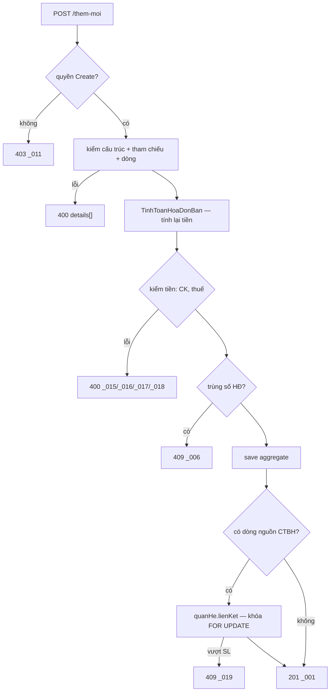

# F2 — Thêm mới Hóa đơn bán hàng

| | |
|---|---|
| **Mã chức năng** | `F2` |
| **UC nguồn** | `ThemMoi` (chưa có mã — [00 §12-Q1](00-ke-hoach-tong.md)) — [`UC_HDBanHang_ThemMoi.md`](../../../pmkt-docs/ba/PMKT-E-06196_HoaDonBanHang/4.usecases/ThemMoi/UC_HDBanHang_ThemMoi.md) |
| **Màn hình nguồn** | `SCR_HDBanHang_ThemMoi.md` (+ `SCR_CTBH_ThemMoi.md` là **logic chuẩn** được tham chiếu) |
| **Endpoint phụ trách** | **A4** `POST /lookup` · **A5** `POST /them-moi` |
| **File gốc** | [`00-ke-hoach-tong.md`](00-ke-hoach-tong.md) |

> **File này là gốc của cả epic.** F4 (Cập nhật) dùng lại 100% hợp đồng request, validate và tính toán ở đây; F3 (Chi tiết) dùng lại cấu trúc response.

---

## 1. Quyết định riêng của chức năng

| # | Quyết định | Trỏ về |
|---|---|---|
| F2-a | `C` và `U` của `BaseCrudController<E,D,C,U>` **cùng là** `LuuHoaDonBanHangRequest` — màn Thêm mới và Cập nhật dùng chung bố cục và toàn bộ BR (`SCR_HDBanHang_CapNhat.md:12,16-17`). | D4 |
| F2-b | Override `POST /them-moi` **chỉ để gắn `messageId`** của epic (`MSG_PMKT-E-06196_001`); hành vi nghiệp vụ nằm trọn ở service. Envelope mặc định của base dùng mã chung `MSG_CORE_*` mà FE không tra được. | mẫu `ChungTuBanHangController.java:127-136` |
| F2-c | BE **tính lại** tiền của từng dòng và tổng header; **tôn trọng** giá trị client gửi cho 6 trường mà BA cho sửa tay (§4.4). | D5 |
| F2-d | `thuTu` do client gửi (BR21.2 — vị trí chèn do FE quyết định) nhưng BE **đánh lại liên tục 1…N** theo đúng thứ tự client gửi trước khi lưu. Client gửi thứ tự trùng/nhảy cóc không làm hỏng dữ liệu. | BR21.2 "Đánh lại số thứ tự" |
| F2-e | Trạng thái lúc tạo do **BE ép cứng**, không nhận từ client: `trangThaiPhatHanh = "Chưa phát hành"`, `trangThaiLapChungTu = "Chưa lập"`, `trangThaiHoaDon = "Hóa đơn gốc"`. | `UC_HDBanHang_ThemMoi.md:39` · `SCR_HDBanHang_ThemMoi.md:96` · D9 |
| F2-f | **Không sinh bút toán, không kiểm kỳ khóa, không gọi `GhiSoApi`.** | `UC_HDBanHang_ThemMoi.md:20` · `SCR_HDBanHang_ThemMoi.md:69` · D2 |

---

## 2. Hợp đồng API

### A4 — `POST /api/ban-hang/hoa-don-ban-hang/lookup`

**Quyền:** `LapHoaDonBan.View`. Trả bộ giá trị enum hợp lệ để FE dựng combo, **không hardcode chuỗi tiếng Việt** vốn nằm trong CHECK constraint của DB (lý do đầy đủ: `ChungTuBanHangController.java:159-167`).

```jsonc
// Response 200
{
  "data": {
    "loaiNghiepVu":       ["Bán hàng trong nước", "Bán hàng xuất khẩu"],
    "loaiChietKhau":      ["Không chiết khấu", "Theo mặt hàng", "Theo % hóa đơn",
                           "Theo số tiền trên tổng hóa đơn", "Theo mặt hàng và hóa đơn"],
    "hinhThucThanhToan":  ["Tiền mặt", "Chuyển khoản", "TM-CK"],
    "thueSuatGtgt":       ["0", "5", "8", "10", "KCT", "KKKNT", "KHAC"],
    "trangThaiPhatHanh":  ["Chưa phát hành", "Đã phát hành"],
    "trangThaiLapChungTu":["Chưa lập", "Đã lập 1 phần", "Đã lập đủ"]
  },
  "message": null, "messageId": null
}
```

> `loaiNghiepVu` trả **2 giá trị** cho màn lập trực tiếp (`SCR_HDBanHang_ThemMoi.md:21` — "chỉ chọn giữa *Bán hàng trong nước* và *Bán hàng xuất khẩu*"). Giá trị `"Bán dịch vụ"` chỉ xuất hiện trên HĐ **lập kèm** từ chứng từ nguồn — chờ [00 §12-Q5](00-ke-hoach-tong.md).
> Với `Bán hàng xuất khẩu`, `thueSuatGtgt` **chỉ nhận** `["0", "KCT"]` (`SCR_CTBH_ThemMoi.md:790` — BR13 mục 1). FE lọc theo `loaiNghiepVu` đang chọn; BE **cũng validate lại** (§5-V13).

### A5 — `POST /api/ban-hang/hoa-don-ban-hang/them-moi`

**Quyền:** `LapHoaDonBan.Create` (`BaseCrudController.java:145`). Trả **201**.

```jsonc
// Request — LuuHoaDonBanHangRequest
{
  "loaiNghiepVu": "Bán hàng trong nước",

  // --- Thông tin hóa đơn (SCR_CTBH_ThemMoi.md:80-101 "Tab Hóa đơn") ---
  "khachHangId": "9a03…",
  "tenKhachHang": "CÔNG TY TNHH ABC",
  "maSoThue": "0101234567",
  "nguoiMuaHang": "Nguyễn Văn A",
  "maSoDvqhns": "1234567",
  "cccd": "001199001234",
  "hoChieu": null,
  "soDienThoai": "0912345678",
  "diaChi": "Số 1 Trần Duy Hưng, Hà Nội",
  "nguoiLienHe": "Trần Thị B",
  "hinhThucThanhToan": "Chuyển khoản",
  "taiKhoanNganHangThuId": "c410…",
  "mauSoHoaDonId": "b21e…",
  "kyHieuHoaDon": "K26TAA",
  "ngayHoaDon": "2026-08-12",
  "soHoaDon": "0000123",
  "nhanVienBanHangId": "77aa…",
  "moTa": "Bán hàng theo hợp đồng 12/HĐKT",

  // --- Loại tiền / chiết khấu (SCR_CTBH_ThemMoi.md:167-181) ---
  "loaiTienId": "0001…",
  "tyGia": 1.000000,
  "loaiChietKhau": "Theo mặt hàng",
  "giaTriChietKhau": 0,

  // --- Thông tin xuất khẩu (chỉ khi loaiNghiepVu = "Bán hàng xuất khẩu") ---
  "soHopDong": null, "ngayHopDong": null, "diaDiemGiao": null, "diaDiemNhan": null,
  "soVanDon": null, "soContainer": null, "donViVanChuyen": null,

  // --- Nguồn: HĐ lập từ chứng từ bán hàng (BR05 — SCR_HDBanHang_ThemMoi.md:99-103) ---
  "chungTuBanId": null,

  "chiTiet": [
    {
      "thuTu": 1,
      "loaiDongHang": true,
      "maHangId": "a1b2…",
      "tenHang": "Xi măng PC40",
      "dienGiai": "Xi măng PC40",
      "donViTinhId": "d001…",
      "soLuong": 100.000,
      "donGia": 85000.00,
      "thanhTien": 8500000.00,
      "thanhTienQuyDoi": 8500000.00,
      "donGiaQuyDoi": 85000.00,

      "hangKhuyenMai": false,
      "chietKhauThuongMai": false,

      "chietKhauPhanTram": 5.00,
      "chietKhau": 425000.00,
      "chietKhauQuyDoi": 425000.00,
      "chietKhauHangPhanTram": null,
      "tienChietKhauHang": null,
      "tienChietKhauHangQuyDoi": null,
      "chietKhauHoaDonPhanTram": null,
      "tienChietKhauHoaDon": null,
      "tienChietKhauHoaDonQuyDoi": null,

      "thueSuatGtgtMacDinh": "10",
      "giaTriThueGtgt": null,
      "tienThueGtgt": 807500.00,
      "tienThueGtgtQuyDoi": 807500.00,
      "dienGiaiThue": "Thuế GTGT - Xi măng PC40",
      "khongTongHopToKhaiGtgt": false,

      "giaTriTinhThueXk": null, "giaTriTinhThueXkQuyDoi": null,
      "phanTramThueXk": null, "tienThueXk": null, "tienThueXkQuyDoi": null,

      "soLo": "L2608", "hanSuDung": "2027-08-12",
      "hopDongId": null, "donViId": null, "khoanMucChiPhiId": null, "vuViecId": null,

      // nguồn dòng (khi lập từ CTBH)
      "chungTuBanHangId": null, "chiTietChungTuBanHangId": null,
      "chungTuBanDichVuId": null, "chiTietChungTuBanDichVuId": null
    }
  ]
}
```

```jsonc
// Response 201 — ApiResponse<HoaDonBanHangDto>
{
  "data": {
    "id": "7f1c…",
    "trangThaiPhatHanh": "Chưa phát hành",
    "trangThaiLapChungTu": "Chưa lập",
    "trangThaiHoaDon": "Hóa đơn gốc",
    "tongTienHangHoa": 8500000.00,
    "tongTienChietKhau": 425000.00,
    "tongTienThueGtgt": 807500.00,
    "tongTienSauThue": 8882500.00,
    "tongTienThanhToan": 8882500.00,
    "tongTienThueXk": null,
    "tongTienHangHoaQuyDoi": 8500000.00,
    "tongTienChietKhauQuyDoi": 425000.00,
    "tongTienThueGtgtQuyDoi": 807500.00,
    "tongTienSauThueQuyDoi": 8882500.00,
    "tongTienThanhToanQuyDoi": 8882500.00,
    "tongTienThueXkQuyDoi": null,
    "phienBan": 1,
    "ngayCapNhat": null,
    "chiTiet": [ /* … như request, kèm id từng dòng và số đã tính lại … */ ]
  },
  "message": "Thêm mới Hóa đơn thành công",
  "messageId": "MSG_PMKT-E-06196_001"
}
```

**Bảng lỗi:**

| Điều kiện | HTTP | `code` | `messageId` | Nguồn BA |
|---|---|---|---|---|
| Thiếu quyền `.Create` | 403 | `FORBIDDEN` | `MSG_PMKT-E-06196_011` | BR25.2 |
| Thiếu trường bắt buộc | 400 | `INVALID_VALUE` | — (dùng `details[]`) | BR15.1 |
| Trùng (số HĐ + ký hiệu + mẫu số) | 409 | `DUPLICATE_HOA_DON` | `MSG_PMKT-E-06196_006` | BR03 (`SCR_…ThemMoi.md:89`) |
| Không có dòng chi tiết | 400 | `EMPTY_DETAIL` | `MSG_PMKT-E-06196_007` | `SCR_…ThemMoi.md:112` |
| Số lượng âm | 400 | `NEGATIVE_QUANTITY` | `MSG_PMKT-E-06196_009` | `:113` |
| Đơn giá âm | 400 | `NEGATIVE_PRICE` | `MSG_PMKT-E-06196_020` | `:114` |
| % CK > 100 | 400 | `INVALID_DISCOUNT` | `MSG_PMKT-E-06196_015` | `:115` |
| Tiền CK > Thành tiền dòng | 400 | `INVALID_DISCOUNT` | `MSG_PMKT-E-06196_016` | `:116` |
| Tổng CK dòng ≠ tổng CK hóa đơn | 400 | `INVALID_DISCOUNT` | `MSG_PMKT-E-06196_017` | `:117` |
| Tổng tỷ lệ phân bổ ≠ 100% | 400 | `INVALID_DISCOUNT` | `MSG_PMKT-E-06196_018` | `:118` |
| SL xuất HĐ vượt SL còn lại của CTBH | 409 | `EXCEEDS_REMAINING_QUANTITY` | `MSG_PMKT-E-06196_019` | `:119` (BR05) |
| Lỗi hệ thống | 500 | `INTERNAL_ERROR` | `MSG_PMKT-E-06196_013` | `UC:46` |

`details[]` của `ApiError` (`core/shared/error/ApiError.java:15`) mang `{field, message}` để FE **focus vào trường đầu tiên có lỗi** (`SCR_HDBanHang_CapNhat.md:36`, BR15.4). Với lỗi ở dòng chi tiết, `field` dùng dạng `chiTiet[3].soLuong`.

---

## 3. Ánh xạ cột BA ↔ DB ↔ DTO

### 3.1 Header — `sal_hoa_don_ban_hang`

| Trường BA (`SCR_CTBH_ThemMoi.md:87-101` "Tab Hóa đơn") | Bắt buộc | Max | Cột DB | Field DTO | Ghi chú |
|---|---|---|---|---|---|
| Loại nghiệp vụ | Y | — | `loai_nghiep_vu text NOT NULL` | `loaiNghiepVu` | riêng của HĐ (`SCR_HDBanHang_ThemMoi.md:21`) |
| Mã khách hàng | Y | — | `khach_hang_id uuid NOT NULL` | `khachHangId` | |
| Tên khách hàng | Y | 255 | `ten_khach_hang text NOT NULL` | `tenKhachHang` | |
| Mã số thuế/CCCD chủ hộ | N | 14 | `ma_so_thue text` | `maSoThue` | |
| Người mua hàng | N | 100 | `nguoi_mua_hang text` | `nguoiMuaHang` | |
| Mã số DV QHNS | N | 7 | `ma_so_dvqhns text` | `maSoDvqhns` | |
| Số CCCD | N | 12 | `cccd text` | `cccd` | |
| Hộ chiếu | N | 20 | `ho_chieu text` | `hoChieu` | |
| Số điện thoại | N | 20 | `so_dien_thoai text` | `soDienThoai` | |
| Địa chỉ | **Y** | 400 | `dia_chi text` **NULL ở DB** | `diaChi` | ⚠ BA bắt buộc, DB cho NULL → validate ở tầng service, **không** đổi NOT NULL (dữ liệu cũ) |
| Hình thức TT | Y | — | `hinh_thuc_thanh_toan text NOT NULL` | `hinhThucThanhToan` | CHECK 3 giá trị (`V1:16853`) |
| Tài khoản NH | N | — | `tai_khoan_ngan_hang_thu_id uuid` | `taiKhoanNganHangThuId` | |
| Mẫu số hóa đơn | Y | — | `mau_so_hoa_don_id uuid` **NULL ở DB** | `mauSoHoaDonId` | ⚠ như `diaChi` |
| Ký hiệu hóa đơn | Y | 6 | `ky_hieu_hoa_don text` **NULL ở DB** | `kyHieuHoaDon` | ⚠ như `diaChi` |
| Ngày hóa đơn | Y | — | `ngay_hoa_don date NOT NULL` | `ngayHoaDon` | mặc định ngày hiện tại (FE) |
| Số hóa đơn | Y | 8 (BA) / **50** (BR20) | `so_hoa_don text NOT NULL` | `soHoaDon` | ⚠ mâu thuẫn độ dài — §5-V03 |
| Diễn giải | N | — | `mo_ta text` | `moTa` | tên DB **lệch** (`mo_ta` vs `DienGiai`) |
| — | N | — | `nguoi_lien_he text` | `nguoiLienHe` | |
| — | N | — | `nhan_vien_ban_hang_id uuid` | `nhanVienBanHangId` | |
| Loại tiền | Y | — | `loai_tien_id uuid NOT NULL` | `loaiTienId` | |
| Tỷ giá quy đổi | Y | — | `ty_gia exchange_rate NOT NULL` | `tyGia` | `numeric(18,6)` — BR7 |
| Loại chiết khấu | Y | — | `loai_chiet_khau text NOT NULL` | `loaiChietKhau` | CHECK 5 giá trị (`V1:16854`) |
| Ô nhập % / số tiền CK chung | N | — | `gia_tri_chiet_khau numeric(18,2)` | `giaTriChietKhau` | |
| **Thông tin xuất khẩu** (`SCR_CTBH_ThemMoi.md:154-160`) | N | 50–255 | `so_hop_dong`, `ngay_hop_dong`, `dia_diem_giao`, `dia_diem_nhan`, `so_van_don`, `so_container`, `don_vi_van_chuyen` | cùng tên camelCase | đã có đủ |
| Tổng tiền hàng | — | — | `tong_tien_hang_hoa money_vnd` | `tongTienHangHoa` | **server tính** |
| Tổng chiết khấu | — | — | `tong_tien_chiet_khau` + `tong_tien_chiet_khau_hang` + `tong_tien_chiet_khau_hoa_don` | `tongTienChietKhau…` | **server tính** |
| Tổng thuế GTGT | — | — | `tong_tien_thue_gtgt` | `tongTienThueGtgt` | **server tính** |
| Tổng tiền sau thuế / Tổng thanh toán | — | — | `tong_tien_sau_thue`, `tong_tien_thanh_toan` | | **server tính** |
| **Tổng thuế XK** (`SCR_HDBanHang_ThemMoi.md:54`) | — | — | **CHƯA CÓ** → `tong_tien_thue_xk` + `…_quy_doi` (V3) | `tongTienThueXk…` | **server tính** |
| (5 cột `…_quy_doi` tương ứng) | — | — | đã có đủ | | **server tính** |
| Trạng thái phát hành | — | — | `trang_thai_phat_hanh_hoa_don` | `trangThaiPhatHanh` | **server ép** (F2-e) |
| Trạng thái lập chứng từ | — | — | `trang_thai_lap_chung_tu` | `trangThaiLapChungTu` | **server ép** |
| Trạng thái hóa đơn | — | — | **CHƯA CÓ** → `trang_thai_hoa_don` (V3) | `trangThaiHoaDon` | **server ép** |
| Chứng từ nguồn | — | — | **CHƯA CÓ** → `chung_tu_ban_id` (V3) | `chungTuBanId` | client gửi khi lập từ CTBH |
| `id`, `tenant_id`, `phien_ban`, audit ×6, `da_xoa` | — | — | theo `AggregateRootEntity` | | base tự quản (BR46) |

### 3.2 Dòng chi tiết — `sal_hoa_don_ban_hang_chi_tiet`

Tham chiếu `SCR_CTBH_ThemMoi.md:187-240` (Tab Chi tiết hàng hóa) **trừ** các cột hạch toán bị loại bởi `SCR_HDBanHang_ThemMoi.md:40-41,69`.

| Cột BA | Bắt buộc | Cột DB | Field DTO | Ai ghi |
|---|---|---|---|---|
| STT | Y | `thu_tu numeric NOT NULL` | `thuTu` | client gửi, **server đánh lại 1…N** (F2-d) |
| Loại dòng hàng | Y | `loai_dong_hang boolean NOT NULL DEFAULT true` | `loaiDongHang` | client |
| Mã hàng | Y (dòng hàng) | `ma_hang_id uuid` | `maHangId` | client |
| Tên hàng | Y | `ten_hang text` | `tenHang` | client (auto-fill từ vật tư ở FE — BR07) |
| **Diễn giải (ẩn)** | N | **CHƯA CÓ** → `dien_giai text` (V3) | `dienGiai` | client; **server fill** = `tenHang` nếu client bỏ trống (BR15) |
| Chiết khấu thương mại | N | `chiet_khau_thuong_mai boolean` | `chietKhauThuongMai` | client |
| Hàng khuyến mại | N | `hang_khuyen_mai boolean` | `hangKhuyenMai` | client |
| ĐVT | Y | `don_vi_tinh_id uuid` | `donViTinhId` | client |
| Hệ số / SL / ĐG quy đổi (ĐVT) | — | **KHÔNG LƯU** | không có trong DTO | tính hiển thị ở FE (`SCR_HDBanHang_ThemMoi.md:43`, BR10) |
| Số lượng | N | `so_luong quantity` | `soLuong` | client |
| Đơn giá | N | `don_gia numeric(18,2)` | `donGia` | client |
| Thành tiền | Y | `thanh_tien numeric(18,2)` | `thanhTien` | **server tính** (§4.1) |
| Thành tiền quy đổi | Y | `thanh_tien_quy_doi numeric(18,2)` | `thanhTienQuyDoi` | **server tính**, client sửa được (§4.4) |
| Đơn giá quy đổi | — | `don_gia_quy_doi numeric(18,2)` | `donGiaQuyDoi` | **server tính** |
| Tỷ lệ CK (%) | N | `chiet_khau_phan_tram percent_rate` | `chietKhauPhanTram` | server tính hoặc client (§4.2) |
| Tiền CK | N | `chiet_khau money_vnd` | `chietKhau` | server tính hoặc client |
| Tiền CK quy đổi | N | `chiet_khau_quy_doi money_vnd` | `chietKhauQuyDoi` | server tính, client sửa được |
| **Tỷ lệ CK theo mặt hàng (%)** | N | **CHƯA CÓ** → `chiet_khau_hang_phan_tram percent_rate` (V3) | `chietKhauHangPhanTram` | client |
| Tiền CK theo mặt hàng (+quy đổi) | N | `tien_chiet_khau_hang`, `…_quy_doi` | `tienChietKhauHang…` | server tính |
| **Tỷ lệ CK theo hóa đơn (%)** | N | **CHƯA CÓ** → `chiet_khau_hoa_don_phan_tram percent_rate` (V3) | `chietKhauHoaDonPhanTram` | client |
| Tiền CK theo hóa đơn (+quy đổi) | N | `tien_chiet_khau_hoa_don`, `…_quy_doi` | `tienChietKhauHoaDon…` | server tính |
| % thuế GTGT | Y | `thue_suat_gtgt_mac_dinh text` (CHECK 7 giá trị — `V1:16922`) | `thueSuatGtgtMacDinh` | client |
| Giá trị thuế GTGT (khi `KHAC`) | N | `gia_tri_thue_gtgt numeric(18,2)` | `giaTriThueGtgt` | client — ⚠ tên DB **lệch** BA (`ThueSuatKhac`) |
| Tiền thuế GTGT (+quy đổi) | N | `tien_thue_gtgt`, `…_quy_doi` | `tienThueGtgt…` | server tính, client sửa được (§4.4) |
| **Diễn giải thuế** | N | **CHƯA CÓ** → `dien_giai_thue text` (V3) | `dienGiaiThue` | client; server fill mặc định `Thuế GTGT - {tenHang}` |
| **HH không TH trên tờ khai GTGT** | N | **CHƯA CÓ** → `khong_tong_hop_to_khai_gtgt boolean DEFAULT false` (V3) | `khongTongHopToKhaiGtgt` | **server ép** theo `%thuế` (§4.3) |
| **Giá trị tính thuế XK (+quy đổi)** | Y (khi XK) | **CHƯA CÓ** → `gia_tri_tinh_thue_xk`, `…_quy_doi numeric(18,2)` (V3) | `giaTriTinhThueXk…` | server tính, client sửa được |
| % Thuế XK | N | `phan_tram_thue_xk percent_rate` | `phanTramThueXk` | client |
| Tiền thuế XK (+quy đổi) | N | `tien_thue_xk`, `…_quy_doi` | `tienThueXk…` | server tính, client sửa được |
| Số lô / Hạn sử dụng | N | `so_lo text`, `han_su_dung date` | `soLo`, `hanSuDung` | client |
| Hợp đồng / Đơn vị / Khoản mục CP / Vụ việc | N | `hop_dong_id`, `don_vi_id`, `khoan_muc_chi_phi_id`, `vu_viec_id` | cùng tên | client |
| Nguồn dòng (BR05) | N | `chung_tu_ban_hang_id`, `chi_tiet_chung_tu_ban_hang_id`, `chung_tu_ban_dich_vu_id`, `chi_tiet_chung_tu_ban_dich_vu_id` | cùng tên | client |

**Cột KHÔNG có trên lưới hóa đơn** (theo `SCR_HDBanHang_ThemMoi.md:40-42`): `Kho`, `Giá vốn`, `Tiền vốn`, `TK công nợ`, `TK doanh thu`, `TK giá vốn`, `TK kho`, `TK chiết khấu`, `TK Thuế GTGT`, `Số lượng đã xuất HĐ`, `Số lượng còn lại`. Bảng DB **cũng không có** các cột này — khớp.

**Hai trường tự do BA có mà DB thiếu:** `Đối tượng THCP` (`DoiTuongTapHopChiPhiId`) và `Đơn đặt hàng` (`DonDatHangId`) — `SCR_CTBH_ThemMoi.md:250,254`. Xem [07 §2](07-thiet-ke-db.md) và [00 §12](00-ke-hoach-tong.md).

---

## 4. Tính toán ở BE (D5)

`TinhToanHoaDonBan` — lớp thuần JVM, không Spring, không DB. Chạy **sau** validate cấu trúc, **trước** validate nghiệp vụ về tiền.

### 4.1 Thành tiền — BR11 (`SCR_CTBH_ThemMoi.md:671-701`)

```
thanhTien      = soLuong × donGia                         (nếu soLuong > 0)
donGiaQuyDoi   = donGia × tyGia
thanhTienQuyDoi= thanhTien × tyGia                        (trừ khi client gửi — §4.4)
```

**Trường hợp `soLuong = 0`** (BR11 mục 2 — nguyên văn): "hệ thống **ngay lập tức** set `Đơn giá = 0` và **giữ nguyên** giá trị `Thành tiền` hiện có… **Không** tính lại `Thành tiền = 0 × Đơn giá`… **Không** tính ngược Đơn giá theo `Thành tiền / Số lượng`".
⇒ BE: `if (soLuong == 0) { donGia = 0; thanhTien = giá trị client gửi; }`. Dòng `soLuong = 0` nhưng `thanhTien ≠ 0` **vẫn** vào `Tổng tiền hàng`.

**Dòng ghi chú** (`loaiDongHang = false`): bỏ qua toàn bộ tính toán, ép mọi cột số = `null`, chỉ giữ `tenHang` + `thuTu` (`SCR_HDBanHang_ThemMoi.md:46`, `SCR_CTBH_ThemMoi.md:290`).

### 4.2 Chiết khấu — BR12 (`SCR_CTBH_ThemMoi.md:702-784`)

| `loaiChietKhau` | BE làm gì |
|---|---|
| `Không chiết khấu` | ép mọi cột CK của mọi dòng = 0 |
| `Theo mặt hàng` | client gửi 1 trong 2 (`chietKhauPhanTram` **hoặc** `chietKhau`); BE tính nốt cái còn lại: `chietKhau = thanhTien × chietKhauPhanTram/100`, hoặc `chietKhauPhanTram = chietKhau/thanhTien × 100` (**chỉ khi `thanhTien > 0`; `thanhTien = 0` → `chietKhauPhanTram = 0`**, tránh chia 0) |
| `Theo % hóa đơn` | `chietKhau[i] = thanhTien[i] × giaTriChietKhau/100`, **bỏ qua** dòng `hangKhuyenMai` hoặc `chietKhauThuongMai` |
| `Theo số tiền trên tổng hóa đơn` | FE đã phân bổ xong ở popup; BE **nhận nguyên** `chietKhau[i]`, chỉ tính lại `chietKhauPhanTram[i]` và validate tổng (§5-V09) |
| `Theo mặt hàng và hóa đơn` | 4 bước BR12d: (1) `tienChietKhauHang = thanhTien × chietKhauHangPhanTram/100`; (2) `conLai = thanhTien − tienChietKhauHang`; (3) `tienChietKhauHoaDon = conLai × chietKhauHoaDonPhanTram/100` (**bỏ qua** dòng KM/CKTM); (4) `chietKhau = tienChietKhauHang + tienChietKhauHoaDon`, `chietKhauPhanTram = chietKhau/thanhTien × 100` |

Cột quy đổi: `…QuyDoi = giá trị gốc × tyGia` (BR11 mục 5), trừ khi client gửi (§4.4).

### 4.3 Thuế GTGT — BR13 (`SCR_CTBH_ThemMoi.md:785-849`)

```
thueSuat = switch (thueSuatGtgtMacDinh) {
    "KHAC"          -> giaTriThueGtgt / 100
    "KCT", "KKKNT"  -> 0
    "0","5","8","10"-> giá trị / 100
}
tienThueGtgt        = (thanhTien       − chietKhau)        × thueSuat
tienThueGtgtQuyDoi  = (thanhTienQuyDoi − chietKhauQuyDoi)  × thueSuat     // KHÔNG phải tienThueGtgt × tyGia
```

`khongTongHopToKhaiGtgt` — **server ép** theo bảng BR13 mục 7, ghi đè giá trị client gửi:

| `thueSuatGtgtMacDinh` | `khongTongHopToKhaiGtgt` |
|---|---|
| `KHAC`, `KKKNT` | **`true`** (ép, client không sửa được) |
| `0`, `5`, `8`, `10`, `KCT` | lấy giá trị client gửi (mặc định `false`) |

**Khi `loaiNghiepVu = "Bán hàng xuất khẩu"`** (BR13 mục 5): ép `tienThueGtgt = tienThueGtgtQuyDoi = 0` và `tongTienThueGtgt = 0`. Cột `% thuế GTGT` **vẫn giữ** (`0` hoặc `KCT`) vì hàng xuất khẩu vẫn phải kê khai mức thuế suất.

### 4.4 Sáu trường BE **KHÔNG** ghi đè khi client gửi

BR11 mục 5 và BR14 nói rõ người dùng sửa tay thì **không tính ngược**:

| Field | Nguồn BA |
|---|---|
| `thanhTienQuyDoi` | `SCR_CTBH_ThemMoi.md:699-701` |
| `chietKhauQuyDoi` | `:699-701` |
| `tienThueGtgt`, `tienThueGtgtQuyDoi` | `:805` — "Khi người dùng sửa trực tiếp 'Tiền thuế GTGT', hệ thống **KHÔNG** cập nhật ngược lại Thuế suất" |
| `giaTriTinhThueXk`, `giaTriTinhThueXkQuyDoi` | `:857-858` — "sửa để khớp Tờ khai Hải quan" |
| `tienThueXk`, `tienThueXkQuyDoi` | `:861-862` |

**Cơ chế phân biệt "client không gửi" vs "client gửi 0":** DTO dùng kiểu **boxed** (`BigDecimal`); `null` = không gửi ⇒ BE tính, có giá trị (kể cả `0`) ⇒ BE giữ nguyên. **Không** dùng primitive.

### 4.5 Thuế XK — BR14 (`SCR_CTBH_ThemMoi.md:850-868`)
Chỉ áp dụng khi `loaiNghiepVu = "Bán hàng xuất khẩu"`; các loại khác ép mọi cột XK = `null`.
```
giaTriTinhThueXk       = thanhTien       − chietKhau
giaTriTinhThueXkQuyDoi = thanhTienQuyDoi − chietKhauQuyDoi
tienThueXk             = giaTriTinhThueXk       × phanTramThueXk/100
tienThueXkQuyDoi       = giaTriTinhThueXkQuyDoi × phanTramThueXk/100
```
**Nguyên tắc tách bạch hai luồng** — cột quy đổi tính từ cột quy đổi, **không** lấy số nguyên tệ nhân tỷ giá lần nữa.

### 4.6 Tổng header
Σ trên các dòng có `loaiDongHang = true` (bỏ dòng ghi chú — `SCR_CTBH_ThemMoi.md:261`):
```
tongTienHangHoa           = Σ thanhTien
tongTienChietKhau         = Σ chietKhau
tongTienChietKhauHang     = Σ tienChietKhauHang
tongTienChietKhauHoaDon   = Σ tienChietKhauHoaDon
tongTienThueGtgt          = Σ tienThueGtgt
tongTienThueXk            = Σ tienThueXk
tongTienSauThue           = tongTienHangHoa − tongTienChietKhau + tongTienThueGtgt
tongTienThanhToan         = tongTienSauThue                       (HĐ không có phí khác)
```
Bộ `…QuyDoi` tính y hệt từ các cột quy đổi.

⚠️ `tongTienThanhToan = tongTienSauThue` là **suy luận của dev** — `SCR_HDBanHang_ThemMoi.md:50` chỉ nói "tham chiếu Dòng tổng tiền của màn Chứng từ bán hàng" mà không liệt kê công thức. Đưa vào [00 §12](00-ke-hoach-tong.md) nếu BA thấy sai.

**Làm tròn — BR7.2:** BE **KHÔNG** làm tròn khi lưu ("Lưu giá trị đầy đủ (không làm tròn) vào DB"); DB domain tự cắt về `numeric(18,2)`. Làm tròn chỉ ở FE lúc hiển thị.

---

## 5. Validation — ma trận đầy đủ

| # | Luật | Thời điểm | Điều kiện chặn | messageId | BR nguồn |
|---|---|---|---|---|---|
| V01 | Trường bắt buộc header: `loaiNghiepVu`, `khachHangId`, `tenKhachHang`, `diaChi`, `hinhThucThanhToan`, `mauSoHoaDonId`, `kyHieuHoaDon`, `ngayHoaDon`, `soHoaDon`, `loaiTienId`, `tyGia`, `loaiChietKhau` | `@Valid` ở controller | null/blank | — (`details[]`, "[Tên trường] không được để trống") | BR15.1 |
| V02 | **Trim** mọi field text trước khi lưu và trước khi so trùng | service, trước V03 | — | — | BR43 |
| V03 | `soHoaDon` ≤ 50 ký tự, **không** ký tự tiếng Việt có dấu | service | vi phạm | — (`details[]`) | BR20.2 — ⚠ BA màn ghi max **8** (`SCR_CTBH_ThemMoi.md:100`), BR20 ghi **50**. Chọn **50** (BR chung thắng khi màn không nói rõ vì sao khác); nêu ở báo cáo |
| V04 | **Check trùng**: `(tenant_id, soHoaDon, kyHieuHoaDon, mauSoHoaDonId)` trên **toàn bộ** `sal_hoa_don_ban_hang` chưa xóa — **bao gồm** HĐ sinh kèm từ CTBH/CTBDV | service, trước khi lưu | tồn tại bản ghi khác `id` | **`_006`** kèm tham số `{soHD}`, `{kyHieuHD}`, `{mauSoHD}` | BR03 (`SCR_HDBanHang_ThemMoi.md:87-91`) |
| V05 | Có ≥ 1 dòng chi tiết **loại dòng hàng** (`loaiDongHang = true`) | service | rỗng | **`_007`** | `SCR_…ThemMoi.md:112` |
| V06 | `soLuong ≥ 0` mọi dòng hàng | service | âm | **`_009`** | `:113` |
| V07 | `donGia ≥ 0` mọi dòng hàng | service | âm | **`_020`** | `:114` |
| V08 | `chietKhauPhanTram ≤ 100` (và `chietKhauHangPhanTram`, `chietKhauHoaDonPhanTram`) | sau §4.2 | > 100 | **`_015`** | `:115`, BR12 |
| V09 | `chietKhau[i] ≤ thanhTien[i]` — kiểm **từng dòng**. Dòng `hangKhuyenMai`/`chietKhauThuongMai`: **KHÔNG chặn** (BR12f cho phép âm), chỉ ghi cờ `canhBao` trong response để FE hỏi Yes/No | sau §4.2 | dòng thường vi phạm | **`_016`** | `:116`, BR12f |
| V10 | `Σ chietKhau[i]` khớp `giaTriChietKhau` khi `loaiChietKhau = "Theo số tiền trên tổng hóa đơn"` (sai số ≤ 0.01) | sau §4.2 | lệch | **`_017`** | `:117` |
| V11 | Tổng tỷ lệ phân bổ = 100% (khi FE gửi kèm tỷ lệ phân bổ) | sau §4.2 | ≠ 100 | **`_018`** | `:118` |
| V12 | `SoLuong_nhap ≤ SoLuong − SoLuongDaXuatHoaDon` của dòng CTBH nguồn — chỉ khi `chiTietChungTuBanHangId ≠ null` | trong transaction, qua `QuanHeChungTuApi.lienKet` (khóa `FOR UPDATE`) | vượt | **`_019`** kèm `{soLuong_nhap}`, `{soLuong_con_lai}`, `{maHang}` | BR05 (`SCR_…ThemMoi.md:99-103`), BR23 §5.2 |
| V13 | `loaiNghiepVu = "Bán hàng xuất khẩu"` ⇒ `thueSuatGtgtMacDinh ∈ {"0","KCT"}` | service | ngoài tập | — (`details[]`) | BR13 mục 1 (`SCR_CTBH_ThemMoi.md:790`) |
| V14 | `thueSuatGtgtMacDinh = "KHAC"` ⇒ `giaTriThueGtgt` bắt buộc, `0 ≤ x < 100`, ≤ 2 chữ số thập phân | service | vi phạm | — (`details[]`) | BR13 mục 2 |
| V15 | `tyGia > 0` | service | ≤ 0 | — (`details[]`) | BR18.1 |
| V16 | `khachHangId`, `maHangId`, `donViTinhId`, `mauSoHoaDonId`, `loaiTienId`, `taiKhoanNganHangThuId` tồn tại & thuộc tenant | service (query 1 lượt cho cả request) | không tồn tại | — (`details[]`) | BR28 |
| V17 | `dienGiaiThue` ≤ 500 ký tự; `dienGiai` ≤ 500 | `@Size` | vượt | — | BR14.4, BR15 |

**Thứ tự chạy:** V01 → V02 → V03 → V15 → V16 → V05..V07 → §4 tính toán → V08..V11, V13, V14 → V04 (trùng) → V12 (khóa dòng nguồn) → lưu.

Lý do V04 (check trùng) chạy **sau** tính toán và **trước** V12: nó là query DB; chạy trước mọi validate rẻ tiền là lãng phí, chạy sau V12 thì đã cầm khóa dòng nguồn quá lâu.

**Chốt cuối ở DB:** unique index `uq_sal_hdbh_so_hd` (sau khi sửa ở `V3`) vẫn là hàng rào cuối — hai request đồng thời cùng số HĐ, một cái sẽ đâm `23505` và `GlobalExceptionHandler` phải map về **`_006`**, không phải 500.

---

## 6. Luồng xử lý

```
1. Controller.create(command)
     └─ quyen.require("LapHoaDonBan", CREATE)                   BaseCrudController.java:145
2. HoaDonBanHangCrudService.create(command)
     └─ TaoHoaDonBan.thucThi(new LenhHoaDonBan.Luu(null, command))
3. LuuHoaDonBanTemplate  (@Transactional)
   3.1  KiemTraHoaDonBan.kiemCauTruc(command)                   V01…V03, V15, V17
   3.2  KiemTraHoaDonBan.kiemThamChieu(command)                 V16 — 1 query batch
   3.3  KiemTraHoaDonBan.kiemDong(command)                      V05, V06, V07
   3.4  TinhToanHoaDonBan.tinhLai(command)                      §4 — thuần JVM
   3.5  KiemTraHoaDonBan.kiemTien(daTinh)                       V08…V11, V13, V14
   3.6  KiemTraHoaDonBan.kiemTrung(daTinh, idHienTai=null)      V04 → _006
   3.7  HoaDonBanMapper.toEntity(daTinh)  + đánh lại thuTu 1…N  F2-d
   3.8  TrangThaiHoaDonBan.khoiTao(entity)                      F2-e
   3.9  repository.save(entity)                                 cascade dòng chi tiết
   3.10 nếu có dòng nguồn CTBH:
          quanHe.lienKet(danh sách LenhLienKet)                 V12 — khóa FOR UPDATE
          → VuotSoLuongNguonException ⇒ _019
   3.11 HoaDonBanMapper.toDto(entity)
4. Controller trả 201 {data, "Thêm mới Hóa đơn thành công", "MSG_PMKT-E-06196_001"}
```



---

## 7. Tương tranh & transaction

| Vấn đề | Xử lý |
|---|---|
| Ranh giới transaction | Toàn bộ bước 3 nằm trong **một** `@Transactional` ở `LuuHoaDonBanTemplate`. `QuanHeChungTuApi.lienKet` **bắt buộc** gọi trong transaction của module gọi để khóa `FOR UPDATE` còn hiệu lực tới lúc commit (`QuanHeChungTuApi.java:32`). |
| Hai người cùng lập HĐ từ một CTBH | `lienKet` khóa các dòng nguồn `ORDER BY id FOR UPDATE` rồi mới kiểm số lượng (`QuanHeChungTuApi.java:21-30`) — không có cửa sổ race. |
| Hai người cùng nhập trùng số HĐ | Unique index là chốt cuối; `23505` → map về `_006` (§5). |
| Idempotency | `INSERT … ON CONFLICT DO NOTHING` trên `(tenant_id, dong_dich_id)` trong `lienKet` — gọi lại cùng dòng đích không sinh liên kết thứ hai (`QuanHeChungTuApi.java:27-29`). Riêng `POST /them-moi` **không** idempotent: gọi 2 lần tạo 2 HĐ, trừ khi số HĐ trùng thì cái thứ hai bị `_006` chặn. |
| Lock lạc quan | `@Version phien_ban` trên aggregate root (`AggregateRootEntity.java:21`). Với `POST` chưa cần. |

---

## 8. Kiểm thử

### 8.1 Unit (`@Tag("unit")`)

| Lớp test | Case (input → kỳ vọng) |
|---|---|
| `TinhToanHoaDonBanTest` | `soLuong=10, donGia=1000` → `thanhTien=10000`, `donGiaQuyDoi=donGia×tyGia` |
| | `soLuong=0, donGia=500, thanhTien=7000` → `donGia=0`, `thanhTien` **giữ 7000** (BR11 mục 2) |
| | `loaiDongHang=false` → mọi cột số `null`, `tenHang` giữ nguyên |
| | CK `Theo mặt hàng`, client gửi `chietKhauPhanTram=5`, `thanhTien=10000` → `chietKhau=500` |
| | CK `Theo mặt hàng`, client gửi `chietKhau=500`, `thanhTien=0` → `chietKhauPhanTram=0` (không chia 0) |
| | CK `Theo % hóa đơn` 10%, có 1 dòng `hangKhuyenMai=true` → dòng KM `chietKhau=0` |
| | CK `Theo mặt hàng và hóa đơn`: `thanhTien=1000`, `ckHang%=10`, `ckHoaDon%=5` → `tienChietKhauHang=100`, `tienChietKhauHoaDon=45`, `chietKhau=145`, `chietKhauPhanTram=14.5` |
| | Thuế `KHAC` + `giaTriThueGtgt=3.5`, `thanhTien=1000`, `chietKhau=0` → `tienThueGtgt=35` |
| | Thuế `KCT`/`KKKNT` → `tienThueGtgt=0` |
| | `tienThueGtgtQuyDoi` tính từ `thanhTienQuyDoi − chietKhauQuyDoi`, **không** = `tienThueGtgt × tyGia` |
| | `loaiNghiepVu=Bán hàng xuất khẩu` → `tienThueGtgt=0`, khối XK được tính |
| | XK: `thanhTien=1000, chietKhau=100, %XK=8` → `giaTriTinhThueXk=900`, `tienThueXk=72` |
| | Client gửi `tienThueGtgt=999` → **giữ 999**, không ghi đè (§4.4) |
| | Client gửi `tienThueGtgt=0` (khác `null`) → **giữ 0** |
| | `khongTongHopToKhaiGtgt`: `%=KHAC` → ép `true` dù client gửi `false`; `%=10` → giữ giá trị client |
| | Tổng header bỏ qua dòng ghi chú |
| `KiemTraHoaDonBanTest` | V05…V15 — mỗi luật một case pass + một case fail, kiểm đúng `messageId` |
| | V09: dòng thường `chietKhau > thanhTien` → ném `_016`; dòng KM → **không** ném, trả cờ cảnh báo |
| `HoaDonBanMapperTest` | `thuTu` client gửi `[3, 1, 9]` → lưu `[1, 2, 3]` giữ nguyên thứ tự |
| | `dienGiai` client bỏ trống → fill = `tenHang`; dòng ghi chú → `null` |
| | `dienGiaiThue` bỏ trống → `"Thuế GTGT - {tenHang}"` |
| `TrangThaiHoaDonBanTest` | `khoiTao()` → `Chưa phát hành` / `Chưa lập` / `Hóa đơn gốc` bất kể client gửi gì |
| `MaLoiHoaDonBanTest` | pin 21 hằng messageId khớp nguyên văn `6.messages.md` |

### 8.2 Tích hợp (cần Docker — R7)

| Lớp | Kiểm |
|---|---|
| `ThemMoiHoaDonBanIT` | Lưu HĐ 3 dòng → đọc lại đúng số tiền, đúng `thu_tu` 1..3 |
| | Trùng (số + ký hiệu + mẫu số) khác khách hàng → **409 `_006`** (chốt bằng unique index mới của `V3`) |
| | 2 request song song cùng số HĐ → 1 thành công, 1 nhận `_006` (không phải 500) |
| | Lập HĐ từ CTBH: SL vượt còn lại → `_019`, không tạo bản ghi nào |
| | RLS: tenant A không tạo được HĐ trỏ tới `khachHangId` của tenant B |
| | CHECK constraint: gửi `loaiChietKhau` lạ → 400, không 500 |

---

## 9. BR đã áp dụng

| BR | Áp ở bước nào |
|---|---|
| BR7 | §4.6 — không làm tròn khi lưu; kiểu cột `money_vnd(18,2)`, `quantity(18,3)`, `percent_rate(5,2)`, `exchange_rate(18,6)` |
| BR14.3 | Lỗi validate → 400, FE giữ nguyên dữ liệu đang nhập (`UC_HDBanHang_ThemMoi.md:50`) |
| BR15.1 | V01 — trường `*` bắt buộc |
| BR15.2 | V03, V06, V07, V08, V14, V15 — kiểu & khoảng giá trị |
| BR15.4 | `details[]` trỏ đúng `field` để FE scroll/focus lỗi đầu tiên |
| BR16 | V09 dòng KM/CKTM trả cờ cảnh báo thay vì chặn |
| BR18 | §4.1, §4.3, §4.5 — quy đổi tỷ giá, tách bạch hai luồng tiền tệ |
| BR19.1 | V04 — check trùng trong phạm vi tenant |
| BR20.2 | V03 — độ dài 50, không dấu tiếng Việt |
| BR21.2 | F2-d — đánh lại STT liên tục, lưu thứ tự dòng |
| BR25 | quyền `.Create` |
| BR26 | `messageId` trong envelope |
| BR28 | V16 + RLS |
| BR43 | V02 — trim |
| BR46 | Trường hệ thống theo `AggregateRootEntity` |

**BR chưa đạt / lệch:** BR15.2 độ dài `soHoaDon` — BA màn ghi 8, BR20 ghi 50, **chọn 50** (V03) và nêu ở báo cáo; công thức `tongTienThanhToan` là suy luận (§4.6) chờ BA; validate "tổng tỷ lệ phân bổ = 100%" (V11) chỉ chạy được nếu FE gửi kèm dữ liệu phân bổ — hợp đồng field này **chưa có trong BA**, xem [00 §12](00-ke-hoach-tong.md).
