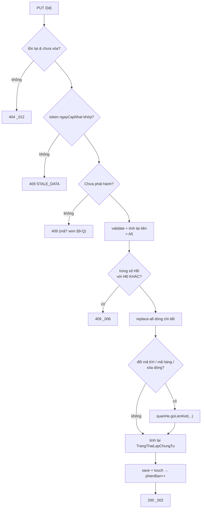

# F4 — Cập nhật Hóa đơn bán hàng

| | |
|---|---|
| **Mã chức năng** | `F4` |
| **UC nguồn** | `PMKT-U-06458` — [`UC_HDBanHang_CapNhat.md`](../../../pmkt-docs/ba/PMKT-E-06196_HoaDonBanHang/4.usecases/PMKT-U-06458_CapNhat/UC_HDBanHang_CapNhat.md) |
| **Màn hình nguồn** | `SCR_HDBanHang_CapNhat.md` |
| **Endpoint phụ trách** | **A7** `PUT /{id}` (nạp dữ liệu dùng **A6**, xem [03](03-xem-chi-tiet-hoa-don.md)) |
| **File gốc** | [`00-ke-hoach-tong.md`](00-ke-hoach-tong.md) |
| **Trạng thái** | ⬜ **CHƯA CÀI** — `PUT /{id}` hiện trả 400 `HOA_DON_BAN_HANG_CHUA_HO_TRO` (`HoaDonBanHangController.java:77-80`) |

> Toàn bộ hợp đồng request, tính toán (§4) và validate (§5) **dùng lại nguyên** [`02-them-moi-hoa-don.md`](02-them-moi-hoa-don.md) — `SCR_HDBanHang_CapNhat.md:16-17,35` yêu cầu "áp dụng **tất cả** các quy tắc validate tại SCR_HDBanHang_ThemMoi". File này chỉ mô tả **phần khác biệt**.

---

## 1. Quyết định riêng của chức năng

| # | Quyết định | Trỏ về |
|---|---|---|
| F4-a | Dùng chung `LuuHoaDonBanHangRequest` với F2. | D4, F2-a |
| F4-b | **Chặn cứng ở BE**: `PUT` trên HĐ `Đã phát hành` → **409**, không phải chỉ ẩn nút ở FE. Người dùng gọi thẳng API vẫn phải bị chặn. | `UC_HDBanHang_CapNhat.md:26,43` |
| F4-c | Sửa dòng chi tiết = **thay toàn bộ tập dòng** (replace-all), không patch từng dòng. Dòng client không gửi lại → `orphanRemoval` xóa. | D3; `SCR_HDBanHang_CapNhat.md:22` "Cho phép thêm/sửa/xóa dòng" |
| F4-d | **Hệ quả BR02** (gỡ liên kết khi sửa mã KH / mã hàng, tính lại `TrangThaiLapChungTu`) chạy **ở BE trong cùng transaction lưu**, không phải job nền. | `SCR_HDBanHang_CapNhat.md:47-50` (không đổi trong đợt sửa BA 2026-08-20) |
| F4-e | Popup cảnh báo `_056` là **việc của FE**; BE chỉ cấp cờ `daLapChungTu` ở A6 và **không** đòi client gửi kèm "đã xác nhận". | `SCR_HDBanHang_CapNhat.md:42-45` — cảnh báo hiện **lúc mở form**, tức trước khi có request `PUT` nào |
| F4-f | `chungTuBanId` và `loaiNghiepVu` của HĐ **lập kèm** (`chungTuBanId ≠ null`) **không cho sửa**. | `SCR_HDBanHang_ThemMoi.md:21`; chờ [00 §12-Q9](00-ke-hoach-tong.md) |

---

## 2. Hợp đồng API

### A7 — `PUT /api/ban-hang/hoa-don-ban-hang/{id}`

**Quyền:** `LapHoaDonBan.Edit` (`BaseCrudController.java:142`).

**Request:** y hệt A5 ([02 §2](02-them-moi-hoa-don.md)), **thêm 2 field**:

```jsonc
{
  "ngayCapNhat": "2026-08-13T04:11:02.451Z",   // token optimistic-lock, lấy từ A6
  "…": "…",
  "chiTiet": [
    { "id": "aa11…", "thuTu": 1, "…": "…" },    // dòng giữ lại → gửi kèm id
    { "id": null,    "thuTu": 2, "…": "…" }     // dòng mới → id = null
    // dòng bị xóa: KHÔNG gửi lại (F4-c)
  ]
}
```

**Response 200:** y hệt A5 nhưng `messageId = "MSG_PMKT-E-06196_002"`, `message = "Cập nhật Hóa đơn thành công"` (`UC_HDBanHang_CapNhat.md:15`).

```jsonc
{
  "data": { "id": "7f1c…", "phienBan": 4, "trangThaiLapChungTu": "DA_LAP_MOT_PHAN", "…": "…" },
  "message": "Cập nhật Hóa đơn thành công",
  "messageId": "MSG_PMKT-E-06196_002"
}
```

**Bảng lỗi** — bổ sung so với A5:

| Điều kiện | HTTP | `code` | `messageId` | Nguồn BA |
|---|---|---|---|---|
| HĐ không tồn tại / đã xóa mềm | 404 | `NOT_FOUND` | `MSG_PMKT-E-06196_012` | `UC:42` |
| HĐ **đã phát hành** | 409 | `ALREADY_ISSUED` | ⚠️ **chưa có mã** — dùng `MSG_PMKT-E-06196_010` ("Hóa đơn đã phát hành, không được xóa")? Xem §9-Q | `UC:26,43` |
| Token `ngayCapNhat` lệch | 409 | `STALE_DATA` | — | mẫu `chung_tu_ban_hang/…/business/BanHangSupport.java` |
| Sửa `loaiNghiepVu`/`chungTuBanId` của HĐ lập kèm | 409 | `IMMUTABLE_FIELD` | — (`details[]`) | F4-f, chờ Q9 |
| Sửa `soLuong` xuống dưới số đã lập chứng từ | 409 | `EXCEEDS_REMAINING_QUANTITY` | `MSG_PMKT-E-06196_019` | §4.3 |
| (còn lại: `_006`, `_007`, `_009`, `_015`…`_018`, `_020`, `_011`, `_013`) | | | | như A5 |

---

## 3. Ánh xạ cột

Không khác A5 — xem [02 §3](02-them-moi-hoa-don.md). Ba nhóm cột **client KHÔNG được sửa** ở `PUT`:

| Nhóm | Cột | Lý do |
|---|---|---|
| Trạng thái | `trangThaiPhatHanh`, `trangThaiLapChungTu`, `trangThaiHoaDon` | server quản (F2-e); `trangThaiLapChungTu` được tính lại ở §4.3 |
| Nguồn (khi lập kèm) | `chungTuBanId`, `loaiNghiepVu` | F4-f |
| Hệ thống | `id`, `tenantId`, `phienBan`, audit ×6, `daXoa` | base (BR46) |

Client gửi lên các field này → **bỏ qua im lặng** (không ném 400), trừ nhóm 2 khi HĐ là lập kèm thì ném `IMMUTABLE_FIELD`. Lý do: FE thường gửi lại nguyên DTO vừa nhận từ A6; ném lỗi vì client "gửi thừa trạng thái đúng như cũ" là phiền nhiễu vô ích.

---

## 4. Luồng xử lý

```
1. Controller.update(id, command)     ← BaseCrudController.java:149, quyen.require(…, EDIT)
2. HoaDonBanHangCrudService.update(id, command)
     └─ SuaHoaDonBan.thucThi(new LenhHoaDonBan.Luu(id, command))
3. LuuHoaDonBanTemplate  (@Transactional)
   3.1  hd = HoaDonBanSupport.nap(id)                       → 404 _012 nếu không có/đã xóa
   3.2  HoaDonBanSupport.kiemTraLock(hd, command.ngayCapNhat())  → 409 STALE_DATA
   3.3  kiemTraChuaPhatHanh(hd)                             → 409 nếu Đã phát hành   [F4-b]
   3.4  kiemTraTruongBatBien(hd, command)                   → 409 IMMUTABLE_FIELD    [F4-f]
   3.5  … V01…V03, V15, V16, V05…V07 …                      như A5
   3.6  TinhToanHoaDonBan.tinhLai(command)                  §4 của file 02
   3.7  … V08…V11, V13, V14 …
   3.8  KiemTraHoaDonBan.kiemTrung(daTinh, idHienTai = id)  V04 → _006  ★ loại trừ chính nó
   3.9  ápDungThayĐổiDòng(hd, daTinh)                       replace-all, orphanRemoval  [F4-c]
   3.10 xửLýHệQuảBR02(hd, dòngCũ, dòngMới)                  §4.2                        [F4-d]
   3.11 hd.touch()  → phienBan++                            (đảm bảo version tăng kể cả khi chỉ sửa dòng con)
   3.12 repository.save(hd)
   3.13 TrangThaiHoaDonBan.tinhLaiTrangThaiLapChungTu(hd)   §4.3
   3.14 HoaDonBanMapper.toDto(hd)
4. Controller trả 200 {data, "Cập nhật Hóa đơn thành công", "MSG_PMKT-E-06196_002"}
```

★ **Bước 3.8 khác A5 ở một chỗ duy nhất nhưng chí mạng:** query check trùng phải có `AND id <> :id`, nếu không mọi lần sửa HĐ mà không đổi số hóa đơn đều tự đâm vào chính nó và trả `_006`.

### 4.2 Hệ quả BR02 — sửa HĐ đã lập chứng từ (F4-d)

Nguyên văn `SCR_HDBanHang_CapNhat.md:47-50` (không đổi trong đợt sửa BA 2026-08-20):

| Thao tác của người dùng | BA nói | BE làm gì |
|---|---|---|
| **Sửa Mã hàng hoặc Mã khách hàng** | "Hóa đơn bán hàng và Chứng từ bán hàng… **không còn liên kết với nhau nữa**. Hệ thống tự động gỡ liên kết hóa đơn trên các chứng từ bán hàng tương ứng, dẫn đến **trạng thái của chứng từ bán hàng cũng sẽ thay đổi** (chuyển về trạng thái chưa lập hóa đơn)." | Nếu `khachHangId` đổi → gỡ **toàn bộ** liên kết xuất phát từ HĐ này: duyệt `quanHe.theoNguon(SAL_HOA_DON_BAN_HANG, id)` rồi `quanHe.goLienKet(quanHeId)` từng cái (`QuanHeChungTuApi.java:39,57`). Nếu chỉ `maHangId` của một dòng đổi → gỡ liên kết **của riêng dòng đó**. |
| **Thêm Mã hàng mới** | "hệ thống sẽ tự động **đổi trạng thái lập chứng từ** của hóa đơn (ví dụ: lùi từ 'Đã lập đủ' về 'Đã lập 1 phần')" | Không gỡ liên kết nào; chỉ chạy lại §4.3 — dòng mới chưa có liên kết nên tỷ lệ đã lập giảm xuống. |
| **Xóa dòng Mã hàng** | "liên kết giữa Hóa đơn bán hàng và Chứng từ bán hàng (nếu có) sẽ **bị gỡ bỏ**. **Trạng thái của chứng từ bán hàng** tương ứng sẽ thay đổi. Đồng thời, **trạng thái lập chứng từ** của hóa đơn cũng sẽ được… cập nhật lại dựa trên các dòng hàng hóa còn lại." | Gỡ liên kết của đúng dòng bị xóa, rồi chạy §4.3. |

⚠️ **Phần "trạng thái của chứng từ bán hàng cũng thay đổi"** — đây là dữ liệu của **module `chung_tu_ban_hang`**, module HĐ **không được** ghi thẳng vào (`internal/` của module khác). Hai phương án:

| | Phương án A — HĐ gọi API công khai của CTBH | **Phương án B (CHỌN) — CTBH tự suy trạng thái từ đồ thị quan hệ** |
|---|---|---|
| Cách làm | `chung_tu_ban_hang` mở `api/CapNhatTrangThaiLapChungTuApi`; HĐ gọi vào | HĐ chỉ gọi `quanHe.goLienKet(...)`; CTBH đọc `quanHe.theoDich(...)` khi tính trạng thái của mình |
| Ranh giới Modulith | Thêm một `api/` mới ở CTBH — đi ngược luật "không tạo `api/` cho chắc" (`cell-app/CLAUDE.md`) | Sạch — cả hai module chỉ nói chuyện qua `quan_he_chung_tu.api` vốn đã có `@NamedInterface` |
| Nhất quán | Có cửa sổ: HĐ gỡ liên kết xong, gọi CTBH lỗi → lệch trạng thái | Không có trạng thái phái sinh để lệch |
| Rủi ro | Vòng phụ thuộc HĐ ↔ CTBH | CTBH hiện đang **lưu** `trang_thai_hoa_don` thành cột vật lý, không suy tại chỗ → **phải sửa `chung_tu_ban_hang`** |

**Chốt an toàn cho phương án B:** lần này **chưa đụng** vào `chung_tu_ban_hang`; ghi nhận đây là **nợ liên module** và nêu ở [00 §12](00-ke-hoach-tong.md) + báo cáo. Hệ quả thực tế: sau khi sửa HĐ làm mất liên kết, cột `sal_chung_tu_ban_hang.trang_thai_hoa_don` **có thể bị cũ** cho tới khi có ticket riêng đồng bộ. **Đây là hạn chế phải nói rõ với BA.**

### 4.3 Tính lại `TrangThaiLapChungTu` (D8)

```
tongSoLuongDongHang   = Σ soLuong của các dòng loaiDongHang = true
tongSoLuongDaLapCT    = Σ daTieuThu(dongId) qua quanHe.daTieuThu(...)   ← QuanHeChungTuApi.java:54

trangThaiLapChungTu =
    tongSoLuongDaLapCT == 0                      → "Chưa lập"
    tongSoLuongDaLapCT <  tongSoLuongDongHang    → "Đã lập 1 phần"
    tongSoLuongDaLapCT >= tongSoLuongDongHang    → "Đã lập đủ"
```

Đúng nguyên văn BR02 màn danh sách (`SCR_HDBanHang_DanhSach.md:61-63`). Chạy **sau** khi đã gỡ/giữ liên kết ở §4.2, trong **cùng transaction**.



---

## 5. Validation

Toàn bộ V01…V17 của [02 §5](02-them-moi-hoa-don.md), **cộng thêm**:

| # | Luật | Thời điểm | messageId | Nguồn BA |
|---|---|---|---|---|
| V18 | Bản ghi tồn tại, chưa xóa mềm, thuộc tenant | bước 3.1 | 404 `_012` | `UC:42` |
| V19 | `trangThaiPhatHanhHoaDon == CHUA_PHAT_HANH` | bước 3.3 | 409 — mã chờ §9-Q | `UC:26,43`; `SCR_…ThemMoi.md:97` |
| V20 | Token `ngayCapNhat` khớp `ngay_cap_nhat` hiện tại (so bằng **epoch-milli**, không `equals` — JSON round-trip cắt nano) | bước 3.2 | 409 `STALE_DATA` | mẫu `chung_tu_ban_hang/…/business/BanHangSupport.java` (`kiemTraLock`) |
| V21 | HĐ lập kèm (`chungTuBanId ≠ null`) không đổi `loaiNghiepVu`, `chungTuBanId` | bước 3.4 | 409 `IMMUTABLE_FIELD` | F4-f, Q9 |
| V22 | `chiTiet[].id` client gửi phải **thuộc chính HĐ này** (chống ghép nhầm dòng của HĐ khác) | bước 3.9 | 400 `INVALID_VALUE` | bảo mật, không có trong BA |
| V23 | `soLuong` mới của một dòng **≥** số lượng đã lập chứng từ từ dòng đó | bước 3.10 | 409 `_019` | suy từ BR23 §9 (`SCR_CTBH_ThemMoi.md:1549`) — "`SoLuong_moi ≥ MAX(...)`" |
| **V04′** | Check trùng **loại trừ chính nó**: `AND id <> :id` | bước 3.8 | 409 `_006` | ★ ở §4 |

**V23 là suy luận từ BR của CTBH**, không có trong tài liệu HĐ. Nếu không có luật này, người dùng sửa `soLuong` từ 100 → 10 trong khi đã lập chứng từ cho 60 đơn vị, hệ thống rơi vào trạng thái "đã lập 60/10" — vô nghĩa. Nêu ở §9-Q.

---

## 6. Tương tranh & transaction

| Vấn đề | Xử lý |
|---|---|
| Ranh giới | Một `@Transactional` bao trọn bước 3.1 → 3.13. |
| Hai người cùng sửa một HĐ | Hai chốt: (1) token `ngayCapNhat` — báo sớm 409 `STALE_DATA` trước khi làm bất cứ việc nặng nào; (2) `@Version phien_ban` ở JPA — chốt thật sự cho lost-update. Token `null` → bỏ qua (1), vẫn còn (2). |
| Sửa **chỉ dòng con** mà header không đổi | Gọi `hd.touch()` (bước 3.11) để `phien_ban` vẫn tăng — nếu không, hai người mỗi người sửa một dòng sẽ ghi đè nhau **im lặng** (đúng cảnh báo ở `ChungTuBanHang.java:32-36`). |
| Gỡ liên kết + tính lại trạng thái | Trong cùng transaction với `save` — không được tách ra event/job, nếu không có cửa sổ HĐ đã lưu mà trạng thái còn cũ. |
| Idempotency | `PUT` idempotent theo nghĩa "gọi lại cùng body → cùng kết quả", **trừ** `phienBan` tăng mỗi lần. Lần gọi thứ hai với token cũ sẽ bị 409 `STALE_DATA` — đúng ý đồ. |

---

## 7. Kiểm thử

### 7.1 Unit (`@Tag("unit")`)

| Lớp test | Case |
|---|---|
| `SuaHoaDonBanTest` | HĐ `Đã phát hành` → ném 409, **không** chạm repository (V19) |
| | Token `ngayCapNhat` lệch 1ms → 409 `STALE_DATA`; token `null` → bỏ qua, đi tiếp (V20) |
| | Token khớp nhưng lệch phần nano → **vẫn khớp** (so epoch-milli) |
| | HĐ lập kèm, đổi `loaiNghiepVu` → 409 `IMMUTABLE_FIELD` (V21) |
| | `chiTiet[].id` của HĐ khác → 400 (V22) |
| | `soLuong` mới 10 < đã lập 60 → 409 `_019` (V23) |
| `KiemTraTrungTest` | Sửa HĐ **giữ nguyên** số HĐ → **không** báo `_006` (★ V04′) |
| | Sửa HĐ sang số HĐ của một HĐ khác → `_006` |
| `TrangThaiHoaDonBanTest` | `daLapCT=0` → `Chưa lập`; `0 < daLapCT < tổng` → `Đã lập 1 phần`; `daLapCT ≥ tổng` → `Đã lập đủ` (§4.3) |
| | Thêm dòng mới vào HĐ `Đã lập đủ` → lùi về `Đã lập 1 phần` (BR02 `SCR_…CapNhat.md:49`) |
| | Xóa dòng chưa lập CT của HĐ `Đã lập 1 phần` → có thể lên `Đã lập đủ` |
| `ApDungThayDoiDongTest` | Client gửi 2/3 dòng cũ + 1 dòng mới → còn đúng 3 dòng, dòng thiếu bị `orphanRemoval` (F4-c) |
| | `thuTu` được đánh lại 1…N |

### 7.2 Tích hợp (cần Docker — R7)

| Lớp | Kiểm |
|---|---|
| `CapNhatHoaDonBanIT` | Sửa `khachHangId` của HĐ đã lập CT → mọi bản ghi `ctu_quan_he_chung_tu` xuất phát từ HĐ bị gỡ mềm; `trangThaiLapChungTu` về `Chưa lập` |
| | Xóa 1 dòng đã lập CT → chỉ liên kết của dòng đó bị gỡ, dòng khác giữ nguyên |
| | 2 request `PUT` song song cùng token → 1 thành công, 1 nhận 409 |
| | Sửa chỉ dòng con → `phien_ban` header vẫn tăng |
| | Sửa HĐ giữ nguyên số HĐ, chạy 10 lần liên tiếp → không lần nào `_006` |

---

## 8. BR đã áp dụng

| BR | Áp ở bước nào |
|---|---|
| BR3 | Popup xác nhận thoát khi có thay đổi chưa lưu — FE |
| BR13.2 | Nút Lưu/Hủy trên form Sửa — FE, dựa cờ `choPhepSua` của A6 |
| BR14.1 | Chế độ form "Chỉnh sửa" |
| BR14.3 | Lỗi validate → 400, FE **giữ nguyên dữ liệu đã sửa**, không reset (`UC:49`) |
| BR15 | Toàn bộ V01…V17 (kế thừa A5) + V18…V23 |
| BR16 | Cảnh báo `_056` khi mở form — FE, BE cấp cờ `daLapChungTu` (F4-e) |
| BR18 | Tính lại quy đổi khi đổi `tyGia` |
| BR19.1 | V04′ — check trùng loại trừ chính nó |
| BR21 | F4-c replace-all + đánh lại STT |
| BR25 | Quyền `.Edit` |
| BR26 | `messageId = _002` |
| BR28 | RLS |
| BR29.2 | Xóa dòng con theo cha bằng `orphanRemoval` (xóa **cứng** dòng con khi sửa — khác xóa cả HĐ, xem [05 §6](05-xoa-hoa-don.md)) |
| BR34 | Sửa từ màn Xem — A6 nạp, A7 lưu (F3-c) |
| BR46 | `phienBan` tăng qua `touch()` |

**BR chưa đạt:**
- **BR02 của epic (một nửa):** BE gỡ được liên kết phía hóa đơn, nhưng **không** cập nhật `sal_chung_tu_ban_hang.trang_thai_hoa_don` — thuộc module khác, xem §4.2 phương án B. **Phải báo BA.**
- **BR29.2 "xóa lan mặc định là xóa mềm":** dòng chi tiết bị bỏ khi **sửa** thì `orphanRemoval` xóa **cứng**. Đây là hành vi của aggregate (dòng con không có vòng đời riêng), khác với việc xóa cả hóa đơn (xóa mềm). Nêu để BA xác nhận.

---

## 9. Câu hỏi phát sinh từ chức năng này

| # | Vấn đề | Bằng chứng | Xử lý tạm |
|---|---|---|---|
| **Q-F4-1** | Sửa HĐ **đã phát hành** dùng **mã message nào**? `6.messages.md` chỉ có `_010` = "Hóa đơn đã phát hành, **không được xóa**" — nói về xóa, không nói về sửa. | `6.messages.md:29` vs `UC_HDBanHang_CapNhat.md:26,43` | Trả 409 `ALREADY_ISSUED` với `messageId = _010` và message tiếng Việt "Hóa đơn đã phát hành, không được sửa". **Cần BA cấp mã riêng** — không bịa `_0xx` mới. |
| **Q-F4-2** | Có được sửa `soLuong` xuống dưới số đã lập chứng từ không (V23)? Tài liệu HĐ **không nói**; luật này suy từ BR23 §9 của **CTBH**. | `SCR_CTBH_ThemMoi.md:1549` | Chặn (409 `_019`). Nếu BA muốn cho phép → phải định nghĩa lại `TrangThaiLapChungTu` khi `đã lập > tổng`. |
| **Q-F4-3** | Sửa HĐ làm mất liên kết → trạng thái CTBH bên kia có được cập nhật ngay không? | `SCR_HDBanHang_CapNhat.md:48` yêu cầu "chuyển về trạng thái chưa lập hóa đơn"; ranh giới Modulith không cho HĐ ghi vào `chung_tu_ban_hang` | Lần này **không** cập nhật (§4.2). Cần ticket riêng cho `chung_tu_ban_hang`. |
