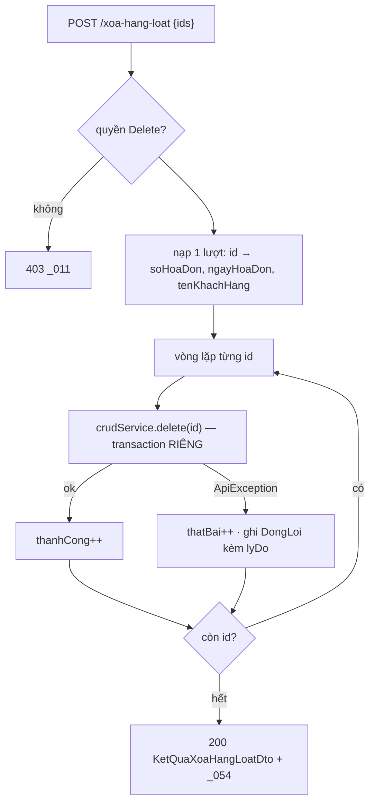

# F5 — Xóa Hóa đơn bán hàng (đơn lẻ + hàng loạt)

| | |
|---|---|
| **Mã chức năng** | `F5` |
| **UC nguồn** | `PMKT-U-06459` — [`UC_HDBanHang_Xoa.md`](../../../pmkt-docs/ba/PMKT-E-06196_HoaDonBanHang/4.usecases/PMKT-U-06459_Xoa/UC_HDBanHang_Xoa.md) |
| **Màn hình nguồn** | `SCR_HDBanHang_Xoa.md` |
| **Endpoint phụ trách** | **A8** `DELETE /{id}` · **A9** `POST /xoa-hang-loat` |
| **File gốc** | [`00-ke-hoach-tong.md`](00-ke-hoach-tong.md) |
| **Trạng thái** | ⬜ **CHƯA CÀI** — `DELETE /{id}` hiện trả 400 `HOA_DON_BAN_HANG_CHUA_HO_TRO` (`HoaDonBanHangController.java:82-86`); `POST /xoa-hang-loat` chưa có |

---

## 1. Quyết định riêng của chức năng

| # | Quyết định | Trỏ về |
|---|---|---|
| F5-a | **Xóa mềm** (`da_xoa = true`, `ngay_xoa`, `nguoi_xoa`), lan xuống dòng chi tiết cũng bằng xóa mềm. **Không** xóa vật lý. | `UC_HDBanHang_Xoa.md:17,75-76`; BR29.1 |
| F5-b | HĐ **đã lập chứng từ** thì **CHO xóa**, kèm gỡ toàn bộ liên kết — theo `SCR_HDBanHang_Xoa.md` BR10, **không** theo `UC_HDBanHang_Xoa.md:71` (chặn). Đây là **mâu thuẫn tài liệu**, xem §9-Q1 và [00 §12-Q7](00-ke-hoach-tong.md). | ★ |
| F5-c | Xóa hàng loạt chạy **lỗi từng phần**: mỗi HĐ một transaction riêng; HĐ hỏng không kéo đổ cả mẻ. | `UC_HDBanHang_Xoa.md:47`; BR45; mẫu `chung_tu_ban_hang/internal/dto/KetQuaHangLoatDto.java` |
| F5-d | Endpoint hàng loạt là **`POST /xoa-hang-loat`**, không phải `DELETE` với body. `DELETE` mang body là vùng xám của HTTP, nhiều proxy nuốt body. | `chung_tu_ban_hang/internal/dto/XuLyHangLoatRequest.java` là mẫu sẵn có |
| F5-e | Kiểm tra tính hợp lệ của **từng** HĐ diễn ra lúc **bấm xác nhận**, không lúc tích chọn. | `UC_HDBanHang_Xoa.md:72` nguyên văn |
| F5-f | Popup xác nhận (`_027`, `_055`) là việc của **FE**; BE **không** đòi field "đã xác nhận" trong request. | `SCR_HDBanHang_Xoa.md:63-64` |

---

## 2. Hợp đồng API

### A8 — `DELETE /api/ban-hang/hoa-don-ban-hang/{id}`

**Quyền:** `LapHoaDonBan.Delete` (`BaseCrudController.java:162`).

```jsonc
// Request body — optional (core/request/DeleteRequest.java)
{ "updatedAt": "2026-08-13T04:11:02.451Z" }
```
Không gửi body → bỏ kiểm optimistic-lock (`BaseCrudController.java:155-158`).

```jsonc
// Response 200
{ "data": null,
  "message": "Xóa hóa đơn bán hàng thành công",
  "messageId": "MSG_PMKT-E-06196_003" }
```

| Điều kiện | HTTP | `code` | `messageId` |
|---|---|---|---|
| Thiếu quyền `.Delete` | 403 | `FORBIDDEN` | `MSG_PMKT-E-06196_011` |
| HĐ không tồn tại / đã xóa | 404 | `NOT_FOUND` | `MSG_PMKT-E-06196_012` |
| HĐ **đã phát hành** | 409 | `ALREADY_ISSUED` | **`MSG_PMKT-E-06196_010`** |
| Token `updatedAt` lệch | 409 | `STALE_DATA` | — |
| HĐ là nguồn của chứng từ **đã ghi sổ** | 409 | `IN_USE` | ⚠ chưa có mã — §9-Q2 |
| Lỗi khi xóa | 500 | `DELETE_FAILED` | `MSG_PMKT-E-06196_033` |

### A9 — `POST /api/ban-hang/hoa-don-ban-hang/xoa-hang-loat`

**Quyền:** `LapHoaDonBan.Delete`.

```jsonc
// Request
{ "ids": ["7f1c…", "8a2d…", "9b3e…"] }
```

```jsonc
// Response 200 — luôn 200, kể cả khi 0 HĐ xóa được (BR8 của SCR_…Xoa.md: "luôn hiển thị popup Kết quả")
{
  "data": {
    "thanhCong": 1,
    "thatBai": 2,
    "loi": [
      { "id": "8a2d…", "soHoaDon": "0000124", "ngayHoaDon": "2026-08-10",
        "tenKhachHang": "CÔNG TY XYZ",
        "maLoi": "ALREADY_ISSUED", "messageId": "MSG_PMKT-E-06196_010",
        "lyDo": "Hóa đơn đã phát hành, không được xóa" },
      { "id": "9b3e…", "soHoaDon": "0000125", "ngayHoaDon": "2026-08-11",
        "tenKhachHang": "CÔNG TY KLM",
        "maLoi": "NOT_FOUND", "messageId": "MSG_PMKT-E-06196_012",
        "lyDo": "Hóa đơn không tồn tại" }
    ]
  },
  "message": "Xóa thành công 1/3 hóa đơn. 2 hóa đơn không được xóa.",
  "messageId": "MSG_PMKT-E-06196_054"
}
```

Bốn field `id`, `soHoaDon`, `ngayHoaDon`, `tenKhachHang`, `lyDo` là **đúng 5 cột** của bảng "Danh sách không xóa được" (`SCR_HDBanHang_Xoa.md:49-55`) trừ `STT` (FE đánh).

| Điều kiện | HTTP | `code` |
|---|---|---|
| `ids` rỗng/null | 400 | `INVALID_VALUE` — "Vui lòng chọn ít nhất một hóa đơn" |
| `ids` > 200 phần tử | 400 | `TOO_MANY_ITEMS` — chặn quét cả tenant trong một request |
| Thiếu quyền | 403 | `FORBIDDEN` |

⚠️ Nguyên văn `_054` là *"Xóa thành công {x}/{n} hóa đơn. {y} hóa đơn **đã phát hành** không được xóa."* — chỉ nhắc một lý do, trong khi thực tế còn lý do khác (không tồn tại, có liên kết). BE trả `lyDo` từng dòng để FE dựng bảng đúng; câu tóm tắt trong `message` **cố ý viết khác nguyên văn** (bỏ cụm "đã phát hành"). Xem [00 §12-Q8](00-ke-hoach-tong.md).

---

## 3. Ánh xạ cột

Chỉ ghi vào 3 cột hệ thống (không có cột nghiệp vụ nào bị đổi):

| Cột DB | Giá trị | Ai ghi |
|---|---|---|
| `da_xoa` | `true` | server |
| `ngay_xoa` | `now()` | server |
| `nguoi_xoa` | id người dùng hiện tại | server |
| (cùng 3 cột trên bảng `sal_hoa_don_ban_hang_chi_tiet`) | như trên | server, xóa lan (§6) |

`phien_ban` cũng tăng qua `@Version`. **Không** đụng `trang_thai_phat_hanh_hoa_don`, `trang_thai_lap_chung_tu` — HĐ đã xóa thì trạng thái giữ nguyên để audit.

---

## 4. Validation

| # | Luật | Thời điểm | messageId | Nguồn BA |
|---|---|---|---|---|
| V01 | HĐ tồn tại, `da_xoa = false`, thuộc tenant | trước mọi việc | 404 `_012` | `UC:53` |
| V02 | Token `updatedAt` khớp (nếu client gửi) | sau V01 | 409 `STALE_DATA` | `BaseCrudController.java:155-158` |
| V03 | `trangThaiPhatHanhHoaDon == CHUA_PHAT_HANH` | sau V02 | 409 **`_010`** | `UC:54,67-68`; `SCR_…Xoa.md:73` |
| V04 | HĐ **không** là nguồn của chứng từ **đã ghi sổ** | sau V03 | 409 — mã? §9-Q2 | suy từ `QuanHeChungTuApi.coLienKet` là **guard xóa** (`QuanHeChungTuApi.java:62-69`) |
| V05 | `ids` không rỗng, ≤ 200 (chỉ A9) | controller | 400 | BR45 |

**V04 cần giải thích.** `UC_HDBanHang_Xoa.md:71` nói HĐ đã lập chứng từ **không được xóa**; `SCR_HDBanHang_Xoa.md:81-82` (BR10) nói **được xóa** kèm gỡ liên kết. Chọn theo SCR (F5-b), nhưng **vẫn phải chặn một trường hợp**: chứng từ bán hàng sinh ra từ HĐ mà **đã ghi sổ** thì việc gỡ liên kết sẽ để lại một chứng từ đã lên sổ cái trỏ vào hóa đơn không còn tồn tại. Đây là bất biến kế toán, không phải lựa chọn UI. Cài bằng `quanHe.coLienKet(SAL_HOA_DON_BAN_HANG, id)` + kiểm trạng thái ghi sổ của các chứng từ đích.

⚠️ Kiểm trạng thái ghi sổ của chứng từ đích cần đọc `sal_chung_tu_ban_hang.status` — thuộc module khác. Cách sạch: `QuanHeDto` trả về từ `theoNguon` đã mang `ThongTinChungTu` (`quan_he_chung_tu/api/ThongTinChungTu.java`) — **đọc lại record này trước khi code** để biết nó có chở trạng thái không. Nếu không có, phải mở rộng `quan_he_chung_tu.api` (một thay đổi nhỏ, đúng chỗ) thay vì cho HĐ đọc bảng của CTBH.

---

## 5. Luồng xử lý

### 5.1 Xóa một hóa đơn (A8)

```
1. Controller.delete(id, body)      ← override để gắn messageId; quyen.require(…, DELETE)
2. HoaDonBanHangCrudService.delete(id, lockToken)
     └─ XoaHoaDonBan.thucThi(new LenhHoaDonBan.Xoa(id, lockToken))
3. @Transactional
   3.1 hd = HoaDonBanSupport.nap(id)                        → 404 _012        [V01]
   3.2 HoaDonBanSupport.kiemTraLock(hd, lockToken)          → 409 STALE_DATA  [V02]
   3.3 kiemTraChuaPhatHanh(hd)                              → 409 _010        [V03]
   3.4 kiemTraKhongCoChungTuDaGhiSo(hd)                     → 409             [V04]
   3.5 quanHe.goToanBoTheoNguon(SAL_HOA_DON_BAN_HANG, id)   gỡ mọi liên kết   [BR10]
   3.6 hd.xoaMem(now, nguoiDung)  + lan xuống chiTiet                          [§6]
   3.7 repository.save(hd)
4. 200 { message: "Xóa hóa đơn bán hàng thành công", messageId: "MSG_PMKT-E-06196_003" }
```

⚠️ Bước 3.5: `QuanHeChungTuApi` hiện có `goToanBoTheoDich(loaiDich, chungTuDichId)` (`QuanHeChungTuApi.java:46`) nhưng **chưa có** phiên bản "theo nguồn". Hai cách: (a) duyệt `theoNguon(...)` rồi `goLienKet(...)` từng cái — **chọn cách này**, không phải sửa module khác; (b) thêm `goToanBoTheoNguon` vào api — sạch hơn nhưng đụng module `quan_he_chung_tu`. Chọn (a) lần này vì số liên kết của một hóa đơn luôn nhỏ (≤ số dòng hàng).

### 5.2 Xóa hàng loạt (A9)

```
1. Controller.xoaHangLoat(request)   ← mới; quyen.require(…, DELETE) MỘT lần cho cả mẻ
2. HoaDonBanHangHangLoatService.xoa(ids)     — KHÔNG @Transactional ở đây
   for id in ids:
       try:
           crudService.delete(id, null)      ← qua PROXY Spring → transaction RIÊNG mỗi HĐ
           thanhCong++
       catch ApiException e:
           thatBai++;  loi.add(DongLoi(id, soHoaDon, ngayHoaDon, tenKhachHang,
                                       e.code(), e.messageId(), e.message()))
3. 200 KetQuaXoaHangLoatDto
```

★ **Lời gọi `crudService.delete` phải đi qua proxy Spring**, không phải self-invocation — self-invocation bỏ qua `@Transactional`, GUC tenant không được bind và RLS trả tập rỗng. Đây đúng là cái bẫy đã ghi ở `ChungTuBanHangCrudService.java:170-173`. Vì vậy `HoaDonBanHangHangLoatService` là **bean riêng** inject `HoaDonBanHangCrudService`, không phải method cùng lớp.

**Dữ liệu để dựng bảng lỗi** (`soHoaDon`, `ngayHoaDon`, `tenKhachHang`): nạp **một lượt trước vòng lặp** bằng `repository.findByIdInAndDaXoaFalse(ids)` (mẫu `chung_tu_ban_hang/…/ChungTuBanHangCrudService.java#traSoChungTu`) — nếu tra trong `catch` thì HĐ vừa rollback có thể không đọc được.



---

## 6. Xóa mềm & xóa lan — BR29 (F5-a)

| Câu hỏi | Trả lời | Bằng chứng |
|---|---|---|
| Xóa mềm hay cứng? | **Mềm** — `da_xoa = true`, giữ dữ liệu cho audit trail | `UC_HDBanHang_Xoa.md:17,61,75-76`; BR29.1 |
| Dòng chi tiết xử lý thế nào? | **Cũng xóa mềm**, không `orphanRemoval` | BR29.2 "Xóa toàn bộ dữ liệu con liên quan: Mặc định… dưới dạng Xóa mềm" |
| Cài ở đâu? | Method `xoaMem(Instant, UUID)` trên `HoaDonBanHang` duyệt `chiTiet` set cờ. **KHÔNG** dùng `cascade = REMOVE`. | — |
| Liên kết `ctu_quan_he_chung_tu` xử lý thế nào? | **Gỡ mềm** qua `quanHe.goLienKet` (`QuanHeChungTuApi.java:39`) | `SCR_HDBanHang_Xoa.md:82` "Mọi liên kết… sẽ bị gỡ bỏ" |
| Bản ghi đã xóa có lọt vào `/search` không? | Không — `DynamicSpecification` tự thêm `da_xoa = false` (`DynamicSpecification.java:78`) | — |
| Xóa xong có "hồi sinh" được không? | Không có endpoint khôi phục. Nằm ngoài phạm vi epic. | — |

⚠️ **Mâu thuẫn nội bộ với F4:** khi **sửa** hóa đơn mà bỏ bớt dòng, dòng đó bị `orphanRemoval` xóa **cứng** ([04 §8](04-cap-nhat-hoa-don.md)); còn khi **xóa cả hóa đơn** thì dòng bị xóa **mềm**. Hai hành vi khác nhau có chủ ý: dòng bị bỏ lúc sửa chưa từng là dữ liệu "đã chốt", còn hóa đơn bị xóa thì cả cụm cần giữ để đối chiếu. **Nêu để BA xác nhận.**

---

## 7. Tương tranh & transaction — BR45

| Vấn đề | Xử lý |
|---|---|
| Ranh giới (A8) | Một `@Transactional` bao bước 3.1 → 3.7. |
| Ranh giới (A9) | **Không** transaction ở tầng vòng lặp; mỗi HĐ một transaction riêng qua proxy (F5-c). HĐ thứ 2 hỏng **không** rollback HĐ thứ 1 đã xóa. |
| Hai người cùng xóa một HĐ | Người thứ hai nhận 404 `_012` (bản ghi đã `da_xoa = true` → `nap()` coi như không tồn tại). Hành vi này **đúng** — không cần thông báo riêng. |
| Xóa trong khi người khác đang sửa | `@Version` chặn: ai commit sau nhận `OptimisticLockException` → 409. |
| Xóa HĐ trong khi người khác đang lập chứng từ từ nó | `quanHe.lienKet` khóa dòng nguồn `FOR UPDATE`; luồng xóa đọc `theoNguon` sau đó sẽ thấy liên kết mới và V04 chặn nếu chứng từ đã ghi sổ. Nếu chứng từ chưa ghi sổ thì HĐ vẫn xóa được và liên kết bị gỡ — đúng BR10. |
| Idempotency (A9) | Gọi lại cùng `ids` → lần thứ hai mọi HĐ đã xóa đều rơi vào 404 `_012`, `thanhCong = 0`. An toàn, không tạo hiệu ứng phụ. |
| Giới hạn mẻ | ≤ 200 id (V05). Không có timeout riêng; mỗi HĐ chỉ vài query nên 200 HĐ vẫn trong ngưỡng request thường. |

---

## 8. Kiểm thử

### 8.1 Unit (`@Tag("unit")`)

| Lớp test | Case |
|---|---|
| `XoaHoaDonBanTest` | HĐ `Đã phát hành` → 409 `_010`, **không** chạm repository (V03) |
| | HĐ không tồn tại / `daXoa=true` → 404 `_012` (V01) |
| | Token `updatedAt` lệch → 409 `STALE_DATA`; `null` → bỏ qua (V02) |
| | HĐ có liên kết tới chứng từ **đã ghi sổ** → 409 (V04) |
| | HĐ có liên kết tới chứng từ **chưa ghi sổ** → xóa được, `goLienKet` được gọi đúng số lần |
| | Xóa thành công → `daXoa=true` trên header **và** mọi dòng chi tiết (§6) |
| `HoaDonBanHangHangLoatServiceTest` | 3 id: 1 ok, 1 đã phát hành, 1 không tồn tại → `thanhCong=1`, `thatBai=2`, `loi` có đúng 2 phần tử với `maLoi` đúng |
| | HĐ thứ 2 ném exception → HĐ thứ 1 **vẫn** được xóa (lỗi từng phần, F5-c) |
| | `ids` rỗng → 400; `ids` 201 phần tử → 400 `TOO_MANY_ITEMS` |
| | `DongLoi` mang đủ `soHoaDon`, `ngayHoaDon`, `tenKhachHang` (dựng được bảng của `SCR_…Xoa.md:51-55`) |

### 8.2 Tích hợp (cần Docker — R7)

| Lớp | Kiểm |
|---|---|
| `XoaHoaDonBanIT` | Sau khi xóa, `POST /search` **không** trả HĐ đó; `GET /{id}` trả 404 |
| | Dòng chi tiết còn nguyên trong DB với `da_xoa = true` (không bị `DELETE` vật lý) |
| | Bản ghi `ctu_quan_he_chung_tu` xuất phát từ HĐ đã bị gỡ mềm |
| | Xóa hàng loạt 50 HĐ, chèn 1 HĐ đã phát hành ở giữa → 49 xóa được, response đúng |
| | Xóa HĐ tenant khác → 404 (RLS) |
| | Audit trigger `trg_audit_sal_hoa_don_ban_hang` (`V1:25492`) ghi nhận bản ghi UPDATE |

---

## 9. BR đã áp dụng & câu hỏi

| BR | Áp ở bước nào |
|---|---|
| BR3 | Popup xác nhận (`_027`/`_055`) — FE (F5-f) |
| BR13.1 | Nút Xóa hiện khi "Chưa phát hành" — cờ `choPhepXoa` của A1/A6 |
| BR16 | Cảnh báo `_055` cho HĐ đã lập chứng từ — FE, dựa cờ `daLapChungTu` |
| BR25 | Quyền `.Delete`; A9 kiểm quyền **một lần** cho cả mẻ |
| BR26 | `messageId = _003` (đơn) / `_054` (hàng loạt) |
| BR28 | RLS — xóa HĐ tenant khác trả 404 |
| BR29.1 | §6 — xóa mềm, giữ audit trail |
| BR29.2 | §6 — xóa lan xuống dòng chi tiết bằng xóa mềm |
| BR29.4 | Giữ nguyên trang sau khi xóa — FE (BE không trả gợi ý trang) |
| BR45 | §7 — thao tác hàng loạt, lỗi từng phần, bảng kết quả chi tiết |
| BR46 | `ngay_xoa`, `nguoi_xoa`, `phien_ban` |

**BR chưa đạt:** BR29.2 — hành vi xóa dòng con **khác nhau** giữa luồng Sửa (cứng) và luồng Xóa (mềm), §6; cần BA xác nhận.

| # | Câu hỏi | Bằng chứng cả hai phía | Xử lý tạm |
|---|---|---|---|
| **Q1** | HĐ **đã lập chứng từ**: chặn xóa hay cho xóa kèm gỡ liên kết? | **Chặn:** `UC_HDBanHang_Xoa.md:12` ("Chỉ xóa được hóa đơn… **chưa được lập chứng từ bán hàng**"), `:55` ("Không cho phép xóa"), `:71` ("→ KHÔNG được xóa"). **Cho xóa:** `SCR_HDBanHang_Xoa.md:81-82` (BR10) — "Nếu người dùng vẫn tiếp tục chọn Yes: **Hệ thống thực hiện xóa hóa đơn**. Mọi liên kết… sẽ **bị gỡ bỏ**". | **Theo SCR** (F5-b) — SCR là màn phụ trách chức năng Xóa và mô tả cụ thể hơn (có cả nội dung popup `_055` dành riêng cho tình huống này). Nếu BA chốt "chặn" thì cần **cấp mã message mới**, `6.messages.md` hiện không có. |
| **Q2** | Xóa HĐ đang là nguồn của chứng từ **đã ghi sổ** — dùng mã message nào? | `6.messages.md` không có mã cho tình huống này. `MaLoiBanHang.java:40` bên CTBH dùng `MSG_PMKT-E-06194_014` "đã sử dụng" — **của epic khác, không được tái dùng**. | Trả 409 `IN_USE` với `messageId = null` và message tiếng Việt tạm. **Cần BA cấp mã.** |
| **Q3** | Nguyên văn `_054` chỉ nhắc lý do "đã phát hành" trong khi còn lý do khác. | `6.messages.md:37` vs `SCR_HDBanHang_Xoa.md:55` (cột "Lý do lỗi" từng dòng) | BE trả `lyDo` từng dòng; `message` tóm tắt viết khác nguyên văn. Cần BA sửa nội dung `_054` hoặc chấp nhận. |
