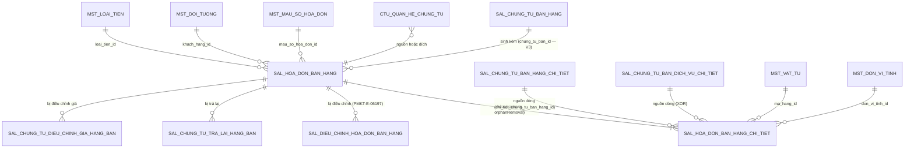

# Thiết kế DB — Hóa đơn bán hàng (PMKT-E-06196)

| | |
|---|---|
| **Migration** | `V3__sal_hoa_don_ban_hang_bo_sung_cot.sql` |
| **Bảng chạm** | `sal_hoa_don_ban_hang` · `sal_hoa_don_ban_hang_chi_tiet` · `ctu_quan_he_chung_tu` (CHECK) · `iam_quyen` (seed) · `fn_bang_cua_loai_chung_tu` (sửa hàm) |
| **File gốc** | [`00-ke-hoach-tong.md`](00-ke-hoach-tong.md) |

> **Đây là mục duy nhất được phép quyết định hình dạng dữ liệu.** §5 (migration) chỉ là bản dịch của §2–§4 sang SQL.

---

## 1. Hiện trạng bảng — nguồn sự thật (rà soát lại 2026-08-21)

```bash
ls cell-app/src/main/resources/db/migration/
# V1__create_database.sql  V2__seed_data.sql  V3__gop_thay_doi_sau_baseline.sql
# V1000__moc_chan_code_cu_phai_pull_lai.sql … V1032__tknd_va_cau_hinh_danh_so.sql
```
**Số hiệu lớn nhất hiện tại: `V1032` ⇒ file mới là `V1033`.**

> ⚠️ **Thư mục migration đã đổi HAI LẦN trong 8 ngày.** Bản kế hoạch 2026-08-14 ghi "max = `V2`, file mới là `V3`" — nay sai. Bản `V3__gop_thay_doi_sau_baseline.sql` đã tồn tại và **là của người khác**. Đọc lại `ls` ngay trước khi tạo file.

### 1.0 ✅ Phần migration của kế hoạch **đã được apply** và nuốt vào baseline

Đối chiếu `V1__create_database.sql` hiện tại với §2 của bản nháp cũ:

| Việc của bản nháp 2026-08-14 | Trạng thái | Bằng chứng |
|---|---|---|
| Thêm `tong_tien_thue_xk`, `tong_tien_thue_xk_quy_doi` | ✅ **đã có** | `V1:16978-16979` + `COMMENT ON COLUMN … tong_tien_thue_xk` ghi đúng câu của kế hoạch |
| Thêm `trang_thai_hoa_don text DEFAULT 'Hóa đơn gốc'` + CHECK 5 giá trị | ✅ **đã có** | `V1:16980`, CHECK `V1:16982`; comment ghi *"Epic này chỉ ghi 'Hóa đơn gốc'; các giá trị điều chỉnh/thay thế do PMKT-E-06197 quản"* |
| Thêm `chung_tu_ban_id uuid` | ✅ **đã có** | `V1:16981`; comment đúng nguyên văn kế hoạch |
| Mở CHECK `trang_thai_lap_chung_tu` 2 → 3 giá trị + backfill | ✅ **đã có** | CHECK `V1:16983`; comment cột: *"V4 mở từ 2 lên 3 giá trị… Chuỗi cũ của baseline đã backfill"* |
| Sửa `fn_bang_cua_loai_chung_tu` trả `'sal_hoa_don_ban_hang_chi_tiet'` | ✅ **đã sửa** | `V3__gop_thay_doi_sau_baseline.sql:3018-3020` — dùng `to_regclass` để chọn tên bảng an toàn. **Rủi ro R3 của bản cũ đã đóng.** |

⇒ **Không viết lại 5 việc này vào `V1033`.**

### 1.1 `sal_hoa_don_ban_hang` — **61 cột**, `V1__create_database.sql:16919-16986`

Comment bảng: *"PMKT-E-06196 HoaDonBanhang — hóa đơn bán hàng (LDM ldm-BanHang.puml). **KHÔNG hạch toán**."*

| Nhóm cột | Cột | Do đâu quản |
|---|---|---|
| Base/audit/tenant | `id`, `tenant_id`, `phien_ban`, `ngay_tao`, `nguoi_tao`, `ngay_cap_nhat`, `nguoi_cap_nhat`, `da_xoa`, `ngay_xoa`, `nguoi_xoa` | `AggregateRootEntity` — **không khai lại** |
| Hóa đơn | `so_hoa_don` (NN), `mau_so_hoa_don_id`, `ky_hieu_hoa_don`, `ngay_hoa_don` (NN) | module |
| Loại nghiệp vụ | `loai_nghiep_vu` (NN, CHECK **2** giá trị) | module |
| Khách hàng | `khach_hang_id` (NN), `ten_khach_hang` (NN), `dia_chi`, `nguoi_lien_he`, `so_dien_thoai`, `ma_so_thue`, `nguoi_mua_hang`, `ma_so_dvqhns`, `cccd`, `ho_chieu`, `mo_ta` | module |
| Thanh toán | `hinh_thuc_thanh_toan` (NN, CHECK 3), `tai_khoan_ngan_hang_thu_id`, `nhan_vien_ban_hang_id` | module |
| Tiền tệ | `loai_tien_id` (NN), `ty_gia` (NN, `exchange_rate`) | module |
| Chiết khấu | `loai_chiet_khau` (NN, CHECK 5), `gia_tri_chiet_khau`, `tong_tien_chiet_khau_hang(_quy_doi)`, `tong_tien_chiet_khau_hoa_don(_quy_doi)` | module |
| Tổng tiền | `tong_tien_hang_hoa`, `tong_tien_chiet_khau`, `tong_tien_thue_gtgt`, **`tong_tien_thue_xk`**, `tong_tien_sau_thue`, `tong_tien_thanh_toan` + 6 cột `…_quy_doi` | server tính |
| Trạng thái | `trang_thai_lap_chung_tu` (CHECK **3** ✅), `trang_thai_phat_hanh_hoa_don` (CHECK 2), **`trang_thai_hoa_don`** (CHECK **5** ✅), `da_bi_dieu_chinh` | module |
| Nguồn | **`chung_tu_ban_id`** ✅ | client (lập kèm) |
| Xuất khẩu | `so_hop_dong`, `ngay_hop_dong`, `dia_diem_giao`, `dia_diem_nhan`, `so_van_don`, `so_container`, `don_vi_van_chuyen` | module |

**Thiếu so với BA: 0 cột** — trừ khả năng thêm `mau_so_hoa_don` (snapshot) nếu chốt phương án B của [01 §12-Q-F1-1](01-xem-danh-sach-hoa-don.md).

### 1.2 `sal_hoa_don_ban_hang_chi_tiet` — **47 cột**, `V1__create_database.sql:17031-17080`

Đã có: `thu_tu`, `hoa_don_ban_hang_id`, 4 cột nguồn, `loai_dong_hang`, `ma_hang_id`, `ten_hang`, `so_luong`, `don_gia(_quy_doi)`, `thanh_tien(_quy_doi)`, `chiet_khau(_quy_doi)`, `chiet_khau_phan_tram`, `tien_chiet_khau_hang(_quy_doi)`, `tien_chiet_khau_hoa_don(_quy_doi)`, `don_vi_tinh_id`, `so_lo`, `han_su_dung`, `hang_khuyen_mai`, `chiet_khau_thuong_mai`, `thue_suat_gtgt_mac_dinh` (CHECK 7), `gia_tri_thue_gtgt`, `tien_thue_gtgt(_quy_doi)`, `tien_thue_xk(_quy_doi)`, `phan_tram_thue_xk`, `hop_dong_id`, `don_vi_id`, `khoan_muc_chi_phi_id`, `vu_viec_id` + 10 cột base/audit/tenant.

**❌ VẪN THIẾU đủ 7 cột** — xem §2.2. Đây là phần lớn nhất còn lại của `V1033`.

**Hai trường tự do BA có mà DB thiếu, KHÔNG thêm lần này:** `Đối tượng THCP` (`DoiTuongTapHopChiPhiId`) và `Đơn đặt hàng` (`DonDatHangId`) — `SCR_CTBH_ThemMoi.md:257,261`. Chúng thuộc bộ "trường tự do dùng chung cho **mọi chứng từ hạch toán**", mà hóa đơn không hạch toán.

### 1.3 Ràng buộc & index hiện có

| Loại | Định nghĩa | Vị trí | Đánh giá |
|---|---|---|---|
| PK | `sal_hoa_don_ban_hang_pkey (id)` · `…_chi_tiet_pkey (id)` | `V1` | ✅ |
| FK | `chi_tiet.hoa_don_ban_hang_id → sal_hoa_don_ban_hang(id)` | `V1:28134` | ✅ |
| FK | `chi_tiet.chung_tu_ban_hang_id` · `chung_tu_ban_dich_vu_id` | `V1` | ✅ |
| FK | `sal_hoa_don_ban_hang.chung_tu_ban_id → sal_chung_tu_ban_hang(id)` | `V3__gop_…:3281` (`NOT VALID`) | ✅ đã có — ⚠️ khai `NOT VALID` (không kiểm dữ liệu cũ); chấp nhận được |
| **Unique** | `uq_sal_hdbh_so_hd (tenant_id, **khach_hang_id**, so_hoa_don, COALESCE(ky_hieu,''), COALESCE(mau_so,'000…')) WHERE da_xoa=false AND so_hoa_don<>''` | `V1:23665` | ❌ **vẫn thừa `khach_hang_id`** so với BR03 — §2.4 |
| Index | `idx_sal_hdbh_tenant_ngay (tenant_id, ngay_hoa_don)` | `V1:21789` | ✅ dùng cho sort mặc định |
| Index | `idx_sal_ct_hdbh_parent (tenant_id, hoa_don_ban_hang_id)` | `V1:21719` | ✅ |
| RLS | `ENABLE` + `FORCE`, policy `tenant_isolation` | `V1:31727` | ✅ BR28 |
| Trigger | `trg_audit_sal_hoa_don_ban_hang` → `fn_audit()` | `V1:25492` | ✅ |
| CHECK | `ck_ctu_qhct_loai_dich` trên `ctu_quan_he_chung_tu` — **7 giá trị, không có `SAL_CHUNG_TU_BAN_HANG`** | `V1:7339` | ❌ chặn F6 — §2.3 |
| Quyền | `LapHoaDonBan.{View, ViewList, View.Detail, Create, Edit, Delete, PhatHanh}` | `V2__seed_data.sql` | ❌ **thiếu `Export`** — §2.6 |

## 2. Còn phải làm — nội dung của `V1033`

### 2.1 `sal_hoa_don_ban_hang` — ✅ **KHÔNG còn việc gì** (trừ một tùy chọn)

4 cột của bản nháp cũ đã có ở baseline (§1.0). Chỉ còn **một tùy chọn chờ chốt**:

| # | Cột | Kiểu | NULL | Ai ghi | Điều kiện làm |
|---|---|---|---|---|---|
| (opt) | `mau_so_hoa_don` | `text` | Y | server (snapshot lúc lưu) | **Chỉ khi** chốt phương án B của [01 §12-Q-F1-1](01-xem-danh-sach-hoa-don.md) — để lọc/sắp xếp cột "Mẫu số hóa đơn" mà không JOIN vào `master_data` (vùng đóng băng) |

### 2.2 `sal_hoa_don_ban_hang_chi_tiet` — thêm **7 cột** (❌ chưa làm)

| # | Cột DB | Kiểu | NULL | Default | Ai ghi | Field DTO | Vì sao cần |
|---|---|---|---|---|---|---|---|
| 1 | `dien_giai` | `text` | Y | — | client; **server fill** = `ten_hang` nếu trống | `dienGiai` | BR15 (`SCR_CTBH_ThemMoi.md:878-892`) |
| 2 | `dien_giai_thue` | `text` | Y | — | client; **server fill** = `'Thuế GTGT - ' \|\| ten_hang` | `dienGiaiThue` | BR15 — BA đổi control sang `TextArea`, max 500 |
| 3 | `khong_tong_hop_to_khai_gtgt` | `boolean` | N | `false` | **server ép** theo `%thuế` | `khongTongHopToKhaiGtgt` | BR13 mục 7 (`SCR_CTBH_ThemMoi.md:849-858`) |
| 4 | `chiet_khau_hang_phan_tram` | `public.percent_rate` | Y | — | client | `chietKhauHangPhanTram` | BR12d (`:219`) — bảng đã có **tiền** CK theo mặt hàng nhưng thiếu **tỷ lệ** |
| 5 | `chiet_khau_hoa_don_phan_tram` | `public.percent_rate` | Y | — | client | `chietKhauHoaDonPhanTram` | BR12d (`:222`) |
| 6 | `gia_tri_tinh_thue_xk` | `numeric(18,2)` | Y | — | server tính, **client sửa được** | `giaTriTinhThueXk` | BR14 (`:866`) |
| 7 | `gia_tri_tinh_thue_xk_quy_doi` | `numeric(18,2)` | Y | — | server tính, **client sửa được** | `giaTriTinhThueXkQuyDoi` | BR14 (`:867`) |

Tên cột #4, #5 bám tiền tố `chiet_khau_…_phan_tram` để **đồng bộ với cột đã có** `chiet_khau_phan_tram`, thay vì `ty_le_chiet_khau_…` như tên field BA. Cột #6, #7 dùng `numeric(18,2)` trần để **khớp cột anh em** `tien_thue_xk`, `tien_thue_xk_quy_doi` vốn đã khai như vậy.

### 2.3 CHECK cần sửa

| # | Constraint | Hiện tại | Đổi thành | Điều kiện |
|---|---|---|---|---|
| 8 | `ck_ctu_qhct_loai_dich` (`V1:7339`) | 7 giá trị, **không có** `SAL_CHUNG_TU_BAN_HANG` | thêm `'SAL_CHUNG_TU_BAN_HANG'` | ❌ chưa làm. **Phải đi cùng commit sửa `LoaiChungTu.java:19`** → `(true, true)`; có test đọc `pg_constraint` bắt lệch ([00 §9-R2](00-ke-hoach-tong.md)) |
| 9 | `sal_hoa_don_ban_hang_loai_nghiep_vu_check` (`V1:16981`) | 2 giá trị | thêm `'Bán dịch vụ'` | ⏸ **chờ [00 §12-Q5](00-ke-hoach-tong.md)** |

### 2.4 Unique index cần sửa

| # | Index | Hiện tại | Đổi thành | Điều kiện |
|---|---|---|---|---|
| 10 | `uq_sal_hdbh_so_hd` (`V1:23665`) | có **`khach_hang_id`** trong khóa | **bỏ `khach_hang_id`** | ❌ chưa làm. BR03 (`SCR_HDBanHang_ThemMoi.md:89`). ⚠️ **chạy K1 (§6) trước** — chờ [00 §12-Q4](00-ke-hoach-tong.md) |

### 2.5 Hàm — ✅ không còn việc

`fn_bang_cua_loai_chung_tu` đã sửa ở `V3__gop_thay_doi_sau_baseline.sql:3018-3020`.

### 2.6 Seed quyền

| # | Việc | Trạng thái |
|---|---|---|
| 11 | `INSERT INTO iam_quyen … 'LapHoaDonBan.Export'` | ❌ **chưa seed**. `POST /export` (A3) đang **403 với mọi user kể cả Admin** vì `BaseCrudController.java:176` kiểm `QuyenChecker.EXPORT` |

**Cột deprecate:** không có. **Không xóa cột nào.**

---

## 3. Bảng mới

**Không áp dụng** — cả hai bảng đã tồn tại từ `V1__create_database.sql`. Không tạo bảng mới nào.

Riêng "hóa đơn liên quan" ([01 §8.5](01-xem-danh-sach-hoa-don.md)) và "trạng thái hóa đơn thay thế" ([00 §12-Q3](00-ke-hoach-tong.md)) **cố ý không tạo bảng** — thuộc epic PMKT-E-06197, tạo trước là đoán hình dạng dữ liệu của người khác.

---

## 4. Ràng buộc · index · khóa ngoại sau `V1033`

| # | Loại | Định nghĩa | Vì sao | Chi phí |
|---|---|---|---|---|
| 1 | unique (**còn phải sửa**) | `uq_sal_hdbh_so_hd` mới — `(tenant_id, so_hoa_don, COALESCE(ky_hieu_hoa_don,''), COALESCE(mau_so_hoa_don_id,'000…')) WHERE da_xoa=false AND so_hoa_don<>''` | BR03 — chặn trùng hóa đơn, chốt cuối cho `_006` ([02 §5-V04](02-them-moi-hoa-don.md)) | Ghi chậm hơn không đáng kể; index hẹp hơn cũ (bỏ 1 cột) |
| 2 | index | `idx_sal_hdbh_tenant_ngay (tenant_id, ngay_hoa_don)` — **giữ nguyên** | sort mặc định `ngayHoaDon:desc` ([01 §8.2](01-xem-danh-sach-hoa-don.md)) | đã có |
| 3 | index | `idx_sal_ct_hdbh_parent (tenant_id, hoa_don_ban_hang_id)` — **giữ nguyên** | nạp chi tiết bằng `@EntityGraph` ([03 §6](03-xem-chi-tiet-hoa-don.md)) | đã có |
| 4 | index **mới** (vẫn cần) | `idx_sal_hdbh_chung_tu_ban (tenant_id, chung_tu_ban_id) WHERE da_xoa = false AND chung_tu_ban_id IS NOT NULL` | Tra "HĐ nào sinh từ chứng từ này" — dùng ở BR08 (`SCR_…DanhSach.md:108`) và ở F6-Q2 (chặn HĐ lập kèm làm nguồn). Partial index vì đa số HĐ có cột này NULL | Rất nhỏ (partial) |
| ~~5~~ | ~~FK `chung_tu_ban_id`~~ | ✅ **đã có** ở `V3__gop_thay_doi_sau_baseline.sql:3281` (khai `NOT VALID`) | — |
| ~~6~~ | ~~check `trang_thai_hoa_don` 5 giá trị~~ | ✅ **đã có ở baseline** | — |
| ~~7~~ | ~~check `trang_thai_lap_chung_tu` 3 giá trị~~ | ✅ **đã có ở baseline** | — |
| 8 | check **sửa** | `loai_nghiep_vu IN (3 giá trị)` | Q5 | full scan |
| 9 | check **sửa** (**còn phải làm**) | `ck_ctu_qhct_loai_dich` + `SAL_CHUNG_TU_BAN_HANG` | F6 (R2) | full scan trên `ctu_quan_he_chung_tu` |
| — | RLS | policy `tenant_isolation` — **giữ nguyên**, cột mới tự nằm trong phạm vi policy | BR28 | — |

**Không thêm index** cho `trang_thai_lap_chung_tu` / `trang_thai_phat_hanh_hoa_don` / `trang_thai_hoa_don` dù chúng lọc được: đây là cột **selectivity thấp** (2–5 giá trị), Postgres sẽ bỏ qua index và quét bảng; index chỉ tốn chi phí ghi. Nếu profiling sau này cho thấy cần, thêm index composite `(tenant_id, trang_thai_lap_chung_tu, ngay_hoa_don)` — **không thêm mù lúc này**.

**Không thêm CHECK** `so_luong >= 0` / `don_gia >= 0` ở DB dù BR yêu cầu (`_009`, `_020`): việc chặn nằm ở tầng service để trả **đúng messageId** cho FE; CHECK ở DB sẽ ném `23514` với thông báo không dịch được sang message nghiệp vụ. Đây là **lệch có chủ ý**, cần Dev BE xác nhận.

---

## 5. Migration `V1033` — SQL đầy đủ

File: `cell-app/src/main/resources/db/migration/V1033__sal_hoa_don_ban_hang_luong_ghi.sql`

> 📋 Chỉ dịch §2 sang SQL. **Đã bỏ 5 việc** mà baseline làm rồi (§1.0): 4 cột header, 2 CHECK, sửa `fn_bang_cua_loai_chung_tu`.

```sql
-- =====================================================================================
-- PMKT-E-06196 Hóa đơn bán hàng — chuẩn bị cho LUỒNG GHI (F2–F6).
-- Nguồn: docs/doing/PMKT-E-06196-hoa-don-ban-hang-api/07-thiet-ke-db.md §2.
-- CHẠY SAU khi đã chạy các query kiểm dữ liệu ở §6 — đặc biệt K1 (trùng số hóa đơn).
-- Phần cột header + 2 CHECK + fn_bang_cua_loai_chung_tu ĐÃ nằm trong baseline, không lặp lại.
-- =====================================================================================

-- ---- 1. Chi tiết: 7 cột mới (§2.2) --------------------------------------------------
ALTER TABLE public.sal_hoa_don_ban_hang_chi_tiet
    ADD COLUMN IF NOT EXISTS dien_giai                     text,
    ADD COLUMN IF NOT EXISTS dien_giai_thue                text,
    ADD COLUMN IF NOT EXISTS khong_tong_hop_to_khai_gtgt   boolean NOT NULL DEFAULT false,
    ADD COLUMN IF NOT EXISTS chiet_khau_hang_phan_tram     public.percent_rate,
    ADD COLUMN IF NOT EXISTS chiet_khau_hoa_don_phan_tram  public.percent_rate,
    ADD COLUMN IF NOT EXISTS gia_tri_tinh_thue_xk          numeric(18,2),
    ADD COLUMN IF NOT EXISTS gia_tri_tinh_thue_xk_quy_doi  numeric(18,2);

COMMENT ON COLUMN public.sal_hoa_don_ban_hang_chi_tiet.dien_giai IS
    'BR15: trường ngầm định (ẩn trên lưới), fill theo ten_hang. NULL với dòng ghi chú.';
COMMENT ON COLUMN public.sal_hoa_don_ban_hang_chi_tiet.dien_giai_thue IS
    'BR15: mặc định "Thuế GTGT - {ten_hang}", người dùng sửa được (≤500 ký tự).';
COMMENT ON COLUMN public.sal_hoa_don_ban_hang_chi_tiet.khong_tong_hop_to_khai_gtgt IS
    'BR13 mục 7: hệ thống TỰ ép true khi thue_suat_gtgt_mac_dinh ∈ (KHAC, KKKNT); mức khác cho người dùng tự tích.';
COMMENT ON COLUMN public.sal_hoa_don_ban_hang_chi_tiet.chiet_khau_hang_phan_tram IS
    'BR12d: Tỷ lệ CK theo mặt hàng (%). Cặp với tien_chiet_khau_hang đã có sẵn.';
COMMENT ON COLUMN public.sal_hoa_don_ban_hang_chi_tiet.chiet_khau_hoa_don_phan_tram IS
    'BR12d: Tỷ lệ CK theo hóa đơn (%). Cặp với tien_chiet_khau_hoa_don đã có sẵn.';
COMMENT ON COLUMN public.sal_hoa_don_ban_hang_chi_tiet.gia_tri_tinh_thue_xk IS
    'BR14: mặc định = thanh_tien − chiet_khau; người dùng sửa để khớp Tờ khai Hải quan.';

-- ---- 2. Unique chống trùng hóa đơn: bỏ khach_hang_id (§2.4) — CHỜ Q4 ---------------
-- ⚠ CHẠY QUERY KIỂM K1 (§6) TRƯỚC. Có dữ liệu trùng → DỪNG, báo BA, KHÔNG tự xóa.
DROP INDEX IF EXISTS public.uq_sal_hdbh_so_hd;
CREATE UNIQUE INDEX uq_sal_hdbh_so_hd
    ON public.sal_hoa_don_ban_hang
       (tenant_id, so_hoa_don,
        COALESCE(ky_hieu_hoa_don, ''::text),
        COALESCE(mau_so_hoa_don_id, '00000000-0000-0000-0000-000000000000'::uuid))
    WHERE da_xoa = false AND so_hoa_don <> ''::text;

-- ---- 3. Cho Chứng từ bán hàng làm ĐÍCH trong đồ thị quan hệ (§2.3, F6) --------------
-- ⚠ PHẢI đi cùng commit sửa quan_he_chung_tu/api/LoaiChungTu.java:19 → (true, true).
ALTER TABLE public.ctu_quan_he_chung_tu
    DROP CONSTRAINT IF EXISTS ck_ctu_qhct_loai_dich;
ALTER TABLE public.ctu_quan_he_chung_tu
    ADD CONSTRAINT ck_ctu_qhct_loai_dich
    CHECK (loai_chung_tu_dich = ANY (ARRAY[
        'SAL_HOA_DON_BAN_HANG'::text, 'INV_PHIEU_XUAT_KHO'::text, 'CB_PHIEU_THU'::text,
        'SAL_CHUNG_TU_TRA_LAI_HANG_BAN'::text, 'SAL_DIEU_CHINH_GIA_HANG_BAN'::text,
        'PUR_HOA_DON_MUA'::text, 'INV_PHIEU_NHAP_KHO'::text,
        'SAL_CHUNG_TU_BAN_HANG'::text]));

-- ---- 4. Seed quyền LapHoaDonBan.Export (§2.6) --------------------------------------
INSERT INTO public.iam_quyen (ma_quyen, module, hanh_dong, nhom, ten_chuc_nang, mo_ta, la_he_thong)
VALUES ('LapHoaDonBan.Export', 'LapHoaDonBan', 'Export', 'Nghiệp vụ', 'LapHoaDonBan',
        'Xuất Excel danh sách hóa đơn bán hàng', true)
ON CONFLICT (ma_quyen) DO NOTHING;

-- ---- 5. (TÙY CHỌN — chỉ khi chốt Q-F1-1 phương án B) --------------------------------
-- ALTER TABLE public.sal_hoa_don_ban_hang ADD COLUMN IF NOT EXISTS mau_so_hoa_don text;
-- COMMENT ON COLUMN public.sal_hoa_don_ban_hang.mau_so_hoa_don IS
--     'Snapshot mst_mau_so_hoa_don.mau_so — để lọc/sắp xếp cột "Mẫu số hóa đơn" ở màn danh sách
--      mà không JOIN vào master_data (vùng đóng băng). Ghi lúc lưu hóa đơn.';
-- UPDATE public.sal_hoa_don_ban_hang h SET mau_so_hoa_don = m.mau_so
--   FROM public.mst_mau_so_hoa_don m WHERE m.id = h.mau_so_hoa_don_id AND h.mau_so_hoa_don IS NULL;

-- ---- 6. (TÙY CHỌN — chỉ khi chốt Q5) ------------------------------------------------
-- ALTER TABLE public.sal_hoa_don_ban_hang DROP CONSTRAINT IF EXISTS sal_hoa_don_ban_hang_loai_nghiep_vu_check;
-- ALTER TABLE public.sal_hoa_don_ban_hang ADD CONSTRAINT sal_hoa_don_ban_hang_loai_nghiep_vu_check
--     CHECK (loai_nghiep_vu = ANY (ARRAY['Bán hàng trong nước'::text, 'Bán hàng xuất khẩu'::text, 'Bán dịch vụ'::text]));
```

**Ghi chú kỹ thuật:**
- **`CONCURRENTLY`**: `CREATE UNIQUE INDEX … CONCURRENTLY` không chạy được trong transaction của Flyway. Bảng còn nhỏ ⇒ chấp nhận khóa ngắn. Môi trường dữ liệu lớn thì tách mục 2 sang migration riêng có `-- flyway:executeInTransaction=false`.
- **Idempotent**: `IF NOT EXISTS` / `IF EXISTS` / `ON CONFLICT DO NOTHING` ở mọi chỗ có thể; `ADD CONSTRAINT` không có `IF NOT EXISTS` nên luôn `DROP … IF EXISTS` trước.
- **Chạy trên máy dev**: cả đội dùng chung DB, Flyway mặc định **tắt**. Chạy một lượt duy nhất bằng `SPRING_FLYWAY_ENABLED=true`, do **một người** thực hiện. Checksum lệch → `FLYWAY_REPAIR_ON_BOOT=true`.
- **Đánh số**: `V1033` — kiểm lại `ls db/migration/` trước khi tạo file, thư mục này đã đổi 2 lần trong 8 ngày.

**File có sẵn phải sửa kèm:**

| File | Sửa gì | Bắt buộc cùng commit? |
|---|---|---|
| `quan_he_chung_tu/api/LoaiChungTu.java:19` | `SAL_CHUNG_TU_BAN_HANG(true, false)` → `(true, true)` | ✅ **có** — cùng mục 3 |
| `hoa_don_ban_hang/internal/model/MaLoiHoaDonBanHang.java` | bổ sung **18 hằng** messageId của [00 §11](00-ke-hoach-tong.md) | không |
| `common/constant/MaChucNang.java` | không cần — `LAP_HOA_DON_BAN` đã có | — |

---

## 6. Kiểm dữ liệu trước khi chạy migration

| # | Vấn đề | Query kiểm tra | Cách xử lý |
|---|---|---|---|
| **K1** | Có HĐ trùng `(tenant, số HĐ, ký hiệu, mẫu số)` **khác khách hàng** không → sẽ làm bước 5 thất bại | ```sql\nSELECT tenant_id, so_hoa_don, ky_hieu_hoa_don, mau_so_hoa_don_id, count(*), array_agg(id)\n  FROM public.sal_hoa_don_ban_hang\n WHERE da_xoa = false AND so_hoa_don <> ''\n GROUP BY 1,2,3,4 HAVING count(*) > 1;``` | Có kết quả → **DỪNG**, xuất danh sách gửi BA. **KHÔNG tự xóa/tự sửa dữ liệu.** [00 §11-R5](00-ke-hoach-tong.md) |
| ~~**K2**~~ | ~~Giá trị `trang_thai_lap_chung_tu` lạ~~ — ✅ **không còn cần**, CHECK 3 giá trị đã apply ở baseline | ```sql\nSELECT DISTINCT trang_thai_lap_chung_tu\n  FROM public.sal_hoa_don_ban_hang;``` | Chỉ được trả `'Chưa lập chứng từ'`, `'Đã lập chứng từ'`, `NULL`. Giá trị lạ → bổ sung nhánh `CASE` ở bước 3 |
| ~~**K3**~~ | ~~Số bản ghi bị backfill~~ — ✅ **đã backfill xong** ở baseline | ```sql\nSELECT trang_thai_lap_chung_tu, count(*)\n  FROM public.sal_hoa_don_ban_hang\n GROUP BY 1;``` | Ghi lại con số **trước và sau** để đối chiếu |
| **K4** | Có bản ghi `ctu_quan_he_chung_tu` nào đang mang `loai_chung_tu_dich = 'SAL_CHUNG_TU_BAN_HANG'` không (không được có, vì CHECK cũ cấm) | ```sql\nSELECT count(*) FROM public.ctu_quan_he_chung_tu\n WHERE loai_chung_tu_dich = 'SAL_CHUNG_TU_BAN_HANG';``` | Phải = 0. Khác 0 nghĩa là CHECK đã bị disable ở đâu đó → điều tra trước |
| ~~**K5**~~ | ~~Bảng `sal_chi_tiet_hd_ban_hang`~~ — ✅ **không còn cần**, hàm đã sửa ở `V3__gop_…` | ```sql\nSELECT to_regclass('public.sal_chi_tiet_hd_ban_hang');``` | Phải trả `NULL` (bảng không tồn tại) → sửa hàm là đúng |
| **K6** | Quyền `LapHoaDonBan.Export` đã có chưa (⚠️ nay có thêm `LapHoaDonBan.ViewList` — [00 §12-Q10](00-ke-hoach-tong.md)) | ```sql\nSELECT ma_quyen FROM public.iam_quyen\n WHERE ma_quyen LIKE 'LapHoaDonBan.%' ORDER BY 1;``` | Trước migration thấy **7** dòng (`View`, `ViewList`, `View.Detail`, `Create`, `Edit`, `Delete`, `PhatHanh` — thiếu `.Export`), sau migration thấy **8** |

**Tương thích ngược:** mọi cột thêm đều `NULL`-able (trừ `khong_tong_hop_to_khai_gtgt` có `DEFAULT false`), nên bản ghi cũ vẫn đọc/ghi được. Bảng `…_chi_tiet` hiện **chưa có entity Java nào ánh xạ** ⇒ thêm cột không phá gì đang chạy. Việc đổi giá trị `trang_thai_lap_chung_tu` đã làm xong ở baseline, lúc đó module còn chưa tồn tại.

---

## 7. Ánh xạ Entity ↔ bảng

| Bảng | Entity | Kế thừa | Quan hệ JPA | Fetch |
|---|---|---|---|---|
| `sal_hoa_don_ban_hang` | `HoaDonBanHang` ✅ **đã có** (39 field header) | `core.entity.AggregateRootEntity` | ❌ **chưa có** `@OneToMany` — phải thêm ở F2 | LAZY, nạp bằng `@EntityGraph` ở `findWithChiTietById` |
| `sal_hoa_don_ban_hang_chi_tiet` | `ChiTietHoaDonBanHang` ❌ **chưa tồn tại** | `core.entity.TenantedEntity` | `@ManyToOne @JoinColumn("hoa_don_ban_hang_id")` | LAZY |

- **Aggregate root:** `HoaDonBanHang`. Dòng chi tiết **không** có repository riêng — chỉ tồn tại qua header (D3).
- **Lock lạc quan:** `@Version` trên `phien_ban` do `AggregateRootEntity` cấp (`:21-22`). Sửa chỉ chạm dòng con phải gọi `touch()` ([04 §6](04-cap-nhat-hoa-don.md)).
- **Enum ⇄ chuỗi DB:** dùng `MaDb.Converter` (`hoa_don_ban_hang/internal/model/MaDb.java` — đã có).

### 7.1 Enum ⇄ giá trị lưu trong DB

> **Sáu enum đã tồn tại** trong `hoa_don_ban_hang/internal/model/` (converter chung là `MaDb.Converter`, không phải `GiaTriDb` như bản nháp cũ ghi). **Đọc tên hằng thật ở đó trước khi viết DTO/lookup** — bảng dưới là đối chiếu ý định, không phải trích code từng dòng. `ThueSuatGtgtHoaDon` **chưa tồn tại**, F2 phải tạo.
>
> ⚠️ Nhắc lại D12: **wire trả TÊN HẰNG**, converter chỉ dùng ở tầng JPA để đổi sang chuỗi tiếng Việt của CHECK.


| Enum Java (`hoa_don_ban_hang/internal/model/`) | Cột | Giá trị lưu thật (chuỗi DB) | Converter | Giá trị lạ thì sao |
|---|---|---|---|---|
| `LoaiNghiepVuHoaDon` | `loai_nghiep_vu` | `"Bán hàng trong nước"` \| `"Bán hàng xuất khẩu"` (⏸ `"Bán dịch vụ"` chờ Q5) |  `MaDb.Converter` | **ném** `IllegalArgumentException` khi đọc — dữ liệu ngoài CHECK là bug, không im lặng |
| `LoaiChietKhauHoaDon` | `loai_chiet_khau` | 5 giá trị (`V1:16854`) | `MaDb.Converter` | ném |
| `HinhThucThanhToanHoaDon` | `hinh_thuc_thanh_toan` | `"Tiền mặt"` \| `"Chuyển khoản"` \| `"TM-CK"` | `MaDb.Converter` | ném |
| `ThueSuatGtgtHoaDon` | `thue_suat_gtgt_mac_dinh` | `"0"` \| `"5"` \| `"8"` \| `"10"` \| `"KCT"` \| `"KKKNT"` \| `"KHAC"` | `MaDb.Converter` | ném |
| `TrangThaiPhatHanh` | `trang_thai_phat_hanh_hoa_don` | `"Chưa phát hành"` \| `"Đã phát hành"` | `MaDb.Converter` | ném |
| `TrangThaiLapChungTu` ✅ | `trang_thai_lap_chung_tu` | `"Chưa lập"` \| `"Đã lập 1 phần"` \| `"Đã lập đủ"` — ✅ CHECK đã mở | `MaDb.Converter` | ném |
| `TrangThaiHoaDonKind` | `trang_thai_hoa_don` | 5 giá trị BR06 | `MaDb.Converter` | ném |

Có **unit test pin** mọi giá trị chuỗi khớp CHECK constraint ([02 §8.1](02-them-moi-hoa-don.md)) — lệch một dấu là chứng từ không lưu được và lỗi chỉ lộ lúc COMMIT.

---

## 8. ERD



Các bảng `MST_*` thuộc `master_data` — **vùng đóng băng**, chỉ tham chiếu khóa, không đọc/không sao chép kiến trúc.

---

## 9. Kiểm thử dữ liệu

| # | Kiểm | Cách |
|---|---|---|
| 1 | Migration chạy được từ DB sạch | Flyway trên schema trống → `V1` → `V2` → `V3` → `V1000…V1032` → **`V1033`** |
| 2 | Migration chạy được trên DB đã có dữ liệu | Chạy K1…K6 trước, sau đó **`V1033`**, rồi chạy lại K2/K3/K6 đối chiếu |
| 3 | Unique mới chặn đúng | Insert 2 HĐ cùng `(tenant, số, ký hiệu, mẫu số)` **khác khách hàng** → cái thứ hai đâm `23505` |
| 4 | Unique mới không chặn nhầm | Insert 2 HĐ cùng số nhưng khác **tenant** → cả hai vào được (RLS + tenant trong index) |
| 5 | Bản ghi `da_xoa = true` không chặn bản ghi mới | Xóa mềm HĐ số `0000123`, tạo lại HĐ số `0000123` → thành công (partial index `WHERE da_xoa = false`) |
| 6 | CHECK mới chặn giá trị cũ | `UPDATE … SET trang_thai_lap_chung_tu = 'Đã lập chứng từ'` → đâm `23514` |
| 7 | Backfill đúng | Trước migration: N bản ghi `'Đã lập chứng từ'`; sau: đúng N bản ghi `'Đã lập đủ'` |
| 8 | Enum đồng bộ CHECK | Chạy test đồng bộ `pg_constraint` ⇄ `LoaiChungTu` (`LoaiChungTu.java:8-11`) — **bắt buộc** trước khi push (R2) |
| 9 | RLS còn nguyên trên cột mới | User tenant A `SELECT trang_thai_hoa_don` của HĐ tenant B → 0 dòng |
| 10 | `fn_bang_cua_loai_chung_tu` trả tên bảng có thật | `SELECT to_regclass(fn_bang_cua_loai_chung_tu('SAL_HOA_DON_BAN_HANG', true));` → không `NULL` |

⚠️ **Toàn bộ mục này cần DB thật** ⇒ chạy qua IntelliJ (`mcp__idea__execute_sql_query` trên datasource đã cấu hình) hoặc Testcontainers ở CI. Máy dev **không có Docker** ([00 §11-R7](00-ke-hoach-tong.md)) — báo cáo phải ghi rõ mục nào chưa chạy.

---

## 10. Tóm tắt cho người ký duyệt (cập nhật 2026-08-21)

### 10.1 Đã làm rồi — nằm trong baseline, không phải duyệt lại

| Việc | Vị trí |
|---|---|
| 4 cột header (`tong_tien_thue_xk`, `…_quy_doi`, `trang_thai_hoa_don`, `chung_tu_ban_id`) | `V1__create_database.sql:16978-16981` |
| CHECK `trang_thai_lap_chung_tu` mở lên 3 giá trị + backfill | `V1:16983` |
| CHECK `trang_thai_hoa_don` 5 giá trị | `V1:16982` |
| FK `chung_tu_ban_id → sal_chung_tu_ban_hang(id)` | `V3__gop_thay_doi_sau_baseline.sql:3281` |
| Sửa `fn_bang_cua_loai_chung_tu` | `V3__gop_…:3018-3020` |

### 10.2 Còn phải duyệt — nội dung `V1033`

| Việc | Số lượng | Rủi ro |
|---|---|---|
| Cột thêm mới trên `…_chi_tiet` | **7** — đều NULL-able hoặc có DEFAULT | Thấp |
| Cột xóa / đổi tên / bảng mới | **0** | — |
| Unique index sửa (`uq_sal_hdbh_so_hd`, bỏ `khach_hang_id`) | **1** — **chặt hơn** | **Cao** — có thể thất bại nếu DB đang có dữ liệu trùng (K1). Chờ [00 §12-Q4](00-ke-hoach-tong.md) |
| CHECK sửa (`ck_ctu_qhct_loai_dich`) | **1** | **Trung bình** — phải đồng bộ với `LoaiChungTu.java:19`, có test đọc `pg_constraint` |
| Index thêm mới (partial trên `chung_tu_ban_id`) | **1** | Thấp |
| Seed quyền `LapHoaDonBan.Export` | **1** | Thấp — không seed thì `/export` 403 với mọi user |
| Tùy chọn chờ chốt | **2** — cột `mau_so_hoa_don` (Q-F1-1) · CHECK `loai_nghiep_vu` + `'Bán dịch vụ'` (Q5) | — |

**Ba điểm phải chốt trước khi chạy `V1033`:**
1. **K1** — kiểm dữ liệu trùng số hóa đơn. Có trùng thì **dừng**, không tự xử lý.
2. **[00 §12-Q4](00-ke-hoach-tong.md)** — khóa check trùng có gồm khách hàng không.
3. **[01 §12-Q-F1-1](01-xem-danh-sach-hoa-don.md)** — cột "Mẫu số hóa đơn" giải quyết bằng cột snapshot hay JOIN.

## 11. BR đã áp dụng

| BR | Áp ở đâu |
|---|---|
| **BR7** (precision & làm tròn) | §2 — `money_vnd(18,2)`, `percent_rate(5,2)`, `quantity(18,3)`, `exchange_rate(18,6)`; không cột `numeric` trần ngoài 2 cột XK bám theo cột anh em có sẵn |
| **BR19** (kiểm tra trùng) | §2.4, §4-#1 — unique index là chốt cuối cho `_006` |
| **BR20** (số chứng từ & mã danh mục) | `so_hoa_don` là `text` tự do, độ dài kiểm ở tầng service (≤50, không dấu) — DB không áp `varchar(n)` để không phải migrate khi BA đổi độ dài |
| **BR28** (multi-tenant) | §1.3 — RLS `tenant_isolation` + `FORCE ROW LEVEL SECURITY`; mọi index/unique đều bắt đầu bằng `tenant_id` |
| **BR29** (chính sách xóa) | §1.3 — không FK `ON DELETE CASCADE`; xóa mềm ở tầng ứng dụng; partial index `WHERE da_xoa = false` để bản ghi đã xóa không chặn bản ghi mới |
| **BR46** (trường hệ thống bắt buộc) | §1.1 — 10 cột base/audit/tenant do `AggregateRootEntity` quản, không khai lại |

**BR chưa đạt:**
- **BR7 mục 7.1** — hai cột `gia_tri_tinh_thue_xk(_quy_doi)` khai `numeric(18,2)` trần thay vì domain `money_vnd`, để nhất quán với `tien_thue_xk` sẵn có. Giá trị tương đương, chỉ khác cách khai.
- **BR15.2** (`số ≥ 0`) **không** cài thành CHECK ở DB — chặn ở service để trả đúng `messageId` (§4).
