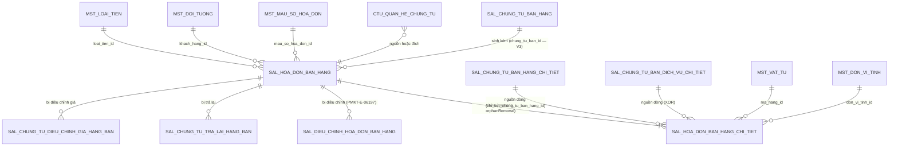

# Thiết kế DB — Hóa đơn bán hàng (PMKT-E-06196)

| | |
|---|---|
| **Migration** | `V3__sal_hoa_don_ban_hang_bo_sung_cot.sql` |
| **Bảng chạm** | `sal_hoa_don_ban_hang` · `sal_hoa_don_ban_hang_chi_tiet` · `ctu_quan_he_chung_tu` (CHECK) · `iam_quyen` (seed) · `fn_bang_cua_loai_chung_tu` (sửa hàm) |
| **File gốc** | [`00-ke-hoach-tong.md`](00-ke-hoach-tong.md) |

> **Đây là mục duy nhất được phép quyết định hình dạng dữ liệu.** §5 (migration) chỉ là bản dịch của §2–§4 sang SQL.

---

## 1. Hiện trạng bảng — nguồn sự thật

```bash
ls cell-app/src/main/resources/db/migration/
# V1__baseline.sql  V2__seed_toan_cuc.sql
```
**Số hiệu lớn nhất hiện tại: `V2` ⇒ file mới là `V3`.**
⚠️ `db/rollback/` còn file tới `V340__…` — đó là **lịch sử trước đợt squash baseline** (ngày file `V1__baseline.sql`: 2026-08-13), **không phải** migration đang chạy. Đừng đánh số `V341`.

### 1.1 `sal_hoa_don_ban_hang` — 57 cột, dựng ở `V1__baseline.sql:16795-16858`

Comment bảng (`V1:16788`): *"PMKT-E-06196 HoaDonBanhang — hóa đơn bán hàng (LDM ldm-BanHang.puml). **KHÔNG hạch toán**."*

| Nhóm cột | Cột đã có | Do đâu quản |
|---|---|---|
| Base/audit/tenant | `id`, `tenant_id`, `phien_ban`, `ngay_tao`, `nguoi_tao`, `ngay_cap_nhat`, `nguoi_cap_nhat`, `da_xoa`, `ngay_xoa`, `nguoi_xoa` | `AggregateRootEntity` (`core/entity/AggregateRootEntity.java:18`) — **không khai lại** |
| Loại nghiệp vụ | `loai_nghiep_vu` (NOT NULL, CHECK 2 giá trị) | module |
| Hóa đơn | `so_hoa_don` (NOT NULL), `mau_so_hoa_don_id`, `ky_hieu_hoa_don`, `ngay_hoa_don` (NOT NULL) | module |
| Khách hàng | `khach_hang_id` (NOT NULL), `ten_khach_hang` (NOT NULL), `dia_chi`, `nguoi_lien_he`, `so_dien_thoai`, `ma_so_thue`, `nguoi_mua_hang`, `ma_so_dvqhns`, `cccd`, `ho_chieu` | module |
| Thanh toán | `hinh_thuc_thanh_toan` (NOT NULL, CHECK 3), `tai_khoan_ngan_hang_thu_id`, `nhan_vien_ban_hang_id` | module |
| Tiền tệ | `loai_tien_id` (NOT NULL), `ty_gia` (NOT NULL, `exchange_rate`) | module |
| Chiết khấu | `loai_chiet_khau` (NOT NULL, CHECK 5), `gia_tri_chiet_khau`, `tong_tien_chiet_khau_hang(_quy_doi)`, `tong_tien_chiet_khau_hoa_don(_quy_doi)` | module |
| Tổng tiền | `tong_tien_hang_hoa`, `tong_tien_chiet_khau`, `tong_tien_thue_gtgt`, `tong_tien_sau_thue`, `tong_tien_thanh_toan` + 5 cột `…_quy_doi` | module (server tính) |
| Trạng thái | `trang_thai_lap_chung_tu` (CHECK 2), `trang_thai_phat_hanh_hoa_don` (CHECK 2), `da_bi_dieu_chinh` | module |
| Xuất khẩu | `so_hop_dong`, `ngay_hop_dong`, `dia_diem_giao`, `dia_diem_nhan`, `so_van_don`, `so_container`, `don_vi_van_chuyen`, `mo_ta` | module |

**Thiếu so với BA — 4 cột:**

| Cột thiếu | Vì sao cần | Nguồn BA |
|---|---|---|
| `tong_tien_thue_xk`, `tong_tien_thue_xk_quy_doi` | Bán hàng xuất khẩu ẩn chỉ tiêu thuế GTGT và **thay bằng Tổng thuế XK**; header đang có `tong_tien_thue_gtgt` nhưng **không có** cặp XK | `SCR_HDBanHang_ThemMoi.md:54` · `SCR_CTBH_ThemMoi.md:864` (BR14 "Lên Section Tổng hợp") |
| `trang_thai_hoa_don` | Cột danh sách BR06, phải **lọc và sắp xếp được** ⇒ phải là cột vật lý | `SCR_HDBanHang_DanhSach.md:28,88-95,121` · [01 §7](01-xem-danh-sach-hoa-don.md) |
| `chung_tu_ban_id` | BR08 nguồn dữ liệu danh sách nhắc đích danh **`HoaDonBan.ChungTuBanId`**; chỉ có link ở mức **dòng**, không có ở mức header | `SCR_HDBanHang_DanhSach.md:108` · `SCR_CTBH_ThemMoi.md:1305` (BR23 §nguồn — "liên kết ngược qua `HoaDonBan.ChungTuBanId`") |

### 1.2 `sal_hoa_don_ban_hang_chi_tiet` — 47 cột, `V1__baseline.sql:16874-16923`

Comment bảng (`V1:16932`): *"PMKT-E-06196 ChiTietHDBanHang — dòng hóa đơn bán hàng. XOR nguồn `chi_tiet_chung_tu_ban_hang_id`/`chi_tiet_chung_tu_ban_dich_vu_id` (tầng ứng dụng)."*

Đã có: `thu_tu`, `hoa_don_ban_hang_id`, 4 cột nguồn (`chung_tu_ban_hang_id`, `chung_tu_ban_dich_vu_id`, `chi_tiet_chung_tu_ban_hang_id`, `chi_tiet_chung_tu_ban_dich_vu_id`), `loai_dong_hang`, `ma_hang_id`, `ten_hang`, `so_luong`, `don_gia(_quy_doi)`, `thanh_tien(_quy_doi)`, `chiet_khau(_quy_doi)`, `chiet_khau_phan_tram`, `tien_chiet_khau_hang(_quy_doi)`, `tien_chiet_khau_hoa_don(_quy_doi)`, `don_vi_tinh_id`, `so_lo`, `han_su_dung`, `hang_khuyen_mai`, `chiet_khau_thuong_mai`, `thue_suat_gtgt_mac_dinh` (CHECK 7 giá trị — `V1:16922`), `gia_tri_thue_gtgt`, `tien_thue_gtgt(_quy_doi)`, `tien_thue_xk(_quy_doi)`, `phan_tram_thue_xk`, `hop_dong_id`, `don_vi_id`, `khoan_muc_chi_phi_id`, `vu_viec_id` + 10 cột base/audit/tenant.

**Thiếu so với BA — 7 cột:**

| Cột thiếu | Vì sao cần | Nguồn BA |
|---|---|---|
| `dien_giai` | Trường ngầm định, ẩn, fill theo Tên hàng; **được lưu cùng chi tiết** | `SCR_HDBanHang_ThemMoi.md:44` · `SCR_CTBH_ThemMoi.md:871-875` (BR15) |
| `dien_giai_thue` | Cột hiển thị trên lưới, mặc định `Thuế GTGT - [Tên hàng]`, người dùng sửa được | `SCR_HDBanHang_ThemMoi.md:44` · `SCR_CTBH_ThemMoi.md:876-879` |
| `khong_tong_hop_to_khai_gtgt` | Checkbox "HH không TH trên tờ khai thuế GTGT" | `SCR_HDBanHang_ThemMoi.md:45` · `SCR_CTBH_ThemMoi.md:840-849` (BR13 mục 7) |
| `chiet_khau_hang_phan_tram` | "Tỷ lệ CK theo mặt hàng (%)" — bảng đã có **tiền** CK theo mặt hàng nhưng **thiếu tỷ lệ** | `SCR_CTBH_ThemMoi.md:212` (BR12d) |
| `chiet_khau_hoa_don_phan_tram` | "Tỷ lệ CK theo hóa đơn (%)" — như trên | `SCR_CTBH_ThemMoi.md:215` |
| `gia_tri_tinh_thue_xk`, `gia_tri_tinh_thue_xk_quy_doi` | Cơ sở tính thuế XK, người dùng **sửa để khớp Tờ khai Hải quan**; bảng đã có `tien_thue_xk` nhưng thiếu cơ sở tính | `SCR_CTBH_ThemMoi.md:236-237,857-858` (BR14) |

**Hai trường BA có mà DB thiếu, KHÔNG thêm lần này:** `Đối tượng THCP` (`DoiTuongTapHopChiPhiId`) và `Đơn đặt hàng` (`DonDatHangId`) — `SCR_CTBH_ThemMoi.md:250,254`. Lý do: chúng thuộc bộ "trường tự do dùng chung cho **mọi chứng từ hạch toán**" (`:244`), mà hóa đơn **không hạch toán**; bảng chỉ giữ 4/6 trường tự do là quyết định có chủ ý của baseline. Nêu ở [00 §12](00-ke-hoach-tong.md).

### 1.3 Ràng buộc & index hiện có

| Loại | Định nghĩa | Vị trí | Đánh giá |
|---|---|---|---|
| PK | `sal_hoa_don_ban_hang_pkey (id)` | `V1:19745` | ✅ |
| PK | `sal_hoa_don_ban_hang_chi_tiet_pkey (id)` | `V1:19737` | ✅ |
| FK | `chi_tiet.hoa_don_ban_hang_id → sal_hoa_don_ban_hang(id)` | `V1:28129` | ✅ (không `ON DELETE` — đúng, vì xóa mềm) |
| FK | `chi_tiet.chung_tu_ban_hang_id → sal_chung_tu_ban_hang(id)` | `V1:28121` | ✅ |
| FK | `chi_tiet.chung_tu_ban_dich_vu_id → sal_chung_tu_ban_dich_vu(id)` | `V1:28113` | ✅ |
| Unique | `uq_sal_hdbh_so_hd` trên `(tenant_id, khach_hang_id, so_hoa_don, COALESCE(ky_hieu_hoa_don,''), COALESCE(mau_so_hoa_don_id,'000…'))` `WHERE da_xoa=false AND so_hoa_don<>''` | `V1:23675` | ❌ **thừa `khach_hang_id`** so với BR03 — §3 |
| Index | `idx_sal_hdbh_tenant_ngay (tenant_id, ngay_hoa_don)` | `V1:21813` | ✅ dùng cho sort mặc định `ngayHoaDon:desc` |
| Index | `idx_sal_ct_hdbh_parent (tenant_id, hoa_don_ban_hang_id)` | `V1:21771` | ✅ dùng khi nạp chi tiết |
| RLS | `ENABLE` + `FORCE ROW LEVEL SECURITY`, policy `tenant_isolation USING/WITH CHECK (tenant_id = fn_current_tenant())` | `V1:16820, 16925, 30720, 30726, 31708, 31715` | ✅ BR28 |
| Trigger | `trg_audit_sal_hoa_don_ban_hang`, `trg_audit_sal_chi_tiet_hd_ban_hang` → `fn_audit()` | `V1:25495, 25446` | ✅ |
| Grant | `SELECT,INSERT,DELETE,UPDATE` cho `pmkt_app` | `V1:33969, 33976` | ✅ |
| CHECK | 5 CHECK trên header (`hinh_thuc_thanh_toan`, `loai_chiet_khau`, `loai_nghiep_vu`, `trang_thai_lap_chung_tu`, `trang_thai_phat_hanh_hoa_don`) | `V1:16853-16857` | ❌ 2 cái phải mở rộng — §2.3 |
| CHECK | `thue_suat_gtgt_mac_dinh IN ('0','5','8','10','KCT','KKKNT','KHAC')` | `V1:16922` | ✅ khớp BR13 mục 1 |

**Bảng liên quan không thuộc epic này:**

| Bảng | Vai trò | Cột khóa nối |
|---|---|---|
| `sal_dieu_chinh_hoa_don_ban_hang` (`V1:16706`, epic **PMKT-E-06197**) | hóa đơn điều chỉnh | `hoa_don_ban_hang_goc_id → sal_hoa_don_ban_hang(id)` (`V1:28105`) |
| `sal_chung_tu_tra_lai_hang_ban` | trả lại hàng bán | `hoa_don_ban_hang_id → sal_hoa_don_ban_hang(id)` (`V1:28089`) |
| `sal_chung_tu_dieu_chinh_gia_hang_ban` | điều chỉnh giá | `hoa_don_ban_hang_id → … ON DELETE RESTRICT` (`V1:28049`) |
| `ctu_quan_he_chung_tu` (`V1:7214`) | đồ thị liên kết | `loai_chung_tu_nguon/dich` + `chung_tu_*_id` + `dong_*_id` |

⚠️ **`ON DELETE RESTRICT`** ở `V1:28049` chỉ chặn **xóa vật lý**. Luồng xóa của epic này là **xóa mềm** ([05 §6](05-xoa-hoa-don.md)) nên FK đó **không bảo vệ được gì** — guard thật phải nằm ở tầng ứng dụng.

---

## 2. Cột thêm mới / sửa trên bảng đã có

### 2.1 `sal_hoa_don_ban_hang` — thêm 4 cột

| # | Cột DB | Kiểu | NULL | Default | Ai ghi | Field DTO | Vì sao cần |
|---|---|---|---|---|---|---|---|
| 1 | `tong_tien_thue_xk` | `public.money_vnd` (= `numeric(18,2)`, BR7) | Y | — | **server tính** | `tongTienThueXk` | `SCR_HDBanHang_ThemMoi.md:54` |
| 2 | `tong_tien_thue_xk_quy_doi` | `public.money_vnd` | Y | — | **server tính** | `tongTienThueXkQuyDoi` | như trên, luồng quy đổi tách bạch (BR14) |
| 3 | `trang_thai_hoa_don` | `text` + CHECK 5 giá trị | Y | `'Hóa đơn gốc'` | **server ép** | `trangThaiHoaDon` | `SCR_HDBanHang_DanhSach.md:88-95` — phải lọc/sort được ([01 §7](01-xem-danh-sach-hoa-don.md)) |
| 4 | `chung_tu_ban_id` | `uuid` + FK → `sal_chung_tu_ban_hang(id)` | Y | — | client (khi lập kèm) | `chungTuBanId` | `SCR_HDBanHang_DanhSach.md:108` |

`trang_thai_hoa_don` khai CHECK **đủ 5 giá trị** ngay từ đầu (kể cả 2 giá trị "thay thế" chưa dùng) để epic PMKT-E-06197 không phải `ALTER` lần nữa — `ALTER … CHECK` trên bảng lớn là full table scan.

### 2.2 `sal_hoa_don_ban_hang_chi_tiet` — thêm 7 cột

| # | Cột DB | Kiểu | NULL | Default | Ai ghi | Field DTO | Vì sao cần |
|---|---|---|---|---|---|---|---|
| 5 | `dien_giai` | `text` | Y | — | client; **server fill** = `ten_hang` nếu trống | `dienGiai` | BR15 (`SCR_CTBH_ThemMoi.md:871-875`) |
| 6 | `dien_giai_thue` | `text` | Y | — | client; **server fill** = `'Thuế GTGT - ' \|\| ten_hang` | `dienGiaiThue` | BR15 (`:876-879`) |
| 7 | `khong_tong_hop_to_khai_gtgt` | `boolean` | N | `false` | **server ép** theo `%thuế` | `khongTongHopToKhaiGtgt` | BR13 mục 7 (`:840-849`) |
| 8 | `chiet_khau_hang_phan_tram` | `public.percent_rate` (= `numeric(5,2)`, BR7) | Y | — | client | `chietKhauHangPhanTram` | BR12d (`:212`) |
| 9 | `chiet_khau_hoa_don_phan_tram` | `public.percent_rate` | Y | — | client | `chietKhauHoaDonPhanTram` | BR12d (`:215`) |
| 10 | `gia_tri_tinh_thue_xk` | `numeric(18,2)` | Y | — | server tính, **client sửa được** | `giaTriTinhThueXk` | BR14 (`:857`) |
| 11 | `gia_tri_tinh_thue_xk_quy_doi` | `numeric(18,2)` | Y | — | server tính, **client sửa được** | `giaTriTinhThueXkQuyDoi` | BR14 (`:858`) |

Tên cột #8, #9 chọn tiền tố `chiet_khau_…_phan_tram` để **đồng bộ với cột đã có** `chiet_khau_phan_tram` (`V1:16887`), thay vì `ty_le_chiet_khau_…` như tên field của BA. Chọn nhất quán với bảng hơn là bám tên BA — cột `chiet_khau_phan_tram` là tiền lệ đã nằm trong baseline.

Cột #10, #11 dùng `numeric(18,2)` trần (không dùng domain `money_vnd`) để **khớp cột anh em** `tien_thue_xk`, `tien_thue_xk_quy_doi` vốn đang là `numeric(18,2)` (`V1:16913-16914`). Giá trị giống hệt, chỉ khác cách khai — giữ nhất quán trong cùng cụm cột.

### 2.3 Sửa CHECK constraint (đổi kiểu ràng buộc — tách dòng riêng, có backfill)

| # | Constraint | Hiện tại | Đổi thành | Dữ liệu cũ xử lý thế nào |
|---|---|---|---|---|
| 12 | `sal_hoa_don_ban_hang_trang_thai_lap_chung_tu_check` (`V1:16856`) | `'Chưa lập chứng từ'`, `'Đã lập chứng từ'` | `'Chưa lập'`, `'Đã lập 1 phần'`, `'Đã lập đủ'` | **Backfill trước khi ADD**: `'Chưa lập chứng từ' → 'Chưa lập'`, `'Đã lập chứng từ' → 'Đã lập đủ'`. Xem §6-K3 |
| 13 | `sal_hoa_don_ban_hang_loai_nghiep_vu_check` (`V1:16855`) | `'Bán hàng trong nước'`, `'Bán hàng xuất khẩu'` | thêm `'Bán dịch vụ'` | Không cần backfill (chỉ mở rộng). ⚠ chờ [00 §12-Q5](00-ke-hoach-tong.md) |
| 14 | `ck_ctu_qhct_loai_dich` (`V1:7233`) | 7 giá trị, **không có** `SAL_CHUNG_TU_BAN_HANG` | thêm `'SAL_CHUNG_TU_BAN_HANG'` | Không cần backfill. **Phải đi cùng commit sửa `LoaiChungTu.java:19`** — [06 §2](06-lap-chung-tu-tu-hoa-don.md), R2 |

### 2.4 Sửa unique index

| # | Index | Hiện tại | Đổi thành | Lý do |
|---|---|---|---|---|
| 15 | `uq_sal_hdbh_so_hd` (`V1:23675`) | `(tenant_id, khach_hang_id, so_hoa_don, COALESCE(ky_hieu,''), COALESCE(mau_so,'000…'))` | **bỏ `khach_hang_id`** | BR03: khóa trùng = **Số HĐ + Ký hiệu + Mẫu số** trong cùng tenant (`SCR_HDBanHang_ThemMoi.md:89`) — không có khách hàng. ⚠ **có bước kiểm dữ liệu bắt buộc**, §6-K1 |

### 2.5 Sửa hàm `fn_bang_cua_loai_chung_tu`

| # | Vấn đề | Hiện tại | Đổi thành |
|---|---|---|---|
| 16 | Hàng `'SAL_HOA_DON_BAN_HANG'` trả tên bảng chi tiết **`sal_chi_tiet_hd_ban_hang`** — bảng **không tồn tại** trong baseline | `V1:313` | `'sal_hoa_don_ban_hang_chi_tiet'` (tên thật ở `V1:16874`) |

Trước khi sửa, chạy `grep -rn "fn_bang_cua_loai_chung_tu" cell-app/src` để biết ai đang gọi. [00 §11-R3](00-ke-hoach-tong.md).

### 2.6 Seed quyền

| # | Việc | Vì sao bắt buộc |
|---|---|---|
| 17 | `INSERT INTO iam_quyen … 'LapHoaDonBan.Export'` | Endpoint `POST /export` kế thừa base gọi `quyen.require(…, EXPORT)` (`BaseCrudController.java:176`); quyền chưa seed ⇒ **403 với mọi user kể cả Admin**. 5 quyền còn lại đã có (`V2__seed_toan_cuc.sql:577-579`, `db/seed/iam_quyen_full_639_ba.sql:372-376`) |

**Cột deprecate:** không có. **Không xóa cột nào** trong migration này.

---

## 3. Bảng mới

**Không áp dụng** — cả hai bảng đã tồn tại từ `V1__baseline.sql`. Không tạo bảng mới nào.

Riêng "hóa đơn liên quan" ([01 §8.5](01-xem-danh-sach-hoa-don.md)) và "trạng thái hóa đơn thay thế" ([00 §12-Q3](00-ke-hoach-tong.md)) **cố ý không tạo bảng** — thuộc epic PMKT-E-06197, tạo trước là đoán hình dạng dữ liệu của người khác.

---

## 4. Ràng buộc · index · khóa ngoại sau `V3`

| # | Loại | Định nghĩa | Vì sao | Chi phí |
|---|---|---|---|---|
| 1 | unique | `uq_sal_hdbh_so_hd` **mới** — `(tenant_id, so_hoa_don, COALESCE(ky_hieu_hoa_don,''), COALESCE(mau_so_hoa_don_id,'000…')) WHERE da_xoa=false AND so_hoa_don<>''` | BR03 — chặn trùng hóa đơn, chốt cuối cho `_006` ([02 §5-V04](02-them-moi-hoa-don.md)) | Ghi chậm hơn không đáng kể; index hẹp hơn cũ (bỏ 1 cột) |
| 2 | index | `idx_sal_hdbh_tenant_ngay (tenant_id, ngay_hoa_don)` — **giữ nguyên** | sort mặc định `ngayHoaDon:desc` ([01 §8.2](01-xem-danh-sach-hoa-don.md)) | đã có |
| 3 | index | `idx_sal_ct_hdbh_parent (tenant_id, hoa_don_ban_hang_id)` — **giữ nguyên** | nạp chi tiết bằng `@EntityGraph` ([03 §6](03-xem-chi-tiet-hoa-don.md)) | đã có |
| 4 | index **mới** | `idx_sal_hdbh_chung_tu_ban (tenant_id, chung_tu_ban_id) WHERE da_xoa = false AND chung_tu_ban_id IS NOT NULL` | Tra "HĐ nào sinh từ chứng từ này" — dùng ở BR08 (`SCR_…DanhSach.md:108`) và ở F6-Q2 (chặn HĐ lập kèm làm nguồn). Partial index vì đa số HĐ có cột này NULL | Rất nhỏ (partial) |
| 5 | FK **mới** | `chung_tu_ban_id → sal_chung_tu_ban_hang(id)` **không** `ON DELETE` | Bảo vệ tham chiếu; không `CASCADE`/`RESTRICT` vì cả hai phía đều xóa mềm ⇒ FK chỉ chặn xóa vật lý | — |
| 6 | check **mới** | `trang_thai_hoa_don IN (5 giá trị)` | BR06 | full scan một lần lúc migrate |
| 7 | check **sửa** | `trang_thai_lap_chung_tu IN (3 giá trị)` | BR02 (D8) | full scan; phải **backfill trước** |
| 8 | check **sửa** | `loai_nghiep_vu IN (3 giá trị)` | Q5 | full scan |
| 9 | check **sửa** | `ck_ctu_qhct_loai_dich` + `SAL_CHUNG_TU_BAN_HANG` | F6 (R2) | full scan trên `ctu_quan_he_chung_tu` |
| — | RLS | policy `tenant_isolation` — **giữ nguyên**, cột mới tự nằm trong phạm vi policy | BR28 | — |

**Không thêm index** cho `trang_thai_lap_chung_tu` / `trang_thai_phat_hanh_hoa_don` / `trang_thai_hoa_don` dù chúng lọc được: đây là cột **selectivity thấp** (2–5 giá trị), Postgres sẽ bỏ qua index và quét bảng; index chỉ tốn chi phí ghi. Nếu profiling sau này cho thấy cần, thêm index composite `(tenant_id, trang_thai_lap_chung_tu, ngay_hoa_don)` — **không thêm mù lúc này**.

**Không thêm CHECK** `so_luong >= 0` / `don_gia >= 0` ở DB dù BR yêu cầu (`_009`, `_020`): việc chặn nằm ở tầng service để trả **đúng messageId** cho FE; CHECK ở DB sẽ ném `23514` với thông báo không dịch được sang message nghiệp vụ. Đây là **lệch có chủ ý**, cần Dev BE xác nhận.

---

## 5. Migration `V3` — SQL đầy đủ

File: `cell-app/src/main/resources/db/migration/V3__sal_hoa_don_ban_hang_bo_sung_cot.sql`

```sql
-- =====================================================================================
-- PMKT-E-06196 Hóa đơn bán hàng — bổ sung cột, sửa CHECK/unique, seed quyền.
-- Chỉ dịch §2 của docs/doing/PMKT-E-06196-hoa-don-ban-hang-api/07-thiet-ke-db.md sang SQL.
-- CHẠY SAU khi đã chạy các query kiểm dữ liệu ở §6 — đặc biệt K1 (trùng số hóa đơn).
-- =====================================================================================

-- ---- 1. Header: 4 cột mới -----------------------------------------------------------
ALTER TABLE public.sal_hoa_don_ban_hang
    ADD COLUMN IF NOT EXISTS tong_tien_thue_xk           public.money_vnd,
    ADD COLUMN IF NOT EXISTS tong_tien_thue_xk_quy_doi   public.money_vnd,
    ADD COLUMN IF NOT EXISTS trang_thai_hoa_don          text DEFAULT 'Hóa đơn gốc',
    ADD COLUMN IF NOT EXISTS chung_tu_ban_id             uuid;

COMMENT ON COLUMN public.sal_hoa_don_ban_hang.tong_tien_thue_xk IS
    'Σ tien_thue_xk của các dòng hàng. Chỉ có giá trị khi loai_nghiep_vu = Bán hàng xuất khẩu (BR14).';
COMMENT ON COLUMN public.sal_hoa_don_ban_hang.trang_thai_hoa_don IS
    'BR06 PMKT-E-06196. Epic này chỉ ghi ''Hóa đơn gốc''; các giá trị điều chỉnh/thay thế do PMKT-E-06197 quản.';
COMMENT ON COLUMN public.sal_hoa_don_ban_hang.chung_tu_ban_id IS
    'Chứng từ bán hàng đã sinh ra hóa đơn này (luồng "Lập kèm hóa đơn"). NULL = hóa đơn lập trực tiếp.';

-- backfill cho bản ghi cũ trước khi gắn CHECK
UPDATE public.sal_hoa_don_ban_hang
   SET trang_thai_hoa_don = 'Hóa đơn gốc'
 WHERE trang_thai_hoa_don IS NULL;

ALTER TABLE public.sal_hoa_don_ban_hang
    ADD CONSTRAINT sal_hoa_don_ban_hang_trang_thai_hoa_don_check
    CHECK (trang_thai_hoa_don = ANY (ARRAY[
        'Hóa đơn gốc'::text, 'Hóa đơn điều chỉnh'::text, 'Hóa đơn thay thế'::text,
        'Hóa đơn bị điều chỉnh'::text, 'Hóa đơn bị thay thế'::text]));

ALTER TABLE public.sal_hoa_don_ban_hang
    ADD CONSTRAINT sal_hoa_don_ban_hang_chung_tu_ban_id_fkey
    FOREIGN KEY (chung_tu_ban_id) REFERENCES public.sal_chung_tu_ban_hang(id);

CREATE INDEX IF NOT EXISTS idx_sal_hdbh_chung_tu_ban
    ON public.sal_hoa_don_ban_hang (tenant_id, chung_tu_ban_id)
    WHERE da_xoa = false AND chung_tu_ban_id IS NOT NULL;

-- ---- 2. Chi tiết: 7 cột mới ---------------------------------------------------------
ALTER TABLE public.sal_hoa_don_ban_hang_chi_tiet
    ADD COLUMN IF NOT EXISTS dien_giai                     text,
    ADD COLUMN IF NOT EXISTS dien_giai_thue                text,
    ADD COLUMN IF NOT EXISTS khong_tong_hop_to_khai_gtgt   boolean NOT NULL DEFAULT false,
    ADD COLUMN IF NOT EXISTS chiet_khau_hang_phan_tram     public.percent_rate,
    ADD COLUMN IF NOT EXISTS chiet_khau_hoa_don_phan_tram  public.percent_rate,
    ADD COLUMN IF NOT EXISTS gia_tri_tinh_thue_xk          numeric(18,2),
    ADD COLUMN IF NOT EXISTS gia_tri_tinh_thue_xk_quy_doi  numeric(18,2);

COMMENT ON COLUMN public.sal_hoa_don_ban_hang_chi_tiet.dien_giai IS
    'BR15: trường ngầm định (ẩn trên lưới), fill theo ten_hang. NULL với dòng ghi chú.';
COMMENT ON COLUMN public.sal_hoa_don_ban_hang_chi_tiet.dien_giai_thue IS
    'BR15: mặc định "Thuế GTGT - {ten_hang}", người dùng sửa được (≤500 ký tự).';
COMMENT ON COLUMN public.sal_hoa_don_ban_hang_chi_tiet.khong_tong_hop_to_khai_gtgt IS
    'BR13 mục 7: hệ thống TỰ ép true khi thue_suat_gtgt_mac_dinh ∈ (KHAC, KKKNT); các mức khác cho người dùng tự tích.';
COMMENT ON COLUMN public.sal_hoa_don_ban_hang_chi_tiet.gia_tri_tinh_thue_xk IS
    'BR14: mặc định = thanh_tien − chiet_khau; người dùng sửa để khớp Tờ khai Hải quan.';

-- ---- 3. Sửa CHECK trang_thai_lap_chung_tu (2 → 3 giá trị) ---------------------------
ALTER TABLE public.sal_hoa_don_ban_hang
    DROP CONSTRAINT IF EXISTS sal_hoa_don_ban_hang_trang_thai_lap_chung_tu_check;

UPDATE public.sal_hoa_don_ban_hang
   SET trang_thai_lap_chung_tu = CASE trang_thai_lap_chung_tu
        WHEN 'Chưa lập chứng từ' THEN 'Chưa lập'
        WHEN 'Đã lập chứng từ'   THEN 'Đã lập đủ'
        ELSE trang_thai_lap_chung_tu END
 WHERE trang_thai_lap_chung_tu IN ('Chưa lập chứng từ', 'Đã lập chứng từ');

UPDATE public.sal_hoa_don_ban_hang
   SET trang_thai_lap_chung_tu = 'Chưa lập'
 WHERE trang_thai_lap_chung_tu IS NULL;

ALTER TABLE public.sal_hoa_don_ban_hang
    ADD CONSTRAINT sal_hoa_don_ban_hang_trang_thai_lap_chung_tu_check
    CHECK (trang_thai_lap_chung_tu = ANY (ARRAY[
        'Chưa lập'::text, 'Đã lập 1 phần'::text, 'Đã lập đủ'::text]));

-- ---- 4. Sửa CHECK loai_nghiep_vu (thêm 'Bán dịch vụ') — CHỜ BA CHỐT Q5 -------------
ALTER TABLE public.sal_hoa_don_ban_hang
    DROP CONSTRAINT IF EXISTS sal_hoa_don_ban_hang_loai_nghiep_vu_check;
ALTER TABLE public.sal_hoa_don_ban_hang
    ADD CONSTRAINT sal_hoa_don_ban_hang_loai_nghiep_vu_check
    CHECK (loai_nghiep_vu = ANY (ARRAY[
        'Bán hàng trong nước'::text, 'Bán hàng xuất khẩu'::text, 'Bán dịch vụ'::text]));

-- ---- 5. Sửa unique index chống trùng hóa đơn (bỏ khach_hang_id) — CHỜ Q4 -----------
-- ⚠ CHẠY QUERY KIỂM K1 (§6) TRƯỚC. Có dữ liệu trùng → DỪNG, báo BA, KHÔNG tự xóa.
DROP INDEX IF EXISTS public.uq_sal_hdbh_so_hd;
CREATE UNIQUE INDEX uq_sal_hdbh_so_hd
    ON public.sal_hoa_don_ban_hang
       (tenant_id, so_hoa_don,
        COALESCE(ky_hieu_hoa_don, ''::text),
        COALESCE(mau_so_hoa_don_id, '00000000-0000-0000-0000-000000000000'::uuid))
    WHERE da_xoa = false AND so_hoa_don <> ''::text;

-- ---- 6. Cho Chứng từ bán hàng làm ĐÍCH trong đồ thị quan hệ (F6) --------------------
-- ⚠ PHẢI đi cùng commit sửa quan_he_chung_tu/api/LoaiChungTu.java:19 → (true, true).
ALTER TABLE public.ctu_quan_he_chung_tu
    DROP CONSTRAINT IF EXISTS ck_ctu_qhct_loai_dich;
ALTER TABLE public.ctu_quan_he_chung_tu
    ADD CONSTRAINT ck_ctu_qhct_loai_dich
    CHECK (loai_chung_tu_dich = ANY (ARRAY[
        'SAL_HOA_DON_BAN_HANG'::text, 'INV_PHIEU_XUAT_KHO'::text, 'CB_PHIEU_THU'::text,
        'SAL_CHUNG_TU_TRA_LAI_HANG_BAN'::text, 'SAL_DIEU_CHINH_GIA_HANG_BAN'::text,
        'PUR_HOA_DON_MUA'::text, 'INV_PHIEU_NHAP_KHO'::text,
        'SAL_CHUNG_TU_BAN_HANG'::text]));

-- ---- 7. Seed quyền LapHoaDonBan.Export ---------------------------------------------
INSERT INTO public.iam_quyen (ma_quyen, module, hanh_dong, nhom, ten_chuc_nang, mo_ta, la_he_thong)
VALUES ('LapHoaDonBan.Export', 'LapHoaDonBan', 'Export', 'Nghiệp vụ', 'LapHoaDonBan',
        'Xuất Excel danh sách hóa đơn bán hàng', true)
ON CONFLICT (ma_quyen) DO NOTHING;

-- ---- 8. Sửa fn_bang_cua_loai_chung_tu: tên bảng chi tiết của hóa đơn bán hàng -------
-- Hiện trả 'sal_chi_tiet_hd_ban_hang' — bảng KHÔNG tồn tại (V1__baseline.sql:313 vs :16874).
CREATE OR REPLACE FUNCTION public.fn_bang_cua_loai_chung_tu(p_loai text, p_la_dong boolean)
RETURNS text LANGUAGE sql IMMUTABLE AS $$
    SELECT CASE WHEN p_la_dong THEN chi_tiet ELSE header END
    FROM (VALUES
        ('SAL_CHUNG_TU_BAN_HANG',         'sal_chung_tu_ban_hang',          'sal_chi_tiet_chung_tu_ban_hang'),
        ('SAL_CHUNG_TU_BAN_DICH_VU',      'sal_chung_tu_ban_dich_vu',       'sal_chi_tiet_chung_tu_ban_dv'),
        ('PUR_CHUNG_TU_MUA_HANG',         'pur_chung_tu_mua_hang',          'pur_chi_tiet_chung_tu_mua_hang'),
        ('SAL_HOA_DON_BAN_HANG',          'sal_hoa_don_ban_hang',           'sal_hoa_don_ban_hang_chi_tiet'),
        ('INV_PHIEU_XUAT_KHO',            'inv_phieu_xuat_kho_module_kho',  'inv_chi_tiet_phieu_xuat_kho'),
        ('INV_PHIEU_NHAP_KHO',            'inv_phieu_nhap_kho_module_kho',  'inv_chi_tiet_phieu_nhap_kho'),
        ('CB_PHIEU_THU',                  'cb_phieu_thu',                   'cb_chi_tiet_phieu_thu'),
        ('SAL_CHUNG_TU_TRA_LAI_HANG_BAN', 'sal_chung_tu_tra_lai_hang_ban',  'sal_chi_tiet_chung_tu_tra_lai_hang_ban'),
        ('SAL_DIEU_CHINH_GIA_HANG_BAN',   'sal_dieu_chinh_gia_hang_ban',    'sal_chi_tiet_dieu_chinh_gia_hang_ban'),
        ('PUR_HOA_DON_MUA',               'pur_hoa_don_mua',                'pur_chi_tiet_hoa_don')
    ) AS t(loai, header, chi_tiet)
    WHERE t.loai = p_loai;
$$;
```

**Ghi chú kỹ thuật:**
- **`CONCURRENTLY`**: `CREATE UNIQUE INDEX … CONCURRENTLY` **không dùng được** trong Flyway migration mặc định vì nó không chạy được trong transaction. Bảng `sal_hoa_don_ban_hang` hiện còn nhỏ ⇒ chấp nhận khóa ngắn. Nếu deploy lên môi trường có dữ liệu lớn, tách bước 5 ra migration riêng có `-- flyway:executeInTransaction=false`.
- **Idempotent**: dùng `IF NOT EXISTS` / `IF EXISTS` / `ON CONFLICT DO NOTHING` ở mọi chỗ có thể; riêng `ADD CONSTRAINT` không có `IF NOT EXISTS` nên luôn `DROP … IF EXISTS` trước.
- **Flyway repair**: nếu DB dev đã chạy migration này rồi mà file bị sửa → `FLYWAY_REPAIR_ON_BOOT`. Không dùng `out-of-order` (đã là số cao nhất).
- **Thứ tự bắt buộc**: mục 3 phải `UPDATE` **trước** khi `ADD CONSTRAINT`, nếu không migration đỏ ngay.
- **Chạy trên máy dev**: cả đội dùng chung DB, Flyway mặc định **tắt** (`application.yml:280-295`). Chạy một lượt duy nhất bằng `SPRING_FLYWAY_ENABLED=true`, do **một người** thực hiện.

**File có sẵn phải sửa kèm:**

| File | Sửa gì |
|---|---|
| `quan_he_chung_tu/api/LoaiChungTu.java:19` | `SAL_CHUNG_TU_BAN_HANG(true, false)` → `(true, true)` — **cùng commit** với mục 6 |
| `common/constant/MaChucNang.java` | Không cần sửa — `LAP_HOA_DON_BAN` đã có (`:220`) |
| `chung_tu_ban_hang/internal/entity/ChiTietChungTuBanHang.java:213` | Gỡ comment "module Hoá đơn chưa có — hiện luôn null" (chỉ là comment, không đổi hành vi) |

---

## 6. Kiểm dữ liệu trước khi chạy migration

| # | Vấn đề | Query kiểm tra | Cách xử lý |
|---|---|---|---|
| **K1** | Có HĐ trùng `(tenant, số HĐ, ký hiệu, mẫu số)` **khác khách hàng** không → sẽ làm bước 5 thất bại | ```sql\nSELECT tenant_id, so_hoa_don, ky_hieu_hoa_don, mau_so_hoa_don_id, count(*), array_agg(id)\n  FROM public.sal_hoa_don_ban_hang\n WHERE da_xoa = false AND so_hoa_don <> ''\n GROUP BY 1,2,3,4 HAVING count(*) > 1;``` | Có kết quả → **DỪNG**, xuất danh sách gửi BA. **KHÔNG tự xóa/tự sửa dữ liệu.** [00 §11-R5](00-ke-hoach-tong.md) |
| **K2** | Có giá trị `trang_thai_lap_chung_tu` lạ ngoài 2 giá trị cũ không | ```sql\nSELECT DISTINCT trang_thai_lap_chung_tu\n  FROM public.sal_hoa_don_ban_hang;``` | Chỉ được trả `'Chưa lập chứng từ'`, `'Đã lập chứng từ'`, `NULL`. Giá trị lạ → bổ sung nhánh `CASE` ở bước 3 |
| **K3** | Số bản ghi bị backfill ở bước 3 | ```sql\nSELECT trang_thai_lap_chung_tu, count(*)\n  FROM public.sal_hoa_don_ban_hang\n GROUP BY 1;``` | Ghi lại con số **trước và sau** để đối chiếu |
| **K4** | Có bản ghi `ctu_quan_he_chung_tu` nào đang mang `loai_chung_tu_dich = 'SAL_CHUNG_TU_BAN_HANG'` không (không được có, vì CHECK cũ cấm) | ```sql\nSELECT count(*) FROM public.ctu_quan_he_chung_tu\n WHERE loai_chung_tu_dich = 'SAL_CHUNG_TU_BAN_HANG';``` | Phải = 0. Khác 0 nghĩa là CHECK đã bị disable ở đâu đó → điều tra trước |
| **K5** | Có bảng `sal_chi_tiet_hd_ban_hang` thật không (để chắc mục 8 không phá gì) | ```sql\nSELECT to_regclass('public.sal_chi_tiet_hd_ban_hang');``` | Phải trả `NULL` (bảng không tồn tại) → sửa hàm là đúng |
| **K6** | Quyền `LapHoaDonBan.Export` đã có chưa | ```sql\nSELECT ma_quyen FROM public.iam_quyen\n WHERE ma_quyen LIKE 'LapHoaDonBan.%' ORDER BY 1;``` | Trước migration phải thấy 6 dòng (thiếu `.Export`), sau migration thấy 7 |

**Tương thích ngược:** mọi cột thêm đều `NULL`-able (trừ `khong_tong_hop_to_khai_gtgt` có `DEFAULT false`), nên bản ghi cũ vẫn đọc/ghi được. Đổi giá trị `trang_thai_lap_chung_tu` là **breaking change với client cũ** — nhưng chưa có client nào (module Java greenfield), FE cũng chưa code màn này. An toàn.

---

## 7. Ánh xạ Entity ↔ bảng

| Bảng | Entity | Kế thừa | Quan hệ JPA | Fetch |
|---|---|---|---|---|
| `sal_hoa_don_ban_hang` | `HoaDonBanHang` | `core.entity.AggregateRootEntity` (`:18`) | `@OneToMany(mappedBy="hoaDonBanHang", cascade=ALL, orphanRemoval=true) @OrderBy("thuTu")` | LAZY, nạp bằng `@EntityGraph` ở `findWithChiTietById` |
| `sal_hoa_don_ban_hang_chi_tiet` | `ChiTietHoaDonBanHang` | `core.entity.TenantedEntity` (`:15`) | `@ManyToOne @JoinColumn("hoa_don_ban_hang_id")` | LAZY |

- **Aggregate root:** `HoaDonBanHang`. Dòng chi tiết **không** có repository riêng — chỉ tồn tại qua header (D3).
- **Lock lạc quan:** `@Version` trên `phien_ban` do `AggregateRootEntity` cấp (`:21-22`). Sửa chỉ chạm dòng con phải gọi `touch()` ([04 §6](04-cap-nhat-hoa-don.md)).
- **Enum ⇄ chuỗi DB:** dùng `GiaTriDb.Converter` (copy từ `chung_tu_ban_hang/internal/model/GiaTriDb.java` — D6).

### 7.1 Enum ⇄ giá trị lưu trong DB

| Enum Java (`hoa_don_ban_hang/internal/model/`) | Cột | Giá trị lưu thật | Converter | Giá trị lạ thì sao |
|---|---|---|---|---|
| `LoaiNghiepVuHoaDon` | `loai_nghiep_vu` | `"Bán hàng trong nước"` \| `"Bán hàng xuất khẩu"` \| `"Bán dịch vụ"` | `GiaTriDb.Converter` | **ném** `IllegalArgumentException` khi đọc — dữ liệu ngoài CHECK là bug, không im lặng |
| `LoaiChietKhauHoaDon` | `loai_chiet_khau` | 5 giá trị (`V1:16854`) | như trên | ném |
| `HinhThucThanhToanHoaDon` | `hinh_thuc_thanh_toan` | `"Tiền mặt"` \| `"Chuyển khoản"` \| `"TM-CK"` | như trên | ném |
| `ThueSuatGtgtHoaDon` | `thue_suat_gtgt_mac_dinh` | `"0"` \| `"5"` \| `"8"` \| `"10"` \| `"KCT"` \| `"KKKNT"` \| `"KHAC"` | như trên | ném |
| `TrangThaiPhatHanh` | `trang_thai_phat_hanh_hoa_don` | `"Chưa phát hành"` \| `"Đã phát hành"` | như trên | ném |
| `TrangThaiLapChungTu` | `trang_thai_lap_chung_tu` | `"Chưa lập"` \| `"Đã lập 1 phần"` \| `"Đã lập đủ"` (sau `V3`) | như trên | ném |
| `TrangThaiHoaDonKind` | `trang_thai_hoa_don` | 5 giá trị BR06 | như trên | ném |

Có **unit test pin** mọi giá trị chuỗi khớp CHECK constraint ([02 §8.1](02-them-moi-hoa-don.md)) — lệch một dấu là chứng từ không lưu được và lỗi chỉ lộ lúc COMMIT.

---

## 8. ERD



Các bảng `MST_*` thuộc `master_data` — **vùng đóng băng**, chỉ tham chiếu khóa, không đọc/không sao chép kiến trúc.

---

## 9. Kiểm thử dữ liệu

| # | Kiểm | Cách |
|---|---|---|
| 1 | Migration chạy được từ DB sạch | Flyway trên schema trống → `V1` → `V2` → `V3` |
| 2 | Migration chạy được trên DB đã có dữ liệu | Chạy K1…K6 trước, sau đó `V3`, rồi chạy lại K2/K3/K6 đối chiếu |
| 3 | Unique mới chặn đúng | Insert 2 HĐ cùng `(tenant, số, ký hiệu, mẫu số)` **khác khách hàng** → cái thứ hai đâm `23505` |
| 4 | Unique mới không chặn nhầm | Insert 2 HĐ cùng số nhưng khác **tenant** → cả hai vào được (RLS + tenant trong index) |
| 5 | Bản ghi `da_xoa = true` không chặn bản ghi mới | Xóa mềm HĐ số `0000123`, tạo lại HĐ số `0000123` → thành công (partial index `WHERE da_xoa = false`) |
| 6 | CHECK mới chặn giá trị cũ | `UPDATE … SET trang_thai_lap_chung_tu = 'Đã lập chứng từ'` → đâm `23514` |
| 7 | Backfill đúng | Trước migration: N bản ghi `'Đã lập chứng từ'`; sau: đúng N bản ghi `'Đã lập đủ'` |
| 8 | Enum đồng bộ CHECK | Chạy test đồng bộ `pg_constraint` ⇄ `LoaiChungTu` (`LoaiChungTu.java:8-11`) — **bắt buộc** trước khi push (R2) |
| 9 | RLS còn nguyên trên cột mới | User tenant A `SELECT trang_thai_hoa_don` của HĐ tenant B → 0 dòng |
| 10 | `fn_bang_cua_loai_chung_tu` trả tên bảng có thật | `SELECT to_regclass(fn_bang_cua_loai_chung_tu('SAL_HOA_DON_BAN_HANG', true));` → không `NULL` |

⚠️ **Toàn bộ mục này cần DB thật** ⇒ chạy qua IntelliJ (`mcp__idea__execute_sql_query` trên datasource đã cấu hình) hoặc Testcontainers ở CI. Máy dev **không có Docker** ([00 §11-R7](00-ke-hoach-tong.md)) — báo cáo phải ghi rõ mục nào chưa chạy.

---

## 10. Tóm tắt cho người ký duyệt

| Việc | Số lượng | Rủi ro |
|---|---|---|
| Cột thêm mới | **11** (4 header + 7 chi tiết) — đều NULL-able hoặc có DEFAULT | Thấp |
| Cột xóa / đổi tên | **0** | — |
| Bảng mới | **0** | — |
| CHECK sửa | **3** (`trang_thai_lap_chung_tu` có backfill, `loai_nghiep_vu`, `ck_ctu_qhct_loai_dich`) | **Trung bình** — `ck_ctu_qhct_loai_dich` phải đồng bộ với enum Java, có test đọc `pg_constraint` |
| CHECK thêm mới | **1** (`trang_thai_hoa_don`) | Thấp |
| Unique index sửa | **1** (`uq_sal_hdbh_so_hd`, **chặt hơn**) | **Cao** — có thể thất bại nếu DB đang có dữ liệu trùng (K1) |
| Index thêm mới | **1** (partial trên `chung_tu_ban_id`) | Thấp |
| FK thêm mới | **1** (`chung_tu_ban_id`) | Thấp |
| Hàm sửa | **1** (`fn_bang_cua_loai_chung_tu` — sửa **lỗi có sẵn**) | Thấp |
| Seed quyền | **1** (`LapHoaDonBan.Export`) | Thấp — không seed thì `/export` 403 với mọi user |

**Ba điểm phải chốt trước khi chạy migration:**
1. **K1** — kiểm dữ liệu trùng số hóa đơn. Có trùng thì dừng, không tự xử lý.
2. **[00 §12-Q2](00-ke-hoach-tong.md)** — `TrangThaiLapChungTu` 2 hay 3 giá trị. Chốt "2" thì bỏ mục 3 của §5.
3. **[00 §12-Q4](00-ke-hoach-tong.md)** — khóa check trùng có gồm khách hàng không. Chốt "có" thì bỏ mục 5 của §5.

---

## 11. BR đã áp dụng

| BR | Áp ở đâu |
|---|---|
| **BR7** (precision & làm tròn) | §2 — `money_vnd(18,2)`, `percent_rate(5,2)`, `quantity(18,3)`, `exchange_rate(18,6)`; không cột `numeric` trần ngoài 2 cột XK bám theo cột anh em có sẵn |
| **BR19** (kiểm tra trùng) | §2.4, §4-#1 — unique index là chốt cuối cho `_006` |
| **BR20** (số chứng từ & mã danh mục) | `so_hoa_don` là `text` tự do, độ dài kiểm ở tầng service (≤50, không dấu) — DB không áp `varchar(n)` để không phải migrate khi BA đổi độ dài |
| **BR28** (multi-tenant) | §1.3 — RLS `tenant_isolation` + `FORCE ROW LEVEL SECURITY`; mọi index/unique đều bắt đầu bằng `tenant_id` |
| **BR29** (chính sách xóa) | §1.3 — không FK `ON DELETE CASCADE`; xóa mềm ở tầng ứng dụng; partial index `WHERE da_xoa = false` để bản ghi đã xóa không chặn bản ghi mới |
| **BR46** (trường hệ thống bắt buộc) | §1.1 — 10 cột base/audit/tenant do `AggregateRootEntity` quản, không khai lại |

**BR chưa đạt:**
- **BR7 mục 7.1** — hai cột `gia_tri_tinh_thue_xk(_quy_doi)` khai `numeric(18,2)` trần thay vì domain `money_vnd`, để nhất quán với `tien_thue_xk` sẵn có. Giá trị tương đương, chỉ khác cách khai.
- **BR15.2** (`số ≥ 0`) **không** cài thành CHECK ở DB — chặn ở service để trả đúng `messageId` (§4).
