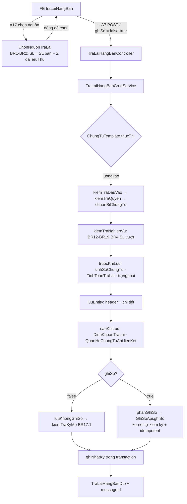

# PMKT-E-06469 Trả lại hàng bán — Kế hoạch triển khai API (BE `cell-app`)

> **Trạng thái:** `BẢN NHÁP CHỜ REVIEW` — chưa code một dòng Java/SQL nào.
> **Ngày cập nhật:** 2026-08-14
> **Người review cần có:** 1 BA (chốt §12) + 1 Dev BE/DBA (chốt §0-D1, §7, §9, §10) + 1 Dev FE (chốt §4 — FE đã code sẵn hợp đồng wire, xem §2.4)

| Mục | Nội dung |
|---|---|
| Use case | `PMKT-U-06470` Xem danh sách · `06471` Thêm mới · `06472` Sửa · `06473` Xóa · `06474` Nhân bản · `06475` Ghi sổ · `06476` Bỏ ghi sổ · `06477` Xem chi tiết |
| Màn hình | `SCR_DanhSachTraLaiHangBan.md` · `SCR_ThemMoiTraLaiHangBan.md` (773 dòng — màn anchor) · `SCR_SuaTraLaiHangBan.md` · `SCR_XemChiTietTraLaiHangBan.md` |
| Tài liệu nguồn | `pmkt-docs/ba/PMKT-E-06469_TraLaiHangBan/` + `pmkt-docs/ba/Common/business_rules.md` (BR1…BR46) |
| Module BE | `cell-app/src/main/java/vn/dopai/pmkt/cell/chung_tu_ban_hang/tra_lai_hang_ban/` — **sub-module MỚI** trong module `chung_tu_ban_hang`, tiền tố bảng `sal_` (xem **D1**) |
| Bảng DB | `sal_chung_tu_tra_lai_hang_ban` (**đã có 61 cột**) · `sal_chung_tu_tra_lai_hang_ban_chi_tiet` (**đã có 44 cột**) — `db/migration/V1__baseline.sql:16480,16631`. **Không CREATE TABLE, chỉ ALTER** |
| Quyền | `TraLaiHangBan.*` — **đã seed đủ 10 mã** (`db/migration/V2__seed_toan_cuc.sql:582-587`, `db/seed/iam_quyen_full_639_ba.sql:484-490,652,657,662`) |

---

## 0. Các quyết định đã chốt

| # | Quyết định | Hệ quả · vì sao KHÔNG chọn phương án kia |
|---|---|---|
| **D1** | Mở **sub-module** `cell/chung_tu_ban_hang/tra_lai_hang_ban/internal/` (KHÔNG có `api/`), giữ tiền tố bảng `sal_` | Hai bảng đích tên `sal_*` — tiền tố này **đã thuộc** module `chung_tu_ban_hang` (`cell-app/CLAUDE.md:69`). Mở module cấp 1 `chung_tu_tra_lai_hang_ban/` sẽ có **hai module cấp 1 cùng một tiền tố**, đúng loại nợ ranh giới mà `docs/be-khung-kien-truc-chuan.md:184-193,256-260` cấm với module mới. Thêm nữa: BR1/BR2 của `SCR_ThemMoiTraLaiHangBan.md:77-126` bắt buộc đọc **dòng hàng** của chứng từ bán hàng gốc kèm số lượng đã trả lại — nằm trong cùng module thì dùng thẳng `ChiTietChungTuBanHangRepository`; ở module riêng thì phải mở `api/` đầu tiên trên `chung_tu_ban_hang` (module hiện **không có `api/` nào** — `cell-app/CLAUDE.md:35-36` nêu đó là chủ ý). Đổi lại: `chung_tu_ban_hang/` sẽ có shape hỗn hợp (`internal/` ở gốc **và** sub-module `tra_lai_hang_ban/`) — không vi phạm luật chữ ("gốc module chỉ có `package-info.java` + thư mục con") nhưng **cần dev review chốt** → xem §12-Q1 |
| **D2** | Kế thừa `BaseChungTuController` + `AbstractChungTuCrudService` + 5 lớp con `ChungTuTemplate`; **không viết lại** endpoint nào | 15 endpoint có sẵn (§4). Trình tự "kiểm quyền → kiểm nghiệp vụ → lưu → sinh bút toán → kiểm kỳ" là bất biến do `accounting_core/chung_tu/service/ChungTuTemplate.java:102-243` cưỡng chế. Không chọn `BaseCrudService` cho phần GHI: `docs/be-khung-kien-truc-chuan.md:134-136` cấm — `repository.save` không biết bất biến kế toán |
| **D3** | `status` (`core.entity.TrangThaiChungTu`, tên hằng) là **nguồn sự thật duy nhất** của trạng thái. Migration `V3` **DROP** cột `trang_thai_chung_tu` | Bảng hiện có **HAI** cột trạng thái: `status text NOT NULL DEFAULT 'NHAP'` + CHECK 5 giá trị (`V1:18113`) và `trang_thai_chung_tu text NOT NULL` + CHECK `'Chưa ghi sổ'/'Đã ghi sổ'` (`V1:16544`). Cột thứ hai **NOT NULL và không có DEFAULT** ⇒ mọi `INSERT` từ JPA (entity chỉ map `status` qua `BaseChungTuEntity.java:70-73`) sẽ **fail 23502** ngay request đầu tiên. `sal_chung_tu_ban_hang` đã DROP đúng cột này ở V309 (`core/entity/TrangThaiChungTu.java:9-12`) ⇒ giữ lại ở đây là hai nguồn sự thật. Không chọn "map cả hai": đồng bộ hai cột trạng thái là nguồn lệch kinh điển, và FE đã đọc **tên hằng** (`api/model.ts:170-171`) |
| **D4** | Thêm **mã loại chứng từ mới** vào `mst_loai_chung_tu` (đề xuất `CTTL` — "Chứng từ trả lại hàng bán"); quyển số tự sinh theo `db/seed/25_quyen_chung_tu.sql` | `ChungTuTemplate.maLoaiChungTu()` là **bắt buộc với mọi chứng từ** (`ChungTuTemplate.java:265-272`) — nó là khoá chốt chặn kỳ khoá cả ở Java lẫn trigger DB. Seed hiện **không có mã nào cho trả lại hàng bán** (`db/seed/20_loai_chung_tu.sql` — 20 mã, không có), và `business_rules.md:88-116` (BR09) cũng **không liệt kê** ⇒ mã cụ thể phải để BA chốt → §12-Q2. Không chọn dùng lại `CTBH`: quyển số dùng chung sẽ trộn số của hai loại chứng từ và chốt chặn khoá sổ theo loại mất khả năng phân biệt |
| **D5** | Bút toán dựng bằng **bộ quy tắc dữ liệu** `QuyTacTraLaiHangBan implements BoQuyTacButToan` + `TaoDinhKhoanApi.taoDoiTuongSoCai(...)`; TK trả lại (5212) dùng vai trò `VaiTroTaiKhoan.TK_NO` | `VaiTroTaiKhoan.java:19-20` ghi rõ: *"TK Nợ (vế Nợ chính, cũng là TK giảm giá / TK trả lại)"* — đúng vai trò cần, **không** tạo vai trò mới, **không** dùng `TK_CHIET_KHAU` (`VaiTroTaiKhoan.java:14-15` cấm nhầm). Mẫu 1:1 là `QuyTacBanHang.java:34-48`. Không chọn tự viết vòng lặp Nợ/Có: `TaoDinhKhoanApi.java:9-19` đã gom việc đó, và nó bảo đảm BR36 "không gộp bút toán" |
| **D6** | **Đợt 1 KHÔNG sinh chứng từ con** (Phiếu nhập kho · Phiếu chi/UNC/Séc · Hóa đơn điều chỉnh). Cờ vẫn lưu, vẫn sinh bút toán giá vốn khi `kiemPhieuNhapKho = true`; request bật cờ ⇒ trả **400 `NOT_SUPPORTED_YET`** | Bảng đích có thật (`inv_phieu_nhap_kho`, `cb_phieu_chi`, `sal_dieu_chinh_hoa_don_ban_hang` — `V1__baseline.sql`) nhưng **không có module Java nào**: `ls cell/` → `accounting_core, chung_tu_ban_hang, chung_tu_mua_hang, common, core, integration_ops, master_data, platform_iam, quan_he_chung_tu, reporting`. Ghi thẳng vào bảng của module chưa tồn tại = lấn ranh giới Modulith và bỏ qua bất biến kế toán của chính chứng từ đó. Mẫu xử lý y hệt đã có: `MaLoiBanHang.java:32-37` (`CHUA_HO_TRO` cho ba cờ sinh chứng từ con của bán hàng). Xem [10-hach-toan-va-chung-tu-kem.md](10-hach-toan-va-chung-tu-kem.md) |
| **D7** | Hợp đồng wire **khớp đúng** `client/src/features/banHang/traLaiHangBan/api/model.ts` — FE đã code xong 51 file và đang chạy trên mock | `docs/doing/PMKT-E-06469-tra-lai-hang-ban-fe/IMPLEMENT.md:115` (lệch L7): *"Enum wire chưa đối chiếu được với BE … Khi BE lên phải đối chiếu TRƯỚC — lệch một dấu là chứng từ chỉ hỏng lúc COMMIT"*. Đổi tên trường ở BE giờ = sửa 51 file FE đã test xanh. Chỗ FE và DB lệch nhau (vd `moTa` ⇄ "Diễn giải") thì **giữ tên DB/FE hiện có**, ghi rõ ở §5 |
| **D8** | Hai endpoint **mới** cho popup chọn nguồn (`POST /nguon/chung-tu-ban-hang` · `POST /nguon/hoa-don-dieu-chinh`) — không thuộc base | `SCR_ThemMoiTraLaiHangBan.md:59-126` (BR1/BR2) cần **DÒNG HÀNG** kèm "số lượng chưa trả lại", còn `POST /chung-tu-ban-hang/search` chỉ trả header — đúng nợ N2 mà FE ghi ở `IMPLEMENT.md:143`. Không chọn nhồi vào `/search` của chứng từ bán hàng: nó là màn danh sách của epic khác, thêm projection dòng hàng vào đó là làm nặng một API đang chạy |
| **D9** | Hàng loạt (BR14·BR15·BR16 của SCR danh sách) dùng `HangLoatChungTuService` — mỗi chứng từ **một transaction riêng**, thành công một phần | `HangLoatChungTuService.java:16-26,63-88` đã cài đúng chính sách BR45: bỏ qua bản lỗi, trả bảng chi tiết `{soChungTu, code, messageId, message}`. Không chọn tự viết: lớp đó cố ý **không** có `@Transactional` ở vòng lặp, viết lại là tái tạo đúng lỗi "một dòng sai rollback cả mẻ" |
| **D10** | Enum nghiệp vụ lưu **chuỗi tiếng Việt** qua `GiaTriDb` + converter; enum trạng thái lưu **tên hằng** | `loai_chiet_khau` / `hinh_thuc_thanh_toan` là `text` + CHECK chuỗi tiếng Việt (`V1:16543-16544`) ⇒ phải đi qua `GiaTriDb.java:16-67` như `chung_tu_ban_hang`. `status` thì `@Enumerated(STRING)` sẵn ở base. Hai cơ chế khác nhau vì hợp đồng DB khác nhau, không phải thiếu nhất quán |
| **D11** | `V3` **sửa `fn_bang_cua_loai_chung_tu`** cho hai loại module này dùng | Xem **R1** — hàm đang trỏ tên bảng KHÔNG tồn tại, chặn cứng việc tạo liên kết chứng từ nguồn↔đích |

> ⚠️ **Cảnh báo môi trường:** máy dev **không có Docker** (luật cứng ở `CLAUDE.md`) ⇒ cổng nghiệm thu là `./gradlew unitTest`, phần Testcontainers **không chạy được** và phải nói rõ trong báo cáo. Baseline migration vừa được squash lại ngày 2026-08-13 (`V1__baseline.sql` 34.060 dòng, `V2__seed_toan_cuc.sql`) — **đọc lại số hiệu `V` lớn nhất ngay trước khi code**, có thể đã có V3 của phiên khác.

---

## 1. Phạm vi

### 1.1 Trong phạm vi

| # | Chức năng | Nguồn | File con |
|---|---|---|---|
| F1 | Xem danh sách: tìm kiếm động · phân trang · sắp xếp · dòng tổng · export Excel | U-06470, `SCR_DanhSachTraLaiHangBan.md` | [01](01-xem-danh-sach.md) |
| F2 | Xem chi tiết: header + dòng chi tiết + bút toán đã ghi | U-06477, `SCR_XemChiTietTraLaiHangBan.md` | [02](02-xem-chi-tiet.md) |
| F3 | Thêm mới (Lưu · Lưu và ghi sổ) | U-06471, `SCR_ThemMoiTraLaiHangBan.md` | [03](03-them-moi.md) |
| F4 | Chỉnh sửa | U-06472, `SCR_SuaTraLaiHangBan.md` | [04](04-chinh-sua.md) |
| F5 | Xóa (một + hàng loạt) | U-06473, BR16 của SCR danh sách | [05](05-xoa.md) |
| F6 | Nhân bản (bản nháp, không ghi DB) | U-06474 | [06](06-nhan-ban.md) |
| F7 | Ghi sổ (một + hàng loạt) | U-06475, BR14 | [07](07-ghi-so.md) |
| F8 | Bỏ ghi sổ (một + hàng loạt) | U-06476, BR15 | [08](08-bo-ghi-so.md) |
| F9 | Hai popup chọn chứng từ nguồn (BR1 · BR2 · BR5) | `SCR_ThemMoiTraLaiHangBan.md:42-243` | [09](09-chon-chung-tu-nguon.md) |
| F10 | Sinh bút toán 3 bước + liên kết chứng từ nguồn | U-06475 §"Chi tiết bút toán", BR19 bộ chứng từ | [10](10-hach-toan-va-chung-tu-kem.md) |
| F11 | Migration `V3` + entity mapping | — | [11](11-thiet-ke-db.md) |

### 1.2 NGOÀI phạm vi (không cài lần này)

| Bị loại | Mã | Vì sao · endpoint kế thừa từ base sẽ trả gì |
|---|---|---|
| **Sinh Phiếu nhập kho** khi tick "Kiêm phiếu nhập kho" | `SCR_ThemMoiTraLaiHangBan.md:275-287`, README §BR19 | Module `inv_*` chưa có Java (D6). `POST /` với `kiemPhieuNhapKho = true` → **400 `NOT_SUPPORTED_YET`**, `messageId = MSG_PMKT-E-06469_206`. Cờ vẫn lưu, bút toán giá vốn (bước 3) **vẫn sinh** |
| **Sinh Phiếu chi / UNC / Séc** khi tick "Thanh toán ngay" | `SCR_ThemMoiTraLaiHangBan.md:303-357` | Module `cb_*` chưa có Java. `thanhToanNgay = true` → 400 `NOT_SUPPORTED_YET`. Bút toán chi tiền (bước 2b) **vẫn sinh** |
| **Sinh Hóa đơn điều chỉnh** khi tick "Lập kèm hóa đơn điều chỉnh" (BR16·BR17 của SCR) | `SCR_ThemMoiTraLaiHangBan.md:358-399,660-697` | Module hóa đơn điều chỉnh chưa có Java. `lapKemHoaDonDieuChinh = true` → 400 `NOT_SUPPORTED_YET`, `messageId = MSG_PMKT-E-06469_205` không dùng ở đây |
| **Nguồn = Hóa đơn điều chỉnh** (popup thứ hai của BR1) | `SCR_ThemMoiTraLaiHangBan.md:87-94,121-125,219-237` | `sal_dieu_chinh_hoa_don_ban_hang` có bảng nhưng không có module Java đọc được. Endpoint `POST /nguon/hoa-don-dieu-chinh` **vẫn khai** và trả `{data: [], pagination: …}` kèm `messageId = MSG_PMKT-E-06469_008` → FE giữ nguyên popup, không phải sửa (xem [09 §5](09-chon-chung-tu-nguon.md)) |
| **BR-TLH-SAISOT / BR_KhongTongHopToKhaiGTGT / BR-CORE-FREEZESIGN** (cờ `LaHoaDonDieuChinhSaiSot`, `DaKeKhai`) | `SCR_ThemMoiTraLaiHangBan.md:677-689` | Phụ thuộc entity `HoaDonMua` + `ChiTietHoaDon.DaKeKhai` — không có module. Cột `khong_tong_hop_to_khai_gtgt` **vẫn thêm** vào chi tiết ở `V3` để FE lưu được giá trị người dùng chọn; luật tự-tick/disable ở FE |
| **`GET/POST /import`** (nhập Excel) | — | Kế thừa từ `BaseCrudController.java:197`. `cotMacDinh(LoaiMau.IMPORT)` trả rỗng ⇒ **400 `IMPORT_NOT_SUPPORTED`**, cùng lý do đã ghi ở `ChungTuBanHangController.java:183-186`: nhập chứng từ kế toán từ Excel bỏ qua toàn bộ luồng kiểm kỳ/sinh bút toán |
| **Tab Đính kèm · Tab Tham chiếu** | `SCR_ThemMoiTraLaiHangBan.md:705-706` | Dùng đặc tả chung `Common/NguonDuLieu`, chưa có bảng cho epic này. FE cũng đang nợ (N4) |
| **Các cột phase 2** — Hợp đồng · Số lô · HSD · Đơn vị · Vụ việc · Khoản mục chi phí | `SCR_ThemMoiTraLaiHangBan.md:486` (nguyên văn: *"Các trường tự do … được thực hiện tại phase 2"*) | **Cột DB đã có sẵn** (`hop_dong_id`, `so_lo`, `han_su_dung`, `don_vi_id`, `vu_viec_id`, `khoan_muc_chi_phi_id` — `V1:16631+`) ⇒ DTO vẫn map và lưu được; **không** validate, **không** join danh mục |

---

## 2. Hiện trạng đã khảo sát

### 2.1 Code hiện có — **GREENFIELD phía Java**

```bash
cd cell-app && grep -rln -i "tralai\|tra_lai" src/main/java | grep -v master_data
```
```
src/main/java/vn/dopai/pmkt/cell/core/controller/QuyenChecker.java          ← chỉ là javadoc nhắc TraLaiHangBan.Clone
src/main/java/vn/dopai/pmkt/cell/quan_he_chung_tu/api/LoaiChungTu.java      ← hằng SAL_CHUNG_TU_TRA_LAI_HANG_BAN
src/main/java/vn/dopai/pmkt/cell/common/constant/MaChucNang.java            ← hằng TRA_LAI_HANG_BAN
```

```bash
ls cell-app/src/main/java/vn/dopai/pmkt/cell/
```
```
accounting_core  chung_tu_ban_hang  chung_tu_mua_hang  common  core
integration_ops  master_data  platform_iam  quan_he_chung_tu  reporting
```

**Kết luận:** không có entity / repository / service / controller nào của trả lại hàng bán. Ba thứ đã có sẵn và **phải dùng lại, không khai trùng**:

| Đã có | `file:dòng` | Giá trị |
|---|---|---|
| `MaChucNang.TRA_LAI_HANG_BAN = "TraLaiHangBan"` | `common/constant/MaChucNang.java:223` | ghép tên quyền |
| `LoaiChungTu.SAL_CHUNG_TU_TRA_LAI_HANG_BAN(false, true)` + `laTieuThu() = true` | `quan_he_chung_tu/api/LoaiChungTu.java:30,64` | chỉ là ĐÍCH; **có** lấy hàng đi khỏi dòng nguồn ⇒ được áp ràng buộc `Σ tiêu thụ ≤ SL nguồn` |
| Whitelist CHECK ở DB đã chấp nhận loại này làm đích | `V1__baseline.sql:7233` | `ck_ctu_qhct_loai_dich` |

### 2.2 Hiện trạng DB — **BROWNFIELD, schema đã dựng gần đủ**

Bảng chính `sal_chung_tu_tra_lai_hang_ban` = **61 cột**, bảng con `sal_chung_tu_tra_lai_hang_ban_chi_tiet` = **44 cột**, cả hai dựng ở `V1__baseline.sql:16480,16631` (baseline squash 2026-08-13).

```bash
sed -n '16480,16546p' V1__baseline.sql | grep -E "^    [a-z_]+ " | wc -l   # → 61
sed -n '16631,16682p' V1__baseline.sql | grep -E "^    [a-z_]+ " | wc -l   # → 44
```

```bash
ls cell-app/src/main/resources/db/migration/
```
```
V1__baseline.sql  V2__seed_toan_cuc.sql
```
**Số hiệu migration lớn nhất hiện tại: `V2` ⇒ file mới là `V3`.** (Đọc lại trước khi code — xem cảnh báo §0.)

Hạ tầng DB đã có sẵn cho hai bảng này, **không phải làm lại**:

| Thứ | `file:dòng` |
|---|---|
| PK | `V1:19713,19721` |
| Unique số chứng từ (partial, đúng soft-delete) `uq_sal_cttl_so_ct (tenant_id, so_chung_tu) WHERE da_xoa = false AND so_chung_tu <> ''` | `V1:23654` |
| RLS `tenant_isolation` cả 2 bảng + 3 policy phạm vi đơn vị (`pv_select/pv_insert/pv_update`) | `V1:31687,31694,30031,29676,30528` |
| Trigger audit `fn_audit()` cả 2 bảng | `V1:25432,25474` |
| Trigger bất biến `don_vi_id` + gán đơn vị mặc định | `V1:26251,26076,2871` |
| CHECK `status` 5 giá trị `NHAP/CHO_DUYET/DA_DUYET/DA_GHI_SO/HUY` | `V1:18113` |
| Index cha-con, index hóa đơn, 2 index phạm vi đơn vị | `V1:21743,21736,21792,22415,22443` |
| FK: chi tiết→cha, chi tiết→`sal_chung_tu_ban_hang`, chi tiết→`sal_hoa_don_ban_hang`, header→`sal_hoa_don_ban_hang`, header→`sal_dieu_chinh_hoa_don_ban_hang`, header→`mst_don_vi` | `V1:27953,28065,28073,28089,28081,27417` |

Bảng phụ liên quan:

| Bảng phụ | Vai trò | Cột khoá nối |
|---|---|---|
| `sal_chung_tu_ban_hang` + `..._chi_tiet` | chứng từ bán hàng gốc (BR1/BR2/BR5) | `chi_tiet.chung_tu_ban_id`, `chi_tiet.chi_tiet_hd_ban_hang_id` |
| `ctu_quan_he_chung_tu` | đồ thị nguồn↔đích, nguồn của "số lượng đã trả lại" | `(loai_chung_tu_dich, chung_tu_dich_id, dong_dich_id)` |
| `acc_so_cai` (+ partition theo năm) | sổ cái — chỉ `GhiSoApi` được ghi | `chung_tu_id` |
| `mst_loai_chung_tu` / `mst_quyen_chung_tu` | mã loại + quyển số chứng từ (D4) | `code` / `(tenant_id, loai_chung_tu_id, ma_quyen)` |

**Thiếu so với BA/FE** (đầu vào của file [11](11-thiet-ke-db.md)): **28 cột header** + **17 cột chi tiết** + **1 cột phải DROP** + 1 CHECK phải nới + 1 hàm phải sửa + 2 seed + 3 index. Chi tiết đích danh ở [11-thiet-ke-db.md §2, §3](11-thiet-ke-db.md).

### 2.3 Hạ tầng base đã có sẵn những gì

| Cần | Đã có ở base | Vị trí |
|---|---|---|
| 8 endpoint CRUD + tìm kiếm động + export | `BaseCrudController` | `core/controller/BaseCrudController.java:121,131,137,143,149,159,171,197` |
| 7 endpoint riêng của chứng từ (ghi sổ, bỏ ghi sổ, nhân bản, hạch toán, dòng chi tiết, 3 hàng loạt) | `BaseChungTuController` | `accounting_core/chung_tu/controller/BaseChungTuController.java:93,103,119,139,147,159,168,177` |
| Trình tự bất biến 5 luồng chứng từ | `ChungTuTemplate.thucThi` | `accounting_core/chung_tu/service/ChungTuTemplate.java:102-137`; 5 luồng `:149,171,194,212,231` |
| Hợp đồng service của chứng từ (`ghiSo`/`boGhiSo`/`nhanBan`/`layDongChiTiet`/`traSoChungTu`/`kiemTraTonTai`) | `AbstractChungTuCrudService` | `accounting_core/chung_tu/service/AbstractChungTuCrudService.java:45,48,62,65,73,86` |
| Thao tác hàng loạt, lỗi từng phần | `HangLoatChungTuService` | `accounting_core/chung_tu/service/HangLoatChungTuService.java:45,50,59,63-88` |
| Cấp số chứng từ theo quyển số (`FOR UPDATE`, rollback theo transaction) | `ChungTuTemplate.sinhSoChungTu` → `SoChungTuApi` | `ChungTuTemplate.java:322-324` |
| Ghi / gỡ / hỏi sổ cái (đường DUY NHẤT) | `GhiSoApi` | `accounting_core/hach_toan/api/GhiSoApi.java:31,48,51` |
| Sinh bút toán từ vai trò tài khoản, chống gộp (BR36) | `TaoDinhKhoanApi.taoDoiTuongSoCai` | `accounting_core/hach_toan/api/TaoDinhKhoanApi.java:39` |
| Định khoản + phần nguyên tệ | `DinhKhoan.cua/voiChiTiet/voiDoiTuong/voiNgoaiTe` | `accounting_core/hach_toan/api/dto/DinhKhoan.java:49,56,61,75` |
| Kiểm kỳ kế toán (BR17) | kernel tự kiểm; template kiểm ca không qua kernel | `ChungTuTemplate.java:56-61,510-512` |
| Khoá chứng từ chống ghi/gỡ chồng | `ChungTuKhoaApi` qua `ChungTuTemplate.khoaChungTu` | `ChungTuTemplate.java:376-378` |
| Số lượng đã tiêu thụ từ dòng nguồn (BR2 "Số lượng đã trả lại") | `QuanHeChungTuApi.daTieuThu` | `quan_he_chung_tu/api/QuanHeChungTuApi.java:54` |
| Tạo liên kết + tự kiểm vượt số lượng nguồn | `QuanHeChungTuApi.lienKet` + `LenhLienKet` | `QuanHeChungTuApi.java:36`, `api/LenhLienKet.java:16,32` |
| Guard xóa/bỏ ghi sổ theo liên kết | `QuanHeChungTuApi.coLienKet` · `goToanBoTheoDich` | `QuanHeChungTuApi.java:69,46` |
| Whitelist lọc/sắp xếp | `@Searchable` (+ khai ở `BaseChungTuEntity` cho số/ngày chứng từ) | `core/shared/search/Searchable.java:36-59`, `core/entity/BaseChungTuEntity.java:44-73` |
| Envelope | `ApiResponse` · `PageResponse{data,pagination,summary}` · `SearchRequest` | `core/response/ApiResponse.java:20`, `core/response/PageResponse.java:20-23`, `core/request/SearchRequest.java:32-38` |
| Kiểm quyền 10 hành động | `QuyenChecker` | `core/controller/QuyenChecker.java:27-43` |
| Enum ⇄ chuỗi tiếng Việt của CHECK constraint | `GiaTriDb` + `GiaTriDb.Converter` | `chung_tu_ban_hang/internal/model/GiaTriDb.java:16,27,42,50` |
| Token optimistic-lock `updatedAt` | `BanHangSupport.kiemTraLock` (mẫu) + `@Version phien_ban` | `chung_tu_ban_hang/internal/service/business/BanHangSupport.java:110-130` |

### 2.4 FE đã code xong và đang chờ đúng hợp đồng này

`docs/doing/PMKT-E-06469-tra-lai-hang-ban-fe/IMPLEMENT.md` — 51 file, ~10.900 dòng, 7 file test / 105 case xanh, **đang chạy trên `api/mock.ts`**. Nợ N1 (`IMPLEMENT.md:142`): *"cell-app chưa có `/api/ban-hang/tra-lai-hang-ban` … gỡ nợ = đối chiếu `api/model.ts`, đổi `DUNG_MOCK` → `false`, xóa `mock.ts`"*.

| FE đã chốt gì | `file:dòng` | Hệ quả lên BE |
|---|---|---|
| Base path `/api/ban-hang/tra-lai-hang-ban` | `api/traLaiHangBanApi.ts:33` | `@RequestMapping` phải đúng chuỗi này |
| `create = POST /` (không phải `/them-moi`), `update = PUT /{id}`, `delete = DELETE /{id}` + `updatedAt` trong body | `api/traLaiHangBanApi.ts:8-11` | **Phải override** `create` bằng `@PostMapping` như `ChungTuBanHangController.java:128` |
| `POST {base}/{id}/ghi-so` · `{id}/bo-ghi-so` (body `{updatedAt}`) | `api/traLaiHangBanApi.ts:148,153` | Trùng base `BaseChungTuController.java:93,103` — base **không** đọc body, xem §12-Q3 |
| Sort mặc định `ngayHachToan:desc,ngayChungTu:desc,soChungTu:asc` | `api/traLaiHangBanApi.ts:57` | 3 alias này phải `@Searchable(sortable = true)` |
| 4 alias lọc nâng cao: `soChungTu` (like) · `tenKhachHang` (like) · `trangThaiChungTu` (eq) · `phuongThucLapHoaDon` (eq) | `api/traLaiHangBanApi.ts:68-73` | 4 alias bắt buộc có; `trangThaiChungTu` so **tên hằng** `DA_GHI_SO` |
| ~70 trường header + ~35 trường dòng chi tiết + `chiTiet[]` chỉ có ở `GET /{id}` | `api/model.ts:38-92,99-189` | §5 và [11](11-thiet-ke-db.md) map 1:1 |
| Dòng tổng 4 cột `tongTienHang · tongChietKhau · tongTienThueGtgt · tongTienThanhToan` | `api/model.ts:194-199` | `summary(SearchRequest)` |
| 7 bộ enum chuỗi tiếng Việt | `constants/constants.ts:27,43,51,57,64,72,79` | Phải khớp `GiaTriDb.giaTri()` **từng ký tự** |

---

## 3. Kiến trúc

### 3.1 Phân tầng

```
TraLaiHangBanController   extends BaseChungTuController<TraLaiHangBan, TraLaiHangBanDto,
                                    ChiTietTraLaiHangBanDto, LuuTraLaiHangBanRequest, …>
        │  kế thừa : 15 endpoint (§4 A1…A15)
        │  override: create/update/delete (chỉ gắn messageId của epic) · messageId(ThaoTacChungTu)
        │            cotMacDinh(EXPORT)
        │  cài mới : POST /lookup · POST /nguon/chung-tu-ban-hang · POST /nguon/hoa-don-dieu-chinh
        ▼
TraLaiHangBanCrudService  extends AbstractChungTuCrudService<…>
        │  kế thừa : search · moTaCot · duLieuExport (phần ĐỌC)
        │  override: get (nạp kèm chi tiết) · create/update/delete/ghiSo/boGhiSo/nhanBan
        │            defaultSortAlias · notFound · summary · layDongChiTiet · traSoChungTu
        ▼
5 lớp con ChungTuTemplate  (TaoTraLaiHangBan · SuaTraLaiHangBan · XoaTraLaiHangBan
                            · GhiSoTraLaiHangBan · BoGhiSoTraLaiHangBan)
        + NhanBanTraLaiHangBan (KHÔNG qua template — chỉ đọc)
        + business/: TraLaiSupport · TraLaiMapper · TinhToanTraLai · KiemTraTraLai
                     · DinhKhoanTraLai · QuyTacTraLaiHangBan · TrangThaiTraLai · ChonNguonTraLai
        ▼
TraLaiHangBanRepository extends BaseRepository<TraLaiHangBan>  (+ …Custom/…Impl cho tổng hợp)
ChiTietTraLaiHangBanRepository
        ▼
TraLaiHangBan            extends BaseChungTuEntity   → @Table("sal_chung_tu_tra_lai_hang_ban")
ChiTietTraLaiHangBan     extends BaseChiTietChungTuEntity → @Table("sal_chung_tu_tra_lai_hang_ban_chi_tiet")
```

### 3.2 Lựa chọn kiến trúc + lý do

| | Phương án A — module cấp 1 `chung_tu_tra_lai_hang_ban/` | **Phương án B (CHỌN) — sub-module `chung_tu_ban_hang/tra_lai_hang_ban/`** |
|---|---|---|
| Tiền tố bảng | `sal_` — **trùng** tiền tố của `chung_tu_ban_hang` (`cell-app/CLAUDE.md:67-72`) | `sal_` dùng đúng chủ sở hữu, khai ở `package-info.java` của module cha |
| Đọc dòng hàng chứng từ bán hàng gốc (BR1/BR2) | Phải mở `api/` ĐẦU TIÊN trên `chung_tu_ban_hang` + `@NamedInterface`, hoặc thêm một port | Dùng thẳng `ChiTietChungTuBanHangRepository` (cùng module) |
| Ranh giới Modulith | Module mới, phải sạch tuyệt đối (`be-khung:241`) — nhưng nó sẽ import `internal` của module khác nếu làm sai | Không phát sinh ranh giới mới nào |
| Shape thư mục | Chuẩn `<module>/{api,internal}` | **Hỗn hợp**: `chung_tu_ban_hang/` có cả `internal/` ở gốc và sub-module — không vi phạm luật chữ nhưng lệch mẫu |
| Rủi ro | Hai module cấp 1 cùng tiền tố `sal_` ⇒ nợ ranh giới ngay ngày đầu; **và** phải mở hợp đồng công khai trên module lớn nhất repo | Người sau đọc `chung_tu_ban_hang/` thấy hai shape. **Chốt an toàn:** ghi rõ ở `package-info.java` của cả hai, và §12-Q1 yêu cầu dev chốt trước khi code |

### 3.3 Cấu trúc thư mục

```
cell/chung_tu_ban_hang/
├── package-info.java                    ← SỬA: ghi thêm dòng sub-module tra_lai_hang_ban
├── internal/                            ← nguyên trạng, KHÔNG đụng
└── tra_lai_hang_ban/                    ← MỚI (không có api/ — D1)
    └── internal/
        ├── controller/
        │   └── TraLaiHangBanController.java          (package-private `class`)
        ├── dto/
        │   ├── TraLaiHangBanDto.java                 · ChiTietTraLaiHangBanDto.java
        │   ├── LuuTraLaiHangBanRequest.java          · LuuChiTietTraLaiHangBanRequest.java
        │   ├── TongHopTraLaiHangBanDto.java          (dòng tổng BR31)
        │   ├── DinhKhoanTraLaiDto.java               (tab Hạch toán — bút toán DỰ KIẾN)
        │   ├── NguonChungTuBanHangRequest.java       · DongNguonBanHangDto.java
        │   └── NguonHoaDonDieuChinhRequest.java      · DongNguonHoaDonDto.java
        ├── entity/
        │   ├── TraLaiHangBan.java                    · ChiTietTraLaiHangBan.java
        ├── model/
        │   ├── MaLoiTraLaiHangBan.java               (mã lỗi + messageId của epic)
        │   ├── PhuongThucLapHoaDon.java              · PhuongThucThanhToan.java
        │   ├── LoaiChietKhauTraLai.java              · NguonChungTu.java
        │   ├── LoaiDieuChinh.java                    · HinhThucThanhToanHoaDon.java
        │   └── ThueSuatGtgtTraLai.java               (dùng lại `GiaTriDb` — xem §14)
        ├── port/
        │   └── DongTraLaiHangBanPort.java            (cài `DongChungTuPort` cho loại ĐÍCH)
        ├── repository/
        │   ├── TraLaiHangBanRepository.java          · …RepositoryCustom · …RepositoryImpl
        │   └── ChiTietTraLaiHangBanRepository.java
        └── service/
            ├── TraLaiHangBanCrudService.java
            ├── TraLaiHangBanHangLoatService.java
            └── business/
                ├── TraLaiSupport.java   · LenhTraLai.java   · TraLaiMapper.java
                ├── LuuTraLaiHangBanTemplate.java (cha của Tao/Sua)
                ├── TaoTraLaiHangBan.java · SuaTraLaiHangBan.java · XoaTraLaiHangBan.java
                ├── GhiSoTraLaiHangBan.java · BoGhiSoTraLaiHangBan.java
                ├── NhanBanTraLaiHangBan.java
                ├── TinhToanTraLai.java   · KiemTraTraLai.java · TrangThaiTraLai.java
                ├── DinhKhoanTraLai.java  · QuyTacTraLaiHangBan.java
                └── ChonNguonTraLai.java  (BR1 · BR2 · BR5)
```

Test **song ánh** ở `src/test/java/vn/dopai/pmkt/cell/chung_tu_ban_hang/tra_lai_hang_ban/internal/…`, gắn `@Tag("unit")`.

---

## 4. Danh mục API mục tiêu

Base path: **`/api/ban-hang/tra-lai-hang-ban`** · Mã chức năng: **`TraLaiHangBan`** (`MaChucNang.java:223`)

| # | Nguồn | Method | Path | Quyền | Trả về | File con |
|---|---|---|---|---|---|---|
| A1 | base | `POST` | `/search` | `.View` | `PageResponse<TraLaiHangBanDto>` | [01](01-xem-danh-sach.md) |
| A2 | base | `GET` | `/cot` | `.View` | `ApiResponse<List<CotMoTa>>` | [01](01-xem-danh-sach.md) |
| A3 | base | `POST` | `/export` | `.Export` | file `.xlsx` | [01](01-xem-danh-sach.md) |
| A4 | base | `GET` | `/{id}` | `.View.Detail` | `ApiResponse<TraLaiHangBanDto>` (kèm `chiTiet`) | [02](02-xem-chi-tiet.md) |
| A5 | base | `GET` | `/{id}/dong-chi-tiet` | `.View.Detail` | `ApiResponse<List<ChiTietTraLaiHangBanDto>>` | [02](02-xem-chi-tiet.md) |
| A6 | base | `GET` | `/{id}/thong-tin-hach-toan` | `.View.Detail` | `ApiResponse<List<DongSoCaiDto>>` | [02](02-xem-chi-tiet.md) |
| A7 | **override** | `POST` | `/` | `.Create` | `201` + `ApiResponse<TraLaiHangBanDto>` | [03](03-them-moi.md) |
| A8 | **override** | `PUT` | `/{id}` | `.Edit` | `ApiResponse<TraLaiHangBanDto>` | [04](04-chinh-sua.md) |
| A9 | **override** | `DELETE` | `/{id}` | `.Delete` | `ApiResponse<Void>` | [05](05-xoa.md) |
| A10 | base | `POST` | `/xoa-hang-loat` | `.Delete` | `ApiResponse<KetQuaHangLoatDto>` | [05](05-xoa.md) |
| A11 | base | `GET` | `/{id}/nhan-ban` | `.Clone` | `ApiResponse<TraLaiHangBanDto>` (bản nháp) | [06](06-nhan-ban.md) |
| A12 | base | `POST` | `/{id}/ghi-so` | `.Post` | `ApiResponse<TraLaiHangBanDto>` | [07](07-ghi-so.md) |
| A13 | base | `POST` | `/ghi-so-hang-loat` | `.Post` | `ApiResponse<KetQuaHangLoatDto>` | [07](07-ghi-so.md) |
| A14 | base | `POST` | `/{id}/bo-ghi-so` | `.Unpost` | `ApiResponse<TraLaiHangBanDto>` | [08](08-bo-ghi-so.md) |
| A15 | base | `POST` | `/bo-ghi-so-hang-loat` | `.Unpost` | `ApiResponse<KetQuaHangLoatDto>` | [08](08-bo-ghi-so.md) |
| A16 | **mới** | `POST` | `/lookup` | `.View` | `ApiResponse<Map<String,List<String>>>` — 7 bộ enum | [03](03-them-moi.md) |
| A17 | **mới** | `POST` | `/nguon/chung-tu-ban-hang` | `.Create` | `PageResponse<DongNguonBanHangDto>` | [09](09-chon-chung-tu-nguon.md) |
| A18 | **mới** | `POST` | `/nguon/hoa-don-dieu-chinh` | `.Create` | `PageResponse<DongNguonHoaDonDto>` — **luôn rỗng đợt 1** | [09](09-chon-chung-tu-nguon.md) |
| — | base, **KHÔNG dùng** | `POST` | `/them-moi` · `/import` | `.Create` · `.Import` | `/them-moi` trùng chức năng A7 (FE dùng A7); `/import` → **400 `IMPORT_NOT_SUPPORTED`** | §1.2 |

**Envelope thành công:** `{ "data": …, "message": "…", "messageId": "MSG_PMKT-E-06469_xxx" }` (`core/response/ApiResponse.java:20`). Danh sách: `{ "data": [...], "pagination": {page,pageSize,totalItems,totalPages}, "summary": {...} }` (`core/response/PageResponse.java:20-23`).

**Envelope lỗi:** `{ "error": { "code", "message", "messageId", "details" } }` — tập trung ở `core/config/GlobalExceptionHandler.java` (theo javadoc `ApiResponse.java:14-16`).

**Quy ước enum trên wire:** trạng thái chứng từ dùng **TÊN HẰNG** (`NHAP`, `DA_GHI_SO`) vì `status` map `@Enumerated(STRING)` ở `BaseChungTuEntity.java:70-73`; **mọi enum nghiệp vụ còn lại** dùng **chuỗi tiếng Việt** vì đó là hợp đồng CHECK constraint của DB (`V1:16543-16544`) — dùng chung cho cả `filters[].value` lẫn `data`. Lý do tách hai cơ chế: `core/entity/TrangThaiChungTu.java:9-15`.

---

## 5. Ma trận UC → endpoint → tài liệu

| UC | Tên | Endpoint | Màn hình | File con |
|---|---|---|---|---|
| PMKT-U-06470 | Xem danh sách | A1 · A2 · A3 | SCR_DanhSachTraLaiHangBan | [01](01-xem-danh-sach.md) |
| PMKT-U-06471 | Thêm mới | A7 · A16 · A17 · A18 | SCR_ThemMoiTraLaiHangBan | [03](03-them-moi.md), [09](09-chon-chung-tu-nguon.md) |
| PMKT-U-06472 | Sửa | A8 | SCR_SuaTraLaiHangBan | [04](04-chinh-sua.md) |
| PMKT-U-06473 | Xóa | A9 · A10 | SCR_DanhSachTraLaiHangBan | [05](05-xoa.md) |
| PMKT-U-06474 | Nhân bản | A11 (+ A7 để lưu) | SCR_SuaTraLaiHangBan | [06](06-nhan-ban.md) |
| PMKT-U-06475 | Ghi sổ | A12 · A13 | SCR_DanhSach + SCR_XemChiTiet | [07](07-ghi-so.md), [10](10-hach-toan-va-chung-tu-kem.md) |
| PMKT-U-06476 | Bỏ ghi sổ | A14 · A15 | SCR_DanhSach + SCR_XemChiTiet | [08](08-bo-ghi-so.md) |
| PMKT-U-06477 | Xem chi tiết | A4 · A5 · A6 | SCR_XemChiTietTraLaiHangBan | [02](02-xem-chi-tiet.md) |

> U-06477 có trong `README.md:64` và `SCR_XemChiTietTraLaiHangBan.md` nhưng **không có thư mục `4.usecases/`** và **không có trong `2.usecase.puml`** — xem §12-Q4.

---

## 6. Luồng tổng thể



Ghi sổ / bỏ ghi sổ đi lại đúng khung đó với `hanhDong()` khác (`ChungTuTemplate.java:212,231`).

---

## 7. Migration dự kiến `V3`

File: `cell-app/src/main/resources/db/migration/V3__sal_tra_lai_hang_ban_api.sql`

| # | Việc | Vì sao bắt buộc |
|---|---|---|
| 1 | `DROP` cột `trang_thai_chung_tu` (header) | NOT NULL không DEFAULT ⇒ mọi INSERT từ JPA fail `23502` (D3) |
| 2 | `ADD` **28 cột header** còn thiếu (nguồn, phương thức lập HĐ, phương thức thanh toán, `lap_kem_hoa_don_dieu_chinh`, `ty_le_chiet_khau`, 9 cột tab Hóa đơn, 6 cột tab Séc/chi tiền, 5 cột quy đổi tổng tiền…) | BA yêu cầu, FE đã gửi lên ([11 §2.2](11-thiet-ke-db.md)) |
| 3 | `ADD` **17 cột chi tiết** còn thiếu (**`chi_tiet_chung_tu_ban_hang_id`** — khoá liên kết, `loai_dong_hang`, `chiet_khau_thuong_mai`, `loai_vat_tu_id`, `thue_suat_gtgt`, 6 cột `*_quy_doi`, `so_phieu_xuat_id`, `khong_tong_hop_to_khai_gtgt`, `mo_ta`, `dien_giai_thue`…) | [11 §3](11-thiet-ke-db.md) |
| 4 | `ALTER` CHECK `hinh_thuc_thanh_toan` (2 → 4 giá trị) hoặc thêm cột mới `phuong_thuc_thanh_toan` | CHECK hiện tại chỉ có `'Tiền mặt'/'Chuyển khoản'` (`V1:16543`) trong khi BA có 4 phương thức (`SCR:264`) — xem §12-Q5 |
| 5 | `INSERT` mã loại chứng từ mới vào `mst_loai_chung_tu` + quyển số cho mọi tenant ACTIVE | `maLoaiChungTu()` bắt buộc (D4); mẫu SQL ở `db/seed/25_quyen_chung_tu.sql` |
| 6 | `CREATE OR REPLACE FUNCTION fn_bang_cua_loai_chung_tu` — sửa tên bảng chi tiết | **R1** — hàm đang trỏ 13/20 tên bảng không tồn tại |
| 7 | `CREATE INDEX` cho sort mặc định `(tenant_id, ngay_hach_toan DESC, ngay_chung_tu DESC, so_chung_tu)` | A1 sắp xếp mặc định (§4-A1), hiện chưa có index nào phủ |
| 8 | Seed quyền — **KHÔNG cần**: 10 mã `TraLaiHangBan.*` đã có ở `V2:582-587` + `iam_quyen_full_639_ba.sql:484-490,652,657,662` | tránh seed trùng |

**File có sẵn phải sửa kèm:** `cell/chung_tu_ban_hang/package-info.java` (ghi thêm sub-module). **KHÔNG** cần sửa `MaChucNang.java` (hằng đã có ở `:223`), **KHÔNG** cần sửa `LoaiChungTu.java` (hằng đã có ở `:30`).

SQL đầy đủ, chạy được: [11-thiet-ke-db.md §5](11-thiet-ke-db.md).

---

## 8. Thứ tự thực hiện

1. **Chốt §12** (Q1 shape module, Q2 mã loại chứng từ, Q5 phương thức thanh toán) — ba câu này quyết định tên cột và tên package, sửa sau là sửa diện rộng.
2. Đọc lại số `V` lớn nhất + chữ ký `ChungTuTemplate`/`BaseChungTuController` (cảnh báo §0).
3. `V3` migration + `package-info.java` → chạy Flyway trên DB dev qua IntelliJ (`mcp__idea__execute_sql_query` kiểm dữ liệu trước/sau).
4. `model/` (7 enum + `MaLoiTraLaiHangBan`) + unit test `GiaTriDb` khớp CHECK constraint từng ký tự.
5. `entity/` + whitelist `@Searchable` → unit test ghim whitelist (4 alias lọc + 3 alias sort của FE).
6. `repository/` (+ `…Impl` cho `tongHop`).
7. `business/`: `TinhToanTraLai` → `KiemTraTraLai` → `QuyTacTraLaiHangBan` + `DinhKhoanTraLai` (unit test công thức, không cần DB).
8. 5 template + `NhanBan` + `TraLaiSupport` → unit test từng luồng bằng mock.
9. `TraLaiHangBanCrudService` + `…HangLoatService` + `port/DongTraLaiHangBanPort`.
10. `controller/` → smoke test qua IntelliJ run configuration.
11. `ChonNguonTraLai` (A17) — phụ thuộc bước 6 và `QuanHeChungTuApi.daTieuThu`.
12. `./gradlew unitTest` → xuất Postman → PR.

Phụ thuộc giữa các file con: [09](09-chon-chung-tu-nguon.md) và [10](10-hach-toan-va-chung-tu-kem.md) là **đầu vào** của [03](03-them-moi.md)/[07](07-ghi-so.md) — đọc hai file đó trước khi code luồng ghi.

---

## 9. Rủi ro kỹ thuật

| # | Rủi ro | Mức | Giảm thiểu |
|---|---|---|---|
| **R1** | `fn_bang_cua_loai_chung_tu` (`V1:305-323`) trỏ **13/20 tên bảng KHÔNG tồn tại** — trong đó có `sal_chi_tiet_chung_tu_tra_lai_hang_ban` (thật: `sal_chung_tu_tra_lai_hang_ban_chi_tiet`) và `sal_chi_tiet_chung_tu_ban_hang` (thật: `sal_chung_tu_ban_hang_chi_tiet`). Hàm này được trigger `trg_kiem_tra_tenant_quan_he` gọi ở **mọi INSERT vào `ctu_quan_he_chung_tu`** (`V1:25691,1434-1466`) qua `EXECUTE format('… FROM public.%I …')` ⇒ tạo liên kết dòng-với-dòng sẽ nổ `42P01 relation does not exist`. **Đây là chốt chặn của BR2 "số lượng đã trả lại"** | **Cao** | `V3` việc #6: `CREATE OR REPLACE` với tên bảng thật. Kiểm trước bằng `SELECT fn_bang_cua_loai_chung_tu('SAL_CHUNG_TU_TRA_LAI_HANG_BAN', true)` rồi `\dt` tên trả về. Sửa **cả 13 dòng** hay chỉ 2 dòng cần dùng → §12-Q6 (đụng loại chứng từ của epic khác) |
| **R2** | Cột `trang_thai_chung_tu` NOT NULL không DEFAULT ⇒ INSERT fail ngay request đầu | **Cao** | D3 + `V3` việc #1. Test tích hợp ghi-đọc thật một chứng từ (chỉ chạy được khi có Docker/DB dev) |
| **R3** | 7 bộ enum của FE (`constants/constants.ts:27-90`) lệch **một dấu** so với CHECK constraint ⇒ lỗi `23514` chỉ lộ lúc COMMIT | **Cao** | A16 `POST /lookup` trả bộ giá trị từ `GiaTriDb.danhSach(...)` (mẫu `ChungTuBanHangController.java:169-177`) + **unit test đối chiếu từng chuỗi enum với CHECK constraint** đọc từ `pg_constraint` (mẫu đồng bộ enum↔CHECK đã có: `LoaiChungTu.java:8-10`) |
| **R4** | `ddl-auto: none` ⇒ Hibernate **không** đối chiếu cột lúc khởi động; sai tên cột thì app vẫn boot, test vẫn xanh, chỉ vỡ khi người dùng mở màn hình (đúng sự cố đã ghi ở `core/entity/BaseChungTuEntity.java:25-31`) | Trung bình | Có sẵn `JpaMetamodelArchTest` trong làn `unitTest` (dựng metamodel + `validate()`, không cần DB) — thêm entity mới là nó soi luôn. Vẫn phải smoke-test đọc/ghi thật |
| **R5** | Bỏ ghi sổ chứng từ thuộc **kỳ đã khoá là KHÔNG thể** (xoá vật lý dòng sổ cái, `GhiSoApi.java:40-42`) — BA không nói tới ca này | Trung bình | Trả `PeriodLockedException` → 409 kèm `MSG_PMKT-E-06469_204`. Ghi rõ cho BA ở §12-Q7 |
| **R6** | `BaseChungTuController.ghiSo/boGhiSo` **không nhận body**, còn FE gửi `{updatedAt}` (`api/traLaiHangBanApi.ts:148`) ⇒ token optimistic-lock bị bỏ qua im lặng | Trung bình | Không override base (sửa base là đụng chứng từ bán hàng). `@Version phien_ban` vẫn chặn lost-update, và `khoaChungTu` + `kiemTraNghiepVu` chặn ghi sổ hai lần. Nói rõ với FE: body `{updatedAt}` hiện **vô hại nhưng vô tác dụng** → §12-Q3 |
| **R7** | Không có module Java cho PNK/PC/HĐĐC ⇒ 3/4 nhóm chức năng của `1.function-breakdown.md` (Nhập kho · Hóa đơn · một phần Hạch toán) không hoàn thành được đợt này | Trung bình | D6 + §1.2 khai đích danh; trả `NOT_SUPPORTED_YET` thay vì lặng lẽ bỏ qua cờ |
| **R8** | Testcontainers không chạy được (không Docker) ⇒ toàn bộ test tích hợp migration/RLS/trigger **chưa chạy** khi báo hoàn thành | Trung bình | Cổng xanh là `./gradlew unitTest`; chạy sâu bằng IntelliJ run configuration trên DB dev; **báo cáo phải ghi rõ phần chưa chạy** (`cell-app/CLAUDE.md:161-169`) |
| **R9** | `chung_tu_ban_hang/` thành shape hỗn hợp (D1) — người sau nhân bản sai mẫu | Thấp | Ghi rõ ở `package-info.java` + §3.2; §12-Q1 chốt trước khi code |

---

## 10. Quyền — mã quyền, đã seed chưa (BR25)

| Mã quyền | Dùng ở | Đã seed? |
|---|---|---|
| `TraLaiHangBan.View` | A1 · A2 · A16 | ✅ `V2:582` · `iam_quyen_full_639_ba.sql:489` |
| `TraLaiHangBan.View.Detail` | A4 · A5 · A6 | ✅ `V2:583` · `:490` |
| `TraLaiHangBan.Create` | A7 · A17 · A18 | ✅ `V2:584` · `:484` |
| `TraLaiHangBan.Edit` | A8 | ✅ `V2:585` · `:486` |
| `TraLaiHangBan.Delete` | A9 · A10 | ✅ `V2:586` · `:485` |
| `TraLaiHangBan.Post` | A12 · A13 | ✅ `V2:587` · `:487` |
| `TraLaiHangBan.Unpost` | A14 · A15 | ✅ `iam_quyen_full_639_ba.sql:488` |
| `TraLaiHangBan.Clone` | A11 | ✅ `iam_quyen_full_639_ba.sql:657` |
| `TraLaiHangBan.Export` | A3 | ✅ `iam_quyen_full_639_ba.sql:662` |
| `TraLaiHangBan.TaoHoaDonDieuChinh` | — (ngoài phạm vi, D6) | ✅ `iam_quyen_full_639_ba.sql:652` |

**Không phải seed thêm mã nào.** Nhưng lưu ý hai chỗ lệch:

1. `V2__seed_toan_cuc.sql:582-587` chỉ có **6 mã** (thiếu `Unpost`, `Clone`, `Export`, `TaoHoaDonDieuChinh`) và đặt `nhom = 'Khác'`; `db/seed/iam_quyen_full_639_ba.sql` có đủ 10 mã với `nhom = 'Nghiệp vụ'`. **Phải kiểm DB dev thực tế** xem file seed nào đã chạy — thiếu `Unpost` là A14/A15 trả **403 cho cả Admin**.
2 . Tài liệu BA ghi mã quyền dạng `PMKT.E06469.DanhSach` / `.ThemMoi` (`SCR_DanhSachTraLaiHangBan.md` §Phân quyền, `SCR_ThemMoiTraLaiHangBan.md:771-773`) — **khác** bộ mã thật `TraLaiHangBan.*`. FE đã chọn bộ mã thật (`IMPLEMENT.md:112` lệch L6). BE dùng bộ mã thật; xem §12-Q8.

---

## 11. Mã thông báo (nguyên văn từ `6.messages.md`)

| Hằng (`MaLoiTraLaiHangBan`) | messageId | Nội dung (nguyên văn) | Loại | Dùng ở |
|---|---|---|---|---|
| `MSG_TAO_THANH_CONG` | `MSG_PMKT-E-06469_001` | Thêm mới chứng từ trả lại thành công | Success | A7 |
| `MSG_CAP_NHAT_THANH_CONG` | `MSG_PMKT-E-06469_002` | Cập nhật chứng từ trả lại thành công | Success | A8 |
| `MSG_XOA_THANH_CONG` | `MSG_PMKT-E-06469_003` | Xóa chứng từ trả lại thành công | Success | A9 · A10 |
| `MSG_GHI_SO_THANH_CONG` | `MSG_PMKT-E-06469_004` | Ghi sổ thành công | Success | A12 · A13 · A7/A8 khi `ghiSo=true` |
| `MSG_BO_GHI_SO_THANH_CONG` | `MSG_PMKT-E-06469_005` | Bỏ ghi sổ thành công | Success | A14 · A15 |
| `MSG_LOI_HE_THONG` | `MSG_PMKT-E-06469_006` | Lỗi hệ thống | Error | handler chung |
| `MSG_KHONG_CO_QUYEN` | `MSG_PMKT-E-06469_007` | Không có quyền truy cập | Error | `QuyenChecker` → 403 |
| `MSG_KHONG_TIM_THAY` | `MSG_PMKT-E-06469_008` | Không tìm thấy dữ liệu | Info | 404 · A17/A18 rỗng |
| `MSG_THIEU_CHUNG_TU_GOC` | `MSG_PMKT-E-06469_100` | Vui lòng chọn chứng từ gốc | Error | [09](09-chon-chung-tu-nguon.md) |
| `MSG_THIEU_NGAY_CHUNG_TU` | `MSG_PMKT-E-06469_101` | Vui lòng nhập ngày chứng từ | Error | A7 · A8 |
| `MSG_NGAY_CHUNG_TU_TUONG_LAI` | `MSG_PMKT-E-06469_102` | Ngày chứng từ không được lớn hơn ngày hiện tại | Error | A7 · A8 |
| `MSG_KHOANG_NGAY_KHONG_HOP_LE` | `MSG_PMKT-E-06469_103` | Ngày đến phải lớn hơn hoặc bằng Ngày từ | Error | A1 · A17 |
| `MSG_THIEU_CHI_TIET` | `MSG_PMKT-E-06469_104` | Phải có ít nhất một dòng chi tiết | Error | A7 · A8 |
| `MSG_THIEU_HANG_HOA` | `MSG_PMKT-E-06469_105` | Hàng hóa không được để trống | Error | A7 · A8 |
| `MSG_SO_LUONG_KHONG_DUONG` | `MSG_PMKT-E-06469_106` | Số lượng trả lại phải lớn hơn 0 | Error | A7 · A8 |
| `MSG_VUOT_SO_LUONG_DA_BAN` | `MSG_PMKT-E-06469_107` | Số lượng trả lại không được vượt quá số lượng đã bán | Error | A7 · A8 · A17 |
| `MSG_DON_GIA_KHONG_DUONG` | `MSG_PMKT-E-06469_108` | Đơn giá phải lớn hơn 0 | Error | A7 · A8 |
| `MSG_THIEU_KHO_NHAP` | `MSG_PMKT-E-06469_109` | Vui lòng chọn kho nhập | Error | A7 · A8 |
| `MSG_THIEU_TK_CONG_NO` | `MSG_PMKT-E-06469_110` | Vui lòng chọn TK công nợ | Error | A7 · A8 · A12 |
| `MSG_THIEU_TK_HANG_HOA` | `MSG_PMKT-E-06469_111` | Vui lòng chọn TK Hàng hóa/Chi phí | Error | A7 · A8 · A12 |
| `MSG_THIEU_TK_KHO` | `MSG_PMKT-E-06469_112` | Vui lòng chọn TK kho | Error | A7 · A8 |
| `MSG_THIEU_DON_GIA_VON` | `MSG_PMKT-E-06469_113` | Vui lòng nhập đơn giá vốn | Error | A7 · A8 |
| `MSG_SUA_KHI_DA_GHI_SO` | `MSG_PMKT-E-06469_201` | Chứng từ đã ghi sổ, không được sửa | Error | A8 → 409 |
| `MSG_XOA_KHI_DA_GHI_SO` | `MSG_PMKT-E-06469_202` | Chứng từ đã ghi sổ, không được xóa | Error | A9 · A10 → 409 |
| `MSG_NGAY_HT_NGOAI_KY_MO` | `MSG_PMKT-E-06469_203` | Ngày hạch toán không thuộc kỳ kế toán đang mở | Error | A7 · A8 · A12 |
| `MSG_KY_DA_DONG` | `MSG_PMKT-E-06469_204` | Kỳ kế toán đã đóng | Error | A12 · A14 (R5) |
| `MSG_SINH_BUT_TOAN_LOI` | `MSG_PMKT-E-06469_205` | Sinh bút toán kế toán thất bại | Error | A12 |
| `MSG_TAO_PHIEU_NHAP_LOI` | `MSG_PMKT-E-06469_206` | Lỗi tạo phiếu nhập kho | Error | D6 → 400 `NOT_SUPPORTED_YET` |
| `MSG_XAC_NHAN_BO_GHI_SO` | `MSG_PMKT-E-06469_207` | Nếu bỏ ghi sổ chứng từ trả lại hàng bán [{soChungTu}] thì Hóa đơn điều chỉnh được sinh ra cũng bị xóa. Bạn có chắc chắn muốn tiếp tục? | Confirm | **FE dùng**, BE không trả |
| `MSG_HOA_DON_DA_PHAT_HANH` | `MSG_PMKT-E-06469_208` | Hóa đơn đã phát hành, không được bỏ ghi sổ | Error | A14 → 409 (chưa kiểm được đợt 1, D6) |
| `MSG_XOA_BUT_TOAN_LOI` | `MSG_PMKT-E-06469_209` | Lỗi xóa bút toán kế toán | Error | A14 |
| `MSG_HUY_PHIEU_NHAP_LOI` | `MSG_PMKT-E-06469_210` | Lỗi hủy phiếu nhập kho | Error | A14 (D6) |
| `MSG_BO_GHI_SO_KHI_CHUA_GHI_SO` | `MSG_PMKT-E-06469_211` | Chứng từ chưa ghi sổ | Error | A14 · A15 → 409 |
| `MSG_XAC_NHAN_XOA` | `MSG_PMKT-E-06469_212` | Bạn có chắc chắn muốn xóa chứng từ này không? | Confirm | **FE dùng**, BE không trả |
| `MSG_TRUNG_SO_HOA_DON` | `MSG_PMKT-E-06469_213` | Số hóa đơn [{soHD}] đã tồn tại cho khách hàng này. Vui lòng kiểm tra lại | Error | ngoài phạm vi (D6) |

**Không có mã cho:** trùng số chứng từ (BR19.1 — bắt buộc kiểm, xem §12-Q9) · nhân bản thành công (rơi về mã chung của base như `ChungTuBanHangController.java:107-113`) · kết quả hàng loạt thành công-một-phần (dùng `_004`/`_005`/`_003` + `data` chi tiết).

---

## 12. ⚠️ Điểm cần BA / Dev xác nhận

| # | Vấn đề | Bằng chứng CẢ HAI phía | Xử lý tạm để code tiếp |
|---|---|---|---|
| **Q1** *(Dev)* | Đặt code ở **sub-module** `chung_tu_ban_hang/tra_lai_hang_ban/` hay **module cấp 1** `chung_tu_tra_lai_hang_ban/`? | (a) `cell-app/CLAUDE.md:67-72`: *"mỗi module một tiền tố"* + bảng gán `sal_` cho `chung_tu_ban_hang` ⇒ module mới phải chọn tiền tố mới, mà bảng đã tên `sal_`; (b) `cell-app/CLAUDE.md:41`: *"Không đổ file phẳng ra gốc module"* + `:43-45` cho phép sub-module — nhưng `chung_tu_ban_hang/` hiện là shape phẳng `internal/` ở gốc, thêm sub-module là **hỗn hợp** | Theo **D1** (sub-module). Đổi sang module cấp 1 = đổi package của ~40 file + mở `api/` trên `chung_tu_ban_hang` — làm trước khi code, không làm sau |
| **Q2** *(BA)* | **Mã loại chứng từ** của Trả lại hàng bán là gì? Đề xuất `CTTL` | (a) `business_rules.md:88-116` (BR09) liệt kê 26 mã, **không có** mã nào cho trả lại hàng bán (có `PBH` chứng từ bán hàng); (b) `db/seed/20_loai_chung_tu.sql` seed 20 mã, cũng **không có**; (c) `ChungTuTemplate.java:265-272` nói mã này **bắt buộc với mọi chứng từ**, kể cả loại không sinh bút toán | Dùng `CTTL` + tiền tố quyển số `CTTL-`, khai một chỗ duy nhất ở `TraLaiSupport.MA_LOAI_CHUNG_TU`. Đổi mã sau = một dòng + một migration seed |
| **Q3** *(FE)* | `POST /{id}/ghi-so` và `/bo-ghi-so`: FE gửi body `{updatedAt}` nhưng base **không đọc** | (a) `client/.../api/traLaiHangBanApi.ts:148,153` gửi `{updatedAt}`; (b) `BaseChungTuController.java:93-108` — signature `ghiSo(@PathVariable UUID id)`, không có `@RequestBody` | Giữ nguyên base (R6). FE có thể bỏ body hoặc để nguyên (server bỏ qua). **Không** override base vì sẽ đụng chứng từ bán hàng |
| **Q4** *(BA)* | UC **Xem chi tiết (U-06477)** có trong `README.md:64` và có màn hình riêng, nhưng **không có** thư mục `4.usecases/PMKT-U-06477_*` và **không có** trong `2.usecase.puml:8-14`. Có phải UC chính thức? | (a) `README.md:64`: `| PMKT-U-06477 | Xem chi tiết | Xem thông tin chi tiết chứng từ |`; (b) `2.usecase.puml` chỉ khai 7 usecase, không có Xem chi tiết; `4.crud-matrix.puml` cũng chỉ có 7 cột | Coi là UC chính thức (F2) — nó cần thiết cho popup Xem và đã có `SCR_XemChiTietTraLaiHangBan.md` + quyền `.View.Detail` đã seed |
| **Q5** *(BA)* | Cột nào lưu **"Phương thức thanh toán"** (4 giá trị) và cột nào lưu **"Hình thức thanh toán"** hiển thị ở danh sách (2 giá trị)? Hiện DB chỉ có **một** cột `hinh_thuc_thanh_toan` CHECK 2 giá trị *khác cả hai bộ* | (a) `V1:16543`: `CHECK (hinh_thuc_thanh_toan = ANY (ARRAY['Tiền mặt','Chuyển khoản']))`; (b) `SCR_ThemMoiTraLaiHangBan.md:264`: Phương thức thanh toán = *Chi tiền mặt / Ủy nhiệm chi / Séc chuyển khoản / Séc tiền mặt*; (c) `SCR_DanhSachTraLaiHangBan.md` §Bảng chính: cột "Hình thức thanh toán" = *Điều chỉnh công nợ / Hoàn tiền ngay* | Theo FE (`constants/constants.ts:43-48,135-138`): thêm cột `phuong_thuc_thanh_toan` (4 giá trị, CHECK mới) cho popup; cột danh sách `hinhThucThanhToan` **suy ra** từ `thanh_toan_ngay` (true → "Hoàn tiền ngay", false → "Điều chỉnh công nợ") và **không** lưu; nới CHECK cột `hinh_thuc_thanh_toan` cũ hoặc DROP nó — chờ Q5 |
| **Q6** *(Dev/DBA)* | `V3` sửa `fn_bang_cua_loai_chung_tu` cho **cả 13 dòng sai** hay chỉ 2 dòng epic này dùng? | Đối chiếu tên trong hàm (`V1:311-320`) với `CREATE TABLE` thật: **13/20 tên không tồn tại** (`sal_chi_tiet_chung_tu_ban_hang`, `sal_chi_tiet_hd_ban_hang`, `pur_chi_tiet_chung_tu_mua_hang`, `inv_*` cả 4, `cb_chi_tiet_phieu_thu`, `sal_dieu_chinh_gia_hang_ban`, `sal_chi_tiet_dieu_chinh_gia_hang_ban`, `pur_chi_tiet_hoa_don`, `sal_chi_tiet_chung_tu_tra_lai_hang_ban`) | Sửa **2 dòng** epic này cần (`SAL_CHUNG_TU_BAN_HANG`, `SAL_CHUNG_TU_TRA_LAI_HANG_BAN`) + mở ticket riêng cho 11 dòng còn lại; ghi rõ trong comment migration |
| **Q7** *(BA)* | Chứng từ đã ghi sổ nằm trong **kỳ đã khoá** thì **không bỏ ghi sổ được** (xoá vật lý dòng sổ cái). BA chấp nhận? | (a) `README.md:12`: bỏ ghi sổ chỉ cần *"Không có nghiệp vụ phát sinh sau chứng từ này"* — không nhắc kỳ khoá; (b) `GhiSoApi.java:40-42`: *"chứng từ thuộc kỳ đã khoá KHÔNG bỏ ghi sổ được — muốn gỡ phải mở kỳ trước"*; (c) `business_rules.md:182-185` (BR17.1) **chặn** bỏ ghi sổ vào kỳ đóng ⇒ BR ủng hộ kernel | Trả 409 + `MSG_PMKT-E-06469_204` |
| **Q8** *(BA)* | Bộ mã quyền chính thức là `TraLaiHangBan.*` hay `PMKT.E06469.*`? | (a) `SCR_ThemMoiTraLaiHangBan.md:771-773` và `SCR_DanhSachTraLaiHangBan.md` §Phân quyền ghi `PMKT.E06469.ThemMoi` / `.DanhSach`; (b) DB đã seed `TraLaiHangBan.View/Create/...` (`V2:582-587`) và `QuyenChecker.java:27-43` ghép `<maChucNang>.<Action>`; FE đã chọn `TraLaiHangBan.*` (`IMPLEMENT.md:112`) | Dùng `TraLaiHangBan.*`. Nếu BA chốt `PMKT.*` thì phải seed lại 10 quyền + sửa FE — báo trước |
| **Q9** *(BA)* | **Trùng số chứng từ**: BR19.1 bắt buộc chặn với message *"Số chứng từ đã tồn tại"*, nhưng `6.messages.md` của epic **không cấp mã nào** | (a) `business_rules.md:203-208` (BR19.1): *"hệ thống ngăn chặn lưu dữ liệu và hiển thị thông báo lỗi… 'Số chứng từ đã tồn tại'"*; (b) `6.messages.md` — 35 mã, không có mã trùng số chứng từ | Ném 409 `DUPLICATE_SO_CHUNG_TU` với `messageId = null` + `message` nguyên văn BR. **Cần BA cấp mã** — mã FE không tra được là mã vô dụng |
| **Q10** *(BA)* | Số lượng trả lại vượt số đã bán: **chặn** hay **cảnh báo cho qua**? Tài liệu nói cả hai | (a) `UC_ThemMoiTraLaiHangBan.md:125` + `SCR:580`: `MSG_PMKT-E-06469_107` là **Error** (chặn); (b) `SCR_ThemMoiTraLaiHangBan.md:619-623` (BR4): *"Cảnh báo: 'Tồn tại mặt hàng có số lượng trả lại lớn hơn số lượng trên chứng từ gốc. Bạn cần kiểm tra lại' — Đóng cảnh báo: Báo đỏ tại cột Số lượng"* (cảnh báo, không chặn); FE đã chọn cảnh-báo-không-chặn (`IMPLEMENT.md:201`) | BE **chặn** 400 `_107` (an toàn số liệu, và `QuanHeChungTuApi.lienKet` tự ném `VuotSoLuongNguonException` ở tầng dưới — `QuanHeChungTuApi.java:26-35`). Nếu BA chốt cảnh báo thì phải bỏ `laTieuThu()` hoặc bỏ liên kết dòng — đổi kiến trúc, không đổi một dòng |
| **Q11** *(BA)* | Dòng **Dịch vụ** được phép `SoLuong = 0` và `DonGia = 0`, `ThanhTien ≠ 0` — BE lấy đâu ra "tính chất Dịch vụ"? | (a) `SCR:114-119`: *"với các dòng hàng có tính chất là Dịch vụ, SL = Đơn giá = 0, Thành tiền khác 0 … là đúng theo thiết kế"*; (b) bảng chi tiết **không có** cột `loai_vat_tu_id`; FE đọc chuỗi `'Dịch vụ'` (`constants/constants.ts:103`) | Thêm cột `loai_vat_tu_id` vào chi tiết ở `V3` (snapshot tính chất tại thời điểm lập — cùng lý do snapshot của `UC_ThemMoi.md:95-97`), hoặc tra `mst_vat_tu` lúc validate. Đề xuất **snapshot** → xem [11 §3](11-thiet-ke-db.md) |
| **Q12** *(BA)* | `1.function-breakdown.md` có 3 nhóm chức năng (Nhập kho · Hóa đơn · một phần Hạch toán) mà đợt này **không làm được** (D6). Chốt cắt phạm vi? | (a) `1.function-breakdown.md:20-40` liệt kê "Lập phiếu nhập kho trả lại", "In phiếu nhập kho", "Tạo hóa đơn điều chỉnh", "Ký và phát hành hóa đơn"; (b) `ls cell/` không có module kho / tiền / hóa đơn | Theo §1.2: trả 400 `NOT_SUPPORTED_YET` khi bật cờ. Cần BA xác nhận đây là cắt phạm vi hợp lệ của đợt 1 |
| **Q13** *(BA)* | **`SCR:546` xung đột BR36.** SCR nói *"Nếu có nhiều dòng chi tiết, hệ thống **group-by** theo từng cặp [TK Nợ] - [TK Có] trước khi sinh bút toán"*; BR36 nói **ngược lại** | (a) `SCR_ThemMoiTraLaiHangBan.md:546`; (b) `business_rules.md:904-906` (BR36): *"hệ thống **không thực hiện gộp** các dòng bút toán có cùng tài khoản hạch toán… Mỗi cặp tài khoản phát sinh trên chứng từ phải được sinh thành 2 dòng bút toán riêng biệt"*; (c) kernel `TaoDinhKhoanApi.java:26-27` gộp **chỉ trong phạm vi một dòng chi tiết** | Theo **BR36** (không gộp giữa các dòng) — kernel đã cài đúng vậy và dùng chung cho bán hàng/mua hàng. Nếu BA giữ `SCR:546` thì phải sửa kernel ⇒ **ticket riêng**. Chi tiết [10 §7-c](10-hach-toan-va-chung-tu-kem.md) |
| **Q14** *(Dev)* | **"Số lượng đã trả lại" của BR2 tính bằng gì?** `QuanHeChungTuApi.daTieuThu` cộng **cả** hóa đơn bán hàng và phiếu xuất kho, không chỉ chứng từ trả lại | (a) `SCR:106`: *"Số lượng = Số lượng trên chứng từ bán hàng − **Số lượng đã trả lại**"* — chỉ trừ phần đã trả lại; (b) `LoaiChungTu.java:59-64`: `laTieuThu() = true` cho 5 loại gồm `SAL_HOA_DON_BAN_HANG`, `INV_PHIEU_XUAT_KHO`…; (c) `QuanHeChungTuApi.java:48-54` không có hàm lọc theo loại đích | Query riêng trong module: `SUM(so_luong)` trên `sal_chung_tu_tra_lai_hang_ban_chi_tiet` GROUP BY `chi_tiet_chung_tu_ban_hang_id`. **Không** thay `daTieuThu` — nó vẫn dùng để chặn tổng tiêu thụ lúc Lưu. Chi tiết + 3 phương án: [09 §4.1](09-chon-chung-tu-nguon.md) |
| **Q15** *(BA)* | **Nhân bản có giữ liên kết dòng bán hàng gốc không?** Giữ thì Lưu bản sao gần như luôn lỗi `_107` | (a) `UC_NhanBan:276`: *"Dữ liệu được sao chép: … Chi tiết hàng hóa, Hạch toán, **Tham chiếu**"*; (b) V10 chặn `Σ SL trả lại ≤ SL nguồn` (`QuanHeChungTuApi.java:21-35`) ⇒ nhân bản một chứng từ trả lại toàn phần rồi Lưu = 400 `_107` | **Giữ** `chiTietChungTuBanHangId` (đúng nguyên văn), để V10 chặn ở bước Lưu với thông báo đọc được. Chi tiết [06 §3](06-nhan-ban.md) |
| **Q16** *(BA/FE)* | **BR45 mục 3 thiếu cột "Ngày chứng từ"** trong payload lỗi hàng loạt | (a) `business_rules.md` BR45 mục 3 đòi 3 cột: Số chứng từ · **Ngày chứng từ** · Nguyên nhân; (b) `accounting_core/chung_tu/dto/KetQuaHangLoatDto.java` chỉ có `(id, soChungTu, code, messageId, message)` | FE join ngày từ `data[]` của danh sách đang hiển thị theo `id`. Nếu BA buộc phải có trong payload ⇒ sửa DTO **dùng chung** của mọi màn chứng từ ⇒ ticket riêng. Chi tiết [05 §8](05-xoa.md) |

---

## 13. Điều kiện nghiệm thu

### BA xác nhận
- [ ] Danh sách trả đủ 9 cột của `SCR_DanhSachTraLaiHangBan.md` §Bảng chính, đúng nhãn "Qua kho/Không qua kho" và "Điều chỉnh công nợ/Hoàn tiền ngay".
- [ ] Sắp xếp mặc định, phân trang 20, dòng tổng 4 cột tính trên **toàn bộ** tập đã lọc (BR31).
- [ ] Ghi sổ sinh **đúng 3 bước bút toán** của `UC_GhiSoTraLaiHangBan.md:541-558`, group-by theo cặp [TK Nợ]-[TK Có] từng dòng chi tiết (BR36).
- [ ] Bỏ ghi sổ gỡ sạch bút toán và **không** để lại liên kết chứng từ nguồn.
- [ ] Hàng loạt trả bảng chi tiết từng chứng từ thất bại kèm lý do (BR45 mục 3).
- [ ] 12 câu §12 đã có phán quyết.

### Dev BE xác nhận
- [ ] Controller không gọi repository; business logic ở service; Entity không lọt ra ngoài DTO.
- [ ] Dùng lại `BaseChungTuController` · `ChungTuTemplate` · `GhiSoApi` · `TaoDinhKhoanApi` · `QuanHeChungTuApi` · `SearchRequest`/`PageResponse`/`ApiResponse`/`QuyenChecker` — **không viết lại cái nào**.
- [ ] Mọi filter/sort qua whitelist `@Searchable`; tenant / phạm vi đơn vị / soft-delete **không** nhận từ client.
- [ ] Mọi handler gọi `quyen.require(...)` (`HandlerAuthorizationArchTest` sẽ đỏ nếu thiếu).
- [ ] Enum ⇄ CHECK constraint có test đối chiếu (R3).
- [ ] Không N+1: `GET /{id}` nạp `@EntityGraph`, aggregate là query riêng.
- [ ] `./gradlew unitTest` xanh; **nói rõ** phần Testcontainers chưa chạy (R8).

---

## 14. Quy chuẩn nghiệp vụ (BR) áp dụng

| BR | Áp ở đâu |
|---|---|
| BR1 phân trang | A1 — `SearchRequest.pageSizeOrDefault() = 20` (`core/request/SearchRequest.java:51-53`), whitelist 10/20/50/100/200 |
| BR2 hiển thị & sắp xếp | A1 `defaultSortAlias()`; [01 §6](01-xem-danh-sach.md) |
| BR4 loại chứng từ | D4 — `maLoaiChungTu()` |
| BR7 precision & làm tròn | [11 §4](11-thiet-ke-db.md) — tiền `numeric(18,2)`, ngoại tệ `(18,4)`, tỷ giá `(18,6)`, SL `(18,3)`, % `(5,2)`; lưu giá trị đầy đủ, làm tròn ở kết quả cuối |
| BR8 khoảng thời gian | A1 filter `between` trên `ngayHachToan`; A17 filter ngày |
| BR9 mã chứng từ | D4 + §12-Q2 |
| BR11 tìm kiếm/lọc/sắp xếp | A1 — `keyword` + 4 alias lọc; whitelist `@Searchable` |
| BR12 trạng thái chứng từ | D3; `kiemTraNghiepVu` của 5 template |
| BR16 cảnh báo nghiệp vụ | §11 + `GlobalExceptionHandler` |
| BR17 kỳ kế toán | `ChungTuTemplate.java:510-512` (ca không qua kernel) + kernel `GhiSoApi` (ca có bút toán); R5 |
| BR18 ngoại tệ | Trường gốc theo loại tiền chọn, `*_quy_doi` theo đồng tiền hạch toán; sổ cái ghi VND + `DinhKhoan.voiNgoaiTe` (`be-khung-kien-truc-chuan.md:279-281`) |
| BR19 kiểm tra trùng | Unique `uq_sal_cttl_so_ct` (`V1:23654`) + kiểm ở `KiemTraTraLai` trước khi ghi; §12-Q9 |
| BR20 số chứng từ | `sinhSoChungTu` (`ChungTuTemplate.java:322`) hoặc người dùng nhập tay, max 50, kiểm trùng theo BR19.1 |
| BR21 grid chi tiết con | `thu_tu` liên tục, đánh lại khi lưu ([03 §6](03-them-moi.md)) |
| BR25 phân quyền | §10 |
| BR28 multi-tenant | RLS `tenant_isolation` (`V1:31687,31694`) + `TenantContext` |
| BR29 chính sách xóa | Xoá mềm cả cha và con ([05](05-xoa.md)); `da_xoa` |
| BR31 dòng tổng | `summary(SearchRequest)` — aggregate riêng trên cùng spec (mẫu `ChungTuBanHangCrudService.java:191-195`) |
| BR36 ghi sổ, không gộp bút toán | `TaoDinhKhoanApi.taoDoiTuongSoCai` (`TaoDinhKhoanApi.java:22-27`) |
| BR37 ngày hạch toán | Một chiều: sửa ngày hạch toán → cập nhật ngày chứng từ khi hai ngày đang bằng nhau. **Việc của FE**; BE chỉ lưu hai giá trị nhận được |
| BR41 tham chiếu chéo | Tab Tham chiếu ngoài phạm vi (§1.2); quan hệ nguồn↔đích của epic này là **ràng buộc nghiệp vụ**, KHÔNG thuộc BR41 (`business_rules.md:1012-1014`) |
| BR42 bỏ ghi sổ | [08](08-bo-ghi-so.md) — chỉ `DA_GHI_SO`; hàng loạt tự bỏ qua bản chưa ghi sổ |
| BR45 thao tác hàng loạt | `HangLoatChungTuService` (D9) — A10 · A13 · A15 |
| BR46 trường hệ thống | `BaseEntity` + `BaseChungTuEntity` (`core/entity/BaseChungTuEntity.java:81-85`) — đủ 9 trường, hệ thống tự quản |

**BR chưa đạt đợt này:** BR30 (ẩn/hiện cột — do `MauCotPort` của core, không phải việc của epic) · phần BR19.1 thiếu mã message (Q9) · BR16 với ba nhóm chức năng bị cắt (D6/Q12).

---

## 15. Tài liệu tham chiếu

- `pmkt-docs/ba/PMKT-E-06469_TraLaiHangBan/` — `README.md`, `1.function-breakdown.md`, `2.usecase.puml`, `4.crud-matrix.puml`, `4.usecases/**` (6 UC), `5.screens/**` (4 SCR), `6.messages.md`, `Matrix/**`
- `pmkt-docs/ba/Common/business_rules.md` — BR1, BR2, BR4, BR7, BR8, BR9, BR11, BR12, BR16, BR17, BR18, BR19, BR20, BR21, BR25, BR28, BR29, BR31, BR36, BR37, BR41, BR42, BR45, BR46
- `docs/be-khung-kien-truc-chuan.md` · `docs/conventions.md` · `docs/_bieu-mau-plan-api.md` · `CLAUDE.md` · `cell-app/CLAUDE.md`
- `docs/doing/db-spec/41-sal-tralaihangban.md` — bản sinh từ LDM (⚠ tên bảng chi tiết đã lỗi thời, xem [11 §1](11-thiet-ke-db.md))
- `docs/doing/PMKT-E-06469-tra-lai-hang-ban-fe/IMPLEMENT.md` — FE đã code, hợp đồng wire phải khớp
- Mẫu code: `cell/chung_tu_ban_hang/` (module chứng từ đầy đủ nhất) · `cell/accounting_core/` (kernel) · `cell/quan_he_chung_tu/`
