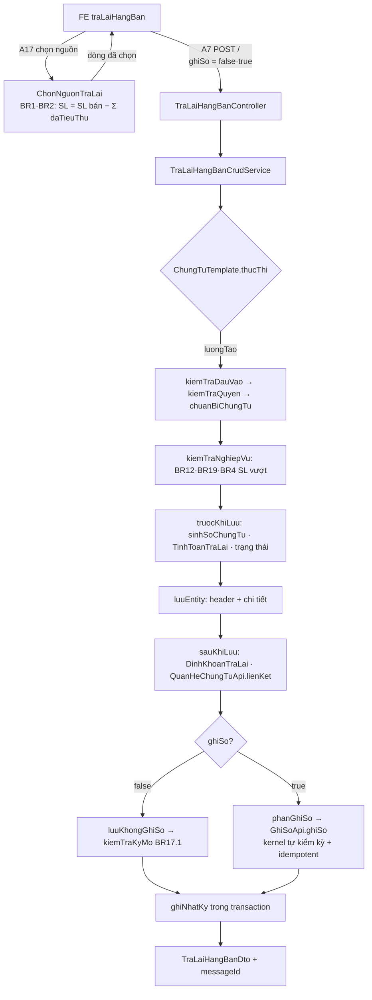

# PMKT-E-06469 Trả lại hàng bán — Kế hoạch triển khai API (BE `cell-app`)

> **Trạng thái:** `ĐANG CODE` — **F1 đã xong, F2 xong một nửa**; F3…F10 chưa code.
> **Ngày cập nhật:** 2026-08-21 (rà soát lại toàn bộ trên repo hiện tại)
> **Bản trước:** 2026-08-14 — xem §-1 Nhật ký cập nhật để biết cái gì đã đổi.
> **Người review cần có:** 1 BA (chốt §12) + 1 Dev BE/DBA (chốt §12-Q17, Q18, §7) + 1 Dev FE (chốt §12-Q3, Q17)

| Mục | Nội dung |
|---|---|
| Use case | `PMKT-U-06470` Xem danh sách ✅ · `06471` Thêm mới · `06472` Sửa · `06473` Xóa · `06474` Nhân bản · `06475` Ghi sổ · `06476` Bỏ ghi sổ · `06477` Xem chi tiết ◐ |
| Màn hình | `SCR_DanhSachTraLaiHangBan.md` · `SCR_ThemMoiTraLaiHangBan.md` (773 dòng — màn anchor) · `SCR_SuaTraLaiHangBan.md` · `SCR_XemChiTietTraLaiHangBan.md` |
| Tài liệu nguồn | `pmkt-docs/ba/PMKT-E-06469_TraLaiHangBan/` (cập nhật 2026-08-18) + `pmkt-docs/ba/Common/business_rules.md` |
| Module BE | **`cell-app/src/main/java/vn/vtt/pmkt/cell/tra_lai_hang_ban/`** — module **cấp 1, ĐÃ TỒN TẠI** (14 file · 973 dòng), tiền tố bảng `sal_` khai ở `package-info.java` |
| Bảng DB | `sal_chung_tu_tra_lai_hang_ban` (**64 cột**) · `sal_chung_tu_tra_lai_hang_ban_chi_tiet` (**44 cột**) — `db/migration/V1__create_database.sql:16580,16756` |
| Quyền | `TraLaiHangBan.*` — **11 mã đã seed** (thêm `ViewList` so với bản trước) |
| Module anh em gần nhất | **`cell/tra_lai_hang_mua/`** (PMKT-E-06758) — 25 file, có ĐỦ luồng ghi + chọn nguồn + hàng loạt. Mẫu tham chiếu số 1 cho F3…F10 |

---

## §-1. Nhật ký cập nhật — repo đã đổi những gì kể từ bản 2026-08-14

Bản plan đầu viết trên một repo khác hẳn. **13 thay đổi** dưới đây làm sai lệch một phần bản cũ; mọi mục bị ảnh hưởng đã được sửa tại chỗ.

| # | Thay đổi | Ảnh hưởng lên plan |
|---|---|---|
| C1 | **Base package đổi** `vn.dopai.pmkt` → **`vn.vtt.pmkt`** | mọi đường dẫn class trong 12 file đã được thay |
| C2 | **Module `cell/tra_lai_hang_ban/` ĐÃ ĐƯỢC TẠO** ở **cấp 1** (không phải sub-module của `chung_tu_ban_hang` như **D1 cũ**), và **F1 đã code xong** | **D1 viết lại** · §2.1 từ "greenfield" thành "brownfield" · §1.1 đánh dấu F1 ✅ |
| C3 | **`TrangThaiChungTu` rút còn 2 giá trị** `CHUA_GHI_SO`/`DA_GHI_SO`, lưu ở cột **`trang_thai_chung_tu`** (tên hằng); cột `status` + vòng đời duyệt (`CHO_DUYET`/`DA_DUYET`/`HUY`, `nguoi_duyet_id`, `ngay_duyet`) **đã bị gỡ** | **D3 ĐẢO NGƯỢC** — không DROP cột nữa · mẹo alias ở [01 §7](01-xem-danh-sach.md) **thành thừa** · mọi ví dụ JSON `"NHAP"` → `"CHUA_GHI_SO"` |
| C4 | **Migration đánh số theo timestamp** từ 2026-08-20: `V<yyyyMMddHHmmss>__<prefix>_<mô_tả>.sql` (`docs/rules/migration-danh-so-theo-timestamp.md`) | **§7 viết lại** — không còn `V3`, không đếm `max+1` |
| C5 | **`fn_bang_cua_loai_chung_tu` ĐÃ ĐƯỢC SỬA** ở `V3__gop_thay_doi_sau_baseline.sql:3032-3035` bằng guard `to_regclass` | **R1 (Cao) → ĐÓNG** · **D11 bỏ** · Q6 cũ bỏ |
| C6 | **6 cột header đã được thêm**: `phuong_thuc_lap_hoa_don`, `lap_kem_hoa_don_dieu_chinh`, 4 cột `tong_*_quy_doi` | [11 §2.2](11-thiet-ke-db.md) giảm từ 28 → **22 cột** |
| C7 | **2/3 index đã có**: `idx_sal_tlhb_danh_sach`, `idx_sal_tlhb_khach_hang` (`V1:21796,21803`) | [11 §4](11-thiet-ke-db.md) còn **1 index** phải thêm |
| C8 | **Hook đánh số chứng từ đổi**: `sinhSoChungTu(LocalDate)` **đã gỡ**; template tự gọi engine qua 2 hook mới `chungTuDangLuu(ctx)` + `soChungTuNguoiDungGo(ctx)` (`ChungTuTemplate.java:335-357`) | **D4 viết lại** · [03 §5](03-them-moi.md) bước 5 |
| C9 | **Module chứng từ con ĐÃ TỒN TẠI**: `kho/` (112 file), `tien_mat_tien_gui/` (49), `hoa_don_ban_hang/` (19), `dieu_chinh_gia_hang_ban/` (17) — **nhưng KHÔNG module nào có `api/`** | **D6 giữ kết luận, đổi lý do** · Q12 viết lại |
| C10 | **`tra_lai_hang_mua/` ra đời** với đủ luồng ghi — và nó **KHÔNG dùng `ChungTuTemplate`** (viết thẳng trong CrudService) | **D2 giữ nguyên** nhưng phải nêu outlier · **Q18 mới** |
| C11 | **Quy ước endpoint của sibling khác plan cũ**: `POST /them-moi` · `GET /nguon` · `GET /nguon/{id}` · `GET /{id}/aggregate`; nhân bản dùng `.Create` | **§4 viết lại** (A7, A11, A17, A18) · **Q17 mới** |
| C12 | **FE đã tắt mock** (`DUNG_MOCK = false`, `api/traLaiHangBanApi.ts:52`) và đang gọi API thật | §2.4 cập nhật · nợ N1 của FE đã gỡ một phần |
| C13 | **Quyền có thêm `TraLaiHangBan.ViewList`** (11 mã) | §10 cập nhật |

**Phát hiện mới — lỗi tồn đọng trong code vừa viết:** xem **§9-R10**.

---

## 0. Các quyết định đã chốt

| # | Quyết định | Hệ quả · vì sao KHÔNG chọn phương án kia |
|---|---|---|
| **D1** ⟳ | **Module cấp 1 `cell/tra_lai_hang_ban/`, chỉ có `internal/`**, tiền tố bảng `sal_` khai ở `package-info.java` | ⚠️ **Đổi so với bản 2026-08-14** (khi đó chọn sub-module của `chung_tu_ban_hang`). Thực tế repo **đã tạo module cấp 1** và đã code xong F1 — quyết định cũ bị thực tế bác bỏ, không tranh luận lại. Việc dùng chung tiền tố `sal_` được `package-info.java` ghi rõ lý do: *"hai bảng đã tồn tại trong baseline với RLS policy, trigger và FK gắn theo đúng tên đó"*, và hai module bán hàng khác (`hoa_don_ban_hang`, `dieu_chinh_gia_hang_ban`) cũng làm vậy ⇒ đây là quy ước thực tế của repo, `cell-app/CLAUDE.md:67-72` chưa cập nhật. **Hệ quả cho F9:** không đọc thẳng được `ChiTietChungTuBanHangRepository` nữa (khác module) — xem **Q19** |
| **D2** | Luồng ghi đi qua `BaseChungTuController` + `AbstractChungTuCrudService` + các lớp con `ChungTuTemplate` | 16/17 module chứng từ trong repo dùng đúng bộ này (`grep -rl "extends BaseChungTuController"`). Trình tự bất biến do `ChungTuTemplate.java:109-152` cưỡng chế. ⚠ **Có đúng một outlier**: `tra_lai_hang_mua` viết thẳng trong `TraLaiHangMuaCrudService` (476 dòng, tự gọi `GhiSoApi`/`KyKeToanApi`). Vì đó lại là module **anh em gần nhất**, cần dev chốt — **Q18** |
| **D3** ⟳ | **`trang_thai_chung_tu` (tên hằng `CHUA_GHI_SO`/`DA_GHI_SO`) là nguồn sự thật duy nhất.** KHÔNG drop cột nào | ⚠️ **ĐẢO NGƯỢC bản cũ.** Base đã đổi: `BaseChungTuEntity.java:83-86` map thẳng `@Column("trang_thai_chung_tu")` với `@Enumerated(STRING)`, cột `status` và vòng đời duyệt đã bị gỡ khỏi cả entity lẫn bảng. CHECK hiện tại: `ck_sal_chung_tu_tra_lai_hang_ban_trang_thai_chung_tu ∈ ('CHUA_GHI_SO','DA_GHI_SO')`. Lý do rút 5→2 trạng thái ghi ở `TrangThaiChungTu.java:8-17` — BR12 chỉ định nghĩa hai. **Không còn rủi ro `23502`** mà bản cũ nêu ở R2 |
| **D4** ⟳ | Số chứng từ do **engine đánh số** cấp; module chỉ cắm 2 hook `chungTuDangLuu(ctx)` + `soChungTuNguoiDungGo(ctx)` | ⚠️ **Hook cũ `sinhSoChungTu(LocalDate)` ĐÃ BỊ GỠ** (commit `df4d1315`). Nay `ChungTuTemplate.luuChungTu` tự gọi `sinhSoChungTu(ctx)` (`:343-357`): nếu `chungTuDangLuu` trả entity thì engine cấp số qua `SoChungTuApi.sinhSo(ct, soNguoiDungGo)` và tự gán `loaiChungTuId`; nếu trả `null` thì số chứng từ thành **nhập liệu bắt buộc** (`doiHoiSoChungTu`, `:362-370`). Có thêm `thuHoiSoChungTu` khi rollback. ⇒ **Không tự chế bộ đếm, không tự set `soChungTu` ở mapper** |
| **D5** | Bút toán dựng bằng bộ quy tắc dữ liệu `QuyTacTraLaiHangBan implements BoQuyTacButToan` + `TaoDinhKhoanApi`; TK trả lại (5212) dùng vai trò `VaiTroTaiKhoan.TK_NO` | `VaiTroTaiKhoan.java` ghi rõ `TK_NO` = *"vế Nợ chính, cũng là TK giảm giá / TK trả lại"*. Mẫu `QuyTacBanHang.java`. Chi tiết [10](10-hach-toan-va-chung-tu-kem.md) |
| **D6** ⟳ | **Đợt này KHÔNG sinh chứng từ con** (Phiếu nhập kho · Phiếu chi/UNC/Séc · Hóa đơn điều chỉnh) | ⚠️ **Lý do đã đổi.** Bản cũ: "module chưa tồn tại". Nay **cả 4 module đều tồn tại** — `kho/` 112 file, `tien_mat_tien_gui/` 49, `hoa_don_ban_hang/` 19, `dieu_chinh_gia_hang_ban/` 17 — **nhưng không module nào có thư mục `api/`** (`find <m> -path "*/api/*" -name "*.java"` → rỗng cho cả 4). Modulith cấm import `internal/` của module khác ⇒ vẫn không gọi được. **Khác hẳn về mức độ khả thi**: giờ chỉ cần module chủ mở một `api/` + `@NamedInterface`, không phải chờ cả một epic. **Q12 viết lại** |
| **D7** | Hợp đồng wire khớp `client/src/features/banHang/traLaiHangBan/api/model.ts` | FE **đã tắt mock** và đang gọi API thật (C12) ⇒ đổi tên trường ở BE giờ là **phá màn hình đang chạy**, không còn là "sửa 51 file test" |
| **D8** ⟳ | Endpoint chọn nguồn theo **quy ước sibling**: `GET /nguon` (tra nhanh) + `GET /nguon/{id}` (nạp dòng hàng của một chứng từ) | ⚠️ **Đổi so với bản cũ** (`POST /nguon/chung-tu-ban-hang`, `POST /nguon/hoa-don-dieu-chinh`). `TraLaiHangMuaController` đã chốt hình dạng này (`:122,133`) và FE của epic mua hàng đã dùng. Chi tiết [09](09-chon-chung-tu-nguon.md) |
| **D9** | Hàng loạt dùng `HangLoatChungTuService` — mỗi chứng từ một transaction riêng, thành công một phần | `TraLaiHangMuaHangLoatService.java` chỉ 14 dòng: khai `@Service` + chuyển tiếp CRUD service. Toàn bộ chính sách lỗi từng phần nằm ở base |
| **D10** ⟳ | Enum nghiệp vụ: **wire dùng TÊN HẰNG**, DB lưu chuỗi tiếng Việt, cầu nối là `MaDb` của module | ⚠️ **Đổi so với bản cũ** (bản cũ nói wire dùng chuỗi tiếng Việt). Module đã code chốt khác: `MaDb.java` nêu lý do — bộ lọc động ép giá trị bằng `Enum.valueOf(name)` (`core.shared.search.ValueConverter`), nên *"trả chuỗi DB ra FE là cho một dropdown mà chính bộ lọc từ chối bằng 400"*. Ba khác biệt nữa so với `GiaTriDb` cũ: có `biDanh()` cho dữ liệu cũ, **đọc khoan dung** (giá trị lạ → `null`, không ném 400), và cố ý **không** dùng lại `GiaTriDb` của module khác. **⚠ Điều này làm `constants/constants.ts` của FE lệch hợp đồng — Q17** |
| ~~D11~~ | ~~`V3` sửa `fn_bang_cua_loai_chung_tu`~~ | **BỎ — đã xong.** `V3__gop_thay_doi_sau_baseline.sql:3032-3035` đã sửa bằng guard `to_regclass(...)`: nếu bảng `…_chi_tiet` tồn tại thì trả tên đó, ngược lại trả tên cũ. R1 đóng |

> ⚠️ **Cảnh báo môi trường:**
> - Máy dev **không có Docker** ⇒ cổng nghiệm thu là `cd cell-app && ./gradlew unitTest`; phần Testcontainers **không chạy được**, báo cáo phải nói rõ.
> - **Migration đánh số theo timestamp** từ 2026-08-20 — lấy version bằng `date +V%Y%m%d%H%M%S`, **không** đếm `max+1` (`docs/rules/migration-danh-so-theo-timestamp.md`).
> - Repo đang chuyển động rất nhanh (33 migration trong 6 ngày, 14 module mới). **Đọc lại chữ ký `ChungTuTemplate` + `BaseChungTuController` ngay trước khi code.**

---

## 1. Phạm vi

### 1.1 Trong phạm vi

| # | Chức năng | Nguồn | File con | Trạng thái |
|---|---|---|---|---|
| F1 | Xem danh sách: tìm kiếm động · phân trang · sắp xếp · dòng tổng · export Excel | U-06470, `SCR_DanhSachTraLaiHangBan.md` | [01](01-xem-danh-sach.md) | ✅ **ĐÃ CODE** |
| F2 | Xem chi tiết: header + dòng chi tiết + bút toán đã ghi | U-06477, `SCR_XemChiTietTraLaiHangBan.md` | [02](02-xem-chi-tiet.md) | ◐ **header xong**; thiếu `chiTiet[]`, `/dong-chi-tiet`, `/thong-tin-hach-toan` |
| F3 | Thêm mới (Lưu · Lưu và ghi sổ) | U-06471, `SCR_ThemMoiTraLaiHangBan.md` | [03](03-them-moi.md) | ☐ chặn 400 `CHUA_HO_TRO` |
| F4 | Chỉnh sửa | U-06472, `SCR_SuaTraLaiHangBan.md` | [04](04-chinh-sua.md) | ☐ chặn 400 |
| F5 | Xóa (một + hàng loạt) | U-06473, BR16 | [05](05-xoa.md) | ☐ chặn 400 |
| F6 | Nhân bản | U-06474 | [06](06-nhan-ban.md) | ☐ |
| F7 | Ghi sổ (một + hàng loạt) | U-06475, BR14 | [07](07-ghi-so.md) | ☐ |
| F8 | Bỏ ghi sổ (một + hàng loạt) | U-06476, BR15 | [08](08-bo-ghi-so.md) | ☐ |
| F9 | Chọn chứng từ nguồn (BR1 · BR2 · BR5) | `SCR_ThemMoiTraLaiHangBan.md:42-243` | [09](09-chon-chung-tu-nguon.md) | ☐ |
| F10 | Sinh bút toán + liên kết chứng từ nguồn | U-06475 §"Chi tiết bút toán", BR19 | [10](10-hach-toan-va-chung-tu-kem.md) | ☐ |
| F11 | Migration + entity chi tiết | — | [11](11-thiet-ke-db.md) | ☐ |

### 1.2 NGOÀI phạm vi (không cài lần này)

| Bị loại | Mã | Vì sao · hành vi hiện tại của API |
|---|---|---|
| **Sinh Phiếu nhập kho** khi tick "Kiêm phiếu nhập kho" | `SCR:275-287`, README §BR19 | Module `kho/` **có** (112 file) nhưng **không có `api/`** (D6). Bật cờ → **400 `NOT_SUPPORTED_YET`** kèm `_206`. Cờ vẫn lưu, bút toán giá vốn (bước 3) **vẫn sinh** |
| **Sinh Phiếu chi / UNC / Séc** khi tick "Thanh toán ngay" | `SCR:303-357` | `tien_mat_tien_gui/` có nhưng không `api/`. Bút toán chi tiền (bước 2b) **vẫn sinh** |
| **Sinh Hóa đơn điều chỉnh** | `SCR:358-399,660-697` | `hoa_don_ban_hang/` + `dieu_chinh_gia_hang_ban/` có nhưng không `api/` |
| **Nguồn = Hóa đơn điều chỉnh** (popup thứ hai của BR1) | `SCR:87-94,121-125,219-237` | `GET /nguon` trả rỗng cho nguồn này — xem [09 §5](09-chon-chung-tu-nguon.md) |
| **BR-TLH-SAISOT · BR_KhongTongHopToKhaiGTGT · BR-CORE-FREEZESIGN** | `SCR:677-689` | Cần entity `HoaDonMua` + cờ `DaKeKhai`. Cột `khong_tong_hop_to_khai_gtgt` **vẫn thêm** để FE round-trip |
| **`POST /import`** | — | `cotMacDinh(IMPORT)` trả rỗng ⇒ 400 `IMPORT_NOT_SUPPORTED` (đã cài, `TraLaiHangBanController.java:79-82`) |
| **Tab Đính kèm · Tab Tham chiếu** | `SCR:705-706` | đặc tả chung `Common/NguonDuLieu`, chưa có bảng |
| **Các cột phase 2** — Hợp đồng · Số lô · HSD · Đơn vị · Vụ việc · Khoản mục chi phí | `SCR:486` (nguyên văn *"thực hiện tại phase 2"*) | **Cột DB đã có sẵn** ⇒ DTO vẫn map và lưu; **không** validate, **không** join danh mục |

---

## 2. Hiện trạng đã khảo sát *(đo lại 2026-08-21)*

### 2.1 Code hiện có — **BROWNFIELD: F1 đã code, F2 xong một nửa**

```bash
find cell-app/src/main/java -ipath "*tra_lai_hang_ban*" -name "*.java" | wc -l   # → 14
```

| File | Dòng | Làm gì |
|---|---|---|
| `tra_lai_hang_ban/package-info.java` | 34 | `@ApplicationModule(displayName = "tra_lai_hang_ban")`; khai tiền tố `sal_`, phạm vi đang cài, và hai cột nhãn dẫn xuất |
| `internal/controller/TraLaiHangBanController.java` | 118 | `extends BaseCrudController<…, Void, Void>`; `@RequestMapping("/api/ban-hang/tra-lai-hang-ban")`; **chặn tường minh** `create`/`update`/`delete` bằng 400 `CHUA_HO_TRO`; bộ 8 cột export |
| `internal/service/TraLaiHangBanCrudService.java` | 141 | `extends AbstractCrudService` (**không** phải `AbstractChungTuCrudService` — javadoc nêu rõ lý do); `defaultSortAlias` khớp FE; override `search` để validate khoảng ngày |
| `internal/entity/TraLaiHangBan.java` | 240 | `extends BaseChungTuEntity`; 12 field nghiệp vụ + 9 `@Searchable` |
| `internal/dto/TraLaiHangBanDto.java` | 56 | 26 field, khớp `traLaiHangBanRowSchema` của FE |
| `internal/dto/TongHopTraLaiHangBanDto.java` | 18 | dòng tổng 4 cột |
| `internal/service/business/TraLaiMapper.java` | 93 | entity → DTO + 2 nhãn dẫn xuất |
| `internal/model/MaDb.java` | 94 | interface enum ⇄ chuỗi DB (bản riêng của module — D10) |
| `internal/model/PhuongThucLapHoaDon.java` | 35 | 3 giá trị + `JpaConverter` |
| `internal/model/NhanTraLaiHang.java` | 26 | hằng chuỗi 2 nhãn dẫn xuất |
| `internal/model/MaLoiTraLaiHangBan.java` | 23 | 5 hằng mã lỗi/messageId |
| `internal/repository/TraLaiHangBanRepository*.java` | 13+20+62 | `BaseRepository` + `…Custom`/`…Impl` cho dòng tổng |

**Chưa có:** entity `ChiTietTraLaiHangBan`, mọi DTO request, 5 lớp `ChungTuTemplate`, `HangLoatService`, `DinhKhoanTraLai`, `QuyTacTraLaiHangBan`, `TinhToanTraLai`, `KiemTraTraLai`, `ChonNguonTraLai`, `DongTraLaiHangBanPort`, **và toàn bộ thư mục test**.

Ba hằng dùng chung đã có sẵn, **không khai trùng**:

| Đã có | `file:dòng` |
|---|---|
| `MaChucNang.TRA_LAI_HANG_BAN = "TraLaiHangBan"` | `common/constant/MaChucNang.java:223` |
| `LoaiChungTu.SAL_CHUNG_TU_TRA_LAI_HANG_BAN(false, true)` + `laTieuThu() = true` | `quan_he_chung_tu/api/LoaiChungTu.java:30,64` |
| CHECK ở DB đã chấp nhận loại này làm đích | `V1__create_database.sql` (`ck_ctu_qhct_loai_dich`) |

### 2.2 Hiện trạng DB

Header **64 cột**, chi tiết **44 cột** (`V1__create_database.sql:16580,16756`).

```bash
awk '/^CREATE TABLE public.sal_chung_tu_tra_lai_hang_ban \(/,/^\);/' V1__create_database.sql | grep -cE "^    [a-z_]+ "   # → 64
awk '/^CREATE TABLE public.sal_chung_tu_tra_lai_hang_ban_chi_tiet \(/,/^\);/' V1__create_database.sql | grep -cE "^    [a-z_]+ "   # → 44
```

**Migration hiện có:** `V1`, `V2`, `V3`, `V1000`…`V1032` (36 file). **File mới KHÔNG đánh `V1033`** — dùng timestamp (C4).

Đã có sẵn, không làm lại: PK · unique `uq_sal_cttl_so_ct` · RLS `tenant_isolation` + 3 policy phạm vi đơn vị · trigger audit · trigger bất biến `don_vi_id` · **`idx_sal_tlhb_danh_sach`** (sort mặc định) · **`idx_sal_tlhb_khach_hang`** · 4 CHECK · 6 FK. Chi tiết [11 §1.4](11-thiet-ke-db.md).

**Còn thiếu:** 22 cột header + 17 cột chi tiết + 1 index + 2 seed. Đích danh ở [11 §2, §3](11-thiet-ke-db.md).

### 2.3 Hạ tầng base đã có sẵn những gì

| Cần | Đã có ở base | Vị trí |
|---|---|---|
| 8 endpoint CRUD + tìm kiếm động + export | `BaseCrudController` | `core/controller/BaseCrudController.java` |
| 7 endpoint riêng của chứng từ | `BaseChungTuController` (206 dòng) | `accounting_core/chung_tu/controller/BaseChungTuController.java` |
| Trình tự bất biến 5 luồng | `ChungTuTemplate` (696 dòng) — `thucThi` `:109`, 5 luồng `:155,177,200,219,238` | `accounting_core/chung_tu/service/ChungTuTemplate.java` |
| **Đánh số chứng từ** (mới) | hook `chungTuDangLuu` `:335` · `soChungTuNguoiDungGo` `:339` · engine gọi ở `:343` · thu hồi `:373` | như trên |
| Hợp đồng service chứng từ | `AbstractChungTuCrudService` | `accounting_core/chung_tu/service/AbstractChungTuCrudService.java` |
| Thao tác hàng loạt, lỗi từng phần | `HangLoatChungTuService` | `accounting_core/chung_tu/service/HangLoatChungTuService.java` |
| Ghi / gỡ / hỏi sổ cái | `GhiSoApi` | `accounting_core/hach_toan/api/GhiSoApi.java` |
| Tra id loại chứng từ theo mã | **`LoaiChungTuApi`** (mới) | `accounting_core/hach_toan/api/LoaiChungTuApi.java` |
| Sinh bút toán từ vai trò tài khoản | `TaoDinhKhoanApi` | `accounting_core/hach_toan/api/TaoDinhKhoanApi.java` |
| Số lượng đã tiêu thụ / tạo liên kết / guard xoá | `QuanHeChungTuApi` | `quan_he_chung_tu/api/QuanHeChungTuApi.java` |
| Whitelist lọc/sắp xếp | `@Searchable` + `@SearchableAudit` | `core/shared/search/Searchable.java` |
| Envelope | `ApiResponse` · `PageResponse` · `SearchRequest` | `core/response/`, `core/request/` |
| Enum ⇄ chuỗi DB | **`MaDb` của chính module** (D10) | `tra_lai_hang_ban/internal/model/MaDb.java` |

### 2.4 FE — **đã nối API thật**

`client/src/features/banHang/traLaiHangBan/api/traLaiHangBanApi.ts:52` → **`DUNG_MOCK = false`**.

| FE chốt gì | `file:dòng` | Trạng thái BE |
|---|---|---|
| Base path `/api/ban-hang/tra-lai-hang-ban` | `traLaiHangBanApi.ts:34` | ✅ khớp |
| Sort mặc định `ngayHachToan:desc,ngayChungTu:desc,soChungTu:asc` | `:61` | ✅ khớp `defaultSortAlias()` |
| 4 alias lọc nâng cao | `:68-73` | ✅ có đủ trong `@Searchable` |
| `create = POST /` · `update = PUT /{id}` · `delete = DELETE /{id}` | `:8-11` | ⚠ **BE chặn 400**; và sibling dùng `POST /them-moi` — **Q17** |
| `POST {base}/{id}/ghi-so` · `/bo-ghi-so` | `:152,157` | ⚠ **chưa có** — FE vẫn còn nhánh `mock.ts` cho hai hàm này |
| 7 bộ enum **chuỗi tiếng Việt** | `constants/constants.ts:27-90` | ⚠ **LỆCH** — BE trả/nhận **tên hằng** (D10). **Q17** |
| `chiTiet[]` ở `GET /{id}` | `model.ts:185` | ⚠ **chưa có** (F2 dở) |

---

## 3. Kiến trúc

### 3.1 Phân tầng — cái đã có ⇄ cái phải thêm

```
TraLaiHangBanController
  HIỆN TẠI: extends BaseCrudController<TraLaiHangBan, TraLaiHangBanDto, Void, Void>
  ĐÍCH:     extends BaseChungTuController<TraLaiHangBan, TraLaiHangBanDto,
                      ChiTietTraLaiHangBanDto, LuuTraLaiHangBanRequest, LuuTraLaiHangBanRequest>
        │  ✅ giữ: cotMacDinh(EXPORT) · maChucNang · maManHinh · tenFileExport
        │  ✂ gỡ : 3 method chặn 400 CHUA_HO_TRO
        │  ➕ thêm: hangLoat() · tenChungTu() · messageId(ThaoTacChungTu)
        │           POST /them-moi · PUT /{id} (override gắn messageId)
        │           POST /lookup · GET /nguon · GET /nguon/{id}
        ▼
TraLaiHangBanCrudService
  HIỆN TẠI: extends AbstractCrudService<…, Void, Void>
  ĐÍCH:     extends AbstractChungTuCrudService<…, LuuTraLaiHangBanRequest, …>
        │  ✅ giữ: defaultSortAlias · defaultSortDirection · notFound · search (validate ngày) · summary
        │  ➕ thêm: get (nạp kèm chi tiết) · create/update/delete/ghiSo/boGhiSo/nhanBan
        │           layDongChiTiet · traSoChungTu · timNguon · layNguon
        ▼
5 lớp con ChungTuTemplate + NhanBanTraLaiHangBan (chỉ đọc)
  + business/: TraLaiSupport · TraLaiMapper(✅ có) · TinhToanTraLai · KiemTraTraLai
               DinhKhoanTraLai · QuyTacTraLaiHangBan · ChonNguonTraLai
        ▼
TraLaiHangBanRepository(✅) + …Custom(✅) + …Impl(✅)   ➕ ChiTietTraLaiHangBanRepository
        ▼
TraLaiHangBan(✅) extends BaseChungTuEntity   ➕ ChiTietTraLaiHangBan extends BaseChiTietChungTuEntity
```

### 3.2 Lựa chọn kiến trúc + lý do

Quyết định module (D1) **đã được thực tế chốt** — không so sánh lại. Còn đúng một lựa chọn mở:

| | A — `ChungTuTemplate` (16/17 module) | B — viết thẳng trong CrudService (`tra_lai_hang_mua`) |
|---|---|---|
| Bất biến kế toán | template cưỡng chế thứ tự; các bước chạm sổ cái là `private`, lớp con không đảo được | tự gọi `GhiSoApi`/`KyKeToanApi` — đúng/sai tuỳ người viết |
| Đánh số chứng từ | engine tự chạy qua 2 hook (D4) | phải tự gọi |
| Hàng loạt | `HangLoatChungTuService` chỉ cần 14 dòng | như nhau |
| Số dòng phải viết | ~6 lớp nhỏ | 1 lớp ~480 dòng |
| Là mẫu của | `chung_tu_ban_hang`, `kho`, `chi_phi_tra_truoc`, `dieu_chinh_gia_hang_mua`… | **`tra_lai_hang_mua` — module anh em gần nhất** |
| Rủi ro | phải học 12 bước | mất mọi bảo đảm của template; một nhánh quên `kiemTraKyMo` là bút toán chui vào kỳ khoá |

**Chọn A**, vì đó là chuẩn của repo (`docs/rules/be-khung-kien-truc-chuan.md` và 16 module), và vì luồng của epic này có đủ cả 5 hành động. **Nhưng phải để dev chốt** — nếu đội muốn đồng bộ với module mua hàng thì đổi cả kiến trúc, không đổi một dòng ⇒ **Q18**.

### 3.3 Cấu trúc thư mục

```
cell/tra_lai_hang_ban/                       ← ĐÃ CÓ
├── package-info.java                        ✅ (cập nhật lại §"Phạm vi ĐANG cài" sau mỗi F)
└── internal/
    ├── controller/TraLaiHangBanController.java        ✅ sửa
    ├── dto/
    │   ├── TraLaiHangBanDto.java                      ✅ bổ sung field
    │   ├── TongHopTraLaiHangBanDto.java               ✅
    │   ├── ChiTietTraLaiHangBanDto.java               ➕
    │   ├── LuuTraLaiHangBanRequest.java               ➕ extends BaseChungTuRequest
    │   ├── LuuChiTietTraLaiHangBanRequest.java        ➕ extends BaseChiTietChungTuRequest
    │   ├── DinhKhoanTraLaiDto.java                    ➕
    │   └── NguonTraLaiHangBanDto.java · DongNguonTraLaiHangBanDto.java  ➕
    ├── entity/
    │   ├── TraLaiHangBan.java                         ✅ bổ sung field + sửa lỗi R10
    │   └── ChiTietTraLaiHangBan.java                  ➕
    ├── model/
    │   ├── MaDb.java ✅ · PhuongThucLapHoaDon.java ✅ · NhanTraLaiHang.java ✅
    │   ├── MaLoiTraLaiHangBan.java                    ✅ bổ sung ~25 hằng
    │   └── NguonChungTu · PhuongThucThanhToan · LoaiChietKhauTraLai
    │       · LoaiDieuChinh · ThueSuatGtgt              ➕ (đều implements MaDb)
    ├── port/DongTraLaiHangBanPort.java                 ➕ cài DongChungTuPort cho loại ĐÍCH
    ├── repository/
    │   ├── TraLaiHangBanRepository*.java              ✅
    │   └── ChiTietTraLaiHangBanRepository.java        ➕
    └── service/
        ├── TraLaiHangBanCrudService.java              ✅ nâng cấp
        ├── TraLaiHangBanHangLoatService.java          ➕ (~14 dòng)
        └── business/
            ├── TraLaiMapper.java                      ✅ mở rộng
            ├── TraLaiSupport.java · LenhTraLai.java   ➕
            ├── LuuTraLaiHangBanTemplate.java          ➕ (cha của Tao/Sua)
            ├── TaoTraLaiHangBan · SuaTraLaiHangBan · XoaTraLaiHangBan
            │   · GhiSoTraLaiHangBan · BoGhiSoTraLaiHangBan · NhanBanTraLaiHangBan  ➕
            ├── TinhToanTraLai · KiemTraTraLai · TrangThaiTraLai  ➕
            ├── DinhKhoanTraLai · QuyTacTraLaiHangBan   ➕
            └── ChonNguonTraLai.java                    ➕
```

⚠ **Chưa có một file test nào** cho module này. Test đặt song ánh ở `src/test/java/vn/vtt/pmkt/cell/tra_lai_hang_ban/internal/…`, gắn `@Tag("unit")`.

---

## 4. Danh mục API mục tiêu

Base path: **`/api/ban-hang/tra-lai-hang-ban`** · Mã chức năng: **`TraLaiHangBan`**

| # | Nguồn | Method | Path | Quyền | Trả về | Trạng thái | File con |
|---|---|---|---|---|---|---|---|
| A1 | base | `POST` | `/search` | `.View` | `PageResponse<TraLaiHangBanDto>` | ✅ | [01](01-xem-danh-sach.md) |
| A2 | base | `GET` | `/cot` | `.View` | `ApiResponse<List<CotMoTa>>` | ✅ | [01](01-xem-danh-sach.md) |
| A3 | base | `POST` | `/export` | `.Export` | `.xlsx` | ✅ | [01](01-xem-danh-sach.md) |
| A4 | base | `GET` | `/{id}` | `.View.Detail` | `ApiResponse<TraLaiHangBanDto>` | ◐ **thiếu `chiTiet[]`** | [02](02-xem-chi-tiet.md) |
| A5 | base | `GET` | `/{id}/dong-chi-tiet` | `.View.Detail` | `ApiResponse<List<ChiTietTraLaiHangBanDto>>` | ☐ | [02](02-xem-chi-tiet.md) |
| A6 | base | `GET` | `/{id}/thong-tin-hach-toan` | `.View.Detail` | `ApiResponse<List<DongSoCaiDto>>` | ☐ | [02](02-xem-chi-tiet.md) |
| **A7** ⟳ | **override** | `POST` | **`/them-moi`** | `.Create` (+ `.Post` nếu `ghiSo`) | `201` + `ApiResponse<TraLaiHangBanDto>` | ☐ chặn 400 | [03](03-them-moi.md) |
| A8 | **override** | `PUT` | `/{id}` | `.Edit` (+ `.Post` nếu `ghiSo`) | `ApiResponse<TraLaiHangBanDto>` | ☐ chặn 400 | [04](04-chinh-sua.md) |
| A9 | base | `DELETE` | `/{id}` | `.Delete` | `ApiResponse<Void>` | ☐ chặn 400 | [05](05-xoa.md) |
| A10 | base | `POST` | `/xoa-hang-loat` | `.Delete` | `ApiResponse<KetQuaHangLoatDto>` | ☐ | [05](05-xoa.md) |
| **A11** ⟳ | base | `GET` | `/{id}/nhan-ban` | **`.Create`** | `ApiResponse<TraLaiHangBanDto>` | ☐ | [06](06-nhan-ban.md) |
| A12 | base | `POST` | `/{id}/ghi-so` | `.Post` | `ApiResponse<TraLaiHangBanDto>` | ☐ | [07](07-ghi-so.md) |
| A13 | base | `POST` | `/ghi-so-hang-loat` | `.Post` | `ApiResponse<KetQuaHangLoatDto>` | ☐ | [07](07-ghi-so.md) |
| A14 | base | `POST` | `/{id}/bo-ghi-so` | `.Unpost` | `ApiResponse<TraLaiHangBanDto>` | ☐ | [08](08-bo-ghi-so.md) |
| A15 | base | `POST` | `/bo-ghi-so-hang-loat` | `.Unpost` | `ApiResponse<KetQuaHangLoatDto>` | ☐ | [08](08-bo-ghi-so.md) |
| A16 | mới | `POST` | `/lookup` | `.View` | `ApiResponse<Map<String,List<String>>>` — **tên hằng** (D10) | ☐ | [03](03-them-moi.md) |
| **A17** ⟳ | mới | **`GET`** | **`/nguon?keyword=&limit=`** | `.Create` | `ApiResponse<List<NguonTraLaiHangBanDto>>` — tra nhanh chứng từ nguồn | ☐ | [09](09-chon-chung-tu-nguon.md) |
| **A18** ⟳ | mới | **`GET`** | **`/nguon/{id}?excludeReturnId=`** | `.Create` | `ApiResponse<NguonTraLaiHangBanDto>` — dòng hàng + SL còn được trả | ☐ | [09](09-chon-chung-tu-nguon.md) |
| A19 | mới | `GET` | `/{id}/aggregate` | `.View.Detail` | `ApiResponse<TraLaiHangBanAggregateDto>` — header + chi tiết + bút toán trong **một** request | ☐ tuỳ chọn | [02](02-xem-chi-tiet.md) |

⟳ = **đổi so với bản 2026-08-14**, theo quy ước sibling `TraLaiHangMuaController.java:86,108,122,133` (C11).

**Envelope thành công:** `{ data, message, messageId }`. Danh sách: `{ data, pagination, summary }`.
**Envelope lỗi:** `{ error: { code, message, messageId, details } }`.

**Quy ước enum trên wire — ⚠ ĐỔI (D10):** **TÊN HẰNG** cho *mọi* enum, gồm cả `trangThaiChungTu` (`CHUA_GHI_SO`/`DA_GHI_SO`), `phuongThucLapHoaDon` (`NGUOI_BAN_XUAT_HD_DIEU_CHINH`…), `loaiChietKhau`, `thueSuatGtgt`. Chuỗi tiếng Việt **chỉ tồn tại trong cột DB**. Lý do: bộ lọc động ép giá trị bằng `Enum.valueOf(name)` (`MaDb.java` javadoc). **FE đang gửi chuỗi tiếng Việt ⇒ Q17.**

---

## 5. Ma trận UC → endpoint → tài liệu

| UC | Tên | Endpoint | Màn hình | File con | Trạng thái |
|---|---|---|---|---|---|
| PMKT-U-06470 | Xem danh sách | A1 · A2 · A3 | SCR_DanhSachTraLaiHangBan | [01](01-xem-danh-sach.md) | ✅ |
| PMKT-U-06471 | Thêm mới | A7 · A16 · A17 · A18 | SCR_ThemMoiTraLaiHangBan | [03](03-them-moi.md), [09](09-chon-chung-tu-nguon.md) | ☐ |
| PMKT-U-06472 | Sửa | A8 | SCR_SuaTraLaiHangBan | [04](04-chinh-sua.md) | ☐ |
| PMKT-U-06473 | Xóa | A9 · A10 | SCR_DanhSachTraLaiHangBan | [05](05-xoa.md) | ☐ |
| PMKT-U-06474 | Nhân bản | A11 (+ A7 để lưu) | SCR_SuaTraLaiHangBan | [06](06-nhan-ban.md) | ☐ |
| PMKT-U-06475 | Ghi sổ | A12 · A13 | SCR_DanhSach + SCR_XemChiTiet | [07](07-ghi-so.md), [10](10-hach-toan-va-chung-tu-kem.md) | ☐ |
| PMKT-U-06476 | Bỏ ghi sổ | A14 · A15 | SCR_DanhSach + SCR_XemChiTiet | [08](08-bo-ghi-so.md) | ☐ |
| PMKT-U-06477 | Xem chi tiết | A4 · A5 · A6 · A19 | SCR_XemChiTietTraLaiHangBan | [02](02-xem-chi-tiet.md) | ◐ |

> U-06477 có ở `README.md:64` và có màn hình riêng nhưng **không có** thư mục `4.usecases/` và **không có** trong `2.usecase.puml` — §12-Q4. (Tài liệu BA cập nhật 2026-08-18 **không** bổ sung UC này.)

---

## 6. Luồng tổng thể



Ghi sổ / bỏ ghi sổ đi lại đúng khung đó với `hanhDong()` khác (`ChungTuTemplate.java:212,231`).

---

## 7. Migration — đánh số theo **timestamp**

⚠ **Luật đổi từ 2026-08-20** (`docs/rules/migration-danh-so-theo-timestamp.md`): tên file là
`V<yyyyMMddHHmmss>__<prefix>_<mo_ta_snake_case>.sql`. Lấy version bằng chính lệnh này, **không tự gõ tay, không đếm `max + 1`**:

```bash
date +V%Y%m%d%H%M%S
```

File dự kiến: `cell-app/src/main/resources/db/migration/V<timestamp>__sal_tra_lai_hang_ban_luong_ghi.sql`

| # | Việc | Vì sao bắt buộc | So bản cũ |
|---|---|---|---|
| 1 | ~~DROP `trang_thai_chung_tu`~~ | **BỎ** — cột đó nay là nguồn sự thật duy nhất (D3) | ⟳ đảo ngược |
| 2 | `ADD` **22 cột header** còn thiếu | 6 cột đã được thêm rồi (C6) | ⟳ 28 → 22 |
| 3 | `ADD` **17 cột chi tiết** còn thiếu — trong đó **`chi_tiet_chung_tu_ban_hang_id`** là khoá liên kết | bảng chi tiết **chưa được đụng tới** | giữ nguyên |
| 4 | Xử lý `hinh_thuc_thanh_toan` NOT NULL (CHECK 2 giá trị) | vẫn còn nguyên, vẫn `NOT NULL` ⇒ **vẫn chặn INSERT** — xem §9-R2 và §12-Q5 | giữ nguyên |
| 5 | `INSERT` mã loại chứng từ + quyển số | `maLoaiChungTu()` bắt buộc; ⚠ phải kiểm lại cơ chế đánh số mới (`V1032__tknd_va_cau_hinh_danh_so.sql` đã đổi cách cấu hình) trước khi seed — xem §12-Q2 | ⟳ cần kiểm lại |
| 6 | ~~`CREATE OR REPLACE fn_bang_cua_loai_chung_tu`~~ | **BỎ** — `V3:3032-3035` đã sửa (C5) | ⟳ đóng |
| 7 | `CREATE INDEX` chi tiết `(tenant_id, chi_tiet_chung_tu_ban_hang_id) WHERE …` | cho `LATERAL SUM` của A18 | ⟳ 3 → 1 index |
| 8 | Seed quyền | **không cần** — 11 mã đã có | giữ nguyên |

**File có sẵn phải sửa kèm:** `tra_lai_hang_ban/package-info.java` (cập nhật §"Phạm vi ĐANG cài"). **Không** cần sửa `MaChucNang.java` hay `LoaiChungTu.java`.

SQL đầy đủ: [11 §5](11-thiet-ke-db.md).

---

## 8. Thứ tự thực hiện

1. **Chốt §12** — Q17 (hợp đồng wire enum + đường dẫn create) và Q18 (template hay CrudService) quyết định hình dạng của toàn bộ phần còn lại.
2. **Sửa R10** (`@Searchable` trỏ `status` không còn tồn tại) — một dòng, nhưng đang là lỗi thật.
3. Đọc lại chữ ký `ChungTuTemplate` + `BaseChungTuController` + `SoChungTuApi` (repo đang chuyển động nhanh).
4. Migration (timestamp) + `package-info.java` → chạy Flyway trên DB dev qua IntelliJ.
5. `model/` — 5 enum mới `implements MaDb` + bổ sung `MaLoiTraLaiHangBan` → unit test đối chiếu `maDb()` với CHECK constraint.
6. `entity/ChiTietTraLaiHangBan` + bổ sung field cho `TraLaiHangBan` → unit test ghim whitelist `@Searchable`.
7. `ChiTietTraLaiHangBanRepository` + `port/DongTraLaiHangBanPort`.
8. `business/`: `TinhToanTraLai` → `KiemTraTraLai` → `QuyTacTraLaiHangBan` + `DinhKhoanTraLai` (unit test công thức, không cần DB).
9. Nâng service lên `AbstractChungTuCrudService`, controller lên `BaseChungTuController`, **gỡ 3 method chặn 400**.
10. 5 template + `NhanBan` + `TraLaiSupport` + `HangLoatService`.
11. `ChonNguonTraLai` (A17, A18) — phụ thuộc bước 7 và **Q19** (đọc dòng bán hàng qua đường nào).
12. `./gradlew unitTest` → xuất Postman vào `docs/json/` → PR.

[09](09-chon-chung-tu-nguon.md) và [10](10-hach-toan-va-chung-tu-kem.md) là **đầu vào** của [03](03-them-moi.md)/[07](07-ghi-so.md) — đọc trước khi code luồng ghi.

---

## 9. Rủi ro kỹ thuật

| # | Rủi ro | Mức | Giảm thiểu |
|---|---|---|---|
| ~~**R1**~~ | ~~`fn_bang_cua_loai_chung_tu` trỏ 13/20 tên bảng không tồn tại~~ | ~~Cao~~ | ✅ **ĐÓNG** — `V3__gop_thay_doi_sau_baseline.sql:3032-3035` đã sửa bằng guard `to_regclass` (C5) |
| ~~**R2 cũ**~~ | ~~`trang_thai_chung_tu` NOT NULL không default ⇒ INSERT fail 23502~~ | ~~Cao~~ | ✅ **ĐÓNG** — cột đó nay do `BaseChungTuEntity` map và có default `CHUA_GHI_SO` (C3) |
| **R2** ⟳ | **`hinh_thuc_thanh_toan` vẫn `NOT NULL`** + CHECK `('Tiền mặt','Chuyển khoản')` — không khớp bất kỳ khái niệm nào của BA, và entity **không map** cột này ⇒ INSERT đầu tiên của F3 sẽ **fail `23502`** | **Cao** | Migration việc #4 (`DROP NOT NULL`). **Chưa lộ ra** vì F1 chỉ đọc. Chờ §12-Q5 |
| **R3** | 7 bộ enum của FE là **chuỗi tiếng Việt**, BE nhận/trả **tên hằng** (D10) | **Cao** | A16 `/lookup` trả `MaDb.danhSachMa(...)` + unit test đối chiếu; FE phải sửa `constants/constants.ts`. **Q17** |
| **R10** ⟳ **MỚI** | **`TraLaiHangBan.java:34` khai `@Searchable(alias = "trangThaiChungTu", path = "status", …)` — thuộc tính `status` KHÔNG CÒN TỒN TẠI** (đã gỡ khỏi `BaseChungTuEntity`), và base đã khai sẵn alias `trangThaiChungTu` ở `:83-86` ⇒ **alias trùng + path chết**. Hệ quả: `GET /cot` có thể trả cột trùng, và lọc/sort theo `trangThaiChungTu` có thể rơi vào path không phân giải được | **Cao** | **Xoá dòng `@Searchable` cấp class đó** — base đã đủ. Đây là tàn dư của mẹo alias mà bản plan cũ đề xuất ([01 §7](01-xem-danh-sach.md)), nay thành thừa. Thêm unit test ghim danh sách `CotMoTa` không trùng alias |
| **R4** | `ddl-auto: none` ⇒ Hibernate không đối chiếu cột lúc khởi động | Trung bình | `JpaMetamodelArchTest` trong làn `unitTest`; vẫn phải smoke-test đọc/ghi thật |
| **R5** | Bỏ ghi sổ chứng từ thuộc kỳ đã khoá là **không thể** (xoá vật lý dòng sổ cái) | Trung bình | 409 + `_204`; §12-Q7 |
| **R6** | `BaseChungTuController.ghiSo/boGhiSo` không nhận body, FE gửi `{updatedAt}` | Trung bình | `@Version` vẫn chặn lost-update. §12-Q3 |
| **R7** ⟳ | Không mở được `api/` của 4 module chứng từ con | ~~Trung bình~~ → **Thấp–TB** | D6. **Rào cản đã thấp hơn nhiều**: module đã tồn tại, chỉ cần chủ module mở `api/` + `@NamedInterface` |
| **R8** | Testcontainers không chạy được (không Docker) | Trung bình | Cổng xanh là `./gradlew unitTest`; **báo cáo phải ghi rõ phần chưa chạy** |
| ~~**R9**~~ | ~~`chung_tu_ban_hang/` thành shape hỗn hợp~~ | — | ✅ **ĐÓNG** — module đứng cấp 1 riêng (D1) |
| **R11** ⟳ **MỚI** | **Module chưa có một file test nào**; F1 đã lên mà không có lưới an toàn nào | Trung bình | Viết test cho F1 **trước** khi động vào F3 — nếu không, mỗi lần nâng cấp service/controller là một lần hồi quy im lặng |
| **R12** ⟳ **MỚI** | **Repo chuyển động rất nhanh** — 33 migration và 14 module mới trong 6 ngày; `sinhSoChungTu(LocalDate)` bị gỡ giữa chừng đã làm `kho/` vỡ compile (commit `df4d1315`) | Trung bình | Bước 3 của §8: đọc lại chữ ký base ngay trước khi code. Không tin số dòng trong plan này quá một tuần |

---

## 10. Quyền — mã quyền, đã seed chưa (BR25)

**11 mã** `TraLaiHangBan.*` đã có trong migration (đo lại 2026-08-21):

```bash
grep -rn "TraLaiHangBan\." cell-app/src/main/resources/db/migration/*.sql | grep -o "'TraLaiHangBan\.[A-Za-z.]*'" | sort -u
```
```
'TraLaiHangBan.Clone'  'TraLaiHangBan.Create'  'TraLaiHangBan.Delete'  'TraLaiHangBan.Edit'
'TraLaiHangBan.Export' 'TraLaiHangBan.Post'    'TraLaiHangBan.TaoHoaDonDieuChinh'
'TraLaiHangBan.Unpost' 'TraLaiHangBan.View'    'TraLaiHangBan.View.Detail'
'TraLaiHangBan.ViewList'   ← MỚI so với bản 2026-08-14
```

| Mã quyền | Dùng ở | Ghi chú |
|---|---|---|
| `.View` | A1 · A2 · A16 | ✅ đang dùng ở code F1 |
| `.ViewList` | **chưa dùng** | ⟳ **mã mới, không rõ ngữ nghĩa** — controller hiện chỉ dùng `.View`. **Q20** |
| `.View.Detail` | A4 · A5 · A6 · A19 | ✅ |
| `.Create` | A7 · A11 · A17 · A18 | ⚠ A11 (nhân bản) dùng `.Create` theo sibling, **không** `.Clone` (C11) |
| `.Clone` | — | ⟳ **đã seed nhưng sibling không dùng** — `TraLaiHangMuaController.java:110` dùng `.Create`. **Q20** |
| `.Edit` | A8 | |
| `.Delete` | A9 · A10 | |
| `.Post` | A12 · A13, **và** A7/A8 khi `ghiSo = true` | sibling require thêm `.Post` ngay trong handler create/update (`TraLaiHangMuaController.java:91,102`) — làm theo |
| `.Unpost` | A14 · A15 | |
| `.Export` | A3 | ✅ |
| `.TaoHoaDonDieuChinh` | — | ngoài phạm vi (D6) |

**Không phải seed thêm mã nào.** Hai lưu ý còn lại:

1. Tài liệu BA vẫn ghi mã dạng `PMKT.E06469.DanhSach` / `.ThemMoi` (`SCR_ThemMoiTraLaiHangBan.md:771-773`) — **khác** bộ mã thật. Code và FE đều đã chọn `TraLaiHangBan.*`. §12-Q8.
2. Phải kiểm DB dev thực tế xem đủ 11 mã chưa: thiếu `Unpost` là A14/A15 **403 cho cả Admin**.

---

## 11. Mã thông báo (nguyên văn từ `6.messages.md`)

| Hằng (`MaLoiTraLaiHangBan`) | messageId | Nội dung (nguyên văn) | Loại | Dùng ở |
|---|---|---|---|---|
| `MSG_TAO_THANH_CONG` | `MSG_PMKT-E-06469_001` | Thêm mới chứng từ trả lại thành công | Success | A7 |
| `MSG_CAP_NHAT_THANH_CONG` | `MSG_PMKT-E-06469_002` | Cập nhật chứng từ trả lại thành công | Success | A8 |
| `MSG_XOA_THANH_CONG` | `MSG_PMKT-E-06469_003` | Xóa chứng từ trả lại thành công | Success | A9 · A10 |
| `MSG_GHI_SO_THANH_CONG` | `MSG_PMKT-E-06469_004` | Ghi sổ thành công | Success | A12 · A13 · A7/A8 khi `ghiSo=true` |
| `MSG_BO_GHI_SO_THANH_CONG` | `MSG_PMKT-E-06469_005` | Bỏ ghi sổ thành công | Success | A14 · A15 |
| `MSG_LOI_HE_THONG` | `MSG_PMKT-E-06469_006` | Lỗi hệ thống | Error | handler chung |
| `MSG_KHONG_CO_QUYEN` | `MSG_PMKT-E-06469_007` | Không có quyền truy cập | Error | `QuyenChecker` → 403 |
| `MSG_KHONG_TIM_THAY` | `MSG_PMKT-E-06469_008` | Không tìm thấy dữ liệu | Info | 404 · A17/A18 rỗng |
| `MSG_THIEU_CHUNG_TU_GOC` | `MSG_PMKT-E-06469_100` | Vui lòng chọn chứng từ gốc | Error | [09](09-chon-chung-tu-nguon.md) |
| `MSG_THIEU_NGAY_CHUNG_TU` | `MSG_PMKT-E-06469_101` | Vui lòng nhập ngày chứng từ | Error | A7 · A8 |
| `MSG_NGAY_CHUNG_TU_TUONG_LAI` | `MSG_PMKT-E-06469_102` | Ngày chứng từ không được lớn hơn ngày hiện tại | Error | A7 · A8 |
| `MSG_KHOANG_NGAY_KHONG_HOP_LE` | `MSG_PMKT-E-06469_103` | Ngày đến phải lớn hơn hoặc bằng Ngày từ | Error | A1 · A17 |
| `MSG_THIEU_CHI_TIET` | `MSG_PMKT-E-06469_104` | Phải có ít nhất một dòng chi tiết | Error | A7 · A8 |
| `MSG_THIEU_HANG_HOA` | `MSG_PMKT-E-06469_105` | Hàng hóa không được để trống | Error | A7 · A8 |
| `MSG_SO_LUONG_KHONG_DUONG` | `MSG_PMKT-E-06469_106` | Số lượng trả lại phải lớn hơn 0 | Error | A7 · A8 |
| `MSG_VUOT_SO_LUONG_DA_BAN` | `MSG_PMKT-E-06469_107` | Số lượng trả lại không được vượt quá số lượng đã bán | Error | A7 · A8 · A17 |
| `MSG_DON_GIA_KHONG_DUONG` | `MSG_PMKT-E-06469_108` | Đơn giá phải lớn hơn 0 | Error | A7 · A8 |
| `MSG_THIEU_KHO_NHAP` | `MSG_PMKT-E-06469_109` | Vui lòng chọn kho nhập | Error | A7 · A8 |
| `MSG_THIEU_TK_CONG_NO` | `MSG_PMKT-E-06469_110` | Vui lòng chọn TK công nợ | Error | A7 · A8 · A12 |
| `MSG_THIEU_TK_HANG_HOA` | `MSG_PMKT-E-06469_111` | Vui lòng chọn TK Hàng hóa/Chi phí | Error | A7 · A8 · A12 |
| `MSG_THIEU_TK_KHO` | `MSG_PMKT-E-06469_112` | Vui lòng chọn TK kho | Error | A7 · A8 |
| `MSG_THIEU_DON_GIA_VON` | `MSG_PMKT-E-06469_113` | Vui lòng nhập đơn giá vốn | Error | A7 · A8 |
| `MSG_SUA_KHI_DA_GHI_SO` | `MSG_PMKT-E-06469_201` | Chứng từ đã ghi sổ, không được sửa | Error | A8 → 409 |
| `MSG_XOA_KHI_DA_GHI_SO` | `MSG_PMKT-E-06469_202` | Chứng từ đã ghi sổ, không được xóa | Error | A9 · A10 → 409 |
| `MSG_NGAY_HT_NGOAI_KY_MO` | `MSG_PMKT-E-06469_203` | Ngày hạch toán không thuộc kỳ kế toán đang mở | Error | A7 · A8 · A12 |
| `MSG_KY_DA_DONG` | `MSG_PMKT-E-06469_204` | Kỳ kế toán đã đóng | Error | A12 · A14 (R5) |
| `MSG_SINH_BUT_TOAN_LOI` | `MSG_PMKT-E-06469_205` | Sinh bút toán kế toán thất bại | Error | A12 |
| `MSG_TAO_PHIEU_NHAP_LOI` | `MSG_PMKT-E-06469_206` | Lỗi tạo phiếu nhập kho | Error | D6 → 400 `NOT_SUPPORTED_YET` |
| `MSG_XAC_NHAN_BO_GHI_SO` | `MSG_PMKT-E-06469_207` | Nếu bỏ ghi sổ chứng từ trả lại hàng bán [{soChungTu}] thì Hóa đơn điều chỉnh được sinh ra cũng bị xóa. Bạn có chắc chắn muốn tiếp tục? | Confirm | **FE dùng**, BE không trả |
| `MSG_HOA_DON_DA_PHAT_HANH` | `MSG_PMKT-E-06469_208` | Hóa đơn đã phát hành, không được bỏ ghi sổ | Error | A14 → 409 (chưa kiểm được đợt 1, D6) |
| `MSG_XOA_BUT_TOAN_LOI` | `MSG_PMKT-E-06469_209` | Lỗi xóa bút toán kế toán | Error | A14 |
| `MSG_HUY_PHIEU_NHAP_LOI` | `MSG_PMKT-E-06469_210` | Lỗi hủy phiếu nhập kho | Error | A14 (D6) |
| `MSG_BO_GHI_SO_KHI_CHUA_GHI_SO` | `MSG_PMKT-E-06469_211` | Chứng từ chưa ghi sổ | Error | A14 · A15 → 409 |
| `MSG_XAC_NHAN_XOA` | `MSG_PMKT-E-06469_212` | Bạn có chắc chắn muốn xóa chứng từ này không? | Confirm | **FE dùng**, BE không trả |
| `MSG_TRUNG_SO_HOA_DON` | `MSG_PMKT-E-06469_213` | Số hóa đơn [{soHD}] đã tồn tại cho khách hàng này. Vui lòng kiểm tra lại | Error | ngoài phạm vi (D6) |

**Không có mã cho:** trùng số chứng từ (BR19.1 — bắt buộc kiểm, xem §12-Q9) · nhân bản thành công (rơi về mã chung của base như `ChungTuBanHangController.java:107-113`) · kết quả hàng loạt thành công-một-phần (dùng `_004`/`_005`/`_003` + `data` chi tiết).

---

## 12. ⚠️ Điểm cần BA / Dev xác nhận

| # | Vấn đề | Bằng chứng CẢ HAI phía | Xử lý tạm để code tiếp |
|---|---|---|---|
| ~~**Q1**~~ ✅ **ĐÓNG** *(thực tế đã chốt: module cấp 1)* | Đặt code ở **sub-module** `chung_tu_ban_hang/tra_lai_hang_ban/` hay **module cấp 1** `chung_tu_tra_lai_hang_ban/`? | (a) `cell-app/CLAUDE.md:67-72`: *"mỗi module một tiền tố"* + bảng gán `sal_` cho `chung_tu_ban_hang` ⇒ module mới phải chọn tiền tố mới, mà bảng đã tên `sal_`; (b) `cell-app/CLAUDE.md:41`: *"Không đổ file phẳng ra gốc module"* + `:43-45` cho phép sub-module — nhưng `chung_tu_ban_hang/` hiện là shape phẳng `internal/` ở gốc, thêm sub-module là **hỗn hợp** | Theo **D1** (sub-module). Đổi sang module cấp 1 = đổi package của ~40 file + mở `api/` trên `chung_tu_ban_hang` — làm trước khi code, không làm sau |
| **Q2** *(BA)* ⟳ | **Mã loại chứng từ** của Trả lại hàng bán là gì? Đề xuất `CTTL` | (a) `business_rules.md:88-116` (BR09) liệt kê 26 mã, **không có** mã nào cho trả lại hàng bán (có `PBH` chứng từ bán hàng); (b) `db/seed/20_loai_chung_tu.sql` seed 20 mã, cũng **không có**; (c) `ChungTuTemplate.java:265-272` nói mã này **bắt buộc với mọi chứng từ**, kể cả loại không sinh bút toán | Dùng `CTTL` + tiền tố quyển số `CTTL-`, khai một chỗ duy nhất ở `TraLaiSupport.MA_LOAI_CHUNG_TU`. Đổi mã sau = một dòng + một migration seed |
| **Q3** *(FE)* | `POST /{id}/ghi-so` và `/bo-ghi-so`: FE gửi body `{updatedAt}` nhưng base **không đọc** | (a) `client/.../api/traLaiHangBanApi.ts:148,153` gửi `{updatedAt}`; (b) `BaseChungTuController.java:93-108` — signature `ghiSo(@PathVariable UUID id)`, không có `@RequestBody` | Giữ nguyên base (R6). FE có thể bỏ body hoặc để nguyên (server bỏ qua). **Không** override base vì sẽ đụng chứng từ bán hàng |
| **Q4** *(BA)* | UC **Xem chi tiết (U-06477)** có trong `README.md:64` và có màn hình riêng, nhưng **không có** thư mục `4.usecases/PMKT-U-06477_*` và **không có** trong `2.usecase.puml:8-14`. Có phải UC chính thức? | (a) `README.md:64`: `| PMKT-U-06477 | Xem chi tiết | Xem thông tin chi tiết chứng từ |`; (b) `2.usecase.puml` chỉ khai 7 usecase, không có Xem chi tiết; `4.crud-matrix.puml` cũng chỉ có 7 cột | Coi là UC chính thức (F2) — nó cần thiết cho popup Xem và đã có `SCR_XemChiTietTraLaiHangBan.md` + quyền `.View.Detail` đã seed |
| **Q5** *(BA)* | Cột nào lưu **"Phương thức thanh toán"** (4 giá trị) và cột nào lưu **"Hình thức thanh toán"** hiển thị ở danh sách (2 giá trị)? Hiện DB chỉ có **một** cột `hinh_thuc_thanh_toan` CHECK 2 giá trị *khác cả hai bộ* | (a) `V1:16543`: `CHECK (hinh_thuc_thanh_toan = ANY (ARRAY['Tiền mặt','Chuyển khoản']))`; (b) `SCR_ThemMoiTraLaiHangBan.md:264`: Phương thức thanh toán = *Chi tiền mặt / Ủy nhiệm chi / Séc chuyển khoản / Séc tiền mặt*; (c) `SCR_DanhSachTraLaiHangBan.md` §Bảng chính: cột "Hình thức thanh toán" = *Điều chỉnh công nợ / Hoàn tiền ngay* | Theo FE (`constants/constants.ts:43-48,135-138`): thêm cột `phuong_thuc_thanh_toan` (4 giá trị, CHECK mới) cho popup; cột danh sách `hinhThucThanhToan` **suy ra** từ `thanh_toan_ngay` (true → "Hoàn tiền ngay", false → "Điều chỉnh công nợ") và **không** lưu; nới CHECK cột `hinh_thuc_thanh_toan` cũ hoặc DROP nó — chờ Q5 |
| ~~**Q6**~~ ✅ **ĐÓNG** *(V3 đã sửa hàm)* | `V3` sửa `fn_bang_cua_loai_chung_tu` cho **cả 13 dòng sai** hay chỉ 2 dòng epic này dùng? | Đối chiếu tên trong hàm (`V1:311-320`) với `CREATE TABLE` thật: **13/20 tên không tồn tại** (`sal_chi_tiet_chung_tu_ban_hang`, `sal_chi_tiet_hd_ban_hang`, `pur_chi_tiet_chung_tu_mua_hang`, `inv_*` cả 4, `cb_chi_tiet_phieu_thu`, `sal_dieu_chinh_gia_hang_ban`, `sal_chi_tiet_dieu_chinh_gia_hang_ban`, `pur_chi_tiet_hoa_don`, `sal_chi_tiet_chung_tu_tra_lai_hang_ban`) | Sửa **2 dòng** epic này cần (`SAL_CHUNG_TU_BAN_HANG`, `SAL_CHUNG_TU_TRA_LAI_HANG_BAN`) + mở ticket riêng cho 11 dòng còn lại; ghi rõ trong comment migration |
| **Q7** *(BA)* | Chứng từ đã ghi sổ nằm trong **kỳ đã khoá** thì **không bỏ ghi sổ được** (xoá vật lý dòng sổ cái). BA chấp nhận? | (a) `README.md:12`: bỏ ghi sổ chỉ cần *"Không có nghiệp vụ phát sinh sau chứng từ này"* — không nhắc kỳ khoá; (b) `GhiSoApi.java:40-42`: *"chứng từ thuộc kỳ đã khoá KHÔNG bỏ ghi sổ được — muốn gỡ phải mở kỳ trước"*; (c) `business_rules.md:182-185` (BR17.1) **chặn** bỏ ghi sổ vào kỳ đóng ⇒ BR ủng hộ kernel | Trả 409 + `MSG_PMKT-E-06469_204` |
| **Q8** *(BA)* | Bộ mã quyền chính thức là `TraLaiHangBan.*` hay `PMKT.E06469.*`? | (a) `SCR_ThemMoiTraLaiHangBan.md:771-773` và `SCR_DanhSachTraLaiHangBan.md` §Phân quyền ghi `PMKT.E06469.ThemMoi` / `.DanhSach`; (b) DB đã seed `TraLaiHangBan.View/Create/...` (`V2:582-587`) và `QuyenChecker.java:27-43` ghép `<maChucNang>.<Action>`; FE đã chọn `TraLaiHangBan.*` (`IMPLEMENT.md:112`) | Dùng `TraLaiHangBan.*`. Nếu BA chốt `PMKT.*` thì phải seed lại 10 quyền + sửa FE — báo trước |
| **Q9** *(BA)* | **Trùng số chứng từ**: BR19.1 bắt buộc chặn với message *"Số chứng từ đã tồn tại"*, nhưng `6.messages.md` của epic **không cấp mã nào** | (a) `business_rules.md:203-208` (BR19.1): *"hệ thống ngăn chặn lưu dữ liệu và hiển thị thông báo lỗi… 'Số chứng từ đã tồn tại'"*; (b) `6.messages.md` — 35 mã, không có mã trùng số chứng từ | Ném 409 `DUPLICATE_SO_CHUNG_TU` với `messageId = null` + `message` nguyên văn BR. **Cần BA cấp mã** — mã FE không tra được là mã vô dụng |
| **Q10** *(BA)* | Số lượng trả lại vượt số đã bán: **chặn** hay **cảnh báo cho qua**? Tài liệu nói cả hai | (a) `UC_ThemMoiTraLaiHangBan.md:125` + `SCR:580`: `MSG_PMKT-E-06469_107` là **Error** (chặn); (b) `SCR_ThemMoiTraLaiHangBan.md:619-623` (BR4): *"Cảnh báo: 'Tồn tại mặt hàng có số lượng trả lại lớn hơn số lượng trên chứng từ gốc. Bạn cần kiểm tra lại' — Đóng cảnh báo: Báo đỏ tại cột Số lượng"* (cảnh báo, không chặn); FE đã chọn cảnh-báo-không-chặn (`IMPLEMENT.md:201`) | BE **chặn** 400 `_107` (an toàn số liệu, và `QuanHeChungTuApi.lienKet` tự ném `VuotSoLuongNguonException` ở tầng dưới — `QuanHeChungTuApi.java:26-35`). Nếu BA chốt cảnh báo thì phải bỏ `laTieuThu()` hoặc bỏ liên kết dòng — đổi kiến trúc, không đổi một dòng |
| **Q11** *(BA)* | Dòng **Dịch vụ** được phép `SoLuong = 0` và `DonGia = 0`, `ThanhTien ≠ 0` — BE lấy đâu ra "tính chất Dịch vụ"? | (a) `SCR:114-119`: *"với các dòng hàng có tính chất là Dịch vụ, SL = Đơn giá = 0, Thành tiền khác 0 … là đúng theo thiết kế"*; (b) bảng chi tiết **không có** cột `loai_vat_tu_id`; FE đọc chuỗi `'Dịch vụ'` (`constants/constants.ts:103`) | Thêm cột `loai_vat_tu_id` vào chi tiết ở migration mới (snapshot tính chất tại thời điểm lập — cùng lý do snapshot của `UC_ThemMoi.md:95-97`), hoặc tra `mst_vat_tu` lúc validate. Đề xuất **snapshot** → xem [11 §3](11-thiet-ke-db.md) |
| **Q12** *(BA)* | `1.function-breakdown.md` có 3 nhóm chức năng (Nhập kho · Hóa đơn · một phần Hạch toán) mà đợt này **không làm được** (D6). Chốt cắt phạm vi? | (a) `1.function-breakdown.md:20-40` liệt kê "Lập phiếu nhập kho trả lại", "In phiếu nhập kho", "Tạo hóa đơn điều chỉnh", "Ký và phát hành hóa đơn"; (b) `ls cell/` không có module kho / tiền / hóa đơn | Theo §1.2: trả 400 `NOT_SUPPORTED_YET` khi bật cờ. Cần BA xác nhận đây là cắt phạm vi hợp lệ của đợt 1 |
| **Q13** *(BA)* | **`SCR:546` xung đột BR36.** SCR nói *"Nếu có nhiều dòng chi tiết, hệ thống **group-by** theo từng cặp [TK Nợ] - [TK Có] trước khi sinh bút toán"*; BR36 nói **ngược lại** | (a) `SCR_ThemMoiTraLaiHangBan.md:546`; (b) `business_rules.md:904-906` (BR36): *"hệ thống **không thực hiện gộp** các dòng bút toán có cùng tài khoản hạch toán… Mỗi cặp tài khoản phát sinh trên chứng từ phải được sinh thành 2 dòng bút toán riêng biệt"*; (c) kernel `TaoDinhKhoanApi.java:26-27` gộp **chỉ trong phạm vi một dòng chi tiết** | Theo **BR36** (không gộp giữa các dòng) — kernel đã cài đúng vậy và dùng chung cho bán hàng/mua hàng. Nếu BA giữ `SCR:546` thì phải sửa kernel ⇒ **ticket riêng**. Chi tiết [10 §7-c](10-hach-toan-va-chung-tu-kem.md) |
| **Q14** *(Dev)* | **"Số lượng đã trả lại" của BR2 tính bằng gì?** `QuanHeChungTuApi.daTieuThu` cộng **cả** hóa đơn bán hàng và phiếu xuất kho, không chỉ chứng từ trả lại | (a) `SCR:106`: *"Số lượng = Số lượng trên chứng từ bán hàng − **Số lượng đã trả lại**"* — chỉ trừ phần đã trả lại; (b) `LoaiChungTu.java:59-64`: `laTieuThu() = true` cho 5 loại gồm `SAL_HOA_DON_BAN_HANG`, `INV_PHIEU_XUAT_KHO`…; (c) `QuanHeChungTuApi.java:48-54` không có hàm lọc theo loại đích | Query riêng trong module: `SUM(so_luong)` trên `sal_chung_tu_tra_lai_hang_ban_chi_tiet` GROUP BY `chi_tiet_chung_tu_ban_hang_id`. **Không** thay `daTieuThu` — nó vẫn dùng để chặn tổng tiêu thụ lúc Lưu. Chi tiết + 3 phương án: [09 §4.1](09-chon-chung-tu-nguon.md) |
| **Q15** *(BA)* | **Nhân bản có giữ liên kết dòng bán hàng gốc không?** Giữ thì Lưu bản sao gần như luôn lỗi `_107` | (a) `UC_NhanBan:276`: *"Dữ liệu được sao chép: … Chi tiết hàng hóa, Hạch toán, **Tham chiếu**"*; (b) V10 chặn `Σ SL trả lại ≤ SL nguồn` (`QuanHeChungTuApi.java:21-35`) ⇒ nhân bản một chứng từ trả lại toàn phần rồi Lưu = 400 `_107` | **Giữ** `chiTietChungTuBanHangId` (đúng nguyên văn), để V10 chặn ở bước Lưu với thông báo đọc được. Chi tiết [06 §3](06-nhan-ban.md) |
| **Q16** *(BA/FE)* | **BR45 mục 3 thiếu cột "Ngày chứng từ"** trong payload lỗi hàng loạt | (a) `business_rules.md` BR45 mục 3 đòi 3 cột: Số chứng từ · **Ngày chứng từ** · Nguyên nhân; (b) `accounting_core/chung_tu/dto/KetQuaHangLoatDto.java` chỉ có `(id, soChungTu, code, messageId, message)` | FE join ngày từ `data[]` của danh sách đang hiển thị theo `id`. Nếu BA buộc phải có trong payload ⇒ sửa DTO **dùng chung** của mọi màn chứng từ ⇒ ticket riêng. Chi tiết [05 §8](05-xoa.md) |

---
| **Q17** *(FE + Dev — CHẶN)* ⟳ **MỚI** | **Hợp đồng wire đang LỆCH ở hai chỗ**, mà FE đã tắt mock nên đây là màn hình đang chạy: (a) **enum**: FE gửi/đọc chuỗi tiếng Việt, BE dùng **tên hằng**; (b) **đường tạo mới**: FE gọi `POST /`, sibling và base dùng `POST /them-moi` | (a) `client/.../constants/constants.ts:27-90` khai `'Người bán xuất hóa đơn điều chỉnh'`…; `tra_lai_hang_ban/internal/model/MaDb.java` javadoc: *"tên hằng chính là GIÁ TRỊ TRÊN WIRE… trả chuỗi DB ra FE là cho một dropdown mà chính bộ lọc từ chối bằng 400"*; (b) `client/.../api/traLaiHangBanApi.ts:8-11` vs `TraLaiHangMuaController.java:86` (`@PostMapping("/them-moi")`) và `BaseCrudController` (`/them-moi`) | (a) **BE giữ tên hằng**, FE sửa `constants.ts` — vì bộ lọc động của core ép `Enum.valueOf(name)`, đổi phía BE là đổi kernel; A16 `/lookup` là nguồn sự thật cho FE. (b) **BE mở `POST /them-moi`** theo base + sibling; nếu FE không muốn sửa thì mở **thêm** `POST /` cùng trỏ một handler — rẻ, nhưng phải chốt |
| **Q18** *(Dev — CHẶN)* ⟳ **MỚI** | **Luồng ghi đi `ChungTuTemplate` (16 module) hay viết thẳng trong CrudService như `tra_lai_hang_mua` (module anh em)?** | (a) `grep -rl "extends ChungTuTemplate"` → 6 module (`chung_tu_ban_hang`, `kho`, `chi_phi_tra_truoc`, `dieu_chinh_gia_hang_mua`…); `grep -rl "extends AbstractChungTuCrudService"` → **16 module**; (b) `tra_lai_hang_mua/internal/service/TraLaiHangMuaCrudService.java` — 476 dòng, `@Transactional` tự quản, tự gọi `GhiSoApi`/`KyKeToanApi`, **không** có lớp `ChungTuTemplate` nào | Theo **D2** (template). Đổi sang B thì §3.1 và [03](03-them-moi.md)…[08](08-bo-ghi-so.md) phải viết lại phần "luồng xử lý" — **quyết trước khi code, không sửa giữa chừng** |
| **Q19** *(Dev)* ⟳ **MỚI** | **F9 đọc dòng hàng của chứng từ bán hàng qua đường nào?** D1 cũ (sub-module) cho đọc thẳng repository; nay module đứng riêng nên Modulith cấm | (a) `cell-app/CLAUDE.md:38-40`: lộ `x.api` không tự động lộ `x.api.dto`, thiếu `@NamedInterface` là Modulith chặn; (b) `chung_tu_ban_hang/` hiện **không có `api/`** nào; (c) `quan_he_chung_tu/api/DongChungTuPort.java` là SPI đảo chiều đã có sẵn nhưng chỉ trả **số lượng**, không trả đơn giá / tài khoản / thuế suất mà BR5 cần | Ba phương án: (1) `chung_tu_ban_hang` mở `api/` + `@NamedInterface` phơi một DTO dòng hàng — sạch nhất, cần chủ module đồng ý; (2) đọc qua view/native query trên bảng `sal_*` — lách Modulith ở tầng SQL, **không khuyến nghị**; (3) mở rộng `DongChungTuPort`. Chi tiết [09 §5](09-chon-chung-tu-nguon.md) |
| **Q20** *(BA + Dev)* ⟳ **MỚI** | **Hai mã quyền đã seed nhưng không ai dùng: `TraLaiHangBan.ViewList` và `.Clone`.** Ngữ nghĩa là gì, có bỏ không? | (a) cả hai có trong migration (§10); (b) code F1 chỉ dùng `.View`; (c) `TraLaiHangMuaController.java:110` cho nhân bản dùng `.Create`, **không** `.Clone`; (d) `QuyenChecker` vẫn khai hằng `CLONE` | Dùng `.View` cho danh sách và `.Create` cho nhân bản (theo sibling). Hai mã kia để nguyên trong seed, không gán cho endpoint nào — **BA chốt bỏ hay dùng** |
| **Q21** *(Dev/DBA)* ⟳ **MỚI** | **Cơ chế đánh số chứng từ vừa được làm lại** (`V1032__tknd_va_cau_hinh_danh_so.sql`, 237 KB; `hach_toan/api/` có thêm `CauHinhMauSo`, `ChonQuyTacDanhSo`, `QuyTacDanhSoKhoa`, `MauSo`, `TachMauSo`…). Trả lại hàng bán cần **seed cấu hình gì** để engine cấp số? | (a) `ChungTuTemplate.java:343-357` — engine chỉ chạy khi `chungTuDangLuu(ctx)` trả entity, rồi gọi `soChungTu.sinhSo(ct, soNguoiDungGo)`; (b) `V1032:914` có nhắc `'sal_chung_tu_tra_lai_hang_ban'` — **cần đọc kỹ xem đã seed gì rồi** | Đọc `V1032` trước khi viết migration seed (§7 việc #5). Có thể **không cần seed gì thêm** — thay thế hoàn toàn cách làm `mst_quyen_chung_tu` mà bản plan cũ đề xuất |

> 📋 Q1, Q6 của bản cũ đã ĐÓNG (D1 được thực tế chốt; `fn_bang_cua_loai_chung_tu` đã sửa). Q13…Q16 giữ nguyên.

---

## 13. Điều kiện nghiệm thu

### BA xác nhận
- [ ] Danh sách trả đủ 9 cột của `SCR_DanhSachTraLaiHangBan.md` §Bảng chính, đúng nhãn "Qua kho/Không qua kho" và "Điều chỉnh công nợ/Hoàn tiền ngay".
- [ ] Sắp xếp mặc định, phân trang 20, dòng tổng 4 cột tính trên **toàn bộ** tập đã lọc (BR31).
- [ ] Ghi sổ sinh **đúng 3 bước bút toán** của `UC_GhiSoTraLaiHangBan.md:541-558`, group-by theo cặp [TK Nợ]-[TK Có] từng dòng chi tiết (BR36).
- [ ] Bỏ ghi sổ gỡ sạch bút toán và **không** để lại liên kết chứng từ nguồn.
- [ ] Hàng loạt trả bảng chi tiết từng chứng từ thất bại kèm lý do (BR45 mục 3).
- [ ] 12 câu §12 đã có phán quyết.

### Dev BE xác nhận
- [ ] Controller không gọi repository; business logic ở service; Entity không lọt ra ngoài DTO.
- [ ] Dùng lại `BaseChungTuController` · `ChungTuTemplate` · `GhiSoApi` · `TaoDinhKhoanApi` · `QuanHeChungTuApi` · `SearchRequest`/`PageResponse`/`ApiResponse`/`QuyenChecker` — **không viết lại cái nào**.
- [ ] Mọi filter/sort qua whitelist `@Searchable`; tenant / phạm vi đơn vị / soft-delete **không** nhận từ client.
- [ ] Mọi handler gọi `quyen.require(...)` (`HandlerAuthorizationArchTest` sẽ đỏ nếu thiếu).
- [ ] Enum ⇄ CHECK constraint có test đối chiếu (R3).
- [ ] Không N+1: `GET /{id}` nạp `@EntityGraph`, aggregate là query riêng.
- [ ] `./gradlew unitTest` xanh; **nói rõ** phần Testcontainers chưa chạy (R8).

---

## 14. Quy chuẩn nghiệp vụ (BR) áp dụng

| BR | Áp ở đâu |
|---|---|
| BR1 phân trang | A1 — `SearchRequest.pageSizeOrDefault() = 20` (`core/request/SearchRequest.java:51-53`), whitelist 10/20/50/100/200 |
| BR2 hiển thị & sắp xếp | A1 `defaultSortAlias()`; [01 §6](01-xem-danh-sach.md) |
| BR4 loại chứng từ | D4 — `maLoaiChungTu()` |
| BR7 precision & làm tròn | [11 §4](11-thiet-ke-db.md) — tiền `numeric(18,2)`, ngoại tệ `(18,4)`, tỷ giá `(18,6)`, SL `(18,3)`, % `(5,2)`; lưu giá trị đầy đủ, làm tròn ở kết quả cuối |
| BR8 khoảng thời gian | A1 filter `between` trên `ngayHachToan`; A17 filter ngày |
| BR9 mã chứng từ | D4 + §12-Q2 |
| BR11 tìm kiếm/lọc/sắp xếp | A1 — `keyword` + 4 alias lọc; whitelist `@Searchable` |
| BR12 trạng thái chứng từ | D3; `kiemTraNghiepVu` của 5 template |
| BR16 cảnh báo nghiệp vụ | §11 + `GlobalExceptionHandler` |
| BR17 kỳ kế toán | `ChungTuTemplate.java:510-512` (ca không qua kernel) + kernel `GhiSoApi` (ca có bút toán); R5 |
| BR18 ngoại tệ | Trường gốc theo loại tiền chọn, `*_quy_doi` theo đồng tiền hạch toán; sổ cái ghi VND + `DinhKhoan.voiNgoaiTe` (`docs/rules/be-khung-kien-truc-chuan.md:279-281`) |
| BR19 kiểm tra trùng | Unique `uq_sal_cttl_so_ct` (`V1:23654`) + kiểm ở `KiemTraTraLai` trước khi ghi; §12-Q9 |
| BR20 số chứng từ | `sinhSoChungTu` (`ChungTuTemplate.java:322`) hoặc người dùng nhập tay, max 50, kiểm trùng theo BR19.1 |
| BR21 grid chi tiết con | `thu_tu` liên tục, đánh lại khi lưu ([03 §6](03-them-moi.md)) |
| BR25 phân quyền | §10 |
| BR28 multi-tenant | RLS `tenant_isolation` (`V1:31687,31694`) + `TenantContext` |
| BR29 chính sách xóa | Xoá mềm cả cha và con ([05](05-xoa.md)); `da_xoa` |
| BR31 dòng tổng | `summary(SearchRequest)` — aggregate riêng trên cùng spec (mẫu `ChungTuBanHangCrudService.java:191-195`) |
| BR36 ghi sổ, không gộp bút toán | `TaoDinhKhoanApi.taoDoiTuongSoCai` (`TaoDinhKhoanApi.java:22-27`) |
| BR37 ngày hạch toán | Một chiều: sửa ngày hạch toán → cập nhật ngày chứng từ khi hai ngày đang bằng nhau. **Việc của FE**; BE chỉ lưu hai giá trị nhận được |
| BR41 tham chiếu chéo | Tab Tham chiếu ngoài phạm vi (§1.2); quan hệ nguồn↔đích của epic này là **ràng buộc nghiệp vụ**, KHÔNG thuộc BR41 (`business_rules.md:1012-1014`) |
| BR42 bỏ ghi sổ | [08](08-bo-ghi-so.md) — chỉ `DA_GHI_SO`; hàng loạt tự bỏ qua bản chưa ghi sổ |
| BR45 thao tác hàng loạt | `HangLoatChungTuService` (D9) — A10 · A13 · A15 |
| BR46 trường hệ thống | `BaseEntity` + `BaseChungTuEntity` (`core/entity/BaseChungTuEntity.java:81-85`) — đủ 9 trường, hệ thống tự quản |

**BR chưa đạt đợt này:** BR30 (ẩn/hiện cột — do `MauCotPort` của core, không phải việc của epic) · phần BR19.1 thiếu mã message (Q9) · BR16 với ba nhóm chức năng bị cắt (D6/Q12).

---

## 15. Tài liệu tham chiếu

- `pmkt-docs/ba/PMKT-E-06469_TraLaiHangBan/` — `README.md`, `1.function-breakdown.md`, `2.usecase.puml`, `4.crud-matrix.puml`, `4.usecases/**` (6 UC), `5.screens/**` (4 SCR), `6.messages.md`, `Matrix/**`
- `pmkt-docs/ba/Common/business_rules.md` — BR1, BR2, BR4, BR7, BR8, BR9, BR11, BR12, BR16, BR17, BR18, BR19, BR20, BR21, BR25, BR28, BR29, BR31, BR36, BR37, BR41, BR42, BR45, BR46
- `docs/rules/be-khung-kien-truc-chuan.md` · `docs/rules/conventions.md` · `docs/rules/_bieu-mau-plan-api.md` · `CLAUDE.md` · `cell-app/CLAUDE.md`
- `docs/doing/db-spec/41-sal-tralaihangban.md` — bản sinh từ LDM (⚠ tên bảng chi tiết đã lỗi thời, xem [11 §1](11-thiet-ke-db.md))
- `docs/doing/PMKT-E-06469-tra-lai-hang-ban-fe/IMPLEMENT.md` — FE đã code, hợp đồng wire phải khớp
- Mẫu code: `cell/chung_tu_ban_hang/` (module chứng từ đầy đủ nhất) · `cell/accounting_core/` (kernel) · `cell/quan_he_chung_tu/`
