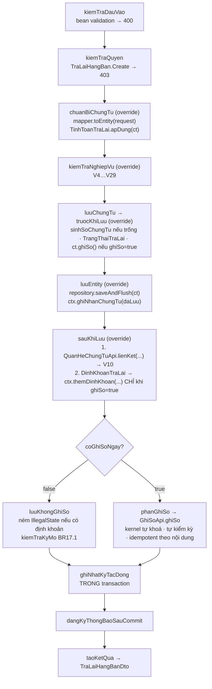

# F3 — Thêm mới chứng từ trả lại hàng bán

| Mục | Nội dung |
|---|---|
| Mã chức năng | **F3** |
| UC nguồn | `PMKT-U-06471` — `4.usecases/PMKT-U-06471_ThemMoi/UC_ThemMoiTraLaiHangBan.md` + `AD_ThemMoi.puml` |
| Màn hình | `5.screens/SCR_ThemMoiTraLaiHangBan.md` (773 dòng — màn anchor) + `Matrix/…/SCR_ThemMoiTraLaiHangBan_MaTranAnHien.md` |
| Endpoint phụ trách | **A7** `POST /` (Lưu · Lưu và ghi sổ) · **A16** `POST /lookup` |
| Quyền | `TraLaiHangBan.Create` (A7) · `TraLaiHangBan.View` (A16) |

## 1. Quyết định riêng

| # | Quyết định | Trỏ về |
|---|---|---|
| 1.1 | **`POST /`** (không phải `/them-moi` của base) — override `create` bằng `@PostMapping` như `ChungTuBanHangController.java:127-136` | §0-D7; FE `api/traLaiHangBanApi.ts:8-11` |
| 1.2 | **"Lưu" và "Lưu và ghi sổ" là MỘT request, MỘT transaction** — phân biệt bằng cờ `ghiSo` trong body | `ChungTuTemplate.java:99-101`; FE `api/traLaiHangBanApi.ts:113-116` |
| 1.3 | Ba cờ sinh chứng từ con (`kiemPhieuNhapKho` · `thanhToanNgay` · `lapKemHoaDonDieuChinh`) **vẫn lưu**, nhưng bật cờ ⇒ **400 `NOT_SUPPORTED_YET`** đợt 1 | §0-D6; xem [10 §5](10-hach-toan-va-chung-tu-kem.md) |
| 1.4 | Số chứng từ: người dùng nhập tay thì dùng, để trống thì `sinhSoChungTu(ngayChungTu)` cấp từ quyển số | BR20 · `ChungTuTemplate.java:316-324` |
| 1.5 | Toàn bộ tính toán tiền **tính lại ở BE**, không tin số FE gửi | §6 bước 3 |

---

## 2. Hợp đồng API

### A7 — `POST /api/ban-hang/tra-lai-hang-ban`

Quyền: `TraLaiHangBan.Create`. Trả **201**.

```jsonc
// Request — LuuTraLaiHangBanRequest
{
  /* ── Cờ hành động ─────────────────────────────────────── */
  "ghiSo": false,                       // false = nút "Lưu"; true = nút "Lưu và ghi sổ"

  /* ── Định danh chứng từ ───────────────────────────────── */
  "soChungTu": "",                      // rỗng/null ⇒ BE tự cấp số (1.4)
  "ngayChungTu": "2026-08-10",
  "ngayHachToan": "2026-08-10",
  "chiNhanhId": "cn01…",

  /* ── Nguồn (BR1 · BR5) ────────────────────────────────── */
  "nguonChungTu": "Chứng từ bán hàng hóa, dịch vụ",
  "chungTuBanHangId": "aa11…",          // null nếu lập tay không chọn nguồn
  "hoaDonBanHangId": null,

  /* ── Hàng tùy chọn nghiệp vụ ──────────────────────────── */
  "phuongThucLapHoaDon": "Người bán xuất hóa đơn điều chỉnh",
  "thanhToanNgay": false,
  "phuongThucThanhToan": null,
  "kiemPhieuNhapKho": false,
  "lapKemHoaDonDieuChinh": false,

  /* ── Tab Ghi giảm công nợ (= header) ──────────────────── */
  "khachHangId": "a1b2…",
  "tenKhachHang": "Công ty TNHH A",
  "maSoThue": "0101234567",
  "diaChi": "12 Trần Duy Hưng, Hà Nội",
  "nguoiLienHe": "Nguyễn Văn A",
  "soDienThoai": "0912345678",
  "nhanVienBanHangId": "b7c8…",
  "moTa": "Trả lại hàng bán cho Công ty TNHH A",

  /* ── Loại tiền & chiết khấu ───────────────────────────── */
  "loaiTienId": "vnd0…",
  "tyGia": 1.000000,
  "loaiChietKhau": "Không chiết khấu",
  "phanTramChietKhau": 0.00,

  /* ── Header phẳng của các tab chứng từ liên kết ───────── */
  "soPhieuNhapKho": null, "nguoiGiaoHang": null,
  "soPhieuChi": null, "nguoiNhan": null, "lyDoChi": null,
  "taiKhoanTienId": null, "taiKhoanChiTienId": null, "mucDichThuChiId": null,
  "nguoiLinhTien": null, "soGiayTo": null, "ngayCap": null, "noiCap": null,
  "kemTheo": null, "chungTuGoc": null,

  /* ── Tab Hóa đơn ──────────────────────────────────────── */
  "nguoiMuaHang": null, "maSoDvqhns": null, "cccd": null, "hoChieu": null,
  "hinhThucThanhToanHoaDon": null, "taiKhoanNganHangThuId": null,
  "loaiDieuChinh": null, "lyDoDieuChinh": null,
  "laHoaDonDieuChinhSaiSot": false,
  "mauSoHoaDon": null, "kyHieuHoaDon": null, "soHoaDon": null, "ngayHoaDon": null,
  "hoaDonCanDieuChinhId": null,

  /* ── Dòng chi tiết ────────────────────────────────────── */
  "chiTiet": [
    {
      "thuTu": 1,
      "loaiDongHang": true,
      "maHangId": "vt01…",
      "tenHang": "Bàn gỗ A",
      "loaiVatTuId": "lvt01…",
      "donViTinhId": "dvt01…",
      "khoId": null,
      "hangKhuyenMai": false,
      "chietKhauThuongMai": false,
      "soLuong": 2.000,
      "donGia": 5000000.00,
      "chietKhauPhanTram": 5.00,
      "chietKhau": 500000.00,
      "thueSuatGtgt": "10",
      "giaTriThueGtgt": null,
      "taiKhoanTraLaiId": "tk5212…",
      "taiKhoanCongNoId": "tk131…",
      "taiKhoanKhoId": "tk156…",
      "taiKhoanGiaVonId": "tk632…",
      "taiKhoanThueGtgtId": "tk33311…",
      "tinhChatThueGtgtId": "tc01…",
      "khongTongHopToKhaiGtgt": false,
      "giaTrungBinh": true,
      "donGiaVon": 3500000.00,
      "soPhieuXuatId": null,
      "soLo": null, "hanSuDung": null,
      "hopDongId": null, "donViId": null, "khoanMucChiPhiId": null, "vuViecId": null,
      "moTa": null, "dienGiaiThue": null,
      "chiTietChungTuBanHangId": "ct01…",
      "chungTuBanHangId": "aa11…",
      "hoaDonBanHangId": null,
      "chiTietHoaDonBanHangId": null
    }
  ]
}
```

**Bảng field — HEADER** (chỉ những field có ràng buộc; danh sách đầy đủ ⇄ cột DB ở [11 §7](11-thiet-ke-db.md)):

| Field | Kiểu | Bắt buộc | Ràng buộc | Nguồn BA |
|---|---|---|---|---|
| `ghiSo` | boolean | N | mặc định `false` | `SCR:527-528` |
| `soChungTu` | string ≤ 50 | N | rỗng ⇒ tự cấp; không ký tự tiếng Việt có dấu; **duy nhất trong tenant** | BR20.2 · BR19.1 · `SCR:295` |
| `ngayChungTu` | `LocalDate` | **Y** | `≤` ngày hiện tại | `_101`, `_102` · `UC:62` |
| `ngayHachToan` | `LocalDate` | **Y** | thuộc kỳ kế toán **đang mở**; `≥` `Tenant.NgayBatDauDuLieu` | `_203` · BR17.1 · BR17.2 |
| `chiNhanhId` | UUID | **Y** | service gán tường minh, **không** lấy từ context (`BaseChungTuEntity.java:92-98`) | BR46.4 |
| `nguonChungTu` | enum chuỗi VN | N | `Chứng từ bán hàng hóa, dịch vụ` \| `Hóa đơn điều chỉnh`; mặc định giá trị đầu | `SCR:44-47` · `constants.ts:51-54` |
| `chungTuBanHangId` | UUID | N | phải tồn tại, `status = DA_GHI_SO`, cùng tenant | `SCR:83` · `UC:79-81` |
| `phuongThucLapHoaDon` | enum chuỗi VN | **Y** | 3 giá trị; mặc định `Người bán xuất hóa đơn điều chỉnh` | `SCR:262` · `constants.ts:27-31` |
| `thanhToanNgay` | boolean | N | mặc định `false`; **`true` ⇒ 400 `NOT_SUPPORTED_YET`** (1.3) | `SCR:263` |
| `phuongThucThanhToan` | enum chuỗi VN | Y* | bắt buộc **khi** `thanhToanNgay = true`; 4 giá trị | `SCR:264` · `constants.ts:43-48` |
| `kiemPhieuNhapKho` | boolean | N | mặc định `false`; **`true` ⇒ 400 `NOT_SUPPORTED_YET`** cho phần *sinh phiếu*; bút toán giá vốn vẫn sinh | `SCR:265` |
| `lapKemHoaDonDieuChinh` | boolean | N | chỉ hợp lệ khi `phuongThucLapHoaDon ≠ "Không có hóa đơn"`; **`true` ⇒ 400 `NOT_SUPPORTED_YET`** | `SCR:266` |
| `khachHangId` | UUID | **Y** | tồn tại trong danh mục, cùng tenant | `SCR:293` · `_105` họ hàng |
| `tenKhachHang` | string ≤ 255 | **Y** | **snapshot** — không tra lại danh mục khi đọc | `UC:91-93` |
| `maSoThue` | string ≤ 16 | N | snapshot | `SCR:296` (max 255 ở tab công nợ, 16 ở tab PNK — lấy **16**, xem §9-Q) |
| `diaChi` | string ≤ 400 | N | snapshot | `SCR:297` |
| `moTa` | string ≤ 500 | N | mặc định do FE dựng: `Tên KH` trống → `"Trả lại hàng bán"`, có → `"Trả lại hàng bán cho [Tên KH]"` | `SCR:300` |
| `loaiTienId` | UUID | **Y** | mặc định đồng tiền hạch toán | `SCR:443` |
| `tyGia` | `decimal(18,6)` | **Y** | `> 0`; mặc định 1 | `SCR:444` · BR7 |
| `loaiChietKhau` | enum chuỗi VN | N | 4 giá trị; mặc định `Không chiết khấu` | `SCR:445` · `constants.ts:64-69` |
| `phanTramChietKhau` | `decimal(5,2)` | Y* | bắt buộc khi `loaiChietKhau = "Theo % hóa đơn"`; `0…100` | `SCR:446` |
| `chiTiet` | array | **Y** | `size ≥ 1` | `_104` · `UC:65` |

**Bảng field — DÒNG CHI TIẾT** (`LuuChiTietTraLaiHangBanRequest`):

| Field | Kiểu | Bắt buộc | Ràng buộc | Nguồn BA |
|---|---|---|---|---|
| `thuTu` | int | N | BE **đánh lại** liên tục 1…n theo thứ tự mảng (BR21.2) | BR21.2 |
| `loaiDongHang` | boolean | N | mặc định `true`. `false` = dòng ghi chú ⇒ **bỏ qua mọi validate số** và **không** sinh bút toán | `api/model.ts:41-42` |
| `maHangId` | UUID | **Y** (khi `loaiDongHang = true`) | tồn tại trong `mst_vat_tu` | `_105` · `SCR:452` |
| `tenHang` | string ≤ 255 | **Y** | **snapshot** | `UC:95-97` |
| `loaiVatTuId` | UUID | N | snapshot tính chất HH/DV — cần cho luật "dòng Dịch vụ được SL = 0" (§12-Q11 file gốc) | `SCR:114-119` |
| `khoId` | UUID | Y* | bắt buộc khi `kiemPhieuNhapKho = true` **VÀ** dòng không phải Dịch vụ **VÀ** không phải chiết khấu thương mại | `_109` · `SCR:455` |
| `soLuong` | `decimal(18,3)` | **Y** | `> 0`; **= 0 hợp lệ nếu dòng là Dịch vụ** | `_106` · `SCR:465,579` |
| `donGia` | `decimal(18,4)` | N | `> 0`; **= 0 hợp lệ** khi `hangKhuyenMai = true` hoặc dòng Dịch vụ | `_108` · `SCR:630` |
| `chietKhauPhanTram` | `decimal(5,2)` | N | `0…100` | `SCR:467` |
| `chietKhau` | `decimal(18,4)` | N | `≤ thanhTien` của dòng | `SCR:468` |
| `thueSuatGtgt` | enum chuỗi | **Y** | `0`\|`5`\|`8`\|`10`\|`KCT`\|`KKKNT`\|`KHAC` | `SCR:472` · `constants.ts:79-90` |
| `giaTriThueGtgt` | `decimal(5,2)` | Y* | bắt buộc khi `thueSuatGtgt = "KHAC"`; `≥ 0` và `< 100` | `constants.ts:247` |
| `taiKhoanTraLaiId` | UUID | **Y** | TK cấp cuối; mặc định `5212x` đầu tiên | `_111` · `SCR:458` |
| `taiKhoanCongNoId` | UUID | **Y** | TK cấp cuối | `_110` · `SCR:459` |
| `taiKhoanKhoId` | UUID | Y* | bắt buộc khi `kiemPhieuNhapKho = true` | `_112` · `SCR:456` |
| `taiKhoanGiaVonId` | UUID | Y* | bắt buộc khi `kiemPhieuNhapKho = true`; mặc định TK giá vốn trên DM VTHH, trống thì `632x` đầu tiên | `SCR:457,445` |
| `taiKhoanThueGtgtId` | UUID | **Y** | mặc định `33311x` đầu tiên | `SCR:475` |
| `giaTrungBinh` | boolean | N | "Tự động áp giá" — **lưu nghịch đảo** vào `tu_nhap_don_gia_von` ([02 §3](02-xem-chi-tiet.md)) | `SCR:460,642-650` |
| `donGiaVon` | `decimal(18,4)` | Y* | bắt buộc khi `giaTrungBinh = false` **và** `kiemPhieuNhapKho = true` | `_113` · `SCR:461` |
| `soPhieuXuatId` | UUID | Y* | BR15 của SCR: bắt buộc với vật tư PP tính giá đích danh/FIFO/BQ tức thời — **ngoài phạm vi đợt 1** (module kho chưa có), nhận và lưu, **không** validate | `SCR:652-658` |
| `chiTietChungTuBanHangId` | UUID | N | dòng hàng gốc — nguồn của liên kết `ctu_quan_he_chung_tu` và của validate `_107` | `SCR:107` · [09](09-chon-chung-tu-nguon.md) |

```jsonc
// Response 201 — ApiResponse<TraLaiHangBanDto>
{
  "data": { /* … toàn bộ DTO như 02 §2-A4, đã có id · soChungTu đã cấp · updatedAt … */ },
  "message": "Thêm mới chứng từ trả lại hàng bán thành công",
  "messageId": "MSG_PMKT-E-06469_001"
}
```

Khi `ghiSo = true`, `message`/`messageId` đổi thành `"Ghi sổ chứng từ trả lại hàng bán thành công"` / `MSG_PMKT-E-06469_004` (mẫu `ChungTuBanHangController.java:210-217`).

**Bảng lỗi:**

| code | HTTP | messageId | Khi nào |
|---|---|---|---|
| `FORBIDDEN` | 403 | `_007` | thiếu `TraLaiHangBan.Create` |
| `VALIDATION_FAILED` | 400 | `MSG_CORE_CT_VALIDATION` | bean validation (`@NotNull`, `@Size`, `@DecimalMin`) — `ChungTuTemplate.java:282-291` |
| `INVALID_DATE` | 400 | `_101` | thiếu `ngayChungTu` |
| `INVALID_DATE` | 400 | `_102` | `ngayChungTu > hôm nay` |
| `PERIOD_LOCKED` | 409 | `_203` | `ngayHachToan` ngoài kỳ mở (BR17.1) |
| `PERIOD_LOCKED` | 409 | `_204` | kỳ đã đóng |
| `DUPLICATE_SO_CHUNG_TU` | 409 | **chưa có mã** (§12-Q9) | `so_chung_tu` trùng trong tenant (BR19.1) |
| `EMPTY_DETAIL` | 400 | `_104` | `chiTiet` rỗng / chỉ có dòng ghi chú |
| `ITEM_NOT_FOUND` | 400 | `_105` | dòng hàng thiếu `maHangId` |
| `NEGATIVE_QUANTITY` | 400 | `_106` | `soLuong ≤ 0` trên dòng **không phải** Dịch vụ |
| `EXCEEDS_RETURNED_QUANTITY` | 400 | `_107` | `Σ SL trả lại > SL còn được trả` của dòng gốc (§5-V10) |
| `NEGATIVE_PRICE` | 400 | `_108` | `donGia ≤ 0` mà không phải khuyến mại / dịch vụ |
| `WAREHOUSE_NOT_FOUND` | 400 | `_109` | thiếu `khoId` khi kiêm PNK |
| `MISSING_ACCOUNT` | 400 | `_110` | thiếu `taiKhoanCongNoId` |
| `MISSING_ACCOUNT` | 400 | `_111` | thiếu `taiKhoanTraLaiId` |
| `MISSING_ACCOUNT` | 400 | `_112` | thiếu `taiKhoanKhoId` khi kiêm PNK |
| `MISSING_COST_PRICE` | 400 | `_113` | thiếu `donGiaVon` khi `giaTrungBinh = false` |
| `INVALID_VALUE` | 400 | `MSG_..._010` họ hàng | enum không thuộc danh sách — `GiaTriDb.tuGiaTri` (`GiaTriDb.java:27-39`) |
| `ACCOUNT_NOT_LEAF` | 400 | — | TK không phải cấp cuối (mẫu `MaLoiBanHang.java:80-81`) |
| **`NOT_SUPPORTED_YET`** | **400** | `_206` (PNK) / không mã (PC, HĐĐC) | bật `kiemPhieuNhapKho` / `thanhToanNgay` / `lapKemHoaDonDieuChinh` — **D6** |

### A16 — `POST /api/ban-hang/tra-lai-hang-ban/lookup`

Quyền `.View`. Trả bộ giá trị enum hợp lệ **từ BE** để FE không hardcode chuỗi CHECK constraint (mẫu + lý do: `ChungTuBanHangController.java:158-177`).

```jsonc
{
  "data": {
    "nguonChungTu":            ["Chứng từ bán hàng hóa, dịch vụ", "Hóa đơn điều chỉnh"],
    "phuongThucLapHoaDon":     ["Người mua xuất hóa đơn", "Người bán xuất hóa đơn điều chỉnh", "Không có hóa đơn"],
    "phuongThucThanhToan":     ["Chi tiền mặt", "Ủy nhiệm chi", "Séc chuyển khoản", "Séc tiền mặt"],
    "loaiChietKhau":           ["Không chiết khấu", "Theo mặt hàng", "Theo % hóa đơn", "Theo số tiền trên tổng hóa đơn"],
    "loaiDieuChinh":           ["Trả lại hàng bán", "Sai sót", "Khác"],
    "hinhThucThanhToanHoaDon": ["Tiền mặt", "Chuyển khoản", "TM/CK"],
    "thueSuatGtgt":            ["0", "5", "8", "10", "KCT", "KKKNT", "KHAC"]
  }
}
```

Sinh bằng `GiaTriDb.danhSach(<Enum>.class)` (`GiaTriDb.java:42-44`). **Đây là chốt chặn của R3**: 7 danh sách này phải khớp `constants/constants.ts:27-90` từng ký tự.

---

## 3. Ánh xạ cột BA ↔ DB ↔ DTO

Bảng đầy đủ ở [11 §7](11-thiet-ke-db.md). Sáu chỗ lệch tên đã nêu ở [02 §3](02-xem-chi-tiet.md). Riêng luồng ghi có thêm:

| Field request | Cột DB | Ai ghi | Ghi chú |
|---|---|---|---|
| `soChungTu` | `so_chung_tu` | client **hoặc** server (1.4) | rỗng ⇒ `sinhSoChungTu` |
| `ghiSo` | — | **không lưu** | chỉ là ý định của request này (`ChungTuTemplate.java:335-340`) |
| — | `status` | **server** | `NHAP` khi Lưu, `DA_GHI_SO` khi Lưu và ghi sổ |
| — | `nguoi_ghi_so`, `thoi_gian_ghi_so` | **server** | `BaseChungTuEntity.ghiSo()` + `@PreUpdate/@PrePersist` (`:110-141`) |
| — | `tong_tien_hang_hoa`, `tong_tien_chiet_khau`, `tong_tien_thue_gtgt`, `tong_tien_sau_thue`, `tong_tien_thanh_toan` + 5 cột `*_quy_doi` | **server tính** | `TinhToanTraLai` — client gửi lên thì **bỏ qua** (§6 bước 3) |
| — | `chi_tiet.thanh_tien`, `gia_von`, `tien_thue_gtgt` + các `*_quy_doi` | **server tính** | công thức [02 §3](02-xem-chi-tiet.md) |
| `giaTrungBinh` | `tu_nhap_don_gia_von` | client, **đảo dấu** | `tu_nhap_don_gia_von = !giaTrungBinh` |
| — | `tenant_id`, `da_xoa`, `phien_ban`, audit 7 trường | **base tự quản** | BR46 |
| — | `don_vi_id` | **trigger DB** `fn_pv_dat_don_vi_mac_dinh` (`V1:26076`) | bất biến sau khi tạo (`V1:2875-2879`) |

---

## 4. Validation — ma trận đầy đủ

| # | Luật | Điều kiện chặn | Thời điểm kiểm | Thông báo | BR nguồn |
|---|---|---|---|---|---|
| V1 | Quyền tạo | thiếu `TraLaiHangBan.Create` | `kiemTraQuyen` — `ChungTuTemplate.java:294-296` | 403 · `_007` | BR25 |
| V2 | Bean validation | `@NotNull`/`@Size`/`@DecimalMin` trên request | `kiemTraDauVao` — `:282-291` | 400 · `VALIDATION_FAILED` | BR15.1, BR14.4 |
| V3 | Ngày chứng từ bắt buộc | `ngayChungTu == null` | `kiemTraDauVao` | 400 · `_101` | `UC:120` |
| V4 | Ngày chứng từ không tương lai | `ngayChungTu > LocalDate.now(clock)` | `kiemTraNghiepVu` | 400 · `_102` | `UC:62,121` |
| V5 | Ngày hạch toán ≥ ngày chứng từ | `ngayHachToan < ngayChungTu` | `kiemTraNghiepVu` | 400 · `VALIDATION_FAILED` | BR15.3 (`SCR:744`) |
| V6 | Kỳ kế toán mở | `ngayHachToan` ngoài kỳ mở | **kernel** khi có bút toán; `kiemTraKyKeToan` khi Lưu thuần (`:469-477,510-512`) | 409 · `_203`/`_204` | BR17.1 |
| V7 | Mốc bắt đầu dữ liệu | `ngayHachToan < Tenant.NgayBatDauDuLieu` | `kiemTraNghiepVu` | 400 · `VALIDATION_FAILED` | BR17.2 |
| V8 | Trùng số chứng từ | tồn tại `so_chung_tu` khác `id`, `da_xoa = false`, cùng tenant | `kiemTraNghiepVu` (kiểm sớm) + unique `uq_sal_cttl_so_ct` (chốt cuối) | 409 · *"Số chứng từ đã tồn tại"* | BR19.1 · §12-Q9 |
| V9 | Ít nhất một dòng hàng | `chiTiet` rỗng hoặc **toàn** dòng ghi chú (`loaiDongHang = false`) | `kiemTraNghiepVu` | 400 · `_104` | `UC:122` |
| V10 | SL trả lại ≤ SL còn được trả | với dòng có `chiTietChungTuBanHangId`: `Σ SL trả lại (mọi CT trả lại) > SL trên dòng bán hàng` | `sauKhiLuu` → `QuanHeChungTuApi.lienKet` **tự kiểm** (`QuanHeChungTuApi.java:21-35`) ⇒ `VuotSoLuongNguonException` | 400 · `_107` | `UC:125` · `SCR:619-623` · §12-Q10 |
| V11 | SL > 0 | `soLuong ≤ 0` **và** dòng không phải Dịch vụ | `kiemTraNghiepVu` | 400 · `_106` | `SCR:579` |
| V12 | Đơn giá > 0 | `donGia ≤ 0` **và** không khuyến mại **và** không Dịch vụ **và** không CKTM | `kiemTraNghiepVu` | 400 · `_108` | `UC:126` |
| V13 | Có mã hàng | dòng hàng thiếu `maHangId` | `kiemTraNghiepVu` | 400 · `_105` | `UC:123` |
| V14 | Kho nhập khi kiêm PNK | `kiemPhieuNhapKho = true` và dòng thiếu `khoId`, dòng **không** Dịch vụ, **không** CKTM | `kiemTraNghiepVu` | 400 · `_109` | `SCR:455,581` |
| V15 | TK công nợ | thiếu `taiKhoanCongNoId` | `kiemTraNghiepVu` | 400 · `_110` | `SCR:582` |
| V16 | TK trả lại (Hàng hóa/Chi phí) | thiếu `taiKhoanTraLaiId` | `kiemTraNghiepVu` | 400 · `_111` | `SCR:583` |
| V17 | TK kho khi kiêm PNK | `kiemPhieuNhapKho = true` và thiếu `taiKhoanKhoId` | `kiemTraNghiepVu` | 400 · `_112` | `UC:128` |
| V18 | Đơn giá vốn khi tự nhập | `giaTrungBinh = false` và `kiemPhieuNhapKho = true` và `donGiaVon == null/0` | `kiemTraNghiepVu` | 400 · `_113` | `UC:129` |
| V19 | TK phải cấp cuối | TK không `cho_phep_hach_toan` | `kiemTraNghiepVu` | 400 · `ACCOUNT_NOT_LEAF` | mẫu `MaLoiBanHang.java:80-81` |
| V20 | Tiền CK ≤ Thành tiền dòng | `chietKhau > thanhTien` | `kiemTraNghiepVu` (sau khi `TinhToanTraLai` chạy) | 400 · `CHIET_KHAU_KHONG_HOP_LE` | mẫu `MaLoiBanHang.java:73-77` |
| V21 | % CK ≤ 100 | `chietKhauPhanTram > 100` hoặc `phanTramChietKhau > 100` | `kiemTraDauVao` (`@DecimalMax("100")`) | 400 | `SCR:446` |
| V22 | Giá trị thuế KHAC | `thueSuatGtgt = "KHAC"` và (`giaTriThueGtgt == null` hoặc ngoài `[0,100)`) | `kiemTraNghiepVu` | 400 · `VALIDATION_FAILED` | `constants.ts:247` |
| V23 | Enum hợp lệ | chuỗi không thuộc danh sách | `GiaTriDb.tuGiaTri` lúc deserialize/convert | 400 · `INVALID_VALUE` kèm **danh sách giá trị cho phép** | `GiaTriDb.java:27-39` |
| V24 | Khách hàng tồn tại | `khachHangId` không có trong danh mục / khác tenant | `kiemTraNghiepVu` | 400 · `CUSTOMER_NOT_FOUND` | `UC:91-93` |
| V25 | Chứng từ gốc hợp lệ | `chungTuBanHangId ≠ null` và (không tồn tại \| `da_xoa` \| `status ≠ DA_GHI_SO`) | `kiemTraNghiepVu` | 400 · `_100` | `SCR:83` |
| V26 | `lapKemHoaDonDieuChinh` chỉ khi có hóa đơn | `lapKemHoaDonDieuChinh = true` và `phuongThucLapHoaDon = "Không có hóa đơn"` | `kiemTraNghiepVu` | 400 · `VALIDATION_FAILED` | `SCR:266` |
| V27 | `phuongThucThanhToan` khi thanh toán ngay | `thanhToanNgay = true` và `phuongThucThanhToan == null` | `kiemTraNghiepVu` | 400 · `VALIDATION_FAILED` | `SCR:264` |
| V28 | **Ba cờ chưa hỗ trợ** | bật bất kỳ cờ nào trong `kiemPhieuNhapKho`(phần sinh phiếu) · `thanhToanNgay` · `lapKemHoaDonDieuChinh` | `kiemTraNghiepVu` | **400 `NOT_SUPPORTED_YET`** | §0-D6 |
| V29 | Nguồn = Hóa đơn điều chỉnh | `nguonChungTu = "Hóa đơn điều chỉnh"` | `kiemTraNghiepVu` | 400 `NOT_SUPPORTED_YET` | §1.2 file gốc |

> **V10 không tự viết**: `QuanHeChungTuApi.lienKet` đã khoá dòng nguồn `ORDER BY id FOR UPDATE`, cộng số đã tiêu thụ, rồi kiểm `Σ ≤ SL nguồn` (`QuanHeChungTuApi.java:20-35`). Đó là **điểm serialize duy nhất** chống hai người cùng lập chứng từ trả lại gây trả vượt. Viết lại ở tầng service = mất khoá, mất bảo đảm.

---

## 5. Luồng xử lý — `TaoTraLaiHangBan extends LuuTraLaiHangBanTemplate extends ChungTuTemplate<LenhTraLai.Luu, TraLaiHangBanDto>`

`hanhDong() = TAO` ⇒ template chạy `luongTao` (`ChungTuTemplate.java:149-160`):



**Chi tiết từng bước — chỗ nào gọi base, chỗ nào override, chỗ nào viết mới:**

| Bước | Ai lo | Việc |
|---|---|---|
| 1 `kiemTraDauVao` | **base** (`:282-291`) | không override |
| 2 `kiemTraQuyen` | **base** (`:294-296`) | không override — quyền suy từ `hanhDong().hanhDongQuyen()` = `Create` |
| 3 `chuanBiChungTu` | **override** | `TraLaiMapper.toEntity(request)` → `TinhToanTraLai.apDung(ct)`. **Tính ở đây**, không ở `truocKhiLuu`: V20 nói về giá trị CUỐI ("Tiền CK không vượt Thành tiền") nên phải có thành tiền trước khi kiểm (lý do nguyên văn `TaoChungTuBanHang.java:28-33`). Bản ghi chưa tồn tại ⇒ **không** gọi `ghiNhanChungTu` ở đây |
| 4 `kiemTraNghiepVu` | **override** | `KiemTraTraLai.kiemTraLuu(ct)` — V4…V29 |
| 5 `truocKhiLuu` | **override** | `if (soChungTu trống) ct.setSoChungTu(sinhSoChungTu(ct.getNgayChungTu()))`; `TrangThaiTraLai.capNhatTrangThai(ct)`; `if (coGhiSoNgay) ct.ghiSo()`; đánh lại `thu_tu` liên tục (BR21.2) |
| 6 `luuEntity` | **override** | `repository.saveAndFlush(ct)` → `ctx.put(CHUNG_TU, daLuu)` → **`ctx.ghiNhanChungTu(daLuu)`** (bắt buộc, `:428-435` ném `IllegalStateException` nếu quên) |
| 7 `sauKhiLuu` | **override** | (a) `QuanHeChungTuApi.lienKet(lenhLienKet(ct))` — dòng nào có `chiTietChungTuBanHangId` thì tạo `LenhLienKet(SAL_CHUNG_TU_BAN_HANG, chungTuBanHangId, chiTietChungTuBanHangId, SAL_CHUNG_TU_TRA_LAI_HANG_BAN, ct.getId(), dong.getId())`; (b) **chỉ khi `ghiSo = true`**: `DinhKhoanTraLai.sangDinhKhoan(ct, dung(ct)).forEach(ctx::themDinhKhoan)`. Định khoản dựng ở đây vì mỗi dòng bút toán cần `chiTietChungTuId`, mà id đó chỉ có sau INSERT (`:326-331`) |
| 8 `coGhiSoNgay` | **override** | `return ctx.lenh().request().laLuuVaGhiSo()` — đọc từ **LỆNH**, không từ entity (`:335-340`) |
| 9 `dienGiaiChung` | **override** | `return ct.getMoTa()` — diễn giải mặc định cho dòng bút toán không có riêng |
| 10 ghi sổ / kiểm kỳ | **base, `private`, KHÔNG override được** | `:446-457`, `:469-477` |
| 11 `ghiNhatKy` | **base** | ghi `aud_audit_log` **trong** transaction (`:522-530`); override `moTaAudit` để thêm `"(lưu và ghi sổ)"` như `TaoChungTuBanHang.java:41-45` |
| 12 `taoKetQua` | **override** | `TraLaiMapper.toDto(ctx.get(CHUNG_TU))` |

**Bẫy đã có sẵn để không sai:** nếu `ghiSo = false` mà bước 7 vẫn dựng định khoản, `luuKhongGhiSo` **ném `IllegalStateException`** (`:469-475`) thay vì âm thầm bỏ bút toán đi. Vì vậy bước 7(b) **phải** có điều kiện `if (coGhiSoNgay(ctx))`.

---

## 6. Tính toán tiền — `TinhToanTraLai`

BE **tính lại tất cả**, không tin số FE gửi (lý do: `GhiSoChungTuBanHang.java:21-22` — *"chứng từ có thể đã được lưu bởi phiên bản logic cũ, và bút toán sai thì phải bỏ ghi sổ mới sửa được"*).

Từng dòng (`SCR:462,468-474`):

```
thanhTien          = soLuong × donGia                        // = 0 nếu hangKhuyenMai
chietKhau          = (loaiChietKhau == "Theo mặt hàng")
                       ? thanhTien × chietKhauPhanTram / 100
                       : <giá trị client gửi>                 // Theo % hóa đơn / số tiền tổng: phân bổ ở mức header
tienThueGtgt       = (thanhTien − chietKhau) × thueSuat% / 100
giaVon             = soLuong × donGiaVon
<x>QuyDoi          = <x> × tyGia                             // BR18
```

Dòng **chiết khấu thương mại** (`chietKhauThuongMai = true`, `SCR:635-640`): `thanhTien` mang **giá trị âm**; disable % CK / tiền CK; không chọn kho, không phát sinh giá vốn.

Header (`SCR:510-518`):

```
tongTienHang        = Σ thanhTien
tongChietKhau       = Σ chietKhau
tongTienThueGtgt    = Σ tienThueGtgt
tongTienThanhToan   = tongTienHang − tongChietKhau + tongTienThueGtgt
tong…QuyDoi         = Σ <…>QuyDoi
```

Làm tròn theo **BR7.2**: lưu giá trị đầy đủ vào DB, làm tròn ở **kết quả cuối** của phép tính, 2 chữ số thập phân (thương mại — `HALF_UP`). Precision cột: [11 §4](11-thiet-ke-db.md).

**Dòng ghi chú** (`loaiDongHang = false`): bỏ ra khỏi mọi phép Σ và mọi validate số.

---

## 7. Tương tranh & transaction

| Việc | Cơ chế | `file:dòng` |
|---|---|---|
| Ranh giới transaction | `@Transactional` trên `ChungTuTemplate.thucThi` — **một** transaction cho cả "Lưu và ghi sổ" | `ChungTuTemplate.java:102-103` |
| Khoá chứng từ | **KHÔNG** khoá ở luồng TAO — bản ghi chưa tồn tại, kernel tự khoá theo id mới lúc ghi sổ | `:141-148` |
| Khoá dòng nguồn | `DongChungTuPort.khoaVaLaySoLuong` — `ORDER BY id FOR UPDATE` trong cùng transaction | `quan_he_chung_tu/api/DongChungTuPort.java:32-44` |
| Cấp số chứng từ | `SELECT … FOR UPDATE` trên `mst_quyen_chung_tu`; rollback thì số rollback theo | `ChungTuTemplate.java:316-321` |
| Idempotency ghi sổ | `GhiSoApi.ghiSo` idempotent **theo nội dung**: gọi lại đúng nội dung cũ → không sinh dòng mới; nội dung khác → 409 `POSTING_PAYLOAD_MISMATCH` | `GhiSoApi.java:18-31` |
| Idempotency liên kết | unique `(tenant_id, dong_dich_id)` + `INSERT … ON CONFLICT DO NOTHING` | `QuanHeChungTuApi.java:28-29` |
| Chống trùng số chứng từ | unique partial `uq_sal_cttl_so_ct` | `V1:23654` |
| Audit | ghi **trong** transaction (nguyên tử với dữ liệu) | `ChungTuTemplate.java:522-530` |
| Thông báo | đăng ký `afterCommit`, lỗi gửi thông báo **không** làm hỏng nghiệp vụ đã commit | `:532-556` |

---

## 8. Kiểm thử

### 8.1 Unit (`@Tag("unit")`)

| Lớp test | Case | Input → kỳ vọng |
|---|---|---|
| `TinhToanTraLaiTest` | thành tiền · thuế · giá vốn | `SL=2, ĐG=5tr, CK%=5, thuế=10` → `thanhTien=10tr`, `chietKhau=500k`, `tienThueGtgt=950k`, `tongTienThanhToan=10.45tr` |
| | hàng khuyến mại | `hangKhuyenMai=true` → `donGia=0`, `thanhTien=0`, thuế vẫn tính được |
| | chiết khấu thương mại | `chietKhauThuongMai=true` → `thanhTien` **âm**, `giaVon=0`, `khoId` không bắt buộc |
| | quy đổi | `tyGia=24000` → mọi `*QuyDoi` = gốc × 24000, làm tròn 2 số |
| | dòng ghi chú | `loaiDongHang=false` → không vào Σ nào |
| | dòng Dịch vụ | `SL=0, ĐG=0, thanhTien=3tr` (client gửi) → giữ `thanhTien=3tr`, **không** ghi đè bằng `SL×ĐG=0` (`SCR:114-119`) |
| `KiemTraTraLaiTest` | V4 | `ngayChungTu = mai` → 400 `_102` |
| | V5 | `ngayHachToan < ngayChungTu` → 400 |
| | V9 | `chiTiet` toàn `loaiDongHang=false` → 400 `_104` |
| | V11 | dòng hàng hóa `SL=0` → 400 `_106`; dòng Dịch vụ `SL=0` → **hợp lệ** |
| | V14 | `kiemPhieuNhapKho=true`, dòng hàng hóa thiếu `khoId` → 400 `_109`; dòng Dịch vụ thiếu `khoId` → hợp lệ |
| | V15…V18 | thiếu từng TK → đúng mã `_110`/`_111`/`_112`/`_113` |
| | V26, V27 | tổ hợp cờ sai → 400 |
| | V28 | bật `kiemPhieuNhapKho` → 400 `NOT_SUPPORTED_YET` + `messageId = _206` |
| `GiaTriDbTraLaiTest` | 7 enum ⇄ CHECK constraint | mọi `giaTri()` khớp **từng ký tự** chuỗi trong `constants/constants.ts` và trong CHECK; giá trị lạ → 400 kèm danh sách cho phép |
| `TaoTraLaiHangBanTest` | thứ tự bước | mock template: `ghiSo=false` → **không** gọi `GhiSoApi`; `ghiSo=true` → gọi đúng 1 lần |
| | bẫy định khoản | `ghiSo=false` mà dựng định khoản → `IllegalStateException` |
| | cấp số | `soChungTu` rỗng → gọi `sinhSoChungTu`; có sẵn → **không** gọi |
| | `thu_tu` | mảng 3 dòng gửi `thuTu = 5,2,9` → lưu 1,2,3 theo thứ tự mảng |
| `TraLaiMapperTest` | `giaTrungBinh` nghịch đảo | xem [02 §7.1](02-xem-chi-tiet.md) |

### 8.2 Tích hợp (cần Docker — chưa chạy được, R8)

| Lớp | Kiểm gì chỉ DB thật làm được |
|---|---|
| `TaoTraLaiHangBanIT` | INSERT thành công (chốt **R2** — cột `trang_thai_chung_tu` đã DROP) |
| | trùng `so_chung_tu` → unique `uq_sal_cttl_so_ct` chặn (V8) |
| | trigger `fn_pv_dat_don_vi_mac_dinh` gán `don_vi_id` (`V1:26076`) |
| | audit log có đúng 1 dòng INSERT cho header + n dòng cho chi tiết (`V1:25432,25474`) |
| | `ghiSo=true` → `acc_so_cai` có `2 × số định khoản` dòng, cân đối Nợ/Có |
| | `ghiSo=true` vào kỳ đã khoá → `PeriodLockedException` 409 `_203`, **rollback sạch** (không còn chứng từ) |
| | liên kết `ctu_quan_he_chung_tu` tạo được (**chốt R1** — `fn_bang_cua_loai_chung_tu` đã sửa) |
| | trả vượt SL → `VuotSoLuongNguonException` 400 `_107` |
| | hai request đồng thời trả cùng dòng nguồn → chỉ một thành công (`FOR UPDATE`) |

---

## 9. BR đã áp dụng

| BR | Áp ở bước nào |
|---|---|
| BR3 popup | Popup Thêm/Sửa/Xem dùng chung một request shape ⇒ `C` và `U` cùng là `LuuTraLaiHangBanRequest` (mẫu `ChungTuBanHangCrudService.java:36-39`) |
| BR7 precision & làm tròn | §6 |
| BR12 trạng thái | §5 bước 5 — `NHAP` hoặc `DA_GHI_SO` |
| BR14.2 nút thao tác | "Lưu" ⇄ "Lưu và ghi sổ" = cờ `ghiSo` (1.2) |
| BR14.4 giới hạn độ dài | `@Size` theo `MAX_LEN` của FE (`constants.ts:250-280`) |
| BR15 validation | §4 toàn bộ |
| BR16 cảnh báo nghiệp vụ | §2 bảng lỗi + §12-Q10 file gốc (chặn vs cảnh báo) |
| BR17 kỳ kế toán | V6, V7 |
| BR18 ngoại tệ | §6 — `*_quy_doi`; sổ cái ghi đồng tiền hạch toán + nguyên tệ qua `DinhKhoan.voiNgoaiTe` |
| BR19.1 kiểm trùng | V8 |
| BR20 số chứng từ | 1.4, V8 |
| BR21.2 vị trí chèn dòng & STT | §5 bước 5 — BE **đánh lại** `thu_tu` liên tục theo thứ tự mảng client gửi; vị trí chèn là việc FE |
| BR25 phân quyền | V1 |
| BR28 multi-tenant | `tenant_id` từ `TenantContext`, RLS; client **không** gửi |
| BR36 ghi sổ không gộp bút toán | [10 §3](10-hach-toan-va-chung-tu-kem.md) |
| BR37 ngày hạch toán | **FE lo** liên kết hai ngày; BE chỉ lưu và kiểm V5 |
| BR43 trim | `@JsonDeserialize` trim hoặc FE đã trim (`IMPLEMENT.md:218`); BE trim lần cuối ở mapper cho các field `String` |
| BR46 trường hệ thống | §3 — base tự quản, client không gửi |

**BR chưa đạt trong file này:** BR15 phần "Số phiếu xuất bắt buộc theo PP tính giá" (BR15 của SCR) — module kho chưa có, nhận và lưu nhưng **không** validate (§2 bảng dòng chi tiết).
