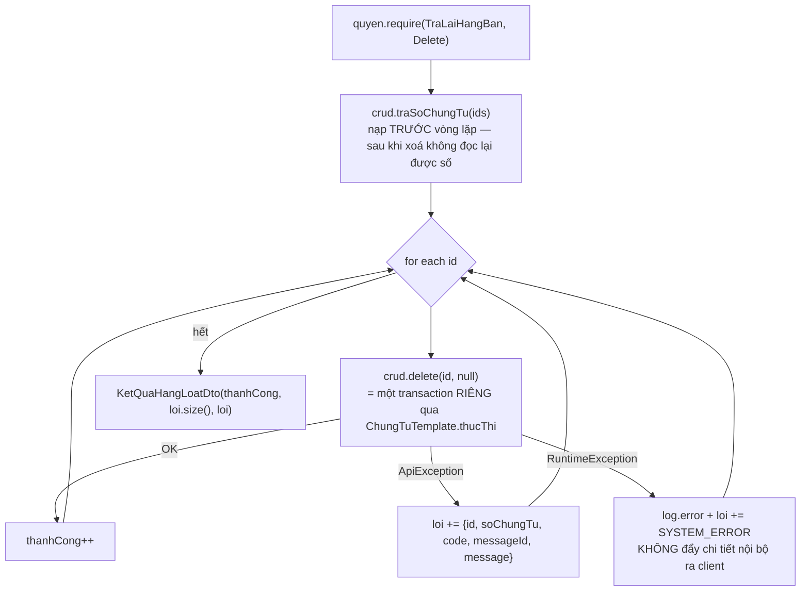

# F5 — Xóa chứng từ trả lại hàng bán (một + hàng loạt)

| Mục | Nội dung |
|---|---|
| Mã chức năng | **F5** |
| UC nguồn | `PMKT-U-06473` — `4.usecases/PMKT-U-06473_Xoa/UC_XoaTraLaiHangBan.md` + `AD_Xoa.puml` |
| Màn hình | `5.screens/SCR_DanhSachTraLaiHangBan.md` §Chức năng · **BR16** (xóa hàng loạt) |
| Endpoint phụ trách | **A9** `DELETE /{id}` · **A10** `POST /xoa-hang-loat` |
| Quyền | `TraLaiHangBan.Delete` (cả hai) |

## 1. Quyết định riêng

| # | Quyết định | Trỏ về |
|---|---|---|
| 1.1 | **Xóa mềm** (`da_xoa = true`) cả header **và** mọi dòng chi tiết | BR29.1; mẫu `XoaChungTuBanHang.java:15-18` |
| 1.2 | Xóa **không** kiểm kỳ kế toán | `ChungTuTemplate.java:187-192` — luồng này không tạo trạng thái sổ sách mới và cũng không gỡ dòng nào |
| 1.3 | A10 **không** nhận token optimistic-lock | `HangLoatChungTuService.java:54-58` — màn danh sách chọn theo checkbox chứ không mở từng chứng từ, nên không có token nào để đối chiếu |
| 1.4 | Xóa **gỡ sạch liên kết** `ctu_quan_he_chung_tu` trỏ tới chứng từ này | §5 bước 6 |
| 1.5 | Popup xác nhận (`_212`) và cảnh báo "có {n} chứng từ liên quan" là **việc FE** — BE không trả confirm | `6.messages.md` `_212` loại `Confirm`; `README.md` §BR19 |

---

## 2. Hợp đồng API

### A9 — `DELETE /api/ban-hang/tra-lai-hang-ban/{id}`

Quyền: `TraLaiHangBan.Delete`. Body **tuỳ chọn**:

```jsonc
// Request body (optional) — core/request/DeleteRequest.java
{ "updatedAt": "2026-08-10T03:12:44.512Z" }
```

| Field | Kiểu | Bắt buộc | Ràng buộc |
|---|---|---|---|
| `updatedAt` | `Instant` | N | token optimistic-lock; lệch → 409 `STALE_DATA`; không gửi ⇒ **bỏ kiểm** (`BaseCrudController.java:155-157`) |

```jsonc
// Response 200
{ "data": null, "message": "Xóa chứng từ trả lại hàng bán thành công", "messageId": "MSG_PMKT-E-06469_003" }
```

| code | HTTP | messageId | Khi nào |
|---|---|---|---|
| `FORBIDDEN` | 403 | `_007` | thiếu `.Delete` |
| `NOT_FOUND` | 404 | `_008` | `id` không có / đã `da_xoa` |
| **`ALREADY_POSTED`** | **409** | **`_202`** | `status = DA_GHI_SO` — *"Chứng từ đã ghi sổ, không được xóa"* |
| `STALE_DATA` | 409 | — | `updatedAt` lệch |
| `SO_CAI_LECH` | 409 | `MSG_CORE_CT_SO_CAI_LECH` | cờ nói chưa ghi sổ mà `acc_so_cai` còn dòng (`ChungTuTemplate.java:397-406`) |
| **`IN_USE`** | **409** | — | chứng từ con (PNK/PC/HĐĐC) đã ghi sổ — **đợt 1 luôn false** vì không sinh chứng từ con (§0-D6); logic vẫn cài, xem §4-V42 |

### A10 — `POST /api/ban-hang/tra-lai-hang-ban/xoa-hang-loat`

Quyền `.Delete` (`BaseChungTuController.java:177-184`).

```jsonc
// Request — accounting_core/chung_tu/dto/XuLyHangLoatRequest.java
{ "ids": ["0f5c…", "1a2b…", "3c4d…"] }
```

```jsonc
// Response 200 — LUÔN 200, kể cả khi có chứng từ thất bại
{
  "data": {
    "thanhCong": 2,
    "thatBai": 1,
    "loi": [
      {
        "id": "3c4d…",
        "soChungTu": "CTTL-000031",
        "code": "ALREADY_POSTED",
        "messageId": "MSG_PMKT-E-06469_202",
        "message": "Chỉ có thể xóa chứng từ ở trạng thái \"Chưa ghi sổ\""
      }
    ]
  },
  "message": "Xử lý thành công 2 chứng từ, thất bại 1 chứng từ",
  "messageId": "MSG_PMKT-E-06469_003"
}
```

> **200 dù có lỗi** là chủ ý (`BaseChungTuController.java:155-158`): đó là dữ liệu cho popup "Thông báo kết quả Xóa" của BR45 mục 3, không phải lỗi của request. `data.loi[]` có đủ 3 cột BR45 cần: **Số chứng từ** · **Nguyên nhân** (`message`) · mã máy đọc (`code`). Cột **Ngày chứng từ** của BR45 mục 3 **không có** trong `KetQuaHangLoatDto.DongLoi` — xem §8.

`ids` rỗng/`null` → `idsOrEmpty()` trả list rỗng ⇒ `{thanhCong: 0, thatBai: 0, loi: []}`, không lỗi.

---

## 3. Ánh xạ cột

| Việc | Cột DB | Ai ghi |
|---|---|---|
| Đánh dấu xoá header | `da_xoa = true`, `ngay_xoa`, `nguoi_xoa` | `BaseEntity.danhDauXoa()` |
| Đánh dấu xoá **từng dòng chi tiết** | `chi_tiet.da_xoa/ngay_xoa/nguoi_xoa` | vòng lặp trong `luuEntity` (mẫu `XoaChungTuBanHang.java:79-87`) |
| Giải phóng số chứng từ | — | unique `uq_sal_cttl_so_ct` có `WHERE da_xoa = false` (`V1:23654`) ⇒ số chứng từ **được dùng lại** sau khi xoá mềm. Đúng ý đồ, không phải lỗ hổng |
| Gỡ liên kết | `ctu_quan_he_chung_tu` (xoá mềm) | `QuanHeChungTuApi.goToanBoTheoDich` |
| Audit | `aud_audit_log` | trigger DB (`V1:25432,25474`) + `NhatKyKiemToan` trong transaction |

**Vì sao đánh dấu xoá cả dòng con** (nguyên văn `XoaChungTuBanHang.java:16-18`): để lại dòng "sống" dưới một header đã xoá thì mọi báo cáo đi từ chi tiết sẽ cộng nhầm chứng từ đã bị xoá.

---

## 4. Validation

| # | Luật | Điều kiện chặn | Thời điểm | Thông báo | BR nguồn |
|---|---|---|---|---|---|
| V40 | Quyền xóa | thiếu `TraLaiHangBan.Delete` | `kiemTraQuyen` (`ChungTuTemplate.java:294-296`) | 403 · `_007` | BR25 · `UC:250` |
| V41 | Chỉ xóa khi chưa ghi sổ | `ct.daGhiSo()` | `kiemTraNghiepVu` | 409 · `_202` | BR12 · `UC:223` · `SCR:BR11` |
| V42 | Chưa bị nghiệp vụ khác dùng | `phieu_nhap_kho_id ≠ null` \|\| `phieu_chi_id ≠ null` \|\| `dieu_chinh_hoa_don_ban_hang_id ≠ null` \|\| `quanHe.coLienKet(SAL_CHUNG_TU_TRA_LAI_HANG_BAN, id)` | `kiemTraNghiepVu` | 409 `IN_USE` | `SCR:BR16` · `README.md` §BR19 |
| V43 | Token khoá | `updatedAt ≠ ngay_cap_nhat` (chỉ A9) | `chuanBiChungTu` | 409 `STALE_DATA` | BR12 |
| V44 | Đối soát sổ cái | `GhiSoApi.daGhiSo(id)` | **base, private** (`:194-198,397-406`) | 409 `SO_CAI_LECH` | — |
| V45 | Tồn tại | không có / `da_xoa` | `chuanBiChungTu` | 404 · `_008` | BR29.1 |

> **V42 hiện chặn RỘNG HƠN BR16.** `SCR:BR16` nói: *"Nếu chứng từ có chứng từ con liên kết (HĐĐC, PNK, PC/UNC/Séc): soft delete toàn bộ bộ chứng từ. Nếu chứng từ con đã ghi sổ → chặn xóa"*. BE hiện **không đọc được trạng thái** của chứng từ con (module chưa có, §0-D6) ⇒ chặn khi *có liên kết*, kể cả liên kết còn nháp. Mẫu xử lý và lời giải thích y hệt đã có ở `BoGhiSoChungTuBanHang.java:79-90`. Đợt 1 điều này **vô hại** vì không sinh chứng từ con nào; chỗ bổ sung đúng là hàm này khi module kho/tiền/hóa đơn ra đời.

**Không** kiểm kỳ kế toán (1.2) — khác hẳn Ghi sổ/Bỏ ghi sổ.

---

## 5. Luồng xử lý — `XoaTraLaiHangBan extends ChungTuTemplate<LenhTraLai.Xoa, Void>`

`hanhDong() = XOA` ⇒ `luongXoa` (`ChungTuTemplate.java:194-203`):

```
1. doiHoiDinhDanh      ← base
2. khoaChungTu         ← base, private
3. kiemTraNghiepVu     ← override (V41, V42)
4. doiSoatVoiSoCai     ← base, private (V44)
5. luuChungTu          → truocKhiLuu (không làm gì) → luuEntity (override)
6. sauKhiLuu           ← override: gỡ liên kết
7. ghiNhatKyTacDong    ← base, TRONG transaction
8. dangKyThongBaoSauCommit
9. taoKetQua           → null
```

`chuanBiChungTu` (**override**) — mẫu `XoaChungTuBanHang.java:56-63`:
```java
ChungTuTraLaiHangBan ct = tl.nap(ctx.lenh().id());        // V45
tl.kiemTraLock(ct, ctx.lenh().updatedAt());               // V43
ctx.ghiNhanChungTu(ct);                                    // khoaChungTu + doiSoatVoiSoCai cần định danh
ctx.put(CHUNG_TU, ct);
```

`luuEntity` (**override**) — mẫu `XoaChungTuBanHang.java:78-87`:
```java
for (ChiTietTraLaiHangBan dong : ct.getChiTiet()) dong.danhDauXoa();
ct.danhDauXoa();
ctx.ghiNhanChungTu(tl.repository().saveAndFlush(ct));
```

`sauKhiLuu` (**override**) — **việc mới, `chung_tu_ban_hang` không có**:
```java
quanHe.goToanBoTheoDich(LoaiChungTu.SAL_CHUNG_TU_TRA_LAI_HANG_BAN, ct.getId());
```
Vì sao bắt buộc: `daTieuThu` chỉ cộng liên kết **chưa gỡ** (`QuanHeChungTuApi.java:48-54`). Không gỡ thì dòng bán hàng gốc vẫn bị tính là "đã trả lại" dù chứng từ trả lại đã bị xoá ⇒ khách hàng không trả lại được số hàng còn lại. Đây là **quan hệ ràng buộc nghiệp vụ**, không phải tham chiếu mềm, nên BR41 không áp dụng.

`coSinhButToan()` giữ mặc định `true` ⇒ `doiSoatVoiSoCai` **có** chạy (V44). `taoKetQua` trả `null` (`Void`), controller trả `ApiResponse.ok(message, messageId)`.

### 5.1 Luồng hàng loạt A10 (BR16 · BR45)

`HangLoatChungTuService.xoa(ids)` → `chay(ids, id -> crud.delete(id, null))` (`HangLoatChungTuService.java:59-61`):



Ba điểm **không được viết lại** (`HangLoatChungTuService.java:16-28`):
1. Lớp vòng lặp **cố ý không** `@Transactional` — transaction do `ChungTuTemplate.thucThi` của **từng** chứng từ mở, gọi qua proxy Spring nên mỗi lần là một transaction mới. Đặt `@Transactional` ở đây thì lỗi đầu tiên đánh dấu rollback-only cho toàn bộ.
2. `traSoChungTu(ids)` phải gọi **trước** vòng lặp và **qua bean khác** (không self-invocation) để `@Transactional` thật sự áp dụng — thiếu transaction là GUC tenant chưa bind và RLS trả tập rỗng (`AbstractChungTuCrudService.java:66-73`).
3. `RuntimeException` ngoài dự kiến vẫn thành một dòng trong bảng kết quả, nhưng **không** đẩy stacktrace ra client.

---

## 6. Tương tranh & transaction

| Việc | A9 | A10 |
|---|---|---|
| Transaction | một, quanh `thucThi` | **một transaction / một chứng từ** (1.3) |
| Khoá bi quan | `khoaChungTu(id)` | như A9, trong từng transaction con |
| Khoá lạc quan | token `updatedAt` + `@Version` | **không** token (1.3); `@Version` vẫn hoạt động |
| Idempotency | xoá lại chứng từ đã `da_xoa` → **404** (bản ghi đã xoá coi như không tồn tại) | dòng đó vào `loi[]` với `NOT_FOUND` |
| Thất bại một phần | không áp dụng | **được chấp nhận** — BR45 mục 2 |

---

## 7. Kiểm thử

### 7.1 Unit

| Lớp test | Case | Input → kỳ vọng |
|---|---|---|
| `XoaTraLaiHangBanTest` | V41 | `status = DA_GHI_SO` → 409 `ALREADY_POSTED` + `_202` |
| | V42 | `phieu_nhap_kho_id ≠ null` → 409 `IN_USE`; cả 3 id `null` và `coLienKet = false` → đi tiếp |
| | V43 | `updatedAt` lệch → 409 `STALE_DATA` |
| | xoá lan dòng con | 3 dòng chi tiết → cả 3 `da_xoa = true` **trước** khi `saveAndFlush` |
| | gỡ liên kết | `goToanBoTheoDich` gọi **đúng 1 lần**, sau `luuEntity` |
| | không kiểm kỳ | `kyKeToan.kiemTraKyMo` **không** được gọi (verify never) |
| | `hanhDong()` | `== XOA` ⇒ quyền `Delete` |
| `TraLaiHangBanHangLoatServiceTest` | 3 id: 1 OK · 1 đã ghi sổ · 1 không tồn tại | `{thanhCong: 1, thatBai: 2}`, `loi[]` đủ `soChungTu` của 2 bản lỗi |
| | `ids` rỗng | `{0, 0, []}`, **không** ném lỗi |
| | lỗi ngoài dự kiến | `NullPointerException` → `code = "SYSTEM_ERROR"`, `message = "Lỗi hệ thống khi xử lý chứng từ"`, **không** lộ stacktrace |
| | không rollback lây | chứng từ #2 lỗi → chứng từ #1 và #3 vẫn xoá (verify `delete` gọi 3 lần) |

### 7.2 Tích hợp (cần Docker — chưa chạy được)

| Lớp | Kiểm gì |
|---|---|
| `XoaTraLaiHangBanIT` | header + n dòng chi tiết đều `da_xoa = true`; **không** dòng nào bị DELETE vật lý (BR29.1) |
| | `GET /{id}` sau xoá → 404; `POST /search` không trả bản ghi đó |
| | số chứng từ **dùng lại được** sau xoá mềm (unique partial `WHERE da_xoa = false`) |
| | `ctu_quan_he_chung_tu` của chứng từ đó đã gỡ; `daTieuThu(dòng gốc)` về giá trị trước khi lập |
| | `aud_audit_log` có dòng UPDATE cho header + n dòng cho chi tiết |
| | A10 với 50 id lẫn trạng thái → mỗi chứng từ một transaction, bản OK vẫn commit khi bản khác rollback |

---

## 8. Lệch so với BR45 — cột "Ngày chứng từ" của popup lỗi

BR45 mục 3 yêu cầu bảng lỗi có **3 cột**: Số chứng từ · **Ngày chứng từ** · Nguyên nhân.

`KetQuaHangLoatDto.DongLoi` của base chỉ có `(id, soChungTu, code, messageId, message)` — **không có ngày chứng từ** (`accounting_core/chung_tu/dto/KetQuaHangLoatDto.java`, 24 dòng). Ba lựa chọn:

| | A — thêm field vào base DTO | B — FE tra ngày từ danh sách đang hiển thị | **C (chọn) — chấp nhận thiếu đợt 1** |
|---|---|---|---|
| Chi phí | sửa DTO dùng chung của mọi màn chứng từ (đụng bán hàng, mua hàng) + `traSoChungTu` phải trả thêm ngày | 0 dòng BE; FE đã có `data[]` của trang hiện tại, join theo `id` | 0 dòng |
| Rủi ro | thay đổi hợp đồng base cho một yêu cầu UI của một epic | chứng từ được chọn ở trang khác (sau khi phân trang) không có ngày | popup thiếu một cột so với BR45 |
| Kết luận | không chọn — vượt phạm vi epic | **khả thi**, FE tự quyết | ghi vào §12 để BA biết; nếu BA buộc phải có → làm A, mở ticket sửa base |

Đưa vào báo cáo: **BR45 mục 3 chưa đạt 100%** (thiếu cột Ngày chứng từ trong payload lỗi).

---

## 9. BR đã áp dụng

| BR | Áp ở bước nào |
|---|---|
| BR12 trạng thái chứng từ | V41 |
| BR13.1 nút thao tác | FE ẩn nút Xóa khi `DA_GHI_SO`; BE **vẫn** kiểm V41 (không dựa vào việc màn hình ẩn nút) |
| BR16 cảnh báo nghiệp vụ | §2 bảng lỗi |
| BR25 phân quyền | V40 |
| BR28 multi-tenant | RLS; `da_xoa` không nhận từ client |
| BR29.1 xóa mềm | 1.1, §3 |
| BR29.2 xóa lan | dòng chi tiết xoá mềm theo header (§5 `luuEntity`); liên kết quan hệ **gỡ** (`set null/reference remove`) |
| BR29.3 chặn xóa đã phát sinh nghiệp vụ | V42 |
| BR29.4 giữ nguyên vị trí trang | **FE lo** — BE không trả gì thêm |
| BR41 tham chiếu chéo | **không áp dụng** — §5 giải thích |
| BR45 thao tác hàng loạt | §5.1; ⚠ chưa đạt mục 3 đầy đủ — §8 |
| BR46 trường hệ thống | `ngay_xoa`/`nguoi_xoa` do `danhDauXoa()` gán |
