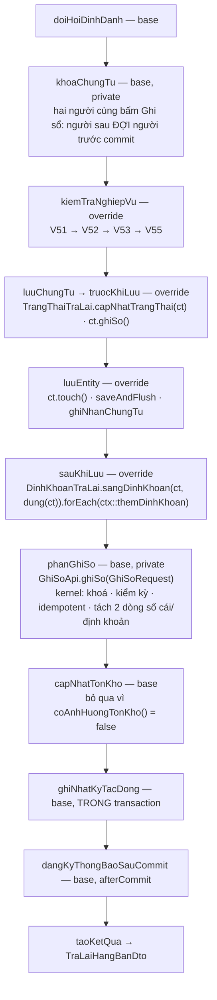

# F7 — Ghi sổ chứng từ trả lại hàng bán (một + hàng loạt)

| Mục | Nội dung |
|---|---|
| Mã chức năng | **F7** |
| UC nguồn | `PMKT-U-06475` — `4.usecases/PMKT-U-06475_GhiSo/UC_GhiSoTraLaiHangBan.md` + `AD_GhiSo.puml` |
| Màn hình | `SCR_DanhSachTraLaiHangBan.md` §Chức năng · **BR14** (ghi sổ hàng loạt) · `SCR_XemChiTietTraLaiHangBan.md:19-21` |
| Endpoint phụ trách | **A12** `POST /{id}/ghi-so` · **A13** `POST /ghi-so-hang-loat` |
| Quyền | `TraLaiHangBan.Post` |
| Bút toán | chi tiết ở [10-hach-toan-va-chung-tu-kem.md](10-hach-toan-va-chung-tu-kem.md) |
| **Trạng thái** | ☐ chưa code |

## 1. Quyết định riêng

| # | Quyết định | Trỏ về |
|---|---|---|
| 1.1 | A12 **không nhận dữ liệu mới** — chứng từ đã nằm trong DB, việc duy nhất là sinh bút toán + chuyển trạng thái | `GhiSoChungTuBanHang.java:17-19` |
| 1.2 | **Tính lại toàn bộ tiền trước khi ghi sổ**, không tin cột đã lưu | `GhiSoChungTuBanHang.java:21-22` |
| 1.3 | Không tự kiểm kỳ kế toán — **kernel kiểm** với đúng cặp (ngày hạch toán, mã loại) mà nó sắp INSERT | `ChungTuTemplate.java:56-61,205-210` |
| 1.4 | `coAnhHuongTonKho()` = **`false`** đợt 1 | §6 |
| 1.5 | A13 dùng `HangLoatChungTuService` — thất bại một phần được chấp nhận | §0-D9; BR45 |

---

## 2. Hợp đồng API

### A12 — `POST /api/ban-hang/tra-lai-hang-ban/{id}/ghi-so`

Quyền: `TraLaiHangBan.Post` (`BaseChungTuController.java:93-99`).

Request: **không có body** (base không khai `@RequestBody`). FE hiện gửi `{updatedAt}` — server **bỏ qua**, xem §12-Q3 file gốc.

```jsonc
// Response 200
{
  "data": { /* … DTO đầy đủ: trangThaiChungTu = "DA_GHI_SO", updatedAt MỚI, dinhKhoan[] … */ },
  "message": "Ghi sổ chứng từ trả lại hàng bán thành công",
  "messageId": "MSG_PMKT-E-06469_004"
}
```

| code | HTTP | messageId | Khi nào |
|---|---|---|---|
| `FORBIDDEN` | 403 | `_007` | thiếu `TraLaiHangBan.Post` |
| `NOT_FOUND` | 404 | `_008` | `id` không có / `da_xoa` |
| **`ALREADY_POSTED`** | **409** | — | `trangThaiChungTu = DA_GHI_SO` — BR12 §"Ghi sổ duy nhất": *"Chứng từ đã được ghi sổ"* (epic **không** cấp mã, xem §9) |
| `PERIOD_LOCKED` | 409 | **`_203`** | `ngayHachToan` không thuộc kỳ đang mở |
| `PERIOD_LOCKED` | 409 | **`_204`** | kỳ kế toán đã đóng |
| `MISSING_ACCOUNT` | 400 | `_110` / `_111` / `_112` | thiếu TK công nợ / TK trả lại / TK kho ở dòng nào |
| `MISSING_COST_PRICE` | 400 | `_113` | `kiemPhieuNhapKho = true` mà dòng thiếu `donGiaVon` |
| `ACCOUNT_NOT_LEAF` | 400 | — | TK không phải cấp cuối |
| **`POSTING_FAILED`** | **400** | **`_205`** | kernel từ chối định khoản (sai cấu trúc, `soTien ≤ 0`) — `GhiSoApi.java:26-27` |
| `POSTING_PAYLOAD_MISMATCH` | 409 | — | gọi lại `ghiSo` với **nội dung khác** lần trước — `GhiSoApi.java:22-24` |
| `EMPTY_DETAIL` | 400 | `_104` | chứng từ không còn dòng hàng nào |

> Chứng từ **không có dòng bút toán nào** (mọi giá trị = 0) **không** phải lỗi: template không đi qua kernel, tự kiểm kỳ rồi log `"… không có dòng bút toán nào để ghi sổ"` và chuyển trạng thái bình thường (`ChungTuTemplate.java:446-454`).

### A13 — `POST /api/ban-hang/tra-lai-hang-ban/ghi-so-hang-loat`

Quyền `.Post` (`BaseChungTuController.java:159-166`).

```jsonc
// Request
{ "ids": ["0f5c…", "1a2b…", "3c4d…", "5e6f…"] }
```

```jsonc
// Response 200 — LUÔN 200
{
  "data": {
    "thanhCong": 2,
    "thatBai": 2,
    "loi": [
      { "id": "3c4d…", "soChungTu": "CTTL-000031", "code": "ALREADY_POSTED",
        "messageId": null, "message": "Không thể ghi sổ chứng từ đã ghi sổ" },
      { "id": "5e6f…", "soChungTu": "CTTL-000032", "code": "PERIOD_LOCKED",
        "messageId": "MSG_PMKT-E-06469_203", "message": "Chứng từ thuộc kỳ đã khóa sổ 31/07/2026. Không thể thao tác." }
    ]
  },
  "message": "Xử lý thành công 2 chứng từ, thất bại 2 chứng từ",
  "messageId": "MSG_PMKT-E-06469_004"
}
```

Khớp BR45 mục 1–3: thành công 100% → FE dùng `_004`; có bản lỗi → FE dựng popup từ `data.loi[]`. Thiếu cột "Ngày chứng từ" — xem [05 §8](05-xoa.md).

---

## 3. Bút toán sinh ra khi ghi sổ

Nguyên văn `UC_GhiSoTraLaiHangBan.md:365-374` và `SCR_ThemMoiTraLaiHangBan.md:539-558` — **ba bước**:

| Bước | Nghiệp vụ | Định khoản | Số tiền | Điều kiện |
|---|---|---|---|---|
| **1a** | Giảm trừ doanh thu | **Nợ** TK trả lại (5212) / **Có** TK công nợ (131) | `Tổng tiền hàng − Tổng chiết khấu` | luôn |
| **1b** | Thuế GTGT đầu ra | **Nợ** TK thuế GTGT (33311) / **Có** TK công nợ (131) | `Tổng tiền thuế GTGT` | luôn (khi > 0) |
| **2b** | Chi tiền ngay | **Nợ** TK công nợ / **Có** TK tiền (111/112) | `Tổng thanh toán` | chỉ khi `thanhToanNgay = true` |
| **3** | Nhập lại kho, giảm giá vốn | **Nợ** TK kho (156/155) / **Có** TK giá vốn (632) | `Số lượng trả lại × Đơn giá vốn` (từng dòng) | chỉ khi `kiemPhieuNhapKho = true` |

**Bước 2a "Giảm trừ công nợ": KHÔNG sinh thêm bút toán** — nguyên văn `SCR:550`: *"Không sinh thêm bút toán. Công nợ đã được ghi nhận giảm ở Bước 1."*

Chi tiết cài đặt (bảng quy tắc, vai trò tài khoản, group-by, TK giá vốn mặc định 632): [10-hach-toan-va-chung-tu-kem.md](10-hach-toan-va-chung-tu-kem.md).

---

## 4. Validation

| # | Luật | Điều kiện chặn | Thời điểm | Thông báo | BR nguồn |
|---|---|---|---|---|---|
| V50 | Quyền ghi sổ | thiếu `TraLaiHangBan.Post` | `kiemTraQuyen` — quyền suy từ `hanhDong() = GHI_SO` | 403 · `_007` | BR25 · `UC:352` |
| V51 | Chỉ ghi sổ khi chưa ghi sổ | `ct.daGhiSo()` | `kiemTraNghiepVu` — **đầu tiên** | 409 `ALREADY_POSTED` | BR12 §"Ghi sổ duy nhất" · `UC:337,397` |
| V52 | Đủ điều kiện lưu | toàn bộ V4…V29 của [03 §4](03-them-moi.md) trên **dữ liệu đã lưu** | `kiemTraNghiepVu` → `KiemTraTraLai.kiemTraLuu(ct, null)` | theo từng mã | mẫu `GhiSoChungTuBanHang.java:74` |
| V53 | Đủ điều kiện ghi sổ | mọi dòng hàng đủ TK bắt buộc (`taiKhoanTraLaiId`, `taiKhoanCongNoId`, `taiKhoanThueGtgtId`; thêm `taiKhoanKhoId` + `taiKhoanGiaVonId` + `donGiaVon` khi kiêm PNK); TK là cấp cuối | `kiemTraNghiepVu` → `KiemTraTraLai.kiemTraTruocGhiSo(ct)` | 400 · `_110`/`_111`/`_112`/`_113` | `UC:400` · mẫu `GhiSoChungTuBanHang.java:75` |
| V54 | Kỳ kế toán mở | `ngayHachToan` ngoài kỳ mở | **KERNEL** — `GhiSoApi.ghiSo` tự gọi `kiemTraKyMo` với đúng cặp tham số sắp INSERT | 409 · `_203`/`_204` | BR17.1 · `UC:398-399` |
| V55 | Chứng từ bán hàng gốc còn tồn tại | `chungTuBanHangId ≠ null` và (không tồn tại \| `da_xoa = true`) | `kiemTraNghiepVu` | 400 `SOURCE_DELETED` — *"Chứng từ bán hàng gốc không còn tồn tại"* | `UC:355,405` · `SCR:BR14` |
| V56 | Tồn tại | không có / `da_xoa` | `chuanBiChungTu` | 404 · `_008` | BR29.1 |
| V57 | Cân đối Nợ/Có | tổng Nợ ≠ tổng Có | **KERNEL** — `DinhKhoanValidator` + trigger DB | 400 · `_205` | BR36 |
| V58 | Idempotency | gọi lại với nội dung **khác** | **KERNEL** — `GhiSoApi.ghiSo` | 409 `POSTING_PAYLOAD_MISMATCH` | `GhiSoApi.java:18-31` |

> **V54, V57, V58 KHÔNG tự cài** — kernel lo, và tự cài là tạo *an toàn giả*: kiểm ở tầng trên chỉ biết **một** ngày của header, còn kernel kiểm với đúng cặp `(ngày hạch toán, mã loại)` mà nó sắp dùng để INSERT (`ChungTuTemplate.java:56-61`). Thêm cổng kiểm thứ hai là thừa một truy vấn và **yếu hơn**.

`luongGhiSo` **không có** `doiSoatVoiSoCai` (`ChungTuTemplate.java:212-221`) — khác `luongSua`/`luongXoa`: ở đây `GhiSoApi` tự chống ghi trùng bằng idempotency theo nội dung, không cần đối soát trước.

---

## 5. Luồng xử lý — `GhiSoTraLaiHangBan extends ChungTuTemplate<LenhTraLai.DoiTrangThai, TraLaiHangBanDto>`

`hanhDong() = GHI_SO` ⇒ `luongGhiSo` (`ChungTuTemplate.java:212-221`):



Cài đặt từng hook — mẫu 1:1 `GhiSoChungTuBanHang.java`:

| Hook | Việc | Ghi chú |
|---|---|---|
| `hanhDong()` | `GHI_SO` | quyền suy ra `Post` |
| `bangGoc()` | `"sal_chung_tu_tra_lai_hang_ban"` | dùng cho ghi sổ, audit |
| `maChucNang()` | `TraLaiSupport.MA_CHUC_NANG` = `MaChucNang.TRA_LAI_HANG_BAN` | `MaChucNang.java:223` |
| `maLoaiChungTu()` | `TraLaiSupport.MA_LOAI_CHUNG_TU` (§0-D4, §12-Q2) | **bắt buộc** — khoá chốt chặn kỳ khoá ở cả Java lẫn trigger DB |
| `chuanBiChungTu` | `nap(id)` → **`ctx.ghiNhanChungTu(ct)` ngay** → `TinhToanTraLai.apDung(ct)` → `ctx.put(...)` | Công bố sớm để template khoá được chứng từ **trước** khi đọc trạng thái (1.2 + `GhiSoChungTuBanHang.java:58-65`) |
| `kiemTraNghiepVu` | V51 → `kiemTraLuu(ct, null)` → `kiemTraTruocGhiSo(ct)` → V55 | |
| `truocKhiLuu` | `TrangThaiTraLai.capNhatTrangThai(ct)`; `ct.ghiSo()` | `ghiSo()` đặt `trangThaiChungTu = DA_GHI_SO` + `nguoiGhiSo`; mốc `thoi_gian_ghi_so` đóng ở `@PreUpdate` (`BaseChungTuEntity.java:118-141`) |
| `luuEntity` | `ct.touch()` → `saveAndFlush` → `ctx.put` + `ctx.ghiNhanChungTu(daLuu)` | `touch()` để `phien_ban` tăng dù chỉ đổi cờ (`BaseChungTuEntity.java:22-23`) |
| `sauKhiLuu` | dựng định khoản | ở đây vì mỗi dòng bút toán cần `chiTietChungTuId`, id đó chỉ có sau INSERT (`ChungTuTemplate.java:326-331`) |
| `dienGiaiChung` | `ct.getMoTa()` | diễn giải mặc định cho dòng bút toán không có riêng |
| `coSinhButToan()` | `true` (mặc định) | |
| `coAnhHuongTonKho()` | **`false`** (mặc định) — §6 | |
| `taoKetQua` | `mapper.toDto(ct)` | |
| `moTaAudit` | `"Ghi sổ chứng từ trả lại hàng bán số " + soChungTu` | |

### 5.1 Luồng hàng loạt A13 (BR14 của SCR · BR45)

`HangLoatChungTuService.ghiSo(ids)` → `chay(ids, crud::ghiSo)` (`HangLoatChungTuService.java:44-47`) — **cùng khung** với [05 §5.1](05-xoa.md):

1. `traSoChungTu(ids)` **trước** vòng lặp (qua proxy, có `@Transactional`).
2. Mỗi `id` → `crud.ghiSo(id)` = **một transaction riêng**.
3. `ApiException` → dòng lỗi có `code`/`messageId`/`message` thật; `RuntimeException` → `SYSTEM_ERROR` + log, không lộ nội bộ.
4. Trả `KetQuaHangLoatDto(thanhCong, thatBai, loi)`.

Khớp `UC:382-393` (luồng ghi sổ hàng loạt): duyệt lần lượt, kiểm điều kiện từng chứng từ, bản không đủ điều kiện **bỏ qua + ghi nhận mã lỗi**, bản hợp lệ vẫn ghi sổ. Ba điều kiện `UC:386` đều đã có: trạng thái (V51) · kỳ mở (V54, kernel) · chứng từ gốc còn tồn tại (V55).

⚠ `SCR:BR14` thêm điều kiện *"không có Hóa đơn điện tử đã ký tham chiếu"* — **không kiểm được đợt 1** (không có module hóa đơn, §0-D6). Ghi vào báo cáo.

---

## 6. Tồn kho — `coAnhHuongTonKho() = false` đợt 1

`UC:414-416` (hậu điều kiện): *"Nếu có 'Kiêm phiếu nhập kho': Phiếu nhập kho được tạo, tồn kho được cập nhật. **Thẻ kho** của từng mặt hàng được ghi nhận tăng số lượng."*

Đợt 1 khai `coAnhHuongTonKho()` = **`false`** vì:

| Lý do | Bằng chứng |
|---|---|
| Không có kernel tồn kho | `ChungTuTemplate.java:62-65`: *"Tồn kho chưa có kernel; hai hook `apDungTonKho`/`hoanTacTonKho` mặc định **NÉM lỗi** khi chứng từ khai `coAnhHuongTonKho()` mà không cài"* |
| Không có module kho | `ls cell/` không có `inv_*` / kho |
| Không sinh Phiếu nhập kho | §0-D6 — mà tồn kho tăng là **hệ quả của phiếu nhập kho**, không phải của chứng từ trả lại |

⇒ Bút toán **bước 3** (Nợ 156 / Có 632) **vẫn sinh** khi `kiemPhieuNhapKho = true` — đó là ghi nhận giá trị vào sổ cái, khác với biến động số lượng tồn kho. Số lượng tồn kho và thẻ kho **chưa cập nhật** — ghi rõ trong báo cáo là BR chưa đạt.

> Khi module kho ra đời: đổi `coAnhHuongTonKho()` → `true`, cài `apDungTonKho`/`hoanTacTonKho`, nạp `ctx.bienDongTonKho()`. Template đã chuẩn bị chỗ; **không** phải sửa luồng.

Ba hậu điều kiện khác của `UC:412-417` cũng chưa đạt: **Sổ thuế GTGT đầu ra** (chưa có module thuế), **Hóa đơn điện tử chờ ký** (§0-D6), **Sổ chi tiết công nợ khách hàng** (là view/báo cáo đọc từ `acc_so_cai` — sẽ tự có khi bút toán vào sổ cái).

---

## 7. Tương tranh & transaction

| Việc | Cơ chế | `file:dòng` |
|---|---|---|
| Ranh giới | một `@Transactional` quanh `thucThi`; A13 = **một transaction / chứng từ** | `ChungTuTemplate.java:102`; `HangLoatChungTuService.java:22-25` |
| Khoá bi quan | `khoaChungTu` **ngay từ đầu** luồng ghi sổ | `:205-208,376-378` |
| Khoá reentrant | kernel khoá lại lúc ghi sổ **không tốn gì** | `:369-370` |
| Idempotency ghi sổ | theo **nội dung**: retry mạng / bấm hai lần / redelivery → không sinh dòng mới, trả `laLapLai() = true` | `GhiSoApi.java:18-24` |
| Cân đối Nợ/Có | mỗi `DinhKhoan` được kernel tách thành **2 dòng** `acc_so_cai` (vế Nợ + vế Có) ⇒ **không tồn tại đường nào ghi được một vế mồ côi** | `DinhKhoan.java:9-14` |
| `GhiSoApi` propagation | `Propagation.MANDATORY` — chạy **trong** transaction người gọi, không tự mở riêng | `GhiSoApi.java:10-14` |
| Audit | trong transaction (nguyên tử với dữ liệu) | `ChungTuTemplate.java:522-530` |
| Thông báo | `afterCommit`; lỗi gửi **không** làm hỏng nghiệp vụ đã commit | `:532-556` |

**Vì sao `GhiSoApi` phải `MANDATORY`** (nguyên văn `GhiSoApi.java:10-14`): nếu ghi sổ commit ở transaction riêng rồi việc lưu chứng từ rollback, sổ cái có bút toán của một chứng từ không tồn tại — kiểu sai lệch chỉ lộ ra lúc đối chiếu cuối kỳ và gần như không lần ngược được nguyên nhân.

---

## 8. Kiểm thử

### 8.1 Unit

| Lớp test | Case | Input → kỳ vọng |
|---|---|---|
| `GhiSoTraLaiHangBanTest` | V51 | `trangThaiChungTu = DA_GHI_SO` → 409 `ALREADY_POSTED`, `GhiSoApi` **never** |
| | thứ tự `chuanBiChungTu` | `ghiNhanChungTu` gọi **trước** `tinhToan.apDung` (`InOrder`) |
| | tính lại tiền | cột `tong_tien_thanh_toan` trong DB sai → sau ghi sổ là giá trị **tính lại**, không phải giá trị cũ (1.2) |
| | `truocKhiLuu` | `ct.ghiSo()` được gọi ⇒ `trangThaiChungTu = DA_GHI_SO`, `nguoiGhiSo ≠ null` |
| | `touch()` | được gọi trước `saveAndFlush` |
| | định khoản dựng ở `sauKhiLuu` | mọi `DinhKhoan.chiTietChungTuId ≠ null` |
| | không kiểm kỳ ở tầng service | `kyKeToan.kiemTraKyMo` **never** (kernel lo — V54) |
| | tồn kho | `apDungTonKho` **never**; `coAnhHuongTonKho() == false` |
| | chứng từ 0 đồng | không dòng bút toán → **không** gọi `GhiSoApi`, vẫn `DA_GHI_SO`, có gọi `kiemTraKyMo` |
| | V55 | `chungTuBanHangId` trỏ chứng từ `da_xoa` → 400 `SOURCE_DELETED` |
| `KiemTraTraLaiTest` | V53 | dòng thiếu `taiKhoanTraLaiId` → `_111`; kiêm PNK thiếu `taiKhoanKhoId` → `_112`; thiếu `donGiaVon` → `_113` |
| `DinhKhoanTraLaiTest` | 3 bước bút toán | xem [10 §6](10-hach-toan-va-chung-tu-kem.md) |
| `TraLaiHangBanHangLoatServiceTest` | 4 id: 2 OK · 1 đã ghi sổ · 1 kỳ khoá | `{2, 2}`, `loi[]` đủ `soChungTu` + `code` + `messageId` đúng từng bản |
| | không rollback lây | verify `ghiSo` gọi 4 lần |
| `TraLaiHangBanControllerTest` | messageId | `GHI_SO` → `_004`; `GHI_SO_HANG_LOAT` → `_004` |
| | quyền | A12/A13 dùng `.Post`, **không** `.Edit` |

### 8.2 Tích hợp (cần Docker — chưa chạy được, R8)

| Lớp | Kiểm gì chỉ DB thật làm được |
|---|---|
| `GhiSoTraLaiHangBanIT` | `acc_so_cai` có đúng `2 × số định khoản` dòng; `Σ Nợ == Σ Có` (trigger cân đối) |
| | bút toán bước 1a: Nợ `5212` / Có `131`, số tiền = `tongTienHang − tongChietKhau` |
| | bút toán bước 1b: Nợ `33311` / Có `131`, = `tongTienThueGtgt` |
| | `kiemPhieuNhapKho = true` → thêm bút toán bước 3 Nợ `156` / Có `632` = `Σ (SL × ĐG vốn)` từng dòng, **không gộp** giữa các dòng (BR36) |
| | kỳ đã khoá → `PeriodLockedException` 409 `_203`, chứng từ vẫn `CHUA_GHI_SO`, `acc_so_cai` rỗng (**rollback sạch**) |
| | gọi A12 hai lần → lần hai 409 `ALREADY_POSTED`, số dòng sổ cái **không đổi** |
| | idempotency kernel: ghi sổ, xoá cờ tay, ghi lại cùng nội dung → không sinh dòng thứ hai |
| | chứng từ ngoại tệ (`tyGia = 24000`) → dòng sổ cái có `so_tien` VND + phần nguyên tệ (`DinhKhoan.voiNgoaiTe`) |
| | A13 50 chứng từ lẫn trạng thái → bản hợp lệ commit, bản lỗi rollback riêng |

---

## 9. Mã thông báo thiếu

| Ca | BA nói gì | Mã trong `6.messages.md` | Xử lý |
|---|---|---|---|
| Ghi sổ chứng từ **đã ghi sổ** | `UC:397` — *"Hiển thị thông báo chứng từ đã được ghi sổ"*; BR12 — *"Chứng từ đã được ghi sổ"* | **không có mã** (`_211` là "Chứng từ chưa ghi sổ", dùng cho Bỏ ghi sổ) | `code = ALREADY_POSTED`, `messageId = null`, `message` nguyên văn BR12. **Cần BA cấp mã** — bổ sung vào §12 file gốc |
| Chứng từ bán hàng gốc đã xóa | `UC:405` — *"hiển thị thông báo 'Chứng từ bán hàng gốc không còn tồn tại'"* | **không có mã** | `code = SOURCE_DELETED`, `message` nguyên văn UC |
| Kết quả hàng loạt thành công một phần | `UC:391` — *"thông báo tổng hợp kèm danh sách chi tiết"* | **không có mã riêng** | dùng `_004` + `data.loi[]` |

---

## 10. BR đã áp dụng

| BR | Áp ở bước nào |
|---|---|
| BR4 loại chứng từ | `maLoaiChungTu()` — §5 |
| BR7 precision & làm tròn | tính lại tiền ở `TinhToanTraLai` ([03 §6](03-them-moi.md)) |
| BR12 trạng thái + ghi sổ duy nhất | V51, §5 `truocKhiLuu` |
| BR13.1 nút thao tác | nút Ghi sổ chỉ hiện khi `CHƯA ghi sổ` — FE; BE **vẫn** kiểm V51 |
| BR16 cảnh báo nghiệp vụ | §2 bảng lỗi, §9 |
| BR17 kỳ kế toán | V54 — kernel kiểm, không kiểm hai lần |
| BR18 ngoại tệ | `DinhKhoan.voiNgoaiTe` khi `tyGia ≠ 1` (mẫu `DinhKhoanBanHang.java:152-166`) |
| BR25 phân quyền | V50 (`.Post`) |
| BR28 multi-tenant | RLS + `TenantContext` |
| BR33 màu trạng thái | **FE** — BE chỉ trả `trangThaiChungTu` |
| BR36 ghi sổ, không gộp bút toán | `TaoDinhKhoanApi.taoDoiTuongSoCai` gộp/bù trừ **chỉ trong phạm vi một dòng chi tiết**, không gộp giữa các dòng (`TaoDinhKhoanApi.java:22-27`) |
| BR37 ngày hạch toán | dùng `ngay_hach_toan` đã lưu; A12 không đổi ngày |
| BR41 tham chiếu chéo | không áp dụng (ràng buộc nghiệp vụ, không phải tham chiếu mềm) |
| BR45 thao tác hàng loạt | §5.1 |
| BR46 trường hệ thống | `nguoi_ghi_so` + `thoi_gian_ghi_so` do `ghiSo()` + `@PreUpdate` gán |

**BR / hậu điều kiện chưa đạt (§6):** cập nhật **số lượng tồn kho** và **Thẻ kho** · **Sổ thuế GTGT đầu ra** · tạo **Hóa đơn điện tử chờ ký** · điều kiện hàng loạt *"không có HĐ điện tử đã ký tham chiếu"* (`SCR:BR14`).
