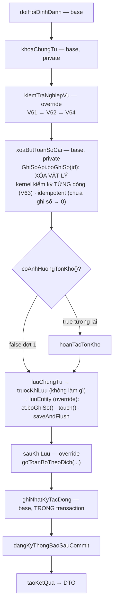

# F8 — Bỏ ghi sổ chứng từ trả lại hàng bán (một + hàng loạt)

| Mục | Nội dung |
|---|---|
| Mã chức năng | **F8** |
| UC nguồn | `PMKT-U-06476` — `4.usecases/PMKT-U-06476_BoGhiSo/UC_BoGhiSoTraLaiHangBan.md` + `AD_BoGhiSo.puml` |
| Màn hình | `SCR_DanhSachTraLaiHangBan.md` §Chức năng · **BR15** (bỏ ghi sổ hàng loạt) · `SCR_XemChiTiet:20-21` |
| Endpoint phụ trách | **A14** `POST /{id}/bo-ghi-so` · **A15** `POST /bo-ghi-so-hang-loat` |
| Quyền | `TraLaiHangBan.Unpost` — ⚠ **có thể chưa seed trong DB dev**, xem [00 §10](00-ke-hoach-tong.md) |

## 1. Quyết định riêng

| # | Quyết định | Trỏ về |
|---|---|---|
| 1.1 | Bỏ ghi sổ = **XÓA VẬT LÝ** dòng sổ cái, **không** sinh bút toán đảo | `ChungTuTemplate.java:52-53` (quyết định chốt tại migration V56); `GhiSoApi.java:33-36` |
| 1.2 | Hệ quả: chứng từ thuộc **kỳ đã khoá KHÔNG bỏ ghi sổ được** — hành vi đúng của mô hình xoá cứng, không phải thiếu sót | `GhiSoApi.java:40-42`; `BoGhiSoChungTuBanHang.java:22-23`; §12-Q7 file gốc |
| 1.3 | Trạng thái sau bỏ ghi sổ: `NHAP` nếu chưa từng duyệt, `DA_DUYET` nếu đã duyệt | `BaseChungTuEntity.boGhiSo()` — `:176-180` |
| 1.4 | **Gỡ sạch liên kết** `ctu_quan_he_chung_tu` trỏ tới chứng từ này | §5, giống [05](05-xoa.md) |
| 1.5 | Popup xác nhận `_207` là **việc FE**, BE không trả confirm | `6.messages.md` `_207` loại `Confirm` |

---

## 2. Hợp đồng API

### A14 — `POST /api/ban-hang/tra-lai-hang-ban/{id}/bo-ghi-so`

Quyền: `TraLaiHangBan.Unpost` (`BaseChungTuController.java:102-108`). Không body (FE gửi `{updatedAt}` — bỏ qua, §12-Q3 file gốc).

```jsonc
// Response 200
{
  "data": { /* … DTO: trangThaiChungTu = "NHAP" | "DA_DUYET", nguoiGhiSo/thoiGianGhiSo = null … */ },
  "message": "Bỏ ghi sổ chứng từ trả lại hàng bán thành công",
  "messageId": "MSG_PMKT-E-06469_005"
}
```

| code | HTTP | messageId | Khi nào |
|---|---|---|---|
| `FORBIDDEN` | 403 | `_007` | thiếu `TraLaiHangBan.Unpost` |
| `NOT_FOUND` | 404 | `_008` | `id` không có / `da_xoa` |
| **`NOT_POSTED`** | **409** | **`_211`** | `status ≠ DA_GHI_SO` — *"Chứng từ chưa ghi sổ"* |
| **`PERIOD_LOCKED`** | **409** | **`_204`** | dòng sổ cái cần gỡ thuộc kỳ đã khoá (1.2) |
| **`IN_USE`** | **409** | **`_208`** | hóa đơn điều chỉnh **đã phát hành/ký** — *"Hóa đơn đã phát hành, không được bỏ ghi sổ"*. ⚠ **chưa kiểm được đợt 1**, xem §4-V62 |
| `UNPOST_FAILED` | 400 | **`_209`** | kernel lỗi khi xoá bút toán |
| `SOURCE_DELETED` | 400 | — | chứng từ bán hàng gốc đã bị xóa (`UC:503,520`) |

### A15 — `POST /api/ban-hang/tra-lai-hang-ban/bo-ghi-so-hang-loat`

Quyền `.Unpost` (`BaseChungTuController.java:168-175`).

```jsonc
// Request
{ "ids": ["0f5c…", "1a2b…", "3c4d…"] }
```

```jsonc
// Response 200 — LUÔN 200
{
  "data": {
    "thanhCong": 1,
    "thatBai": 2,
    "loi": [
      { "id": "1a2b…", "soChungTu": "CTTL-000021", "code": "NOT_POSTED",
        "messageId": "MSG_PMKT-E-06469_211", "message": "Không thể bỏ ghi sổ chứng từ chưa ghi sổ" },
      { "id": "3c4d…", "soChungTu": "CTTL-000022", "code": "PERIOD_LOCKED",
        "messageId": "MSG_PMKT-E-06469_204", "message": "Chứng từ thuộc kỳ đã khóa sổ 31/07/2026. Không thể thao tác." }
    ]
  },
  "message": "Xử lý thành công 1 chứng từ, thất bại 2 chứng từ",
  "messageId": "MSG_PMKT-E-06469_005"
}
```

Khớp **BR42.3**: *"Tự động bỏ qua các chứng từ đang ở trạng thái 'Chưa ghi sổ'"* — chúng vào `loi[]` với `NOT_POSTED`/`_211` chứ **không** làm cả mẻ fail. BR42.3 muốn câu tổng kết dạng *"Bỏ ghi sổ thành công X/Y chứng từ. Đã bỏ qua Z chứng từ chưa ghi sổ."*; base trả *"Xử lý thành công 1 chứng từ, thất bại 2 chứng từ"* (`BaseChungTuController.java:186-190`) + `data` đủ dữ liệu để FE dựng câu đúng ⇒ **FE ghép câu**, BE không đổi base. Ghi vào báo cáo là lệch nhẹ về câu chữ.

---

## 3. Hậu điều kiện — cái gì bị gỡ

Nguyên văn `UC_BoGhiSoTraLaiHangBan.md:523-530`:

| # | Hậu điều kiện | Đợt 1 | Cơ chế |
|---|---|---|---|
| 1 | Trạng thái `Đã ghi sổ` → `Chưa ghi sổ` | ✅ | `ct.boGhiSo()` (1.3) |
| 2 | Bút toán bị xóa khỏi **Sổ cái** | ✅ | `GhiSoApi.boGhiSo(id)` — xóa vật lý (1.1) |
| 3 | **Sổ chi tiết công nợ** cập nhật theo | ✅ tự động | là view/báo cáo đọc từ `acc_so_cai` |
| 4 | Phiếu nhập kho bị hủy, **tồn kho giảm** | ❌ | không có module kho (§0-D6); `coAnhHuongTonKho() = false` ⇒ `hoanTacTonKho` **không** được gọi |
| 5 | Hóa đơn điện tử bị xóa | ❌ | không có module hóa đơn (§0-D6) |
| 6 | **Rollback sổ thuế GTGT đầu ra** — chỉ dòng `KhongTongHopToKhaiGTGT = false` | ❌ | không có module thuế |
| 7 | *(bổ sung so với UC)* Gỡ liên kết `ctu_quan_he_chung_tu` | ✅ | §5 bước 6 — xem lý do dưới |

**#7 không có trong UC nhưng bắt buộc.** `LoaiChungTu.SAL_CHUNG_TU_TRA_LAI_HANG_BAN.laTieuThu() = true` (`LoaiChungTu.java:64`) ⇒ liên kết của nó **lấy hàng đi khỏi** dòng bán hàng gốc. Chứng từ đã bỏ ghi sổ về trạng thái sửa được, nhưng nếu liên kết còn thì `daTieuThu` vẫn tính ⇒ người dùng sửa tăng số lượng sẽ bị chặn `_107` một cách vô lý (số đã tính hai lần: liên kết cũ + liên kết mới).

> ⚠ **Điểm cần cân nhắc:** gỡ liên kết ở bước Bỏ ghi sổ nghĩa là sau đó chứng từ **không còn** truy vết về dòng bán hàng gốc ở bảng quan hệ — nhưng `chi_tiet.chung_tu_ban_id` / `chi_tiet_chung_tu_ban_hang_id` trên **chính dòng chi tiết** vẫn giữ, nên liên kết được **tạo lại** khi Lưu/Ghi sổ lần sau ([04 §5](04-chinh-sua.md)). Không mất dữ liệu.

---

## 4. Validation

| # | Luật | Điều kiện chặn | Thời điểm | Thông báo | BR nguồn |
|---|---|---|---|---|---|
| V60 | Quyền bỏ ghi sổ | thiếu `TraLaiHangBan.Unpost` | `kiemTraQuyen` — suy từ `hanhDong() = BO_GHI_SO` | 403 · `_007` | BR25 · `UC:480` |
| V61 | Chỉ bỏ ghi sổ khi **đã** ghi sổ | `!ct.daGhiSo()` | `kiemTraNghiepVu` — **đầu tiên** | 409 `NOT_POSTED` · `_211` | BR12 · BR42.1 · `UC:465,514` |
| V62 | Chứng từ con chưa ghi sổ / hóa đơn chưa phát hành | `phieu_nhap_kho_id ≠ null` \|\| `phieu_chi_id ≠ null` \|\| `dieu_chinh_hoa_don_ban_hang_id ≠ null` \|\| `quanHe.coLienKet(...)` | `kiemTraNghiepVu` | 409 `IN_USE` · `_208` | `UC:471` · `SCR:BR15` |
| V63 | Kỳ kế toán mở | dòng sổ cái cần gỡ thuộc kỳ đã khoá | **KERNEL** — `GhiSoApi.boGhiSo` kiểm theo **TỪNG** ngày hạch toán của các dòng đang gỡ | 409 · `_204` | BR17.1 · 1.2 |
| V64 | Chứng từ bán hàng gốc còn tồn tại | `chungTuBanHangId ≠ null` và `da_xoa = true` | `kiemTraNghiepVu` | 400 `SOURCE_DELETED` | `UC:482,503,520` · `SCR:BR15` |
| V65 | Tồn tại | không có / `da_xoa` | `chuanBiChungTu` | 404 · `_008` | BR29.1 |

> **V62 hiện chặn RỘNG HƠN `SCR:BR15`.** BR15 muốn chặn khi *"Hóa đơn điện tử **đã ký**"* / *"Phiếu nhập kho **đã khóa kỳ**"* — tức chỉ chặn khi con **đã ghi sổ**. BE hiện chỉ đọc được **sự tồn tại** của liên kết, chưa đọc được **trạng thái** của chứng từ con (module chưa có). Lời giải thích và mẫu code y hệt đã có ở `BoGhiSoChungTuBanHang.java:79-90`:
>
> *"Ba module đó chưa tồn tại trong `cell-app` nên hiện chỉ kiểm được **sự tồn tại** của liên kết… Bảng quan hệ KHÔNG giải được phần còn thiếu đó — nó lưu quan hệ, không lưu trạng thái của hai đầu. Muốn phân biệt 'con đã ghi sổ' với 'con còn nháp' thì vẫn phải hỏi module sở hữu chứng từ con, tức phải đợi module đó ra đời. Chỗ bổ sung là đúng hàm này."*
>
> Đợt 1 điều này **vô hại** (không sinh chứng từ con nào, §0-D6). `messageId = _208` là mã gần nghĩa nhất BA cấp.

**V63 KHÔNG tự cài.** Template **không** tự kiểm kỳ ở luồng bỏ ghi sổ (nguyên văn `ChungTuTemplate.java:227-229`): *"kernel kiểm theo TỪNG ngày hạch toán riêng của các dòng đang gỡ, với mã loại chứng từ tra ngược từ chính sổ cái. Template chỉ biết một ngày của header — kiểm ở đây vừa thừa vừa có thể chặn nhầm khi các dòng lệch ngày nhau."*

---

## 5. Luồng xử lý — `BoGhiSoTraLaiHangBan extends ChungTuTemplate<LenhTraLai.DoiTrangThai, TraLaiHangBanDto>`

`hanhDong() = BO_GHI_SO` ⇒ `luongBoGhiSo` (`ChungTuTemplate.java:231-243`) — **gỡ tác động cũ TRƯỚC, đổi trạng thái SAU**:



**Thứ tự "gỡ trước, đổi cờ sau" là bất biến** (nguyên văn `ChungTuTemplate.java:223-226`): *"tất cả trong một transaction: không tồn tại khoảnh khắc cờ nói 'chưa ghi sổ' mà sổ cái còn dòng."*

Cài đặt từng hook — mẫu 1:1 `BoGhiSoChungTuBanHang.java`:

| Hook | Việc |
|---|---|
| `hanhDong()` | `BO_GHI_SO` ⇒ quyền `Unpost` |
| `bangGoc()` · `maChucNang()` · `maLoaiChungTu()` | như [07 §5](07-ghi-so.md) |
| `chuanBiChungTu` | `nap(id)` → **`ctx.ghiNhanChungTu(ct)`** (bắt buộc: bước xóa bút toán chạy **trước** khi lưu và cần định danh bản ghi đang tồn tại) → `ctx.put(...)`. **Không** gọi `TinhToanTraLai` — không cần tính lại gì để gỡ |
| `kiemTraNghiepVu` | V61 → V62 → V64 |
| `truocKhiLuu` | **không cài** — không có gì phải chốt trước INSERT |
| `luuEntity` | `ct.boGhiSo()` → `ct.touch()` → `saveAndFlush` → `ctx.put` + `ctx.ghiNhanChungTu(daLuu)` |
| `sauKhiLuu` | **việc mới**: `quanHe.goToanBoTheoDich(LoaiChungTu.SAL_CHUNG_TU_TRA_LAI_HANG_BAN, ct.getId())` (§3 #7) |
| `coSinhButToan()` | `true` (mặc định) — nếu `false` thì `xoaButToanSoCai` **return sớm** và không gỡ gì (`:497-502`) |
| `coAnhHuongTonKho()` | `false` đợt 1 ⇒ `hoanTacTonKho` không được gọi ([07 §6](07-ghi-so.md)) |
| `taoKetQua` | `mapper.toDto(ct)` |
| `moTaAudit` | `"Bỏ ghi sổ chứng từ trả lại hàng bán số " + soChungTu` |

`xoaButToanSoCai` **idempotent** (`GhiSoApi.java:37-38`): chứng từ chưa ghi sổ thì trả 0, không ném lỗi.

### 5.1 Luồng hàng loạt A15 (BR15 của SCR · BR42.3 · BR45)

`HangLoatChungTuService.boGhiSo(ids)` → `chay(ids, crud::boGhiSo)` (`HangLoatChungTuService.java:49-52`) — cùng khung [05 §5.1](05-xoa.md): `traSoChungTu` trước vòng lặp, **một transaction / chứng từ**, `ApiException` → dòng lỗi thật, `RuntimeException` → `SYSTEM_ERROR`.

Khớp `UC:499-510`: duyệt lần lượt, kiểm trạng thái `Đã ghi sổ` + chứng từ gốc còn tồn tại, bản không đủ điều kiện **bỏ qua + ghi nhận mã lỗi**.

⚠ `SCR:BR15` thêm hai điều kiện **không kiểm được đợt 1**: *"Hóa đơn điện tử chưa ký"* và *"không có Phiếu nhập kho đã khóa kỳ"* — V62 chặn rộng hơn thay thế tạm.

---

## 6. Tương tranh & transaction

| Việc | Cơ chế | `file:dòng` |
|---|---|---|
| Ranh giới | một `@Transactional` quanh `thucThi`; A15 = **một transaction / chứng từ** | `ChungTuTemplate.java:102`; `HangLoatChungTuService.java:22-25` |
| Khoá bi quan | `khoaChungTu` ngay từ đầu — chặn "một người ghi sổ, một người bỏ ghi sổ" cùng lúc | `:231-233,376-378` |
| Nguyên tử gỡ↔đổi cờ | cùng transaction, gỡ trước (§5) | `:223-226` |
| Idempotency gỡ | `GhiSoApi.boGhiSo` trả 0 nếu chưa có gì để gỡ | `GhiSoApi.java:37-38` |
| Idempotency gỡ liên kết | `goToanBoTheoDich` gỡ mềm, gọi lại trả 0 | `QuanHeChungTuApi.java:41-46` |
| Chặn kỳ khoá ở DB | `period_guard` chặn `DELETE` vào kỳ khoá; cài đặt kiểm **sớm** để trả lỗi đọc được thay vì lỗi trigger | `GhiSoApi.java:40-43` |
| Khoá lạc quan | `@Version phien_ban` (`touch()` trong `luuEntity`); **không** token `updatedAt` (base không nhận body) | `BaseChungTuEntity.java:20-23`; R6 |

---

## 7. Kiểm thử

### 7.1 Unit

| Lớp test | Case | Input → kỳ vọng |
|---|---|---|
| `BoGhiSoTraLaiHangBanTest` | V61 | `status = NHAP` → 409 `NOT_POSTED` + `_211`; `GhiSoApi.boGhiSo` **never** |
| | thứ tự bất biến | `boGhiSo` (kernel) gọi **trước** `saveAndFlush` (`InOrder`) |
| | `chuanBiChungTu` | `ghiNhanChungTu` được gọi (thiếu → `IllegalStateException` từ `doiHoiDinhDanh`) |
| | không tính lại tiền | `TinhToanTraLai.apDung` **never** |
| | trạng thái sau gỡ | chưa duyệt → `NHAP`; đã duyệt (`nguoiDuyetId ≠ null`) → `DA_DUYET`; `nguoiGhiSo`/`thoiGianGhiSo` == `null` |
| | `touch()` | được gọi trước `saveAndFlush` |
| | gỡ liên kết | `goToanBoTheoDich` gọi **đúng 1 lần**, **sau** `luuEntity` |
| | tồn kho | `hoanTacTonKho` **never** (`coAnhHuongTonKho() == false`) |
| | không tự kiểm kỳ | `kyKeToan.kiemTraKyMo` **never** (V63 — kernel lo) |
| | V62 | `phieu_nhap_kho_id ≠ null` → 409 `IN_USE` + `_208` |
| | V64 | chứng từ gốc `da_xoa` → 400 `SOURCE_DELETED` |
| `TraLaiHangBanHangLoatServiceTest` | 3 id: 1 OK · 1 chưa ghi sổ · 1 kỳ khoá | `{1, 2}`, `loi[]` có `_211` và `_204` đúng bản |
| `TraLaiHangBanControllerTest` | messageId | `BO_GHI_SO` → `_005`; `BO_GHI_SO_HANG_LOAT` → `_005` |
| | quyền | `.Unpost` (**không** `.Post`) |

### 7.2 Tích hợp (cần Docker — chưa chạy được, R8)

| Lớp | Kiểm gì chỉ DB thật làm được |
|---|---|
| `BoGhiSoTraLaiHangBanIT` | ghi sổ rồi bỏ ghi sổ → `acc_so_cai` của chứng từ đó **rỗng hoàn toàn** (xóa vật lý, **không** có bút toán đảo) |
| | trạng thái về `NHAP`, `nguoi_ghi_so`/`thoi_gian_ghi_so` `NULL` |
| | `ctu_quan_he_chung_tu` đã gỡ; `daTieuThu(dòng gốc)` về giá trị trước khi lập |
| | sau khi bỏ ghi sổ → `PUT` sửa được (**không** còn 409 `_201`), và `doiSoatVoiSoCai` **không** nổ |
| | kỳ đã khoá → 409 `_204`, chứng từ **vẫn** `DA_GHI_SO`, sổ cái **vẫn** còn dòng (rollback sạch) — chốt chặn 1.2 |
| | gọi A14 hai lần → lần hai 409 `NOT_POSTED` |
| | ghi sổ → bỏ ghi sổ → ghi sổ lại: sổ cái có đúng số dòng như lần đầu, `so_chung_tu` không đổi |
| | `aud_audit_log` có dòng `BO_GHI_SO` |
| | A15 30 chứng từ lẫn trạng thái → bản hợp lệ commit, bản lỗi rollback riêng |

---

## 8. Mã thông báo thiếu / lệch

| Ca | BA nói gì | Mã có sẵn | Xử lý |
|---|---|---|---|
| Chứng từ con đã ghi sổ (không phải hóa đơn) | `SCR:BR15` — *"Phiếu nhập kho đã khóa kỳ"* | chỉ có `_208` *"Hóa đơn đã phát hành…"* | dùng `_208` (gần nghĩa nhất). **Nếu BA muốn phân biệt PNK ⇄ HĐ thì cần cấp thêm mã** |
| Câu tổng kết hàng loạt của BR42.3 | *"Bỏ ghi sổ thành công X/Y chứng từ. Đã bỏ qua Z chứng từ chưa ghi sổ."* | không có mã | base trả câu khác (§2-A15); **FE ghép câu** từ `data` |
| Chứng từ gốc đã xóa | `UC:520` — *"hiển thị thông báo 'Chứng từ bán hàng gốc không còn tồn tại'"* | không có mã | `code = SOURCE_DELETED`, `message` nguyên văn UC |

---

## 9. BR đã áp dụng

| BR | Áp ở bước nào |
|---|---|
| BR12 trạng thái | V61, 1.3 |
| BR13.1 · BR42.2 nút thao tác | nút Bỏ ghi sổ chỉ hiện khi `Đã ghi sổ` — FE; BE **vẫn** kiểm V61 (BR42.1: *"Nếu thao tác được gọi ép qua API với chứng từ chưa ghi sổ → chặn"*) |
| BR16 cảnh báo nghiệp vụ | §2 bảng lỗi, §8 |
| BR17 kỳ kế toán | V63 — kernel kiểm từng ngày của dòng đang gỡ |
| BR25 phân quyền | V60 (`.Unpost` — ⚠ kiểm seed, [00 §10](00-ke-hoach-tong.md)) |
| BR28 multi-tenant | RLS + `TenantContext` |
| BR29.2 xóa lan | gỡ liên kết = hình thức *"Ngắt liên kết dữ liệu (set null/reference remove)"* |
| BR36 ghi sổ | đảo chiều của BR36: gỡ toàn bộ dòng của chứng từ, không chọn lọc |
| BR41 tham chiếu chéo | **không áp dụng** — quan hệ nguồn↔đích là ràng buộc nghiệp vụ (`business_rules.md:1012-1014`) |
| BR42.1 điều kiện áp dụng | V61 |
| BR42.3 xử lý hàng loạt | §5.1; ⚠ câu tổng kết lệch (§8) |
| BR45 thao tác hàng loạt | §5.1; ⚠ thiếu cột Ngày chứng từ ([05 §8](05-xoa.md)) |
| BR46 trường hệ thống | `nguoi_ghi_so`/`thoi_gian_ghi_so` về `null` (`BaseChungTuEntity.java:176-180`) |

**Hậu điều kiện chưa đạt (§3):** hủy Phiếu nhập kho + **giảm tồn kho** · xóa Hóa đơn điện tử · **rollback sổ thuế GTGT đầu ra**. Điều kiện `SCR:BR15` *"HĐ điện tử chưa ký"* / *"PNK chưa khóa kỳ"* thay bằng V62 chặn rộng hơn.
