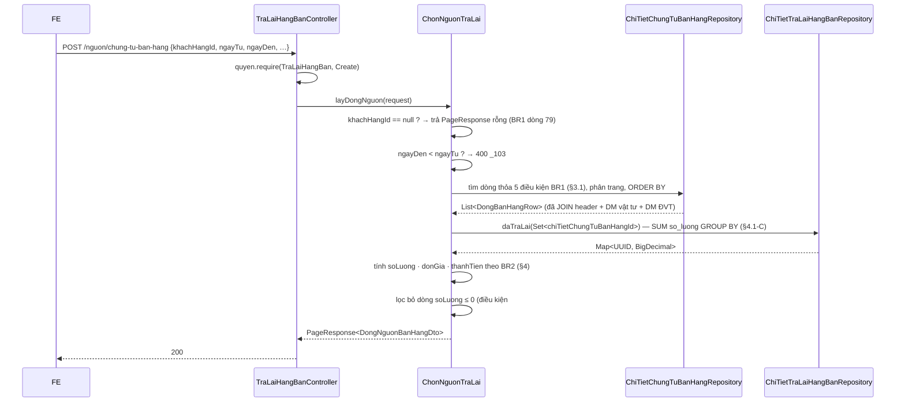

# F9 — Hai popup chọn chứng từ nguồn (BR1 · BR2 · BR5)

| Mục | Nội dung |
|---|---|
| Mã chức năng | **F9** |
| UC nguồn | `PMKT-U-06471` bước 4 (`UC_ThemMoiTraLaiHangBan.md:108`) |
| Màn hình | `SCR_ThemMoiTraLaiHangBan.md:42-253` — §Chọn chứng từ bán hàng gốc · **BR1** (quy tắc load) · **BR2** (công thức SL/ĐG/Thành tiền) · **BR5** (quy tắc fill) |
| Endpoint phụ trách | **A17** `POST /nguon/chung-tu-ban-hang` · **A18** `POST /nguon/hoa-don-dieu-chinh` |
| Quyền | `TraLaiHangBan.Create` — người dùng đang lập chứng từ mới |
| Nợ FE tương ứng | `IMPLEMENT.md:143` (N2) — *"Lưới cần endpoint tra DÒNG HÀNG của chứng từ nguồn (kèm SL đã trả lại)… Hàm nạp được TIÊM qua props (`useNguonChuaCoApi`) nên nối API là sửa đúng một hook"* |

## 1. Quyết định riêng

| # | Quyết định | Vì sao KHÔNG chọn phương án kia |
|---|---|---|
| 1.1 | **Endpoint mới** thuộc module trả lại hàng bán, không mở rộng `/chung-tu-ban-hang/search` | `/chung-tu-ban-hang/search` là màn danh sách của epic E-06194 và chỉ trả **header**; thêm projection dòng hàng + cột "SL đã trả lại" vào đó là làm nặng một API đang chạy cho nhu cầu của epic khác. §0-D8 |
| 1.2 | Trả về **DÒNG HÀNG** (grain dòng), không phải chứng từ | BR1 nói *"Load tất cả các **dòng** trên chứng từ thỏa mãn"* (`SCR:81`), và lưới kết quả của popup là lưới dòng hàng (`SCR:59-73`) |
| 1.3 | `Số lượng` (còn được trả) tính bằng `QuanHeChungTuApi.daTieuThu`, **không** thêm cột đếm trên bảng bán hàng | `QuanHeChungTuApi.java:11-15` — *"Không có `capNhatLienKet` — và đó là chủ ý"*; đồ thị quan hệ là nguồn sự thật duy nhất, thêm counter là nguồn thứ hai phải đồng bộ |
| 1.4 | **A18 luôn trả rỗng đợt 1** nhưng vẫn khai endpoint | FE đã dựng popup và inject hàm nạp; endpoint rỗng ⇒ FE không phải sửa gì khi module hóa đơn điều chỉnh ra đời. §1.2 file gốc |
| 1.5 | BE **không** làm phần "fill dữ liệu sang form" (BR5) — chỉ trả dòng hàng đầy đủ trường, FE tự đổ | BR5 là quy tắc **giao diện** (trường nào readonly, tab nào lấy từ đâu — `SCR:168-243`); FE đã cài trong `helpers/nguon.ts` (`IMPLEMENT.md:49`) |
| 1.6 | Endpoint chỉ đọc, `@Transactional(readOnly = true)`, **không** khoá dòng nguồn | khoá chỉ có nghĩa trong transaction ghi; chốt chặn trả vượt nằm ở `lienKet` lúc Lưu ([03 §4](03-them-moi.md) V10) |

---

## 2. Hợp đồng API

### A17 — `POST /api/ban-hang/tra-lai-hang-ban/nguon/chung-tu-ban-hang`

Quyền `TraLaiHangBan.Create`.

```jsonc
// Request — NguonChungTuBanHangRequest
{
  "khachHangId": "a1b2…",              // BẮT BUỘC (SCR:54)
  "keyword": "CTBH-000",               // lọc theo số chứng từ (SCR:55)
  "ngayTu": "2026-08-01",              // BẮT BUỘC (SCR:56) — mặc định FE: từ đầu tháng
  "ngayDen": "2026-08-14",             // BẮT BUỘC
  "apDungDonGiaSauTraLai": false,      // SCR:57 — đổi công thức Đơn giá/Thành tiền (§4)
  "chungTuBanHangId": null,            // ≠ null ⇒ chỉ lấy dòng của ĐÚNG chứng từ đó (combo chọn nguồn, SCR:142-145)
  "page": 1,
  "pageSize": 20                       // SCR:144 — mặc định 20, scroll load tiếp 20
}
```

| Field | Kiểu | Bắt buộc | Ràng buộc | Nguồn BA |
|---|---|---|---|---|
| `khachHangId` | UUID | **Y** | *"Lần đầu NSD mở form ra không ngầm định load dữ liệu (do Khách hàng đang để trống)"* ⇒ thiếu → trả **rỗng**, không lỗi | `SCR:54,79` |
| `keyword` | string ≤ 100 | N | `like` trên `so_chung_tu` | `SCR:55` |
| `ngayTu` / `ngayDen` | `LocalDate` | **Y** | `ngayDen ≥ ngayTu`, lọc trên `ngay_hach_toan` | `SCR:56` · `_103` |
| `apDungDonGiaSauTraLai` | boolean | N | mặc định `false` | `SCR:57,108-113` |
| `chungTuBanHangId` | UUID | N | dùng cho combo "chỉ cho chọn 1 chứng từ" (`SCR:145`) | `SCR:142-145` |

```jsonc
// Response 200 — PageResponse<DongNguonBanHangDto>
{
  "data": [
    {
      /* ── Định danh để tạo liên kết ────────────────────── */
      "chungTuBanHangId": "aa11…",
      "chiTietChungTuBanHangId": "ct01…",
      "hoaDonBanHangId": "hd77…",
      "chiTietHoaDonBanHangId": "chd01…",

      /* ── Cột hiển thị của lưới (SCR:61-73) ───────────── */
      "ngayChungTu": "2026-08-05",
      "soChungTu": "CTBH-000201",
      "soHoaDon": "00000098",
      "maHang": "VT-001",
      "maHangId": "vt01…",
      "tenHang": "Bàn gỗ A",
      "donViTinhId": "dvt01…",
      "tenDonViTinh": "Cái",

      /* ── Ba cột theo công thức BR2 (§4) ──────────────── */
      "soLuong": 8.000,                 // = SL bán − SL đã trả lại
      "donGia": 5000000.00,
      "thanhTien": 40000000.00,

      /* ── Trường để FE fill sang lưới chi tiết (BR5) ──── */
      "loaiVatTuId": "lvt01…",
      "laDichVu": false,
      "khoId": "kho01…",
      "taiKhoanKhoId": "tk156…",
      "taiKhoanGiaVonId": "tk632…",
      "taiKhoanTraLaiId": "tk5212…",    // SCR:210 — theo DM VTHH
      "taiKhoanCongNoId": "tk131…",     // SCR:211 — theo CTBH gốc
      "taiKhoanThueGtgtId": "tk33311…",
      "chietKhauPhanTram": 5.00,
      "thueSuatGtgt": "10",
      "tinhChatThueGtgtId": "tc01…",
      "donGiaVon": 3500000.00,
      "hangKhuyenMai": false,

      /* ── Kiểm tra cùng loại tiền / tỷ giá (SCR:97-98) ── */
      "loaiTienId": "vnd0…",
      "maLoaiTien": "VND",
      "tyGia": 1.000000,

      /* ── Thông tin khách hàng để fill header (BR5) ───── */
      "khachHangId": "a1b2…",
      "tenKhachHang": "Công ty TNHH A",
      "maSoThue": "0101234567",
      "diaChi": "12 Trần Duy Hưng, Hà Nội",
      "nhanVienBanHangId": "b7c8…",
      "kiemPhieuXuatKhoCtbh": true,     // BR5: quyết định giá trị mặc định của "Kiêm phiếu nhập kho"
      "lapKemHoaDonCtbh": true          // BR5: tab Hóa đơn lấy từ CTBH hay từ DM khách hàng
    }
  ],
  "pagination": { "page": 1, "pageSize": 20, "totalItems": 34, "totalPages": 2 },
  "summary": null
}
```

| Lỗi | HTTP | messageId |
|---|---|---|
| Thiếu `.Create` | 403 | `_007` |
| `ngayDen < ngayTu` | 400 | `_103` |
| Không có dòng nào thỏa | 200, `data: []` | FE hiển thị `_008` |
| Thiếu `khachHangId` | 200, `data: []` | — (đúng BR1 dòng 79) |

### A18 — `POST /api/ban-hang/tra-lai-hang-ban/nguon/hoa-don-dieu-chinh`

Quyền `.Create`. Request tương tự A17 nhưng lọc trên `ngay_hoa_don`, **không** có `apDungDonGiaSauTraLai` (`SCR:57`: checkbox đó *"Chỉ hiển thị khi chọn nguồn là Chứng từ bán hàng hóa, dịch vụ"*).

**Đợt 1 luôn trả:**
```jsonc
{ "data": [], "pagination": { "page": 1, "pageSize": 20, "totalItems": 0, "totalPages": 0 }, "summary": null }
```

Kèm `ApiResponse` không dùng được (PageResponse không có messageId) ⇒ FE tự hiển thị "Không tìm thấy dòng hàng nào" như hiện tại (`IMPLEMENT.md:143`).

**Vì sao rỗng chứ không 400/501:** FE đã dựng popup, lọc, validate và inject hàm nạp; trả 400 sẽ làm popup hiện lỗi đỏ trong khi nghiệp vụ không có gì sai — chỉ là chưa có dữ liệu. Bảng `sal_dieu_chinh_hoa_don_ban_hang` **có thật** (`V1:16706`) nhưng không có module Java đọc nó (§0-D6). Khi module ra đời: cài thân hàm, FE **không** phải sửa.

---

## 3. BR1 — quy tắc load dòng nguồn (nguyên văn `SCR:77-99`)

### 3.1 Nguồn = Chứng từ bán hàng hóa, dịch vụ

Dòng được load phải thỏa **đủ 5** điều kiện:

| # | Điều kiện BA | Cài đặt |
|---|---|---|
| 1 | *"Có loại là Chứng từ bán hàng hoặc Chứng từ bán dịch vụ"* | Đợt 1 **chỉ** `sal_chung_tu_ban_hang` — `sal_chung_tu_ban_dich_vu` có bảng nhưng **không có module Java** (§5) |
| 2 | *"Có trạng thái là Đã ghi sổ"* | `header.status = 'DA_GHI_SO'` |
| 3 | *"Số lượng chưa trả lại > 0 (công thức cột Số lượng ở BR2)"* | `soLuong = dong.so_luong − daTieuThu(dong.id) > 0` (§4) |
| 4 | *"Với các dòng hàng hóa là Dịch vụ có SL = 0 → chỉ load lên nếu thành tiền sau trả lại/điều chỉnh giá > 0"* | dòng Dịch vụ (`loai_vat_tu` = Dịch vụ) và `so_luong = 0`: bỏ điều kiện #3, dùng `thanhTienConLai > 0` |
| 5 | *"Thỏa mãn tham số: Khách hàng và Thời gian"* | `header.khach_hang_id = :khachHangId` AND `header.ngay_hach_toan BETWEEN :ngayTu AND :ngayDen` |

Thêm: `header.da_xoa = false` AND `dong.da_xoa = false` AND `dong.loai_dong_hang = true` (bỏ dòng ghi chú).

**Sắp xếp** (`SCR:93`): *"Giảm dần Ngày hạch toán → Số chứng từ. Trong cùng 1 chứng từ thì sắp xếp theo đúng thứ tự khi lập chứng từ."*
⇒ `ORDER BY header.ngay_hach_toan DESC, header.so_chung_tu DESC, dong.thu_tu ASC`

**Phân trang** (`SCR:144`): 20 dòng/trang, scroll load tiếp 20.

### 3.2 Nguồn = Hóa đơn điều chỉnh — **ngoài phạm vi đợt 1**

Điều kiện BA (`SCR:87-91`), ghi lại để lần sau cài đúng:

| # | Điều kiện |
|---|---|
| 1 | *"Có Trạng thái hóa đơn là Hóa đơn điều chỉnh"* |
| 2 | *"Chưa được lập chứng từ trả lại hàng bán, giảm giá hàng bán nào"* ⇒ `NOT EXISTS` trong `ctu_quan_he_chung_tu` với `dong_nguon_id = <dòng HĐĐC>` |
| 3 | *"Chỉ load lên các dòng hàng có số lượng trên HĐ điều chỉnh ≤ 0 và có thành tiền sau trả lại/điều chỉnh giá < 0"* |
| 4 | Thỏa Khách hàng + Thời gian |

Sắp xếp (`SCR:94`): `ngay_hoa_don DESC, so_hoa_don DESC, thu_tu ASC`.

### 3.3 "Ghi nhớ lựa chọn lần trước"

`SCR:79` — *"Sau khi đã chọn chứng từ rồi, mở lại form này thì phải mặc định tích vào các dòng đã tích tại lần chọn gần nhất."*

**Việc của FE**, không phải BE: dòng đã chọn đang nằm trong lưới chi tiết của form (mỗi dòng giữ `chiTietChungTuBanHangId`), FE đối chiếu `data[].chiTietChungTuBanHangId` với lưới hiện tại để tự tích. BE **không** lưu state popup.

⚠ Hệ quả cần lưu ý: dòng **đã được chọn** vào chứng từ đang lập (chưa Lưu) thì `daTieuThu` **chưa** tính nó ⇒ `soLuong` trả về là số **chưa trừ** phần đang nhập dở. Đúng thiết kế (BE không biết form đang mở), và FE phải tự trừ phần đã đổ vào lưới. Ghi vào báo cáo cho FE biết.

### 3.4 Validate khi bấm Xác nhận (`SCR:95-98`)

| Luật | Nguyên văn | Ai kiểm |
|---|---|---|
| Chọn ít nhất 1 dòng | *"Chọn ít nhất 1 dòng"* | **FE** |
| Cùng loại tiền | *"Các chứng từ được chọn phải cùng loại tiền. Nếu khác loại tiền thì cảnh báo: 'Vui lòng chọn các chứng từ có cùng Loại tiền'"* | **FE** — BE trả `loaiTienId`/`maLoaiTien` từng dòng để FE so |
| Khác tỷ giá → hỏi tiếp tục | *"Các chứng từ được chọn không cùng Tỷ giá. Bạn có muốn tiếp tục không?"* | **FE** — BE trả `tyGia` từng dòng |

BE **không** kiểm ba luật này: chúng nói về *tập dòng người dùng đang tích chọn trên popup*, mà popup là state của FE. Chốt chặn ở BE là V10 lúc Lưu ([03 §4](03-them-moi.md)).

---

## 4. BR2 — công thức 3 cột `soLuong` · `donGia` · `thanhTien`

Nguyên văn `SCR:102-125`.

### 4.1 `soLuong`

```
soLuong = dong.so_luong − daTieuThu(dong.id)
```
`daTieuThu` = `QuanHeChungTuApi.daTieuThu(Set<dongNguonId>)` (`QuanHeChungTuApi.java:48-54`) — chỉ cộng liên kết có `loaiDich.laTieuThu() = true`. Dòng chưa bị tiêu thụ **không** xuất hiện trong map ⇒ dùng `getOrDefault(id, ZERO)`.

> ⚠ **`daTieuThu` cộng CẢ hóa đơn bán hàng và phiếu xuất kho**, không chỉ chứng từ trả lại. `LoaiChungTu.laTieuThu()` = `true` cho `SAL_HOA_DON_BAN_HANG`, `INV_PHIEU_XUAT_KHO`, `INV_PHIEU_NHAP_KHO`, `PUR_HOA_DON_MUA`, `SAL_CHUNG_TU_TRA_LAI_HANG_BAN` (`LoaiChungTu.java:59-64`).
>
> BA nói *"Số lượng = Số lượng trên chứng từ bán hàng − **Số lượng đã trả lại**"* (`SCR:106`) — tức chỉ trừ phần **đã trả lại**, không trừ phần đã xuất hóa đơn.
> **⇒ Không dùng `daTieuThu` trần.** Phải lọc theo loại đích. `QuanHeChungTuApi` hiện **không** có hàm `daTieuThuTheoLoai(loaiDich, dongIds)`.
>
> **Ba lựa chọn:**
>
> | | A — dùng `daTieuThu` trần | B — thêm hàm vào `QuanHeChungTuApi` | **C (chọn) — query riêng trong module** |
> |---|---|---|---|
> | Cách | trừ cả phần đã xuất HĐ/xuất kho | mở rộng `api/` của `quan_he_chung_tu` + `internal` | `ChiTietTraLaiHangBanRepository` tự `SUM(so_luong)` trên `sal_chung_tu_tra_lai_hang_ban_chi_tiet` GROUP BY `chi_tiet_chung_tu_ban_hang_id`, lọc `da_xoa = false` |
> | Đúng BA | ❌ SL còn được trả bị **thiếu hụt** vô lý | ✅ | ✅ |
> | Chi phí | 0 | đụng `api/` dùng chung của module khác (cần review chủ sở hữu) | 1 query trong module mình |
> | Rủi ro | sai số liệu | mở rộng hợp đồng công khai cho một nhu cầu | trùng phép đếm với `daTieuThu` — nhưng **khác mục đích**: đây là "đã trả lại", kia là "đã tiêu thụ mọi hình thức" |
>
> **Chọn C.** Ghi rõ trong javadoc là **không** thay `daTieuThu` — `lienKet` lúc Lưu vẫn dùng `daTieuThu` để chặn tổng tiêu thụ (V10), hai phép đếm phục vụ hai luật khác nhau. **Đưa vào §12 file gốc để dev chốt.**

Dòng **Dịch vụ** có `so_luong = 0` (`SCR:114-117`): `soLuong = donGia = 0`, không áp phép trừ.

### 4.2 `donGia` và `thanhTien`

| `apDungDonGiaSauTraLai` | `donGia` | `thanhTien` | Nguồn |
|---|---|---|---|
| **`false`** | `dong.don_gia` (trên CTBH) | `soLuong × donGia` | `SCR:108-110` |
| **`true`** | `thanhTien / soLuong` | `thanhTienSauTraLai` (công thức dưới) | `SCR:111-113` |

```
thanhTienSauTraLai = dong.thanh_tien
                   + Σ thành tiền trên phiếu ĐIỀU CHỈNH TĂNG
                   − Σ thành tiền trên phiếu ĐIỀU CHỈNH GIẢM
                   − Σ thành tiền trên CT TRẢ LẠI            (gắn với từng hàng hóa)
```

> ⚠ **Hai trong bốn số hạng không lấy được đợt 1.** "Phiếu điều chỉnh tăng/giảm" là `sal_chung_tu_dieu_chinh_gia_hang_ban` (epic PMKT-E-07664) — có bảng (`V1:16257`) nhưng **không có module Java**.
> **Xử lý:** `apDungDonGiaSauTraLai = true` đợt 1 chỉ trừ được phần **CT trả lại**, bỏ hai số hạng điều chỉnh giá. Ghi cảnh báo trong javadoc + báo cáo. **Không** trả 400: checkbox mặc định `false` (`SCR:57`) nên luồng thường không đi vào đây.

Dòng **Dịch vụ** `SL = ĐG = 0, Thành tiền ≠ 0` (`SCR:114-117`): `thanhTien = thanhTienSauTraLai` **bất kể** checkbox (`SCR:117`: *"Không bị ảnh hưởng bởi checkbox"*).

`SCR:119` (nguyên văn, lưu ý kiểm thử): *"Hành vi này (SL = ĐG = 0, Thành tiền ≠ 0) là **đúng theo thiết kế**, không phải lỗi. Không áp dụng validate MSG_106 (SL > 0) cho các dòng Dịch vụ."*

---

## 5. Phạm vi dữ liệu đợt 1

| Nguồn BA yêu cầu | Bảng | Module Java | Đợt 1 |
|---|---|---|---|
| Chứng từ bán hàng | `sal_chung_tu_ban_hang` + `..._chi_tiet` | ✅ `chung_tu_ban_hang` | ✅ **có** |
| Chứng từ bán **dịch vụ** | `sal_chung_tu_ban_dich_vu` + `sal_chi_tiet_chung_tu_ban_dv` (`V1:15841,15686`) | ❌ không có (epic PMKT-E-06195) | ❌ **thiếu** |
| Hóa đơn điều chỉnh | `sal_dieu_chinh_hoa_don_ban_hang` (`V1:16706`) | ❌ không có | ❌ **A18 rỗng** |
| Điều chỉnh giá hàng bán (cho công thức §4.2) | `sal_chung_tu_dieu_chinh_gia_hang_ban` (`V1:16257`) | ❌ không có (epic PMKT-E-07664) | ❌ **thiếu 2 số hạng** |

Truy vấn A17 đọc **thẳng** `ChiTietChungTuBanHangRepository` + `ChungTuBanHangRepository` — được phép vì cùng module Modulith (§0-D1). Đây chính là lợi ích chính của quyết định D1.

Khi `chung_tu_ban_dich_vu` ra đời: `ChonNguonTraLai` `UNION ALL` thêm một nhánh, hoặc module đó cài `DongChungTuPort` + một port đọc dòng hàng. **Không** phải sửa hợp đồng A17 (DTO đã có `soChungTu`, không phân biệt loại).

---

## 6. Luồng xử lý — `ChonNguonTraLai`



> ⚠ **Bẫy phân trang.** Điều kiện #3 (`soLuong > 0`) **không** diễn tả được bằng SQL thuần nếu `daTraLai` tính ở Java ⇒ lọc sau khi phân trang sẽ cho ra trang **thiếu dòng** (xin 20, trả 14).
>
> | | A — lọc ở Java sau phân trang | **B (chọn) — đưa phép trừ vào SQL** |
> |---|---|---|
> | Cách | `WHERE …` cơ bản + phân trang, rồi filter Java | `LEFT JOIN LATERAL (SELECT COALESCE(SUM(so_luong),0) …) AS tl ON true` + `WHERE dong.so_luong − tl.da_tra_lai > 0` |
> | Kết quả | trang thiếu dòng, `totalItems` sai | đúng, `COUNT` cũng đúng |
> | Chi phí | 0 | một `LATERAL` subquery — cần index `(tenant_id, chi_tiet_chung_tu_ban_hang_id)` trên bảng chi tiết trả lại ⇒ **thêm vào `V3`** ([11 §4](11-thiet-ke-db.md)) |
>
> **Chọn B**, cài ở `TraLaiHangBanRepositoryCustom`/`…Impl` (native query) — đúng chỗ dự án dành cho query động (`cell-app/CLAUDE.md:27`).

---

## 7. Tương tranh & transaction

| Việc | Cơ chế |
|---|---|
| Transaction | `@Transactional(readOnly = true)` — bắt buộc để GUC tenant bind, RLS hoạt động |
| Khoá | **không** (1.6) — chốt chặn trả vượt ở `lienKet` lúc Lưu |
| Race giữa xem popup và Lưu | hai người cùng thấy `soLuong = 8`, cùng nhập 8 → người sau bị `VuotSoLuongNguonException` lúc Lưu, nhờ `FOR UPDATE` trong `DongChungTuPort.khoaVaLaySoLuong` (`DongChungTuPort.java:32-44`). **Đúng thiết kế** — popup là ảnh chụp, không phải đặt chỗ |
| RLS | dữ liệu bán hàng cũng có RLS `tenant_isolation` + policy phạm vi đơn vị ⇒ user chỉ thấy chứng từ trong phạm vi của mình |

---

## 8. Kiểm thử

### 8.1 Unit

| Lớp test | Case | Input → kỳ vọng |
|---|---|---|
| `ChonNguonTraLaiTest` | thiếu `khachHangId` | → `PageResponse` rỗng, **không** ném lỗi (BR1 dòng 79) |
| | khoảng ngày đảo | `ngayDen < ngayTu` → 400 `_103` |
| | BR2 `soLuong` | SL bán 10, đã trả lại 2 → `soLuong = 8` |
| | BR2 checkbox `false` | `donGia = don_gia` gốc, `thanhTien = soLuong × donGia` |
| | BR2 checkbox `true` | `thanhTien = thanhTienSauTraLai`, `donGia = thanhTien / soLuong` |
| | dòng Dịch vụ SL=0 | `soLuong = donGia = 0`, `thanhTien` = thành tiền còn lại, **không** bị lọc bỏ nếu `> 0` |
| | dòng Dịch vụ SL=0, thành tiền = 0 | **bị lọc bỏ** (điều kiện #4) |
| | trả lại hết | SL bán 10, đã trả lại 10 → dòng **không** xuất hiện |
| | dòng ghi chú | `loai_dong_hang = false` → **không** xuất hiện |
| | chứng từ chưa ghi sổ | `status = NHAP` → **không** xuất hiện |
| | `chungTuBanHangId` chỉ định | chỉ trả dòng của đúng chứng từ đó |
| | không dùng `daTieuThu` trần | verify gọi `ChiTietTraLaiHangBanRepository.daTraLai`, **không** gọi `QuanHeChungTuApi.daTieuThu` (§4.1-C) |
| `DongNguonBanHangDtoTest` | đủ trường fill BR5 | DTO có đủ 6 TK + `chietKhauPhanTram` + `thueSuatGtgt` + `donGiaVon` + `loaiTienId` + `tyGia` |
| `ChonNguonHoaDonDieuChinhTest` | A18 đợt 1 | luôn trả `data: []`, `totalItems: 0`, **không** ném lỗi (1.4) |

### 8.2 Tích hợp (cần Docker — chưa chạy được, R8)

| Lớp | Kiểm gì |
|---|---|
| `ChonNguonTraLaiIT` | phân trang **đúng** khi có dòng bị lọc bởi điều kiện #3: xin 20 → trả đúng 20 dòng thỏa (chốt §6-B) |
| | `totalItems` khớp `COUNT` của cùng điều kiện |
| | sắp xếp: `ngay_hach_toan DESC, so_chung_tu DESC, thu_tu ASC` |
| | RLS: chứng từ bán hàng của tenant khác **không** lọt vào |
| | `EXPLAIN` dùng index `(tenant_id, chi_tiet_chung_tu_ban_hang_id)` |
| | end-to-end: A17 → chọn dòng → A7 Lưu → A17 lại thấy `soLuong` đã giảm đúng phần vừa trả |
| | trả lại 2 lần cộng lại vượt → lần hai 400 `_107` lúc Lưu |

---

## 9. BR đã áp dụng

| BR | Áp ở bước nào |
|---|---|
| BR1 phân trang | §3.1 — 20 dòng/trang |
| BR5 hiển thị combogrid | A17 là nguồn dữ liệu của combogrid "Chọn chứng từ" + popup nâng cao (`SCR:246-252`); trình bày là việc FE |
| BR8 khoảng thời gian | `ngayTu`/`ngayDen` bắt buộc, validate `_103` |
| BR10 trường chọn nguồn | 2 giá trị nguồn = 2 endpoint (A17/A18); BR10 liệt kê 6 nguồn nhưng epic này chỉ dùng 2 (`SCR:44-46`) — **epic thắng trong phạm vi epic** |
| BR11 tìm kiếm | `keyword` `like` trên số chứng từ |
| BR12 trạng thái | điều kiện #2 — chỉ chứng từ `Đã ghi sổ` |
| BR18 ngoại tệ | DTO trả `loaiTienId`/`maLoaiTien`/`tyGia` để FE kiểm cùng loại tiền/tỷ giá (§3.4) |
| BR25 phân quyền | `.Create` |
| BR28 multi-tenant | RLS ở cả bảng bán hàng và bảng trả lại |
| BR29.1 xóa mềm | `da_xoa = false` ở cả header và dòng |

**BR / yêu cầu chưa đạt:**
- Nguồn **Chứng từ bán dịch vụ** (§5) — không có module.
- Nguồn **Hóa đơn điều chỉnh** (A18) — trả rỗng.
- Công thức `thanhTienSauTraLai` **thiếu 2 số hạng** điều chỉnh giá tăng/giảm (§4.2).
- Điều kiện `SCR:107` (*"Lập CTBH → Hóa đơn → HĐ điều chỉnh → CT trả lại thì cũng cần tạo liên kết giữa các chứng từ để xác định đúng SL thực tế chưa trả lại"*) — chuỗi 4 bước này cần module hóa đơn điều chỉnh, chưa làm được.
