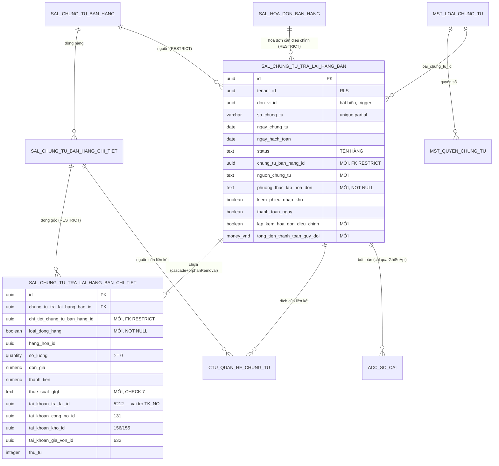

# F11 — Thiết kế DB & migration `V3`

| Mục | Nội dung |
|---|---|
| Bảng chính | `sal_chung_tu_tra_lai_hang_ban` — **đã có, 61 cột** (`db/migration/V1__baseline.sql:16480`) |
| Bảng con | `sal_chung_tu_tra_lai_hang_ban_chi_tiet` — **đã có, 44 cột** (`V1:16631`) |
| Migration mới | `V3__sal_tra_lai_hang_ban_api.sql` — số hiệu lớn nhất hiện tại là **`V2`** (`ls db/migration/` → `V1__baseline.sql`, `V2__seed_toan_cuc.sql`) |
| Việc chính | **1 DROP · 28 ADD (header) · 17 ADD (chi tiết) · 1 ALTER CHECK · 2 INSERT seed · 1 REPLACE FUNCTION · 3 INDEX** |
| Nguyên tắc | **KHÔNG `CREATE TABLE`** — hai bảng đã tồn tại với đủ RLS, trigger, FK, unique. Chỉ `ALTER` |

---

## 1. Hiện trạng bảng (nguồn sự thật)

### 1.1 Kiểm tra đã chạy

```bash
cd cell-app/src/main/resources/db/migration
grep -n "CREATE TABLE public.sal_chung_tu_tra_lai_hang_ban" V1__baseline.sql
# 16480:CREATE TABLE public.sal_chung_tu_tra_lai_hang_ban (
# 16631:CREATE TABLE public.sal_chung_tu_tra_lai_hang_ban_chi_tiet (

sed -n '16480,16546p' V1__baseline.sql | grep -E "^    [a-z_]+ " | wc -l   # → 61
sed -n '16631,16682p' V1__baseline.sql | grep -E "^    [a-z_]+ " | wc -l   # → 44
```

⚠️ **`docs/doing/db-spec/41-sal-tralaihangban.md` đã LỖI THỜI** ở hai điểm — không dùng nó làm nguồn sự thật:

| db-spec nói | Sự thật (baseline 2026-08-13) |
|---|---|
| Bảng chi tiết tên `sal_chi_tiet_chung_tu_tra_lai_hang_ban` (`41-sal-…md:12,102`) | Tên thật là **`sal_chung_tu_tra_lai_hang_ban_chi_tiet`** (`V1:16631`) |
| Header có "53 cột hiện có" (`:86`) · chi tiết "45 cột" (`:175`) | **61** và **44** |

### 1.2 Header — 61 cột đã có

| Nhóm | Cột |
|---|---|
| **Base/audit/tenant** (theo `BaseChungTuEntity` + `BaseEntity`) | `id` · `tenant_id` · `phien_ban` · `ngay_tao` · `nguoi_tao` · `ngay_cap_nhat` · `nguoi_cap_nhat` · `da_xoa` · `ngay_xoa` · `nguoi_xoa` · `chi_nhanh_id` · `loai_chung_tu_id` · `giao_dich_chung_tu_id` · `so_chung_tu` · `ngay_chung_tu` · `ngay_hach_toan` · `status` · `nguoi_duyet_id` · `ngay_duyet` · `nguoi_ghi_so` · `thoi_gian_ghi_so` |
| **Phạm vi đơn vị** (RLS) | `don_vi_id` — bất biến sau khi tạo, trigger `fn_pv_sal_chung_tu_tra_lai_hang_ban` (`V1:2871-2879`) |
| **Khách hàng (snapshot)** | `khach_hang_id` · `ten_khach_hang` · `ma_so_thue` · `dia_chi` · `nguoi_lien_he` · `so_dien_thoai` · `nhan_vien_ban_hang_id` · `nguoi_mua_hang` · `ma_so_dvqhns` · `cccd` · `ho_chieu` |
| **Điều khiển nghiệp vụ** | `kiem_phieu_nhap_kho` · `thanh_toan_ngay` · `lap_kem_phieu_chi` · `hinh_thuc_thanh_toan` · `da_nhap_kho` |
| **Chiết khấu** | `loai_chiet_khau` · `gia_tri_chiet_khau` |
| **Loại tiền** | `loai_tien_id` · `ty_gia` |
| **Chứng từ liên kết** | `hoa_don_ban_hang_id` · `phieu_nhap_kho_id` · `phieu_chi_id` · `so_chung_tu_phieu_chi` · `dieu_chinh_hoa_don_ban_hang_id` · `tai_khoan_tien_id` · `tai_khoan_ngan_hang_chi_id` · `muc_dich_thu_chi_id` · `nguoi_giao` · `nguoi_nhan` |
| **Tổng tiền** (`money_vnd` = `numeric(18,2)`) | `tong_tien_hang_hoa` · `tong_tien_chiet_khau` · `tong_tien_truoc_thue` · `tong_tien_thue_gtgt` · `tong_tien_sau_thue` · `tong_tien_thanh_toan` · `so_tien_da_thanh_toan` |
| **⚠ Cột thừa** | `trang_thai_chung_tu` — **PHẢI DROP**, xem §2.1 |

### 1.3 Chi tiết — 44 cột đã có

| Nhóm | Cột |
|---|---|
| **Base/audit/tenant** | `id` · `tenant_id` · `phien_ban` · `thu_tu` · `ngay_tao` · `nguoi_tao` · `ngay_cap_nhat` · `nguoi_cap_nhat` · `da_xoa` · `ngay_xoa` · `nguoi_xoa` |
| **Cha** | `chung_tu_tra_lai_hang_ban_id` (FK → header, `V1:27953`) |
| **Nguồn** | `chung_tu_ban_id` (FK → `sal_chung_tu_ban_hang`, `V1:28065`) · `hoa_don_ban_hang_id` (FK, `:28073`) · `chi_tiet_hd_ban_hang_id` · `chi_tiet_hoa_don_dieu_chinh_id` · `phieu_nhap_kho_id` · `chi_tiet_phieu_nhap_kho_id` |
| **Hàng hóa** | `hang_hoa_id` · `ten_hang` · `don_vi_tinh_id` · `kho_id` · `so_lo` · `han_su_dung` · `hang_khuyen_mai` |
| **Số lượng & giá** | `so_luong` (`quantity`) · `don_gia` · `thanh_tien` · `don_gia_von` · `gia_von` · `tu_nhap_don_gia_von` |
| **Chiết khấu** | `chiet_khau_phan_tram` (`percent_rate`) · `chiet_khau` |
| **Thuế** | `thue_suat_gtgt_id` (uuid → danh mục) · `tai_khoan_thue_gtgt_id` · `tien_thue_gtgt` |
| **Tài khoản hạch toán** | `tai_khoan_tra_lai_id` · `tai_khoan_cong_no_id` · `tai_khoan_kho_id` · `tai_khoan_gia_von_id` |
| **Bổ sung** | `hop_dong_id` · `don_vi_id` · `khoan_muc_chi_phi_id` · `vu_viec_id` |

### 1.4 Hạ tầng đã có — **không làm lại**

| Thứ | `file:dòng` |
|---|---|
| PK cả 2 bảng | `V1:19713,19721` |
| Unique số chứng từ, partial đúng soft-delete: `uq_sal_cttl_so_ct (tenant_id, so_chung_tu) WHERE da_xoa = false AND so_chung_tu <> ''` | `V1:23654` |
| CHECK `status` ∈ `NHAP/CHO_DUYET/DA_DUYET/DA_GHI_SO/HUY` (`NOT VALID`) | `V1:18113` |
| CHECK `hinh_thuc_thanh_toan` ∈ `'Tiền mặt','Chuyển khoản'` | `V1:16543` |
| CHECK `loai_chiet_khau` ∈ 4 giá trị tiếng Việt | `V1:16544` |
| CHECK `trang_thai_chung_tu` ∈ `'Chưa ghi sổ','Đã ghi sổ'` | `V1:16545` → **DROP theo cột** |
| RLS `tenant_isolation` cả 2 bảng | `V1:31687,31694` |
| RLS phạm vi đơn vị: `pv_select` · `pv_insert` · `pv_update` (header) | `V1:30031,29676,30528` |
| `FORCE ROW LEVEL SECURITY` cả 2 bảng | `V1:16548,16674` |
| Trigger audit `fn_audit()` cả 2 bảng | `V1:25432,25474` |
| Trigger gán `don_vi_id` mặc định (BEFORE INSERT) | `V1:26076` |
| Trigger bất biến `don_vi_id` + guard xoá (BEFORE UPDATE) | `V1:26251` + hàm `:2871` |
| Index: `(tenant_id, chung_tu_tra_lai_hang_ban_id)` · `(tenant_id, chi_tiet_hoa_don_dieu_chinh_id) WHERE …` · `(tenant_id, hoa_don_ban_hang_id)` · 2 index phạm vi đơn vị | `V1:21743,21736,21792,22415,22443` |
| FK: chi tiết→cha · chi tiết→CTBH · chi tiết→HĐBH · header→HĐBH · header→HĐĐC · header→`mst_don_vi` | `V1:27953,28065,28073,28089,28081,27417` |
| Whitelist `ck_ctu_qhct_loai_dich` đã chấp nhận `SAL_CHUNG_TU_TRA_LAI_HANG_BAN` | `V1:7233` |
| Domain type | `money_vnd numeric(18,2)` `:73` · `money_foreign numeric(18,4)` `:66` · `exchange_rate numeric(18,6)` `:48` · `percent_rate numeric(5,2)` `:80` · `quantity numeric(18,3)` `:94` |

**Kết luận — thiếu gì so với BA/FE:** 28 cột header, 17 cột chi tiết, 1 cột phải DROP, 1 CHECK phải nới, 1 hàm phải sửa, 2 seed, 3 index. Đích danh ở §2 và §3.

---

## 2. Cột thêm mới / sửa trên **bảng header**

### 2.1 DROP `trang_thai_chung_tu` — **việc quan trọng nhất**

| Cột | Vấn đề | Bằng chứng |
|---|---|---|
| `trang_thai_chung_tu text NOT NULL` + CHECK 2 giá trị | Entity chỉ map `status` (`BaseChungTuEntity.java:70-73`) ⇒ mọi `INSERT` từ JPA **fail `23502` not-null violation** ngay request đầu tiên | `V1:16519,16545` |

`sal_chung_tu_ban_hang` **đã DROP đúng cột này ở V309** — nguyên văn `core/entity/TrangThaiChungTu.java:9-12`: *"Lưu bằng tên hằng (`@Enumerated(STRING)`), không phải chuỗi tiếng Việt như cột `trang_thai_chung_tu` mà V75 từng đặt cho luồng bán hàng (**đã DROP ở V309**)"*.

Đây là dấu hiệu bảng trả lại hàng bán được sinh **trước** đợt chuẩn hoá và bị bỏ sót.

**Không chọn "map cả hai cột"**: đồng bộ hai cột trạng thái là nguồn lệch kinh điển; FE đã đọc **tên hằng** (`api/model.ts:170-171`); và `TrangThaiChungTu` có 5 giá trị trong khi CHECK cũ chỉ cho 2 ⇒ chứng từ ở `CHO_DUYET` không lưu được.

Backfill: **không cần** — nếu bảng đã có dữ liệu, `DROP COLUMN` chỉ bỏ giá trị `Chưa ghi sổ`/`Đã ghi sổ` mà `status` đã diễn tả đầy đủ. Câu kiểm trước ở §6.

### 2.2 Cột thêm mới — header (28 cột)

| # | Cột DB | Kiểu | NULL | Default | Ai ghi | Field DTO/FE | Vì sao cần |
|---|---|---|---|---|---|---|---|
| 1 | `nguon_chung_tu` | `text` + CHECK 2 | Y | — | client | `nguonChungTu` | `SCR:44-47` — combo chọn nguồn |
| 2 | `chung_tu_ban_hang_id` | `uuid` | Y | — | client | `chungTuBanHangId` | `UC:79-81` FK chứng từ bán hàng gốc **ở mức header**; hiện chỉ có ở chi tiết (`chung_tu_ban_id`) |
| 3 | `phuong_thuc_lap_hoa_don` | `text` + CHECK 3 | **N** | `'Người bán xuất hóa đơn điều chỉnh'` | client | `phuongThucLapHoaDon` | `SCR:262` bắt buộc; cột danh sách + lọc `eq` (`api/traLaiHangBanApi.ts:72`) |
| 4 | `phuong_thuc_thanh_toan` | `text` + CHECK 4 | Y | — | client | `phuongThucThanhToan` | `SCR:264`; **khác** `hinh_thuc_thanh_toan` cũ — xem §2.3 |
| 5 | `lap_kem_hoa_don_dieu_chinh` | `boolean` | Y | `false` | client | `lapKemHoaDonDieuChinh` | `SCR:266` |
| 6 | `ty_le_chiet_khau` | `percent_rate` | Y | `0` | client | `phanTramChietKhau` | `SCR:446`; `gia_tri_chiet_khau` giữ nghĩa "số tiền" — xem §2.4 |
| 7 | `so_phieu_nhap_kho` | `varchar(50)` | Y | — | client | `soPhieuNhapKho` | `SCR:281` tab Phiếu nhập kho — số phiếu **riêng** của PNK |
| 8 | `ly_do_chi` | `varchar(500)` | Y | — | client | `lyDoChi` | `SCR:315,332,345` |
| 9 | `nguoi_linh_tien` | `varchar(100)` | Y | — | client | `nguoiLinhTien` | `SCR:351` tab Séc tiền mặt |
| 10 | `so_giay_to` | `varchar(12)` | Y | — | client | `soGiayTo` | `SCR:352` |
| 11 | `ngay_cap` | `date` | Y | — | client | `ngayCap` | `SCR:353` |
| 12 | `noi_cap` | `varchar(255)` | Y | — | client | `noiCap` | `SCR:354` |
| 13 | `kem_theo` | `varchar(50)` | Y | — | client | `kemTheo` | `SCR:317,334,355` |
| 14 | `chung_tu_goc` | `varchar(500)` | Y | — | client | `chungTuGoc` | `SCR:318,335,356` |
| 15 | `ten_ngan_hang_chi` | `varchar(255)` | Y | — | server autofill | — (FE chưa dùng) | `SCR:329,348` "Ngân hàng chi tiền", autofill theo TK, không cho sửa. Thêm để không phải ALTER lần hai |
| 16 | `hinh_thuc_thanh_toan_hoa_don` | `varchar(50)` | Y | — | client | `hinhThucThanhToanHoaDon` | `SCR:384` — `varchar` **không** CHECK: SCR cho *"Nhập tay giá trị ngoài danh sách"* |
| 17 | `tai_khoan_ngan_hang_thu_id` | `uuid` | Y | — | client | `taiKhoanNganHangThuId` | `SCR:385` |
| 18 | `loai_dieu_chinh` | `text` + CHECK 3 | Y | `'Trả lại hàng bán'` | client | `loaiDieuChinh` | `SCR:386` |
| 19 | `ly_do_dieu_chinh` | `varchar(255)` | Y | — | client | `lyDoDieuChinh` | `SCR:387` |
| 20 | `la_hoa_don_dieu_chinh_sai_sot` | `boolean` | Y | `false` | client | `laHoaDonDieuChinhSaiSot` | `SCR:390`, BR-TLH-SAISOT — lưu để FE round-trip; luật lock ngoài phạm vi (§1.2 file gốc) |
| 21 | `mau_so_hoa_don` | `varchar(1)` | Y | — | client | `mauSoHoaDon` | `SCR:396` max 1 |
| 22 | `ky_hieu_hoa_don` | `varchar(6)` | Y | — | client | `kyHieuHoaDon` | `SCR:397` max 6 |
| 23 | `so_hoa_don` | `varchar(8)` | Y | — | client | `soHoaDon` | `SCR:398` max 8 |
| 24 | `ngay_hoa_don` | `date` | Y | — | client | `ngayHoaDon` | `SCR:399` |
| 25 | `hoa_don_can_dieu_chinh_id` | `uuid` | Y | — | client | `hoaDonCanDieuChinhId` | `SCR:362-371` "Chọn hóa đơn cần điều chỉnh" |
| 26 | `tong_tien_hang_hoa_quy_doi` | `money_vnd` | Y | `0` | **server tính** | `tongTienHangQuyDoi` | BR18; cột danh sách |
| 27 | `tong_tien_chiet_khau_quy_doi` | `money_vnd` | Y | `0` | **server tính** | `tongChietKhauQuyDoi` | BR18 |
| 28 | `tong_tien_thue_gtgt_quy_doi` | `money_vnd` | Y | `0` | **server tính** | `tongTienThueGtgtQuyDoi` | BR18 |
| 29 | `tong_tien_sau_thue_quy_doi` | `money_vnd` | Y | `0` | **server tính** | — | đối xứng với `tong_tien_sau_thue` |
| 30 | `tong_tien_thanh_toan_quy_doi` | `money_vnd` | Y | `0` | **server tính** | `tongTienThanhToanQuyDoi` | BR18; **cột tiền của màn danh sách** |

> Đếm lại: 30 dòng ở bảng trên — trong đó #15 là dự phòng cho SCR mà FE chưa dùng, #29 để đối xứng. Nếu muốn tối giản thì bỏ 2 cột đó → **28 cột bắt buộc**.

**Cột `NOT NULL` duy nhất là #3** — bảng có thể đã có dữ liệu ⇒ quy trình 3 bước ở §5 (thêm NULL → backfill default → set NOT NULL).

### 2.3 Cột `hinh_thuc_thanh_toan` cũ — nới CHECK hay để nguyên?

| Sự thật | Bằng chứng |
|---|---|
| CHECK hiện tại chỉ cho `'Tiền mặt'`, `'Chuyển khoản'` | `V1:16543` |
| BA có **hai** khái niệm khác nhau, **không** khái niệm nào khớp 2 giá trị đó | (a) "Phương thức thanh toán" popup = 4 giá trị *Chi tiền mặt / Ủy nhiệm chi / Séc chuyển khoản / Séc tiền mặt* (`SCR:264`); (b) cột "Hình thức thanh toán" danh sách = 2 giá trị *Điều chỉnh công nợ / Hoàn tiền ngay* (`SCR_DanhSach` §Bảng chính) |
| Cột `hinh_thuc_thanh_toan` **NOT NULL** | `V1:16515` |

⇒ **Ba việc trong `V3`:**
1. Thêm cột mới `phuong_thuc_thanh_toan` (§2.2 #4) cho 4 giá trị của popup.
2. Cột danh sách "Hình thức thanh toán" **dẫn xuất** từ `thanh_toan_ngay`, **không lưu** ([01 §4.1](01-xem-danh-sach.md)).
3. Cột cũ `hinh_thuc_thanh_toan` **NOT NULL** ⇒ phải xử lý, nếu không INSERT fail như §2.1. Hai phương án:

| | A — `DROP COLUMN hinh_thuc_thanh_toan` | **B (chọn) — `ALTER … DROP NOT NULL` + giữ cột** |
|---|---|---|
| Rủi ro | mất cột mà `sal_dieu_chinh_hoa_don_ban_hang` hoặc báo cáo nào đó có thể đang đọc | cột tồn tại nhưng luôn `NULL` ⇒ nhiễu schema |
| Kết luận | mạnh tay quá cho một cột chưa ai đọc chắc chắn | an toàn hơn, đảo lại được. **Chờ §12-Q5 của file gốc** — nếu BA chốt "Tiền mặt/Chuyển khoản" là ngữ nghĩa thật của tab chi tiền thì cột này **được dùng** thật |

### 2.4 Cột `gia_tri_chiet_khau` — hai nghĩa dùng chung một cột

`gia_tri_chiet_khau numeric(18,2)` (`V1:16493`) hiện phải chở **cả** "% chiết khấu" (khi `loai_chiet_khau = 'Theo % hóa đơn'`) **và** "số tiền chiết khấu" (khi `= 'Theo số tiền trên tổng hóa đơn'`). Cùng cách `sal_chung_tu_ban_hang` làm (`V1:15975`).

⇒ Thêm `ty_le_chiet_khau percent_rate` (§2.2 #6) và giữ `gia_tri_chiet_khau` cho số tiền:

| `loai_chiet_khau` | Cột dùng | FE gửi |
|---|---|---|
| `Không chiết khấu` | — | — |
| `Theo mặt hàng` | (mức dòng: `chi_tiet.chiet_khau_phan_tram`) | `chietKhauPhanTram` từng dòng |
| `Theo % hóa đơn` | **`ty_le_chiet_khau`** | `phanTramChietKhau` |
| `Theo số tiền trên tổng hóa đơn` | `gia_tri_chiet_khau` | (FE chưa có field — ngoài phạm vi) |

**Vì sao không dùng lại `gia_tri_chiet_khau` cho %:** `numeric(18,2)` cho một giá trị 0–100 là sai kiểu theo BR7.1 (phần trăm = `decimal(5,2)`), và một cột hai nghĩa buộc mọi query đọc nó phải kèm `loai_chiet_khau` — nguồn lỗi im lặng.

---

## 3. Cột thêm mới — **bảng chi tiết** (17 cột)

| # | Cột DB | Kiểu | NULL | Default | Ai ghi | Field DTO/FE | Vì sao cần |
|---|---|---|---|---|---|---|---|
| 1 | `chi_tiet_chung_tu_ban_hang_id` | `uuid` | Y | — | client | `chiTietChungTuBanHangId` | **BẮT BUỘC** — khoá tạo `LenhLienKet` và nguồn của BR2 "SL đã trả lại". Cột `chi_tiet_hd_ban_hang_id` hiện có là dòng **HÓA ĐƠN**, không phải dòng chứng từ bán hàng |
| 2 | `loai_dong_hang` | `boolean` | **N** | `true` | client | `loaiDongHang` | `false` = dòng ghi chú (`api/model.ts:41-42`); quyết định dòng có tham gia tính toán/bút toán |
| 3 | `chiet_khau_thuong_mai` | `boolean` | Y | `false` | client | `chietKhauThuongMai` | BR13 của SCR (`SCR:635-640`) — dòng giảm trừ, thành tiền âm |
| 4 | `loai_vat_tu_id` | `uuid` | Y | — | client (snapshot) | `loaiVatTuId` | phân biệt Hàng hóa ⇄ **Dịch vụ** — nền của luật "dòng Dịch vụ được SL = 0" (`SCR:114-119`). §12-Q11 file gốc |
| 5 | `thue_suat_gtgt` | `text` + CHECK 7 | Y | — | client | `thueSuatGtgt` | FE gửi **mã chuỗi** `"0"/"5"/"8"/"10"/"KCT"/"KKKNT"/"KHAC"` (`constants.ts:79-90`); cột `thue_suat_gtgt_id` hiện có là uuid trỏ danh mục — **hai thứ khác nhau**, giữ cả hai |
| 6 | `gia_tri_thue_gtgt` | `percent_rate` | Y | — | client | `giaTriThueGtgt` | % thực tế khi `thue_suat_gtgt = 'KHAC'` (`constants.ts:247`) |
| 7 | `tinh_chat_thue_gtgt_id` | `uuid` | Y | — | client | `tinhChatThueGtgtId` | `SCR:476` "Nhóm HHDV mua vào" → `ENT_TinhChatThueGTGT` |
| 8 | `khong_tong_hop_to_khai_gtgt` | `boolean` | Y | `false` | client | `khongTongHopToKhaiGtgt` | `SCR:477`, BR_KhongTongHopToKhaiGTGT — lưu để round-trip; luật tự-tick ở FE |
| 9 | `so_phieu_xuat_id` | `uuid` | Y | — | client | `soPhieuXuatId` | `SCR:463,652-658` (BR15) — nhận và lưu, **không** validate đợt 1 |
| 10 | `mo_ta` | `text` | Y | — | client | — (FE chưa dùng) | diễn giải dòng → `DongHachToan.voiDienGiai` ([10 §3](10-hach-toan-va-chung-tu-kem.md)); mẫu `sal_chung_tu_ban_hang_chi_tiet.mo_ta` |
| 11 | `dien_giai_thue` | `text` | Y | — | client | — (FE chưa dùng) | diễn giải riêng cho bút toán thuế → `voiDienGiaiRieng(NV_THUE_GTGT, …)`; mẫu `sal_chung_tu_ban_hang_chi_tiet.dien_giai_thue` |
| 12 | `don_gia_quy_doi` | `money_vnd` | Y | `0` | **server tính** | — | BR18; đối xứng `sal_chung_tu_ban_hang_chi_tiet.don_gia_quy_doi` |
| 13 | `thanh_tien_quy_doi` | `money_vnd` | Y | `0` | **server tính** | `thanhTienQuyDoi` | BR18 |
| 14 | `chiet_khau_quy_doi` | `money_vnd` | Y | `0` | **server tính** | `chietKhauQuyDoi` | BR18 |
| 15 | `tien_thue_gtgt_quy_doi` | `money_vnd` | Y | `0` | **server tính** | `tienThueGtgtQuyDoi` | BR18 |
| 16 | `don_gia_von_quy_doi` | `money_vnd` | Y | `0` | **server tính** | — | BR18; cần cho bút toán giá vốn nguyên tệ |
| 17 | `gia_von_quy_doi` | `money_vnd` | Y | `0` | **server tính** | — | BR18; vế tiền của bút toán bước 4 ([10 §3](10-hach-toan-va-chung-tu-kem.md)) |

**Ngoài phạm vi, KHÔNG thêm đợt này:** `don_vi_tinh_quy_doi_id` · `he_so_quy_doi` · `so_luong_theo_dvc` (BR11 của SCR — ĐVT quy đổi, `SCR:490-492,627`). FE chưa dựng, và thêm cột không ai ghi là nợ schema. Ghi vào báo cáo.

**Đổi kiểu / đổi tên: KHÔNG có.** Mọi cột đã có đều giữ nguyên tên và kiểu; các chỗ lệch tên BA↔DB giải quyết ở **mapper**, xem §7.

---

## 4. Ràng buộc · index · khóa ngoại

| # | Loại | Định nghĩa | Vì sao | Chi phí |
|---|---|---|---|---|
| 1 | CHECK | `nguon_chung_tu IN ('Chứng từ bán hàng hóa, dịch vụ','Hóa đơn điều chỉnh')` | hợp đồng với `GiaTriDb` (`constants.ts:51-54`) | ~0 |
| 2 | CHECK | `phuong_thuc_lap_hoa_don IN ('Người mua xuất hóa đơn','Người bán xuất hóa đơn điều chỉnh','Không có hóa đơn')` | `constants.ts:27-31` | ~0 |
| 3 | CHECK | `phuong_thuc_thanh_toan IN ('Chi tiền mặt','Ủy nhiệm chi','Séc chuyển khoản','Séc tiền mặt')` | `constants.ts:43-48` | ~0 |
| 4 | CHECK | `loai_dieu_chinh IN ('Trả lại hàng bán','Sai sót','Khác')` | `constants.ts:57-61` | ~0 |
| 5 | CHECK | `chi_tiet.thue_suat_gtgt IN ('0','5','8','10','KCT','KKKNT','KHAC')` | `constants.ts:79-90` | ~0 |
| 6 | CHECK | `chi_tiet.so_luong >= 0` | BR: SL trả lại `> 0`, dòng Dịch vụ `= 0` ⇒ **`>= 0`**, không `> 0` (`SCR:114-119`) | ~0 |
| 7 | CHECK | `ty_le_chiet_khau BETWEEN 0 AND 100` · `chi_tiet.chiet_khau_phan_tram BETWEEN 0 AND 100` | BR7.1 + `SCR:446` | ~0 |
| 8 | **INDEX** | `(tenant_id, ngay_hach_toan DESC, ngay_chung_tu DESC, so_chung_tu) WHERE da_xoa = false` | **sort mặc định của A1** ([01 §6.2](01-xem-danh-sach.md)) — hiện **không có index nào** phủ; danh sách sẽ full-scan + sort | ghi chậm hơn ~2% |
| 9 | **INDEX** | `chi_tiet (tenant_id, chi_tiet_chung_tu_ban_hang_id) WHERE da_xoa = false AND chi_tiet_chung_tu_ban_hang_id IS NOT NULL` | **A17** — `LATERAL SUM(so_luong)` tính "SL đã trả lại" ([09 §6](09-chon-chung-tu-nguon.md)); không có index thì mỗi lần mở popup là seq-scan bảng chi tiết | ~1% |
| 10 | **INDEX** | `(tenant_id, khach_hang_id) WHERE da_xoa = false` | lọc `khachHangId` ở A1 + A17 | ~1% |
| 11 | FK | `chung_tu_ban_hang_id REFERENCES sal_chung_tu_ban_hang(id)` — **ON DELETE RESTRICT** | `UC:79-81` — *"Hành vi khi xóa chứng từ bán: **Chặn**"* | ~0 |
| 12 | FK | `chi_tiet.chi_tiet_chung_tu_ban_hang_id REFERENCES sal_chung_tu_ban_hang_chi_tiet(id)` — **RESTRICT** | như trên, mức dòng | ~0 |
| 13 | FK | `hoa_don_can_dieu_chinh_id REFERENCES sal_hoa_don_ban_hang(id)` — **RESTRICT** | `UC:83-85` — *"Không cho xóa hóa đơn nếu đã có chứng từ trả lại liên quan"* | ~0 |
| 14 | **KHÔNG** thêm FK | `khach_hang_id`, `*_tai_khoan_*_id`, `kho_id`, `hang_hoa_id`, `loai_vat_tu_id`, `don_vi_tinh_id` | `UC:91-97` — hành vi là **Snapshot**, không Chặn: *"Khi KH bị xóa/sửa, CT trả lại vẫn giữ nguyên thông tin cũ"*. FK cứng vào danh mục sẽ **chặn** xoá danh mục, trái ý đồ. Cùng lối làm với `chung_tu_ban_hang` (dùng "XFK" — khoá logic, không FK) | — |

> **Unique/partial index phải khớp đúng điều kiện soft-delete** — mọi index mới đều có `WHERE da_xoa = false`, cùng quy ước với `uq_sal_cttl_so_ct` (`V1:23654`). Thiếu điều kiện đó thì bản ghi đã xoá vẫn nằm trong index và chặn bản mới.

**Không thêm index nào cho `phuong_thuc_lap_hoa_don`** dù FE lọc `eq` trên nó: cột chỉ có 3 giá trị (selectivity thấp), index B-tree gần như không được planner chọn. Index không có query dùng là index thừa.

---

## 5. Migration `V3` — SQL đầy đủ

File: `cell-app/src/main/resources/db/migration/V3__sal_tra_lai_hang_ban_api.sql`

> Mục này **chỉ dịch §1-§4 sang SQL** — không phát sinh cột/index mới ở đây.

```sql
-- =====================================================================
-- V3 — PMKT-E-06469 Trả lại hàng bán: mở API cho hai bảng đã có schema.
--
-- Bảng sal_chung_tu_tra_lai_hang_ban (61 cột) và ..._chi_tiet (44 cột) dựng ở
-- V1__baseline.sql:16480,16631 — file này CHỈ ALTER, không CREATE TABLE.
--
-- Kế hoạch: docs/doing/PMKT-E-06469-tra-lai-hang-ban-api/11-thiet-ke-db.md
-- =====================================================================

-- ── 1. DROP cột trạng thái trùng lặp (§2.1) ─────────────────────────
-- `status` (BaseChungTuEntity, tên hằng) là nguồn sự thật duy nhất. Cột
-- `trang_thai_chung_tu` NOT NULL không DEFAULT sẽ làm mọi INSERT từ JPA fail
-- 23502. sal_chung_tu_ban_hang đã DROP đúng cột này ở V309.
ALTER TABLE public.sal_chung_tu_tra_lai_hang_ban
    DROP CONSTRAINT IF EXISTS sal_chung_tu_tra_lai_hang_ban_trang_thai_chung_tu_check,
    DROP COLUMN IF EXISTS trang_thai_chung_tu;

-- ── 2. Nới NOT NULL cột hinh_thuc_thanh_toan cũ (§2.3-B) ────────────
-- Chờ §12-Q5: cột này có 2 giá trị 'Tiền mặt'/'Chuyển khoản', không khớp cả
-- "Phương thức thanh toán" (4 giá trị) lẫn cột nhãn của màn danh sách.
ALTER TABLE public.sal_chung_tu_tra_lai_hang_ban
    ALTER COLUMN hinh_thuc_thanh_toan DROP NOT NULL;

-- ── 3. Cột mới — HEADER (§2.2) ──────────────────────────────────────
ALTER TABLE public.sal_chung_tu_tra_lai_hang_ban
    ADD COLUMN IF NOT EXISTS nguon_chung_tu               text,
    ADD COLUMN IF NOT EXISTS chung_tu_ban_hang_id         uuid,
    ADD COLUMN IF NOT EXISTS phuong_thuc_lap_hoa_don      text,
    ADD COLUMN IF NOT EXISTS phuong_thuc_thanh_toan       text,
    ADD COLUMN IF NOT EXISTS lap_kem_hoa_don_dieu_chinh   boolean DEFAULT false,
    ADD COLUMN IF NOT EXISTS ty_le_chiet_khau             public.percent_rate DEFAULT 0,
    ADD COLUMN IF NOT EXISTS so_phieu_nhap_kho            varchar(50),
    ADD COLUMN IF NOT EXISTS ly_do_chi                    varchar(500),
    ADD COLUMN IF NOT EXISTS nguoi_linh_tien              varchar(100),
    ADD COLUMN IF NOT EXISTS so_giay_to                   varchar(12),
    ADD COLUMN IF NOT EXISTS ngay_cap                     date,
    ADD COLUMN IF NOT EXISTS noi_cap                      varchar(255),
    ADD COLUMN IF NOT EXISTS kem_theo                     varchar(50),
    ADD COLUMN IF NOT EXISTS chung_tu_goc                 varchar(500),
    ADD COLUMN IF NOT EXISTS ten_ngan_hang_chi            varchar(255),
    ADD COLUMN IF NOT EXISTS hinh_thuc_thanh_toan_hoa_don varchar(50),
    ADD COLUMN IF NOT EXISTS tai_khoan_ngan_hang_thu_id   uuid,
    ADD COLUMN IF NOT EXISTS loai_dieu_chinh              text,
    ADD COLUMN IF NOT EXISTS ly_do_dieu_chinh             varchar(255),
    ADD COLUMN IF NOT EXISTS la_hoa_don_dieu_chinh_sai_sot boolean DEFAULT false,
    ADD COLUMN IF NOT EXISTS mau_so_hoa_don               varchar(1),
    ADD COLUMN IF NOT EXISTS ky_hieu_hoa_don              varchar(6),
    ADD COLUMN IF NOT EXISTS so_hoa_don                   varchar(8),
    ADD COLUMN IF NOT EXISTS ngay_hoa_don                 date,
    ADD COLUMN IF NOT EXISTS hoa_don_can_dieu_chinh_id    uuid,
    ADD COLUMN IF NOT EXISTS tong_tien_hang_hoa_quy_doi   public.money_vnd DEFAULT 0,
    ADD COLUMN IF NOT EXISTS tong_tien_chiet_khau_quy_doi public.money_vnd DEFAULT 0,
    ADD COLUMN IF NOT EXISTS tong_tien_thue_gtgt_quy_doi  public.money_vnd DEFAULT 0,
    ADD COLUMN IF NOT EXISTS tong_tien_sau_thue_quy_doi   public.money_vnd DEFAULT 0,
    ADD COLUMN IF NOT EXISTS tong_tien_thanh_toan_quy_doi public.money_vnd DEFAULT 0;

-- Backfill rồi mới NOT NULL (bảng có thể đã có dữ liệu — §6)
UPDATE public.sal_chung_tu_tra_lai_hang_ban
   SET phuong_thuc_lap_hoa_don = 'Người bán xuất hóa đơn điều chỉnh'
 WHERE phuong_thuc_lap_hoa_don IS NULL;

ALTER TABLE public.sal_chung_tu_tra_lai_hang_ban
    ALTER COLUMN phuong_thuc_lap_hoa_don SET DEFAULT 'Người bán xuất hóa đơn điều chỉnh',
    ALTER COLUMN phuong_thuc_lap_hoa_don SET NOT NULL;

-- ── 4. Cột mới — CHI TIẾT (§3) ──────────────────────────────────────
ALTER TABLE public.sal_chung_tu_tra_lai_hang_ban_chi_tiet
    ADD COLUMN IF NOT EXISTS chi_tiet_chung_tu_ban_hang_id uuid,
    ADD COLUMN IF NOT EXISTS loai_dong_hang               boolean DEFAULT true,
    ADD COLUMN IF NOT EXISTS chiet_khau_thuong_mai        boolean DEFAULT false,
    ADD COLUMN IF NOT EXISTS loai_vat_tu_id               uuid,
    ADD COLUMN IF NOT EXISTS thue_suat_gtgt               text,
    ADD COLUMN IF NOT EXISTS gia_tri_thue_gtgt            public.percent_rate,
    ADD COLUMN IF NOT EXISTS tinh_chat_thue_gtgt_id       uuid,
    ADD COLUMN IF NOT EXISTS khong_tong_hop_to_khai_gtgt  boolean DEFAULT false,
    ADD COLUMN IF NOT EXISTS so_phieu_xuat_id             uuid,
    ADD COLUMN IF NOT EXISTS mo_ta                        text,
    ADD COLUMN IF NOT EXISTS dien_giai_thue               text,
    ADD COLUMN IF NOT EXISTS don_gia_quy_doi              public.money_vnd DEFAULT 0,
    ADD COLUMN IF NOT EXISTS thanh_tien_quy_doi           public.money_vnd DEFAULT 0,
    ADD COLUMN IF NOT EXISTS chiet_khau_quy_doi           public.money_vnd DEFAULT 0,
    ADD COLUMN IF NOT EXISTS tien_thue_gtgt_quy_doi       public.money_vnd DEFAULT 0,
    ADD COLUMN IF NOT EXISTS don_gia_von_quy_doi          public.money_vnd DEFAULT 0,
    ADD COLUMN IF NOT EXISTS gia_von_quy_doi              public.money_vnd DEFAULT 0;

UPDATE public.sal_chung_tu_tra_lai_hang_ban_chi_tiet
   SET loai_dong_hang = true WHERE loai_dong_hang IS NULL;

ALTER TABLE public.sal_chung_tu_tra_lai_hang_ban_chi_tiet
    ALTER COLUMN loai_dong_hang SET NOT NULL;

-- ── 5. CHECK constraint (§4 #1-7) ───────────────────────────────────
ALTER TABLE public.sal_chung_tu_tra_lai_hang_ban
    ADD CONSTRAINT ck_sal_cttl_nguon_chung_tu
        CHECK (nguon_chung_tu IS NULL OR nguon_chung_tu = ANY (ARRAY[
            'Chứng từ bán hàng hóa, dịch vụ'::text, 'Hóa đơn điều chỉnh'::text])),
    ADD CONSTRAINT ck_sal_cttl_pt_lap_hoa_don
        CHECK (phuong_thuc_lap_hoa_don = ANY (ARRAY[
            'Người mua xuất hóa đơn'::text,
            'Người bán xuất hóa đơn điều chỉnh'::text,
            'Không có hóa đơn'::text])),
    ADD CONSTRAINT ck_sal_cttl_pt_thanh_toan
        CHECK (phuong_thuc_thanh_toan IS NULL OR phuong_thuc_thanh_toan = ANY (ARRAY[
            'Chi tiền mặt'::text, 'Ủy nhiệm chi'::text,
            'Séc chuyển khoản'::text, 'Séc tiền mặt'::text])),
    ADD CONSTRAINT ck_sal_cttl_loai_dieu_chinh
        CHECK (loai_dieu_chinh IS NULL OR loai_dieu_chinh = ANY (ARRAY[
            'Trả lại hàng bán'::text, 'Sai sót'::text, 'Khác'::text])),
    ADD CONSTRAINT ck_sal_cttl_ty_le_chiet_khau
        CHECK (ty_le_chiet_khau IS NULL OR (ty_le_chiet_khau >= 0 AND ty_le_chiet_khau <= 100));

ALTER TABLE public.sal_chung_tu_tra_lai_hang_ban_chi_tiet
    ADD CONSTRAINT ck_sal_cttl_ct_thue_suat_gtgt
        CHECK (thue_suat_gtgt IS NULL OR thue_suat_gtgt = ANY (ARRAY[
            '0'::text, '5'::text, '8'::text, '10'::text,
            'KCT'::text, 'KKKNT'::text, 'KHAC'::text])),
    ADD CONSTRAINT ck_sal_cttl_ct_so_luong CHECK (so_luong >= 0),
    ADD CONSTRAINT ck_sal_cttl_ct_ck_phan_tram
        CHECK (chiet_khau_phan_tram IS NULL
               OR (chiet_khau_phan_tram >= 0 AND chiet_khau_phan_tram <= 100));

-- ── 6. Khóa ngoại (§4 #11-13) ───────────────────────────────────────
ALTER TABLE public.sal_chung_tu_tra_lai_hang_ban
    ADD CONSTRAINT fk_sal_cttl_chung_tu_ban_hang
        FOREIGN KEY (chung_tu_ban_hang_id)
        REFERENCES public.sal_chung_tu_ban_hang(id) ON DELETE RESTRICT,
    ADD CONSTRAINT fk_sal_cttl_hoa_don_can_dieu_chinh
        FOREIGN KEY (hoa_don_can_dieu_chinh_id)
        REFERENCES public.sal_hoa_don_ban_hang(id) ON DELETE RESTRICT;

ALTER TABLE public.sal_chung_tu_tra_lai_hang_ban_chi_tiet
    ADD CONSTRAINT fk_sal_cttl_ct_dong_ban_hang
        FOREIGN KEY (chi_tiet_chung_tu_ban_hang_id)
        REFERENCES public.sal_chung_tu_ban_hang_chi_tiet(id) ON DELETE RESTRICT;

-- ── 7. Index (§4 #8-10) ─────────────────────────────────────────────
CREATE INDEX IF NOT EXISTS idx_sal_cttl_sort_mac_dinh
    ON public.sal_chung_tu_tra_lai_hang_ban
    USING btree (tenant_id, ngay_hach_toan DESC, ngay_chung_tu DESC, so_chung_tu)
    WHERE (da_xoa = false);

CREATE INDEX IF NOT EXISTS idx_sal_cttl_ct_dong_ban_hang
    ON public.sal_chung_tu_tra_lai_hang_ban_chi_tiet
    USING btree (tenant_id, chi_tiet_chung_tu_ban_hang_id)
    WHERE (da_xoa = false AND chi_tiet_chung_tu_ban_hang_id IS NOT NULL);

CREATE INDEX IF NOT EXISTS idx_sal_cttl_khach_hang
    ON public.sal_chung_tu_tra_lai_hang_ban
    USING btree (tenant_id, khach_hang_id)
    WHERE (da_xoa = false);

-- ── 8. Sửa fn_bang_cua_loai_chung_tu — R1 (§12-Q6) ──────────────────
-- Hàm ở V1:305-323 trỏ 13/20 tên bảng KHÔNG tồn tại. Trigger
-- trg_kiem_tra_tenant_quan_he (V1:25691) gọi nó ở MỌI insert vào
-- ctu_quan_he_chung_tu qua EXECUTE format('… FROM public.%I …') ⇒ tạo liên kết
-- dòng-với-dòng nổ 42P01. Sửa ĐÚNG 2 dòng epic này dùng; 11 dòng còn lại mở
-- ticket riêng (không đụng loại chứng từ của epic khác trong migration này).
CREATE OR REPLACE FUNCTION public.fn_bang_cua_loai_chung_tu(p_loai text, p_la_dong boolean)
RETURNS text LANGUAGE sql IMMUTABLE AS $$
    SELECT CASE WHEN p_la_dong THEN chi_tiet ELSE header END
    FROM (VALUES
        -- SỬA: sal_chi_tiet_chung_tu_ban_hang → sal_chung_tu_ban_hang_chi_tiet
        ('SAL_CHUNG_TU_BAN_HANG',         'sal_chung_tu_ban_hang',          'sal_chung_tu_ban_hang_chi_tiet'),
        ('SAL_CHUNG_TU_BAN_DICH_VU',      'sal_chung_tu_ban_dich_vu',       'sal_chi_tiet_chung_tu_ban_dv'),
        ('PUR_CHUNG_TU_MUA_HANG',         'pur_chung_tu_mua_hang',          'pur_chi_tiet_chung_tu_mua_hang'),
        ('SAL_HOA_DON_BAN_HANG',          'sal_hoa_don_ban_hang',           'sal_hoa_don_ban_hang_chi_tiet'),
        ('INV_PHIEU_XUAT_KHO',            'inv_phieu_xuat_kho_module_kho',  'inv_chi_tiet_phieu_xuat_kho'),
        ('INV_PHIEU_NHAP_KHO',            'inv_phieu_nhap_kho',             'inv_phieu_nhap_kho_chi_tiet'),
        ('CB_PHIEU_THU',                  'cb_phieu_thu',                   'cb_chi_tiet_phieu_thu'),
        -- SỬA: sal_chi_tiet_chung_tu_tra_lai_hang_ban → ..._chi_tiet
        ('SAL_CHUNG_TU_TRA_LAI_HANG_BAN', 'sal_chung_tu_tra_lai_hang_ban',  'sal_chung_tu_tra_lai_hang_ban_chi_tiet'),
        ('SAL_DIEU_CHINH_GIA_HANG_BAN',   'sal_chung_tu_dieu_chinh_gia_hang_ban',
                                          'sal_chung_tu_dieu_chinh_gia_hang_ban_chi_tiet'),
        ('PUR_HOA_DON_MUA',               'pur_hoa_don_mua',                'pur_chi_tiet_hoa_don')
    ) AS t(loai, header, chi_tiet)
    WHERE t.loai = p_loai;
$$;

-- ── 9. Seed mã loại chứng từ + quyển số (§0-D4, §12-Q2) ─────────────
-- ⚠ MÃ 'CTTL' LÀ ĐỀ XUẤT — chờ BA chốt (BR09 không liệt kê mã cho trả lại
-- hàng bán, seed 20_loai_chung_tu.sql cũng không có).
INSERT INTO public.mst_loai_chung_tu (id, code, ten)
VALUES (gen_random_uuid(), 'CTTL', 'Chứng từ trả lại hàng bán')
ON CONFLICT (code) DO NOTHING;

-- Quyển số mặc định cho mọi tenant ACTIVE — cùng công thức 25_quyen_chung_tu.sql
INSERT INTO public.mst_quyen_chung_tu
  (tenant_id, loai_chung_tu_id, ma_quyen, tien_to, do_dai_so, so_hien_tai, quy_tac_reset, da_xoa)
SELECT t.id, lct.id, lct.code, lct.code || '-', 6, 0, 'Nam', false
FROM public.iam_tenant t
CROSS JOIN public.mst_loai_chung_tu lct
WHERE t.trang_thai = 'ACTIVE' AND lct.code = 'CTTL'
  AND NOT EXISTS (SELECT 1 FROM public.mst_quyen_chung_tu x
                  WHERE x.tenant_id = t.id AND x.loai_chung_tu_id = lct.id
                    AND x.ma_quyen = lct.code);

-- ── 10. COMMENT cho cột mới quan trọng ──────────────────────────────
COMMENT ON COLUMN public.sal_chung_tu_tra_lai_hang_ban.chung_tu_ban_hang_id IS
  'PMKT-E-06469 UC:79-81 — chứng từ bán hàng gốc ở mức HEADER. FK RESTRICT: không cho xóa chứng từ bán nếu đã có chứng từ trả lại.';
COMMENT ON COLUMN public.sal_chung_tu_tra_lai_hang_ban_chi_tiet.chi_tiet_chung_tu_ban_hang_id IS
  'PMKT-E-06469 SCR:107 — DÒNG hàng gốc trên sal_chung_tu_ban_hang_chi_tiet. Khoá tạo LenhLienKet và nguồn của BR2 "Số lượng đã trả lại". KHÔNG lẫn với chi_tiet_hd_ban_hang_id (dòng hóa đơn).';
COMMENT ON COLUMN public.sal_chung_tu_tra_lai_hang_ban_chi_tiet.loai_dong_hang IS
  'true = dòng hàng (tính toán + sinh bút toán); false = dòng ghi chú (chỉ ten_hang có nghĩa).';
COMMENT ON COLUMN public.sal_chung_tu_tra_lai_hang_ban_chi_tiet.thue_suat_gtgt IS
  'MÃ thuế suất (0|5|8|10|KCT|KKKNT|KHAC) — KHÁC thue_suat_gtgt_id (uuid trỏ danh mục). KCT và KKKNT cùng ra 0 đồng nhưng khác nhau trên tờ khai.';
COMMENT ON COLUMN public.sal_chung_tu_tra_lai_hang_ban.ty_le_chiet_khau IS
  'PMKT-E-06469 SCR:446 — % chiết khấu khi loai_chiet_khau = ''Theo % hóa đơn''. gia_tri_chiet_khau giữ nghĩa SỐ TIỀN (loại "Theo số tiền trên tổng hóa đơn").';
```

**Ghi chú kỹ thuật:**
- **Idempotent**: mọi `ADD COLUMN`/`CREATE INDEX` dùng `IF NOT EXISTS`; `INSERT` dùng `ON CONFLICT`/`NOT EXISTS`. `ADD CONSTRAINT` **không** có `IF NOT EXISTS` trong Postgres ⇒ nếu chạy lại phải `DROP CONSTRAINT IF EXISTS` trước, hoặc dựa vào Flyway không chạy lại file đã apply.
- **`CONCURRENTLY`**: **không** dùng — `CREATE INDEX CONCURRENTLY` không chạy được trong transaction, mà Flyway bọc mỗi migration trong một transaction. Bảng hiện gần như rỗng nên lock ngắn.
- **`ALTER … SET NOT NULL`** quét toàn bảng (`ACCESS EXCLUSIVE`) — chấp nhận vì bảng chưa có dữ liệu production. Nếu DB dev đã có nhiều dòng: cân nhắc `ADD CONSTRAINT … NOT VALID` rồi `VALIDATE` sau, như baseline đã làm với `ck_…_status` (`V1:18113` có `NOT VALID`).
- **RLS**: cột mới **tự động** thuộc phạm vi policy đang có, không phải khai lại.
- **Flyway repair**: nếu `V3` fail giữa đường, `flyway repair` rồi sửa file — **không** sửa file đã apply thành công.

---

## 6. Kiểm dữ liệu trước khi chạy · backfill · tương thích ngược

| # | Vấn đề | Câu query kiểm **trước** | Cách xử lý |
|---|---|---|---|
| 1 | Bảng có dữ liệu không? | `SELECT count(*) FROM sal_chung_tu_tra_lai_hang_ban;` · `… _chi_tiet;` | `0` ⇒ mọi `SET NOT NULL` an toàn tức thời |
| 2 | DROP `trang_thai_chung_tu` có mất thông tin? | `SELECT trang_thai_chung_tu, status, count(*) FROM sal_chung_tu_tra_lai_hang_ban GROUP BY 1,2;` | Nếu có dòng `trang_thai_chung_tu = 'Đã ghi sổ'` mà `status ≠ 'DA_GHI_SO'` → **báo cho BA/DBA**, backfill `status` trước khi DROP. Không tự sửa số liệu kế toán |
| 3 | Trùng số chứng từ trước khi tin vào unique | `SELECT tenant_id, so_chung_tu, count(*) FROM sal_chung_tu_tra_lai_hang_ban WHERE da_xoa = false GROUP BY 1,2 HAVING count(*) > 1;` | Unique **đã tồn tại** (`V1:23654`) ⇒ phải rỗng. Không rỗng nghĩa là baseline có vấn đề — dừng và báo |
| 4 | `hinh_thuc_thanh_toan` đang chứa gì | `SELECT hinh_thuc_thanh_toan, count(*) FROM sal_chung_tu_tra_lai_hang_ban GROUP BY 1;` | Input cho §12-Q5 — biết cột cũ có được dùng thật hay không |
| 5 | `fn_bang_cua_loai_chung_tu` đang trỏ đâu | `SELECT public.fn_bang_cua_loai_chung_tu('SAL_CHUNG_TU_TRA_LAI_HANG_BAN', true);` → so với `\dt sal_*` | Xác nhận **R1** trước khi sửa, và xác nhận lại **sau** khi sửa |
| 6 | `ctu_quan_he_chung_tu` đã có bản ghi nào của loại này chưa | `SELECT count(*) FROM ctu_quan_he_chung_tu WHERE loai_chung_tu_dich = 'SAL_CHUNG_TU_TRA_LAI_HANG_BAN';` | `> 0` là bất thường (chưa có module nào ghi) — kiểm nguồn gốc |
| 7 | Mã `CTTL` đã tồn tại? | `SELECT code, ten FROM mst_loai_chung_tu WHERE code = 'CTTL';` | Có rồi ⇒ `ON CONFLICT DO NOTHING` lo; kiểm `ten` có khớp không |
| 8 | Quyền `Unpost` đã seed? | `SELECT ma_quyen FROM iam_quyen WHERE module = 'TraLaiHangBan' ORDER BY 1;` | Thiếu `TraLaiHangBan.Unpost` ⇒ A14/A15 **403 cho cả Admin**. Xem [00 §10](00-ke-hoach-tong.md) |

**Cột deprecate:** `hinh_thuc_thanh_toan` (§2.3-B) — giữ cột, bỏ `NOT NULL`, **không** DROP trong cùng migration với việc thêm `phuong_thuc_thanh_toan`. Gỡ ở migration sau khi §12-Q5 có phán quyết và xác nhận không ai đọc.

**Tương thích ngược:** không có consumer nào của hai bảng này (module Java chưa tồn tại, FE đang chạy mock) ⇒ **không** rủi ro phá vỡ hợp đồng đang chạy. Đây là thời điểm tốt nhất để dọn `trang_thai_chung_tu`.

---

## 7. Ánh xạ Entity ↔ bảng

| Bảng | Entity | Kế thừa | Quan hệ JPA | Fetch |
|---|---|---|---|---|
| `sal_chung_tu_tra_lai_hang_ban` | `TraLaiHangBan` | `BaseChungTuEntity` (→ `AggregateRootEntity` → `TenantedEntity` → `BaseEntity`) | `@OneToMany(mappedBy="chungTu", cascade=ALL, orphanRemoval=true)` | `LAZY` + `@EntityGraph` ở `findWithChiTietById` |
| `sal_chung_tu_tra_lai_hang_ban_chi_tiet` | `ChiTietTraLaiHangBan` | `BaseChiTietChungTuEntity` | `@ManyToOne(fetch=LAZY) @JoinColumn("chung_tu_tra_lai_hang_ban_id")` | `LAZY` |

- **Aggregate root là `TraLaiHangBan`**; dòng chi tiết **chỉ** tồn tại qua header.
- **Khoá lạc quan** `@Version phien_ban` đặt ở `AggregateRootEntity` (header). Sửa chỉ chạm dòng con thì phải gọi `ct.touch()` (`BaseChungTuEntity.java:22-23`).
- **Repository riêng cho `ChiTietTraLaiHangBan`**: ✅ có — cần cho `SUM(so_luong) GROUP BY chi_tiet_chung_tu_ban_hang_id` của A17 ([09 §4.1](09-chon-chung-tu-nguon.md)) và cho `DongTraLaiHangBanPort.laySoLuong`. Repository đó **chỉ đọc**, mọi ghi đi qua aggregate root.
- **Cột base KHÔNG khai lại** trong entity con: `id`, `tenant_id`, `phien_ban`, audit 7 trường, `chi_nhanh_id`, `loai_chung_tu_id`, `giao_dich_chung_tu_id`, `so_chung_tu`, `ngay_chung_tu`, `ngay_hach_toan`, `status`, `nguoi_duyet_id`, `ngay_duyet`, `nguoi_ghi_so`, `thoi_gian_ghi_so` (`BaseChungTuEntity.java:44-85`) và `thu_tu` (`BaseChiTietChungTuEntity`).

### 7.1 Bảng ánh xạ tên — mọi chỗ LỆCH giữa BA / FE / DB

Đây là bảng chống lỗi map. **In đậm = tên khác nhau ở hai đầu.**

| Nhãn BA | Field FE / DTO | Cột DB | Ghi chú |
|---|---|---|---|
| Diễn giải (header) | `moTa` | `mo_ta` | BA gọi "Diễn giải" (`SCR:300`) |
| Trạng thái | **`trangThaiChungTu`** | **`status`** | alias `@Searchable` phải khai lại — [01 §7](01-xem-danh-sach.md) |
| Khách hàng (cột danh sách) | `tenKhachHang` | `ten_khach_hang` | BA gọi field `KhachHangTen` |
| Tổng thanh toán | `tongTienThanhToanQuyDoi` | `tong_tien_thanh_toan_quy_doi` (MỚI) | BA gọi `TongTienThanhToan` |
| Tổng tiền hàng | **`tongTienHangQuyDoi`** | **`tong_tien_hang_hoa_quy_doi`** (MỚI) | FE bỏ chữ `hoa` |
| Tổng chiết khấu | **`tongChietKhauQuyDoi`** | **`tong_tien_chiet_khau_quy_doi`** (MỚI) | FE bỏ chữ `tien` |
| Người giao hàng | **`nguoiGiaoHang`** | **`nguoi_giao`** | không thêm cột mới |
| Tài khoản chi tiền | **`taiKhoanChiTienId`** | **`tai_khoan_ngan_hang_chi_id`** | `SCR:328` — TK ngân hàng của công ty |
| Mã hàng | **`maHangId`** | **`hang_hoa_id`** | `SCR:452` |
| Tự động áp giá | **`giaTrungBinh`** | **`tu_nhap_don_gia_von`** | **NGHỊCH ĐẢO**: `giaTrungBinh = !tu_nhap_don_gia_von` ([02 §3](02-xem-chi-tiet.md)) — có unit test riêng |
| Tỷ lệ CK (%) header | **`phanTramChietKhau`** | **`ty_le_chiet_khau`** (MỚI) | §2.4 |
| Kiêm phiếu nhập kho | `kiemPhieuNhapKho` | `kiem_phieu_nhap_kho` | khớp |
| Trả lại hàng (nhãn) | `traLaiHang` | **không có cột** | dẫn xuất từ `kiem_phieu_nhap_kho` |
| Hình thức thanh toán (nhãn danh sách) | `hinhThucThanhToan` | **không có cột** (khác cột `hinh_thuc_thanh_toan` cũ!) | dẫn xuất từ `thanh_toan_ngay` — §2.3 |
| Số chứng từ con liên quan | `soChungTuLienQuan` | **không có cột** | dẫn xuất, đếm 3 id chứng từ con |
| Bút toán dự kiến | `dinhKhoan[]` | **không có cột** | tính lại mỗi lần đọc ([02 §2-A6](02-xem-chi-tiet.md)) |

### 7.2 Enum ⇄ giá trị lưu trong DB

| Enum Java | Cột | Giá trị lưu thật | Converter | Giá trị lạ |
|---|---|---|---|---|
| `core.entity.TrangThaiChungTu` | `status` | **TÊN HẰNG**: `NHAP`, `CHO_DUYET`, `DA_DUYET`, `DA_GHI_SO`, `HUY` | `@Enumerated(STRING)` — base | Hibernate ném `IllegalArgumentException` |
| `NguonChungTu` | `nguon_chung_tu` | `Chứng từ bán hàng hóa, dịch vụ` \| `Hóa đơn điều chỉnh` | `GiaTriDb.Converter` | **400** kèm danh sách cho phép (`GiaTriDb.java:27-39`) |
| `PhuongThucLapHoaDon` | `phuong_thuc_lap_hoa_don` | 3 chuỗi VN | `GiaTriDb.Converter` | 400 |
| `PhuongThucThanhToan` | `phuong_thuc_thanh_toan` | 4 chuỗi VN | `GiaTriDb.Converter` | 400 |
| `LoaiChietKhauTraLai` | `loai_chiet_khau` | 4 chuỗi VN | `GiaTriDb.Converter` | 400 |
| `LoaiDieuChinh` | `loai_dieu_chinh` | 3 chuỗi VN | `GiaTriDb.Converter` | 400 |
| `ThueSuatGtgtTraLai` | `chi_tiet.thue_suat_gtgt` | `0`\|`5`\|`8`\|`10`\|`KCT`\|`KKKNT`\|`KHAC` | `GiaTriDb.Converter` | 400 |
| — (không enum) | `hinh_thuc_thanh_toan_hoa_don` | `varchar(50)` tự do | không | — (SCR cho nhập tay) |

> **Vì sao không `@Enumerated(STRING)` cho enum nghiệp vụ** (nguyên văn `GiaTriDb.java:11-15`): *"tên hằng Java không thể là chuỗi có dấu, mà chuỗi trong CHECK constraint mới là hợp đồng thật với DB. Tách `giaTri()` ra khỏi tên hằng cho phép đặt tên hằng theo chuẩn Java mà giá trị ghi xuống vẫn đúng từng ký tự — sai một dấu là `23514` lúc COMMIT chứ không phải lỗi biên dịch."*

### 7.3 Precision theo BR7.1

| Loại | Chuẩn BR7.1 | Domain type dùng | Cột |
|---|---|---|---|
| Tiền tệ (VND) | `decimal(18,2)` | `money_vnd` (`V1:73`) | mọi `tong_*`, `*_quy_doi`, `tien_thue_gtgt`, `gia_von` |
| Ngoại tệ | `decimal(18,4)` | `money_foreign` (`V1:66`) | `don_gia`, `thanh_tien`, `chiet_khau`, `don_gia_von` — ⚠ hiện là `numeric(18,2)`, xem dưới |
| Tỷ giá | `decimal(18,6)` | `exchange_rate` (`V1:48`) | `ty_gia` ✅ |
| Số lượng | `decimal(18,3)` | `quantity` (`V1:94`) | `so_luong` ✅ |
| Phần trăm | `decimal(5,2)` | `percent_rate` (`V1:80`) | `chiet_khau_phan_tram` ✅ · `ty_le_chiet_khau` (MỚI) · `gia_tri_thue_gtgt` (MỚI) |

> ⚠ **Lệch BR7.1 có sẵn ở baseline:** `chi_tiet.don_gia`, `thanh_tien`, `chiet_khau`, `don_gia_von`, `gia_von` khai `numeric(18,2)` (`V1:16641-16645`) trong khi BR7.1 nói ngoại tệ phải `(18,4)`. Với VND thì `(18,2)` đúng; với ngoại tệ sẽ **mất 2 chữ số thập phân**.
>
> **KHÔNG đổi kiểu trong `V3`**: đổi `numeric(18,2)` → `money_foreign(18,4)` là `ALTER TYPE`, viết lại toàn bảng, và đụng cả `db-spec/41-…md` (đang khai `money_foreign ≈` với dấu "suy luận theo tên trường"). Ghi vào **báo cáo** như một BR chưa đạt + đề xuất ticket riêng cho cả nhóm bảng chứng từ (`sal_chung_tu_ban_hang_chi_tiet` cũng vậy). Cột **mới** thì khai đúng chuẩn ngay.

---

## 8. ERD



---

## 9. Kiểm thử dữ liệu

### 9.1 Unit (`@Tag("unit")`, không cần DB)

| Lớp test | Kiểm gì |
|---|---|
| `JpaMetamodelArchTest` (**đã có sẵn**) | dựng metamodel Hibernate của **toàn bộ** entity + `Metadata.validate()` — bắt khai trùng cột / lệch kiểu, không cần DB. Thêm 2 entity mới là nó soi luôn |
| `GiaTriDbTraLaiTest` | 6 enum × mọi giá trị: `giaTri()` khớp **từng ký tự** chuỗi trong CHECK constraint của `V3` **và** trong `constants/constants.ts`. Đây là chốt chặn **R3** |
| `TraLaiHangBanSearchableTest` | whitelist `@Searchable` chứa đủ 4 alias lọc + 3 alias sort FE gửi; `GET /cot` không trả trùng alias |
| `PrecisionTest` | mọi cột tiền mới khai `money_vnd`, % khai `percent_rate` — đọc annotation `@Column(precision, scale)` của entity |

### 9.2 Tích hợp (cần Docker — **chưa chạy được**, R8)

| Lớp | Kiểm gì chỉ DB thật làm được |
|---|---|
| `V3MigrationIT` | Flyway apply `V3` sạch trên DB rỗng **và** trên DB đã có 1 chứng từ mẫu |
| | `trang_thai_chung_tu` đã biến mất (`information_schema.columns`) |
| | 47 cột mới tồn tại đúng kiểu (`information_schema.columns` so với §2/§3) |
| | 8 CHECK mới hoạt động: INSERT giá trị lạ → `23514` |
| | 3 FK mới: xoá `sal_chung_tu_ban_hang` đang được trỏ → `23503` (RESTRICT — đúng `UC:81`) |
| | 3 index tồn tại; `EXPLAIN` của query sort mặc định dùng `idx_sal_cttl_sort_mac_dinh` |
| | `SELECT fn_bang_cua_loai_chung_tu('SAL_CHUNG_TU_TRA_LAI_HANG_BAN', true)` trả **tên bảng tồn tại thật** |
| | INSERT vào `ctu_quan_he_chung_tu` với `dong_dich_id` → **không** còn `42P01` (chốt **R1**) |
| | `mst_loai_chung_tu` có `CTTL`; `mst_quyen_chung_tu` có 1 quyển / tenant ACTIVE |
| `TraLaiHangBanEntityIT` | ghi/đọc round-trip đầy đủ 2 entity: mọi cột về đúng giá trị (chốt **R4** — `ddl-auto: none` không đối chiếu cột) |
| | `orphanRemoval`: xoá dòng khỏi collection → mất khỏi DB |
| | `@Version`: 2 phiên sửa cùng lúc → `OptimisticLockException` |
| | RLS: kết nối tenant B không đọc được bản ghi tenant A |
| | trigger `don_vi_id`: INSERT không set → được gán mặc định; UPDATE đổi → `PV_BB_001` |
| | trigger audit: 1 INSERT header → 1 dòng `aud_audit_log` |

---

## 10. Tóm tắt cho người ký duyệt

| Câu hỏi | Trả lời |
|---|---|
| Có tạo bảng mới? | **Không.** Hai bảng đã tồn tại từ baseline; `V3` chỉ `ALTER` |
| Có mất dữ liệu? | Chỉ cột `trang_thai_chung_tu` bị DROP — thông tin của nó đã có đủ trong `status` (kiểm bằng query §6 #2 trước khi chạy) |
| Có đổi kiểu / đổi tên cột nào? | **Không.** Mọi chỗ lệch tên BA↔DB xử lý ở mapper (§7.1) |
| Đảo lại được không? | Có, trừ `DROP COLUMN` (rollback = `ADD COLUMN` lại, dữ liệu cũ không lấy lại được — nhưng cột đó không mang thông tin riêng) |
| Rủi ro lớn nhất | `fn_bang_cua_loai_chung_tu` đang sai 13/20 tên bảng, chặn cứng việc tạo liên kết chứng từ (**R1**). `V3` sửa 2 dòng cần; 11 dòng còn lại là **nợ của repo**, cần ticket riêng — xem §12-Q6 |
| Cần phán quyết trước khi chạy | **Q2** mã loại chứng từ (`CTTL`?) · **Q5** ngữ nghĩa `hinh_thuc_thanh_toan` · **Q6** phạm vi sửa `fn_bang_cua_loai_chung_tu` · **Q11** cột `loai_vat_tu_id` |
| BR chưa đạt sau `V3` | BR7.1 phần **ngoại tệ `(18,4)`** — 5 cột tiền cũ vẫn `numeric(18,2)`, không đổi kiểu trong migration này (§7.3); ĐVT quy đổi (`he_so_quy_doi`, `so_luong_theo_dvc`) chưa thêm (§3) |
