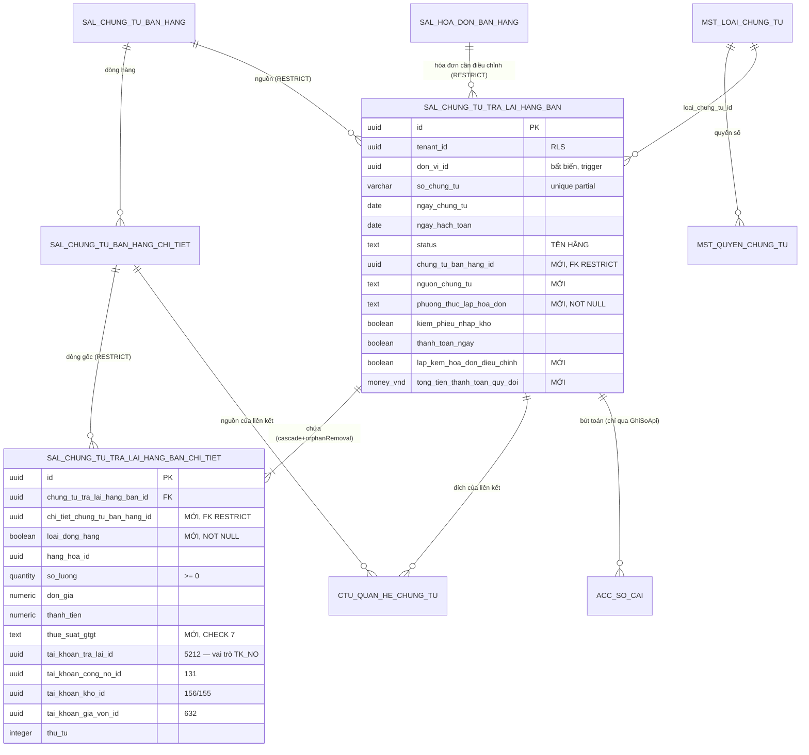

# F11 — Thiết kế DB & migration

> ⟳ **Rà soát lại 2026-08-21.** Repo đã đổi nhiều so với bản 2026-08-14 — xem [§-1 Nhật ký cập nhật](00-ke-hoach-tong.md) của file gốc. Ba thay đổi lớn nhất ảnh hưởng đúng file này: **(C3)** cột trạng thái đảo ngược · **(C6)** 6 cột đã được thêm · **(C4)** migration đánh số theo timestamp.

| Mục | Nội dung |
|---|---|
| Bảng chính | `sal_chung_tu_tra_lai_hang_ban` — **đã có, 64 cột** (`db/migration/V1__create_database.sql:16580`) |
| Bảng con | `sal_chung_tu_tra_lai_hang_ban_chi_tiet` — **đã có, 44 cột** (`V1:16756`) — **chưa được đụng tới** |
| Migration mới | `V<yyyyMMddHHmmss>__sal_tra_lai_hang_ban_luong_ghi.sql` — lấy version bằng `date +V%Y%m%d%H%M%S`, **KHÔNG** đếm `max+1` |
| Việc chính | **0 DROP · 22 ADD (header) · 17 ADD (chi tiết) · 1 DROP NOT NULL · 1 INDEX · seed cấu hình đánh số (chờ Q21)** |
| Nguyên tắc | **KHÔNG `CREATE TABLE`** — hai bảng đã tồn tại với đủ RLS, trigger, FK, unique, và 2 index danh sách |

---

## 0. Cái gì đã thay đổi so với bản trước

| # | Bản 2026-08-14 nói | Sự thật 2026-08-21 | Hệ quả |
|---|---|---|---|
| 1 | DROP cột `trang_thai_chung_tu` (D3), vì `status` là nguồn sự thật | **Ngược lại**: `status` đã bị gỡ khỏi cả `BaseChungTuEntity` lẫn bảng; `trang_thai_chung_tu` **là** cột trạng thái, lưu **tên hằng** `CHUA_GHI_SO`/`DA_GHI_SO`, có CHECK `ck_sal_chung_tu_tra_lai_hang_ban_trang_thai_chung_tu` | **§2.1 viết lại** — không DROP gì. **R2 cũ đóng** |
| 2 | header 61 cột, thiếu 28 | header **64 cột**; đã có `phuong_thuc_lap_hoa_don` (+CHECK `ck_sal_tlhb_phuong_thuc_lap_hoa_don`), `lap_kem_hoa_don_dieu_chinh`, `tong_tien_hang_hoa_quy_doi`, `tong_tien_chiet_khau_quy_doi`, `tong_tien_thue_gtgt_quy_doi`, `tong_tien_thanh_toan_quy_doi` | **§2.2 còn 22 cột** |
| 3 | phải thêm 3 index | **2/3 đã có**: `idx_sal_tlhb_danh_sach (tenant_id, ngay_hach_toan DESC, ngay_chung_tu DESC, so_chung_tu) WHERE da_xoa = false` (`V1:21796`) và `idx_sal_tlhb_khach_hang` (`V1:21803`) | **§4 còn 1 index** |
| 4 | phải `CREATE OR REPLACE fn_bang_cua_loai_chung_tu` (R1, mức Cao) | **Đã sửa** ở `V3__gop_thay_doi_sau_baseline.sql:3032-3035` bằng guard `to_regclass('public.sal_chung_tu_tra_lai_hang_ban_chi_tiet')` | **bỏ khỏi §5**, R1 đóng |
| 5 | seed `mst_loai_chung_tu` + `mst_quyen_chung_tu` | Cơ chế đánh số **vừa được làm lại** (`V1032__tknd_va_cau_hinh_danh_so.sql`, 237 KB; `V1032:914` có nhắc bảng này) | **§5 việc #5 để ngỏ — Q21** |
| 6 | migration `V3`, đếm `max+1` | Timestamp từ 2026-08-20 | **tên file đổi** |

---

## 1. Hiện trạng bảng (nguồn sự thật)

### 1.1 Kiểm tra đã chạy *(2026-08-21)*

```bash
cd cell-app/src/main/resources/db/migration
grep -n "^CREATE TABLE public.sal_chung_tu_tra_lai_hang_ban" V1__create_database.sql
# 16580:CREATE TABLE public.sal_chung_tu_tra_lai_hang_ban (
# 16756:CREATE TABLE public.sal_chung_tu_tra_lai_hang_ban_chi_tiet (

awk '/^CREATE TABLE public.sal_chung_tu_tra_lai_hang_ban \(/,/^\);/' V1__create_database.sql | grep -cE "^    [a-z_]+ "        # → 64
awk '/^CREATE TABLE public.sal_chung_tu_tra_lai_hang_ban_chi_tiet \(/,/^\);/' V1__create_database.sql | grep -cE "^    [a-z_]+ " # → 44
```

⚠️ **`docs/doing/db-spec/41-sal-tralaihangban.md` vẫn LỖI THỜI** (bảng chi tiết ghi sai tên, số cột cũ) — không dùng làm nguồn sự thật.

### 1.2 Header — 64 cột đã có

| Nhóm | Cột |
|---|---|
| **Base/audit/tenant** (`BaseChungTuEntity` + `BaseEntity`) | `id` · `tenant_id` · `phien_ban` · `ngay_tao` · `nguoi_tao` · `ngay_cap_nhat` · `nguoi_cap_nhat` · `da_xoa` · `ngay_xoa` · `nguoi_xoa` · `chi_nhanh_id` · `loai_chung_tu_id` · `giao_dich_chung_tu_id` · `so_chung_tu` · `ngay_chung_tu` · `ngay_hach_toan` · **`trang_thai_chung_tu`** · `nguoi_ghi_so` · `thoi_gian_ghi_so` |
| **Phạm vi đơn vị** (RLS) | `don_vi_id` — bất biến sau khi tạo (trigger) |
| **Khách hàng (snapshot)** | `khach_hang_id` · `ten_khach_hang` · `ma_so_thue` · `dia_chi` · `nguoi_lien_he` · `so_dien_thoai` · `nhan_vien_ban_hang_id` · `nguoi_mua_hang` · `ma_so_dvqhns` · `cccd` · `ho_chieu` |
| **Điều khiển nghiệp vụ** | `kiem_phieu_nhap_kho` · `thanh_toan_ngay` · `lap_kem_phieu_chi` · `hinh_thuc_thanh_toan` · `da_nhap_kho` · ⟳**`phuong_thuc_lap_hoa_don`** · ⟳**`lap_kem_hoa_don_dieu_chinh`** |
| **Chiết khấu** | `loai_chiet_khau` · `gia_tri_chiet_khau` |
| **Loại tiền** | `loai_tien_id` · `ty_gia` |
| **Chứng từ liên kết** | `hoa_don_ban_hang_id` · `phieu_nhap_kho_id` · `phieu_chi_id` · `so_chung_tu_phieu_chi` · `dieu_chinh_hoa_don_ban_hang_id` · `tai_khoan_tien_id` · `tai_khoan_ngan_hang_chi_id` · `muc_dich_thu_chi_id` · `nguoi_giao` · `nguoi_nhan` |
| **Tổng tiền** | `tong_tien_hang_hoa` · `tong_tien_chiet_khau` · `tong_tien_truoc_thue` · `tong_tien_thue_gtgt` · `tong_tien_sau_thue` · `tong_tien_thanh_toan` · `so_tien_da_thanh_toan` |
| **Tổng tiền quy đổi** ⟳ **MỚI** | `tong_tien_hang_hoa_quy_doi` · `tong_tien_chiet_khau_quy_doi` · `tong_tien_thue_gtgt_quy_doi` · `tong_tien_thanh_toan_quy_doi` |
| ⚠ **Cột vướng** | `hinh_thuc_thanh_toan` — `NOT NULL` + CHECK `('Tiền mặt','Chuyển khoản')`, **entity không map** ⇒ chặn INSERT (§2.1) |

⟳ = thêm sau bản plan 2026-08-14. **Đã biến mất:** `status`, `nguoi_duyet_id`, `ngay_duyet`.

### 1.3 Chi tiết — 44 cột đã có, **chưa được đụng tới**

| Nhóm | Cột |
|---|---|
| **Base/audit/tenant** | `id` · `tenant_id` · `phien_ban` · `thu_tu` · `ngay_tao` · `nguoi_tao` · `ngay_cap_nhat` · `nguoi_cap_nhat` · `da_xoa` · `ngay_xoa` · `nguoi_xoa` |
| **Cha** | `chung_tu_tra_lai_hang_ban_id` (FK → header) |
| **Nguồn** | `chung_tu_ban_id` (FK → `sal_chung_tu_ban_hang`) · `hoa_don_ban_hang_id` (FK) · `chi_tiet_hd_ban_hang_id` · `chi_tiet_hoa_don_dieu_chinh_id` · `phieu_nhap_kho_id` · `chi_tiet_phieu_nhap_kho_id` |
| **Hàng hóa** | `hang_hoa_id` · `ten_hang` · `don_vi_tinh_id` · `kho_id` · `so_lo` · `han_su_dung` · `hang_khuyen_mai` |
| **Số lượng & giá** | `so_luong` · `don_gia` · `thanh_tien` · `don_gia_von` · `gia_von` · `tu_nhap_don_gia_von` |
| **Chiết khấu** | `chiet_khau_phan_tram` · `chiet_khau` |
| **Thuế** | `thue_suat_gtgt_id` (uuid → danh mục) · `tai_khoan_thue_gtgt_id` · `tien_thue_gtgt` |
| **Tài khoản hạch toán** | `tai_khoan_tra_lai_id` · `tai_khoan_cong_no_id` · `tai_khoan_kho_id` · `tai_khoan_gia_von_id` |
| **Bổ sung** | `hop_dong_id` · `don_vi_id` · `khoan_muc_chi_phi_id` · `vu_viec_id` |

### 1.4 Hạ tầng đã có — **không làm lại**

| Thứ | Ghi chú |
|---|---|
| PK cả 2 bảng · unique `uq_sal_cttl_so_ct (tenant_id, so_chung_tu) WHERE da_xoa = false AND so_chung_tu <> ''` | `V1:23644` |
| **CHECK `trang_thai_chung_tu ∈ ('CHUA_GHI_SO','DA_GHI_SO')`** | ⟳ mới — khớp `TrangThaiChungTu` 2 giá trị |
| **CHECK `ck_sal_tlhb_phuong_thuc_lap_hoa_don`** 3 chuỗi tiếng Việt | ⟳ mới |
| CHECK `hinh_thuc_thanh_toan ∈ ('Tiền mặt','Chuyển khoản')` · CHECK `loai_chiet_khau` 4 giá trị | từ baseline |
| RLS `tenant_isolation` cả 2 bảng + `pv_select`/`pv_insert`/`pv_update` + `FORCE ROW LEVEL SECURITY` | `V1:30721,30727` |
| Trigger audit `fn_audit()` · trigger gán + bất biến `don_vi_id` | |
| **Index `idx_sal_tlhb_danh_sach`** — đúng sort mặc định của A1 | ⟳ mới, `V1:21796` |
| **Index `idx_sal_tlhb_khach_hang`** | ⟳ mới, `V1:21803` |
| Index `idx_sal_ct_cttl_parent` · `idx_sal_ct_cttl_hddc_line` · `idx_sal_cttl_hoa_don` · 2 index phạm vi đơn vị | `V1:21691,21684,21740,22405,22433` |
| FK: chi tiết→cha · chi tiết→CTBH · chi tiết→HĐBH · header→HĐBH · header→HĐĐC · header→`mst_don_vi` | `V1:19653,27949…28093` |
| `fn_bang_cua_loai_chung_tu` **đã trỏ đúng tên bảng chi tiết** | `V3:3032-3035` |
| Domain type | `money_vnd(18,2)` · `money_foreign(18,4)` · `exchange_rate(18,6)` · `percent_rate(5,2)` · `quantity(18,3)` |

**Kết luận — còn thiếu:** 22 cột header · 17 cột chi tiết · 1 `DROP NOT NULL` · 1 index · seed cấu hình đánh số (Q21).

## 2. Cột thêm mới / sửa trên **bảng header**

### 2.1 ⟳ **KHÔNG DROP gì** — nhưng phải nới `hinh_thuc_thanh_toan`

> **Mục này đã ĐẢO NGƯỢC.** Bản 2026-08-14 đề xuất `DROP COLUMN trang_thai_chung_tu` vì cho rằng `status` là nguồn sự thật. Base sau đó làm ngược lại.

**Cột trạng thái — không đụng gì:**

```java
// core/entity/BaseChungTuEntity.java:83-86
@Searchable(sortable = true, label = "Trạng thái chứng từ")
@Enumerated(EnumType.STRING)
@Column(name = "trang_thai_chung_tu", nullable = false)
private TrangThaiChungTu trangThaiChungTu = TrangThaiChungTu.CHUA_GHI_SO;
```

`TrangThaiChungTu` rút còn **2 giá trị** (`CHUA_GHI_SO`, `DA_GHI_SO`), CHECK ở DB đã khớp. Lý do rút 5→2 ghi nguyên văn ở `TrangThaiChungTu.java:8-17`: BR12 chỉ định nghĩa hai, và ba giá trị duyệt (`CHO_DUYET`/`DA_DUYET`/`HUY`) *"có 0 lượt dùng trong toàn bộ mã nguồn"* — chúng buộc mỗi màn FE khai "chưa ghi sổ" bằng một TẬP thay vì một phép so sánh bằng.

⇒ **Không migration nào cho cột trạng thái.** Entity đã map đúng, F1 đang chạy được.

**Cột thật sự chặn luồng ghi — `hinh_thuc_thanh_toan`:**

| Sự thật | Hệ quả |
|---|---|
| `hinh_thuc_thanh_toan text NOT NULL` + CHECK `('Tiền mặt','Chuyển khoản')` | INSERT không set → **`23502` not-null violation** |
| `TraLaiHangBan.java` **không map** cột này (12 field nghiệp vụ, không có nó) | F3 sẽ nổ ngay request đầu tiên |
| Chưa lộ ra vì F1 **chỉ đọc** | ⇒ **R2** mức Cao, phải xử lý trong migration của F3 |

Hai phương án — giống bản cũ, kết luận không đổi:

| | A — `DROP COLUMN` | **B (chọn) — `ALTER … DROP NOT NULL`, giữ cột** |
|---|---|---|
| Rủi ro | mất cột mà báo cáo/module khác có thể đang đọc | cột luôn `NULL` ⇒ nhiễu schema |
| Đảo lại | không lấy lại được dữ liệu | một dòng |
| Kết luận | mạnh tay cho một cột chưa ai đọc chắc chắn | an toàn hơn — **chờ §12-Q5** phán quyết ngữ nghĩa rồi mới quyết bỏ hẳn |

### 2.2 Cột thêm mới — header (**22 cột**, giảm từ 28)

⟳ **6 cột đã có rồi, gạch khỏi danh sách**: `phuong_thuc_lap_hoa_don`, `lap_kem_hoa_don_dieu_chinh`, `tong_tien_hang_hoa_quy_doi`, `tong_tien_chiet_khau_quy_doi`, `tong_tien_thue_gtgt_quy_doi`, `tong_tien_thanh_toan_quy_doi`.

| # | Cột DB | Kiểu | NULL | Default | Ai ghi | Field DTO/FE | Vì sao cần |
|---|---|---|---|---|---|---|---|
| 1 | `nguon_chung_tu` | `text` + CHECK 2 | Y | — | client | `nguonChungTu` | `SCR:44-47` |
| 2 | `chung_tu_ban_hang_id` | `uuid` | Y | — | client | `chungTuBanHangId` | `UC:79-81` — FK chứng từ gốc **ở mức header** |
| 3 | `phuong_thuc_thanh_toan` | `text` + CHECK 4 | Y | — | client | `phuongThucThanhToan` | `SCR:264`; **khác** `hinh_thuc_thanh_toan` — §2.3 |
| 4 | `ty_le_chiet_khau` | `percent_rate` | Y | `0` | client | `phanTramChietKhau` | `SCR:446` — §2.4 |
| 5 | `so_phieu_nhap_kho` | `varchar(50)` | Y | — | client | `soPhieuNhapKho` | `SCR:281` |
| 6 | `ly_do_chi` | `varchar(500)` | Y | — | client | `lyDoChi` | `SCR:315,332,345` |
| 7 | `nguoi_linh_tien` | `varchar(100)` | Y | — | client | `nguoiLinhTien` | `SCR:351` |
| 8 | `so_giay_to` | `varchar(12)` | Y | — | client | `soGiayTo` | `SCR:352` |
| 9 | `ngay_cap` | `date` | Y | — | client | `ngayCap` | `SCR:353` |
| 10 | `noi_cap` | `varchar(255)` | Y | — | client | `noiCap` | `SCR:354` |
| 11 | `kem_theo` | `varchar(50)` | Y | — | client | `kemTheo` | `SCR:317,334,355` |
| 12 | `chung_tu_goc` | `varchar(500)` | Y | — | client | `chungTuGoc` | `SCR:318,335,356` |
| 13 | `ten_ngan_hang_chi` | `varchar(255)` | Y | — | server autofill | — | `SCR:329,348` |
| 14 | `hinh_thuc_thanh_toan_hoa_don` | `varchar(50)` | Y | — | client | `hinhThucThanhToanHoaDon` | `SCR:384` — **không** CHECK: SCR cho nhập tay |
| 15 | `tai_khoan_ngan_hang_thu_id` | `uuid` | Y | — | client | `taiKhoanNganHangThuId` | `SCR:385` |
| 16 | `loai_dieu_chinh` | `text` + CHECK 3 | Y | `'Trả lại hàng bán'` | client | `loaiDieuChinh` | `SCR:386` |
| 17 | `ly_do_dieu_chinh` | `varchar(255)` | Y | — | client | `lyDoDieuChinh` | `SCR:387` |
| 18 | `la_hoa_don_dieu_chinh_sai_sot` | `boolean` | Y | `false` | client | `laHoaDonDieuChinhSaiSot` | `SCR:390` |
| 19 | `mau_so_hoa_don` | `varchar(1)` | Y | — | client | `mauSoHoaDon` | `SCR:396` |
| 20 | `ky_hieu_hoa_don` | `varchar(6)` | Y | — | client | `kyHieuHoaDon` | `SCR:397` |
| 21 | `so_hoa_don` | `varchar(8)` | Y | — | client | `soHoaDon` | `SCR:398` |
| 22 | `ngay_hoa_don` | `date` · `hoa_don_can_dieu_chinh_id` `uuid` | Y | — | client | `ngayHoaDon` · `hoaDonCanDieuChinhId` | `SCR:399,362-371` |

**Không cột nào `NOT NULL`** ⇒ không cần backfill 3 bước như bản cũ (cột `NOT NULL` duy nhất là `phuong_thuc_lap_hoa_don`, đã được thêm và backfill xong ở migration trước).

⚠ `tong_tien_sau_thue_quy_doi` (cột #29 của bản cũ) **không thêm** — 4 cột quy đổi đã có là đủ cho FE; thêm một cột không ai ghi là nợ schema.

### 2.3 Cột `hinh_thuc_thanh_toan` cũ — nới CHECK hay để nguyên?

| Sự thật | Bằng chứng |
|---|---|
| CHECK hiện tại chỉ cho `'Tiền mặt'`, `'Chuyển khoản'` | `V1:16543` |
| BA có **hai** khái niệm khác nhau, **không** khái niệm nào khớp 2 giá trị đó | (a) "Phương thức thanh toán" popup = 4 giá trị *Chi tiền mặt / Ủy nhiệm chi / Séc chuyển khoản / Séc tiền mặt* (`SCR:264`); (b) cột "Hình thức thanh toán" danh sách = 2 giá trị *Điều chỉnh công nợ / Hoàn tiền ngay* (`SCR_DanhSach` §Bảng chính) |
| Cột `hinh_thuc_thanh_toan` **NOT NULL** | `V1:16515` |

⇒ **Ba việc trong migration mới:**
1. Thêm cột mới `phuong_thuc_thanh_toan` (§2.2 #4) cho 4 giá trị của popup.
2. Cột danh sách "Hình thức thanh toán" **dẫn xuất** từ `thanh_toan_ngay`, **không lưu** ([01 §4.1](01-xem-danh-sach.md)).
3. Cột cũ `hinh_thuc_thanh_toan` **NOT NULL** ⇒ phải xử lý, nếu không INSERT fail như §2.1. Hai phương án:

| | A — `DROP COLUMN hinh_thuc_thanh_toan` | **B (chọn) — `ALTER … DROP NOT NULL` + giữ cột** |
|---|---|---|
| Rủi ro | mất cột mà `sal_dieu_chinh_hoa_don_ban_hang` hoặc báo cáo nào đó có thể đang đọc | cột tồn tại nhưng luôn `NULL` ⇒ nhiễu schema |
| Kết luận | mạnh tay quá cho một cột chưa ai đọc chắc chắn | an toàn hơn, đảo lại được. **Chờ §12-Q5 của file gốc** — nếu BA chốt "Tiền mặt/Chuyển khoản" là ngữ nghĩa thật của tab chi tiền thì cột này **được dùng** thật |

### 2.4 Cột `gia_tri_chiet_khau` — hai nghĩa dùng chung một cột

`gia_tri_chiet_khau numeric(18,2)` (`V1:16493`) hiện phải chở **cả** "% chiết khấu" (khi `loai_chiet_khau = 'Theo % hóa đơn'`) **và** "số tiền chiết khấu" (khi `= 'Theo số tiền trên tổng hóa đơn'`). Cùng cách `sal_chung_tu_ban_hang` làm (`V1:15975`).

⇒ Thêm `ty_le_chiet_khau percent_rate` (§2.2 #6) và giữ `gia_tri_chiet_khau` cho số tiền:

| `loai_chiet_khau` | Cột dùng | FE gửi |
|---|---|---|
| `Không chiết khấu` | — | — |
| `Theo mặt hàng` | (mức dòng: `chi_tiet.chiet_khau_phan_tram`) | `chietKhauPhanTram` từng dòng |
| `Theo % hóa đơn` | **`ty_le_chiet_khau`** | `phanTramChietKhau` |
| `Theo số tiền trên tổng hóa đơn` | `gia_tri_chiet_khau` | (FE chưa có field — ngoài phạm vi) |

**Vì sao không dùng lại `gia_tri_chiet_khau` cho %:** `numeric(18,2)` cho một giá trị 0–100 là sai kiểu theo BR7.1 (phần trăm = `decimal(5,2)`), và một cột hai nghĩa buộc mọi query đọc nó phải kèm `loai_chiet_khau` — nguồn lỗi im lặng.

---

## 3. Cột thêm mới — **bảng chi tiết** (17 cột)

| # | Cột DB | Kiểu | NULL | Default | Ai ghi | Field DTO/FE | Vì sao cần |
|---|---|---|---|---|---|---|---|
| 1 | `chi_tiet_chung_tu_ban_hang_id` | `uuid` | Y | — | client | `chiTietChungTuBanHangId` | **BẮT BUỘC** — khoá tạo `LenhLienKet` và nguồn của BR2 "SL đã trả lại". Cột `chi_tiet_hd_ban_hang_id` hiện có là dòng **HÓA ĐƠN**, không phải dòng chứng từ bán hàng |
| 2 | `loai_dong_hang` | `boolean` | **N** | `true` | client | `loaiDongHang` | `false` = dòng ghi chú (`api/model.ts:41-42`); quyết định dòng có tham gia tính toán/bút toán |
| 3 | `chiet_khau_thuong_mai` | `boolean` | Y | `false` | client | `chietKhauThuongMai` | BR13 của SCR (`SCR:635-640`) — dòng giảm trừ, thành tiền âm |
| 4 | `loai_vat_tu_id` | `uuid` | Y | — | client (snapshot) | `loaiVatTuId` | phân biệt Hàng hóa ⇄ **Dịch vụ** — nền của luật "dòng Dịch vụ được SL = 0" (`SCR:114-119`). §12-Q11 file gốc |
| 5 | `thue_suat_gtgt` | `text` + CHECK 7 | Y | — | client | `thueSuatGtgt` | FE gửi **mã chuỗi** `"0"/"5"/"8"/"10"/"KCT"/"KKKNT"/"KHAC"` (`constants.ts:79-90`); cột `thue_suat_gtgt_id` hiện có là uuid trỏ danh mục — **hai thứ khác nhau**, giữ cả hai |
| 6 | `gia_tri_thue_gtgt` | `percent_rate` | Y | — | client | `giaTriThueGtgt` | % thực tế khi `thue_suat_gtgt = 'KHAC'` (`constants.ts:247`) |
| 7 | `tinh_chat_thue_gtgt_id` | `uuid` | Y | — | client | `tinhChatThueGtgtId` | `SCR:476` "Nhóm HHDV mua vào" → `ENT_TinhChatThueGTGT` |
| 8 | `khong_tong_hop_to_khai_gtgt` | `boolean` | Y | `false` | client | `khongTongHopToKhaiGtgt` | `SCR:477`, BR_KhongTongHopToKhaiGTGT — lưu để round-trip; luật tự-tick ở FE |
| 9 | `so_phieu_xuat_id` | `uuid` | Y | — | client | `soPhieuXuatId` | `SCR:463,652-658` (BR15) — nhận và lưu, **không** validate đợt 1 |
| 10 | `mo_ta` | `text` | Y | — | client | — (FE chưa dùng) | diễn giải dòng → `DongHachToan.voiDienGiai` ([10 §3](10-hach-toan-va-chung-tu-kem.md)); mẫu `sal_chung_tu_ban_hang_chi_tiet.mo_ta` |
| 11 | `dien_giai_thue` | `text` | Y | — | client | — (FE chưa dùng) | diễn giải riêng cho bút toán thuế → `voiDienGiaiRieng(NV_THUE_GTGT, …)`; mẫu `sal_chung_tu_ban_hang_chi_tiet.dien_giai_thue` |
| 12 | `don_gia_quy_doi` | `money_vnd` | Y | `0` | **server tính** | — | BR18; đối xứng `sal_chung_tu_ban_hang_chi_tiet.don_gia_quy_doi` |
| 13 | `thanh_tien_quy_doi` | `money_vnd` | Y | `0` | **server tính** | `thanhTienQuyDoi` | BR18 |
| 14 | `chiet_khau_quy_doi` | `money_vnd` | Y | `0` | **server tính** | `chietKhauQuyDoi` | BR18 |
| 15 | `tien_thue_gtgt_quy_doi` | `money_vnd` | Y | `0` | **server tính** | `tienThueGtgtQuyDoi` | BR18 |
| 16 | `don_gia_von_quy_doi` | `money_vnd` | Y | `0` | **server tính** | — | BR18; cần cho bút toán giá vốn nguyên tệ |
| 17 | `gia_von_quy_doi` | `money_vnd` | Y | `0` | **server tính** | — | BR18; vế tiền của bút toán bước 4 ([10 §3](10-hach-toan-va-chung-tu-kem.md)) |

**Ngoài phạm vi, KHÔNG thêm đợt này:** `don_vi_tinh_quy_doi_id` · `he_so_quy_doi` · `so_luong_theo_dvc` (BR11 của SCR — ĐVT quy đổi, `SCR:490-492,627`). FE chưa dựng, và thêm cột không ai ghi là nợ schema. Ghi vào báo cáo.

**Đổi kiểu / đổi tên: KHÔNG có.** Mọi cột đã có đều giữ nguyên tên và kiểu; các chỗ lệch tên BA↔DB giải quyết ở **mapper**, xem §7.

---

## 4. Ràng buộc · index · khóa ngoại

⟳ **2/3 index đã có** (C7) — chỉ còn **một** index phải thêm.

| # | Loại | Định nghĩa | Vì sao | Trạng thái |
|---|---|---|---|---|
| 1 | CHECK | `nguon_chung_tu ∈ ('Chứng từ bán hàng hóa, dịch vụ','Hóa đơn điều chỉnh')` | hợp đồng với `MaDb` | ➕ |
| 2 | CHECK | `phuong_thuc_lap_hoa_don ∈` 3 chuỗi VN | — | ✅ **đã có** (`ck_sal_tlhb_phuong_thuc_lap_hoa_don`) |
| 3 | CHECK | `phuong_thuc_thanh_toan ∈ ('Chi tiền mặt','Ủy nhiệm chi','Séc chuyển khoản','Séc tiền mặt')` | — | ➕ |
| 4 | CHECK | `loai_dieu_chinh ∈ ('Trả lại hàng bán','Sai sót','Khác')` | — | ➕ |
| 5 | CHECK | `chi_tiet.thue_suat_gtgt ∈ ('0','5','8','10','KCT','KKKNT','KHAC')` | — | ➕ |
| 6 | CHECK | `chi_tiet.so_luong >= 0` | dòng Dịch vụ được `= 0` (`SCR:114-119`) ⇒ **`>=`**, không `>` | ➕ |
| 7 | CHECK | `ty_le_chiet_khau` và `chi_tiet.chiet_khau_phan_tram` ∈ `[0,100]` | BR7.1 | ➕ |
| 8 | INDEX | `(tenant_id, ngay_hach_toan DESC, ngay_chung_tu DESC, so_chung_tu) WHERE da_xoa = false` | sort mặc định A1 | ✅ **đã có** `idx_sal_tlhb_danh_sach` (`V1:21796`) |
| 9 | **INDEX** | `chi_tiet (tenant_id, chi_tiet_chung_tu_ban_hang_id) WHERE da_xoa = false AND … IS NOT NULL` | **A18** — `LATERAL SUM(so_luong)` tính "SL đã trả lại" ([09 §4.1](09-chon-chung-tu-nguon.md)) | ➕ **DUY NHẤT còn thiếu** |
| 10 | INDEX | `(tenant_id, khach_hang_id) WHERE da_xoa = false` | lọc theo khách hàng | ✅ **đã có** `idx_sal_tlhb_khach_hang` (`V1:21803`) |
| 11 | FK | `chung_tu_ban_hang_id → sal_chung_tu_ban_hang(id)` **RESTRICT** | `UC:79-81` *"Hành vi khi xóa chứng từ bán: Chặn"* | ➕ |
| 12 | FK | `chi_tiet.chi_tiet_chung_tu_ban_hang_id → sal_chung_tu_ban_hang_chi_tiet(id)` **RESTRICT** | như trên, mức dòng | ➕ |
| 13 | FK | `hoa_don_can_dieu_chinh_id → sal_hoa_don_ban_hang(id)` **RESTRICT** | `UC:83-85` | ➕ |
| 14 | **KHÔNG** FK | `khach_hang_id`, `tai_khoan_*_id`, `kho_id`, `hang_hoa_id`, `loai_vat_tu_id`, `don_vi_tinh_id` | `UC:91-97` — hành vi là **Snapshot**, không Chặn. FK cứng vào danh mục sẽ chặn xoá danh mục, trái ý đồ | — |

Mọi index mới đều có `WHERE da_xoa = false`, cùng quy ước với `uq_sal_cttl_so_ct`.

## 5. Migration — SQL đầy đủ

⚠ **Tên file lấy bằng lệnh, không gõ tay** (`docs/rules/migration-danh-so-theo-timestamp.md`):

```bash
date +V%Y%m%d%H%M%S
# → V20260821001604  ⇒  V20260821001604__sal_tra_lai_hang_ban_luong_ghi.sql
```

```sql
-- =====================================================================
-- PMKT-E-06469 Trả lại hàng bán — mở LUỒNG GHI (F3…F10).
--
-- Hai bảng đã tồn tại: sal_chung_tu_tra_lai_hang_ban (64 cột) và
-- ..._chi_tiet (44 cột) — V1__create_database.sql:16580,16756. CHỈ ALTER.
--
-- KHÔNG có DROP COLUMN nào: cột trang_thai_chung_tu là nguồn sự thật của
-- trạng thái (BaseChungTuEntity.java:83-86), khác với bản kế hoạch 2026-08-14.
--
-- Kế hoạch: docs/doing/PMKT-E-06469-tra-lai-hang-ban-api/11-thiet-ke-db.md
-- =====================================================================

-- ── 1. Nới NOT NULL cột hinh_thuc_thanh_toan (§2.1, R2) ─────────────
-- CHECK ('Tiền mặt','Chuyển khoản') không khớp cả "Phương thức thanh toán"
-- (4 giá trị của popup) lẫn cột nhãn của màn danh sách; entity KHÔNG map cột
-- này ⇒ INSERT đầu tiên của F3 sẽ fail 23502. Giữ cột, chờ §12-Q5 quyết bỏ hẳn.
ALTER TABLE public.sal_chung_tu_tra_lai_hang_ban
    ALTER COLUMN hinh_thuc_thanh_toan DROP NOT NULL;

-- ── 2. Cột mới — HEADER, 22 cột (§2.2) ──────────────────────────────
ALTER TABLE public.sal_chung_tu_tra_lai_hang_ban
    ADD COLUMN IF NOT EXISTS nguon_chung_tu               text,
    ADD COLUMN IF NOT EXISTS chung_tu_ban_hang_id         uuid,
    ADD COLUMN IF NOT EXISTS phuong_thuc_thanh_toan       text,
    ADD COLUMN IF NOT EXISTS ty_le_chiet_khau             public.percent_rate DEFAULT 0,
    ADD COLUMN IF NOT EXISTS so_phieu_nhap_kho            varchar(50),
    ADD COLUMN IF NOT EXISTS ly_do_chi                    varchar(500),
    ADD COLUMN IF NOT EXISTS nguoi_linh_tien              varchar(100),
    ADD COLUMN IF NOT EXISTS so_giay_to                   varchar(12),
    ADD COLUMN IF NOT EXISTS ngay_cap                     date,
    ADD COLUMN IF NOT EXISTS noi_cap                      varchar(255),
    ADD COLUMN IF NOT EXISTS kem_theo                     varchar(50),
    ADD COLUMN IF NOT EXISTS chung_tu_goc                 varchar(500),
    ADD COLUMN IF NOT EXISTS ten_ngan_hang_chi            varchar(255),
    ADD COLUMN IF NOT EXISTS hinh_thuc_thanh_toan_hoa_don varchar(50),
    ADD COLUMN IF NOT EXISTS tai_khoan_ngan_hang_thu_id   uuid,
    ADD COLUMN IF NOT EXISTS loai_dieu_chinh              text,
    ADD COLUMN IF NOT EXISTS ly_do_dieu_chinh             varchar(255),
    ADD COLUMN IF NOT EXISTS la_hoa_don_dieu_chinh_sai_sot boolean DEFAULT false,
    ADD COLUMN IF NOT EXISTS mau_so_hoa_don               varchar(1),
    ADD COLUMN IF NOT EXISTS ky_hieu_hoa_don              varchar(6),
    ADD COLUMN IF NOT EXISTS so_hoa_don                   varchar(8),
    ADD COLUMN IF NOT EXISTS ngay_hoa_don                 date,
    ADD COLUMN IF NOT EXISTS hoa_don_can_dieu_chinh_id    uuid;

-- ── 3. Cột mới — CHI TIẾT, 17 cột (§3) ──────────────────────────────
ALTER TABLE public.sal_chung_tu_tra_lai_hang_ban_chi_tiet
    ADD COLUMN IF NOT EXISTS chi_tiet_chung_tu_ban_hang_id uuid,
    ADD COLUMN IF NOT EXISTS loai_dong_hang               boolean DEFAULT true,
    ADD COLUMN IF NOT EXISTS chiet_khau_thuong_mai        boolean DEFAULT false,
    ADD COLUMN IF NOT EXISTS loai_vat_tu_id               uuid,
    ADD COLUMN IF NOT EXISTS thue_suat_gtgt               text,
    ADD COLUMN IF NOT EXISTS gia_tri_thue_gtgt            public.percent_rate,
    ADD COLUMN IF NOT EXISTS tinh_chat_thue_gtgt_id       uuid,
    ADD COLUMN IF NOT EXISTS khong_tong_hop_to_khai_gtgt  boolean DEFAULT false,
    ADD COLUMN IF NOT EXISTS so_phieu_xuat_id             uuid,
    ADD COLUMN IF NOT EXISTS mo_ta                        text,
    ADD COLUMN IF NOT EXISTS dien_giai_thue               text,
    ADD COLUMN IF NOT EXISTS don_gia_quy_doi              public.money_vnd DEFAULT 0,
    ADD COLUMN IF NOT EXISTS thanh_tien_quy_doi           public.money_vnd DEFAULT 0,
    ADD COLUMN IF NOT EXISTS chiet_khau_quy_doi           public.money_vnd DEFAULT 0,
    ADD COLUMN IF NOT EXISTS tien_thue_gtgt_quy_doi       public.money_vnd DEFAULT 0,
    ADD COLUMN IF NOT EXISTS don_gia_von_quy_doi          public.money_vnd DEFAULT 0,
    ADD COLUMN IF NOT EXISTS gia_von_quy_doi              public.money_vnd DEFAULT 0;

UPDATE public.sal_chung_tu_tra_lai_hang_ban_chi_tiet
   SET loai_dong_hang = true WHERE loai_dong_hang IS NULL;

ALTER TABLE public.sal_chung_tu_tra_lai_hang_ban_chi_tiet
    ALTER COLUMN loai_dong_hang SET NOT NULL;

-- ── 4. CHECK constraint (§4 #1,3,4,5,6,7) ───────────────────────────
-- KHÔNG thêm CHECK cho phuong_thuc_lap_hoa_don — ck_sal_tlhb_phuong_thuc_lap_hoa_don đã có.
ALTER TABLE public.sal_chung_tu_tra_lai_hang_ban
    ADD CONSTRAINT ck_sal_tlhb_nguon_chung_tu
        CHECK (nguon_chung_tu IS NULL OR nguon_chung_tu = ANY (ARRAY[
            'Chứng từ bán hàng hóa, dịch vụ'::text, 'Hóa đơn điều chỉnh'::text])),
    ADD CONSTRAINT ck_sal_tlhb_pt_thanh_toan
        CHECK (phuong_thuc_thanh_toan IS NULL OR phuong_thuc_thanh_toan = ANY (ARRAY[
            'Chi tiền mặt'::text, 'Ủy nhiệm chi'::text,
            'Séc chuyển khoản'::text, 'Séc tiền mặt'::text])),
    ADD CONSTRAINT ck_sal_tlhb_loai_dieu_chinh
        CHECK (loai_dieu_chinh IS NULL OR loai_dieu_chinh = ANY (ARRAY[
            'Trả lại hàng bán'::text, 'Sai sót'::text, 'Khác'::text])),
    ADD CONSTRAINT ck_sal_tlhb_ty_le_chiet_khau
        CHECK (ty_le_chiet_khau IS NULL OR (ty_le_chiet_khau >= 0 AND ty_le_chiet_khau <= 100));

ALTER TABLE public.sal_chung_tu_tra_lai_hang_ban_chi_tiet
    ADD CONSTRAINT ck_sal_tlhb_ct_thue_suat_gtgt
        CHECK (thue_suat_gtgt IS NULL OR thue_suat_gtgt = ANY (ARRAY[
            '0'::text, '5'::text, '8'::text, '10'::text,
            'KCT'::text, 'KKKNT'::text, 'KHAC'::text])),
    ADD CONSTRAINT ck_sal_tlhb_ct_so_luong CHECK (so_luong >= 0),
    ADD CONSTRAINT ck_sal_tlhb_ct_ck_phan_tram
        CHECK (chiet_khau_phan_tram IS NULL
               OR (chiet_khau_phan_tram >= 0 AND chiet_khau_phan_tram <= 100));

-- ── 5. Khóa ngoại (§4 #11-13) ───────────────────────────────────────
ALTER TABLE public.sal_chung_tu_tra_lai_hang_ban
    ADD CONSTRAINT fk_sal_tlhb_chung_tu_ban_hang
        FOREIGN KEY (chung_tu_ban_hang_id)
        REFERENCES public.sal_chung_tu_ban_hang(id) ON DELETE RESTRICT,
    ADD CONSTRAINT fk_sal_tlhb_hoa_don_can_dieu_chinh
        FOREIGN KEY (hoa_don_can_dieu_chinh_id)
        REFERENCES public.sal_hoa_don_ban_hang(id) ON DELETE RESTRICT;

ALTER TABLE public.sal_chung_tu_tra_lai_hang_ban_chi_tiet
    ADD CONSTRAINT fk_sal_tlhb_ct_dong_ban_hang
        FOREIGN KEY (chi_tiet_chung_tu_ban_hang_id)
        REFERENCES public.sal_chung_tu_ban_hang_chi_tiet(id) ON DELETE RESTRICT;

-- ── 6. Index — DUY NHẤT một cái (§4 #9) ─────────────────────────────
-- idx_sal_tlhb_danh_sach và idx_sal_tlhb_khach_hang ĐÃ CÓ (V1:21796,21803).
CREATE INDEX IF NOT EXISTS idx_sal_tlhb_ct_dong_ban_hang
    ON public.sal_chung_tu_tra_lai_hang_ban_chi_tiet
    USING btree (tenant_id, chi_tiet_chung_tu_ban_hang_id)
    WHERE (da_xoa = false AND chi_tiet_chung_tu_ban_hang_id IS NOT NULL);

-- ── 7. Cấu hình đánh số chứng từ — ĐỂ NGỎ, chờ §12-Q21 ──────────────
-- ⚠ Cơ chế đánh số vừa được làm lại ở V1032__tknd_va_cau_hinh_danh_so.sql
-- (237 KB; V1032:914 có nhắc 'sal_chung_tu_tra_lai_hang_ban'). PHẢI đọc file
-- đó trước khi seed — có thể KHÔNG cần seed gì thêm, và cách cũ
-- (mst_loai_chung_tu + mst_quyen_chung_tu) đã bị thay.
-- Xem ChungTuTemplate.java:343-357 để biết engine đọc gì từ entity.

-- ── 8. COMMENT cho cột mới quan trọng ───────────────────────────────
COMMENT ON COLUMN public.sal_chung_tu_tra_lai_hang_ban.chung_tu_ban_hang_id IS
  'PMKT-E-06469 UC:79-81 — chứng từ bán hàng gốc ở mức HEADER. FK RESTRICT.';
COMMENT ON COLUMN public.sal_chung_tu_tra_lai_hang_ban_chi_tiet.chi_tiet_chung_tu_ban_hang_id IS
  'PMKT-E-06469 SCR:107 — DÒNG hàng gốc trên sal_chung_tu_ban_hang_chi_tiet. Khoá tạo LenhLienKet và nguồn của BR2 "Số lượng đã trả lại". KHÔNG lẫn với chi_tiet_hd_ban_hang_id (dòng hóa đơn).';
COMMENT ON COLUMN public.sal_chung_tu_tra_lai_hang_ban_chi_tiet.loai_dong_hang IS
  'true = dòng hàng (tính toán + sinh bút toán); false = dòng ghi chú.';
COMMENT ON COLUMN public.sal_chung_tu_tra_lai_hang_ban_chi_tiet.thue_suat_gtgt IS
  'MÃ thuế suất (0|5|8|10|KCT|KKKNT|KHAC) — KHÁC thue_suat_gtgt_id (uuid trỏ danh mục).';
COMMENT ON COLUMN public.sal_chung_tu_tra_lai_hang_ban.ty_le_chiet_khau IS
  'SCR:446 — % chiết khấu khi loai_chiet_khau = ''Theo % hóa đơn''. gia_tri_chiet_khau giữ nghĩa SỐ TIỀN.';
```

**Ghi chú kỹ thuật:**
- **Idempotent**: `ADD COLUMN`/`CREATE INDEX` dùng `IF NOT EXISTS`. `ADD CONSTRAINT` **không** có `IF NOT EXISTS` trong Postgres — dựa vào Flyway không chạy lại file đã apply.
- **`CONCURRENTLY`**: không dùng — Flyway bọc mỗi migration trong một transaction.
- **`ALTER … SET NOT NULL`** trên `loai_dong_hang`: bảng chi tiết gần như rỗng nên lock ngắn.
- **Out-of-order**: máy dev (profile `local`) đã bật `out-of-order = true`; prod thì `false` (`docs/rules/migration-danh-so-theo-timestamp.md` §4) — không cần đổi gì.
- **RLS**: cột mới tự động thuộc phạm vi policy đang có.

## 6. Kiểm dữ liệu trước khi chạy · backfill · tương thích ngược

| # | Vấn đề | Câu query kiểm **trước** | Cách xử lý |
|---|---|---|---|
| 1 | Bảng có dữ liệu không? | `SELECT count(*) FROM sal_chung_tu_tra_lai_hang_ban;` · `…_chi_tiet;` | `0` ⇒ `SET NOT NULL` an toàn tức thời |
| 2 | ~~DROP `trang_thai_chung_tu` có mất thông tin?~~ | — | ✅ **BỎ** — không DROP cột nào (§2.1) |
| 3 | `hinh_thuc_thanh_toan` đang chứa gì | `SELECT hinh_thuc_thanh_toan, count(*) FROM sal_chung_tu_tra_lai_hang_ban GROUP BY 1;` | Input cho §12-Q5 — biết cột cũ có được dùng thật không |
| 4 | Trạng thái đang lưu đúng tên hằng chưa | `SELECT trang_thai_chung_tu, count(*) FROM sal_chung_tu_tra_lai_hang_ban GROUP BY 1;` | Phải là `CHUA_GHI_SO`/`DA_GHI_SO`. Còn chuỗi tiếng Việt ⇒ CHECK mới đã chặn, nhưng dữ liệu dev cũ có thể vướng |
| 5 | Trùng số chứng từ | `SELECT tenant_id, so_chung_tu, count(*) … HAVING count(*) > 1;` | Unique đã tồn tại ⇒ phải rỗng |
| 6 | ~~`fn_bang_cua_loai_chung_tu` trỏ đâu~~ | `SELECT public.fn_bang_cua_loai_chung_tu('SAL_CHUNG_TU_TRA_LAI_HANG_BAN', true);` | ✅ **đã sửa** — chạy để xác nhận trả `sal_chung_tu_tra_lai_hang_ban_chi_tiet` |
| 7 | `ctu_quan_he_chung_tu` đã có bản ghi nào của loại này chưa | `SELECT count(*) … WHERE loai_chung_tu_dich = 'SAL_CHUNG_TU_TRA_LAI_HANG_BAN';` | `> 0` là bất thường (chưa có luồng ghi) |
| 8 | ⟳ **Cấu hình đánh số** đã seed gì cho loại này | đọc `V1032__tknd_va_cau_hinh_danh_so.sql:914` + `SELECT … FROM <bảng cấu hình danh số> WHERE …` | **Q21** — quyết định có phải seed thêm không |
| 9 | Quyền đã seed đủ 11 mã? | `SELECT ma_quyen FROM iam_quyen WHERE module = 'TraLaiHangBan' ORDER BY 1;` | Thiếu `Unpost` ⇒ A14/A15 **403 cho cả Admin** |

**Cột deprecate:** `hinh_thuc_thanh_toan` — giữ cột, bỏ `NOT NULL`; **không** DROP cùng migration với việc thêm `phuong_thuc_thanh_toan`.

**Tương thích ngược:** ⟳ **đã đổi** — F1 **đang chạy thật** (FE tắt mock, C12). Mọi thay đổi phải giữ nguyên hợp đồng của A1/A2/A3/A4. May là toàn bộ việc trong migration này là **thêm cột** và **nới ràng buộc**, không cột nào đang được A1…A4 đọc bị đụng.

## 7. Ánh xạ Entity ↔ bảng

| Bảng | Entity | Kế thừa | Quan hệ JPA | Fetch |
|---|---|---|---|---|
| `sal_chung_tu_tra_lai_hang_ban` | `TraLaiHangBan` | `BaseChungTuEntity` (→ `AggregateRootEntity` → `TenantedEntity` → `BaseEntity`) | `@OneToMany(mappedBy="chungTu", cascade=ALL, orphanRemoval=true)` | `LAZY` + `@EntityGraph` ở `findWithChiTietById` |
| `sal_chung_tu_tra_lai_hang_ban_chi_tiet` | `ChiTietTraLaiHangBan` | `BaseChiTietChungTuEntity` | `@ManyToOne(fetch=LAZY) @JoinColumn("chung_tu_tra_lai_hang_ban_id")` | `LAZY` |

- **Aggregate root là `TraLaiHangBan`**; dòng chi tiết **chỉ** tồn tại qua header.
- **Khoá lạc quan** `@Version phien_ban` đặt ở `AggregateRootEntity` (header). Sửa chỉ chạm dòng con thì phải gọi `ct.touch()` (`BaseChungTuEntity.java:22-23`).
- **Repository riêng cho `ChiTietTraLaiHangBan`**: ✅ có — cần cho `SUM(so_luong) GROUP BY chi_tiet_chung_tu_ban_hang_id` của A17 ([09 §4.1](09-chon-chung-tu-nguon.md)) và cho `DongTraLaiHangBanPort.laySoLuong`. Repository đó **chỉ đọc**, mọi ghi đi qua aggregate root.
- **Cột base KHÔNG khai lại** trong entity con: `id`, `tenant_id`, `phien_ban`, audit 7 trường, `chi_nhanh_id`, `loai_chung_tu_id`, `giao_dich_chung_tu_id`, `so_chung_tu`, `ngay_chung_tu`, `ngay_hach_toan`, `status`, `nguoi_duyet_id`, `ngay_duyet`, `nguoi_ghi_so`, `thoi_gian_ghi_so` (`BaseChungTuEntity.java:44-85`) và `thu_tu` (`BaseChiTietChungTuEntity`).

### 7.1 Bảng ánh xạ tên — mọi chỗ LỆCH giữa BA / FE / DB

Đây là bảng chống lỗi map. **In đậm = tên khác nhau ở hai đầu.**

| Nhãn BA | Field FE / DTO | Cột DB | Ghi chú |
|---|---|---|---|
| Diễn giải (header) | `moTa` | `mo_ta` | BA gọi "Diễn giải" (`SCR:300`) |
| Trạng thái | **`trangThaiChungTu`** | **`status`** | alias `@Searchable` phải khai lại — [01 §7](01-xem-danh-sach.md) |
| Khách hàng (cột danh sách) | `tenKhachHang` | `ten_khach_hang` | BA gọi field `KhachHangTen` |
| Tổng thanh toán | `tongTienThanhToanQuyDoi` | `tong_tien_thanh_toan_quy_doi` (MỚI) | BA gọi `TongTienThanhToan` |
| Tổng tiền hàng | **`tongTienHangQuyDoi`** | **`tong_tien_hang_hoa_quy_doi`** (MỚI) | FE bỏ chữ `hoa` |
| Tổng chiết khấu | **`tongChietKhauQuyDoi`** | **`tong_tien_chiet_khau_quy_doi`** (MỚI) | FE bỏ chữ `tien` |
| Người giao hàng | **`nguoiGiaoHang`** | **`nguoi_giao`** | không thêm cột mới |
| Tài khoản chi tiền | **`taiKhoanChiTienId`** | **`tai_khoan_ngan_hang_chi_id`** | `SCR:328` — TK ngân hàng của công ty |
| Mã hàng | **`maHangId`** | **`hang_hoa_id`** | `SCR:452` |
| Tự động áp giá | **`giaTrungBinh`** | **`tu_nhap_don_gia_von`** | **NGHỊCH ĐẢO**: `giaTrungBinh = !tu_nhap_don_gia_von` ([02 §3](02-xem-chi-tiet.md)) — có unit test riêng |
| Tỷ lệ CK (%) header | **`phanTramChietKhau`** | **`ty_le_chiet_khau`** (MỚI) | §2.4 |
| Kiêm phiếu nhập kho | `kiemPhieuNhapKho` | `kiem_phieu_nhap_kho` | khớp |
| Trả lại hàng (nhãn) | `traLaiHang` | **không có cột** | dẫn xuất từ `kiem_phieu_nhap_kho` |
| Hình thức thanh toán (nhãn danh sách) | `hinhThucThanhToan` | **không có cột** (khác cột `hinh_thuc_thanh_toan` cũ!) | dẫn xuất từ `thanh_toan_ngay` — §2.3 |
| Số chứng từ con liên quan | `soChungTuLienQuan` | **không có cột** | dẫn xuất, đếm 3 id chứng từ con |
| Bút toán dự kiến | `dinhKhoan[]` | **không có cột** | tính lại mỗi lần đọc ([02 §2-A6](02-xem-chi-tiet.md)) |

### 7.2 Enum ⇄ giá trị lưu trong DB ⇄ **giá trị trên WIRE**

⟳ **Đổi so với bản cũ.** Bản cũ nói wire dùng chuỗi tiếng Việt. Module đã code chốt khác — **wire dùng TÊN HẰNG** (D10).

| Enum Java | Cột DB | Giá trị lưu DB | **Giá trị trên wire** | Cơ chế | Giá trị lạ |
|---|---|---|---|---|---|
| `core.entity.TrangThaiChungTu` | `trang_thai_chung_tu` | `CHUA_GHI_SO` · `DA_GHI_SO` | **giống DB** | `@Enumerated(STRING)` — base | Hibernate ném |
| `PhuongThucLapHoaDon` ✅ | `phuong_thuc_lap_hoa_don` | `'Người mua xuất hóa đơn'` … | `NGUOI_MUA_XUAT` · `NGUOI_BAN_XUAT_HD_DIEU_CHINH` · `KHONG_CO_HOA_DON` | `MaDb.Converter` | **`null`**, không ném |
| `NguonChungTu` ➕ | `nguon_chung_tu` | 2 chuỗi VN | 2 tên hằng | `MaDb.Converter` | `null` |
| `PhuongThucThanhToan` ➕ | `phuong_thuc_thanh_toan` | 4 chuỗi VN | 4 tên hằng | `MaDb.Converter` | `null` |
| `LoaiChietKhauTraLai` ➕ | `loai_chiet_khau` | 4 chuỗi VN | 4 tên hằng | `MaDb.Converter` | `null` |
| `LoaiDieuChinh` ➕ | `loai_dieu_chinh` | 3 chuỗi VN | 3 tên hằng | `MaDb.Converter` | `null` |
| `ThueSuatGtgt` ➕ | `chi_tiet.thue_suat_gtgt` | `0`\|`5`\|`8`\|`10`\|`KCT`\|`KKKNT`\|`KHAC` | giống DB | `MaDb.Converter` | `null` |
| — | `hinh_thuc_thanh_toan_hoa_don` | `varchar(50)` tự do | tự do | không | — |

**Ba khác biệt của `MaDb` so với `GiaTriDb` cũ** (`tra_lai_hang_ban/internal/model/MaDb.java`):

1. **Tên hằng là giá trị wire** — *"Bộ lọc động ép giá trị bằng `Enum.valueOf(name)` (`core.shared.search.ValueConverter`), nên API nhận/trả `NGUOI_BAN_XUAT_HD_DIEU_CHINH` chứ không phải chuỗi tiếng Việt — trả chuỗi DB ra FE là cho một dropdown mà chính bộ lọc từ chối bằng 400."*
2. **Đọc khoan dung** — `tuMaDb` trả `null` khi không khớp, **không** ném 400 như `GiaTriDb`. Lý do ghi ở javadoc: *"một bản ghi mang chuỗi lạ (dữ liệu dev cũ, seed tay) mà làm cả màn danh sách trả 500 là hành vi sai của một màn tra cứu"*.
   ⚠ **Khi mở luồng GHI phải cân nhắc lại**: khoan dung ở luồng đọc là đúng, nhưng ở luồng **ghi** thì giá trị lạ trở thành `null` rồi vướng CHECK/NOT NULL ở COMMIT — thông báo khó đọc. Đề xuất: giữ `tuMaDb` khoan dung cho đọc, thêm một hàm `tuMaDbBatBuoc(...)` ném 400 kèm danh sách cho phép, dùng ở tầng request.
3. **`biDanh()`** — chấp nhận chuỗi cũ khi đọc, chỉ ghi bằng `maDb()`.

### 7.3 Precision theo BR7.1

| Loại | Chuẩn BR7.1 | Domain type dùng | Cột |
|---|---|---|---|
| Tiền tệ (VND) | `decimal(18,2)` | `money_vnd` (`V1:73`) | mọi `tong_*`, `*_quy_doi`, `tien_thue_gtgt`, `gia_von` |
| Ngoại tệ | `decimal(18,4)` | `money_foreign` (`V1:66`) | `don_gia`, `thanh_tien`, `chiet_khau`, `don_gia_von` — ⚠ hiện là `numeric(18,2)`, xem dưới |
| Tỷ giá | `decimal(18,6)` | `exchange_rate` (`V1:48`) | `ty_gia` ✅ |
| Số lượng | `decimal(18,3)` | `quantity` (`V1:94`) | `so_luong` ✅ |
| Phần trăm | `decimal(5,2)` | `percent_rate` (`V1:80`) | `chiet_khau_phan_tram` ✅ · `ty_le_chiet_khau` (MỚI) · `gia_tri_thue_gtgt` (MỚI) |

> ⚠ **Lệch BR7.1 có sẵn ở baseline:** `chi_tiet.don_gia`, `thanh_tien`, `chiet_khau`, `don_gia_von`, `gia_von` khai `numeric(18,2)` (`V1:16641-16645`) trong khi BR7.1 nói ngoại tệ phải `(18,4)`. Với VND thì `(18,2)` đúng; với ngoại tệ sẽ **mất 2 chữ số thập phân**.
>
> **KHÔNG đổi kiểu trong migration mới**: đổi `numeric(18,2)` → `money_foreign(18,4)` là `ALTER TYPE`, viết lại toàn bảng, và đụng cả `db-spec/41-…md` (đang khai `money_foreign ≈` với dấu "suy luận theo tên trường"). Ghi vào **báo cáo** như một BR chưa đạt + đề xuất ticket riêng cho cả nhóm bảng chứng từ (`sal_chung_tu_ban_hang_chi_tiet` cũng vậy). Cột **mới** thì khai đúng chuẩn ngay.

---

## 8. ERD



---

## 9. Kiểm thử dữ liệu

### 9.1 Unit (`@Tag("unit")`, không cần DB)

| Lớp test | Kiểm gì |
|---|---|
| `JpaMetamodelArchTest` (**đã có sẵn**) | dựng metamodel Hibernate của **toàn bộ** entity + `Metadata.validate()` — bắt khai trùng cột / lệch kiểu, không cần DB. Thêm 2 entity mới là nó soi luôn |
| `GiaTriDbTraLaiTest` | 6 enum × mọi giá trị: `giaTri()` khớp **từng ký tự** chuỗi trong CHECK constraint của `V<timestamp>` **và** trong `constants/constants.ts`. Đây là chốt chặn **R3** |
| `TraLaiHangBanSearchableTest` | whitelist `@Searchable` chứa đủ 4 alias lọc + 3 alias sort FE gửi; `GET /cot` không trả trùng alias |
| `PrecisionTest` | mọi cột tiền mới khai `money_vnd`, % khai `percent_rate` — đọc annotation `@Column(precision, scale)` của entity |

### 9.2 Tích hợp (cần Docker — **chưa chạy được**, R8)

| Lớp | Kiểm gì chỉ DB thật làm được |
|---|---|
| `V3MigrationIT` | Flyway apply `V<timestamp>` sạch trên DB rỗng **và** trên DB đã có 1 chứng từ mẫu |
| | `trang_thai_chung_tu` đã biến mất (`information_schema.columns`) |
| | 47 cột mới tồn tại đúng kiểu (`information_schema.columns` so với §2/§3) |
| | 8 CHECK mới hoạt động: INSERT giá trị lạ → `23514` |
| | 3 FK mới: xoá `sal_chung_tu_ban_hang` đang được trỏ → `23503` (RESTRICT — đúng `UC:81`) |
| | 3 index tồn tại; `EXPLAIN` của query sort mặc định dùng `idx_sal_cttl_sort_mac_dinh` |
| | `SELECT fn_bang_cua_loai_chung_tu('SAL_CHUNG_TU_TRA_LAI_HANG_BAN', true)` trả **tên bảng tồn tại thật** |
| | INSERT vào `ctu_quan_he_chung_tu` với `dong_dich_id` → **không** còn `42P01` (chốt **R1**) |
| | `mst_loai_chung_tu` có `CTTL`; `mst_quyen_chung_tu` có 1 quyển / tenant ACTIVE |
| `TraLaiHangBanEntityIT` | ghi/đọc round-trip đầy đủ 2 entity: mọi cột về đúng giá trị (chốt **R4** — `ddl-auto: none` không đối chiếu cột) |
| | `orphanRemoval`: xoá dòng khỏi collection → mất khỏi DB |
| | `@Version`: 2 phiên sửa cùng lúc → `OptimisticLockException` |
| | RLS: kết nối tenant B không đọc được bản ghi tenant A |
| | trigger `don_vi_id`: INSERT không set → được gán mặc định; UPDATE đổi → `PV_BB_001` |
| | trigger audit: 1 INSERT header → 1 dòng `aud_audit_log` |

---

## 10. Tóm tắt cho người ký duyệt

| Câu hỏi | Trả lời |
|---|---|
| Có tạo bảng mới? | **Không.** Chỉ `ALTER` |
| Có **DROP** gì? | ⟳ **Không** — khác bản 2026-08-14. Chỉ `DROP NOT NULL` trên `hinh_thuc_thanh_toan` |
| Có mất dữ liệu? | **Không** |
| Có đổi kiểu / đổi tên cột? | **Không.** Lệch tên BA↔DB xử lý ở mapper (§7.1) |
| Đảo lại được không? | Có — toàn bộ là thêm cột / nới ràng buộc |
| Quy mô | 22 cột header · 17 cột chi tiết · 7 CHECK · 3 FK · **1 index** · 1 `DROP NOT NULL` |
| Rủi ro lớn nhất | ⟳ **R2** — `hinh_thuc_thanh_toan` `NOT NULL` mà entity không map ⇒ INSERT đầu tiên của F3 fail `23502`. *(R1 cũ về `fn_bang_cua_loai_chung_tu` đã ĐÓNG — `V3` sửa rồi.)* |
| Cần phán quyết trước khi chạy | **Q5** ngữ nghĩa `hinh_thuc_thanh_toan` · **Q11** cột `loai_vat_tu_id` · **Q21** cấu hình đánh số sau `V1032` |
| BR chưa đạt sau migration | BR7.1 phần **ngoại tệ `(18,4)`** — 5 cột tiền cũ vẫn `numeric(18,2)` (§7.3); ĐVT quy đổi (`he_so_quy_doi`, `so_luong_theo_dvc`) chưa thêm (§3) |
| Tên file | **KHÔNG** `V1033` — dùng `date +V%Y%m%d%H%M%S` (§5) |
