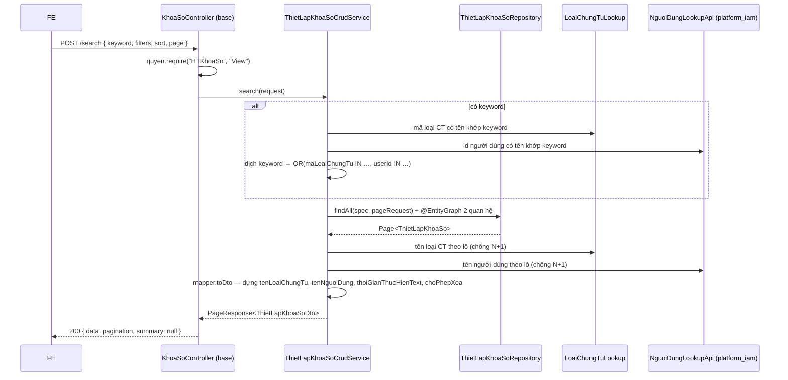

# F01 — Xem danh sách thiết lập khóa sổ

> Quay lại [00-ke-hoach-tong.md](00-ke-hoach-tong.md)

| Mục | Nội dung |
|---|---|
| Use case | `PMKT-U-09190_XemDanhSachThietLapKhoaSo` |
| Màn hình | `6.screens/SCR_XemDanhSachThietLapKhoaSo.md` |
| Tác nhân | Kế toán trưởng · Quản trị viên hệ thống |
| Endpoint | **A1** `POST /search` · **A2** `GET /cot` · **A3** `GET /{id}` |
| Quyền | `HTKhoaSo.View` (A1, A2) · `HTKhoaSo.View.Detail` (A3) |
| Nguồn | **Kế thừa nguyên `BaseCrudController`** — không viết lại endpoint nào |

---

## 1. Phân tầng

```
KhoaSoController extends BaseCrudController<ThietLapKhoaSo, ThietLapKhoaSoDto, LuuThietLapKhoaSoRequest, LuuThietLapKhoaSoRequest>
        ▼  (search / cot / get — kế thừa nguyên vẹn)
ThietLapKhoaSoCrudService extends AbstractCrudService<…>
        │   ├── kế thừa : search() · moTaCot() · get() — core/service/AbstractCrudService.java:76,88,96
        │   ├── override: defaultSortAlias()  → "loaiDoiTuong:asc,ngayCapNhat:desc"   (BR6 Common)
        │   ├── override: notFound(id)        → messageId riêng của epic
        │   └── override: summary(req)        → null (màn không có dòng tổng — BR31 không áp dụng)
        ▼
ThietLapKhoaSoRepository extends BaseRepository<ThietLapKhoaSo>
        ▼
ThietLapKhoaSo @Table("cfg_thiet_lap_khoa_so") extends AggregateRootEntity
```

Ba endpoint đều **không viết một dòng controller nào** — `BaseCrudController.java:121-141` đã cài sẵn, kể cả `quyen.require(...)`.

---

## 2. Hợp đồng API

### 2.1 A1 — `POST /api/he-thong/khoa-so/search`

```jsonc
// Request — core/request/SearchRequest.java:32
{
  "page": 1,
  "pageSize": 20,
  "sort": "ngayKhoaSo:desc",
  "keyword": "Bán hàng",
  "logic": "AND",
  "filters": [
    { "field": "loaiKhoaSo",  "op": "in", "value": [1, 3] },
    { "field": "loaiDoiTuong","op": "eq", "value": 2 }
  ]
}
```

```jsonc
// Response 200 — core/response/PageResponse.java:20
{
  "data": [
    {
      "id": "3f1c…",
      "loaiDoiTuong": 1,
      "loaiDoiTuongText": "Hệ thống",
      "tenLoaiChungTu": "Hệ thống",              // cột "Loại chứng từ" đã dựng sẵn — §3.1
      "loaiChungTu": [],                          // rỗng khi loaiDoiTuong = 1
      "loaiChonNguoiDung": 1,
      "tenNguoiDung": "Tất cả",                   // cột "Người dùng" đã dựng sẵn — §3.2
      "nguoiDung": [],
      "loaiKhoaSo": 1,
      "loaiKhoaSoText": "Thủ công",
      "kyKhoaSo": null,
      "kyKhoaSoText": "-",
      "ngayKhoaSo": "2026-05-31T23:59:00Z",
      "isTuDong": false,
      "gioThucThi": null,
      "doTreThucThi": null,
      "thoiGianThucHienText": "31/05/2026 23:59",  // §3.3
      "laMacDinh": false,
      "choPhepSua": true,                          // §4
      "choPhepXoa": false,                         // §4
      "ngayCapNhat": "2026-05-30T08:12:44Z"        // token optimistic-lock cho A5/A6
    }
  ],
  "pagination": { "page": 1, "pageSize": 20, "totalItems": 7, "totalPages": 1 },
  "summary": null
}
```

**Bảng field request** — dùng nguyên `SearchRequest` của core, **không** khai DTO riêng:

| # | Field | Kiểu | Bắt buộc | Ràng buộc | Nguồn BA |
|---|---|---|---|---|---|
| 1 | `page` | `Integer` | N | 1-based; `< 1` hoặc null → 1 (`SearchRequest.java:46-48`) | BR1 |
| 2 | `pageSize` | `Integer` | N | Whitelist `10/20/50/100/200`, giá trị khác → 20 (`ListSort.java:35`, `SortResolver.java:57-59`) | BR1 |
| 3 | `sort` | `String` | N | `alias[:dir][,alias[:dir]…]`; alias ngoài whitelist `@Searchable(sortable)` bị **bỏ qua**, không lỗi. Null → §5.2 | BR11.3 |
| 4 | `keyword` | `String` | N | Max 255; trim (BR43); không phân biệt dấu. Phạm vi tìm: **tên loại chứng từ + tên người dùng** — §3.5 | `SCR_XemDanhSachThietLapKhoaSo.md:21` |
| 5 | `filters` | `List<FilterCriteria>` | N | `{field, op, value}`; `field` phải có `@Searchable`, không thì bị bỏ qua (log warn); `op` ∈ 14 toán tử `FilterOperator.java:12-38` | BR11.2 |
| 6 | `logic` | `String` | N | `AND` (mặc định) hoặc `OR` — ghép các `filters`. `keyword` **luôn** AND với cả nhóm (`SearchRequest.java:29-30`) | BR11.2 |

Alias hợp lệ cho `filters` / `sort`: xem §3.4 (bộ tiêu chí) và §6 (whitelist trên entity). FE **không hardcode** danh sách này mà lấy từ A2.

Lỗi có thể gặp: `403` thiếu `HTKhoaSo.View`.
Danh sách rỗng **không** phải lỗi — trả `data: []`, FE hiển thị `MSG_PMKT-E-07528_001`.
Lỗi 5xx bất kỳ → FE hiển thị `MSG_PMKT-E-07528_002` (`UC_XemDanhSachThietLapKhoaSo.md:32`).

### 2.2 A2 — `GET /api/he-thong/khoa-so/cot`

Trả `List<CotMoTa>` sinh **từ chính whitelist `@Searchable`** của entity (`AbstractCrudService.java:88-92`). FE dựng bộ lọc nâng cao (BR11.2) từ đây, **không hardcode danh sách cột**.

### 2.3 A3 — `GET /api/he-thong/khoa-so/{id}`

Dùng cho action "Xem chi tiết" (icon Mắt) và để nạp dữ liệu vào popup ở chế độ Sửa (BR34). Trả **cùng** `ThietLapKhoaSoDto` với A1 — không có DTO chi tiết riêng vì màn danh sách đã hiển thị đủ trường của aggregate; hai mảng `loaiChungTu[]` và `nguoiDung[]` mới là phần chỉ chi tiết mới cần (§3.1, §3.2).

Lỗi: `404 NOT_FOUND` khi id không tồn tại hoặc đã xoá mềm (`AbstractCrudService.load()` — `AbstractCrudService.java:184-188`).

---

## 3. Ánh xạ cột: BA ↔ DB ↔ DTO

| # | Cột BA | Field BA | Cột DB thật | Field DTO | Lọc | Sort |
|---|---|---|---|---|---|---|
| 1 | STT | — | — | — (FE tính theo BR2) | N | N |
| 2 | Loại chứng từ | `LoaiDoiTuong` + `ThietLapKhoaSo_ChungTu` | `loai_doi_tuong` + bảng con | `loaiDoiTuong`, `tenLoaiChungTu`, `loaiChungTu[]` | Y (§3.4) | N |
| 3 | Người dùng | `ThietLapKhoaSo_NguoiDung` | **`loai_chon_nguoi_dung` (cột MỚI trên bảng cha)** + bảng con | `loaiChonNguoiDung`, `tenNguoiDung`, `nguoiDung[]` | Y (§3.4) | N |
| 4 | Loại khóa sổ | `LoaiKhoaSo` | `loai_khoa_so` | `loaiKhoaSo`, `loaiKhoaSoText` | Y | Y |
| 5 | Kỳ khóa sổ | `KyKhoaSo` | `ky_khoa_so` | `kyKhoaSo`, `kyKhoaSoText` | N | Y |
| 6 | Thời gian khóa sổ | `NgayKhoaSo` | `ngay_khoa_so` | `ngayKhoaSo` | N | Y |
| 7 | Thời gian thực hiện | `GioThucThi` + `DoTreThucThi` | `gio_thuc_thi` + `do_tre_thuc_thi` | `thoiGianThucHienText` (+ 2 field gốc) | N | N |
| 8 | Chức năng | — | `loai_khoa_so`, `la_mac_dinh` | `choPhepSua`, `choPhepXoa` | N | N |

> ⚠️ Không cột nào lệch tên giữa DB và BA đủ để cần migration đổi tên. **Một cột phải chuyển vị trí**: `loai_chon_nguoi_dung` hôm nay nằm ở bảng con `cfg_thiet_lap_khoa_so_nguoi_dung` (`V1__baseline.sql:1247`) nhưng BA mô hình hoá nó là radio **cấp form** — xem [09-thiet-ke-db.md §3](09-thiet-ke-db.md).

### 3.1 Cột dẫn xuất `tenLoaiChungTu`

**Quy tắc BA** (`SCR_XemDanhSachThietLapKhoaSo.md:34`): *"Hiển thị 'Hệ thống' (LoaiDoiTuong=1) hoặc danh sách tên loại CT (ThietLapKhoaSo_ChungTu)"*.

Dữ liệu nguồn: `cfg_thiet_lap_khoa_so.loai_doi_tuong` + `cfg_thiet_lap_khoa_so_chung_tu.ma_loai_chung_tu` → tên lấy từ `mst_loai_chung_tu.ten`.

Công thức:
```
loaiDoiTuong = 1  →  "Hệ thống"
loaiDoiTuong = 2  →  join(", ", tên các loại CT theo thứ tự ma_loai_chung_tu tăng dần)
```

| | Phương án A — subquery `string_agg` trong native SQL | **Phương án B (chọn) — `@OneToMany` + map ở `ThietLapKhoaSoMapper`** |
|---|---|---|
| N+1 | Không | **Có nguy cơ** — phải chặn bằng `@EntityGraph`/`JOIN FETCH` ở repository của luồng search |
| Dùng lại được cho A3 và popup Sửa | Không (mất mảng id) | Có — cùng một quan hệ phục vụ cả text hiển thị lẫn mảng `loaiChungTu[]` mà popup Sửa cần |
| Tên loại CT lấy từ đâu | JOIN `mst_loai_chung_tu` trong SQL | `LoaiChungTuLookup` đã có cache (`LoaiChungTuLookup.java:24`), nhưng hôm nay chỉ có `idTheoMa` ⇒ **phải bổ sung `tenTheoMa`/`tenTheoMaHangLoat`** |
| Rủi ro | Cột không dùng lại được | N+1. **Chốt an toàn**: `@EntityGraph(attributePaths = {"danhSachChungTu", "danhSachNguoiDung"})` trên method search của repository + test đếm query |

Chọn **B**. `mst_loai_chung_tu` là danh mục **toàn cục, không tenant, không RLS** (`V1__baseline.sql:1962`) nên cache tiến trình là hợp lệ và không rò dữ liệu giữa tenant.

### 3.2 Cột dẫn xuất `tenNguoiDung`

**Quy tắc BA** (`SCR_XemDanhSachThietLapKhoaSo.md:35`): *"Hiển thị 'Tất cả' (LoaiChonNguoiDung=1) hoặc chuỗi tên user (JOIN User System)"*.

```
loaiDoiTuong = 1                         →  "Tất cả"   (phạm vi hệ thống luôn áp cho mọi user)
loaiDoiTuong = 2 && loaiChonNguoiDung=1  →  "Tất cả"
loaiDoiTuong = 2 && loaiChonNguoiDung=2  →  join(", ", họ tên các user)
```

Tên người dùng nằm ở `platform_iam` — **module khác**. Không được import `internal` của nó ⇒ phải đi qua hợp đồng công khai. Xem [05-nguon-chon-loai-ct-nguoi-dung.md §4](05-nguon-chon-loai-ct-nguoi-dung.md) cho thiết kế `NguoiDungLookupApi` và lý do.

Người dùng đã bị xoá/khoá vẫn phải hiện tên (thiết lập cũ tham chiếu tới họ); nếu không tra được tên thì hiển thị `"(không xác định)"` chứ **không** bỏ khỏi chuỗi — bỏ đi sẽ làm phạm vi hiển thị hẹp hơn phạm vi thực tế đang chặn.

### 3.3 Cột dẫn xuất `thoiGianThucHienText`

**Quy tắc BA nguyên văn** (`SCR_XemDanhSachThietLapKhoaSo.md:39`):
> *Hiển thị thời gian thực thi kèm độ trễ. Định dạng: "HH:mm, Sau/Trước N ngày" (ví dụ: "18:00, Sau 7 ngày" hoặc "18:00, Trước 3 ngày"). Nếu DoTreThucThi = 0 thì hiển thị "HH:mm, Đúng ngày". Bằng Thời gian khóa sổ nếu Loại khóa sổ là thủ công*

Công thức:
```
loaiKhoaSo = 1 (Thủ công)        →  format(ngayKhoaSo, "dd/MM/yyyy HH:mm")
gioThucThi = null                →  "-"
doTreThucThi = 0                 →  "HH:mm, Đúng ngày"
doTreThucThi > 0                 →  "HH:mm, Sau N ngày"
doTreThucThi < 0                 →  "HH:mm, Trước N ngày"      (N = |doTreThucThi|)
```

**Dựng ở BE, không ở FE.** Lý do: chuỗi này là quy tắc nghiệp vụ có nhánh (BR02), không phải định dạng hiển thị thuần; để FE tự ghép là mở đường cho FE Web và FE khác (nếu có) lệch nhau, và không test được ở tầng BE. DTO **vẫn trả kèm** `gioThucThi` + `doTreThucThi` gốc để FE dùng khi mở popup Sửa.

### 3.4 Bộ tiêu chí tìm kiếm

| Field BA | Control | Alias BE (`@Searchable`) | Toán tử | Ghi chú |
|---|---|---|---|---|
| Ô tìm kiếm (theo Loại chứng từ **hoặc** Người dùng) | Search box, max 255 | `keyword` | `LIKE` không dấu | §3.5 — **đây là điểm khó nhất của màn** |
| Loại chứng từ | Bộ lọc | `maLoaiChungTu` (path `danhSachChungTu.maLoaiChungTu`) | `IN` | Lọc theo **mã**, không theo tên — FE lấy mã từ A12 |
| Người dùng | Bộ lọc | `userId` (path `danhSachNguoiDung.userId`) | `IN` | |
| Loại khóa sổ | Bộ lọc | `loaiKhoaSo` | `EQ`, `IN` | 1/2/3 |
| Kỳ khóa sổ | (chỉ sort) | `kyKhoaSo` | — | BA đánh Lọc = N |
| Thời gian khóa sổ | (chỉ sort) | `ngayKhoaSo` | — | BA đánh Lọc = N |

Cách ghép: `AND` mặc định (`SearchRequest.logic`); `keyword` **luôn** AND với cả nhóm (`SearchRequest.java:29-30`).

### 3.5 Ô tìm kiếm nhanh — vì sao không dùng thẳng `@Searchable(keyword = true)`

BA yêu cầu tìm theo **Loại chứng từ hoặc Người dùng** (`SCR_XemDanhSachThietLapKhoaSo.md:21`). Cả hai đều **không phải cột chuỗi trên bảng cha**: loại CT là mã ở bảng con cần đổi sang tên qua `mst_loai_chung_tu`; người dùng là id ở bảng con cần đổi sang tên qua module `platform_iam`.

`@Searchable(keyword = true)` chỉ áp dụng cho field **kiểu chuỗi** (`Searchable.java:57`), và `DynamicSpecification` chỉ biết đi theo property path JPA — nó không tra được sang một module khác.

| | Phương án A — `@Searchable(keyword=true, path="danhSachChungTu.maLoaiChungTu")` | Phương án B — cột phi chuẩn hoá `ten_pham_vi text` cập nhật khi lưu | **Phương án C (chọn) — dịch keyword thành `filters` ở service trước khi gọi base** |
|---|---|---|---|
| Tìm được theo **tên** loại CT | ❌ chỉ khớp mã (`BAN_HANG`), người dùng gõ "Bán hàng" không ra | ✅ | ✅ |
| Tìm được theo tên người dùng | ❌ | ✅ | ✅ |
| Nguồn sự thật | 1 | **2** — tên đổi ở danh mục/IAM thì cột phi chuẩn hoá trôi | 1 |
| Chi phí đọc | Thấp | Thấp nhất | 2 truy vấn phụ nhỏ (mã loại CT khớp tên; id user khớp tên) rồi `IN` |
| Rủi ro | Không đạt BA | Dữ liệu lệch âm thầm | Keyword khớp **rất nhiều** user ⇒ mệnh đề `IN` dài. **Chốt an toàn**: trần 500 id, vượt trần thì cắt và trả cờ `keywordBiCat: true` để FE nhắc người dùng gõ cụ thể hơn |

Chọn **C**: `ThietLapKhoaSoCrudService.search()` override — dịch `keyword` thành `OR(maLoaiChungTu IN (…), userId IN (…))` rồi mới gọi `super.search()`. Giữ nguyên sự thật một nguồn, và không phải sửa `DynamicSpecification`.

---

## 4. Field phụ trong DTO để FE ẩn/hiện nút (BR13.1 + BR25)

| Nút | Điều kiện BA | Field DTO |
|---|---|---|
| Xem chi tiết | luôn hiện nếu có `HTKhoaSo.View.Detail` | — (FE dựa vào quyền) |
| Sửa | luôn hiện nếu có `HTKhoaSo.Edit` | `choPhepSua` — luôn `true` ở đợt này, giữ field để không phải đổi hợp đồng khi BA bổ sung điều kiện |
| Xóa | `loaiKhoaSo = 2` **và** `laMacDinh = false` (`SCR_XemDanhSachThietLapKhoaSo.md:40,53` + BR04) | `choPhepXoa` |

BE **vẫn kiểm lại** hai điều kiện này ở A6 — ẩn nút chỉ là UX, không phải chốt chặn (xem [04-xoa-thiet-lap.md](04-xoa-thiet-lap.md)).

---

## 4bis. Validation

**Không áp dụng** — cả ba endpoint đều chỉ ĐỌC, không có trường nhập liệu nào để validate. Ba hành vi thay cho validation, đều do base lo, đều là **bỏ qua có log** chứ không phải trả 400:

| Đầu vào lệch | Hành vi | Ở đâu |
|---|---|---|
| `filters[].field` không có `@Searchable` | Bỏ qua điều kiện đó, log `WARN` | `Searchable.java:11-13` — *"Field không khai → request lọc theo nó bị BỎ QUA (log warn), không ném 500… chặn client dò cột chưa muốn lộ"* |
| `sort` trỏ alias không `sortable` | Bỏ qua khoá sort đó | `SortResolver` |
| `pageSize` ngoài whitelist | Về 20 | `SortResolver.java:57-59` |

Trả 400 cho các ca này sẽ biến một màn danh sách thành nơi client dò được tên cột — đúng thứ whitelist sinh ra để chặn.

Validation của **popup** thiết lập (MSG_005…_027) nằm ở [F02 §3](02-tao-thiet-lap-khoa-so.md).

---

## 4ter. Tương tranh & transaction

**Không áp dụng ở mức ghi** — ba endpoint đều `@Transactional(readOnly = true)` do `AbstractCrudService` khai sẵn (`AbstractCrudService.java:75, 95`). Không khoá, không idempotency key.

Hai điểm vẫn phải đúng:

| Vấn đề | Xử lý |
|---|---|
| Phân trang **không ổn định** khi hai bản ghi trùng `ngayCapNhat` — cùng một dòng có thể hiện ở cả trang 1 và trang 2 | `SortResolver` tự nối `id ASC` làm tie-break (`SortResolver.java:21-23`). Không được tắt |
| Dữ liệu đổi giữa lúc người dùng lật trang | Chấp nhận (BR29.4 chỉ yêu cầu giữ nguyên vị trí trang sau khi sửa/xoá, không yêu cầu snapshot). Không dùng cursor pagination — BA và toàn bộ màn danh sách khác của repo đều dùng offset |
| Token optimistic-lock cho A5/A6 | `ThietLapKhoaSoDto.ngayCapNhat` trả về ở A1/A3 chính là token; FE gửi lại khi Sửa/Xoá — xem [F03 §3](03-chinh-sua-thiet-lap.md) |

---

## 5. Lọc · sắp xếp · phân trang · dòng tổng

### 5.1 Bộ lọc mặc định
Không có bộ lọc nghiệp vụ mặc định nào. Ba lớp bảo vệ do base tự bơm, client **không gửi và không tắt được**: tenant (RLS + `TenantRlsAspect`), soft-delete (`da_xoa = false`), whitelist `@Searchable` (`DynamicSpecification`).

### 5.2 Sắp xếp mặc định
**BR6 Common** (`SCR_XemDanhSachThietLapKhoaSo.md:81-83`): *"Bản ghi Khóa sổ cho Hệ thống luôn được xếp cao nhất. Mặc định sắp xếp theo thời gian cập nhật từ mới đến cũ."*

⇒ `defaultSortAlias()` trả **`"loaiDoiTuong:asc,ngayCapNhat:desc"`**.
`loai_doi_tuong = 1` (Hệ thống) < `2` (Chọn chứng từ) nên `asc` đưa Hệ thống lên đầu — không cần `CASE WHEN`.

`SortResolver.sort(...)` nhận `defaultSpec` **cùng cú pháp với `rawSort`** (`SortResolver.java:78-90`), nên khoá kép chỉ là một chuỗi hằng, không phải hook mới. Base tự nối `id ASC` làm tie-break (`SortResolver.java:21-23`) — bắt buộc để một bản ghi không xuất hiện ở hai trang.

### 5.3 Phân trang
Theo BR1 và `ListSort.ALLOWED_PAGE_SIZES`: mặc định **20**, whitelist `10/20/50/100/200`, giá trị khác → 20. `page` **1-based** (FE gửi 1, base trừ 1 khi dựng `PageRequest` — `SortResolver.java:60`).

### 5.4 Dòng tổng cộng
**Không áp dụng** — BR31 chỉ yêu cầu dòng tổng khi lưới có cột số lượng/số tiền; màn này không có cột nào như vậy. `summary()` giữ mặc định `null` (`AbstractCrudService.java:224`).

---

## 6. Whitelist `@Searchable` trên entity

```java
@Entity
@Table(name = "cfg_thiet_lap_khoa_so")
@Searchable(alias = "ngayTao",     path = "ngayTao",     sortable = true)
@Searchable(alias = "ngayCapNhat", path = "ngayCapNhat", sortable = true)   // sort mặc định §5.2
public class ThietLapKhoaSo extends AggregateRootEntity {

    @Searchable(sortable = true, label = "Phạm vi khóa sổ")
    @Column(name = "loai_doi_tuong", nullable = false)
    private Integer loaiDoiTuong;

    @Searchable(sortable = true, label = "Loại khóa sổ")
    @Column(name = "loai_khoa_so", nullable = false)
    private Integer loaiKhoaSo;

    @Searchable(sortable = true, label = "Kỳ khóa sổ")
    @Column(name = "ky_khoa_so")
    private Integer kyKhoaSo;

    @Searchable(sortable = true, label = "Thời gian khóa sổ")
    @Column(name = "ngay_khoa_so")
    private Instant ngayKhoaSo;

    @Searchable(alias = "maLoaiChungTu", path = "danhSachChungTu.maLoaiChungTu", label = "Loại chứng từ")
    @OneToMany(mappedBy = "thietLap", cascade = CascadeType.ALL, orphanRemoval = true, fetch = FetchType.LAZY)
    private List<ThietLapKhoaSoChungTu> danhSachChungTu = new ArrayList<>();

    @Searchable(alias = "userId", path = "danhSachNguoiDung.userId", label = "Người dùng")
    @OneToMany(mappedBy = "thietLap", cascade = CascadeType.ALL, orphanRemoval = true, fetch = FetchType.LAZY)
    private List<ThietLapKhoaSoNguoiDung> danhSachNguoiDung = new ArrayList<>();
    …
}
```

> ⚠️ Hai alias lồng (`maLoaiChungTu`, `userId`) **cố ý KHÔNG khai `sortable = true`**: Spring Data sinh **INNER JOIN** cho property path có dấu chấm ở `ORDER BY`, nên sắp xếp theo chúng sẽ **loại mất** mọi thiết lập phạm vi "Toàn hệ thống" (không có dòng con nào). Cảnh báo này ghi sẵn ở `SortResolver.java:24-26`.

---

## 7. Luồng xử lý



---

## 8. Kiểm thử

### 8.1 Unit test (`@Tag("unit")`, không cần Docker)

| Lớp test | Kiểm gì |
|---|---|
| `ThietLapKhoaSoWhitelistTest` | Pin đúng tập alias `@Searchable` (thêm/bớt cột phải sửa test có chủ đích); khẳng định `maLoaiChungTu`/`userId` **không** `sortable` |
| `ThietLapKhoaSoMapperTest` | 8 ca `thoiGianThucHienText` (thủ công · null giờ · độ trễ 0 · dương · âm × 3 chu kỳ) |
| `ThietLapKhoaSoMapperTest` | `tenLoaiChungTu` = "Hệ thống" khi `loaiDoiTuong = 1`; nối đúng thứ tự khi `= 2`; `"(không xác định)"` khi tra tên user hỏng |
| `ThietLapKhoaSoCrudServiceSortTest` | `defaultSortAlias()` = `"loaiDoiTuong:asc,ngayCapNhat:desc"` và `SortResolver` dịch ra đúng 3 `Sort.Order` (kèm tie-break `id`) |
| `KhoaSoKeywordDichLocTest` | Keyword rỗng/blank → không thêm filter; keyword khớp > 500 id → cắt và bật cờ `keywordBiCat` |
| `ChoPhepXoaTest` | Ma trận `loaiKhoaSo × laMacDinh` → `choPhepXoa` |

### 8.2 Test tích hợp (cần Docker — chạy ở CI)

`KhoaSoSearchIT`: RLS cách ly 2 tenant · bản ghi `da_xoa = true` không lọt vào kết quả · **đếm số query** để chặn N+1 khi trang có 20 dòng, mỗi dòng 5 loại CT và 5 người dùng · phân trang ổn định khi `ngayCapNhat` trùng nhau (nhờ tie-break `id`).

### 8.3 Lệnh cổng

```bash
cd cell-app && ./gradlew unitTest
```

```bash
cd cell-app && ./gradlew build
```

---

## 9. BR đã áp dụng

| BR | Áp thế nào |
|---|---|
| BR1 phân trang | Mặc định 20, whitelist cỡ trang, `page` 1-based, `totalItems`/`totalPages` trong `pagination` |
| BR2 hiển thị & sắp xếp | Sort mặc định §5.2; STT liên tục qua trang do FE tính từ `pagination`; cột Hành động cuối bảng |
| BR11 tìm kiếm/lọc/sắp xếp | Keyword §3.5, bộ lọc nâng cao §3.4 lấy metadata từ A2 |
| BR13.1 nút thao tác | `choPhepSua` / `choPhepXoa` §4 |
| BR25 phân quyền | `quyen.require` ở cả 3 endpoint; nút không có quyền thì FE **ẩn** (không disable) |
| BR28 multi-tenant | RLS + `TenantRlsAspect`; client không gửi được `tenantId` |
| BR29.1 xóa mềm | `AbstractCrudService.load()` loại bản ghi `da_xoa` |
| BR44 truncate text | FE — BE trả nguyên văn `tenLoaiChungTu` / `tenNguoiDung` để tooltip hiện đủ |
| **BR31 dòng tổng** | **Không áp dụng** — §5.4 |
| **BR39 xuất Excel** | **Không áp dụng** — xem [00 §1.2](00-ke-hoach-tong.md) |
