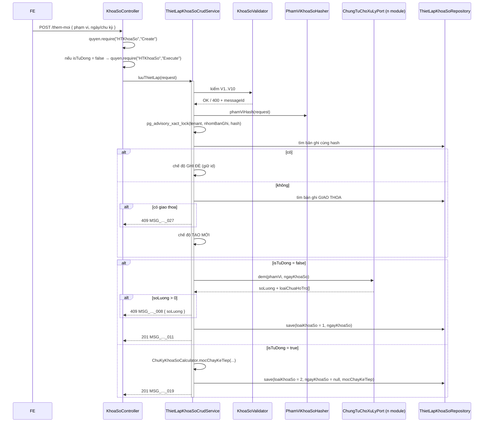

# F02 — Tạo thiết lập / thực hiện khóa sổ

> Quay lại [00-ke-hoach-tong.md](00-ke-hoach-tong.md)

| Mục | Nội dung |
|---|---|
| Use case | `U-09187` Khóa sổ theo hệ thống · `U-09188` theo loại chứng từ · `U-09189` theo người dùng · `U-09193`/`U-09194`/`U-09195` thiết lập tự động (3 phạm vi) |
| Màn hình | `6.screens/SCR_ThietLapNgayKhoaSo.md` + ma trận `SCR_ThietLapNgayKhoaSo_MaTranAnHien.md` |
| Endpoint | **A4** `POST /api/he-thong/khoa-so/them-moi` |
| Quyền | `HTKhoaSo.Create` — **cộng thêm** `HTKhoaSo.Execute` khi `isTuDong = false` (thao tác này khóa sổ thật) |
| Nguồn | **Override** `BaseCrudController.create` — luồng không phải CRUD thuần |

---

## 1. Vì sao MỘT endpoint cho SÁU use case (D4)

Sáu UC dùng **chung một popup, chung một nút Lưu** (`SCR_ThietLapNgayKhoaSo.md`). Chúng chỉ khác nhau ở giá trị ba trường trong cùng một form:

| UC | `loaiDoiTuong` | `loaiChonNguoiDung` | `isTuDong` | `loaiKhoaSo` ghi vào DB |
|---|---|---|---|---|
| U-09187 Khóa sổ theo hệ thống | 1 | — (bỏ qua) | false | **1 — Thủ công** |
| U-09188 Khóa sổ theo loại chứng từ | 2 | 1 | false | **1 — Thủ công** |
| U-09189 Khóa sổ theo người dùng | 2 | 2 | false | **1 — Thủ công** |
| U-09193 Tự động theo hệ thống | 1 | — | true | **2 — Thiết lập** |
| U-09194 Tự động theo loại chứng từ | 2 | 1 | true | **2 — Thiết lập** |
| U-09195 Tự động theo người dùng | 2 | 2 | true | **2 — Thiết lập** |
| *(job chạy — [F07](07-job-tu-dong-khoa-so.md))* | kế thừa thiết lập | kế thừa | — | **3 — Tự động** |

Tách 6 endpoint = 6 bản sao của cùng một bộ 10 validation; lệch một bản là một lỗ hổng không ai thấy. `loaiKhoaSo` là **giá trị server tính**, request không được gửi.

---

## 2. Hợp đồng API

### 2.1 A4 — `POST /api/he-thong/khoa-so/them-moi`

```jsonc
// Request — LuuThietLapKhoaSoRequest
{
  "loaiDoiTuong": 2,                       // 1 = Toàn hệ thống, 2 = Chọn chứng từ   (bắt buộc)
  "maLoaiChungTu": ["BAN_HANG", "MUA_HANG"],// bắt buộc khi loaiDoiTuong = 2
  "loaiChonNguoiDung": 2,                  // 1 = Tất cả, 2 = Chọn người dùng        (bắt buộc khi loaiDoiTuong = 2)
  "userIds": ["8b1e…", "c07a…"],           // bắt buộc khi loaiChonNguoiDung = 2
  "ngayKhoaSo": "2026-05-31",              // bắt buộc khi isTuDong = false
  "isTuDong": false,

  // — chỉ đọc khi isTuDong = true —
  "kyKhoaSo": null,                        // 1 = Hàng ngày, 2 = Hàng tuần, 3 = Hàng tháng
  "giaTriKy": null,                        // tuần: 1..7 (T2..CN) · tháng: 1..31, 32 = ngày cuối tháng
  "doTreThucThi": null,                    // ngày: 0..31 · tuần: -7..7 · tháng: -31..31   (Q1)
  "gioThucThi": null,                      // "HH:mm"

  "boQuaCanhBaoChungTu": false             // §4.3 — FE gửi true sau khi người dùng đã xử lý xong
}
```

```jsonc
// Response 201 — isTuDong = false (đã khóa sổ)
{
  "data": { /* ThietLapKhoaSoDto — xem 01-xem-danh-sach-thiet-lap.md §2.1 */ },
  "message": "Khóa sổ thành công",
  "messageId": "MSG_PMKT-E-07528_011"
}
```

```jsonc
// Response 201 — isTuDong = true (mới chỉ tạo lịch)
{
  "data": { /* ThietLapKhoaSoDto, ngayKhoaSo = null, loaiKhoaSo = 2 */ },
  "message": "Thiết lập khóa sổ đã được tạo mới thành công",
  "messageId": "MSG_PMKT-E-07528_019"
}
```

```jsonc
// Response 409 — còn chứng từ chưa ghi sổ (D5)
{
  "code": "CO_CHUNG_TU_CHUA_GHI_SO",
  "message": "Có 12 chứng từ chưa ghi sổ. Muốn thực hiện khóa sổ, bạn cần xử lý hết các chứng từ này",
  "messageId": "MSG_PMKT-E-07528_008",
  "details": [ { "field": "soLuong", "message": "12" } ]
}
```

### 2.2 Bảng field của `LuuThietLapKhoaSoRequest`

| # | Field | Kiểu | Bắt buộc | Ràng buộc | Nguồn BA |
|---|---|---|---|---|---|
| 1 | `loaiDoiTuong` | `Integer` | **Y** | `@NotNull`, ∈ {1, 2}. 1 = Toàn hệ thống · 2 = Chọn chứng từ | `SCR_ThietLapNgayKhoaSo.md:21` — Radio Phạm vi khóa sổ, mặc định "Toàn hệ thống" |
| 2 | `maLoaiChungTu` | `List<String>` | **Y nếu** `loaiDoiTuong = 2` | Không rỗng (V1); mỗi phần tử trim (BR43), max 255, phải tồn tại trong `mst_loai_chung_tu.code` (V10); loại trùng trước khi lưu | `SCR_ThietLapNgayKhoaSo.md:22` — Loại chứng từ, side-tab chọn nhiều |
| 3 | `loaiChonNguoiDung` | `Integer` | **Y nếu** `loaiDoiTuong = 2` | ∈ {1, 2}. 1 = Tất cả · 2 = Chọn người dùng. Mặc định 1 | `SCR_ThietLapNgayKhoaSo.md:23` — Radio (User), mặc định "Tất cả" |
| 4 | `userIds` | `List<UUID>` | **Y nếu** `loaiChonNguoiDung = 2` | Không rỗng (V2); loại trùng trước khi lưu | `SCR_ThietLapNgayKhoaSo.md:24` — Người dùng, hiển thị dạng tag |
| 5 | `ngayKhoaSo` | `LocalDate` | **Y nếu** `isTuDong = false` | V7. **Không** ràng buộc quá khứ/tương lai — BR01 cho phép lùi ngày = Mở sổ | `SCR_ThietLapNgayKhoaSo.md:25` — Date picker `DD/MM/YYYY`, mặc định ngày hiện tại |
| 6 | `isTuDong` | `boolean` | **Y** | Mặc định `false` | `SCR_ThietLapNgayKhoaSo.md:35` — Toggle Switch, mặc định Off |
| 7 | `kyKhoaSo` | `Integer` | **Y nếu** `isTuDong = true` | V4; ∈ {1, 2, 3}. 1 = Hàng ngày · 2 = Hàng tuần · 3 = Hàng tháng | `SCR_ThietLapNgayKhoaSo.md:43-47` — bảng "Hiển thị theo kỳ khóa sổ" |
| 8 | `giaTriKy` | `Integer` | **Y nếu** `kyKhoaSo ∈ {2, 3}` | V5, V6, V8. Tuần: 1..7 (T2..CN). Tháng: 1..31, hoặc **32 = ngày cuối tháng** (**Q2**) | `SCR_ThietLapNgayKhoaSo.md:46-47` — "Chọn thứ" / "Chọn ngày trong tháng" |
| 9 | `doTreThucThi` | `Integer` | N | V9. Mặc định `0`. Ngày: `0…31` · Tuần: `-7…7` · Tháng: `-31…31` (**Q1** — 3 nguồn BA đang nói khác nhau) | `SCR_ThietLapNgayKhoaSo.md:45-47,52-54` + BR06 dòng 109-119 |
| 10 | `gioThucThi` | `LocalTime` | **Y nếu** `isTuDong = true` | V3. Định dạng `HH:mm`, mặc định `18:00` | `SCR_ThietLapNgayKhoaSo.md:45-47` — Time picker |
| 11 | `boQuaCanhBaoChungTu` | `boolean` | N | Mặc định `false`. **Không** dùng để bỏ qua kiểm tra — §4.3 | Không có trong BA — thêm cho truy vết, §4.3 |

**Trường server tính, request KHÔNG có field tương ứng:** `loaiKhoaSo`, `laMacDinh`, `phamViHash`, `nhomBanGhi`, `mocChayKeTiep`, `lanChayGanNhat`, `tenantId`, toàn bộ cột audit (BR46). Client gửi kèm thì bị Jackson bỏ qua vì `LuuThietLapKhoaSoRequest` không khai chúng — đó là field **không tồn tại trong hợp đồng**, không phải giá trị sai, nên không trả 400.

---

## 2bis. Ánh xạ cột: BA ↔ DB ↔ DTO

| # | Field BA (popup) | Field request | Cột DB thật | Bảng | Ghi chú |
|---|---|---|---|---|---|
| 1 | Radio Phạm vi khóa sổ | `loaiDoiTuong` | `loai_doi_tuong` | cha | |
| 2 | Loại chứng từ | `maLoaiChungTu[]` | `ma_loai_chung_tu` (N dòng) | **con** `…_chung_tu` | `loaiDoiTuong = 1` ⇒ **0 dòng con** |
| 3 | Radio (User) | `loaiChonNguoiDung` | `loai_chon_nguoi_dung` | **cha** | ⚠️ Cột này hôm nay nằm ở **bảng con** — V358 chuyển lên cha, xem [09 §3](09-thiet-ke-db.md) |
| 4 | Người dùng | `userIds[]` | `user_id` (N dòng) | **con** `…_nguoi_dung` | `loaiChonNguoiDung = 1` ⇒ **0 dòng con** (không phải 1 dòng `user_id = NULL`) |
| 5 | Ngày khóa sổ | `ngayKhoaSo` (`LocalDate`) | `ngay_khoa_so` (`timestamptz`) | cha | **Dẫn xuất phần giờ** — §2bis.1 |
| 6 | Switch Khóa sổ tự động | `isTuDong` | `is_tu_dong` | cha | |
| 7 | Kỳ khóa sổ | `kyKhoaSo` | `ky_khoa_so` | cha | |
| 8 | Chọn thứ / Chọn ngày trong tháng | `giaTriKy` | `gia_tri_ky` | cha | Một cột phục vụ hai control khác nhau tuỳ `kyKhoaSo` |
| 9 | Số ngày (độ trễ) | `doTreThucThi` | `do_tre_thuc_thi` | cha | |
| 10 | Giờ | `gioThucThi` | `gio_thuc_thi` (`time`) | cha | |
| — | *(không có trên form)* | — | `loai_khoa_so` | cha | **Dẫn xuất** — §2bis.2 |
| — | *(không có trên form)* | — | `pham_vi_hash` | cha | **Dẫn xuất** — [09 §4.2](09-thiet-ke-db.md) |
| — | *(không có trên form)* | — | `moc_chay_ke_tiep` | cha | **Dẫn xuất** — chỉ khi `isTuDong = true`, [07 §2](07-job-tu-dong-khoa-so.md) |

### 2bis.1 Cột dẫn xuất `ngay_khoa_so` — ghép phần giờ

Người dùng chỉ nhập **ngày** (`SCR_ThietLapNgayKhoaSo.md:25`), nhưng cột DB là `timestamptz` và màn danh sách hiển thị `DD/MM/YYYY HH:mm` (`SCR_XemDanhSachThietLapKhoaSo.md:38`). Công thức ghép:

```
isTuDong = false (thủ công)          →  ngayKhoaSo tại 23:59:00
job hàng ngày   (kyKhoaSo = 1)       →  ngày chốt tại gioThucThi        (BR06: "khóa đến hết đúng [Giờ]")
job hàng tuần/tháng (kyKhoaSo = 2,3) →  ngày chốt tại 23:59:59          (BR06)
```

> ⚠️ Phần giờ hiện **không có tác dụng chặn**: cả `KhoaSoRepository.SQL_MOC_KHOA` (`KhoaSoRepository.java:25`) lẫn trigger `acc_so_cai_period_guard` đều so `ngay_khoa_so::date`, và `ngay_hach_toan` của chứng từ là kiểu `date`. Nghĩa là "khóa đến hết 18:00" thực chất khóa cả ngày. Đây là **Q10** — cần BA chốt giờ là hiển thị thuần hay phải chặn tới giờ.

### 2bis.2 Cột dẫn xuất `loai_khoa_so`

```
isTuDong = true                        →  2  (Thiết lập)
isTuDong = false, người dùng lưu       →  1  (Thủ công)
isTuDong = false, job ghi              →  3  (Tự động)   — xem 07-job-tu-dong-khoa-so.md §4.3
```

`nhom_ban_ghi` **không** tính ở Java — nó là cột sinh của DB (`CASE WHEN loai_khoa_so = 2 THEN 2 ELSE 1 END`), nên không có cách nào ghi lệch với `loai_khoa_so`.

---

## 3. Validation — ma trận đầy đủ

Thứ tự chạy: **BR43 trim → bean validation → `KhoaSoValidator` → kiểm phạm vi (ghi đè / giao thoa) → quét chứng từ chưa ghi sổ**. Dừng ở lỗi đầu tiên trong mỗi nhóm.

### 3.1 Validation trường (`KhoaSoValidator`)

| # | Điều kiện | Mã lỗi | messageId | HTTP |
|---|---|---|---|---|
| V1 | `loaiDoiTuong = 2` và `maLoaiChungTu` rỗng | `THIEU_LOAI_CHUNG_TU` | `MSG_PMKT-E-07528_005` | 400 |
| V2 | `loaiChonNguoiDung = 2` và `userIds` rỗng | `THIEU_NGUOI_DUNG` | `MSG_PMKT-E-07528_006` | 400 |
| V3 | `isTuDong = true` và `gioThucThi` null | `THIEU_GIO_THUC_THI` | `MSG_PMKT-E-07528_007` | 400 |
| V4 | `isTuDong = true` và `kyKhoaSo` null | `THIEU_CHU_KY` | `MSG_PMKT-E-07528_022` | 400 |
| V5 | `kyKhoaSo = 2` (tuần) và `giaTriKy` null | `THIEU_NGAY_TRONG_TUAN` | `MSG_PMKT-E-07528_017` | 400 |
| V6 | `kyKhoaSo = 3` (tháng) và `giaTriKy` null | `THIEU_NGAY_TRONG_THANG` | `MSG_PMKT-E-07528_018` | 400 |
| V7 | `isTuDong = false` và `ngayKhoaSo` null | `THIEU_NGAY_KHOA_SO` | `MSG_PMKT-E-07528_015` | 400 |
| V8 | `giaTriKy` ngoài khoảng theo `kyKhoaSo` (tuần 1..7; tháng 1..31 hoặc 32) | `GIA_TRI_KY_KHONG_HOP_LE` | *(không có mã BA — dùng `MSG_CORE_VALIDATION`)* | 400 |
| V9 | `doTreThucThi` ngoài khoảng theo `kyKhoaSo` (**Q1**) | `DO_TRE_KHONG_HOP_LE` | *(không có mã BA)* | 400 |
| V10 | `maLoaiChungTu` chứa mã không có trong `mst_loai_chung_tu` | `UNKNOWN_VOUCHER_TYPE` | `MSG_UNKNOWN_VOUCHER_TYPE` (đã có ở `MaLoiHachToan`) | 400 |

V8 và V9 **không có mã thông báo trong `6.messages.md`** — không bịa mã mới của epic. Dùng mã lỗi validation chung của core và ghi vào `details[]` đúng tên field, để FE hiển thị lỗi cạnh ô nhập theo BR15.4. Nếu BA muốn message riêng thì bổ sung vào `6.messages.md` trước (**Q1** đã hỏi khoảng giá trị, đề nghị hỏi luôn message).

**Trường bị bỏ qua chứ không bị từ chối:**
- `loaiDoiTuong = 1` → `maLoaiChungTu`, `loaiChonNguoiDung`, `userIds` bị **bỏ qua** (BR02: ẩn hai trường này). Không ném lỗi khi FE lỡ gửi — theo ma trận `SCR_ThietLapNgayKhoaSo_MaTranAnHien.md`, trường ẩn là trường không tồn tại với người dùng, giá trị còn sót lại là rác của FE.
- `loaiChonNguoiDung = 1` → `userIds` bị bỏ qua.
- `isTuDong = true` → `ngayKhoaSo` bị bỏ qua (BR04: trường Ngày khóa sổ bị disable khi bật tự động).
- `isTuDong = false` → `kyKhoaSo`, `giaTriKy`, `doTreThucThi`, `gioThucThi` bị bỏ qua.

Việc bỏ qua **phải diễn ra ở service, không phải ở entity** — nếu để lọt xuống DB thì bản ghi "Toàn hệ thống" vẫn có dòng con loại chứng từ, và câu truy vấn mốc khóa ở [F08](08-ap-dung-moc-khoa-so.md) sẽ đọc ra phạm vi sai.

### 3.2 Kiểm phạm vi — ghi đè (BR03) vs giao thoa (MSG_027)

**Quy tắc BA** (`SCR_ThietLapNgayKhoaSo.md:64-65`):

| Điều kiện | Xử lý |
|---|---|
| **Trùng khớp hoàn toàn** phạm vi với thiết lập đã tồn tại | Cập nhật (ghi đè) bản ghi cũ |
| **Giao thoa một phần** phạm vi với thiết lập đã tồn tại | Chặn, `MSG_PMKT-E-07528_027` |

Định nghĩa **phạm vi** = bộ 4: `(loaiDoiTuong, tập maLoaiChungTu, loaiChonNguoiDung, tập userId)`.
Định nghĩa **nhóm bản ghi** (BR03: *"Riêng loại 'Thiết lập'… tồn tại độc lập với bản ghi kết quả khóa sổ"*):

```
nhom_ban_ghi = 1 (KẾT QUẢ)   khi loai_khoa_so ∈ {1 Thủ công, 3 Tự động}
nhom_ban_ghi = 2 (THIẾT LẬP) khi loai_khoa_so = 2
```

Thuật toán:

```
1. Tính phamViHash của request        (PhamViKhoaSoHasher — 09-thiet-ke-db.md §4)
2. Tìm bản ghi cùng (tenant, nhom_ban_ghi, phamViHash), da_xoa = false
   → Có   ⇒ GHI ĐÈ bản ghi đó (không INSERT mới)
   → Không⇒ sang bước 3
3. Tìm các bản ghi cùng (tenant, nhom_ban_ghi) có phạm vi GIAO THOA nhưng không trùng khớp:
     giao thoa ⟺ (tập maLoaiChungTu ∩ tập cũ ≠ ∅)  AND  (tập userId giao nhau hoặc một trong hai là "Tất cả")
   → Có   ⇒ 409 GIAO_THOA_PHAM_VI / MSG_PMKT-E-07528_027, {0} = tên các loại CT bị giao thoa
   → Không⇒ INSERT mới
```

Hai chỗ cần chốt trước khi code:

- **Q9** — BA chỉ nói giao thoa theo *tập loại chứng từ*, không nói tập người dùng. Thuật toán trên kiểm **cả hai**; nếu BA chỉ muốn kiểm loại CT thì bỏ vế thứ hai.
- **`loaiDoiTuong = 1` có giao thoa với `loaiDoiTuong = 2` không?** Theo BR01 (mốc muộn nhất) hai phạm vi này **chồng nhau có chủ đích** — thiết lập "Toàn hệ thống" là mốc cơ sở, thiết lập chi tiết chồng lên. ⇒ **KHÔNG** coi là giao thoa. Chỉ so giao thoa **giữa các bản ghi cùng `loaiDoiTuong = 2`**.

Ghi đè cũng phải chống tương tranh: xem §5.

### 3.3 Ghi đè cụ thể làm gì

BR03 (`SCR_XemDanhSachThietLapKhoaSo.md:68-71`): *"hệ thống sẽ ghi đè (thay thế) bản ghi cũ, bất kể loại khóa sổ trước đó là Thủ công hay Tự động"*, ví dụ đi kèm cho thấy `loaiKhoaSo` **đổi theo nguồn ghi mới nhất**.

⇒ Ghi đè = `UPDATE` chính bản ghi cũ (giữ nguyên `id`, giữ `ngay_tao`/`nguoi_tao`, tăng `phien_ban`):

| Cột | Sau khi ghi đè |
|---|---|
| `loai_khoa_so` | 1 nếu người dùng lưu thủ công · 2 nếu là thiết lập tự động · 3 nếu job ghi |
| `ngay_khoa_so` | ngày mới (có thể **lùi** so với cũ — đó chính là "Mở sổ" của BR01, xem **Q12**) |
| `is_tu_dong`, `ky_khoa_so`, `gia_tri_ky`, `do_tre_thuc_thi`, `gio_thuc_thi` | theo request |
| `ngay_cap_nhat`, `nguoi_cap_nhat`, `phien_ban` | base tự quản (`BaseEntity.onUpdate()` — `BaseEntity.java:58-65`) |
| `pham_vi_hash` | **không đổi** (phạm vi trùng khớp hoàn toàn mới vào nhánh này) |
| `la_mac_dinh` | **không đổi** — ghi đè lên bản ghi mặc định vẫn giữ cờ, nó chỉ chi phối quyền xoá |

Vì giữ `id`, hai mảng con được đồng bộ bằng `orphanRemoval = true` (xoá dòng con không còn trong request, thêm dòng mới). Ở đây phạm vi trùng khớp hoàn toàn nên hai mảng con **không đổi** — nhưng vẫn phải chạy qua cùng một đường ghi để không có hai lối lưu khác nhau.

### 3.4 Kế thừa đối tượng thiết lập (BR05 popup)

*"Khi bật Switch 'Khóa sổ tự động', các cấu hình ở section phía trên trở thành phạm vi áp dụng của Job tự động."*

Ở API điều này là **hiển nhiên**: cùng một request mang cả phạm vi lẫn cấu hình chu kỳ, cùng một bản ghi lưu cả hai. Không cần cơ chế nào thêm. Ghi lại ở đây để người review không đi tìm.

---

## 4. Quét chứng từ chưa ghi sổ (BR01 `SCR_PopupCanhBaoChungTu`)

### 4.1 Khi nào quét

| `isTuDong` | Quét? | Lý do |
|---|---|---|
| `false` (khóa sổ thật) | **Có** | Thao tác chốt dữ liệu ngay lập tức |
| `true` (chỉ tạo lịch) | **Không** — **Q3** | Bản ghi "Thiết lập" có `ngay_khoa_so = NULL`, không chặn chứng từ nào tại thời điểm lưu. Quét lúc này là quét một mốc chưa tồn tại |

### 4.2 Quét cái gì

Bốn điều kiện đồng thời — ba điều kiện của BA (`SCR_PopupCanhBaoChungTu.md:41`) cộng một cận dưới:

1. `ngay_hach_toan <= ngayKhoaSo` **và `ngay_hach_toan > mocCu`** ← §4.2.1
2. nằm trong **phạm vi đối tượng đã chọn** (loại CT + người dùng của request đang lưu)
3. trạng thái **"Chưa ghi sổ"** ⇒ `status != DA_GHI_SO` (`TrangThaiChungTu.java:17-32`)

Thực hiện qua `ChungTuChoXuLyPort.dem(phamVi)` — xem [06-chung-tu-cho-xu-ly.md §3](06-chung-tu-cho-xu-ly.md).

#### 4.2.1 Cận dưới `mocCu` — chỉ quét PHẦN MỚI BỊ KHOÁ THÊM

`mocCu` = mốc khoá sổ **đang hiệu lực** cho phạm vi này, tính theo BR01 (`MAX` qua mọi thiết lập áp dụng được — [08 §3.3](08-ap-dung-moc-khoa-so.md)). Chưa có thiết lập nào chạm tới ⇒ `mocCu = null` ⇒ không có cận dưới ⇒ **đúng bằng điều kiện gốc của BA**.

Cận dưới này tồn tại để không chặn người dùng vì một việc họ không gây ra. Ví dụ: hệ thống đã khoá tới 31/05; người dùng tạo thiết lập "Bán hàng khoá tới 30/06". Phần **mới** bị khoá chỉ là `(31/05, 30/06]`. Một chứng từ bán hàng chưa ghi sổ ngày 20/05 **đã bị khoá từ trước** — chặn lần lưu này vì nó là vô lý kép:

- người dùng **không thể** ghi sổ nó (BR07 chặn ghi sổ trong kỳ đã khoá — `SCR_XemDanhSachThietLapKhoaSo.md:85-92`);
- và nó không liên quan gì tới khoảng thời gian họ đang khoá thêm.

Chi tiết đầy đủ + ca kẹt cứng mà cận dưới này ngăn: [03 §4quater](03-chinh-sua-thiet-lap.md). **Lệch BA có chủ đích** — xem **Q14**.

> ⚠️ **R3 — con số này không đầy đủ.** Chỉ những loại chứng từ đã có module Java và đã cài port mới được đếm. Response `409` phải kèm `loaiChungTuChuaHoTro[]` để FE nói rõ với người dùng rằng còn loại chưa quét được.

### 4.3 Cờ `boQuaCanhBaoChungTu`

Sau khi người dùng xử lý xong ở màn "Danh sách chứng từ chờ xử lý", FE quay lại popup và bấm Lưu lần nữa (BR05 `SCR_DanhSachChungTuChoXuLy.md:93-94`). Lúc đó lưới đã trống nên lần quét thứ hai trả 0 và request đi qua bình thường — **cờ này KHÔNG dùng để bỏ qua kiểm tra**.

Nó chỉ để phân biệt hai tình huống trong log/audit: người dùng lưu lần đầu, hay lưu sau khi đã đi qua luồng xử lý. **Nếu vẫn còn chứng từ chưa ghi sổ thì `boQuaCanhBaoChungTu = true` vẫn bị chặn 409** — cho phép bỏ qua là mở đường khóa sổ trên dữ liệu chưa chốt, đúng thứ toàn bộ luồng này sinh ra để ngăn.

*(Nếu BA muốn cho phép "khóa sổ dù còn chứng từ chưa ghi sổ", đó là một quyết định nghiệp vụ khác hẳn và cần một UC riêng — không âm thầm gài vào một cờ boolean.)*

---

## 5. Tương tranh và transaction

Toàn bộ A4 chạy trong **một** `@Transactional`:

```
① khóa tương tranh theo phạm vi      pg_advisory_xact_lock(hash64(tenantId, nhomBanGhi, phamViHash))
② tìm bản ghi trùng khớp hoàn toàn   → quyết định TẠO hay GHI ĐÈ
③ kiểm giao thoa
④ quét chứng từ chưa ghi sổ          (chỉ khi isTuDong = false)
⑤ INSERT / UPDATE + đồng bộ 2 bảng con
⑥ tính lại moc_chay_ke_tiep          (chỉ khi isTuDong = true — F07)
```

**Vì sao cần cả advisory lock ở ① lẫn unique index ở DB (D8):** unique index chống được ca "2 request cùng TẠO", nhưng không chống được ca "1 request TẠO + 1 request GHI ĐÈ" hay "2 request cùng GHI ĐÈ với ngày khác nhau" — ở đó không có INSERT nào vi phạm unique, mà kết quả cuối phụ thuộc thứ tự. Advisory lock serialize hẳn theo phạm vi. Cùng cơ chế `ChungTuKhoaApi` đang dùng cho chứng từ (`ChungTuKhoaApi.java:5-12`), nhưng khoá theo **phạm vi** chứ không theo id chứng từ, nên viết một helper riêng trong `khoa_so/internal` — **không** tái dùng `ChungTuKhoaApi` vì tham số của nó là `chungTuId`, truyền một hash vào đó là nói dối về ý nghĩa.

Advisory lock tự nhả khi transaction kết thúc, không cần `finally`.

---

## 6. Luồng xử lý



---

## 6bis. Phân trang · sắp xếp · lọc · dòng tổng

**Không áp dụng** — đây là endpoint ghi (một bản ghi), không phải màn danh sách. Các mục BR1/BR2/BR11/BR31 áp ở [F01](01-xem-danh-sach-thiet-lap.md).

Một hệ quả **có** liên quan tới danh sách: BR2 Common quy định *"bản ghi vừa tạo hiển thị ở vị trí đầu tiên"* ngay sau khi Thêm mới thành công. Sort mặc định của F01 là `loaiDoiTuong:asc, ngayCapNhat:desc` ⇒ bản ghi vừa lưu **tự** lên đầu nhóm của nó mà không cần cơ chế ghim nào ở BE. Không cài thêm gì.

---

## 7. Kiểm thử

### 7.1 Unit test (`@Tag("unit")`)

| Lớp test | Kiểm gì |
|---|---|
| `KhoaSoValidatorTest` | 10 ca V1…V10, mỗi ca khẳng định **đúng `messageId`** (không chỉ "ném lỗi") |
| `KhoaSoValidatorTest` | Trường bị bỏ qua: `loaiDoiTuong=1` + gửi kèm `maLoaiChungTu` → lưu ra bản ghi **không có** dòng con nào |
| `PhamViKhoaSoHasherTest` | Pin chuỗi băm cho 6 tổ hợp phạm vi; hai request khác **thứ tự** phần tử trong `maLoaiChungTu`/`userIds` cho **cùng** hash; khác nội dung cho hash khác |
| `PhamViGiaoThoaTest` | Ma trận: trùng hoàn toàn → ghi đè · giao thoa một phần → 409 · rời nhau → tạo mới · `loaiDoiTuong` 1 vs 2 → **không** giao thoa |
| `GhiDeThietLapTest` | Ghi đè giữ `id`/`ngayTao`/`nguoiTao`/`laMacDinh`, đổi `loaiKhoaSo`, tăng `phienBan` |
| `ChuKyKhoaSoCalculatorTest` | Xem [07-job-tu-dong-khoa-so.md §6](07-job-tu-dong-khoa-so.md) |

### 7.2 Test tích hợp (cần Docker)

`LuuThietLapKhoaSoIT`:
- Hai request đồng thời cùng phạm vi → đúng **một** bản ghi hiệu lực, request còn lại 409 (chứng minh advisory lock + unique index).
- `isTuDong = false` với 3 chứng từ chưa ghi sổ trong phạm vi → 409 kèm `soLuong = 3`, **và bản ghi không được ghi vào DB** (transaction rollback trọn vẹn).
- Ghi đè bản ghi có 5 dòng con bằng phạm vi trùng khớp → vẫn đúng 5 dòng con, không sinh dòng mồ côi.
- `HTKhoaSo.Create` có nhưng thiếu `HTKhoaSo.Execute` + `isTuDong=false` → 403.

---

## 8. BR đã áp dụng

| BR | Áp thế nào |
|---|---|
| BR02 popup (UI động theo phạm vi) | §3.1 — trường bị ẩn thì bị **bỏ qua ở service** |
| BR03 popup (bắt buộc chọn tối thiểu) | V1, V2 |
| BR03 danh sách (hợp nhất bản ghi / ghi đè) | §3.2, §3.3 |
| BR04 popup (hiển thị section tự động) | §3.1 — `ngayKhoaSo` bị bỏ qua khi `isTuDong = true` |
| BR05 popup (kế thừa đối tượng thiết lập) | §3.4 |
| BR01 popup (logic khóa/mở sổ, không ràng buộc tương lai/quá khứ) | Không validate `ngayKhoaSo` phải ≥ hôm nay — **cố ý**; lùi ngày chính là "Mở sổ" |
| BR01 danh sách (mốc muộn nhất) | Không áp ở đây — áp ở [F08](08-ap-dung-moc-khoa-so.md) |
| BR3 Common (popup) · BR14 Common (chế độ form) | FE |
| BR15 Common (validation) | §3.1, lỗi trả kèm `details[]` theo field cho BR15.4 |
| BR43 Common (trim) | Trim `maLoaiChungTu` trước khi băm và trước khi so trùng |
| BR25 Common (phân quyền) | `Create` + `Execute` §2 |
| BR26 Common (toast) | `messageId` trả về ở mọi nhánh thành công |
