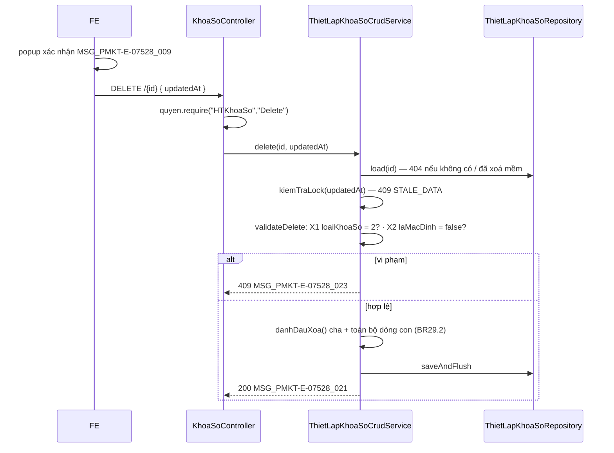

# F04 — Xóa thiết lập khóa sổ

> Quay lại [00-ke-hoach-tong.md](00-ke-hoach-tong.md)

| Mục | Nội dung |
|---|---|
| Use case | `PMKT-U-11304_XoaThietLapKhoaSo` |
| Màn hình | `SCR_XemDanhSachThietLapKhoaSo.md` (icon Thùng rác) |
| Endpoint | **A6** `DELETE /api/he-thong/khoa-so/{id}` |
| Quyền | `HTKhoaSo.Delete` |
| Nguồn | **Override** `AbstractCrudService.validateDelete` — controller vẫn dùng nguyên `BaseCrudController.delete` |

---

## 1. Hai điều kiện chặn

`UC_XoaThietLapKhoaSo.md:7,20-24` + BR03/BR04 của `SCR_XemDanhSachThietLapKhoaSo.md`:

| # | Điều kiện | Vi phạm thì | messageId |
|---|---|---|---|
| **X1** | `loaiKhoaSo = 2` (**Thiết lập**) | 409 `KHONG_THE_XOA` | `MSG_PMKT-E-07528_023` |
| **X2** | `laMacDinh = false` (BR04: *"Bản ghi mặc định không cho phép xóa"*) | 409 `KHONG_THE_XOA` | `MSG_PMKT-E-07528_023` |

Hai điều kiện dùng **cùng một messageId** vì `6.messages.md` chỉ cấp một mã cho cả hai (*"Cảnh báo khi người dùng cố xóa bản ghi mặc định hoặc bản ghi không cho phép xóa"* — `6.messages.md:25`). `code` máy đọc thì tách để log phân biệt được: `KHONG_THE_XOA_LOAI_KHOA_SO` vs `KHONG_THE_XOA_MAC_DINH`.

### Vì sao X1 chặn được nhiều hơn nó nghe có vẻ

Bản ghi loại **1 (Thủ công)** và **3 (Tự động)** là **kết quả khóa sổ đang có hiệu lực** — chúng chính là dữ liệu mà `KyKeToanApi` đọc để chặn thao tác trên chứng từ. Xoá chúng = **mở sổ một kỳ đã khóa mà không để lại mốc mới nào**. BA chặn đúng.

Muốn mở sổ, người dùng **sửa** bản ghi và lùi ngày (BR01 `SCR_ThietLapNgayKhoaSo.md:91`), không phải xoá. Ghi rõ điều này vào javadoc của `validateDelete` để người sau không "nới lỏng cho tiện".

### `laMacDinh` chặn ở hai tầng

- **Service**: `validateDelete` ném 409 trước khi chạm DB — cho thông báo đọc được.
- **DB**: `CHECK (NOT (la_mac_dinh AND da_xoa))` trên `cfg_thiet_lap_khoa_so` — chốt chặn cuối, bắt cả đường ghi không đi qua service (script vá tay, migration ẩu). Chi tiết ở [09-thiet-ke-db.md §4](09-thiet-ke-db.md).

---

## 2. Hợp đồng API

### 2.1 A6 — `DELETE /api/he-thong/khoa-so/{id}`

```jsonc
// Request body — TUỲ CHỌN (core/request/DeleteRequest.java)
{ "updatedAt": "2026-05-30T08:12:44Z" }
```

```jsonc
// Response 200
{ "data": null, "message": "Thiết lập khóa sổ đã được xóa thành công", "messageId": "MSG_PMKT-E-07528_021" }
```

| HTTP | Mã lỗi | messageId | Khi nào |
|---|---|---|---|
| 404 | `NOT_FOUND` | `MSG_CORE_CRUD_001` | id không tồn tại hoặc đã xoá mềm |
| 409 | `KHONG_THE_XOA_LOAI_KHOA_SO` | `MSG_PMKT-E-07528_023` | `loaiKhoaSo ≠ 2` |
| 409 | `KHONG_THE_XOA_MAC_DINH` | `MSG_PMKT-E-07528_023` | `laMacDinh = true` |
| 409 | `STALE_DATA` | — | `updatedAt` lệch `ngayCapNhat` hiện tại |
| 403 | — | — | thiếu `HTKhoaSo.Delete` |
| 500 | — | `MSG_PMKT-E-07528_024` | lỗi hệ thống (`UC_XoaThietLapKhoaSo.md:34`) |

**Bảng field request** (`DeleteRequest` — `core/request/DeleteRequest.java`):

| # | Field | Kiểu | Bắt buộc | Ràng buộc | Nguồn BA |
|---|---|---|---|---|---|
| 1 | `{id}` (path) | `UUID` | **Y** | Tồn tại và chưa xoá mềm, nếu không → 404 | `SCR_XemDanhSachThietLapKhoaSo.md:53` — icon Thùng rác trên dòng |
| 2 | `updatedAt` | `Instant` | N | Token optimistic-lock; lệch `ngay_cap_nhat` → 409 `STALE_DATA`. Null ⇒ bỏ qua kiểm (`AbstractCrudService.java:145-148`). **Body cả gói là optional** (`BaseCrudController.java:161`) | Không có trong BA — hạ tầng base |

Không có field nghiệp vụ nào: hai điều kiện chặn (X1, X2) đọc từ **chính bản ghi** trong DB, không nhận từ client. Cho client gửi `loaiKhoaSo`/`laMacDinh` lên rồi tin chúng là mở đường xoá bản ghi mặc định bằng một request tự chế.

---

## 1bis. Ánh xạ cột: BA ↔ DB ↔ DTO

| Cột BA | Field DTO | Cột DB | Vai trò trong luồng xoá |
|---|---|---|---|
| Loại khóa sổ | `loaiKhoaSo` | `loai_khoa_so` | Điều kiện **X1** — chỉ `= 2` mới xoá được |
| *(không hiển thị)* | `laMacDinh` | `la_mac_dinh` | Điều kiện **X2** — `true` thì chặn |
| Chức năng (icon Thùng rác) | `choPhepXoa` | dẫn xuất `loai_khoa_so = 2 AND NOT la_mac_dinh` | FE ẩn/hiện nút; BE kiểm lại — [F01 §4](01-xem-danh-sach-thiet-lap.md) |
| *(không hiển thị)* | — | `da_xoa`, `ngay_xoa`, `nguoi_xoa` | Server ghi qua `BaseEntity.danhDauXoa()` + `onUpdate()` (BR46) |

**Không cột nào mới** — xoá mềm chỉ ghi vào bộ cột base có sẵn.

---

**Base `delete` phải override message mặc định.** `BaseCrudController.java:164` trả cứng `"Xoá thành công" / "MSG_CORE_DELETE_SUCCESS"`. Epic yêu cầu `MSG_PMKT-E-07528_021` ⇒ override method `delete` ở `KhoaSoController` (vẫn gọi `quyen.require` + `service().delete(...)`, chỉ đổi envelope trả về).

---

## 3. Xóa mềm và xóa lan (BR29)

`ThietLapKhoaSo` kế thừa `BaseEntity implements SoftDeletable` ⇒ `AbstractCrudService.delete` tự gọi `danhDauXoa()` thay vì `repository.delete()` (`AbstractCrudService.java:129-134`). Không cần viết gì.

**Hai bảng con thì sao?** `orphanRemoval = true` chỉ chạy khi phần tử bị gỡ khỏi collection, **không** chạy khi cha bị xoá mềm — cha vẫn còn trong DB. Ba lựa chọn:

| | A — để nguyên dòng con | **B (chọn) — xoá mềm lan xuống 2 bảng con** | C — xoá vật lý dòng con |
|---|---|---|---|
| Truy vấn mốc khóa ([F08](08-ap-dung-moc-khoa-so.md)) đọc nhầm? | **Không** — nó lọc `t.da_xoa = false` ở bảng CHA trước | Không | Không |
| Đúng BR29.2 (*"Xóa toàn bộ dữ liệu con liên quan: mặc định Xóa mềm"*) | ❌ | ✅ | ❌ (BR29.1 cấm xoá vật lý) |
| Truy vết | Dòng con "sống" trỏ vào cha "chết" — đọc audit log rất khó hiểu | Nhất quán | Mất dữ liệu |
| Chi phí | 0 | 2 câu UPDATE theo `thiet_lap_id` | — |

Chọn **B**: override `AbstractCrudService.validateDelete` để kiểm X1/X2, và thêm bước xoá mềm hai collection trong cùng transaction (gọi `danhDauXoa()` trên từng dòng con — chúng cũng kế thừa `BaseEntity`).

**Không dùng `ON DELETE CASCADE` ở FK**: BR29.1 cấm xoá vật lý, nên không bao giờ có `DELETE` để cascade chạy. FK giữ `ON DELETE RESTRICT` như một hàng rào chống xoá vật lý ngoài ý muốn — xem [09-thiet-ke-db.md §4](09-thiet-ke-db.md).

---

## 4. Xóa bản ghi Thiết lập có ảnh hưởng gì tới job?

Bản ghi loại 2 là **nguồn duy nhất** của lịch chạy tự động. Xoá mềm nó ⇒ job không còn quét thấy (truy vấn "tới hạn" lọc `da_xoa = false`) ⇒ lịch dừng. Đúng ý nghĩa của UC.

**Bản ghi KẾT QUẢ mà job đã sinh ra trước đó (loại 3) KHÔNG bị xoá theo** — mốc khóa sổ đã áp dụng vẫn còn hiệu lực. Đây là hệ quả trực tiếp của BR03 (*"nó tồn tại độc lập với bản ghi kết quả khóa sổ"*) và cần nói rõ với BA vì trực giác người dùng có thể ngược lại ("xoá lịch thì mở sổ luôn chứ?"). Ghi vào **Q5/Q12** khi rà soát.

---

## 5. Luồng xử lý



---

## 5bis. Tương tranh & transaction

| Vấn đề | Xử lý |
|---|---|
| Ranh giới transaction | `AbstractCrudService.delete` khai `@Transactional` (`AbstractCrudService.java:123-124`). Xoá mềm cha + N dòng con nằm trong **một** transaction — nửa chừng thất bại thì không có bản ghi "cha chết con sống" |
| Hai người cùng xoá | Người sau nhận 404: `load(id)` lọc bản ghi `da_xoa` (`AbstractCrudService.java:184-188`). Chấp nhận được — kết quả cuối vẫn là "đã xoá", chỉ khác thông báo |
| Xoá trong khi người khác đang sửa | `@Version phien_ban` + token `updatedAt` → 409 `STALE_DATA` |
| Xoá trong khi **job đang chạy** thiết lập đó | Job giữ dòng bằng `SELECT … FOR UPDATE SKIP LOCKED` ([F07 §3.2](07-job-tu-dong-khoa-so.md)) ⇒ request xoá **đợi** job commit rồi mới đi tiếp, và khi đó `phien_ban` đã đổi → 409 nếu client có gửi token. Không có ca job ghi đè lên bản ghi vừa bị xoá |
| Idempotency | Không cần khoá riêng: xoá là thao tác hội tụ (gọi 2 lần → lần 2 trả 404, trạng thái không đổi) |

**Không** dùng advisory lock theo phạm vi như [F02 §5](02-tao-thiet-lap-khoa-so.md): xoá không tính lại `pham_vi_hash` và không đụng bản ghi nào khác, nên không có ca hai request cùng phạm vi cần serialize.

---

## 5ter. Phân trang · sắp xếp · lọc · dòng tổng

**Không áp dụng** — endpoint xoá một bản ghi. Sau khi xoá, FE tải lại danh sách qua A1 và **giữ nguyên trang hiện tại** (BR29.4).

---

## 6. Kiểm thử

### 6.1 Unit test (`@Tag("unit")`)

| Lớp test | Kiểm gì |
|---|---|
| `XoaThietLapValidateTest` | Ma trận `loaiKhoaSo ∈ {1,2,3} × laMacDinh ∈ {true,false}` → chỉ `(2, false)` được xoá; 5 ca còn lại ném 409 đúng `messageId` |
| `XoaThietLapCascadeTest` | Sau khi xoá, cha **và** toàn bộ dòng con đều `daXoa = true` |
| `XoaThietLapMessageTest` | Envelope trả `MSG_PMKT-E-07528_021`, **không** phải `MSG_CORE_DELETE_SUCCESS` của base |

### 6.2 Test tích hợp (cần Docker)

`XoaThietLapKhoaSoIT`:
- Xoá xong thì A1 (`/search`) không còn trả bản ghi đó, nhưng dòng vẫn nằm trong bảng (xoá mềm).
- Xoá bản ghi loại 2 → job không còn quét thấy nó ở lần chạy kế tiếp.
- Cố `UPDATE cfg_thiet_lap_khoa_so SET da_xoa = true WHERE la_mac_dinh = true` bằng SQL trực tiếp → DB từ chối (chứng minh CHECK constraint là chốt chặn cuối).

---

## 7. BR đã áp dụng

| BR | Áp thế nào |
|---|---|
| BR03 danh sách (chỉ loại "Thiết lập" mới xoá được) | X1 |
| BR04 danh sách (bản ghi mặc định không xoá) | X2 + CHECK ở DB |
| BR29.1 Common (chỉ xóa mềm) | `danhDauXoa()`, không `DELETE` |
| BR29.2 Common (xóa lan = xóa mềm) | §3 phương án B |
| BR29.4 Common (giữ nguyên trang sau khi xoá) | FE |
| BR25 Common (phân quyền) | `HTKhoaSo.Delete`; nút ẩn khi không có quyền, BE vẫn kiểm lại |
| BR3 Common (popup xác nhận) | FE hiển thị `MSG_PMKT-E-07528_009` trước khi gọi API |
| BR46 Common (`NguoiXoa`/`NgayXoa`) | `BaseEntity.danhDauXoa()` + `onUpdate()` tự đóng dấu (`BaseEntity.java:62-64,84-87`) |
