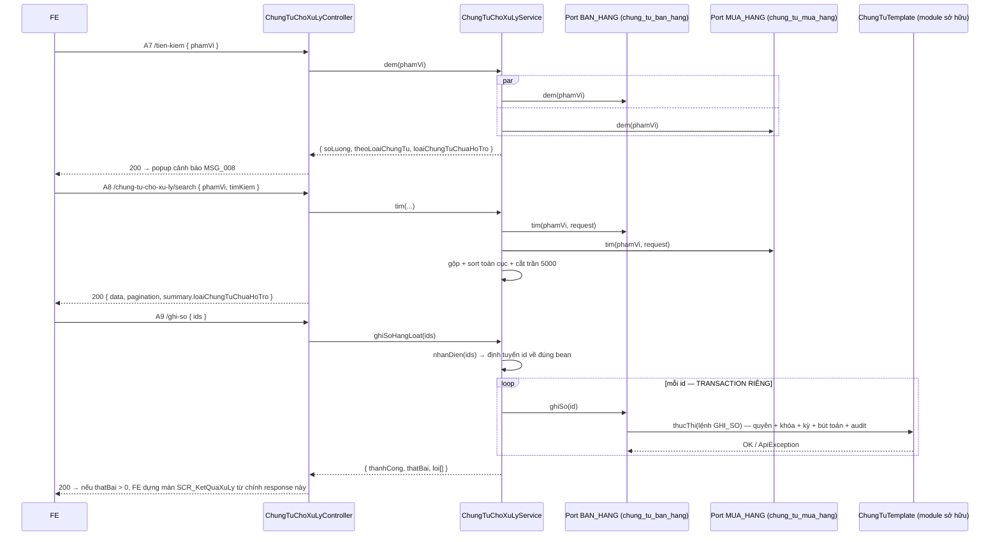

# F06 — Chứng từ chờ xử lý

> Quay lại [00-ke-hoach-tong.md](00-ke-hoach-tong.md)

| Mục | Nội dung |
|---|---|
| Use case | `PMKT-U-09196_XemDanhSachChungTuChoXuLy` · `PMKT-U-09192_XuLyLaiDanhSachChungTu` |
| Màn hình | `SCR_PopupCanhBaoChungTu.md` · `SCR_DanhSachChungTuChoXuLy.md` · `SCR_KetQuaXuLy.md` · `SCR_PopupChonNgayHachToan.md` |
| Endpoint | **A7** `/tien-kiem` · **A8** `/chung-tu-cho-xu-ly/search` · **A9** `/ghi-so` · **A10** `/xoa` · **A11** `/doi-ngay-hach-toan` |
| Quyền | `HTKhoaSo.Execute` (A7) · `HTKhoaSo.Reprocess` (A8–A11) |
| Nguồn | Mới — **không** kế thừa `BaseCrudController` (đây không phải màn CRUD của một bảng) |

---

## 1. Bài toán và ràng buộc

Màn này liệt kê **chứng từ chưa ghi sổ của MỌI loại chứng từ** nằm trong phạm vi khóa sổ. Ba ràng buộc đóng khung toàn bộ thiết kế:

1. **Không có bảng/view chứng từ hợp nhất.** Mỗi loại chứng từ là một bảng riêng (`sal_chung_tu_ban_hang`, `pur_chung_tu_mua_hang`, `inv_phieu_nhap_kho`…), tên cột chi tiết khác nhau. Không có view nào gộp chúng:
   ```bash
   grep -rhoE "CREATE (OR REPLACE )?VIEW [a-z_.]+" cell-app/src/main/resources/db/migration/*.sql | sort -u
   # → chỉ có mst_doi_tuong (party cutover). Không có view chứng từ hợp nhất.
   ```
2. **`accounting_core` không được import `internal` của module chứng từ** (`cell-app/CLAUDE.md`, luật cứng 1).
3. **Ghi sổ / xóa / đổi ngày hạch toán phải đi qua luồng của module sở hữu** — thứ tự "gỡ bút toán cũ → lưu → sinh bút toán mới → kiểm kỳ khoá" là bất biến do `ChungTuTemplate` giữ (`ChungTuTemplate.java:28-54`). UPDATE thẳng cột là phá bất biến (R7).

⇒ **SPI đảo chiều** là lối duy nhất đáp đủ cả ba. Cùng khuôn với `quan_he_chung_tu/api/DongChungTuPort.java:26` — *"phụ thuộc một chiều `<module nghiệp vụ> → …api`, không chu trình, và không module nào import internal của module khác"*.

### 1.1 Vì sao không phải hai phương án kia

| | A — view SQL `UNION ALL` các bảng chứng từ | B — bảng "hàng đợi chứng từ chờ xử lý" ghi sẵn | **C (chọn) — SPI `ChungTuChoXuLyPort`** |
|---|---|---|---|
| Ranh giới module | ❌ `accounting_core` hardcode tên bảng của module khác | ⚠️ Cần mọi module ghi vào hàng đợi ở mọi lần lưu | ✅ |
| Ghi sổ / xóa / đổi ngày | ❌ View không thao tác được — vẫn phải có port | ❌ như trên | ✅ cùng một port |
| Thêm loại chứng từ mới | Sửa view (migration) + sửa `accounting_core` | Sửa module mới + backfill hàng đợi | Chỉ thêm một bean trong module mới |
| Nhất quán dữ liệu | Luôn đúng (đọc trực tiếp) | **Trôi** nếu một module quên ghi hàng đợi | Luôn đúng |
| Rủi ro | Nợ ranh giới không gỡ được | Nguồn sự thật thứ hai | Loại chứng từ **chưa có bean thì không được đếm** (R3). Chốt an toàn: `hoTroChoXuLy` ở [F05 §2.2](05-nguon-chon-loai-ct-nguoi-dung.md) + `loaiChungTuChuaHoTro[]` trong mọi response |

---

## 2. SPI `ChungTuChoXuLyPort`

```java
package vn.dopai.pmkt.cell.accounting_core.khoa_so.api;

/**
 * SPI đảo chiều — mỗi module sở hữu chứng từ tự cài MỘT bean cho loại của mình.
 *
 * <p>Hai bean cùng {@link #maLoaiChungTu()} là lỗi cấu hình, phát hiện lúc khởi động chứ không
 * phải lúc chạy.
 *
 * <p><b>Cấm UPDATE thẳng cột.</b> {@link #ghiSo}, {@link #xoa}, {@link #doiNgayHachToan} BẮT BUỘC
 * đi qua luồng nghiệp vụ của module (ChungTuTemplate) — nếu không sẽ bỏ qua kiểm kỳ khoá, bỏ qua
 * sinh/gỡ bút toán, và không tăng {@code phien_ban}. Ba thứ đó hỏng lặng lẽ, không test đơn lẻ nào
 * của khoá sổ bắt được.
 */
public interface ChungTuChoXuLyPort {

    /** Mã trong {@code mst_loai_chung_tu.code} mà bean này phụ trách, vd {@code "BAN_HANG"}. */
    String maLoaiChungTu();

    /** Đếm chứng từ CHƯA GHI SỔ khớp phạm vi — cho popup cảnh báo MSG_008, không nạp dữ liệu. */
    long dem(PhamViKhoaSo phamVi);

    /** Một trang chứng từ chưa ghi sổ khớp phạm vi, đã map sang DTO chung. */
    Page<ChungTuChoXuLyDto> tim(PhamViKhoaSo phamVi, SearchRequest request);

    /** Ghi sổ MỘT chứng từ. Ném {@code ApiException} có message đọc được khi không ghi được. */
    void ghiSo(UUID chungTuId);

    /** Xoá (mềm) MỘT chứng từ. */
    void xoa(UUID chungTuId);

    /** Đổi ngày hạch toán MỘT chứng từ — phải đi qua luồng SỬA, và phải áp BR37 (§6.2). */
    void doiNgayHachToan(UUID chungTuId, LocalDate ngayMoi);
}
```

```java
public record PhamViKhoaSo(
        int loaiDoiTuong,              // 1 = toàn hệ thống, 2 = chọn chứng từ
        Set<String> maLoaiChungTu,     // rỗng khi loaiDoiTuong = 1
        int loaiChonNguoiDung,         // 1 = tất cả, 2 = chọn người dùng
        Set<UUID> userIds,             // rỗng khi loaiChonNguoiDung = 1
        LocalDate ngayKhoaSo) {

    /** Bean của loại này có nằm trong phạm vi không — port tự hỏi, service không phải biết. */
    public boolean apDungCho(String ma) {
        return loaiDoiTuong == 1 || maLoaiChungTu.contains(ma);
    }
}
```

```java
public record ChungTuChoXuLyDto(
        UUID id,
        String maLoaiChungTu,
        String tenLoaiChungTu,
        String maChungTu,          // = so_chung_tu — BA gọi là "Số chứng từ"
        LocalDate ngayChungTu,
        LocalDate ngayHachToan,
        String dienGiai,
        String duongDanChiTiet,    // §4.2
        String nguyenNhanLoi) {}   // null ở màn danh sách; có giá trị ở màn Kết quả xử lý
```

### 2.1 Điều kiện lọc mà mọi bean PHẢI cài giống nhau

| Điều kiện | Cài thế nào | Vì sao |
|---|---|---|
| Chưa ghi sổ | `status != DA_GHI_SO` (`TrangThaiChungTu.java:29`) | BA: *"ở trạng thái 'Chưa ghi sổ'"* |
| `ngay_hach_toan <= ngayKhoaSo` | so trên cột `ngay_hach_toan` của header | `SCR_PopupCanhBaoChungTu.md:41` |
| Thuộc phạm vi người dùng | `loaiChonNguoiDung = 1` → bỏ qua; `= 2` → `nguoi_tao IN (:userIds)` | **Q4** — "người dùng của chứng từ" tạm chốt là `nguoi_tao` |
| Chưa xoá mềm | `da_xoa = false` | BR29.1 |
| Đúng tenant | RLS tự lo | BR28 |

Năm điều kiện này **giống hệt nhau ở mọi bean** ⇒ đặt chúng vào một `abstract class AbstractChungTuChoXuLyAdapter<E extends BaseChungTuEntity>` trong `accounting_core/khoa_so/api/`, module con chỉ khai entity + repository của mình. Để mỗi module tự viết lại 5 điều kiện là để chúng lệch dần — đúng thứ `HangLoatChungTuService` đã tránh được bằng cách giữ chính sách ở lớp cha (`HangLoatChungTuService.java:27-28`).

#### 2.1.1 Ba tên, ba vai — đừng lẫn

| Tên | Loại | Ở đâu | Vai |
|---|---|---|---|
| `ChungTuChoXuLyPort` | `interface` | `accounting_core/khoa_so/api/` | **Hợp đồng** do `khoa_so` khai ra để module khác cắm vào |
| `AbstractChungTuChoXuLyAdapter<E>` | `abstract class` | `accounting_core/khoa_so/api/` | **Bản cài đặt một phần** — giữ 5 điều kiện lọc §2.1 để chúng không lệch giữa các module |
| `ChungTuBanHangChoXuLyAdapter`<br>`ChungTuMuaHangChoXuLyAdapter` | `class` (`@Component`) | `<module>/internal/adapter/` | **Bản cài đặt cụ thể** của từng module chứng từ |

Quy ước lấy từ repo, không tự đặt: `Port` = interface (`quan_he_chung_tu/api/DongChungTuPort.java:26`, `core/controller/spi/MauCotPort.java`); tiền tố `Abstract` cho lớp cha dùng chung (`core/service/AbstractCrudService.java:37`, `accounting_core/chung_tu/service/AbstractChungTuCrudService.java`); thư mục `internal/adapter/` cho bản cài đặt (9 module đang dùng, vd `platform_iam/nguoi_dung/internal/adapter/`).

> ⚠️ **Có một tiền lệ đi ngược** cần biết để không bị nhầm là chuẩn: `chung_tu_ban_hang/internal/port/DongChungTuBanHangPort.java` là một `public class` (bản cài đặt) nhưng lại mang hậu tố `Port` và nằm trong `internal/port/`. Plan **không** theo tiền lệ đó — đặt tên bản cài đặt là `...Adapter` trong `internal/adapter/` để đọc tên là biết ngay đâu là hợp đồng, đâu là bản cài. Nếu người review muốn ưu tiên đồng bộ với `DongChungTuBanHangPort` hơn là rõ nghĩa, đổi lại được mà không ảnh hưởng thiết kế nào khác.

### 2.2 Ai cài bean — hiện trạng

```bash
grep -rln "extends BaseChungTuEntity" cell-app/src/main/java/vn/dopai/pmkt/cell
```
```
chung_tu_ban_hang/internal/entity/ChungTuBanHang.java
chung_tu_mua_hang/internal/entity/ChungTuMuaHang.java
```

⇒ Đợt này có đúng **2 bean**, và **cả hai đã cài**: `ChungTuBanHangChoXuLyAdapter` (`CTBH`,
`sal_chung_tu_ban_hang`) và `ChungTuMuaHangChoXuLyAdapter` (`CTMH`, `pur_chung_tu_mua_hang`). Mọi
loại chứng từ khác (kho, tiền mặt, TSCĐ, CCDC, CPTT, thuế, giá thành, KTTH) **chưa có entity Java**
nên không thể có bean. Đây là **R3** — rủi ro mức Cao, phải nói với BA chứ không giấu.

**Chứng từ mua hàng đang ở giai đoạn CHỈ ĐỌC (PMKT-U-00506) — bean vẫn bắt buộc phải có.** Nửa
ĐẾM/LIỆT KÊ mới là thứ khoá sổ cần nhất: thiếu bean thì chứng từ mua hàng chưa ghi sổ **không được
đếm**, người dùng khoá sổ xong tưởng sạch, và đống chứng từ nằm dưới mốc khoá thành không ghi sổ
được nữa mà không có gì báo. Nửa THAO TÁC (`ghiSo` / `xoa` / `doiNgayHachToan`) uỷ quyền thẳng cho
`ChungTuMuaHangCrudService`, nơi hiện ném `400 CHUA_HO_TRO` nêu đích danh use case phụ trách
(U-00502…U-00509). Hai cái lợi so với việc adapter tự ném lỗi riêng: ngày các UC đó được cài thì
adapter tự chạy đúng — không còn chỗ thứ hai phải nhớ gỡ stub; và người dùng nhận đúng thông báo
chính thức của module sở hữu. Lỗi hiện thành **một dòng** trong bảng kết quả hàng loạt (BR45), các
chứng từ loại khác trong cùng lô vẫn được xử lý.

`ChungTuChoXuLyService` giữ `Map<String, ChungTuChoXuLyPort>` dựng từ `List<ChungTuChoXuLyPort>` Spring inject. Mã loại chứng từ **có trong phạm vi nhưng không có bean** ⇒ đưa vào `loaiChungTuChuaHoTro[]` của response và ghi log `WARN` — **không** ném lỗi, vì chặn hẳn khóa sổ chỉ vì một loại chứng từ chưa có module là chặn cả nghiệp vụ.

---

## 3. A7 — `POST /api/he-thong/khoa-so/tien-kiem`

Phục vụ popup cảnh báo `SCR_PopupCanhBaoChungTu`. Quyền: `HTKhoaSo.Execute`.

```jsonc
// Request — cùng phạm vi mà popup Thiết lập đang giữ
{
  "loaiDoiTuong": 2,
  "maLoaiChungTu": ["BAN_HANG", "PNK"],
  "loaiChonNguoiDung": 1,
  "userIds": [],
  "ngayKhoaSo": "2026-05-31"
}
```

```jsonc
// Response 200
{
  "data": {
    "soLuong": 12,
    "theoLoaiChungTu": [ { "maLoaiChungTu": "BAN_HANG", "soLuong": 12 } ],
    "loaiChungTuChuaHoTro": ["PNK"]
  },
  "message": null, "messageId": null
}
```

**Bảng field request** (`TienKiemKhoaSoRequest` — 5 field, khớp 1-1 với `PhamViKhoaSo`):

| # | Field | Kiểu | Bắt buộc | Ràng buộc | Nguồn BA |
|---|---|---|---|---|---|
| 1 | `loaiDoiTuong` | `Integer` | **Y** | ∈ {1, 2} | `SCR_PopupCanhBaoChungTu.md:41` — điều kiện (2) "nằm trong phạm vi đối tượng đã chọn" |
| 2 | `maLoaiChungTu` | `List<String>` | **Y nếu** `loaiDoiTuong = 2` | Không rỗng; mã lạ → 400 `UNKNOWN_VOUCHER_TYPE` | như trên |
| 3 | `loaiChonNguoiDung` | `Integer` | **Y nếu** `loaiDoiTuong = 2` | ∈ {1, 2} | như trên |
| 4 | `userIds` | `List<UUID>` | **Y nếu** `loaiChonNguoiDung = 2` | Không rỗng | như trên |
| 5 | `ngayKhoaSo` | `LocalDate` | **Y** | — | `SCR_PopupCanhBaoChungTu.md:41` — điều kiện (1) `ngay_hach_toan <= ngayKhoaSo` |

**Bảng field response** (`TienKiemKhoaSoResponse`):

| # | Field | Kiểu | Ý nghĩa |
|---|---|---|---|
| 1 | `soLuong` | `long` | Tổng chứng từ chưa ghi sổ khớp phạm vi — điền vào `{0}` của `MSG_PMKT-E-07528_008` |
| 2 | `theoLoaiChungTu` | `List<{maLoaiChungTu, soLuong}>` | Tách theo loại để FE nói rõ chỗ nào đang vướng |
| 3 | `loaiChungTuChuaHoTro` | `List<String>` | Loại nằm trong phạm vi nhưng **chưa có bean port** (R3) — không có trong BA, thêm để không nói dối người dùng |

`soLuong = 0` **không** có nghĩa "chắc chắn khóa được" khi `loaiChungTuChuaHoTro` khác rỗng — FE phải hiển thị cảnh báo phụ. Đây là lý do trường thứ ba tồn tại.

| HTTP | Mã lỗi | messageId | Khi nào |
|---|---|---|---|
| 400 | `THIEU_LOAI_CHUNG_TU` | `MSG_PMKT-E-07528_005` | `loaiDoiTuong = 2` mà `maLoaiChungTu` rỗng |
| 400 | `THIEU_NGUOI_DUNG` | `MSG_PMKT-E-07528_006` | `loaiChonNguoiDung = 2` mà `userIds` rỗng |
| 400 | `UNKNOWN_VOUCHER_TYPE` | `MSG_UNKNOWN_VOUCHER_TYPE` | Mã loại CT không có trong `mst_loai_chung_tu` |
| 403 | — | — | Thiếu `HTKhoaSo.Execute` |
| 500 | — | `MSG_PMKT-E-07528_003` | Lỗi hệ thống khi quét |

**Không có state phía server.** FE giữ phạm vi trong popup và gửi lại ở mỗi lần gọi (A7, A8, A4). Không tạo "phiên khóa sổ" trên server vì: (a) popup có thể mở nhiều giờ, phiên sẽ hết hạn giữa chừng; (b) người dùng có thể sửa phạm vi rồi bấm lại; (c) một bảng phiên tạm là một nguồn sự thật thứ hai không ai dọn.

---

## 4. A8 — `POST /api/he-thong/khoa-so/chung-tu-cho-xu-ly/search`

Quyền: `HTKhoaSo.Reprocess`.

```jsonc
// Request
{
  "phamVi": { /* như A7 */ },
  "timKiem": {                       // core/request/SearchRequest.java
    "page": 1, "pageSize": 20,
    "sort": "ngayHachToan:asc",
    "keyword": "PN0001",
    "filters": [ { "field": "ngayHachToan", "op": "between", "value": ["2026-01-01","2026-05-31"] } ]
  },
  "chiLayThatBai": false             // true ⇒ màn "Kết quả xử lý" — §4.3
}
```

```jsonc
// Response 200
{
  "data": [
    {
      "id": "a91f…", "maLoaiChungTu": "BAN_HANG", "tenLoaiChungTu": "Chứng từ bán hàng",
      "maChungTu": "BH0001", "ngayChungTu": "2026-05-20", "ngayHachToan": "2026-05-20",
      "dienGiai": "Bán hàng cho KH A",
      "duongDanChiTiet": "/ban-hang/chung-tu-ban-hang/a91f…",
      "nguyenNhanLoi": null
    }
  ],
  "pagination": { "page": 1, "pageSize": 20, "totalItems": 12, "totalPages": 1 },
  "summary": { "loaiChungTuChuaHoTro": ["PNK"] }
}
```

Danh sách rỗng ⇒ FE hiển thị `MSG_PMKT-E-07528_012` và (theo BR05 `SCR_DanhSachChungTuChoXuLy.md:93-94`) quay lại popup Thiết lập với giá trị đã điền.

**Bảng field request:**

| # | Field | Kiểu | Bắt buộc | Ràng buộc | Nguồn BA |
|---|---|---|---|---|---|
| 1 | `phamVi` | `TienKiemKhoaSoRequest` | **Y** | 5 field như §3 | `SCR_DanhSachChungTuChoXuLy.md` BR01 |
| 2 | `timKiem` | `SearchRequest` | N | Như [F01 §2.1](01-xem-danh-sach-thiet-lap.md); alias hợp lệ ở §4.4 dưới | `SCR_DanhSachChungTuChoXuLy.md:64` — ô Tìm kiếm |
| 3 | `chiLayThatBai` | `boolean` | N | Mặc định `false`. `true` ⇒ màn "Kết quả xử lý" — §4.3 | `SCR_KetQuaXuLy.md` BR01 |

**Bảng field một dòng response** (`ChungTuChoXuLyDto`) — §4.4 có ánh xạ về cột DB.

| HTTP | Mã lỗi | messageId | Khi nào |
|---|---|---|---|
| 400 | như A7 | `MSG_..._005` / `_006` | Phạm vi không hợp lệ |
| 403 | — | — | Thiếu `HTKhoaSo.Reprocess` |
| 500 | — | `MSG_PMKT-E-07528_003` | Lỗi hệ thống |

### 4.1 Gộp kết quả nhiều loại chứng từ — bài toán phân trang

Mỗi bean trả một `Page` riêng; ghép chúng lại thành một trang duy nhất **không** làm được bằng cách cộng dồn ngây thơ (sort toàn cục theo `ngayHachToan` cắt ngang các loại).

| | A — gọi mọi bean với `pageSize` đầy đủ rồi sort/cắt trong bộ nhớ | B — phân trang **theo từng loại** (FE hiển thị lưới nhóm theo loại) | **C (chọn) — A + trần cứng** |
|---|---|---|---|
| Sort toàn cục đúng | ✅ | ❌ | ✅ |
| Bộ nhớ | Không kiểm soát | Tốt | Có trần |
| Đúng SCR (một lưới phẳng, sort theo cột) | ✅ | ❌ | ✅ |
| Rủi ro | Phạm vi rộng, hàng chục nghìn chứng từ chưa ghi sổ → OOM | Lệch SCR | Vượt trần thì cắt. **Chốt an toàn**: trần `MAX_CHUNG_TU_CHO_XU_LY = 5000`, vượt trần trả cờ `daCatBot: true` + `soLuongThat` để FE nói rõ "hiển thị 5000/12345 — hãy thu hẹp phạm vi" |

Chọn **C**. Lý do chấp nhận được: đây là màn **chặn khóa sổ** — nếu có tới hàng nghìn chứng từ chưa ghi sổ thì việc cần làm là thu hẹp phạm vi hoặc xử lý theo đợt, không phải cuộn qua 12 nghìn dòng.

`dem()` (A7) **không** bị trần vì nó chỉ trả `COUNT`.

### 4.2 `duongDanChiTiet`

Cột "Số chứng từ" là hyperlink mở chi tiết ở tab mới (`SCR_DanhSachChungTuChoXuLy.md:47`). Đường dẫn FE khác nhau theo loại chứng từ ⇒ **BE trả đường dẫn**, không để FE dựng `switch` theo mã loại.

Đường dẫn do chính bean của module cung cấp (module đó biết route FE của mình). Đây là dữ liệu hiển thị, không phải hợp đồng điều hướng — nếu FE đổi route, module đó sửa một chỗ.

### 4.3 Màn "Kết quả xử lý" (`SCR_KetQuaXuLy.md`)

BR01 của màn đó: *"chỉ hiển thị các bản ghi ghi sổ thất bại từ thao tác trước đó"*.

Không cần endpoint riêng: A9 đã trả về **đầy đủ** danh sách dòng thất bại kèm nguyên nhân (§5). FE dựng màn Kết quả xử lý **từ chính response của A9**, không gọi lại A8.

Cờ `chiLayThatBai` giữ lại cho một ca duy nhất: người dùng ở màn Kết quả bấm F5 / mở lại. Khi đó FE không còn response cũ ⇒ gọi A8 với danh sách `ids` đã biết. **Nhưng** cột "Nguyên nhân" sẽ **rỗng** vì lỗi không được lưu ở server. Đó là hành vi chấp nhận được (BA không yêu cầu lưu lịch sử lỗi); ghi rõ để FE không kỳ vọng khác.

---

### 4.4 Ánh xạ cột: BA ↔ DB ↔ DTO · phân trang · sắp xếp · lọc

Cột DB nằm ở **bảng chứng từ của từng module** (`sal_chung_tu_ban_hang`, `pur_chung_tu_mua_hang`, …). Tên cột giống nhau vì cả hai entity kế thừa `BaseChungTuEntity` (`core/entity/BaseChungTuEntity.java:40`) — đó chính là thứ khiến `AbstractChungTuChoXuLyAdapter` dùng chung được (§2.1).

| # | Cột BA | Field BA | Cột DB | Field DTO | Lọc | Sort |
|---|---|---|---|---|---|---|
| 1 | Checkbox | `selected` | — | — (FE) | N | N |
| 2 | STT | — | — | — (FE tính theo BR2) | N | N |
| 3 | Ngày hạch toán | `ngayHachToan` | `ngay_hach_toan` (`BaseChungTuEntity.java:65`) | `ngayHachToan` | **Y** | **Y** |
| 4 | Ngày chứng từ | `ngayChungTu` | `ngay_chung_tu` (`BaseChungTuEntity.java:61`) | `ngayChungTu` | N | **Y** |
| 5 | **Số chứng từ** | `maChungTu` | **`so_chung_tu`** (`BaseChungTuEntity.java:57`) | `maChungTu` | **Y** | **Y** |
| 6 | Diễn giải | `dienGiai` | `dien_giai` — **cột riêng của từng module**, không ở `BaseChungTuEntity` | `dienGiai` | **Y** | N |
| 7 | Loại chứng từ | `loaiChungTu` | dẫn xuất từ mã của bean | `maLoaiChungTu` + `tenLoaiChungTu` | **Y** | **Y** |
| 8 | Nguyên nhân | `nguyenNhanLoi` | **không lưu ở đâu cả** | `nguyenNhanLoi` | N | N |
| 9 | Chức năng | — | `status` | — (FE dựa vào quyền) | N | N |

> ⚠️ **Cột #5 lệch tên**: BA gọi field là `maChungTu` nhưng cột DB là `so_chung_tu`. Không tạo migration đổi tên — `so_chung_tu` là tên chuẩn của toàn bộ chứng từ trong repo (`BaseChungTuEntity`, `acc_so_cai`, `KetQuaHangLoatDto.DongLoi.soChungTu`). DTO giữ tên BA `maChungTu` để FE khớp SCR; adapter chịu trách nhiệm map.
>
> ⚠️ **Cột #8 không có nguồn DB**: `nguyenNhanLoi` sinh tại chỗ từ `ApiException` của lần ghi sổ vừa rồi (§5.1) và **không được lưu**. Hệ quả: F5 ở màn Kết quả xử lý sẽ mất cột này — §4.3.
>
> ⚠️ **Cột #6 `dien_giai` không nằm ở `BaseChungTuEntity`** — mỗi module tự khai. Adapter phải map, và loại chứng từ nào không có diễn giải thì trả `null` chứ không ném lỗi.

**Phân trang** (BR1): mặc định 20, whitelist `10/20/50/100/200`, `page` 1-based — dùng nguyên `SearchRequest`, nhưng **áp sau khi gộp** kết quả nhiều bean (§4.1), không phải áp cho từng bean.

**Sắp xếp mặc định** (BR2): `ngayHachToan:asc, soChungTu:asc`. **Cố ý ngược** với sort mặc định của màn chứng từ thường (`ngayHachToan:desc` — `ChungTuBanHangCrudService.defaultSortAlias()`): đây là hàng đợi việc-phải-làm, chứng từ **cũ nhất** mới là thứ chặn khóa sổ và cần xử lý trước. Ghi rõ ở javadoc để không ai "sửa cho đồng bộ".

**Dòng tổng cộng** (BR31): **không áp dụng** — lưới không có cột số lượng/số tiền nào. `summary` chở `loaiChungTuChuaHoTro` + `daCatBot` + `soLuongThat` (§4.1) thay vì tổng.

---

## 5. A9 — `POST /chung-tu-cho-xu-ly/ghi-so` · A10 — `/xoa`

Quyền: `HTKhoaSo.Reprocess`. **Cộng thêm** quyền của module sở hữu chứng từ (`BanHangHoa.Post` / `.Delete`…) — kiểm **bên trong** luồng của module đó, vì `ChungTuTemplate.kiemTraQuyen` đã làm việc này (`ChungTuTemplate.java:107`). `HTKhoaSo.Reprocess` cho quyền **vào màn**, không cho quyền ghi sổ chứng từ của người khác.

```jsonc
// Request — cùng khuôn XuLyHangLoatRequest của accounting_core
{ "ids": ["a91f…", "b02c…", "c13d…"] }
```

```jsonc
// Response 200 — khuôn KetQuaHangLoatDto (accounting_core/chung_tu/dto/KetQuaHangLoatDto.java:17)
{
  "data": {
    "thanhCong": 2,
    "thatBai": 1,
    "loi": [
      {
        "id": "c13d…", "soChungTu": "BH0003",
        "maLoi": "THIEU_DOI_TUONG",
        "messageId": "MSG_...",
        "lyDo": "Tài khoản 331 chi tiết theo Nhà cung cấp. Vui lòng bổ sung thông tin Nhà cung cấp/Đối tượng"
      }
    ]
  },
  "message": null, "messageId": null
}
```

**Bảng field request** (`XuLyHangLoatRequest` — dùng lại nguyên record của `accounting_core`, `dto/XuLyHangLoatRequest.java:12`):

| # | Field | Kiểu | Bắt buộc | Ràng buộc | Nguồn BA |
|---|---|---|---|---|---|
| 1 | `ids` | `List<UUID>` | **Y** | `@NotEmpty` — *"Vui lòng chọn ít nhất một chứng từ"* (`XuLyHangLoatRequest.java:13`). Id không bean nào nhận → một dòng lỗi, không 400 cả mẻ (§5.2) | `SCR_DanhSachChungTuChoXuLy.md:61` — nút Ghi sổ disable khi không có dòng nào chọn |

| HTTP | Mã lỗi | messageId | Khi nào |
|---|---|---|---|
| 400 | `VALIDATION_ERROR` | — | `ids` rỗng |
| 403 | — | — | Thiếu `HTKhoaSo.Reprocess` |
| 200 | — | — | **Kể cả khi mọi dòng đều lỗi** — lỗi từng phần nằm trong `data.loi[]`, không phải HTTP status (BR45) |

Riêng quyền của module sở hữu (`BanHangHoa.Post`…) thiếu thì **không** trả 403 cho cả request — nó thành một dòng trong `loi[]` để các chứng từ khác vẫn xử lý được.

### 5.1 Lỗi từng phần — dùng lại chính sách đã có

`HangLoatChungTuService` (`accounting_core/chung_tu/service/HangLoatChungTuService.java:32`) đã cài đúng chính sách BA cần: **mỗi chứng từ một transaction riêng**, chứng từ hỏng chỉ rollback phần của nó, kết quả trả về đủ để dựng bảng lỗi.

Điểm phải giữ nguyên (javadoc `HangLoatChungTuService.java:22-25`): **không** đặt `@Transactional` ở method vòng lặp — nếu đặt, mọi template join vào transaction chung và lỗi đầu tiên đánh dấu rollback-only cho cả mẻ.

`ChungTuChoXuLyService` **không** kế thừa `HangLoatChungTuService` (lớp đó gắn với **một** `AbstractChungTuCrudService`, còn ở đây mỗi id có thể thuộc module khác nhau), nhưng **sao chép nguyên chính sách**: vòng lặp không transaction, bắt `ApiException` → dòng lỗi có message đọc được, bắt `RuntimeException` → dòng lỗi `SYSTEM_ERROR` + log đầy đủ, **không** đẩy chi tiết nội bộ ra client.

Trước vòng lặp phải nạp `Map<UUID, String> soChungTu` cho cả mẻ — sau khi một chứng từ bị xoá thì không đọc lại được số của nó nữa (bài học đã ghi ở `HangLoatChungTuService.java:65-68`).

### 5.2 Định tuyến id → bean

Request chỉ có `ids`, không có mã loại chứng từ. Hai cách:

| | A — FE gửi kèm `maLoaiChungTu` cho mỗi id | **B (chọn) — service hỏi lần lượt các bean** |
|---|---|---|
| Tin FE | Có — FE nói id này thuộc loại nào; gửi sai loại thì thao tác chạy nhầm module | Không |
| Số truy vấn | 0 phụ | N bean × 1 truy vấn `SELECT id WHERE id IN (…)` — với 2 bean là 2 truy vấn cho cả mẻ |
| Rủi ro | Tin dữ liệu từ client để chọn nhánh nghiệp vụ | Chi phí tăng tuyến tính theo số bean. Chấp nhận được: bean là hằng số cấu hình, không phải dữ liệu |

Chọn **B**, và thêm method `Set<UUID> nhanDien(Collection<UUID> ids)` vào port. Id không bean nào nhận ⇒ một dòng lỗi `KHONG_XAC_DINH_LOAI_CHUNG_TU`, không im lặng bỏ qua.

---

## 6. A11 — `POST /chung-tu-cho-xu-ly/doi-ngay-hach-toan`

```jsonc
// Request
{ "ids": ["a91f…"], "ngayHachToanMoi": "2026-06-01" }
```

Response: cùng khuôn `KetQuaHangLoatDto` như A9.

**Bảng field request** (`DoiNgayHachToanRequest`):

| # | Field | Kiểu | Bắt buộc | Ràng buộc | Nguồn BA |
|---|---|---|---|---|---|
| 1 | `ids` | `List<UUID>` | **Y** | `@NotEmpty`. Một id = icon Lịch trên dòng; nhiều id = nút "Chuyển ngày hạch toán" hàng loạt | `SCR_DanhSachChungTuChoXuLy.md:33,62` — BR03 + BR04 |
| 2 | `ngayHachToanMoi` | `LocalDate` | **Y** | `@NotNull` → `MSG_..._013`. **Không** ràng buộc phải > ngày khóa sổ — §6.1 | `SCR_PopupChonNgayHachToan.md:21` — Date picker, mặc định ngày khóa sổ + 1 (do FE bơm) |

| HTTP | Mã lỗi | messageId | Khi nào |
|---|---|---|---|
| 400 | `THIEU_NGAY_HACH_TOAN_MOI` | `MSG_PMKT-E-07528_013` | `ngayHachToanMoi` null (`SCR_PopupChonNgayHachToan.md:31`) |
| 400 | `VALIDATION_ERROR` | — | `ids` rỗng |
| 403 | — | — | Thiếu `HTKhoaSo.Reprocess` |
| 200 | — | — | Lỗi từng dòng nằm trong `data.loi[]` (BR45) — ví dụ ngày mới rơi vào một kỳ đã khóa khác |

### 6.1 Giá trị mặc định "ngày khóa sổ + 1"

BR03 `SCR_PopupChonNgayHachToan.md:49`: *"Ngày hạch toán mới mặc định là ngày khóa sổ + 1 ngày"*.

Đây là **giá trị mặc định của control FE**, tính từ `ngayKhoaSo` mà popup Thiết lập đang giữ. BE **không** tự bơm mặc định: nếu BE tự chọn ngày khi client gửi null thì validation `MSG_013` không bao giờ chạy được. BE nhận giá trị tường minh hoặc từ chối.

BE **cũng không chặn** ngày mới ≤ ngày khóa sổ. Lý do: mốc khóa sổ chưa được lưu tại thời điểm này (đang trong luồng "chuẩn bị khóa"), và nếu người dùng chọn ngày vẫn nằm trong phạm vi khóa thì chứng từ đó **vẫn còn** trong lưới ở lần tải lại — hệ thống tự nói cho họ biết mà không cần thêm luật.

### 6.2 BR37 — đổi ngày hạch toán kéo theo ngày chứng từ

`business_rules.md:828-831`:
> *Nếu Ngày hạch toán và Ngày chứng từ **bằng nhau** trước khi người dùng sửa, và người dùng sửa Ngày hạch toán, thì **tự động cập nhật Ngày chứng từ** để khớp với Ngày hạch toán mới. Trường hợp Ngày hạch toán khác Ngày chứng từ trước khi sửa… thì không cập nhật Ngày chứng từ.*

Luật này thuộc **module sở hữu chứng từ**, không thuộc khóa sổ ⇒ cài trong module đó, không phải
trong `ChungTuChoXuLyService`. Nếu cài ở service khóa sổ thì mỗi module có hai đường đổi ngày với
hai hành vi khác nhau.

**Bản cài đặt (bán hàng):** `DoiNgayHachToanChungTuBanHang` — một `ChungTuTemplate` hành động `SUA`.
BR37 nằm ở `ngayChungTuSauBr37(...)`, và thứ tự trong `truocKhiLuu` là bắt buộc: **tính ngày chứng
từ TRƯỚC khi ghi đè ngày hạch toán**, vì BR37 so hai giá trị CŨ — gán trước là mất luôn căn cứ so
sánh, và khi đó ngày chứng từ bị kéo theo trong MỌI trường hợp. `DoiNgayHachToanBr37Test` phủ 4 ca
(bằng nhau · khác nhau · cả hai null · một bên null).

**Cố ý KHÔNG chạy `kiemTra().kiemTraLuu(...)`.** Chứng từ nằm trong danh sách "chờ xử lý" có thể là
chứng từ CŨ, lưu trước khi một validate nào đó được thêm vào. Chạy full validate là nhốt người dùng
lại đúng chỗ họ đang cố gỡ ra: không đổi ngày được, mà ghi sổ cũng không được (BR07) ⇒ không bao giờ
khoá sổ được — cùng họ với bẫy R10. Chỉ kiểm đúng phần luồng này đụng tới: trạng thái chưa ghi sổ,
và ngày chứng từ sau khi BR37 kéo theo (`kiemTraNgayChungTu`, tách ra từ `kiemTraHeader` để một
nguồn sự thật).

### 6.3 Vì sao bắt buộc đi qua luồng SỬA (R7)

Đổi `ngay_hach_toan` bằng một câu UPDATE sẽ bỏ qua:
- kiểm kỳ khoá cho ngày MỚI (`ChungTuTemplate` gọi `kiemTraKyMo` ở luồng lưu — `ChungTuTemplate.java:56-61`),
- BR37 (§6.2),
- tăng `phien_ban` ⇒ hai người sửa cùng chứng từ ghi đè nhau,
- audit `nguoi_cap_nhat` / `ngay_cap_nhat` (BR46).

Chứng từ ở màn này **chưa ghi sổ** nên không có bút toán để gỡ — nhưng ba điểm còn lại vẫn đủ để bắt buộc đi đường chuẩn. Javadoc của port ghi cấm rõ ràng; test tích hợp khẳng định `phien_ban` tăng sau khi đổi ngày.

Luồng `SUA` cho đúng thứ cần: khoá chứng từ → đối soát sổ cái → lưu → vì `coGhiSoNgay() = false` nên
rơi vào `luuKhongGhiSo` → **kiểm kỳ kế toán trên ngày MỚI**. Không ai dùng được màn khoá sổ để đẩy
chứng từ vào một kỳ đã khoá khác. `luuKhongGhiSo` còn ném lỗi nếu `sauKhiLuu` lỡ dựng định khoản,
nên bất biến "không sinh bút toán ở luồng này" được cưỡng chế chứ không chỉ là quy ước.

---

## 7. Luồng xử lý



---

## 8. Kiểm thử

### 8.1 Unit test (`@Tag("unit")`)

| Lớp test | Kiểm gì |
|---|---|
| `ChungTuChoXuLyServiceTest` | Định tuyến id → bean; id không bean nào nhận → dòng lỗi `KHONG_XAC_DINH_LOAI_CHUNG_TU`, không im lặng |
| `ChungTuChoXuLyServiceTest` | Loại có trong phạm vi nhưng không có bean → vào `loaiChungTuChuaHoTro`, **không** ném lỗi |
| `ChungTuChoXuLyServiceTest` | Lỗi từng phần: 3 id, id giữa ném `ApiException` → `thanhCong = 2`, `thatBai = 1`, `lyDo` là message nghiệp vụ chứ không phải stacktrace |
| `ChungTuChoXuLyServiceTest` | `RuntimeException` ngoài dự kiến → dòng lỗi `SYSTEM_ERROR` + không rò chi tiết nội bộ |
| `GopKetQuaPhanTrangTest` | Gộp 2 nguồn, sort toàn cục theo `ngayHachToan` đúng; vượt trần 5000 → `daCatBot = true` + `soLuongThat` |
| `PhamViKhoaSoTest` | `apDungCho` đúng cho `loaiDoiTuong` 1 và 2 |

### 8.2 Test tích hợp (cần Docker)

`ChungTuChoXuLyIT`:
- Ghi sổ qua A9 làm `status` chuyển `DA_GHI_SO` **và** sinh dòng `acc_so_cai` (chứng minh đi qua kernel, không UPDATE tắt).
- Đổi ngày qua A11 làm `phien_ban` tăng và `ngay_chung_tu` đổi theo đúng BR37 (2 ca: bằng nhau / khác nhau).
- A9 với chứng từ mà người gọi thiếu `BanHangHoa.Post` → dòng lỗi 403 trong `loi[]`, **các chứng từ khác vẫn ghi sổ được**.
- Chạy A8 với phạm vi trùm cả 2 loại → kết quả chứa cả hai, sort toàn cục đúng.

---

## 9. BR đã áp dụng

| BR | Áp thế nào |
|---|---|
| BR01 `SCR_PopupCanhBaoChungTu` (cơ chế cảnh báo) | A7 — 3 điều kiện quét §2.1 |
| BR03 `SCR_DanhSachChungTuChoXuLy` (hành động đơn lẻ) | A11 với 1 id · A10 với 1 id |
| BR04 `SCR_DanhSachChungTuChoXuLy` (hành động hàng loạt) | A9, A10, A11 với nhiều id |
| BR05 `SCR_DanhSachChungTuChoXuLy` (hoàn tất luồng) | Lưới trống ⇒ FE quay lại popup; server không giữ state (§3) |
| BR01/BR02 `SCR_KetQuaXuLy` (chỉ hiện bản ghi thất bại + nguyên nhân) | §4.3 — dựng từ response A9 |
| BR03 `SCR_PopupChonNgayHachToan` (ngày mặc định) | §6.1 — mặc định ở FE, BE không tự bơm |
| BR12 Common (trạng thái chứng từ) | Chỉ lấy `status != DA_GHI_SO` |
| BR17 Common (kiểm tra kỳ kế toán) | Do `ChungTuTemplate`/`GhiSoApi` của module sở hữu lo, không kiểm lại lần hai |
| BR36 Common (không gộp bút toán) | Do kernel `GhiSoApi` lo |
| BR37 Common (update ngày hạch toán) | §6.2 — cài ở adapter của module sở hữu |
| BR45 Common (thao tác hàng loạt) | Bỏ qua bản ghi lỗi, vẫn xử lý bản ghi hợp lệ, trả bảng chi tiết lỗi (Số chứng từ · Nguyên nhân) |
| BR8 Common (khoảng thời gian) | Filter `ngayHachToan` toán tử `BETWEEN` |
| BR11 Common (tìm kiếm/lọc) | `SearchRequest` chuẩn, keyword trên `maChungTu`/`dienGiai`/`tenLoaiChungTu` |
| BR44 Common (truncate) | FE — BE trả nguyên văn `dienGiai` (max 500) và `nguyenNhanLoi` |
| BR29.1 Common (xóa mềm) | A10 đi qua luồng xoá của module ⇒ xoá mềm |
