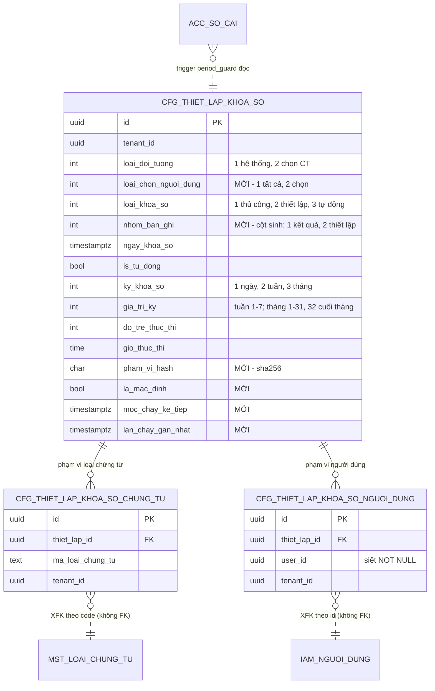

# F09 — Thiết kế DB chi tiết + migration

> Quay lại [00-ke-hoach-tong.md](00-ke-hoach-tong.md)
> **Mục này là nơi DUY NHẤT được quyết định hình dạng dữ liệu.** §5 (migration) chỉ là bản dịch của §2–§4 sang SQL — nếu §5 có thứ gì không xuất hiện ở §2–§4 thì §2–§4 chưa xong.
> **Cần Dev BE/DBA ký trước khi mở PR-1.**

---

## 1. Hiện trạng ba bảng (nguồn sự thật)

Ba bảng dựng ở `V1__baseline.sql:1145-1257`, sửa bởi `V3`, `V6`, `V16`, `V354`. Entity Java: **chưa có**.

Bảng đang **RỖNG** — `V1__baseline.sql:3183-3195` có mục "Data for Name: cfg_thiet_lap_khoa_so…" nhưng không COPY dòng nào, và không migration nào sau đó INSERT vào. ⇒ **ALTER phá huỷ (DROP COLUMN, DROP CONSTRAINT) an toàn, không cần backfill.**

> ⚠️ Khẳng định "bảng rỗng" **phải kiểm lại trên từng môi trường** trước khi chạy migration — xem §6.

### 1.1 `cfg_thiet_lap_khoa_so` (bảng cha)

| Nhóm | Cột hiện có | Ai quản | Số phận |
|---|---|---|---|
| Base/audit/tenant | `id`, `tenant_id`, `ngay_tao`, `nguoi_tao`, `ngay_cap_nhat`, `nguoi_cap_nhat`, `da_xoa`, `ngay_xoa`, `nguoi_xoa`, `phien_ban` | base (`AggregateRootEntity` → `TenantedEntity` → `BaseEntity`) | **giữ, không khai lại ở entity** |
| Nghiệp vụ khóa sổ | `loai_doi_tuong`, `loai_khoa_so`, `ngay_khoa_so`, `is_tu_dong`, `ky_khoa_so`, `gia_tri_ky`, `do_tre_thuc_thi`, `gio_thuc_thi` | module | **giữ**, siết ràng buộc — §2.1 |
| **Legacy "period close" cũ** | `nam_tai_chinh` (NOT NULL), `ky` (NOT NULL), `trang_thai` (NOT NULL DEFAULT 'OPEN'), `ngay_khoa` | — | **DROP** — §2.2 |
| GAP-FILL | `chi_nhanh_id` | — | **DROP** (Q11) — §2.2 |
| Dup còn sót | `updated_by` | — | **DROP** — §2.2 |

Ràng buộc / index / trigger hiện có:

| Loại | Định nghĩa | Nguồn | Số phận |
|---|---|---|---|
| PK | `cfg_thiet_lap_khoa_so_pkey (id)` | `V1:4397-4401` | giữ |
| **UNIQUE** | `cfg_thiet_lap_khoa_so_tenant_id_nam_tai_chinh_ky_key (tenant_id, nam_tai_chinh, ky)` | `V1:4405-4409` | **DROP** — §2.2 |
| Index | `idx_cfg_tlks_guard (tenant_id, loai_doi_tuong, ngay_khoa_so)` | `V1:5358` | giữ — phục vụ truy vấn mốc khóa ([F08 §3.3](08-ap-dung-moc-khoa-so.md)) |
| RLS | `ENABLE` + `FORCE` + policy `tenant_isolation` | `V1:1174, 7100, 7564` | giữ |
| Trigger | `trg_audit_cfg_thiet_lap_khoa_so` → `fn_audit()` | `V1:6534` | giữ — là nguồn "lịch sử khóa sổ" thay cho `ENT_LichSuKhoaSo` (Q5) |
| GRANT | `SELECT,INSERT,DELETE,UPDATE` cho `pmkt_app` | `V1:8155` | giữ |

### 1.2 `cfg_thiet_lap_khoa_so_chung_tu` (bảng con — phạm vi loại chứng từ)

| Cột | Kiểu | Ghi chú |
|---|---|---|
| `id` | `uuid` PK | |
| `thiet_lap_id` | `uuid` NOT NULL | FK → cha (`V1:6940-6941`), **không khai `ON DELETE`** ⇒ mặc định `NO ACTION` |
| `ma_loai_chung_tu` | `text` NOT NULL | XFK → `mst_loai_chung_tu.code` (`V1:1237`), **không có FK thật** |
| `tenant_id` + bộ base | | như bảng cha, đã conform đủ qua V3/V6/V354 |

Index: `idx_cfg_tlks_ct_tenant (tenant_id, thiet_lap_id)` (`V1:5351`). RLS + audit trigger: có.

### 1.3 `cfg_thiet_lap_khoa_so_nguoi_dung` (bảng con — phạm vi người dùng)

| Cột | Kiểu | Ghi chú |
|---|---|---|
| `id` | `uuid` PK | |
| `thiet_lap_id` | `uuid` NOT NULL | FK → cha (`V1:6948-6949`) |
| **`loai_chon_nguoi_dung`** | `integer` **NOT NULL** | **Sai vị trí** — §3 |
| `user_id` | `uuid` NULL | XFK → người dùng, không có FK thật |
| `tenant_id` + bộ base | | |

Index: `idx_cfg_tlks_nd_tenant (tenant_id, thiet_lap_id)` (`V1:5365`). RLS + audit trigger: có.

### 1.4 Kết luận — thiếu gì so với BA

| # | Thiếu | Dùng cho |
|---|---|---|
| 1 | `loai_chon_nguoi_dung` **trên bảng cha** | Radio "Tất cả / Chọn người dùng" là trường cấp form — §3 |
| 2 | `la_mac_dinh` | BR04 — bản ghi mặc định không xoá được ([F04](04-xoa-thiet-lap.md)) |
| 3 | `pham_vi_hash` | BR03 ghi đè — chống trùng phạm vi ở tầng DB ([F02 §3.2](02-tao-thiet-lap-khoa-so.md)) |
| 4 | `nhom_ban_ghi` (cột sinh) | Tách nhóm KẾT QUẢ / THIẾT LẬP theo BR03 |
| 5 | `moc_chay_ke_tiep`, `lan_chay_gan_nhat` | Job tự động ([F07 §3.2](07-job-tu-dong-khoa-so.md)) |
| 6 | Unique trên hai bảng con | Chống trùng cùng một loại CT / user trong một thiết lập |
| 7 | CHECK cho enum + khoảng giá trị | BR06, BR15 |

---

## 2. Cột trên bảng cha `cfg_thiet_lap_khoa_so`

### 2.1 Cột giữ lại — siết ràng buộc

| # | Cột | Kiểu | NULL | Default | Ai ghi | Field DTO | Ràng buộc mới |
|---|---|---|---|---|---|---|---|
| 1 | `loai_doi_tuong` | `integer` | **N** (đang Y) | — | client | `loaiDoiTuong` | `CHECK IN (1,2)` |
| 2 | `loai_khoa_so` | `integer` | **N** (đang Y) | — | **server tính** | `loaiKhoaSo` | `CHECK IN (1,2,3)` |
| 3 | `ngay_khoa_so` | `timestamptz` | Y | — | client (thủ công) / server (job) | `ngayKhoaSo` | `CHECK (loai_khoa_so = 2 OR la_mac_dinh OR ngay_khoa_so IS NOT NULL)` — vế `la_mac_dinh` là lối thoát cho BR04, xem §5.4 |
| 4 | `is_tu_dong` | `boolean` | **N** (đang Y) | `false` | client | `isTuDong` | `CHECK ((loai_khoa_so = 2) = is_tu_dong)` — hai cột phải nhất quán |
| 5 | `ky_khoa_so` | `integer` | Y | — | client | `kyKhoaSo` | `CHECK (ky_khoa_so IS NULL OR ky_khoa_so IN (1,2,3))` + bắt buộc khi `is_tu_dong` |
| 6 | `gia_tri_ky` | `integer` | Y | — | client | `giaTriKy` | §2.3 |
| 7 | `do_tre_thuc_thi` | `integer` | Y | — | client | `doTreThucThi` | §2.3 |
| 8 | `gio_thuc_thi` | `time` | Y | — | client | `gioThucThi` | bắt buộc khi `is_tu_dong` |

> ⚠️ Ba cột `loai_doi_tuong`, `loai_khoa_so`, `is_tu_dong` **đang nullable** vì V1 tạo chúng như GAP-FILL. Siết `NOT NULL` được vì bảng rỗng. Không siết thì mọi truy vấn mốc khóa phải mang thêm nhánh `IS NULL` mãi mãi.

Không dùng `enum` native của PostgreSQL: thêm giá trị mới sẽ phải `ALTER TYPE`, trong khi `integer` + `CHECK` chỉ cần sửa constraint — cùng lý do đã ghi ở `TrangThaiChungTu.java:14-16`.

### 2.2 Cột DROP

| # | Cột / constraint | Vì sao bỏ | Rủi ro |
|---|---|---|---|
| 1 | `UNIQUE (tenant_id, nam_tai_chinh, ky)` | Mỗi tenant chỉ lưu được 1 thiết lập/kỳ — **chặn cứng mô hình BA** | Không — bảng rỗng |
| 2 | `nam_tai_chinh`, `ky` | Không có trong BA; NOT NULL nên INSERT vỡ nếu giữ | Không |
| 3 | `trang_thai varchar(20) NOT NULL DEFAULT 'OPEN'` | Mô hình "kỳ mở/đóng" cũ. BA không có trạng thái nào cho thiết lập | Không |
| 4 | `ngay_khoa` | Trùng vai trò với `ngay_khoa_so`; **không** function/trigger nào dùng (`grep -n "ngay_khoa[^_]" V1__baseline.sql` chỉ ra định nghĩa cột) | Không |
| 5 | `chi_nhanh_id` | BA không có phạm vi chi nhánh; là GAP-FILL còn sót (`V36__drop_chi_nhanh.sql:10` xác nhận nó bị bỏ lại có chủ đích) | **Q11** — cần DBA xác nhận không consumer nào khác |
| 6 | `updated_by` | Dup của `nguoi_cap_nhat`; V16 dọn 3/4 cột và quên cột này | Không — Hibernate không map nó |

**Kiểm trước khi DROP** (§6): mỗi cột phải có một câu `SELECT count(*) … WHERE <cột> IS NOT NULL` trả 0.

### 2.3 Ràng buộc theo chu kỳ — CHECK hay chỉ ở Java?

BR06 quy định `gia_tri_ky` và `do_tre_thuc_thi` có khoảng hợp lệ **khác nhau theo `ky_khoa_so`**:

| `ky_khoa_so` | `gia_tri_ky` | `do_tre_thuc_thi` (Q1) |
|---|---|---|
| 1 — Hàng ngày | không dùng (NULL) | `0 … 31` |
| 2 — Hàng tuần | `1 … 7` | `-7 … 7` |
| 3 — Hàng tháng | `1 … 31` hoặc `32` (cuối tháng — Q2) | `-31 … 31` |

| | A — chỉ validate ở Java | **B (chọn) — CHECK ở DB + validate ở Java** |
|---|---|---|
| Message đọc được | ✅ | ✅ (Java chạy trước) |
| Chặn đường ghi không qua service | ❌ | ✅ |
| Chi phí sửa khi BA đổi khoảng (Q1 chưa chốt) | 1 file Java | 1 file Java + 1 migration |
| Rủi ro | Job hoặc script vá tay ghi giá trị vô nghĩa ⇒ `ChuKyKhoaSoCalculator` ném lỗi lúc chạy, giữa đêm | Q1 chưa chốt ⇒ **nếu viết CHECK bây giờ có thể phải sửa**. Chốt an toàn: đặt CHECK ở migration **riêng**, chạy sau khi BA chốt Q1 |

Chọn **B nhưng tách file**: V358 chỉ đặt CHECK cho phần **không phụ thuộc Q1** (`ky_khoa_so IN (1,2,3)`, `gia_tri_ky BETWEEN 1 AND 32`, `do_tre_thuc_thi BETWEEN -31 AND 31`); CHECK theo từng chu kỳ để lại một migration sau khi Q1 chốt. Không chặn PR-1 vì một câu hỏi BA.

### 2.4 Cột thêm mới

| # | Cột | Kiểu | NULL | Default | Ai ghi | Field DTO | Vì sao cần |
|---|---|---|---|---|---|---|---|
| 1 | `loai_chon_nguoi_dung` | `integer` | Y | — | client | `loaiChonNguoiDung` | §3 — chuyển từ bảng con lên. `CHECK (loai_chon_nguoi_dung IS NULL OR IN (1,2))` + `CHECK (loai_doi_tuong = 1 OR loai_chon_nguoi_dung IS NOT NULL)` |
| 2 | `la_mac_dinh` | `boolean` | N | `false` | **server** | `laMacDinh` | BR04 — chặn xoá ([F04 §1](04-xoa-thiet-lap.md)) |
| 3 | `pham_vi_hash` | `char(64)` | N | — | **server tính** | không lộ ra DTO | §4 — khoá chống trùng phạm vi |
| 4 | `nhom_ban_ghi` | `integer` **GENERATED ALWAYS AS (CASE WHEN loai_khoa_so = 2 THEN 2 ELSE 1 END) STORED** | N | sinh | **DB** | không lộ | BR03 — hai nhóm tồn tại độc lập. Cột sinh chứ không phải cột thường: nó **luôn** đúng với `loai_khoa_so`, không có cách nào ghi lệch |
| 5 | `moc_chay_ke_tiep` | `timestamptz` | Y | — | **server tính** | `mocChayKeTiep` (chỉ đọc) | [F07 §3.2](07-job-tu-dong-khoa-so.md) |
| 6 | `lan_chay_gan_nhat` | `timestamptz` | Y | — | **server tính** | `lanChayGanNhat` (chỉ đọc) | truy vết job |

Không cột nào ở đây nhận giá trị từ client ngoài `loai_chon_nguoi_dung` — `LuuThietLapKhoaSoRequest` **không có** field tương ứng cho 5 cột còn lại, nên không có đường nào để client ghi vào.

---

## 2bis. Bảng mới

**Không áp dụng — epic này không tạo bảng mới nào.** Ba bảng `cfg_thiet_lap_khoa_so`,
`cfg_thiet_lap_khoa_so_chung_tu`, `cfg_thiet_lap_khoa_so_nguoi_dung` đã tồn tại từ `V1__baseline.sql`
và được dùng lại theo quyết định **D2** ([00 §0](00-ke-hoach-tong.md)).

Hai thực thể mà `5.crud-matrix.puml` có nhắc nhưng **cố ý không tạo bảng**:

| Thực thể trong CRUD matrix | Vì sao không tạo bảng | Thay bằng |
|---|---|---|
| `ENT_LichSuKhoaSo` (`5.crud-matrix.puml:8`) | Không màn hình nào đọc nó, không UC nào xem nó — xem **Q5** | `aud_audit_log` qua trigger `trg_audit_cfg_thiet_lap_khoa_so` đã bật từ `V1__baseline.sql:6534` |
| `ENT_ChungTuChoXuLy` (`5.crud-matrix.puml:9`) | Đây **không phải dữ liệu được lưu** — nó là kết quả truy vấn động trên các bảng chứng từ hiện có, tính lại mỗi lần theo phạm vi khóa sổ | SPI `ChungTuChoXuLyPort` — [06 §2](06-chung-tu-cho-xu-ly.md) |

Tạo bảng cho `ENT_ChungTuChoXuLy` sẽ sinh **nguồn sự thật thứ hai** cho trạng thái chứng từ: bảng đó
trôi ngay khi ai đó ghi sổ/xoá chứng từ ở màn khác mà không cập nhật hàng đợi. Xem so sánh 3 phương
án ở [06 §1.1](06-chung-tu-cho-xu-ly.md).

---

## 3. Chuyển `loai_chon_nguoi_dung` từ bảng con lên bảng cha

**Hiện trạng:** `cfg_thiet_lap_khoa_so_nguoi_dung.loai_chon_nguoi_dung integer NOT NULL` (`V1__baseline.sql:1247`), `user_id` nullable.

**Vấn đề:** mô hình đó buộc phạm vi "Tất cả người dùng" phải được biểu diễn bằng **một dòng con có `user_id = NULL`**. Ba hệ quả:

1. Truy vấn mốc khóa ([F08 §3.3](08-ap-dung-moc-khoa-so.md)) phải `EXISTS` hai lần và phân biệt hai loại dòng con — dài hơn, dễ sai hơn.
2. Đếm "thiết lập này áp cho bao nhiêu người" cho ra `1` thay vì "tất cả" — off-by-one im lặng.
3. Nếu thiết lập "Tất cả" lỡ mất dòng con đó (xoá mềm nhầm, insert thiếu), phạm vi người dùng trở thành **rỗng** và thiết lập âm thầm ngừng áp cho ai cả.

BA mô hình hoá nó là **radio cấp form** (`SCR_ThietLapNgayKhoaSo.md:23` — "Radio (User)" nằm cùng nhóm "Phạm vi khóa sổ"), không phải thuộc tính của từng người dùng.

| | A — giữ nguyên ở bảng con | **B (chọn) — thêm cột ở cha, DROP ở con** |
|---|---|---|
| Khớp mô hình BA | ❌ | ✅ |
| Truy vấn mốc khóa | 2 `EXISTS` + phân nhánh | 1 so sánh cột + 1 `EXISTS` |
| "Tất cả" biểu diễn thế nào | 1 dòng con `user_id IS NULL` | `loai_chon_nguoi_dung = 1` + **0 dòng con** |
| Chi phí | 0 | 1 ADD + 1 DROP COLUMN |
| Rủi ro | 3 hệ quả trên | Không (bảng rỗng, không backfill) |

Chọn **B**. Sau khi chuyển, `cfg_thiet_lap_khoa_so_nguoi_dung.user_id` siết **NOT NULL** — mỗi dòng con là đúng một người dùng, không còn dòng "đại diện cho tất cả".

---

## 4. Ràng buộc · index · khóa ngoại mới

| # | Loại | Định nghĩa | Vì sao | Chi phí |
|---|---|---|---|---|
| 1 | **unique** | `uq_cfg_tlks_pham_vi (tenant_id, nhom_ban_ghi, pham_vi_hash) WHERE da_xoa = false` | BR03 — mỗi phạm vi × mỗi nhóm chỉ 1 bản ghi hiệu lực (D8) | +1 index; ghi chậm không đáng kể |
| 2 | index | `idx_cfg_tlks_job (moc_chay_ke_tiep) WHERE da_xoa = false AND loai_khoa_so = 2 AND is_tu_dong = true` | Truy vấn "tới hạn" của job ([F07 §3.2](07-job-tu-dong-khoa-so.md)) chạy mỗi 5 phút | Rất nhỏ — partial index chỉ phủ bản ghi lịch |
| 3 | check | `ck_cfg_tlks_loai_doi_tuong CHECK (loai_doi_tuong IN (1,2))` | BR02 | 0 |
| 4 | check | `ck_cfg_tlks_loai_khoa_so CHECK (loai_khoa_so IN (1,2,3))` | BR03 danh sách | 0 |
| 5 | check | `ck_cfg_tlks_tu_dong CHECK ((loai_khoa_so = 2) = is_tu_dong)` | Hai cột nói cùng một sự thật ⇒ không được lệch | 0 |
| 6 | check | `ck_cfg_tlks_ngay_khoa CHECK (loai_khoa_so = 2 OR la_mac_dinh OR ngay_khoa_so IS NOT NULL)` | Bản ghi kết quả **phải** có mốc; bản ghi lịch **không** có; bản ghi mặc định được miễn cho tới khi Q6 chốt (§5.4) | 0 |
| 7 | check | `ck_cfg_tlks_pham_vi_user CHECK (loai_doi_tuong = 1 OR loai_chon_nguoi_dung IN (1,2))` | BR02 | 0 |
| 8 | check | `ck_cfg_tlks_lich CHECK (NOT is_tu_dong OR (ky_khoa_so IS NOT NULL AND gio_thuc_thi IS NOT NULL))` | MSG_007 + MSG_022 ở tầng DB | 0 |
| 9 | **check** | `ck_cfg_tlks_mac_dinh_khong_xoa CHECK (NOT (la_mac_dinh AND da_xoa))` | BR04 — chốt chặn cuối cho [F04](04-xoa-thiet-lap.md) | 0 |
| 10 | unique | `uq_cfg_tlks_ct (thiet_lap_id, ma_loai_chung_tu) WHERE da_xoa = false` | Một thiết lập không lặp cùng một loại CT | +1 index nhỏ |
| 11 | unique | `uq_cfg_tlks_nd (thiet_lap_id, user_id) WHERE da_xoa = false` | Một thiết lập không lặp cùng một người dùng | +1 index nhỏ |
| 12 | FK | Sửa 2 FK con thành `... REFERENCES cfg_thiet_lap_khoa_so(id) ON DELETE RESTRICT` | Chặn xoá vật lý bảng cha khi còn dòng con. **Không** `CASCADE` vì BR29.1 cấm xoá vật lý ⇒ sẽ không bao giờ có `DELETE` để cascade chạy; `RESTRICT` là hàng rào chống thao tác ngoài ý muốn | 0 |
| 13 | FK (**đề xuất — cần DBA chốt**) | `cfg_thiet_lap_khoa_so_chung_tu.ma_loai_chung_tu REFERENCES mst_loai_chung_tu(code) ON DELETE RESTRICT` | §4.1 | 0 |

> ⚠️ Mọi partial unique đều phải mang **đúng** điều kiện soft-delete `WHERE da_xoa = false` — đây là quy ước đã chuẩn hoá ở `V48__partial_unique_after_soft_delete.sql`. Thiếu điều kiện này thì một bản ghi đã xoá sẽ chặn bản ghi mới cùng phạm vi vĩnh viễn.

### 4.1 FK cho `ma_loai_chung_tu` — có nên thêm không

V1 gọi cột này là **XFK** (`V1:1237` — *"XFK -> mst_loai_chung_tu.code"*), tức "khoá ngoài trên giấy, không có constraint". Nhưng kiểm lại schema thì **FK thật là khả thi**:

```bash
grep -n "uq_mst_loai_chung_tu_code" cell-app/src/main/resources/db/migration/V1__baseline.sql
# 5045-5049: ADD CONSTRAINT uq_mst_loai_chung_tu_code UNIQUE (code)
grep -n "REFERENCES public.mst_loai_chung_tu" cell-app/src/main/resources/db/migration/*.sql
# V20:66 — đúng 1 FK trong toàn repo, và nó trỏ vào (id) chứ không phải (code)
```

| | A — giữ XFK, chỉ kiểm ở Java | **B (chọn — chờ DBA xác nhận) — thêm FK thật** |
|---|---|---|
| Mã lạ lọt vào DB | Có thể — qua script vá tay / migration / import | Không |
| Hệ quả nếu lọt | Phạm vi khóa sổ **âm thầm không khớp gì**: truy vấn mốc khóa so `ma_loai_chung_tu = :ma` không bao giờ đúng ⇒ thiết lập tồn tại nhưng không chặn ai. Đây đúng loại lỗi mà `LoaiChungTuLookup.java:35-38` đã cảnh báo cho cột `loai_chung_tu_id` | Vỡ ngay lúc ghi |
| RLS | Bảng con `FORCE ROW LEVEL SECURITY`, danh mục thì không — FK vẫn chạy được (kiểm FK chạy dưới quyền chủ bảng, không qua policy) | như A |
| Tác dụng phụ | — | Xoá một dòng `mst_loai_chung_tu` bị `RESTRICT` chặn nếu **bất kỳ tenant nào** đang dùng mã đó. Đây là hành vi **mong muốn**, nhưng nó là thay đổi hành vi của một danh mục toàn cục ⇒ phải được DBA đồng ý |
| Chi phí | 0 | 0 (index đã có sẵn từ unique) |

Java vẫn kiểm trước (V10 của [F02 §3.1](02-tao-thiet-lap-khoa-so.md), qua `LoaiChungTuLookup.idTheoMa` — `LoaiChungTuLookup.java:39-49`) để lỗi có message đọc được; FK là chốt chặn cuối cho đường ghi không qua service. Nếu DBA từ chối vì tác dụng phụ ở dòng cuối bảng, bỏ mục #13 và giữ nguyên phần Java — thiết kế còn lại không đổi.

### 4.2 Công thức `pham_vi_hash` — phải pin bằng test

```
chuoiPhamVi =  loaiDoiTuong
            + "|" + (loaiDoiTuong == 1 ? "" : sort(maLoaiChungTu).join(","))
            + "|" + (loaiDoiTuong == 1 ? "1" : loaiChonNguoiDung)
            + "|" + (loaiChonNguoiDung == 2 ? sort(userIds).map(toString).join(",") : "")

phamViHash = lowerHex(SHA-256(UTF-8(chuoiPhamVi)))        // 64 ký tự
```

Bốn quy tắc bắt buộc, mỗi cái có một test riêng:

| # | Quy tắc | Vì sao |
|---|---|---|
| 1 | **Sắp xếp** `maLoaiChungTu` và `userIds` trước khi nối | `["A","B"]` và `["B","A"]` là **cùng** một phạm vi; không sắp xếp thì tạo được 2 bản ghi trùng |
| 2 | Chuẩn hoá "Toàn hệ thống" về `loaiChonNguoiDung = 1` | `loaiDoiTuong = 1` thì trường người dùng bị **ẩn** (BR02) và bị bỏ qua ở service ([F02 §3.1](02-tao-thiet-lap-khoa-so.md)); nếu để giá trị rác lọt vào hash, hai lần lưu cùng một phạm vi ra hai hash khác nhau |
| 3 | Trim từng phần tử trước khi sắp xếp (BR43) | `"BAN_HANG "` và `"BAN_HANG"` là cùng một mã |
| 4 | Tính **ở Java**, không phải cột sinh SQL | Postgres không có `sha256` cho `text` nếu chưa bật `pgcrypto`; và tập con nằm ở **bảng khác** nên cột sinh không đọc được chúng |

Test pin (`PhamViKhoaSoHasherTest`) khẳng định **đúng chuỗi hash** cho 6 tổ hợp — không chỉ "hai request cho cùng hash". Đổi công thức mà không đổi test là đổi ý nghĩa của toàn bộ unique index, phải là một quyết định có chủ đích.

---

## 5. Migration

### 5.1 `V358__cfg_thiet_lap_khoa_so_theo_ba_khoa_so.sql`

> Số hiệu phải kiểm lại ngay trước khi đặt tên: `ls cell-app/src/main/resources/db/migration | sort -V | tail -1` (lúc khảo sát 2026-08-11 là **V357**).

| # | Việc | Vì sao bắt buộc |
|---|---|---|
| 1 | **Kiểm tiên quyết**: `RAISE EXCEPTION` nếu 3 bảng có bất kỳ dòng nào | Toàn bộ thiết kế dựa trên "bảng rỗng". Chạy trên môi trường có dữ liệu phải **dừng ồn ào**, không âm thầm DROP cột có dữ liệu |
| 2 | `DROP CONSTRAINT cfg_thiet_lap_khoa_so_tenant_id_nam_tai_chinh_ky_key` | §2.2 #1 — không bỏ thì tenant chỉ tạo được 1 thiết lập |
| 3 | `DROP COLUMN nam_tai_chinh, ky, trang_thai, ngay_khoa, chi_nhanh_id, updated_by` | §2.2 |
| 4 | `ALTER COLUMN loai_doi_tuong / loai_khoa_so / is_tu_dong SET NOT NULL` (+ `SET DEFAULT false` cho `is_tu_dong`) | §2.1 |
| 5 | `ADD COLUMN loai_chon_nguoi_dung, la_mac_dinh, pham_vi_hash, nhom_ban_ghi (GENERATED), moc_chay_ke_tiep, lan_chay_gan_nhat` | §2.4 |
| 6 | `ALTER TABLE cfg_thiet_lap_khoa_so_nguoi_dung DROP COLUMN loai_chon_nguoi_dung` + `ALTER COLUMN user_id SET NOT NULL` | §3 |
| 7 | 9 `CHECK` của §4 (#3…#9) — **trừ** CHECK theo chu kỳ (chờ Q1) | §2.3 |
| 8 | 3 partial unique (#1, #10, #11) + 1 partial index (#2) | §4 |
| 9 | `DROP` rồi `ADD` lại 2 FK con với `ON DELETE RESTRICT` + (nếu DBA duyệt §4.1) FK `ma_loai_chung_tu → mst_loai_chung_tu(code)` | §4 #12, #13 |
| 10 | `COMMENT ON COLUMN` cho 6 cột mới + cập nhật `COMMENT ON TABLE` (bản hiện tại còn nhắc "LDM ThietLapKhoaSo / design 60-close.sql" — đã lỗi thời) | Người đọc schema sau này không có tài liệu này trong tay |

Ghi chú kỹ thuật:
- **Không** dùng `CREATE INDEX CONCURRENTLY` — Flyway chạy trong transaction, `CONCURRENTLY` không cho phép. Bảng rỗng nên khoá bảng vô hại.
- Toàn bộ file **idempotent**: `IF EXISTS` / `IF NOT EXISTS` ở mọi lệnh DDL. Với `CHECK` (PostgreSQL **không** có `ADD CONSTRAINT IF NOT EXISTS`) dùng cặp `DROP CONSTRAINT IF EXISTS` + `ADD CONSTRAINT` — vừa idempotent vừa đọc được, thay vì bọc mỗi ràng buộc trong một `DO $$ IF NOT EXISTS $$`.
- **Không** seed bản ghi mặc định (BR04) trong migration này — nó phụ thuộc "Ngày bắt đầu dữ liệu" (**Q6**) và phải sinh **cho từng tenant** lúc provisioning, không phải một lần lúc migrate. Xem §5.4.
- Không đụng RLS / policy `tenant_isolation` / trigger audit / GRANT — cả ba đã đúng từ V1, `ALTER TABLE` không làm mất chúng.

#### SQL đầy đủ

```sql
-- =====================================================================================
-- V358 — Khóa sổ kế toán (PMKT-E-07528): chuẩn hoá 3 bảng cfg_thiet_lap_khoa_so* theo BA.
--
-- BỐI CẢNH. Ba bảng này dựng ở V1__baseline.sql:1145-1257 theo LDM "period close" cũ
-- (khoá theo cặp năm tài chính + kỳ). Mô hình BA của epic khác hẳn: N thiết lập song song,
-- mỗi thiết lập một PHẠM VI (toàn hệ thống | tập loại chứng từ × tập người dùng) và một mốc
-- ngày. Ba thứ của mô hình cũ chặn cứng mô hình mới:
--   · UNIQUE (tenant_id, nam_tai_chinh, ky) — mỗi tenant chỉ lưu được 1 thiết lập/kỳ;
--   · nam_tai_chinh / ky / trang_thai NOT NULL — không có trong BA, INSERT sẽ vỡ;
--   · loai_chon_nguoi_dung nằm ở bảng CON — BA mô hình hoá nó là radio cấp form.
--
-- Ba bảng đang RỖNG (V1 baseline không COPY dòng nào — V1__baseline.sql:3183-3195; không
-- migration nào sau đó INSERT). Vì vậy DROP COLUMN / SET NOT NULL là an toàn và KHÔNG cần
-- backfill. Bước 0 kiểm lại điều đó trên môi trường thật và HUỶ migration nếu sai.
--
-- Tham chiếu: docs/doing/PMKT-E-07528-khoa-so-api/09-thiet-ke-db.md
-- =====================================================================================

-- ─── 0. Kiểm tiên quyết: 3 bảng phải rỗng ────────────────────────────────────────────
DO $$
DECLARE n_cha bigint; n_ct bigint; n_nd bigint;
BEGIN
    SELECT count(*) INTO n_cha FROM public.cfg_thiet_lap_khoa_so;
    SELECT count(*) INTO n_ct  FROM public.cfg_thiet_lap_khoa_so_chung_tu;
    SELECT count(*) INTO n_nd  FROM public.cfg_thiet_lap_khoa_so_nguoi_dung;
    IF n_cha > 0 OR n_ct > 0 OR n_nd > 0 THEN
        RAISE EXCEPTION
            'V358 HUY: 3 bang khoa so phai RONG truoc khi chuan hoa (cha=%, chung_tu=%, nguoi_dung=%). '
            'Moi truong nay co du lieu ⇒ thiet ke phai bo sung buoc backfill, xem 09-thiet-ke-db.md §6.',
            n_cha, n_ct, n_nd;
    END IF;
END $$;

-- ─── 1. Gỡ ràng buộc & cột legacy trên bảng cha ──────────────────────────────────────
ALTER TABLE public.cfg_thiet_lap_khoa_so
    DROP CONSTRAINT IF EXISTS cfg_thiet_lap_khoa_so_tenant_id_nam_tai_chinh_ky_key;

ALTER TABLE public.cfg_thiet_lap_khoa_so
    DROP COLUMN IF EXISTS nam_tai_chinh,   -- mô hình period-close cũ
    DROP COLUMN IF EXISTS ky,              -- mô hình period-close cũ
    DROP COLUMN IF EXISTS trang_thai,      -- 'OPEN'/'CLOSED' cũ; BA không có trạng thái cho thiết lập
    DROP COLUMN IF EXISTS ngay_khoa,       -- trùng vai trò với ngay_khoa_so
    DROP COLUMN IF EXISTS chi_nhanh_id,    -- GAP-FILL còn sót (V36__drop_chi_nhanh.sql:10); BA không có phạm vi chi nhánh — Q11
    DROP COLUMN IF EXISTS updated_by;      -- dup của nguoi_cap_nhat; V16 dọn 3/4 cột và quên cột này

-- ─── 2. Siết NOT NULL cho 3 cột nghiệp vụ (V1 tạo chúng nullable dạng GAP-FILL) ──────
ALTER TABLE public.cfg_thiet_lap_khoa_so
    ALTER COLUMN is_tu_dong SET DEFAULT false;

ALTER TABLE public.cfg_thiet_lap_khoa_so
    ALTER COLUMN loai_doi_tuong SET NOT NULL,
    ALTER COLUMN loai_khoa_so   SET NOT NULL,
    ALTER COLUMN is_tu_dong     SET NOT NULL;

-- ─── 3. Cột mới trên bảng cha ────────────────────────────────────────────────────────
ALTER TABLE public.cfg_thiet_lap_khoa_so
    ADD COLUMN IF NOT EXISTS loai_chon_nguoi_dung integer,
    ADD COLUMN IF NOT EXISTS la_mac_dinh          boolean NOT NULL DEFAULT false,
    ADD COLUMN IF NOT EXISTS pham_vi_hash         char(64),
    ADD COLUMN IF NOT EXISTS moc_chay_ke_tiep     timestamp with time zone,
    ADD COLUMN IF NOT EXISTS lan_chay_gan_nhat    timestamp with time zone;

-- pham_vi_hash bắt buộc: bảng rỗng nên SET NOT NULL không cần default/backfill.
ALTER TABLE public.cfg_thiet_lap_khoa_so
    ALTER COLUMN pham_vi_hash SET NOT NULL;

-- Cột SINH, không phải cột thường: nó LUÔN khớp loai_khoa_so, không có đường nào ghi lệch.
-- Tách khỏi khối ADD COLUMN ở trên vì biểu thức tham chiếu loai_khoa_so vừa được SET NOT NULL.
ALTER TABLE public.cfg_thiet_lap_khoa_so
    ADD COLUMN IF NOT EXISTS nhom_ban_ghi integer
        GENERATED ALWAYS AS (CASE WHEN loai_khoa_so = 2 THEN 2 ELSE 1 END) STORED;

-- ─── 4. Bảng con: chuyển loai_chon_nguoi_dung lên cha, siết user_id ──────────────────
ALTER TABLE public.cfg_thiet_lap_khoa_so_nguoi_dung
    DROP COLUMN IF EXISTS loai_chon_nguoi_dung;

ALTER TABLE public.cfg_thiet_lap_khoa_so_nguoi_dung
    ALTER COLUMN user_id SET NOT NULL;

-- ─── 5. CHECK (DROP + ADD = idempotent; PG không có ADD CONSTRAINT IF NOT EXISTS) ────
ALTER TABLE public.cfg_thiet_lap_khoa_so
    DROP CONSTRAINT IF EXISTS ck_cfg_tlks_loai_doi_tuong,
    DROP CONSTRAINT IF EXISTS ck_cfg_tlks_loai_khoa_so,
    DROP CONSTRAINT IF EXISTS ck_cfg_tlks_tu_dong,
    DROP CONSTRAINT IF EXISTS ck_cfg_tlks_ngay_khoa,
    DROP CONSTRAINT IF EXISTS ck_cfg_tlks_pham_vi_user,
    DROP CONSTRAINT IF EXISTS ck_cfg_tlks_ky_khoa_so,
    DROP CONSTRAINT IF EXISTS ck_cfg_tlks_gia_tri_ky,
    DROP CONSTRAINT IF EXISTS ck_cfg_tlks_do_tre,
    DROP CONSTRAINT IF EXISTS ck_cfg_tlks_lich,
    DROP CONSTRAINT IF EXISTS ck_cfg_tlks_mac_dinh_khong_xoa;

ALTER TABLE public.cfg_thiet_lap_khoa_so
    -- BR02: 1 = Toàn hệ thống, 2 = Chọn chứng từ
    ADD CONSTRAINT ck_cfg_tlks_loai_doi_tuong
        CHECK (loai_doi_tuong IN (1, 2)),
    -- BR03 danh sách: 1 = Thủ công, 2 = Thiết lập, 3 = Tự động
    ADD CONSTRAINT ck_cfg_tlks_loai_khoa_so
        CHECK (loai_khoa_so IN (1, 2, 3)),
    -- Hai cột nói cùng một sự thật ⇒ không được lệch
    ADD CONSTRAINT ck_cfg_tlks_tu_dong
        CHECK ((loai_khoa_so = 2) = is_tu_dong),
    -- Bản ghi KẾT QUẢ phải có mốc; bản ghi THIẾT LẬP (lịch) thì không.
    -- la_mac_dinh được miễn: bản ghi mặc định BR04 sinh lúc provisioning — xem §5.4 và Q6.
    ADD CONSTRAINT ck_cfg_tlks_ngay_khoa
        CHECK (loai_khoa_so = 2 OR la_mac_dinh OR ngay_khoa_so IS NOT NULL),
    -- BR02: phạm vi "Chọn chứng từ" bắt buộc có radio người dùng
    ADD CONSTRAINT ck_cfg_tlks_pham_vi_user
        CHECK (loai_doi_tuong = 1 OR loai_chon_nguoi_dung IN (1, 2)),
    -- BR06: 1 = Hàng ngày, 2 = Hàng tuần, 3 = Hàng tháng
    ADD CONSTRAINT ck_cfg_tlks_ky_khoa_so
        CHECK (ky_khoa_so IS NULL OR ky_khoa_so IN (1, 2, 3)),
    -- BR06: tuần 1..7 (T2..CN) · tháng 1..31 · 32 = ngày cuối tháng (Q2).
    -- Ràng buộc CHẶT theo từng chu kỳ để lại migration sau khi BA chốt Q1 — xem §2.3.
    ADD CONSTRAINT ck_cfg_tlks_gia_tri_ky
        CHECK (gia_tri_ky IS NULL OR gia_tri_ky BETWEEN 1 AND 32),
    -- BR06: khoảng rộng nhất trong 3 chu kỳ (hàng tháng). Siết theo chu kỳ: chờ Q1.
    ADD CONSTRAINT ck_cfg_tlks_do_tre
        CHECK (do_tre_thuc_thi IS NULL OR do_tre_thuc_thi BETWEEN -31 AND 31),
    -- MSG_PMKT-E-07528_007 + _022 ở tầng DB: bật tự động thì phải có chu kỳ và giờ
    ADD CONSTRAINT ck_cfg_tlks_lich
        CHECK (NOT is_tu_dong OR (ky_khoa_so IS NOT NULL AND gio_thuc_thi IS NOT NULL)),
    -- BR04: bản ghi mặc định không cho phép xóa — chốt chặn cuối cho 04-xoa-thiet-lap.md
    ADD CONSTRAINT ck_cfg_tlks_mac_dinh_khong_xoa
        CHECK (NOT (la_mac_dinh AND da_xoa));

-- ─── 6. Unique & index ───────────────────────────────────────────────────────────────
-- BR03 ghi đè: mỗi (phạm vi × nhóm bản ghi) chỉ 1 bản ghi HIỆU LỰC. Điều kiện
-- `WHERE da_xoa = false` bắt buộc (quy ước V48__partial_unique_after_soft_delete.sql):
-- thiếu nó thì một bản ghi đã xoá sẽ chặn bản ghi mới cùng phạm vi vĩnh viễn.
CREATE UNIQUE INDEX IF NOT EXISTS uq_cfg_tlks_pham_vi
    ON public.cfg_thiet_lap_khoa_so (tenant_id, nhom_ban_ghi, pham_vi_hash)
    WHERE da_xoa = false;

-- Truy vấn "thiết lập tới hạn" của job, chạy mỗi 5 phút — 07-job-tu-dong-khoa-so.md §3.2
CREATE INDEX IF NOT EXISTS idx_cfg_tlks_job
    ON public.cfg_thiet_lap_khoa_so (moc_chay_ke_tiep)
    WHERE da_xoa = false AND loai_khoa_so = 2 AND is_tu_dong = true;

-- Một thiết lập không lặp cùng một loại chứng từ / cùng một người dùng
CREATE UNIQUE INDEX IF NOT EXISTS uq_cfg_tlks_ct
    ON public.cfg_thiet_lap_khoa_so_chung_tu (thiet_lap_id, ma_loai_chung_tu)
    WHERE da_xoa = false;

CREATE UNIQUE INDEX IF NOT EXISTS uq_cfg_tlks_nd
    ON public.cfg_thiet_lap_khoa_so_nguoi_dung (thiet_lap_id, user_id)
    WHERE da_xoa = false;

-- ─── 7. Khoá ngoại ───────────────────────────────────────────────────────────────────
-- V1 tạo 2 FK con KHÔNG khai ON DELETE ⇒ mặc định NO ACTION. Đổi sang RESTRICT: BR29.1 cấm
-- xoá vật lý nên sẽ không bao giờ có DELETE để CASCADE chạy; RESTRICT là hàng rào chống xoá
-- vật lý ngoài ý muốn (script vá tay, migration ẩu).
ALTER TABLE public.cfg_thiet_lap_khoa_so_chung_tu
    DROP CONSTRAINT IF EXISTS cfg_thiet_lap_khoa_so_chung_tu_thiet_lap_id_fkey,
    DROP CONSTRAINT IF EXISTS fk_cfg_tlks_ct_thiet_lap;
ALTER TABLE public.cfg_thiet_lap_khoa_so_chung_tu
    ADD CONSTRAINT fk_cfg_tlks_ct_thiet_lap
        FOREIGN KEY (thiet_lap_id) REFERENCES public.cfg_thiet_lap_khoa_so(id) ON DELETE RESTRICT;

ALTER TABLE public.cfg_thiet_lap_khoa_so_nguoi_dung
    DROP CONSTRAINT IF EXISTS cfg_thiet_lap_khoa_so_nguoi_dung_thiet_lap_id_fkey,
    DROP CONSTRAINT IF EXISTS fk_cfg_tlks_nd_thiet_lap;
ALTER TABLE public.cfg_thiet_lap_khoa_so_nguoi_dung
    ADD CONSTRAINT fk_cfg_tlks_nd_thiet_lap
        FOREIGN KEY (thiet_lap_id) REFERENCES public.cfg_thiet_lap_khoa_so(id) ON DELETE RESTRICT;

-- ─── 7bis. FK sang danh mục loại chứng từ — CHỜ DBA DUYỆT, xem §4.1 ─────────────────
-- Khả thi (uq_mst_loai_chung_tu_code UNIQUE (code) — V1__baseline.sql:5045-5049), nhưng có tác
-- dụng phụ: xoá một dòng mst_loai_chung_tu sẽ bị chặn nếu BẤT KỲ tenant nào đang dùng mã đó.
-- Bỏ comment sau khi DBA đồng ý; nếu không, ràng buộc giữ ở tầng Java (LoaiChungTuLookup.java:39-49).
-- ALTER TABLE public.cfg_thiet_lap_khoa_so_chung_tu
--     DROP CONSTRAINT IF EXISTS fk_cfg_tlks_ct_loai_chung_tu;
-- ALTER TABLE public.cfg_thiet_lap_khoa_so_chung_tu
--     ADD CONSTRAINT fk_cfg_tlks_ct_loai_chung_tu
--         FOREIGN KEY (ma_loai_chung_tu) REFERENCES public.mst_loai_chung_tu(code) ON DELETE RESTRICT;

-- ─── 8. Comment (bản cũ còn nhắc "design 60-close.sql" — mô hình đã bỏ) ─────────────
COMMENT ON TABLE public.cfg_thiet_lap_khoa_so IS
    'Thiết lập khóa sổ (nguồn sự thật mốc khóa) — epic PMKT-E-07528. Mỗi dòng là MỘT phạm vi '
    '(toàn hệ thống | tập loại chứng từ × tập người dùng) kèm mốc ngày khóa hoặc lịch chạy tự động. '
    'Trigger acc_so_cai_period_guard và KyKeToanApi đọc bảng này.';

COMMENT ON COLUMN public.cfg_thiet_lap_khoa_so.loai_doi_tuong IS
    'BR02 — 1 = Toàn hệ thống, 2 = Chọn chứng từ.';
COMMENT ON COLUMN public.cfg_thiet_lap_khoa_so.loai_chon_nguoi_dung IS
    'BR02 — 1 = Tất cả, 2 = Chọn người dùng. NULL khi loai_doi_tuong = 1. Chuyển từ bảng con lên '
    '(V358): đây là radio cấp form, không phải thuộc tính của từng người dùng.';
COMMENT ON COLUMN public.cfg_thiet_lap_khoa_so.loai_khoa_so IS
    'BR03 danh sách — 1 = Thủ công, 2 = Thiết lập (lịch tự động), 3 = Tự động (kết quả job).';
COMMENT ON COLUMN public.cfg_thiet_lap_khoa_so.nhom_ban_ghi IS
    'Cột SINH — 1 = KẾT QUẢ (loai_khoa_so 1|3), 2 = THIẾT LẬP (loai_khoa_so 2). BR03: hai nhóm tồn '
    'tại độc lập, nên khoá chống trùng phạm vi phải tách theo nhóm.';
COMMENT ON COLUMN public.cfg_thiet_lap_khoa_so.pham_vi_hash IS
    'SHA-256 (hex thường) của phạm vi đã chuẩn hoá — công thức và 4 quy tắc bắt buộc ở '
    '09-thiet-ke-db.md §4.2. Tính ở Java (PhamViKhoaSoHasher), KHÔNG phải cột sinh: tập loại chứng '
    'từ và tập người dùng nằm ở bảng khác nên biểu thức SQL không đọc được.';
COMMENT ON COLUMN public.cfg_thiet_lap_khoa_so.la_mac_dinh IS
    'BR04 — bản ghi mặc định sinh lúc provisioning tenant, KHÔNG cho phép xóa (ck_cfg_tlks_mac_dinh_khong_xoa).';
COMMENT ON COLUMN public.cfg_thiet_lap_khoa_so.moc_chay_ke_tiep IS
    'Thời điểm job phải chạy lần tới = mốc chốt dữ liệu + độ trễ + giờ (BR07). Chỉ có giá trị trên '
    'bản ghi THIẾT LẬP. Là khoá lọc của truy vấn tới hạn (idx_cfg_tlks_job).';
COMMENT ON COLUMN public.cfg_thiet_lap_khoa_so.lan_chay_gan_nhat IS
    'Lần job chạy gần nhất cho thiết lập này — truy vết, và chống chạy lặp trong cùng chu kỳ.';
COMMENT ON COLUMN public.cfg_thiet_lap_khoa_so_nguoi_dung.user_id IS
    'Người dùng thuộc phạm vi khóa. Siết NOT NULL ở V358: phạm vi "Tất cả" nay biểu diễn bằng '
    'cfg_thiet_lap_khoa_so.loai_chon_nguoi_dung = 1 với 0 dòng con, không phải bằng một dòng user_id NULL.';
```

### 5.2 `V359__acc_so_cai_period_guard_pham_vi_nguoi_dung.sql`

`CREATE OR REPLACE FUNCTION public.acc_so_cai_period_guard()` với đúng **một** thay đổi so với bản đang chạy: thêm `AND t.loai_chon_nguoi_dung = 1` vào nhánh `loai_doi_tuong = 2`.

Lý do và giới hạn: [08-ap-dung-moc-khoa-so.md §4](08-ap-dung-moc-khoa-so.md). **Phải đi cùng PR với thay đổi Java** — sửa một bên là để hai chốt chặn lệch nhau, đúng thứ javadoc `KhoaSoRepository.java:14-19` cấm.

Không cần `DROP TRIGGER` / `CREATE TRIGGER` — `CREATE OR REPLACE FUNCTION` là đủ, trigger `trg_acc_so_cai_period_guard` trỏ theo **tên** function.

> ⚠️ Bản gốc để lấy làm nền **không phải** `V1__baseline.sql:121-161` mà là `V3__conform_softdelete_da_xoa.sql:126-167` — V3 đã recreate function này để đổi `is_deleted → da_xoa` (V1 dùng tên cột cũ). Chép nhầm bản V1 sẽ làm function tham chiếu cột không còn tồn tại.

#### SQL đầy đủ

```sql
-- =====================================================================================
-- V359 — acc_so_cai_period_guard: KHÔNG áp thiết lập khoá theo NGƯỜI DÙNG cho mọi người.
--
-- BỐI CẢNH. Trước epic PMKT-E-07528, bảng cfg_thiet_lap_khoa_so_nguoi_dung chưa có đường
-- ghi nào nên nhánh loai_doi_tuong = 2 của trigger không cần phân biệt phạm vi người dùng.
-- Từ V358 người dùng tạo được thiết lập "khoá cho user A và B" — mà trigger hiện tại KHÔNG
-- đọc bảng người dùng, nên nó sẽ áp mốc đó cho TẤT CẢ mọi người. Đó là chặn nhầm, không phải
-- bỏ lọt: kế toán viên C bị chặn bởi một thiết lập không dành cho mình.
--
-- CÁCH SỬA VÀ GIỚI HẠN CÓ CHỦ ĐÍCH. Trigger chỉ áp các thiết lập KHÔNG phụ thuộc người dùng
-- (loai_chon_nguoi_dung = 1). Phạm vi theo người dùng được cưỡng chế ở tầng Java
-- (KyKeToanApi / KyKeToanChecker), vì acc_so_cai KHÔNG có đường nào về người tạo CHỨNG TỪ:
-- cột nguoi_tao của nó là người GHI SỔ, và nó cũng không biết bảng nguồn của chung_tu_id.
-- ⇒ Sau migration này, DB LỎNG HƠN Java đúng một chiều: không có ca nào DB chặn mà Java cho
-- qua. Xem 08-ap-dung-moc-khoa-so.md §4.1 (so sánh 3 phương án) và câu hỏi Q4.
--
-- Nền: V3__conform_softdelete_da_xoa.sql:126-167 (KHÔNG phải bản V1 — V1 còn dùng is_deleted).
-- =====================================================================================
CREATE OR REPLACE FUNCTION public.acc_so_cai_period_guard()
 RETURNS trigger
 LANGUAGE plpgsql
AS $function$
DECLARE
    v_ngay    date;
    v_tenant  uuid;
    v_loai_id uuid;
    v_lock    date;
BEGIN
    IF TG_OP = 'DELETE' THEN
        v_ngay := OLD.ngay_hach_toan; v_tenant := OLD.tenant_id; v_loai_id := OLD.loai_chung_tu_id;
    ELSE
        v_ngay := NEW.ngay_hach_toan; v_tenant := NEW.tenant_id; v_loai_id := NEW.loai_chung_tu_id;
    END IF;

    SELECT MAX(t.ngay_khoa_so::date)
      INTO v_lock
      FROM cfg_thiet_lap_khoa_so t
     WHERE t.tenant_id = v_tenant
       AND t.da_xoa = false
       AND t.ngay_khoa_so IS NOT NULL
       AND (
            t.loai_doi_tuong = 1
            OR (t.loai_doi_tuong = 2
                -- V358/V359: chỉ áp thiết lập KHÔNG phụ thuộc người dùng. Thiết lập theo
                -- người dùng (loai_chon_nguoi_dung = 2) do tầng Java cưỡng chế — xem header.
                AND t.loai_chon_nguoi_dung = 1
                AND EXISTS (
                  SELECT 1
                    FROM cfg_thiet_lap_khoa_so_chung_tu c
                    JOIN mst_loai_chung_tu m ON m.code = c.ma_loai_chung_tu
                   WHERE c.thiet_lap_id = t.id
                     AND c.da_xoa = false
                     AND m.id = v_loai_id))
           );

    IF v_lock IS NOT NULL AND v_ngay <= v_lock THEN
        RAISE EXCEPTION 'PERIOD_LOCKED: ngay_hach_toan % <= moc khoa so %', v_ngay, v_lock
            USING ERRCODE = 'check_violation';
    END IF;

    IF TG_OP = 'DELETE' THEN RETURN OLD; END IF;
    RETURN NEW;
END;
$function$;
```

### 5.3 `V360__seed_quyen_ht_khoa_so.sql`

Thứ tự bắt buộc (FK `iam_quyen.hanh_dong → iam_hanh_dong_lop`):

```sql
-- ① Phân loại 2 hành động MỚI — thiếu bước này thì bước ② vi phạm khoá ngoại
INSERT INTO public.iam_hanh_dong_lop (hanh_dong, lop_doc, lop_tao, lop_sua, lop_xoa, suy_dien_xem, da_phan_loai)
VALUES ('Execute',   true, false, true, false, true, true),
       ('Reprocess', true, false, true, true,  true, true)
ON CONFLICT (hanh_dong) DO NOTHING;

-- ② 7 mã quyền HTKhoaSo
INSERT INTO iam_quyen (ma_quyen, module, hanh_dong, ma_chuc_nang, nhom, ten_chuc_nang, mo_ta, la_he_thong)
VALUES ('HTKhoaSo.View',        'HTKhoaSo','View',       'HTKhoaSo','Hệ thống','HTKhoaSo','Xem danh sách thiết lập khóa sổ', true),
       ('HTKhoaSo.View.Detail', 'HTKhoaSo','View.Detail','HTKhoaSo','Hệ thống','HTKhoaSo','Xem chi tiết thiết lập khóa sổ',  true),
       ('HTKhoaSo.Create',      'HTKhoaSo','Create',     'HTKhoaSo','Hệ thống','HTKhoaSo','Thêm mới thiết lập khóa sổ',      true),
       ('HTKhoaSo.Edit',        'HTKhoaSo','Edit',       'HTKhoaSo','Hệ thống','HTKhoaSo','Chỉnh sửa thiết lập khóa sổ',     true),
       ('HTKhoaSo.Delete',      'HTKhoaSo','Delete',     'HTKhoaSo','Hệ thống','HTKhoaSo','Xóa thiết lập khóa sổ',           true),
       ('HTKhoaSo.Execute',     'HTKhoaSo','Execute',    'HTKhoaSo','Hệ thống','HTKhoaSo','Thực hiện khóa sổ',               true),
       ('HTKhoaSo.Reprocess',   'HTKhoaSo','Reprocess',  'HTKhoaSo','Hệ thống','HTKhoaSo','Xử lý lại chứng từ chờ xử lý',    true)
ON CONFLICT (ma_quyen) DO NOTHING;

-- ③ Đồng bộ 4 cột lớp trên iam_quyen (V303 làm việc này cho các quyền có sẵn)
UPDATE public.iam_quyen q
   SET lop_doc = h.lop_doc, lop_tao = h.lop_tao, lop_sua = h.lop_sua, lop_xoa = h.lop_xoa
  FROM public.iam_hanh_dong_lop h
 WHERE h.hanh_dong = q.hanh_dong AND q.module = 'HTKhoaSo';
```

Khuôn `INSERT` copy từ `V350__sal_seed_quyen_ban_hang_clone_export.sql:23-24` (đủ 8 cột, `ON CONFLICT DO NOTHING`).

**Kiểm chéo trước khi viết**: `nhom` ở V45 dùng `'Báo cáo'`/`'Khác'` tuỳ file, catalog BA dùng `'Nghiệp vụ'`. `HTKhoaSo` thuộc mục **A11. Hệ thống** của `MaChucNang.java:150-159` ⇒ dùng `'Hệ thống'`, và **phải đối chiếu với các mã anh em `HTNguoiDung`/`HTVaiTro` đang seed ở đâu** để giữ cùng convention — nếu chúng dùng chuỗi khác thì theo chuỗi đó.

Admin tự nhận 7 quyền này qua `seedVaiTro` (cơ chế ghi ở `V350:19-21`), không cần INSERT `iam_vai_tro_quyen` tay.

### 5.4 Bản ghi mặc định BR04 — **không** ở migration

BR04: *"Khi công ty mới bắt đầu sử dụng, hệ thống tự động sinh 01 bản ghi khóa sổ mặc định: Toàn hệ thống, Thủ công, Ngày khóa sổ = [Ngày bắt đầu dữ liệu] - 1 ngày."*

| | A — INSERT trong migration cho mọi tenant hiện có | **B (chọn) — sinh lúc provisioning tenant** |
|---|---|---|
| Tenant tạo sau khi migrate | ❌ không có bản ghi mặc định | ✅ |
| "Ngày bắt đầu dữ liệu" | Migration không biết (Q6) | Provisioning biết ngữ cảnh tenant |
| Tenant hiện có | ✅ | Cần một bước backfill riêng |
| Rủi ro | Sinh sai mốc ⇒ **khóa nhầm dữ liệu của mọi tenant** ngay lúc deploy | Phải nhớ backfill tenant cũ. **Chốt an toàn**: một migration backfill riêng, chạy sau khi Q6 chốt, tạo bản ghi với `ngay_khoa_so = NULL`… |

Bản ghi mặc định là `loai_khoa_so = 1` (Thủ công) nên nếu để `ngay_khoa_so = NULL` nó sẽ **vi phạm CHECK #6**. Hai lối:

| | (a) Mốc quá khứ xa (`1900-01-01`) | **(b) Nới CHECK cho `la_mac_dinh` — đã viết vào V358** |
|---|---|---|
| CHECK #6 | giữ chặt | `loai_khoa_so = 2 OR la_mac_dinh OR ngay_khoa_so IS NOT NULL` |
| Khớp BA? | BA nói mốc = *"[Ngày bắt đầu dữ liệu] - 1 ngày"* — `1900-01-01` là một **giá trị bịa** thay cho giá trị chưa biết | Không bịa: chưa biết thì để trống |
| Màn danh sách hiện gì | "01/01/1900" — người dùng phải đoán ý nghĩa | Cột "Thời gian khóa sổ" trống |
| Khi Q6 chốt xong | Phải sửa lại dữ liệu đã sinh | Chỉ cần điền giá trị vào, CHECK không cản |

Chọn **(b)**: `Q6` chưa chốt nên hằng `1900-01-01` là một giá trị bịa nằm trong DB thật, và bịa dữ liệu để thoả một ràng buộc là cách sai để dùng ràng buộc. Vế `la_mac_dinh` trong CHECK là lối thoát **có tên, có lý do**, gỡ được ngay khi Q6 chốt. Cần BA chốt cùng **Q6**.

**Chỗ móc vào provisioning:** `master_data.TenantProvisioner` là API công khai của vùng đóng băng. Chạm vào nó cần báo user và xin phép gỡ tạm rule deny (theo `CLAUDE.md`). Nếu không muốn chạm, lối thay thế: sinh bản ghi mặc định **lười** — lần đầu một tenant gọi A1 mà chưa có bản ghi nào thì tạo. Cần chốt cùng **Q6**.

---

## 6. Kiểm dữ liệu trước khi chạy migration

| # | Kiểm gì | Câu query | Kỳ vọng | Nếu lệch |
|---|---|---|---|---|
| 1 | 3 bảng rỗng | `SELECT (SELECT count(*) FROM cfg_thiet_lap_khoa_so), (SELECT count(*) FROM cfg_thiet_lap_khoa_so_chung_tu), (SELECT count(*) FROM cfg_thiet_lap_khoa_so_nguoi_dung);` | `0,0,0` | **DỪNG** — thiết kế phải bổ sung bước backfill; báo user |
| 2 | Cột sắp DROP không có dữ liệu | `SELECT count(*) FROM cfg_thiet_lap_khoa_so WHERE chi_nhanh_id IS NOT NULL OR ngay_khoa IS NOT NULL OR updated_by IS NOT NULL;` | `0` | Báo DBA trước khi DROP |
| 3 | `updated_by` thật sự còn tồn tại | `SELECT column_name FROM information_schema.columns WHERE table_name='cfg_thiet_lap_khoa_so' AND column_name IN ('updated_by','ngay_khoa','chi_nhanh_id');` | 3 dòng | Nếu ít hơn thì bỏ bớt lệnh DROP tương ứng (đã có `IF EXISTS` nên vô hại) |
| 4 | Không ai đang tham chiếu 2 hành động mới | `SELECT * FROM iam_hanh_dong_lop WHERE hanh_dong IN ('Execute','Reprocess');` | 0 dòng | Nếu đã có thì `ON CONFLICT DO NOTHING` lo, nhưng phải **kiểm phân loại có khớp §5.3 không** |
| 5 | `HTKhoaSo` chưa seed | `SELECT * FROM iam_quyen WHERE module = 'HTKhoaSo';` | 0 dòng | Đối chiếu mã đã có trước khi thêm |

**Cột deprecate:** không có. Toàn bộ cột bị bỏ đều là legacy chưa từng có dữ liệu ⇒ DROP thẳng trong cùng migration là an toàn. (Quy tắc "không DROP cột trong cùng migration với cột thay thế" áp cho cột **đang được đọc** — không phải trường hợp này.)

---

## 7. Ánh xạ Entity ↔ bảng

| Bảng | Entity | Kế thừa | Quan hệ JPA | Fetch |
|---|---|---|---|---|
| `cfg_thiet_lap_khoa_so` | `ThietLapKhoaSo` | `AggregateRootEntity` | `@OneToMany(mappedBy="thietLap", cascade=ALL, orphanRemoval=true)` × 2 | `LAZY` + `@EntityGraph` ở luồng đọc |
| `cfg_thiet_lap_khoa_so_chung_tu` | `ThietLapKhoaSoChungTu` | `TenantedEntity` | `@ManyToOne(fetch=LAZY) @JoinColumn("thiet_lap_id")` | `LAZY` |
| `cfg_thiet_lap_khoa_so_nguoi_dung` | `ThietLapKhoaSoNguoiDung` | `TenantedEntity` | như trên | `LAZY` |

- **Aggregate root là `ThietLapKhoaSo`.** Hai bảng con **không có repository riêng** — mọi thay đổi đi qua root, để `orphanRemoval` và `@Version` làm đúng việc.
- **Optimistic lock** đặt ở root (`phien_ban`, `AggregateRootEntity.java:20-22`). Sửa chỉ chạm dòng con phải gọi `touch()` — xem [03-chinh-sua-thiet-lap.md §3](03-chinh-sua-thiet-lap.md).
- Hai entity con kế thừa `TenantedEntity` chứ không `AggregateRootEntity`: chúng **có** cột `phien_ban` trong DB (V6 rename từ `version`) nhưng không cần `@Version` riêng — lock ở mức aggregate là đủ, và hai `@Version` trong một aggregate chỉ tạo thêm điểm xung đột giả.
- `nhom_ban_ghi` là cột sinh ⇒ map `@Column(insertable = false, updatable = false)`; Hibernate đọc nhưng không ghi.

---

## 8. ERD



---

## 9. Kiểm thử

### 9.1 Migration test (cần Docker — CI)

| Test | Kiểm gì |
|---|---|
| `KhoaSoMigrationTest` | Sau V358: constraint `cfg_thiet_lap_khoa_so_tenant_id_nam_tai_chinh_ky_key` **không còn tồn tại**; 6 cột legacy đã biến mất; 6 cột mới có mặt đúng kiểu |
| `KhoaSoMigrationTest` | INSERT 2 bản ghi **cùng** `(tenant, nhom_ban_ghi, pham_vi_hash)` → bản thứ hai bị chặn; xoá mềm bản thứ nhất rồi INSERT lại → **thành công** (chứng minh `WHERE da_xoa = false`) |
| `KhoaSoMigrationTest` | 9 CHECK: mỗi cái một INSERT vi phạm phải bị từ chối |
| `KhoaSoMigrationTest` | `nhom_ban_ghi` tự sinh đúng cho `loai_khoa_so` 1/2/3 và **không ghi đè được** |
| `KhoaSoMigrationTest` | `UPDATE … SET da_xoa = true WHERE la_mac_dinh = true` bị DB từ chối (CHECK #9) |
| `KhoaSoMigrationTest` | Flyway chạy lại V358 sau `repair` không vỡ (idempotent) |
| `QuyenKhoaSoMigrationTest` | Sau V360: `iam_quyen` có đúng 7 mã `HTKhoaSo.*`; FK sang `iam_hanh_dong_lop` thoả; 4 cột `lop_*` đã đồng bộ |

### 9.2 Unit test (`@Tag("unit")`)

`PhamViKhoaSoHasherTest` — §4.2, pin đúng chuỗi hash cho 6 tổ hợp + 4 quy tắc.

---

## 10. Tóm tắt cho người ký duyệt

| Hạng mục | Con số |
|---|---|
| Bảng mới | **0** — dùng lại 3 bảng có sẵn |
| Cột DROP | 6 (`nam_tai_chinh`, `ky`, `trang_thai`, `ngay_khoa`, `chi_nhanh_id`, `updated_by`) + 1 ở bảng con (`loai_chon_nguoi_dung`) |
| Constraint DROP | 1 (`UNIQUE(tenant_id, nam_tai_chinh, ky)`) |
| Cột ADD | 6 ở cha (1 trong đó là cột sinh) |
| Cột siết NOT NULL | 3 ở cha + 1 ở bảng con |
| CHECK mới | 9 (chưa gồm CHECK theo chu kỳ — chờ Q1) |
| Unique / index mới | 3 unique + 1 partial index |
| FK sửa | 2 (thêm `ON DELETE RESTRICT`) + 1 FK mới đề xuất (§4.1, chờ DBA) |
| Function sửa | 1 (`acc_so_cai_period_guard`) |
| Quyền seed | 2 hành động + 7 mã quyền |
| **Câu hỏi chặn** | **Q1** (khoảng độ trễ → CHECK theo chu kỳ) · **Q2** (mã ngày cuối tháng) · **Q4** (định nghĩa "người dùng của chứng từ" → §5.2) · **Q6** (bản ghi mặc định → §5.4) · **Q11** (`chi_nhanh_id`) |
| **Cần DBA chốt riêng** | §4.1 FK `ma_loai_chung_tu` (tác dụng phụ: chặn xoá dòng danh mục toàn cục) · §5 vai DB / `SECURITY DEFINER` cho vòng quét cắt tenant của job ([07 §5](07-job-tu-dong-khoa-so.md)) |
