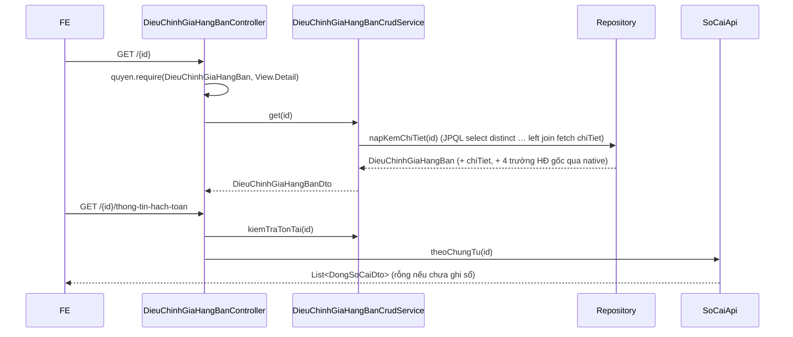

# F2 — Xem chi tiết · dòng chi tiết · bút toán · nhân bản

| | |
|---|---|
| Mã chức năng | **F2** |
| UC nguồn | [PMKT-U-07667 — Xem chi tiết](../../pmkt-docs/ba/PMKT-E-07664_DieuChinhGiaHangBan/4.usecases/PMKT-U-07667_XemChiTiet/UC_XemChiTiet.md) |
| Màn hình nguồn | [SCR_XemChiTietDieuChinhGia.md](../../pmkt-docs/ba/PMKT-E-07664_DieuChinhGiaHangBan/5.screens/SCR_XemChiTietDieuChinhGia.md) (tham chiếu trường về `SCR_ThemMoiDieuChinhGia`) |
| Endpoint phụ trách | **A3** `GET /{id}` · **A9** `GET /{id}/dong-chi-tiet` · **A10** `GET /{id}/thong-tin-hach-toan` · **A11** `GET /{id}/nhan-ban` |

## 1. Quyết định riêng

- **A3 trả kèm `chiTiet`** (nạp bằng `join fetch`), nên **A9 là dư thừa với màn Xem chi tiết** — nó tồn tại vì kế thừa `BaseChungTuController` ([:147](../../cell-app/src/main/java/vn/dopai/pmkt/cell/accounting_core/chung_tu/controller/BaseChungTuController.java)) và hữu ích cho lưới phân trang riêng phần chi tiết. Không ẩn đi: base để `public` mới map được (javadoc lớp base nói rõ). FE hiện dùng A3.
- **A11 (`/nhan-ban`) là `GET` và KHÔNG ghi gì** — hợp đồng của base ([AbstractChungTuCrudService.java:60-70](../../cell-app/src/main/java/vn/dopai/pmkt/cell/accounting_core/chung_tu/service/AbstractChungTuCrudService.java)). Bản nhân bản chỉ là dữ liệu điền sẵn cho màn Thêm mới; chứng từ chỉ ra đời khi người dùng bấm Lưu. **Không chọn** tạo bản ghi ngay: mỗi lần người dùng đổi ý là một chứng từ rác đã chiếm một số chứng từ.
- **A10 trả sổ cái THẬT** (`acc_so_cai` qua `SoCaiApi.theoChungTu`), không phải bút toán dự kiến. Chứng từ chưa ghi sổ ⇒ list rỗng, **không phải lỗi**. Tab "Hạch toán dự kiến" của màn Thêm mới nằm ngoài phạm vi (§1.2 file gốc).

## 2. Hợp đồng API

### A3 — `GET /api/ban-hang/dieu-chinh-gia-hang-ban/{id}` · quyền `.View.Detail`

```jsonc
// Response 200
{
  "code": "SUCCESS", "message": "...", "messageId": null,
  "data": {
    "id": "…", "soChungTu": "BGG00001",
    "ngayChungTu": "2026-08-10", "ngayHachToan": "2026-08-10",

    "huongDieuChinhGia": "GiamGia",
    "thanhToanNgay": true,
    "hinhThucThanhToan": "ChiTienMat",
    "lapKemHoaDonDieuChinh": true,

    "khachHangId": "…", "tenKhachHang": "Công ty TNHH ABC",
    "maSoThue": "0101234567", "diaChi": "12 Nguyễn Trãi, Hà Nội",
    "nhanVienBanHangId": "…", "dienGiai": "Giảm giá hàng bán theo thỏa thuận",

    "nguonChungTu": "CHUNG_TU_BAN_HANG",
    "lyDoDieuChinhNguon": null,
    "chungTuBanHangId": "…", "chungTuBanDichVuId": null,
    "hoaDonBanHangId": "…", "hoaDonDieuChinhId": null,

    "loaiTienId": "…", "tyGia": 1,

    "chungTuThanhToan": {
      "khachHangId": "…", "tenKhachHang": "Công ty TNHH ABC",
      "soChungTu": "PC00042", "diaChi": "…",
      "ngayChungTu": "2026-08-10", "ngayHachToan": "2026-08-10",
      "nhanVienBanHangId": "…", "nguoiGiaoDich": "Nguyễn Văn A",
      "lyDo": "Chi trả giảm giá hàng bán",
      "taiKhoanTienId": "…", "taiKhoanNganHangId": null, "tenNganHang": null,
      "soGiayTo": null, "ngayCap": null, "noiCap": null,
      "kemTheo": null, "chungTuGoc": null
    },

    "hoaDon": {
      "khachHangId": "…", "tenKhachHang": "…", "maSoThue": "…", "diaChi": "…",
      "nguoiMuaHang": "…", "maSoDvqhns": null, "cccd": null, "hoChieu": null,
      "nhanVienBanHangId": "…", "soDienThoai": "…",
      "hinhThucThanhToan": "Tiền mặt", "taiKhoanNganHangThuId": null,
      "loaiDieuChinh": "DieuChinhGia", "lyDoDieuChinh": "Điều chỉnh giảm giá theo hợp đồng",
      "mauSoHoaDon": "1", "kyHieuHoaDon": "C26TAA",
      "soHoaDonDieuChinh": "00001234", "ngayHoaDonDieuChinh": "2026-08-10",
      "hoaDonGocId": "…", "soHoaDonGoc": "00001200",
      "ngayHoaDonGoc": "2026-07-15", "mauSoHoaDonGoc": "1", "kyHieuHoaDonGoc": "C26TAA"
    },

    "soHoaDonDieuChinh": "00001234",

    "tongTienHang": 1000000, "tongChietKhau": 0,
    "tongTienThueGtgt": 100000, "tongTienThanhToan": 1100000,
    "tongThanhTienQuyDoi": 1000000, "tongChietKhauQuyDoi": 0,
    "tongTienThueGtgtQuyDoi": 100000, "tongTienThanhToanQuyDoi": 1100000,

    "trangThaiChungTu": "NHAP",
    "chiTiet": [ /* xem A9 */ ],
    "updatedAt": "2026-08-10T03:12:44Z"
  }
}
```

| Lỗi | HTTP | Ghi chú |
|---|---|---|
| Không có quyền `.View.Detail` | 403 | `MSG_PMKT-E-07664_007` |
| `id` không tồn tại / đã xoá mềm / khác tenant | 404 | `ResourceNotFoundException` |

### A9 — `GET /{id}/dong-chi-tiet` · quyền `.View.Detail`

```jsonc
// Response 200 — data: List<ChiTietDieuChinhGiaHangBanDto>, đúng thứ tự `thu_tu`
{
  "data": [
    {
      "id": "…", "thuTu": 1,
      "maHangId": "…", "tenHang": "Bánh gạo hộp 200g", "donViTinhId": "…",
      "taiKhoanCongNoId": "…", "taiKhoanDoanhThuId": null, "taiKhoanGiamGiaId": "…",
      "soLuong": 10, "donGia": 5000, "thanhTien": 50000, "thanhTienQuyDoi": 50000,
      "chietKhauPhanTram": 0, "chietKhauTien": 0, "chietKhauTienQuyDoi": 0,
      "taiKhoanChietKhauId": null,
      "thueSuatGtgt": "10", "giaTriThueGtgt": null,
      "tienThueGtgt": 5000, "tienThueGtgtQuyDoi": 5000, "taiKhoanThueGtgtId": "…",
      "khongTongHopToKhaiGtgt": false,
      "chungTuNguonId": "…", "chiTietNguonId": "…",
      "soChungTuBanHang": "PBH00120", "soHoaDonGoc": "00001200",
      "ngayChungTuGoc": "2026-07-15",
      "donViId": null, "vuViecId": null, "khoanMucChiPhiId": null, "doiTuongThcpId": null
    }
  ]
}
```

### A10 — `GET /{id}/thong-tin-hach-toan` · quyền `.View.Detail`

Trả `List<DongSoCaiDto>` — các dòng `acc_so_cai` **đã ghi** của chứng từ. Base kiểm tồn tại trước khi đọc sổ cái ([BaseChungTuController.java:139-145](../../cell-app/src/main/java/vn/dopai/pmkt/cell/accounting_core/chung_tu/controller/BaseChungTuController.java)) nên id bịa ra trả 404 chứ không phải 200 rỗng.

Chứng từ chưa ghi sổ ⇒ `data: []`, HTTP 200. Đáp ứng UC_XemChiTiet bước 6 (*"Nếu đã ghi sổ, hiển thị bút toán hạch toán"*).

### A11 — `GET /{id}/nhan-ban` · quyền `.Clone` ⚠ **quyền chưa seed** (§10 file gốc)

Trả DTO **giống A3** nhưng:

| Trường | Giá trị trong bản nhân bản | Vì sao |
|---|---|---|
| `id` | `null` | chưa tồn tại bản ghi |
| `soChungTu`, `chungTuThanhToan.soChungTu` | `null` | BR19/BR20 — số chứng từ duy nhất, người dùng nhập lại |
| `soHoaDonDieuChinh`, `hoaDon.soHoaDonDieuChinh` | `null` | số hóa đơn không nhân bản được |
| `ngayChungTu`, `ngayHachToan` | **ngày hiện tại** | mặc định của SCR (dòng 293, 296) |
| `trangThaiChungTu` | `"NHAP"` | luôn "Chưa ghi sổ" kể cả khi bản gốc đã ghi sổ (hợp đồng base) |
| `updatedAt` | `null` | không có bản ghi để khoá lạc quan |
| `chiTiet[].id` | `null` | dòng mới |
| `chiTiet[].chungTuNguonId`, `.chiTietNguonId` | **giữ nguyên** | ⚠ xem cảnh báo dưới |

> ⚠ **Cảnh báo nghiệp vụ cần BA xác nhận (bổ sung cho §12 file gốc):** nhân bản mà giữ liên kết nguồn nghĩa là dòng bán hàng gốc bị điều chỉnh giá **hai lần**. Điều đó *hợp lệ về kỹ thuật* (`LoaiChungTu.laTieuThu()` của điều chỉnh giá là `false`, [LoaiChungTu.java:65](../../cell-app/src/main/java/vn/dopai/pmkt/cell/quan_he_chung_tu/api/LoaiChungTu.java) — cùng một dòng được điều chỉnh nhiều lần là có chủ ý), nhưng có thể **không phải ý** của người bấm "Nhân bản". Cách cài: giữ nguyên liên kết (người dùng thấy đủ dữ liệu, tự xoá dòng nếu không muốn). Nếu BA muốn ngược lại thì bỏ `chungTuNguonId`/`chiTietNguonId` trong `NhanBanDieuChinhGia` — một chỗ sửa.

## 3. Ánh xạ cột BA ↔ DB ↔ DTO (phần khác với [01](01-xem-danh-sach.md))

### 3.1 Header — tab "Chứng từ điều chỉnh công nợ" (SCR_ThemMoi dòng 286-296)

| Trường BA | Cột DB | Field DTO | Ghi chú |
|---|---|---|---|
| Mã KH / Tên KH | `khach_hang_id` / `ten_khach_hang` | `khachHangId` / `tenKhachHang` | |
| Số chứng từ | `so_chung_tu` | `soChungTu` | |
| Mã số thuế/CCCD chủ hộ | `ma_so_thue` | `maSoThue` | |
| Địa chỉ | `dia_chi` | `diaChi` | |
| Ngày chứng từ / Ngày hạch toán | `ngay_chung_tu` / `ngay_hach_toan` | như tên | base quản |
| Nhân viên bán hàng | `nhan_vien_ban_hang_id` | `nhanVienBanHangId` | |
| Diễn giải | **`mo_ta`** ⚠ | `dienGiai` | tên DB lệch tên BA |

### 3.2 Object con `chungTuThanhToan` (6 tab thanh toán → 1 object, `model.ts` dòng 104-138)

| Trường BA (nhãn theo tab) | Cột DB | Field DTO |
|---|---|---|
| Số chứng từ (Phiếu thu/chi/Séc/Giấy báo) | `so_chung_tu_phieu_thu_chi` (đã có) | `chungTuThanhToan.soChungTu` |
| Tài khoản tiền | `tai_khoan_tien_id` (đã có) | `.taiKhoanTienId` |
| Tài khoản nhận tiền / chi tiền | `tai_khoan_ngan_hang_thu_id` / `tai_khoan_ngan_hang_chi_id` (đã có) | `.taiKhoanNganHangId` — mapper chọn cột theo hướng điều chỉnh |
| Người nộp / Người nhận / Người lĩnh tiền | **mới** `nguoi_giao_dich_thu_chi` | `.nguoiGiaoDich` |
| Lý do nộp / Lý do chi / Nội dung TT | **mới** `ly_do_thu_chi` | `.lyDo` |
| Ngân hàng nhận/chi tiền | **mới** `ten_ngan_hang_thu_chi` | `.tenNganHang` |
| Số giấy tờ · Ngày cấp · Nơi cấp (Séc TM) | **mới** `so_giay_to`, `ngay_cap`, `noi_cap` | `.soGiayTo` `.ngayCap` `.noiCap` |
| Kèm theo · Chứng từ gốc | **mới** `kem_theo`, `chung_tu_goc` | `.kemTheo` `.chungTuGoc` |
| Ngày chứng từ / Ngày hạch toán của tab | — | `.ngayChungTu` / `.ngayHachToan` = **lấy từ header** |

> Quyết định: **không** thêm cột ngày riêng cho tab thanh toán. SCR khai chúng cùng mặc định "Ngày hiện tại" với tab Công nợ, và bút toán 2 phải cùng ngày hạch toán với bút toán 1 (nếu không, một nửa nghiệp vụ rơi sang kỳ khác). Mapper trả bằng ngày header. Nếu BA khẳng định hai tab được lệch ngày → phải thêm 2 cột và tách kiểm kỳ cho từng bút toán; đưa vào §12 khi có phản hồi.

### 3.3 Object con `hoaDon` (tab Hóa đơn, SCR dòng 409-433)

| Trường BA | Cột DB | Field DTO |
|---|---|---|
| Mã KH · Tên KH · MST · Địa chỉ · Người mua hàng · Mã số ĐVQHNS · CCCD · Hộ chiếu · NVBH | dùng chung cột header (`khach_hang_id`, `ten_khach_hang`, `ma_so_thue`, `dia_chi`, `nguoi_mua_hang`, `ma_so_dvqhns`, `cccd`, `ho_chieu`, `nhan_vien_ban_hang_id`) | `hoaDon.*` |
| Điện thoại | **mới** `dien_thoai` | `hoaDon.soDienThoai` |
| Hình thức thanh toán (HĐ) | **mới** `hinh_thuc_thanh_toan_hoa_don` | `hoaDon.hinhThucThanhToan` |
| Tài khoản NH | `tai_khoan_ngan_hang_thu_id` | `hoaDon.taiKhoanNganHangThuId` |
| Loại điều chỉnh (Điều chỉnh giá/Sai sót/Khác) | **mới** `loai_dieu_chinh_hoa_don` | `hoaDon.loaiDieuChinh` — §12-Q9 |
| Lý do điều chỉnh | **mới** `ly_do_dieu_chinh` | `hoaDon.lyDoDieuChinh` |
| Mẫu số · Ký hiệu · Số HĐ ĐC · Ngày HĐ ĐC | `mau_so_hoa_don_id`, `ky_hieu_hoa_don`, `so_hoa_don_dieu_chinh`, `ngay_hoa_don_dieu_chinh` (đã có) | `hoaDon.*` |
| Hóa đơn gốc cần điều chỉnh | `hoa_don_ban_hang_id` (đã có) | `hoaDon.hoaDonGocId` |
| Số / Ngày / Mẫu số / Ký hiệu HĐ gốc | **không lưu** — đọc từ `sal_hoa_don_ban_hang` | `hoaDon.soHoaDonGoc`, `.ngayHoaDonGoc`, `.mauSoHoaDonGoc`, `.kyHieuHoaDonGoc` |

> ⚠ **Bốn trường HĐ gốc là dẫn xuất, đọc bằng SQL native** (không có module Java cho `sal_hoa_don_ban_hang` — §2.1 file gốc). Đọc trong cùng query nạp chi tiết để không N+1. Nếu hóa đơn gốc bị xoá ⇒ trả `null`, không nổ 500.
> ⚠ `mauSoHoaDon` trong `model.ts` là **chuỗi** còn DB là `mau_so_hoa_don_id uuid` (FK `mst_mau_so_hoa_don`). Mapper trả **mã mẫu số** (chuỗi) cho FE, nhận lại mã và tra ngược sang id khi lưu. Ghi rõ ở [03](03-them-moi.md) §3.

## 4. Luồng xử lý



`join fetch` một collection **bắt buộc có `distinct`** — thiếu nó thì chứng từ 5 dòng trả về 5 lần (đúng bài học đã ghi ở [ChungTuBanHangRepositoryImpl.java:40](../../cell-app/src/main/java/vn/dopai/pmkt/cell/chung_tu_ban_hang/internal/repository/ChungTuBanHangRepositoryImpl.java)).

## 5. Tương tranh & transaction
Cả 4 endpoint `@Transactional(readOnly = true)`. Không khoá gì. `updatedAt` trả về là token khoá lạc quan cho PUT/DELETE/ghi sổ ở các file sau.

## 6. Kiểm thử

### Unit
| Lớp test | Kiểm gì |
|---|---|
| `DieuChinhGiaMapperTest` | A3 kèm `chiTiet`; `chungTuThanhToan` = `null` khi `thanhToanNgay = false`; `taiKhoanNganHangId` lấy đúng cột thu/chi theo hướng điều chỉnh |
| `NhanBanDieuChinhGiaTest` | bản nhân bản có `id`/`soChungTu`/`soHoaDonDieuChinh`/`updatedAt` = null; `trangThaiChungTu = NHAP` **kể cả** khi gốc `DA_GHI_SO`; ngày = ngày hiện tại (`Clock` tiêm được) |
| `ChiTietMapperTest` | `soLuong/donGia/thanhTien` lấy đúng khối tăng hoặc giảm theo `huongDieuChinhGia` (D6) |

### Tích hợp
| Lớp test | Kiểm gì |
|---|---|
| `DieuChinhGiaChiTietIT` | không N+1 (đếm query); id lạ → 404; `/thong-tin-hach-toan` của chứng từ chưa ghi sổ → 200 + rỗng; của id bịa → 404; `/nhan-ban` **không** sinh dòng nào trong DB (đếm bản ghi trước/sau) |

## 7. BR đã áp dụng
BR12 (trạng thái quyết định nút — §2 A11) · BR13.2 (nút trên form chi tiết) · BR18 (các cột `*QuyDoi`) · BR25 (quyền từng endpoint) · BR34 (mở popup Sửa từ màn Xem — FE) · BR36 (A10 đọc sổ cái thật, không gộp dòng) · BR46 (`updatedAt`, `nguoiGhiSo`/`thoiGianGhiSo` do base quản).
