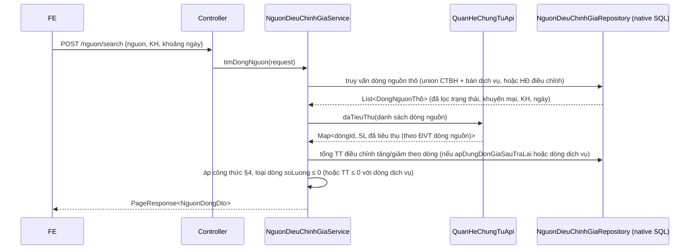

# F8 — Chọn chứng từ nguồn (Bước 1 của màn Thêm mới)

| | |
|---|---|
| Mã chức năng | **F8** |
| UC nguồn | [PMKT-U-07666 — Thêm mới](../../pmkt-docs/ba/PMKT-E-07664_DieuChinhGiaHangBan/4.usecases/PMKT-U-07666_ThemMoi/UC_ThemMoi.md) bước 3-5 |
| Màn hình nguồn | [SCR_ThemMoiDieuChinhGia.md](../../pmkt-docs/ba/PMKT-E-07664_DieuChinhGiaHangBan/5.screens/SCR_ThemMoiDieuChinhGia.md) **Bước 1**, dòng 18-172 |
| Endpoint phụ trách | **A15** `POST /nguon/search` · **A16** `POST /nguon/chung-tu` · **A17** `POST /nguon/chung-tu/{id}/dong` |
| Rủi ro liên quan | **R2** (§9 file gốc) — công thức BR2 phải viết SQL native |

## 1. Quyết định riêng

- **Ba endpoint, không phải một** — đúng tên FE đã khai (`IMPLEMENT.md` dòng 186-188, D10). Ba nhu cầu khác nhau: lưới dòng hàng của popup (A15), combo "Chọn nhanh chứng từ" ở mức chứng từ (A16), nạp toàn bộ dòng của một chứng từ khi chọn từ combo (A17). Gộp làm một sẽ phải nhồi cờ `mucDo=dong|chungTu` và trả hai shape khác nhau trên cùng đường dẫn.
- **Truy vấn bằng SQL native**, đặt trọn trong `NguonDieuChinhGiaRepository`. Bắt buộc: các bảng nguồn (`sal_chung_tu_ban_dich_vu`, `sal_chung_tu_tra_lai_hang_ban_chi_tiet`, `sal_chi_tiet_hoa_don_dieu_chinh`) **không có tầng Java** (§2.1 file gốc), và công thức BR2 là một phép trừ tổng hợp có quy đổi ĐVT — viết bằng Criteria API sẽ dài hơn và khó review hơn chính SQL.
  **Không chọn** đọc qua entity của `chung_tu_ban_hang`: Modulith cấm import `internal/` của module khác, và ba bảng kia không có entity nào cả.
- **Quyền dùng `.Create`**, không phải `.View`: ba endpoint này chỉ phục vụ màn Thêm mới. Người chỉ có quyền xem không cần chúng.
- **BE chỉ trả dữ liệu nguồn thô + số lượng/đơn giá/thành tiền đã tính theo BR2.** Ba cột `Tỷ lệ ĐC %`, `Đơn giá ĐC`, `Giá trị ĐC` (BR3) là **ô người dùng nhập trên FE**, BE không tính và không lưu ở bước này.

## 2. Hợp đồng API

### A15 — `POST /nguon/search` · quyền `.Create`
Lưới dòng hàng của popup "Chọn chứng từ nguồn" (SCR dòng 41-61).

```jsonc
// Request — TimNguonRequest
{
  "nguonChungTu": "CHUNG_TU_BAN_HANG",   // CHUNG_TU_BAN_HANG | HOA_DON_DIEU_CHINH — BẮT BUỘC
  "khachHangId": "…",                    // BẮT BUỘC (SCR dòng 35)
  "ngayTu": "2026-08-01",                // BẮT BUỘC (SCR dòng 37, mặc định đầu tháng → hôm nay do FE)
  "ngayDen": "2026-08-14",               // BẮT BUỘC
  "keyword": "PBH0012",                  // N — lọc theo số chứng từ
  "lyDoDieuChinh": "DieuChinhGiam",      // BẮT BUỘC khi nguonChungTu = HOA_DON_DIEU_CHINH
  "apDungDonGiaSauTraLai": false,        // N — chỉ khi nguồn = CHUNG_TU_BAN_HANG (SCR dòng 39)
  "chungTuIds": ["…"],                   // N — giới hạn trong 1 chứng từ (dùng bởi A17)
  "page": 1, "pageSize": 20
}
```

| Field | Kiểu | Bắt buộc | Ràng buộc | Nguồn BA |
|---|---|---|---|---|
| `nguonChungTu` | enum | **Y** | 2 giá trị; mặc định FE gửi `CHUNG_TU_BAN_HANG` | SCR dòng 22-27 |
| `khachHangId` | uuid | **Y** | SCR ghi rõ "Bắt buộc chọn" | SCR dòng 35 |
| `ngayTu` / `ngayDen` | date | **Y** | `ngayTu ≤ ngayDen`; lọc theo **Ngày hạch toán** | SCR dòng 37 |
| `keyword` | string | N | `like` trên số chứng từ | SCR dòng 36 |
| `lyDoDieuChinh` | enum | **Y khi** nguồn = HĐ ĐC | `DieuChinhTang` \| `DieuChinhGiam` | SCR dòng 38 |
| `apDungDonGiaSauTraLai` | bool | N | mặc định `false`; đổi **công thức Đơn giá/Thành tiền** (§4) | SCR dòng 39, 106-111 |

```jsonc
// Response 200 — PageResponse<NguonDongDto>
{
  "data": [
    {
      "chungTuId": "…", "chiTietId": "…",
      "loaiChungTuNguon": "SAL_CHUNG_TU_BAN_HANG",
      "ngayChungTu": "2026-07-15", "ngayHachToan": "2026-07-15",
      "soChungTu": "PBH00120",
      "soHoaDon": "00001200;00001201",        // nhiều HĐ ⇒ nối bằng dấu ';' (SCR dòng 49)
      "loaiTienId": "…", "tenLoaiTien": "VND", "tyGia": 1,
      "maHangId": "…", "maHang": "BG200", "tenHang": "Bánh gạo hộp 200g",
      "donViTinhId": "…", "tenDonViTinh": "Hộp",
      "soLuong": 8,            // = SL trên CTBH − SL đã trả lại (quy đổi ĐVT) — §4
      "donGia": 5000,
      "thanhTien": 40000,
      "laDongDichVu": false,   // SL = ĐG = 0 và Thành tiền ≠ 0 → FE khóa 2 ô, cho nhập Giá trị ĐC
      // Dữ liệu để BR5 autofill sang form (SCR dòng 176-232)
      "taiKhoanCongNoId": "…", "taiKhoanDoanhThuId": "…",
      "chietKhauPhanTram": 0, "thueSuatGtgt": "10", "giaTriThueGtgt": null,
      "khachHangId": "…", "tenKhachHang": "…", "maSoThue": "…", "diaChi": "…",
      "nhanVienBanHangId": "…", "hoaDonBanHangId": "…"
    }
  ],
  "pagination": { "page": 1, "pageSize": 20, "totalItems": 12, "totalPages": 1 },
  "summary": null
}
```

### A16 — `POST /nguon/chung-tu` · quyền `.Create`
Combo "Chọn nhanh chứng từ" — **mỗi chứng từ một dòng** (SCR dòng 141-171).

```jsonc
// Request — cùng TimNguonRequest, KHÔNG bắt buộc khachHangId
{ "nguonChungTu": "CHUNG_TU_BAN_HANG", "keyword": "PBH", "page": 1, "pageSize": 20 }
```

```jsonc
// Response 200 — PageResponse<NguonChungTuDto>
{
  "data": [
    { "chungTuId": "…", "loaiChungTuNguon": "SAL_CHUNG_TU_BAN_HANG",
      "soChungTu": "PBH00120", "soHoaDon": "00001200",
      "ngayChungTu": "2026-07-15", "khachHangId": "…", "tenKhachHang": "Công ty TNHH ABC" }
  ],
  "pagination": { "page": 1, "pageSize": 20, "totalItems": 87, "totalPages": 5 },
  "summary": null
}
```

Khác A15 ở ba điểm, đều từ SCR dòng 152-171:
1. **`khachHangId` không bắt buộc** — *"Load lên các chứng từ của **tất cả các KH** có ít nhất 1 dòng thỏa mãn điều kiện load"*.
2. Mỗi chứng từ **một dòng** (`DISTINCT` ở mức header) — không phải mỗi dòng hàng một dòng.
3. `pageSize` mặc định **20**, FE cuộn để nạp tiếp (infinite scroll).

Cột trả về khác nhau theo nguồn: CTBH ⇒ Số chứng từ · Số hóa đơn · Ngày chứng từ · Tên KH; HĐ điều chỉnh ⇒ Số hóa đơn · Ngày hóa đơn · Tên KH. **Một DTO cho cả hai**, trường không dùng để `null` — FE đã khai cột theo nguồn.

### A17 — `POST /nguon/chung-tu/{id}/dong` · quyền `.Create`
Sau khi chọn một chứng từ từ combo, nạp **tất cả** dòng thỏa mãn của chứng từ đó (SCR dòng 172: *"Sau khi chọn chứng từ sẽ mặc định chọn tất cả các dòng thỏa mãn trên chứng từ"*).

```jsonc
// Request
{ "nguonChungTu": "CHUNG_TU_BAN_HANG", "apDungDonGiaSauTraLai": false, "lyDoDieuChinh": null }
```
```jsonc
// Response 200 — ApiResponse<List<NguonDongDto>>, KHÔNG phân trang
{ "data": [ /* NguonDongDto như A15 */ ] }
```

| Lỗi (cả ba endpoint) | HTTP |
|---|---|
| Thiếu quyền `.Create` | 403 (`MSG_PMKT-E-07664_007`) |
| Thiếu `khachHangId`/`ngayTu`/`ngayDen` ở A15 | 400 |
| `nguonChungTu = HOA_DON_DIEU_CHINH` mà thiếu `lyDoDieuChinh` | 400 |
| `{id}` của A17 không tồn tại / khác tenant | 404 |

## 3. Điều kiện lọc dòng nguồn (BR1 của SCR, dòng 66-89)

### 3.1 Nguồn = **Chứng từ bán hàng hóa, dịch vụ**

| # | Điều kiện | Cài bằng |
|---|---|---|
| 1 | Loại là Chứng từ bán hàng **hoặc** Chứng từ bán dịch vụ | `UNION ALL` hai bảng `sal_chung_tu_ban_hang` + `sal_chung_tu_ban_dich_vu` |
| 2 | Trạng thái **Đã ghi sổ** | `status = 'DA_GHI_SO'` |
| 3 | **Không** tích "Là hàng khuyến mại" | `coalesce(hang_khuyen_mai, false) = false` |
| 4 | **Số lượng chưa trả lại > 0** | công thức §4 |
| 5 | Dòng Dịch vụ có `SL = 0` ⇒ chỉ load nếu **thành tiền sau trả lại/ĐC > 0** | nhánh riêng ở §4 |
| 6 | Thỏa `khachHangId` và khoảng `ngay_hach_toan` | `WHERE` |
| — | (ngầm) `da_xoa = false`, RLS tenant | mặc định |

**Sắp xếp:** `ngay_hach_toan ASC, so_chung_tu ASC, thu_tu ASC` — SCR dòng 84: *"**Tăng** dần Ngày hạch toán → Số chứng từ. Trong cùng 1 chứng từ: đúng thứ tự khi lập"*.

### 3.2 Nguồn = **Hóa đơn điều chỉnh**

| # | Điều kiện | Cài bằng |
|---|---|---|
| 1 | Trạng thái hóa đơn là **Hóa đơn điều chỉnh** | đọc `sal_dieu_chinh_hoa_don_ban_hang` + `sal_chi_tiet_hoa_don_dieu_chinh` |
| 2 | **Chưa** được lập chứng từ trả lại hàng bán / giảm giá hàng bán nào | `NOT EXISTS` trên `ctu_quan_he_chung_tu` (dòng nguồn chưa có liên kết đích loại `SAL_CHUNG_TU_TRA_LAI_HANG_BAN` hoặc `SAL_DIEU_CHINH_GIA_HANG_BAN`) |
| 3 | `lyDoDieuChinh = DieuChinhTang` ⇒ chỉ dòng `SL ≥ 0` và **Thành tiền sau trả lại/ĐC > 0** | `WHERE` |
| 4 | `lyDoDieuChinh = DieuChinhGiam` ⇒ chỉ dòng `SL ≥ 0` và **Thành tiền sau trả lại/ĐC < 0** | `WHERE` |
| 5 | Thỏa `khachHangId` và khoảng ngày | `WHERE` |

**Sắp xếp:** `ngay_hoa_don DESC, so_hoa_don DESC, thu_tu ASC` (SCR dòng 85 — **giảm** dần, ngược với nhánh CTBH).

**Giá trị trả về (BR2, SCR dòng 118-122):** `soLuong`, `donGia`, `thanhTien` = **trị tuyệt đối** của giá trị trên HĐ điều chỉnh.

## 4. Cột dẫn xuất — công thức BR2 (nhánh CTBH)

Đây là phần khó nhất của epic. Nguồn: SCR dòng 91-116.

### 4.1 Số lượng đã trả lại (có quy đổi ĐVT)

```
SL_da_tra_lai(dòng CTBH d) = Σ  quyDoi( tl.so_luong , tl.don_vi_tinh_id → d.don_vi_tinh_id )
                             với tl ∈ sal_chung_tu_tra_lai_hang_ban_chi_tiet
                                 mà tl liên kết tới d
```

**Quy đổi ĐVT** (SCR dòng 98-100), đọc `mst_don_vi_quy_doi_vat_tu` ([V1__baseline.sql:11137](../../cell-app/src/main/resources/db/migration/V1__baseline.sql) — cột `ty_le_quy_doi numeric(18,6)`, `phep_tinh varchar(10)`):

| `phep_tinh` trên DM VTHH | Công thức |
|---|---|
| `Nhân` | `SL_trả_lại_theo_ĐVT_CTBH = SL_theo_ĐVT_chính / ty_le_quy_doi` |
| `Chia` | `SL_trả_lại_theo_ĐVT_CTBH = SL_theo_ĐVT_chính × ty_le_quy_doi` |

⚠ Hệ số phải đọc **từ dòng chứng từ trả lại** nếu dòng đó có lưu hệ số, chứ không tra lại danh mục — số lịch sử sẽ trôi khi danh mục đổi (nguyên tắc đã ghi ở [DongChungTuPort.java:56](../../cell-app/src/main/java/vn/dopai/pmkt/cell/quan_he_chung_tu/api/DongChungTuPort.java)). Nhưng `sal_chung_tu_tra_lai_hang_ban_chi_tiet` **không có cột hệ số quy đổi** (đã kiểm DDL) ⇒ **buộc phải tra danh mục**. Ghi nhận là nợ kỹ thuật, nêu ở §7.

**Liên kết `tl ↔ d`** — hai đường, phải hợp cả hai (SCR dòng 105: *"Lập CTBH → Lập Hóa đơn → Lập HĐ điều chỉnh → Lập CT trả lại thì cũng cần tạo liên kết giữa các chứng từ"*):
1. Cột trực tiếp: `tl.chung_tu_ban_id = d.chung_tu_ban_hang_id` (thô, mức chứng từ) hoặc `tl.chi_tiet_hd_ban_hang_id = <dòng HĐ sinh từ d>`.
2. **Đồ thị quan hệ**: `ctu_quan_he_chung_tu` mức dòng, đi ngược từ dòng trả lại về dòng CTBH qua tối đa 2 chặng (CTBH → HĐBH → HĐ điều chỉnh → trả lại).

→ **Chọn đường (2) làm chính** qua `QuanHeChungTuApi.daTieuThu(dongNguonIds)` ([QuanHeChungTuApi.java:53](../../cell-app/src/main/java/vn/dopai/pmkt/cell/quan_he_chung_tu/api/QuanHeChungTuApi.java)) — hàm này **đã cộng sẵn** số đã tiêu thụ, chỉ tính các loại đích có `laTieuThu() = true` (trả lại hàng bán có, điều chỉnh giá **không**), và đã quy về ĐVT của dòng nguồn. **Không chọn** tự cộng bằng SQL trên cột FK: cột FK chỉ nối được một chặng, đúng cái mà SCR dòng 105 cảnh báo là không đủ.
⚠ Điều kiện đủ: mọi chứng từ trả lại hàng bán phải **đã** đăng ký liên kết vào `ctu_quan_he_chung_tu`. Module trả lại hàng bán chưa có tầng Java ⇒ **dữ liệu liên kết có thể trống** cho chứng từ tạo trước đó → xem §7-N1.

### 4.2 Số lượng · Đơn giá · Thành tiền hiển thị

```
soLuong = d.so_luong − SL_da_tra_lai(d)                       (điều kiện lọc #4: > 0)
```

| `apDungDonGiaSauTraLai` | `donGia` | `thanhTien` |
|---|---|---|
| `false` (mặc định) | `d.don_gia` | `soLuong × donGia` |
| `true` | `thanhTien / soLuong` | `TT_gốc + TT_ĐC_tăng − TT_ĐC_giảm − TT_trả_lại` (theo từng dòng hàng) |

**Dòng dịch vụ** (`d.so_luong = 0`, `d.don_gia = 0`, `d.thanh_tien ≠ 0`) — SCR dòng 112-115:
```
soLuong = 0 ; donGia = 0
thanhTien = TT_gốc + TT_ĐC_tăng − TT_ĐC_giảm − TT_trả_lại       (không phụ thuộc apDungDonGiaSauTraLai)
laDongDichVu = true                                              → FE khóa 2 ô, cho nhập Giá trị ĐC
```

`TT_ĐC_tăng` / `TT_ĐC_giảm` cộng từ chính bảng của epic này (`…_chi_tiet.thanh_tien_tang` / `.thanh_tien_giam`) của các chứng từ **đã ghi sổ** liên kết tới dòng `d`.

### 4.3 Cột "Số hóa đơn" (SCR dòng 49)

Ba trường hợp (lập kèm HĐ / sinh từ HĐ gốc / HĐ lập sau), một dòng hàng có thể ứng nhiều hóa đơn ⇒ **liệt kê, ngăn bằng dấu `;`**. Chỉ hiển thị **hóa đơn gốc**, không hiển thị hóa đơn thay thế / hóa đơn điều chỉnh.
Cài: `string_agg(DISTINCT hd.so_hoa_don, ';' ORDER BY hd.so_hoa_don)` trên `sal_hoa_don_ban_hang`, lọc bỏ hóa đơn thay thế/điều chỉnh.

### 4.4 BR3 — Tỷ lệ ĐC · Đơn giá ĐC · Giá trị ĐC
**Không thuộc BE.** Ba cột này là ô nhập trên popup, tính hai chiều tại chỗ (SCR dòng 124-139), và chỉ hiển thị khi nguồn là CTBH. FE đã cài. BE chỉ nhận kết quả (`donGia`, `thanhTien` của dòng chi tiết) ở A4.

## 5. Luồng xử lý



⚠ **Lọc sau khi tính là bắt buộc**, và nó phá phân trang ở tầng SQL: điều kiện #4 (`soLuong > 0`) chỉ biết được sau khi trừ số đã trả lại. Hai cách:
- **(chọn)** đẩy phép trừ **vào SQL** bằng `LEFT JOIN LATERAL` cộng số đã tiêu thụ, để `WHERE` và `LIMIT/OFFSET` chạy đúng ở DB. `QuanHeChungTuApi.daTieuThu` khi đó chỉ dùng để **đối chiếu trong test**, không nằm trên đường chạy chính.
- (không chọn) nạp hết rồi lọc/phân trang trong Java: một khách hàng lớn có hàng nghìn dòng bán hàng trong tháng — nạp hết để bỏ đi phần lớn là lãng phí và không có trần.

→ **Hệ quả cần Dev review:** SQL của A15 phải tự cộng số đã tiêu thụ từ `ctu_quan_he_chung_tu` (cùng công thức mà `daTieuThu` cài), tức **hai bản cài của một quy tắc**. Chốt an toàn: một integration test so kết quả SQL với `daTieuThu` trên cùng dữ liệu, chạy ở CI.

## 6. Tương tranh & transaction
Cả ba endpoint `@Transactional(readOnly = true)` (bắt buộc để RLS bind GUC tenant). **Không khoá** dòng nguồn ở bước này — khoá chỉ xảy ra lúc Lưu, trong `QuanHeChungTuApi.lienKet` (`ORDER BY id FOR UPDATE`). Hệ quả chấp nhận được: dữ liệu popup có thể cũ vài giây; nếu dòng nguồn bị chứng từ khác lấy trước thì bước Lưu mới báo — và điều chỉnh giá **không** áp ràng buộc vượt số lượng (`laTieuThu() = false`) nên ca này gần như không phát sinh.

## 7. Nợ kỹ thuật & điểm cần xác nhận của riêng chức năng này

| # | Vấn đề | Ảnh hưởng | Đề xuất |
|---|---|---|---|
| **N1** | `ctu_quan_he_chung_tu` chỉ có dữ liệu cho chứng từ được tạo **qua Java**. Module trả lại hàng bán chưa có tầng Java ⇒ liên kết có thể trống, làm `SL_da_tra_lai = 0` và popup hiện số lượng **cao hơn thực tế** | **Cao** — sai số nghiệp vụ, không phải sai kỹ thuật | Bổ sung nhánh dự phòng đọc cột FK trực tiếp (`tl.chung_tu_ban_id`, `tl.chi_tiet_hd_ban_hang_id`) và lấy `GREATEST` của hai cách. Cần BA/Dev chốt |
| **N2** | Bảng chứng từ trả lại **không lưu hệ số quy đổi ĐVT** ⇒ buộc tra danh mục hiện tại; danh mục đổi ⇒ số lịch sử trôi | TB | Ghi nhận; nếu BA thấy nghiêm trọng thì thêm cột `he_so_quy_doi` vào bảng trả lại — thuộc epic Trả lại hàng bán, không phải epic này |
| **N3** | "Thành tiền sau trả lại/điều chỉnh giá" của **nhánh HĐ điều chỉnh** (điều kiện lọc #3/#4) chưa có định nghĩa công thức trong tài liệu — SCR chỉ nêu tên | TB | Tạm dùng cùng công thức của nhánh CTBH (`TT_gốc + ĐC_tăng − ĐC_giảm − trả_lại`). **Cần BA xác nhận** |
| **N4** | SCR dòng 68: *"mở lại form thì phải mặc định tích vào các dòng đã tích tại lần chọn gần nhất"* | Thấp | Đây là **trạng thái phiên của FE**, BE không lưu. FE giữ trong store của màn |
| **N5** | Hai cảnh báo khi chọn chứng từ khác loại tiền / khác tỷ giá (SCR dòng 88-89) | Thấp | Thuần FE — BE trả `loaiTienId` + `tyGia` từng dòng để FE so |

## 8. Kiểm thử

### Unit (`@Tag("unit")`)
| Lớp test | Kiểm gì |
|---|---|
| `QuyDoiDonViTinhTest` | `phep_tinh = Nhân` ⇒ chia; `= Chia` ⇒ nhân; đúng ví dụ của SCR dòng 101-104 (bán 1 Thùng, trả 2 Cái, ĐVT chính Hộp, 1 Thùng = 10 Hộp, 1 Cái = 1/10 Hộp ⇒ SL đã trả = **1/50 Thùng**) |
| `CongThucNguonTest` | `apDungDonGiaSauTraLai` false/true ra hai bộ Đơn giá/Thành tiền khác nhau; dòng dịch vụ không đổi theo cờ đó; `soLuong ≤ 0` bị loại |
| `TimNguonRequestValidationTest` | thiếu `khachHangId`/`ngayTu`/`ngayDen` ở A15 ⇒ 400; A16 **không** đòi `khachHangId`; nguồn HĐ ĐC thiếu `lyDoDieuChinh` ⇒ 400 |

### Tích hợp (cần Docker — phần lớn giá trị của chức năng này nằm ở đây)
| Lớp test | Kiểm gì |
|---|---|
| `NguonCtbhIT` | 6 điều kiện lọc §3.1, từng cái một · sắp xếp tăng dần · phân trang **sau khi** trừ số đã trả lại (tổng số bản ghi đúng) · dòng đã trả hết không xuất hiện |
| `NguonHoaDonDieuChinhIT` | 5 điều kiện §3.2 · trị tuyệt đối của SL/ĐG/TT · dòng đã có chứng từ trả lại/giảm giá bị loại · sắp xếp giảm dần |
| `SoHoaDonAggIT` | một dòng hàng gắn 2 hóa đơn ⇒ chuỗi `"A;B"`; hóa đơn thay thế/điều chỉnh không lọt vào |
| `DoiChieuDaTieuThuIT` | **kết quả SQL của A15 khớp `QuanHeChungTuApi.daTieuThu`** trên cùng bộ dữ liệu (chốt an toàn cho hai bản cài — §5) |
| `NguonRlsIT` | tenant khác không thấy dòng nguồn nào |

## 9. BR đã áp dụng
BR1 (phân trang A16 = 20/trang theo SCR dòng 154) · BR2 (sắp xếp §3) · BR5 (combogrid A16) · BR7 (precision khi quy đổi ĐVT — `numeric(18,6)` cho hệ số, `quantity` cho số lượng) · BR8 (khoảng ngày bắt buộc) · BR10 (trường chọn nguồn) · BR11 (tìm kiếm server-side) · BR18 (`tyGia` trả về từng dòng) · BR25 (`.Create`) · BR28 (RLS).

**BR chưa đạt:** BR13 của SCR (ĐVT quy đổi hiển thị) — §12-Q7 file gốc.
