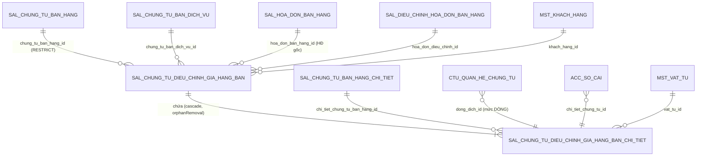

# F9 — Thiết kế DB & migration `V3`

> Mục này để **DBA/Dev review TRƯỚC khi code**. §10 (SQL) chỉ là bản dịch của §9 — thứ gì có ở §10 mà không có ở §9 nghĩa là §9 chưa xong.

## 9.1 Hiện trạng bảng (nguồn sự thật)

Cả hai bảng **đã tồn tại** trong `V1__baseline.sql` (baseline squash V1..V373). Không có migration nào sau đó chạm vào chúng — thư mục `db/migration/` chỉ có `V1` và `V2`.

### Bảng chính `sal_chung_tu_dieu_chinh_gia_hang_ban` — [V1:16257](../../cell-app/src/main/resources/db/migration/V1__baseline.sql), **63 cột**

Comment bảng ([V1:16334](../../cell-app/src/main/resources/db/migration/V1__baseline.sql)): *"PMKT-E-07664 DieuChinhGiaHangBan — điều chỉnh giá hàng bán (LDM ldm-BanHang.puml). CÓ hạch toán, KHÔNG di chuyển tồn kho."*

| Nhóm cột | Cột đã có | Do đâu quản |
|---|---|---|
| Base chứng từ | `so_chung_tu`, `ngay_chung_tu`, `ngay_hach_toan`, `status`, `chi_nhanh_id`, `loai_chung_tu_id`, `giao_dich_chung_tu_id`, `nguoi_duyet_id`, `ngay_duyet`, `nguoi_ghi_so`, `thoi_gian_ghi_so` | `BaseChungTuEntity` ([:44-85](../../cell-app/src/main/java/vn/dopai/pmkt/cell/core/entity/BaseChungTuEntity.java)) — **không khai lại** |
| Base audit/tenant | `id`, `tenant_id`, `phien_ban`, `ngay_tao`, `nguoi_tao`, `ngay_cap_nhat`, `nguoi_cap_nhat`, `da_xoa`, `ngay_xoa`, `nguoi_xoa` | `BaseEntity`/`TenantedEntity`/`SoftDeletableEntity` |
| Phạm vi dữ liệu | `don_vi_id` (NOT NULL, bất biến sau khi tạo — comment [:16376](../../cell-app/src/main/resources/db/migration/V1__baseline.sql)) | trigger `fn_pv_dat_don_vi_mac_dinh` + policy |
| Nghiệp vụ | `loai_dieu_chinh`, `trang_thai_hoa_don`, `hinh_thuc_thanh_toan`, `khach_hang_id`, `ten_khach_hang`, `dia_chi`, `ma_so_thue`, `nhan_vien_ban_hang_id`, `mo_ta` | module |
| Nguồn | `chung_tu_ban_hang_id`, `chung_tu_ban_dich_vu_id`, `hoa_don_ban_hang_id`, `hoa_don_dieu_chinh_id` | module |
| Hóa đơn | `mau_so_hoa_don_id`, `ky_hieu_hoa_don`, `so_hoa_don_dieu_chinh`, `ngay_hoa_don_dieu_chinh`, `nguoi_mua_hang`, `ma_so_dvqhns`, `cccd`, `ho_chieu` | module |
| Thanh toán | `phieu_thu_id`, `phieu_chi_id`, `giay_bao_co_id`, `giay_bao_no_id`, `sec_tien_mat_id`, `sec_chuyen_khoan_id`, `tai_khoan_ngan_hang_thu_id`, `tai_khoan_ngan_hang_chi_id`, `tai_khoan_tien_id`, `muc_dich_thu_chi_id`, `so_chung_tu_phieu_thu_chi` | module (6 cột `*_id` phiếu **giữ NULL** lần này — D3) |
| Tiền tệ | `loai_tien_id`, `ty_gia` | module |
| Tổng | `tong_tien_hang_chenh_lech`, `tong_tien_chiet_khau_chenh_lech`, `tong_tien_truoc_thue_chenh_lech`, `tong_tien_thue_gtgt_chenh_lech`, `tong_tien_sau_thue_chenh_lech`, `tong_thanh_toan_chenh_lech` | module (server tính) |
| **Thừa/xung đột** | `trang_thai_chung_tu` (NOT NULL, CHECK `'Chưa ghi sổ'`/`'Đã ghi sổ'`) | **DROP** — D7 |

### Bảng chi tiết `…_chi_tiet` — [V1:16411](../../cell-app/src/main/resources/db/migration/V1__baseline.sql), **39 cột**

| Nhóm | Cột đã có |
|---|---|
| Base | `id`, `tenant_id`, `phien_ban`, audit 6 cột, `da_xoa`/`ngay_xoa`/`nguoi_xoa`, `thu_tu` |
| Cha & nguồn | `dieu_chinh_gia_hang_ban_id` (NOT NULL), `chi_tiet_chung_tu_ban_hang_id`, `chi_tiet_chung_tu_ban_dich_vu_id`, `chi_tiet_hd_ban_hang_id`, `ngay_chung_tu_goc`, `so_chung_tu_goc`, `so_hoa_don_goc` |
| Hàng hoá | `vat_tu_id` (NOT NULL), `ten_vat_tu`, `don_vi_tinh_id` |
| Khối **tăng** | `so_luong_tang`, `don_gia_tang`, `thanh_tien_tang`, `chiet_khau_phan_tram_tang`, `chiet_khau_tien_tang` |
| Khối **giảm** | `so_luong_giam`, `don_gia_giam`, `thanh_tien_giam`, `chiet_khau_phan_tram_giam`, `chiet_khau_tien_giam` |
| Thuế | `thue_suat_gtgt_id` (uuid — **deprecate**, D8), `tai_khoan_thue_gtgt_id`, `tien_thue_gtgt_chenh_lech` |
| Tài khoản | `tai_khoan_cong_no_id`, `tai_khoan_doanh_thu_id`, `tai_khoan_giam_gia_id`, `tai_khoan_chiet_khau_id` |

**Kết luận — thiếu so với BA:** 12 cột header (tab thanh toán chi tiết, 3 cờ nghiệp vụ, 4 tổng quy đổi, 3 trường hóa đơn) và 11 cột chi tiết (thuế dạng enum, 3 cột quy đổi, cờ tờ khai, 4 chiều phân tích). Danh sách đích danh ở §9.2.

## 9.2 Cột thêm mới / sửa trên bảng đã có

### Bảng chính (12 thêm, 1 xoá)

| # | Cột DB | Kiểu | NULL | Default | Ai ghi | Field DTO | Vì sao cần |
|---|---|---|---|---|---|---|---|
| 1 | `thanh_toan_ngay` | `boolean` | N | `false` | client | `thanhToanNgay` | SCR dòng 265 — §12-Q8 |
| 2 | `lap_kem_hoa_don_dieu_chinh` | `boolean` | N | `true` | client | `lapKemHoaDonDieuChinh` | SCR dòng 267 |
| 3 | `nguon_chung_tu` | `text` | Y | — | client | `nguonChungTu` | SCR dòng 22-27; CHECK 2 giá trị |
| 4 | `ly_do_dieu_chinh_nguon` | `text` | Y | — | client | `lyDoDieuChinhNguon` | SCR dòng 38; CHECK 2 giá trị |
| 5 | `loai_dieu_chinh_hoa_don` | `text` | Y | — | client | `hoaDon.loaiDieuChinh` | SCR dòng 422 — §12-Q9; CHECK 3 giá trị |
| 6 | `ly_do_dieu_chinh` | `text` | Y | — | client | `hoaDon.lyDoDieuChinh` | SCR dòng 423 |
| 7 | `dien_thoai` | `text` | Y | — | client | `hoaDon.soDienThoai` | SCR dòng 424 |
| 8 | `hinh_thuc_thanh_toan_hoa_don` | `text` | Y | — | client | `hoaDon.hinhThucThanhToan` | SCR dòng 420 — cho nhập tay nên **không** CHECK |
| 9 | `nguoi_giao_dich_thu_chi` | `text` | Y | — | client | `chungTuThanhToan.nguoiGiaoDich` | SCR dòng 307/388/372 |
| 10 | `ly_do_thu_chi` | `text` | Y | — | client | `chungTuThanhToan.lyDo` | SCR dòng 312/393/366 |
| 11 | `ten_ngan_hang_thu_chi` | `text` | Y | — | client | `chungTuThanhToan.tenNganHang` | SCR dòng 330/348/369 |
| 12 | `so_giay_to` · `ngay_cap` · `noi_cap` · `kem_theo` · `chung_tu_goc` | `text`, `date`, `text`, `text`, `text` | Y | — | client | `chungTuThanhToan.*` | SCR dòng 372-377 (tab Séc tiền mặt) |
| 13 | `tong_tien_hang_quy_doi`, `tong_tien_chiet_khau_quy_doi`, `tong_tien_thue_gtgt_quy_doi`, `tong_thanh_toan_quy_doi` | `money_vnd` | Y | — | **server tính** | `tongThanhTienQuyDoi`, `tongChietKhauQuyDoi`, `tongTienThueGtgtQuyDoi`, `tongTienThanhToanQuyDoi` | SCR dòng 512-514 + cột tiền của màn danh sách |
| — | ~~`trang_thai_chung_tu`~~ | — | — | — | — | — | **DROP** — D7, xem §9.6 |

> Ghi chú #12: đếm là 5 cột (bảng gộp một dòng cho gọn) ⇒ tổng cột thêm ở bảng chính là **20**.

### Bảng chi tiết (11 thêm)

| # | Cột DB | Kiểu | NULL | Default | Ai ghi | Field DTO | Vì sao cần |
|---|---|---|---|---|---|---|---|
| 1 | `thue_suat_gtgt_mac_dinh` | `text` | Y | — | client | `thueSuatGtgt` | D8; CHECK **giống hệt** `sal_chung_tu_ban_hang_chi_tiet` (`'0','5','8','10','KCT','KKKNT','KHAC'`) |
| 2 | `gia_tri_thue_gtgt` | `numeric(18,2)` | Y | — | client | `giaTriThueGtgt` | chỉ có nghĩa khi `= 'KHAC'` |
| 3 | `khong_tong_hop_to_khai_gtgt` | `boolean` | N | `false` | client (server ép `true` với `KHAC`/`KKKNT`) | `khongTongHopToKhaiGtgt` | SCR dòng 463, BR_KhongTongHopToKhaiGTGT |
| 4 | `thanh_tien_quy_doi` | `money_vnd` | Y | — | server tính | `thanhTienQuyDoi` | SCR dòng 455, BR18 |
| 5 | `chiet_khau_tien_quy_doi` | `money_vnd` | Y | — | server tính | `chietKhauTienQuyDoi` | SCR dòng 458 |
| 6 | `tien_thue_gtgt_quy_doi` | `money_vnd` | Y | — | server tính | `tienThueGtgtQuyDoi` | SCR dòng 462 |
| 7 | `don_vi_id` | `uuid` | Y | — | client | `donViId` | chiều phân tích (panel Xem nhanh, `model.ts` dòng 94-98) |
| 8 | `vu_viec_id` | `uuid` | Y | — | client | `vuViecId` | như trên |
| 9 | `khoan_muc_chi_phi_id` | `uuid` | Y | — | client | `khoanMucChiPhiId` | như trên |
| 10 | `doi_tuong_thcp_id` | `uuid` | Y | — | client | `doiTuongThcpId` | như trên |
| 11 | `chung_tu_nguon_id` | `uuid` | Y | — | server (từ nguồn) | `chungTuNguonId` | **id header** của chứng từ nguồn — ba cột FK hiện có chỉ trỏ **dòng**, không trỏ header; cần để hiển thị "Số CT bán hàng" mà không phải join ngược |

> ⚠ **Không** thêm cột `soLuong/donGia/thanhTien` phẳng — D6 giữ cặp `*_tang`/`*_giam`.
> ⚠ Cột `thue_suat_gtgt_id` (uuid) **giữ nguyên, không dùng, không xoá** lần này — xem §9.6 "Cột deprecate".

## 9.3 Bảng mới
**Không áp dụng** — cả hai bảng đã tồn tại từ baseline.

## 9.4 Ràng buộc · index · khóa ngoại

### Đã có (không đụng)

| Loại | Định nghĩa | Vị trí |
|---|---|---|
| PK | `(id)` cả hai bảng | [V1:19705](../../cell-app/src/main/resources/db/migration/V1__baseline.sql), :19697 |
| unique | `uq_sal_dcg_so_ct (tenant_id, so_chung_tu) WHERE da_xoa = false AND so_chung_tu <> ''` | :23661 — **khớp đúng điều kiện soft-delete**, nên số của chứng từ đã xoá dùng lại được (BR19.1) |
| index | `idx_sal_dcg_hoa_don (tenant_id, hoa_don_ban_hang_id)` | :21799 |
| index | `idx_sal_ct_dcg_parent (tenant_id, dieu_chinh_gia_hang_ban_id)` — nạp dòng chi tiết theo cha | :21750 |
| index | `ix_pv_sal_…_don_vi`, `ix_sal_…_pv_don_vi_id` (cả hai `(tenant_id, don_vi_id)`) | :22408, :22436 — ⚠ **trùng nhau**, xem §9.6 |
| CHECK | `loai_dieu_chinh ∈ {TangGia, GiamGia}` · `hinh_thuc_thanh_toan ∈ 8 giá trị` · `trang_thai_hoa_don ∈ 3 giá trị` · `status ∈ 5 giá trị` | :16321-16324, :18105 |
| FK | `chung_tu_ban_hang_id → sal_chung_tu_ban_hang(id) ON DELETE RESTRICT` · `hoa_don_ban_hang_id → sal_hoa_don_ban_hang` · `hoa_don_dieu_chinh_id → sal_dieu_chinh_hoa_don_ban_hang` · `chung_tu_ban_dich_vu_id → …` · `(tenant_id, don_vi_id) → mst_don_vi` | :28041, :28049, :28057, :28096, :27409 |
| FK chi tiết | `dieu_chinh_gia_hang_ban_id → cha ON DELETE CASCADE` + 3 FK dòng nguồn | :27985, :27968, :27976, :27992 |
| RLS | `tenant_isolation` (cả hai bảng) + `pv_select`/`pv_insert`/`pv_update` theo phạm vi đơn vị (bảng chính) | :31673, :31680, :30020, :29665, :30513 |
| Trigger | `trg_audit_*` (cả hai bảng) · `trg_pv_dv_*` (đặt đơn vị mặc định khi INSERT) · `trg_pv_*` (chặn đổi `don_vi_id`) | :25481, :25439, :26083, :26258 |
| GRANT | `pmkt_app`: bảng chính `SELECT,INSERT,UPDATE` (**không có DELETE** — đúng chính sách xoá mềm); bảng chi tiết có thêm `DELETE` (orphanRemoval của JPA cần) | :33934, :33941 |

### Thêm mới ở V3

| # | Loại | Định nghĩa | Vì sao | Chi phí |
|---|---|---|---|---|
| 1 | index | `(tenant_id, ngay_hach_toan DESC, so_chung_tu DESC) WHERE da_xoa = false` | sắp xếp mặc định của màn danh sách ([01 §4.2](01-xem-danh-sach.md)) — hiện **không có index nào** phục vụ nó, mọi lần mở màn là một sort toàn bảng | +1 index ghi; partial nên nhỏ |
| 2 | index | `(tenant_id, khach_hang_id) WHERE da_xoa = false` | bộ lọc "Khách hàng" của màn danh sách và của popup chọn nguồn | như trên |
| 3 | CHECK | `nguon_chung_tu ∈ {'CHUNG_TU_BAN_HANG','HOA_DON_DIEU_CHINH'}` | enum wire; giá trị lạ chặn ở DB thay vì lộ khi đọc | ~0 |
| 4 | CHECK | `ly_do_dieu_chinh_nguon ∈ {'DieuChinhTang','DieuChinhGiam'}` | như trên | ~0 |
| 5 | CHECK | `loai_dieu_chinh_hoa_don ∈ {'DieuChinhGia','SaiSot','Khac'}` | SCR dòng 422 | ~0 |
| 6 | CHECK | `thue_suat_gtgt_mac_dinh ∈ {'0','5','8','10','KCT','KKKNT','KHAC'}` (bảng chi tiết) | **cùng bộ** với `sal_chung_tu_ban_hang_chi_tiet` ([V1:16482 vùng CTBH chi tiết](../../cell-app/src/main/resources/db/migration/V1__baseline.sql)) — test đồng bộ enum đọc constraint này (R4) | ~0 |
| 7 | CHECK | `gia_tri_thue_gtgt IS NULL` khi `thue_suat_gtgt_mac_dinh <> 'KHAC'` | mẫu đã có ở `mst_vat_tu` (`mst_vat_tu_gia_tri_thue_suat_gtgt_check`) | ~0 |

> **Không thêm** FK cho `chung_tu_nguon_id`: cột trỏ **đa hình** (CTBH hoặc chứng từ bán dịch vụ hoặc HĐ điều chỉnh) — FK một đích là sai. Ràng buộc thật nằm ở `ctu_quan_he_chung_tu` (D4).
> **Không thêm** NOT NULL cho các cột mới trừ hai cờ boolean có default: bảng có thể đã có dữ liệu ở tenant dev (§9.6).

## 9.5 Enum ⇄ giá trị lưu trong DB

| Enum Java (`internal/model/`) | Cột | Giá trị lưu thật | Converter | Giá trị lạ |
|---|---|---|---|---|
| `HuongDieuChinhGia` | `loai_dieu_chinh` | `TangGia` \| `GiamGia` | `@Enumerated(STRING)` — tên hằng trùng giá trị DB, không cần converter | CHECK chặn ở DB; Java ném `IllegalArgumentException` khi đọc |
| `HinhThucThanhToanDcg` | `hinh_thuc_thanh_toan` | 8 giá trị theo CHECK :16321 | `@Enumerated(STRING)` | như trên |
| `NguonChungTu` | `nguon_chung_tu` | `CHUNG_TU_BAN_HANG` \| `HOA_DON_DIEU_CHINH` | `@Enumerated(STRING)` | CHECK mới #3 |
| `LyDoDieuChinhNguon` | `ly_do_dieu_chinh_nguon` | `DieuChinhTang` \| `DieuChinhGiam` | `@Enumerated(STRING)` | CHECK mới #4 |
| `LoaiDieuChinhHoaDon` | `loai_dieu_chinh_hoa_don` | `DieuChinhGia` \| `SaiSot` \| `Khac` | `@Enumerated(STRING)` | CHECK mới #5 |
| `ThueSuatGtgt` | `thue_suat_gtgt_mac_dinh` | `0`\|`5`\|`8`\|`10`\|`KCT`\|`KKKNT`\|`KHAC` | **`AttributeConverter`** (tên hằng Java không thể là `"0"`) | CHECK mới #6; converter ném khi giá trị lạ |
| `TrangThaiChungTu` (base) | `status` | `NHAP`\|`CHO_DUYET`\|`DA_DUYET`\|`DA_GHI_SO`\|`HUY` | base quản | CHECK `ck_…_status` :18105 |
| `TrangThaiHoaDon` | `trang_thai_hoa_don` | `KhongCoHoaDon`\|`NguoiMuaXuat`\|`NguoiBanXuat` | `@Enumerated(STRING)` | CHECK :16324 |

⚠ `trang_thai_hoa_don` là **NOT NULL không có default** — entity phải khởi tạo `KhongCoHoaDon`, nếu không mọi INSERT nổ. Trường này không xuất hiện trong SCR; cần BA cho biết ý nghĩa (bổ sung §12 file gốc nếu BA phản hồi khác) — tạm để `KhongCoHoaDon` khi không lập kèm hóa đơn, `NguoiBanXuat` khi có.

## 9.6 Dữ liệu hiện có · backfill · tương thích ngược

| # | Vấn đề | Câu query kiểm tra TRƯỚC | Cách xử lý |
|---|---|---|---|
| 1 | Bảng có thể đã có dữ liệu ở DB dev | `SELECT count(*) FROM sal_chung_tu_dieu_chinh_gia_hang_ban;` | `> 0` ⇒ backfill `status` từ `trang_thai_chung_tu` **trước** khi DROP: `UPDATE … SET status = CASE trang_thai_chung_tu WHEN 'Đã ghi sổ' THEN 'DA_GHI_SO' ELSE 'NHAP' END WHERE status IS NULL;` |
| 2 | DROP `trang_thai_chung_tu` là không đảo ngược | `SELECT count(*) FROM … WHERE trang_thai_chung_tu IS NOT NULL;` | có rollback script `V3__…rollback.sql` khôi phục cột + backfill ngược |
| 3 | Cột mới NOT NULL trên bảng đã có dữ liệu (`thanh_toan_ngay`, `lap_kem_hoa_don_dieu_chinh`, `khong_tong_hop_to_khai_gtgt`) | — | `ADD COLUMN … boolean NOT NULL DEFAULT false/true` — Postgres 11+ không rewrite bảng với default hằng, an toàn |
| 4 | Trùng số chứng từ trước khi tin vào unique index | `SELECT tenant_id, so_chung_tu, count(*) FROM sal_chung_tu_dieu_chinh_gia_hang_ban WHERE da_xoa = false GROUP BY 1,2 HAVING count(*) > 1;` | index đã tồn tại từ baseline nên không thể có; query này là kiểm chứng, **không tự xoá dữ liệu** — báo cho BA nếu ra kết quả |
| 5 | Hai index trùng nhau trên `(tenant_id, don_vi_id)` (`ix_pv_…_don_vi` và `ix_sal_…_pv_don_vi_id`) | `SELECT indexname, indexdef FROM pg_indexes WHERE tablename = 'sal_chung_tu_dieu_chinh_gia_hang_ban';` | **KHÔNG xoá lần này** — nợ có sẵn từ baseline, dọn nó là thay đổi ngoài phạm vi phiếu. Báo để mở ticket riêng |

**Cột deprecate:** `…_chi_tiet.thue_suat_gtgt_id` (uuid) — sau V3 không ai ghi, không ai đọc. **Không xoá trong cùng migration với việc thêm cột thay thế**; gỡ ở phiếu sau, khi chắc chắn không tenant nào còn dữ liệu ở cột đó.

## 9.7 Ánh xạ Entity ↔ bảng

| Bảng | Entity | Kế thừa | Quan hệ JPA | Fetch |
|---|---|---|---|---|
| `sal_chung_tu_dieu_chinh_gia_hang_ban` | `DieuChinhGiaHangBan` | `BaseChungTuEntity` | `@OneToMany(mappedBy="chungTu", cascade=ALL, orphanRemoval=true)` | LAZY, nạp bằng `join fetch` khi cần |
| `sal_chung_tu_dieu_chinh_gia_hang_ban_chi_tiet` | `ChiTietDieuChinhGiaHangBan` | `BaseChiTietChungTuEntity` | `@ManyToOne(fetch=LAZY) @JoinColumn("dieu_chinh_gia_hang_ban_id")` | LAZY |

- **Aggregate root** là `DieuChinhGiaHangBan`. Dòng chi tiết **không có repository riêng** — mọi truy cập đi qua cha. Ngoại lệ duy nhất: `DongDieuChinhGiaAdapter` (cài `DongChungTuPort`) đọc dòng bằng **query native** để trả `COALESCE(so_luong_tang, so_luong_giam)`; nó không sửa dòng nên không phá bất biến aggregate.
- **Khoá lạc quan** đặt ở cha: `@Version` trên `phien_ban`. Sửa chỉ chạm dòng con phải gọi `touch()` trên cha, nếu không hai người sửa hai dòng khác nhau sẽ ghi đè nhau im lặng (`be-khung-kien-truc-chuan.md` §6).
- `@Searchable` khai trên **9 cột** (sort) + **5** (filter) + **2** (keyword) — pin bằng test ([01 §7](01-xem-danh-sach.md)). Cột không khai = FE không lọc được; đó là hàng rào, không phải thiếu sót.

## 9.8 ERD



---

## 10. Migration `V3`

File: `cell-app/src/main/resources/db/migration/V3__sal_dieu_chinh_gia_hang_ban_bo_sung.sql`
Rollback: `cell-app/src/main/resources/db/rollback/V3__sal_dieu_chinh_gia_hang_ban_bo_sung.rollback.sql`

```sql
-- =====================================================================================
-- V3 — PMKT-E-07664 Điều chỉnh giá hàng bán: bổ sung cột theo SCR, seed loại chứng từ
--      và quyền Clone. Hai bảng đã có từ V1__baseline (V1:16257, V1:16411).
-- =====================================================================================

-- ---- 0. Backfill status trước khi DROP cột trạng thái tiếng Việt (§9.6 mục 1) --------
UPDATE public.sal_chung_tu_dieu_chinh_gia_hang_ban
   SET status = CASE trang_thai_chung_tu
                    WHEN 'Đã ghi sổ' THEN 'DA_GHI_SO'
                    ELSE 'NHAP'
                END
 WHERE status IS NULL;

ALTER TABLE public.sal_chung_tu_dieu_chinh_gia_hang_ban
    DROP COLUMN IF EXISTS trang_thai_chung_tu;

-- ---- 1. Bảng chính: cờ nghiệp vụ + xuất xứ ------------------------------------------
ALTER TABLE public.sal_chung_tu_dieu_chinh_gia_hang_ban
    ADD COLUMN IF NOT EXISTS thanh_toan_ngay             boolean NOT NULL DEFAULT false,
    ADD COLUMN IF NOT EXISTS lap_kem_hoa_don_dieu_chinh  boolean NOT NULL DEFAULT true,
    ADD COLUMN IF NOT EXISTS nguon_chung_tu              text,
    ADD COLUMN IF NOT EXISTS ly_do_dieu_chinh_nguon      text,
    -- tab Hóa đơn
    ADD COLUMN IF NOT EXISTS loai_dieu_chinh_hoa_don     text,
    ADD COLUMN IF NOT EXISTS ly_do_dieu_chinh            text,
    ADD COLUMN IF NOT EXISTS dien_thoai                  text,
    ADD COLUMN IF NOT EXISTS hinh_thuc_thanh_toan_hoa_don text,
    -- tab Phiếu thu / Phiếu chi / Séc / Giấy báo
    ADD COLUMN IF NOT EXISTS nguoi_giao_dich_thu_chi     text,
    ADD COLUMN IF NOT EXISTS ly_do_thu_chi               text,
    ADD COLUMN IF NOT EXISTS ten_ngan_hang_thu_chi       text,
    ADD COLUMN IF NOT EXISTS so_giay_to                  text,
    ADD COLUMN IF NOT EXISTS ngay_cap                    date,
    ADD COLUMN IF NOT EXISTS noi_cap                     text,
    ADD COLUMN IF NOT EXISTS kem_theo                    text,
    ADD COLUMN IF NOT EXISTS chung_tu_goc                text,
    -- khối tổng quy đổi (BR18)
    ADD COLUMN IF NOT EXISTS tong_tien_hang_quy_doi        public.money_vnd,
    ADD COLUMN IF NOT EXISTS tong_tien_chiet_khau_quy_doi  public.money_vnd,
    ADD COLUMN IF NOT EXISTS tong_tien_thue_gtgt_quy_doi   public.money_vnd,
    ADD COLUMN IF NOT EXISTS tong_thanh_toan_quy_doi       public.money_vnd;

ALTER TABLE public.sal_chung_tu_dieu_chinh_gia_hang_ban
    ADD CONSTRAINT ck_sal_dcg_nguon_chung_tu
        CHECK (nguon_chung_tu IS NULL
               OR nguon_chung_tu = ANY (ARRAY['CHUNG_TU_BAN_HANG','HOA_DON_DIEU_CHINH'])),
    ADD CONSTRAINT ck_sal_dcg_ly_do_nguon
        CHECK (ly_do_dieu_chinh_nguon IS NULL
               OR ly_do_dieu_chinh_nguon = ANY (ARRAY['DieuChinhTang','DieuChinhGiam'])),
    ADD CONSTRAINT ck_sal_dcg_loai_dieu_chinh_hoa_don
        CHECK (loai_dieu_chinh_hoa_don IS NULL
               OR loai_dieu_chinh_hoa_don = ANY (ARRAY['DieuChinhGia','SaiSot','Khac']));

COMMENT ON COLUMN public.sal_chung_tu_dieu_chinh_gia_hang_ban.thanh_toan_ngay IS
    'SCR Thêm mới dòng 265 — tick "Thanh toán ngay". false ⇒ hinh_thuc_thanh_toan = DieuChinhCongNo.';
COMMENT ON COLUMN public.sal_chung_tu_dieu_chinh_gia_hang_ban.loai_dieu_chinh_hoa_don IS
    'SCR dòng 422 "Loại điều chỉnh" trên tab Hóa đơn (Điều chỉnh giá/Sai sót/Khác). KHÁC loai_dieu_chinh (= Phương thức điều chỉnh Tăng/Giảm).';

-- ---- 2. Bảng chi tiết: thuế enum + quy đổi + chiều phân tích -------------------------
ALTER TABLE public.sal_chung_tu_dieu_chinh_gia_hang_ban_chi_tiet
    ADD COLUMN IF NOT EXISTS thue_suat_gtgt_mac_dinh      text,
    ADD COLUMN IF NOT EXISTS gia_tri_thue_gtgt            numeric(18,2),
    ADD COLUMN IF NOT EXISTS khong_tong_hop_to_khai_gtgt  boolean NOT NULL DEFAULT false,
    ADD COLUMN IF NOT EXISTS thanh_tien_quy_doi           public.money_vnd,
    ADD COLUMN IF NOT EXISTS chiet_khau_tien_quy_doi      public.money_vnd,
    ADD COLUMN IF NOT EXISTS tien_thue_gtgt_quy_doi       public.money_vnd,
    ADD COLUMN IF NOT EXISTS don_vi_id                    uuid,
    ADD COLUMN IF NOT EXISTS vu_viec_id                   uuid,
    ADD COLUMN IF NOT EXISTS khoan_muc_chi_phi_id         uuid,
    ADD COLUMN IF NOT EXISTS doi_tuong_thcp_id            uuid,
    ADD COLUMN IF NOT EXISTS chung_tu_nguon_id            uuid;

ALTER TABLE public.sal_chung_tu_dieu_chinh_gia_hang_ban_chi_tiet
    ADD CONSTRAINT ck_sal_dcg_ct_thue_suat
        CHECK (thue_suat_gtgt_mac_dinh IS NULL
               OR thue_suat_gtgt_mac_dinh = ANY (ARRAY['0','5','8','10','KCT','KKKNT','KHAC'])),
    ADD CONSTRAINT ck_sal_dcg_ct_gia_tri_thue
        CHECK (CASE WHEN thue_suat_gtgt_mac_dinh IS DISTINCT FROM 'KHAC'
                    THEN gia_tri_thue_gtgt IS NULL ELSE true END);

COMMENT ON COLUMN public.sal_chung_tu_dieu_chinh_gia_hang_ban_chi_tiet.khong_tong_hop_to_khai_gtgt IS
    'SCR dòng 463 + BR_KhongTongHopToKhaiGTGT: thuế suất KHAC/KKKNT ⇒ luôn true (server ép).';
COMMENT ON COLUMN public.sal_chung_tu_dieu_chinh_gia_hang_ban_chi_tiet.chung_tu_nguon_id IS
    'Id HEADER chứng từ nguồn (đa hình: CTBH / bán dịch vụ / HĐ điều chỉnh) — KHÔNG đặt FK. Ràng buộc thật ở ctu_quan_he_chung_tu.';

-- ---- 3. Index phục vụ sắp xếp mặc định và bộ lọc khách hàng --------------------------
CREATE INDEX IF NOT EXISTS idx_sal_dcg_sort
    ON public.sal_chung_tu_dieu_chinh_gia_hang_ban (tenant_id, ngay_hach_toan DESC, so_chung_tu DESC)
    WHERE da_xoa = false;

CREATE INDEX IF NOT EXISTS idx_sal_dcg_khach_hang
    ON public.sal_chung_tu_dieu_chinh_gia_hang_ban (tenant_id, khach_hang_id)
    WHERE da_xoa = false;

-- ---- 4. Seed loại chứng từ (D11 — §12-Q1 chờ BA chốt mã) -----------------------------
INSERT INTO public.mst_loai_chung_tu (id, code, ten)
VALUES (gen_random_uuid(), 'CTDG', 'Chứng từ điều chỉnh giá hàng bán')
ON CONFLICT (code) DO NOTHING;

-- ---- 5. Seed quyền còn thiếu: Clone (nút Nhân bản của SCR_XemChiTiet) ----------------
INSERT INTO public.iam_quyen (ma_quyen, module, hanh_dong, nhom, ten_chuc_nang, mo_ta, la_he_thong)
VALUES ('DieuChinhGiaHangBan.Clone','DieuChinhGiaHangBan','Clone','Nghiệp vụ',
        'DieuChinhGiaHangBan','Nhân bản điều chỉnh giá hàng bán', true)
ON CONFLICT (ma_quyen) DO NOTHING;
```

**Ghi chú kỹ thuật:**
- Toàn bộ **idempotent** (`IF NOT EXISTS` / `ON CONFLICT DO NOTHING`) trừ hai `ADD CONSTRAINT` và `DROP COLUMN` — chạy lại trên DB đã áp sẽ lỗi, đúng hành vi Flyway mong đợi (mỗi version chạy một lần).
- **Không dùng `CREATE INDEX CONCURRENTLY`**: Flyway chạy migration trong transaction, `CONCURRENTLY` không cho phép. Bảng còn nhỏ nên khoá ngắn.
- `DROP COLUMN` chạy **sau** UPDATE backfill trong cùng transaction — hỏng ở đâu thì rollback sạch.
- Không cần `flyway repair`.

**File có sẵn phải sửa kèm:** không có (§7 file gốc).

## 11. Kiểm thử dữ liệu

| # | Kiểm | Cách |
|---|---|---|
| 1 | Migration chạy được trên DB rỗng và DB có dữ liệu | `FlywayMigrationIT` (Testcontainers) — chạy V1→V3 hai lần trên hai bộ dữ liệu |
| 2 | Backfill đúng | dựng 2 dòng (`'Chưa ghi sổ'`, `'Đã ghi sổ'`) trước V3 ⇒ sau V3 `status` = `NHAP` / `DA_GHI_SO` |
| 3 | Enum ⇄ CHECK đồng bộ | test đọc `pg_constraint` của `ck_sal_dcg_ct_thue_suat` và so với `ThueSuatGtgt.values()` — cùng mẫu test đồng bộ của `LoaiChungTu` (R4) |
| 4 | Unique số chứng từ có tôn trọng xoá mềm | INSERT `BGG01` → xoá mềm → INSERT `BGG01` lần nữa ⇒ **thành công** |
| 5 | RLS | tenant A không đọc/ghi được dòng của tenant B trên cả hai bảng |
| 6 | Policy phạm vi đơn vị | người dùng chỉ có đơn vị X không thấy chứng từ đơn vị Y |
| 7 | Cascade + orphanRemoval | xoá dòng chi tiết qua JPA ⇒ DELETE thật (GRANT có DELETE trên bảng chi tiết) |
| 8 | Trigger chặn đổi `don_vi_id` | UPDATE `don_vi_id` ⇒ trigger `trg_pv_*` chặn |
| 9 | Precision (BR7) | ghi `123.456789` vào `money_vnd` ⇒ đọc ra `123.46`; `quantity` giữ 3 số lẻ; `exchange_rate` giữ 6 |
| 10 | Seed | `mst_loai_chung_tu` có `CTDG`; `iam_quyen` có `DieuChinhGiaHangBan.Clone`; chạy lại V3 không nhân đôi |

## 12. Tóm tắt cho người ký duyệt

- **Không tạo bảng mới.** Hai bảng của epic đã tồn tại từ baseline với đầy đủ RLS, policy phạm vi đơn vị, trigger audit, FK và unique số chứng từ.
- **V3 làm 5 việc:** (1) bỏ cột trạng thái tiếng Việt trùng chức năng với `status` — có backfill; (2) thêm **20 cột** header và **11 cột** chi tiết mà màn hình có nhưng DB chưa có; (3) thêm **2 index** cho sắp xếp mặc định và lọc khách hàng; (4) seed mã loại chứng từ `CTDG` — **mã này BA chưa chốt (§12-Q1)**; (5) seed quyền `.Clone` còn thiếu, không có nó thì nút Nhân bản 403 với mọi người.
- **Một thay đổi không đảo ngược:** DROP `trang_thai_chung_tu`. Có backfill trước và script rollback.
- **Một nợ ghi nhận, không dọn:** hai index trùng nhau trên `(tenant_id, don_vi_id)` có sẵn từ baseline, và cột `thue_suat_gtgt_id` thành cột chết sau V3.
- **BR đã áp dụng:** BR7 (precision qua domain `money_vnd`/`quantity`/`percent_rate`/`exchange_rate`) · BR19/BR20 (unique số chứng từ tôn trọng xoá mềm) · BR28 (RLS tenant + phạm vi đơn vị) · BR29 (xoá mềm; `pmkt_app` **không** có quyền DELETE trên bảng chính) · BR46 (đủ 9 trường hệ thống trên cả hai bảng).
