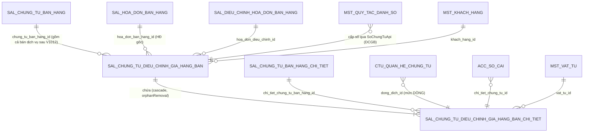

# F9 — Thiết kế DB & migration

> **Cập nhật 2026-08-21.** Bản 2026-08-14 đã lỗi thời ở 4 điểm: baseline đổi tên file, 6 cột header đã được thêm, cột trạng thái đổi cơ chế, và luật đánh số migration đổi sang timestamp. Xem §-1.
> Mục này để **DBA/Dev review TRƯỚC khi code**. §10 (SQL) chỉ là bản dịch của §9.

## -1. Đã đổi gì so với bản trước

| Bản 2026-08-14 nói | Thực tế 2026-08-21 |
|---|---|
| File baseline `V1__baseline.sql` | **`V1__create_database.sql`** (squash V1 + V3…V7), kèm `V2__seed_data.sql` |
| `db/migration/` chỉ có V1, V2 ⇒ file mới là `V3` | **36 file**, cao nhất `V1032`; **`V3` đã bị dùng** (`V3__gop_thay_doi_sau_baseline.sql`). Đánh số nay theo **timestamp** |
| Bảng chính 63 cột | **69 cột** — 6 cột của §9.2 cũ đã được thêm |
| DROP cột `trang_thai_chung_tu` (D7) | **HUỶ** — cột đó nay LÀ cột trạng thái chuẩn của base (`CHUA_GHI_SO`/`DA_GHI_SO`), cột `status` đã biến mất |
| Giữ cặp cột `*_tang`/`*_giam` (D6) | **HUỶ** — LDM mới khai cột phẳng (D6′) |
| Thêm 2 index sắp xếp/lọc | **ĐÃ CÓ** — `idx_sal_dcg_danh_sach`, `idx_sal_dcg_khach_hang` |
| Seed `mst_loai_chung_tu` mã `CTDG` | **HUỶ** — `DCGB` đã có sẵn |
| — | **MỚI**: LDM riêng của epic (`ldm-DieuChinhGiaHangBan.puml`) là nguồn sự thật về hình dạng dữ liệu |

## 9.1 Hiện trạng bảng (nguồn sự thật)

### Bảng chính `sal_chung_tu_dieu_chinh_gia_hang_ban` — [V1:16315](../../cell-app/src/main/resources/db/migration/V1__create_database.sql), **69 cột**

Comment bảng ([V1:16399](../../cell-app/src/main/resources/db/migration/V1__create_database.sql)): *"PMKT-E-07664 DieuChinhGiaHangBan — điều chỉnh giá hàng bán. CÓ hạch toán, KHÔNG di chuyển tồn kho."*

| Nhóm cột | Cột đã có | Do đâu quản |
|---|---|---|
| Base chứng từ | `so_chung_tu`, `so_thu_tu_danh_so`, `ngay_chung_tu`, `ngay_hach_toan`, **`trang_thai_chung_tu`**, `chi_nhanh_id`, `loai_chung_tu_id`, `giao_dich_chung_tu_id`, `nguoi_ghi_so`, `thoi_gian_ghi_so` | `BaseChungTuEntity` — **không khai lại**. ⚠ `status`, `nguoi_duyet_id`, `ngay_duyet` **không còn** |
| Base audit/tenant | `id`, `tenant_id`, `phien_ban`, `ngay_tao`, `nguoi_tao`, `ngay_cap_nhat`, `nguoi_cap_nhat`, `da_xoa`, `ngay_xoa`, `nguoi_xoa` | `BaseEntity` / `TenantedEntity` / `SoftDeletableEntity` |
| Phạm vi dữ liệu | `don_vi_id` (NOT NULL, bất biến — comment [V1:16441](../../cell-app/src/main/resources/db/migration/V1__create_database.sql)) | trigger `fn_pv_dat_don_vi_mac_dinh` + policy |
| Nghiệp vụ | `loai_dieu_chinh`, `trang_thai_hoa_don`, `hinh_thuc_thanh_toan`, **`thanh_toan_ngay`**, **`lap_kem_hoa_don_dieu_chinh`**, `khach_hang_id`, `ten_khach_hang`, `dia_chi`, `ma_so_thue`, `nhan_vien_ban_hang_id`, `mo_ta` | module |
| Xuất xứ | **`nguon_chung_tu`**, **`ly_do_dieu_chinh_nguon`**, `chung_tu_ban_hang_id`, `chung_tu_ban_dich_vu_id`, `hoa_don_ban_hang_id`, `hoa_don_dieu_chinh_id` | module |
| Hóa đơn | `mau_so_hoa_don_id`, `ky_hieu_hoa_don`, `so_hoa_don_dieu_chinh`, `ngay_hoa_don_dieu_chinh`, `nguoi_mua_hang`, `ma_so_dvqhns`, `cccd`, `ho_chieu` | module |
| Thanh toán | `phieu_thu_id`, `phieu_chi_id`, `giay_bao_co_id`, `giay_bao_no_id`, `sec_tien_mat_id`, `sec_chuyen_khoan_id`, `tai_khoan_ngan_hang_thu_id`, `tai_khoan_ngan_hang_chi_id`, `tai_khoan_tien_id`, `muc_dich_thu_chi_id`, `so_chung_tu_phieu_thu_chi` | module (6 cột `*_id` phiếu giữ `NULL` — D3) |
| Tiền tệ | `loai_tien_id`, `ty_gia` | module |
| Tổng | 6 cột `tong_*_chenh_lech` + **4 cột `tong_*_quy_doi`** | server tính |

**CHECK hiện có:** `trang_thai_chung_tu ∈ {CHUA_GHI_SO, DA_GHI_SO}` · `loai_dieu_chinh ∈ {TangGia, GiamGia}` ([V1:16388](../../cell-app/src/main/resources/db/migration/V1__create_database.sql)) · `hinh_thuc_thanh_toan ∈ 8 giá trị` ([V1:16387](../../cell-app/src/main/resources/db/migration/V1__create_database.sql)) · `trang_thai_hoa_don ∈ 3 giá trị` · `ck_sal_dcg_nguon_chung_tu` · `ck_sal_dcg_ly_do_dieu_chinh_nguon`.

### Bảng chi tiết `…_chi_tiet` — [V1:16511](../../cell-app/src/main/resources/db/migration/V1__create_database.sql), **39 cột — CHƯA ĐỘNG GÌ**

| Nhóm | Cột đã có |
|---|---|
| Base | `id`, `tenant_id`, `phien_ban`, audit 6 cột, `da_xoa`/`ngay_xoa`/`nguoi_xoa`, `thu_tu` |
| Cha & nguồn | `dieu_chinh_gia_hang_ban_id` (NOT NULL), `chi_tiet_chung_tu_ban_hang_id`, `chi_tiet_chung_tu_ban_dich_vu_id`, `chi_tiet_hd_ban_hang_id`, `ngay_chung_tu_goc`, `so_chung_tu_goc`, `so_hoa_don_goc` |
| Hàng hoá | `vat_tu_id` (NOT NULL), `ten_vat_tu`, `don_vi_tinh_id` |
| Khối **tăng** | `so_luong_tang`, `don_gia_tang`, `thanh_tien_tang`, `chiet_khau_phan_tram_tang`, `chiet_khau_tien_tang` |
| Khối **giảm** | `so_luong_giam`, `don_gia_giam`, `thanh_tien_giam`, `chiet_khau_phan_tram_giam`, `chiet_khau_tien_giam` |
| Thuế | `thue_suat_gtgt_id` (uuid — deprecate, D8), `tai_khoan_thue_gtgt_id`, `tien_thue_gtgt_chenh_lech` |
| Tài khoản | `tai_khoan_cong_no_id`, `tai_khoan_doanh_thu_id`, `tai_khoan_giam_gia_id`, `tai_khoan_chiet_khau_id` |

**Kết luận:** header còn thiếu **14 cột**; chi tiết còn thiếu **11 cột** + phải **chuyển 10 cột tăng/giảm sang 5 cột phẳng** (D6′).

## 9.2 Cột thêm mới / sửa

### 9.2.1 Bảng chi tiết — chuyển sang cột phẳng (D6′)

| # | Cột DB mới | Kiểu | NULL | Default | Ai ghi | Field DTO | Backfill từ |
|---|---|---|---|---|---|---|---|
| 1 | `so_luong` | `public.quantity` | Y | — | client | `soLuong` | `COALESCE(so_luong_tang, so_luong_giam)` |
| 2 | `don_gia` | `public.money_vnd` | Y | — | client | `donGia` | `COALESCE(don_gia_tang, don_gia_giam)` |
| 3 | `thanh_tien` | `public.money_vnd` | Y | — | server tính | `thanhTien` | `COALESCE(thanh_tien_tang, thanh_tien_giam)` |
| 4 | `chiet_khau_phan_tram` | `public.percent_rate` | Y | — | client | `chietKhauPhanTram` | `COALESCE(chiet_khau_phan_tram_tang, …_giam)` |
| 5 | `chiet_khau` | `public.money_vnd` | Y | — | server tính | `chietKhauTien` | `COALESCE(chiet_khau_tien_tang, chiet_khau_tien_giam)` |

10 cột `*_tang`/`*_giam` **deprecate** — giữ nguyên, không xoá trong cùng migration (§9.6).
Nguồn: `ldm-DieuChinhGiaHangBan.puml` dòng 96-98 (`SoLuong` · `DonGia` · `ThanhTien`) và 103-104 (`ChietKhauPhanTram` · `ChietKhau`).

### 9.2.2 Bảng chi tiết — 11 cột nghiệp vụ còn thiếu

| # | Cột DB | Kiểu | NULL | Default | Ai ghi | Field DTO | Vì sao cần |
|---|---|---|---|---|---|---|---|
| 1 | `thue_suat_gtgt_mac_dinh` | `text` | Y | — | client | `thueSuatGtgt` | D8; CHECK giống `sal_chung_tu_ban_hang_chi_tiet` |
| 2 | `gia_tri_thue_gtgt` | `numeric(18,2)` | Y | — | client | `giaTriThueGtgt` | LDM `ThueSuatKhac`; chỉ có nghĩa khi `= 'KHAC'` |
| 3 | `khong_tong_hop_to_khai_gtgt` | `boolean` | N | `false` | client (server ép `true` với `KHAC`/`KKKNT`) | `khongTongHopToKhaiGtgt` | SCR dòng 463 + LDM |
| 4 | `thanh_tien_quy_doi` | `money_vnd` | Y | — | server tính | `thanhTienQuyDoi` | SCR dòng 455, BR18 |
| 5 | `chiet_khau_quy_doi` | `money_vnd` | Y | — | server tính | `chietKhauTienQuyDoi` | SCR dòng 458 |
| 6 | `tien_thue_gtgt_quy_doi` | `money_vnd` | Y | — | server tính | `tienThueGtgtQuyDoi` | SCR dòng 462 |
| 7 | `don_vi_id` | `uuid` | Y | — | client | `donViId` | LDM + panel Xem nhanh |
| 8 | `vu_viec_id` | `uuid` | Y | — | client | `vuViecId` | LDM |
| 9 | `khoan_muc_chi_phi_id` | `uuid` | Y | — | client | `khoanMucChiPhiId` | LDM |
| 10 | `doi_tuong_tap_hop_chi_phi_id` | `uuid` | Y | — | client | `doiTuongThcpId` | LDM (tên theo LDM, không phải `doi_tuong_thcp_id`) |
| 11 | `chung_tu_ban_hang_id` | `uuid` | Y | — | server (từ nguồn) | `chungTuNguonId` | LDM dòng 79: **id HEADER** chứng từ bán hàng gốc. 3 FK hiện có chỉ trỏ **dòng** |

**Chờ Q7** (nếu BA duyệt): thêm `don_vi_tinh_chinh_id uuid` + `he_so_quy_doi numeric(18,6)` — LDM dòng 88-89.
**Chờ Q12** (không cài lần này): `LoaiDongHang`, `LoaiVatTuId`, `SoLo`, `HanSuDung`, `NhomHHDVMuaVao`, `DienGiaiThue`.

### 9.2.3 Bảng chính — 14 cột còn thiếu

| # | Cột DB | Kiểu | NULL | Default | Ai ghi | Field DTO | Nguồn |
|---|---|---|---|---|---|---|---|
| 1 | `loai_dieu_chinh_hoa_don` | `text` | Y | — | client | `hoaDon.loaiDieuChinh` | SCR dòng 422 + LDM; CHECK 3 giá trị |
| 2 | `ly_do_dieu_chinh` | `text` | Y | — | client | `hoaDon.lyDoDieuChinh` | SCR dòng 423 + LDM |
| 3 | `dien_thoai` | `text` | Y | — | client | `hoaDon.soDienThoai` | SCR dòng 424 + LDM |
| 4 | `hinh_thuc_thanh_toan_hoa_don` | `text` | Y | — | client | `hoaDon.hinhThucThanhToan` | SCR dòng 420 — cho nhập tay ⇒ **không** CHECK |
| 5 | `nguoi_giao_dich` | `text` | Y | — | client | `chungTuThanhToan.nguoiGiaoDich` | LDM (tên theo LDM) |
| 6 | `ly_do_thu_chi` | `text` | Y | — | client | `chungTuThanhToan.lyDo` | SCR dòng 312/393/366 |
| 7 | `ten_ngan_hang_thu_chi` | `text` | Y | — | client | `chungTuThanhToan.tenNganHang` | SCR dòng 330/348/369 |
| 8 | `so_giay_to` | `text` | Y | — | client | `.soGiayTo` | LDM + SCR dòng 373 |
| 9 | `ngay_cap` | `date` | Y | — | client | `.ngayCap` | LDM + SCR dòng 374 |
| 10 | `noi_cap` | `text` | Y | — | client | `.noiCap` | LDM + SCR dòng 375 |
| 11 | `kem_theo` | `text` | Y | — | client | `.kemTheo` | SCR dòng 376 |
| 12 | `chung_tu_goc` | `text` | Y | — | client | `.chungTuGoc` | SCR dòng 377 |
| 13 | `loai_chiet_khau` | `text` | N | `'KhongChietKhau'` | client | `loaiChietKhau` | **LDM dòng 39** — D15; CHECK 4 giá trị |
| 14 | `ty_le_chiet_khau` | `public.percent_rate` | Y | — | client | `tyLeChietKhau` | **LDM dòng 40** — D15, 0-100 |

> ⚠ **Không** thêm cột `tai_khoan_ngan_hang_id` gộp như LDM đề xuất — DB đã có **hai** cột `tai_khoan_ngan_hang_thu_id`/`_chi_id`, mapper chọn theo hướng điều chỉnh. Gộp lại là một migration đổi dữ liệu không đem lại gì.
> ⚠ **Không** thêm `chung_tu_thanh_toan_id` gộp như LDM — DB đã có 6 cột `phieu_thu_id`/`phieu_chi_id`/… và chúng để `NULL` lần này (D3). Khi nào thật sự sinh phiếu thì bàn lại.

## 9.3 Bảng mới
**Không áp dụng** — cả hai bảng đã tồn tại.

## 9.4 Ràng buộc · index · khóa ngoại

### Đã có (không đụng)

| Loại | Định nghĩa | Vị trí |
|---|---|---|
| PK | `(id)` cả hai bảng | [V1:19645](../../cell-app/src/main/resources/db/migration/V1__create_database.sql), :19637 |
| unique | `uq_sal_dcg_so_ct (tenant_id, so_chung_tu) WHERE da_xoa = false AND so_chung_tu <> ''` | [V1:23651](../../cell-app/src/main/resources/db/migration/V1__create_database.sql) — khớp đúng điều kiện soft-delete (BR19.1) |
| index | **`idx_sal_dcg_danh_sach (tenant_id, ngay_hach_toan DESC, so_chung_tu DESC) WHERE da_xoa = false`** | [V1:21747](../../cell-app/src/main/resources/db/migration/V1__create_database.sql) — **đề xuất cũ đã được cài** |
| index | **`idx_sal_dcg_khach_hang (tenant_id, khach_hang_id) WHERE da_xoa = false`** | [V1:21761](../../cell-app/src/main/resources/db/migration/V1__create_database.sql) — đã cài |
| index | `idx_sal_dcg_hoa_don`, `idx_sal_ct_dcg_parent` | :21754, :21698 |
| index | `ix_pv_…_don_vi` + `ix_sal_…_pv_don_vi_id` — **trùng nhau** | :22398, :22426 — nợ có sẵn, §9.6 |
| FK | 4 FK nguồn ở header + `dieu_chinh_gia_hang_ban_id → cha ON DELETE CASCADE` ([V1:27990](../../cell-app/src/main/resources/db/migration/V1__create_database.sql)) + 3 FK dòng nguồn + `(tenant_id, don_vi_id) → mst_don_vi` | :27413, :28045, … |
| RLS | `tenant_isolation` cả hai bảng ([V1:31692](../../cell-app/src/main/resources/db/migration/V1__create_database.sql)) + `pv_select`/`pv_insert`/`pv_update` theo phạm vi đơn vị ([V1:30039](../../cell-app/src/main/resources/db/migration/V1__create_database.sql)) | |
| Trigger | `trg_audit_*` (2) · `trg_pv_dv_*` (đặt đơn vị mặc định) · `trg_pv_*` (chặn đổi `don_vi_id`) | :25478, :25436, :26080, :26255 |
| GRANT | header `SELECT,INSERT,UPDATE` (**không DELETE** — chính sách xoá mềm); chi tiết có thêm `DELETE` (orphanRemoval) | [V1:33967](../../cell-app/src/main/resources/db/migration/V1__create_database.sql), :33974 |

### Thêm mới

| # | Loại | Định nghĩa | Vì sao |
|---|---|---|---|
| 1 | CHECK | `loai_dieu_chinh_hoa_don ∈ {'DieuChinhGia','SaiSot','Khac'}` | SCR dòng 422 |
| 2 | CHECK | `loai_chiet_khau ∈ {'KhongChietKhau','TheoMatHang','TheoPhanTramHoaDon','TheoSoTienTongHoaDon'}` | LDM dòng 39 |
| 3 | CHECK | `thue_suat_gtgt_mac_dinh ∈ {'0','5','8','10','KCT','KKKNT','KHAC'}` (chi tiết) | đồng bộ với CTBH; test đọc `pg_constraint` |
| 4 | CHECK | `gia_tri_thue_gtgt IS NULL` khi `thue_suat_gtgt_mac_dinh <> 'KHAC'` | mẫu `mst_vat_tu_gia_tri_thue_suat_gtgt_check` |
| 5 | index | `(tenant_id, chung_tu_ban_hang_id)` trên **bảng chi tiết** | F8 phải hỏi "dòng bán hàng này đã bị điều chỉnh bao nhiêu" — không có index thì mỗi lần mở popup là quét toàn bảng |

> **Không** đặt FK cho `chi_tiet.chung_tu_ban_hang_id`: sau khi gộp bán dịch vụ (V1012) thì đích luôn là `sal_chung_tu_ban_hang`, nhưng nguồn còn có thể là hóa đơn điều chỉnh ⇒ cột dùng đa hình. Ràng buộc thật ở `ctu_quan_he_chung_tu` (D4).
> **Không** thêm NOT NULL cho cột mới (trừ 2 cột có default) — bảng có thể đã có dữ liệu demo ở tenant dev.

## 9.5 Enum ⇄ giá trị lưu trong DB

Quy ước module (đã cài, ghi ở `package-info.java`): **wire = TÊN HẰNG Java**, **DB = `MaDb.maDb()`**.

| Enum Java | Cột | Giá trị DB | Converter | Tình trạng |
|---|---|---|---|---|
| `HuongDieuChinhGia` | `loai_dieu_chinh` | `TangGia` \| `GiamGia` | `JpaConverter` | ✅ đã có |
| `HinhThucThanhToanDcg` | `hinh_thuc_thanh_toan` | 8 giá trị | `JpaConverter` | ✅ |
| `NguonChungTu` | `nguon_chung_tu` | `CHUNG_TU_BAN_HANG` \| `HOA_DON_DIEU_CHINH` | `JpaConverter` | ✅ |
| `LyDoDieuChinhNguon` | `ly_do_dieu_chinh_nguon` | `DieuChinhTang` \| `DieuChinhGiam` | `JpaConverter` | ✅ |
| `TrangThaiHoaDonDcg` | `trang_thai_hoa_don` | 3 giá trị | `JpaConverter` | ✅ |
| `TrangThaiChungTu` (base) | `trang_thai_chung_tu` | `CHUA_GHI_SO` \| `DA_GHI_SO` | base quản | ✅ |
| **`ThueSuatGtgt`** | `thue_suat_gtgt_mac_dinh` | `0`\|`5`\|`8`\|`10`\|`KCT`\|`KKKNT`\|`KHAC` | `AttributeConverter` (tên hằng Java không thể là `"0"`) | ➕ phải viết |
| **`LoaiDieuChinhHoaDon`** | `loai_dieu_chinh_hoa_don` | `DieuChinhGia`\|`SaiSot`\|`Khac` | `JpaConverter` | ➕ |
| **`LoaiChietKhau`** | `loai_chiet_khau` | 4 giá trị | `JpaConverter` | ➕ |

⚠ `trang_thai_hoa_don` là **NOT NULL không default** — entity phải khởi tạo `KhongCoHoaDon`.

⚠ **L4 (§2.4 file gốc):** `dieu_kien` của quy tắc đánh số dùng `"CHI_TIEN_MAT"` còn CHECK dùng `'ChiTienMat'` — engine so bằng dạng nào phải chốt trước khi code F3 (§12-Q14).

## 9.6 Dữ liệu hiện có · backfill · tương thích ngược

| # | Vấn đề | Query kiểm TRƯỚC | Cách xử lý |
|---|---|---|---|
| 1 | Bảng chi tiết đã có dòng nào chưa (quyết định chi phí backfill D6′) | `SELECT count(*) FROM sal_chung_tu_dieu_chinh_gia_hang_ban_chi_tiet;` | `= 0` ⇒ backfill là no-op, migration chạy tức thì. `> 0` ⇒ vẫn chạy `UPDATE … COALESCE(...)`, kiểm lại bằng query đối chiếu ở §11 mục 2 |
| 2 | Dòng có **cả hai** khối tăng và giảm (dữ liệu bẩn) | `SELECT count(*) FROM …_chi_tiet WHERE so_luong_tang IS NOT NULL AND so_luong_giam IS NOT NULL;` | `> 0` ⇒ **DỪNG**, báo BA. `COALESCE` sẽ lặng lẽ chọn khối tăng và đánh mất khối giảm |
| 3 | Header đã có dữ liệu (cột mới NOT NULL có default) | `SELECT count(*) FROM sal_chung_tu_dieu_chinh_gia_hang_ban;` | `ADD COLUMN … NOT NULL DEFAULT` — Postgres 11+ không rewrite bảng với default hằng |
| 4 | Trùng số chứng từ trước khi tin unique index | `SELECT tenant_id, so_chung_tu, count(*) FROM … WHERE da_xoa = false GROUP BY 1,2 HAVING count(*) > 1;` | index đã có từ V1 nên không thể có; ra kết quả thì báo BA, **không tự xoá** |
| 5 | Hai index trùng trên `(tenant_id, don_vi_id)` | `SELECT indexname, indexdef FROM pg_indexes WHERE tablename = 'sal_chung_tu_dieu_chinh_gia_hang_ban';` | **KHÔNG xoá** — nợ có sẵn từ baseline, ngoài phạm vi phiếu. Báo mở ticket |
| 6 | `sal_chung_tu_ban_dich_vu` đã di trú sang `sal_chung_tu_ban_hang` (V1012) nhưng **bảng cũ chưa DROP** | `SELECT count(*) FROM sal_chung_tu_ban_dich_vu;` | F8 chỉ đọc `sal_chung_tu_ban_hang` (`loai_nghiep_vu` phân biệt). Cột `chung_tu_ban_dich_vu_id` và `chi_tiet_chung_tu_ban_dich_vu_id` trở thành **cột chết** — deprecate, không xoá |

**Cột deprecate sau migration này:** 10 cột `*_tang`/`*_giam` (chi tiết) · `thue_suat_gtgt_id` (chi tiết) · `chung_tu_ban_dich_vu_id` + `chi_tiet_chung_tu_ban_dich_vu_id`. **Không xoá trong cùng migration với việc thêm cột thay thế** — gỡ ở phiếu sau, khi chắc chắn không tenant nào còn dữ liệu.

## 9.7 Ánh xạ Entity ↔ bảng

| Bảng | Entity | Kế thừa | Quan hệ JPA | Tình trạng |
|---|---|---|---|---|
| `sal_chung_tu_dieu_chinh_gia_hang_ban` | `DieuChinhGiaHangBan` | `BaseChungTuEntity` | `@OneToMany(mappedBy="chungTu", cascade=ALL, orphanRemoval=true)` | ✅ có; **chưa có** quan hệ OneToMany |
| `…_chi_tiet` | `ChiTietDieuChinhGiaHangBan` | `BaseChiTietChungTuEntity` | `@ManyToOne(LAZY) @JoinColumn("dieu_chinh_gia_hang_ban_id")` | ➕ **chưa dựng** |

- Aggregate root là header; dòng chi tiết **không có repository riêng**, trừ `DongDieuChinhGiaAdapter` (cài `DongChungTuPort`) đọc bằng query native.
- Khoá lạc quan `@Version` trên `phien_ban` ở header; sửa chỉ chạm dòng con phải `touch()` cha.
- **`@Searchable`:** xoá annotation mức class `path = "status"` (L1). Base đã khai sẵn `soChungTu`/`ngayChungTu`/`ngayHachToan`/`trangThaiChungTu`/`chiNhanhId` — không khai lại.

## 9.8 ERD



---

## 10. Migration

**Đánh số bằng timestamp** (luật có hiệu lực 2026-08-20 — [docs/rules/migration-danh-so-theo-timestamp.md](../../docs/rules/migration-danh-so-theo-timestamp.md)):

```bash
date +V%Y%m%d%H%M%S
```

Tên file: `V<yyyyMMddHHmmss>__sal_dieu_chinh_gia_hang_ban_bo_sung_cot.sql`.
⚠ **KHÔNG** đặt `V1033` — arch-test `MigrationNamingArchTest` (`@Tag("unit")`) bắt lỗi ngay ở `./gradlew unitTest`.
⚠ `cell-app/CLAUDE.md` vẫn ghi luật cũ `V<N>` — file đó lỗi thời, không phải nguồn sự thật.

```sql
-- =====================================================================================
-- PMKT-E-07664 Điều chỉnh giá hàng bán — bổ sung cột theo SCR + LDM ldm-DieuChinhGiaHangBan.
-- Plan: docs/doing/PMKT-E-07664-dieu-chinh-gia-hang-ban-api/09-thiet-ke-db.md §9.2
--
-- KHÔNG có bước xoá: 10 cột *_tang/*_giam và thue_suat_gtgt_id chuyển sang deprecate,
-- gỡ ở phiếu sau khi chắc chắn không tenant nào còn dữ liệu (§9.6).
-- =====================================================================================

-- ---- A. Bảng chi tiết: cột phẳng (D6′) ----------------------------------------------
ALTER TABLE public.sal_chung_tu_dieu_chinh_gia_hang_ban_chi_tiet
    ADD COLUMN IF NOT EXISTS so_luong              public.quantity,
    ADD COLUMN IF NOT EXISTS don_gia               public.money_vnd,
    ADD COLUMN IF NOT EXISTS thanh_tien            public.money_vnd,
    ADD COLUMN IF NOT EXISTS chiet_khau_phan_tram  public.percent_rate,
    ADD COLUMN IF NOT EXISTS chiet_khau            public.money_vnd;

-- Hướng Tăng/Giảm nằm ở header (loai_dieu_chinh); một dòng chỉ dùng MỘT khối.
-- Kiểm §9.6 mục 2 TRƯỚC khi chạy: dòng có cả hai khối sẽ mất khối giảm.
UPDATE public.sal_chung_tu_dieu_chinh_gia_hang_ban_chi_tiet
   SET so_luong             = COALESCE(so_luong, so_luong_tang, so_luong_giam),
       don_gia              = COALESCE(don_gia, don_gia_tang, don_gia_giam),
       thanh_tien           = COALESCE(thanh_tien, thanh_tien_tang, thanh_tien_giam),
       chiet_khau_phan_tram = COALESCE(chiet_khau_phan_tram, chiet_khau_phan_tram_tang,
                                       chiet_khau_phan_tram_giam),
       chiet_khau           = COALESCE(chiet_khau, chiet_khau_tien_tang, chiet_khau_tien_giam);

COMMENT ON COLUMN public.sal_chung_tu_dieu_chinh_gia_hang_ban_chi_tiet.so_luong IS
    'LDM ldm-DieuChinhGiaHangBan: SoLuong. Thay cặp so_luong_tang/so_luong_giam (deprecate) — hướng điều chỉnh đọc ở header.loai_dieu_chinh.';

-- ---- B. Bảng chi tiết: 11 cột nghiệp vụ ----------------------------------------------
ALTER TABLE public.sal_chung_tu_dieu_chinh_gia_hang_ban_chi_tiet
    ADD COLUMN IF NOT EXISTS thue_suat_gtgt_mac_dinh       text,
    ADD COLUMN IF NOT EXISTS gia_tri_thue_gtgt             numeric(18,2),
    ADD COLUMN IF NOT EXISTS khong_tong_hop_to_khai_gtgt   boolean NOT NULL DEFAULT false,
    ADD COLUMN IF NOT EXISTS thanh_tien_quy_doi            public.money_vnd,
    ADD COLUMN IF NOT EXISTS chiet_khau_quy_doi            public.money_vnd,
    ADD COLUMN IF NOT EXISTS tien_thue_gtgt_quy_doi        public.money_vnd,
    ADD COLUMN IF NOT EXISTS don_vi_id                     uuid,
    ADD COLUMN IF NOT EXISTS vu_viec_id                    uuid,
    ADD COLUMN IF NOT EXISTS khoan_muc_chi_phi_id          uuid,
    ADD COLUMN IF NOT EXISTS doi_tuong_tap_hop_chi_phi_id  uuid,
    ADD COLUMN IF NOT EXISTS chung_tu_ban_hang_id          uuid;

ALTER TABLE public.sal_chung_tu_dieu_chinh_gia_hang_ban_chi_tiet
    ADD CONSTRAINT ck_sal_dcg_ct_thue_suat
        CHECK (thue_suat_gtgt_mac_dinh IS NULL
               OR thue_suat_gtgt_mac_dinh = ANY (ARRAY['0','5','8','10','KCT','KKKNT','KHAC'])),
    ADD CONSTRAINT ck_sal_dcg_ct_gia_tri_thue
        CHECK (CASE WHEN thue_suat_gtgt_mac_dinh IS DISTINCT FROM 'KHAC'
                    THEN gia_tri_thue_gtgt IS NULL ELSE true END);

COMMENT ON COLUMN public.sal_chung_tu_dieu_chinh_gia_hang_ban_chi_tiet.chung_tu_ban_hang_id IS
    'Id HEADER chứng từ nguồn (đa hình: sal_chung_tu_ban_hang gồm cả bán dịch vụ sau V1012, hoặc HĐ điều chỉnh) — KHÔNG đặt FK. Ràng buộc thật ở ctu_quan_he_chung_tu.';

CREATE INDEX IF NOT EXISTS idx_sal_dcg_ct_nguon
    ON public.sal_chung_tu_dieu_chinh_gia_hang_ban_chi_tiet (tenant_id, chung_tu_ban_hang_id);

-- ---- C. Bảng chính: 14 cột còn thiếu -------------------------------------------------
ALTER TABLE public.sal_chung_tu_dieu_chinh_gia_hang_ban
    -- tab Hóa đơn
    ADD COLUMN IF NOT EXISTS loai_dieu_chinh_hoa_don       text,
    ADD COLUMN IF NOT EXISTS ly_do_dieu_chinh              text,
    ADD COLUMN IF NOT EXISTS dien_thoai                    text,
    ADD COLUMN IF NOT EXISTS hinh_thuc_thanh_toan_hoa_don  text,
    -- tab Phiếu thu / Phiếu chi / Séc / Giấy báo
    ADD COLUMN IF NOT EXISTS nguoi_giao_dich               text,
    ADD COLUMN IF NOT EXISTS ly_do_thu_chi                 text,
    ADD COLUMN IF NOT EXISTS ten_ngan_hang_thu_chi         text,
    ADD COLUMN IF NOT EXISTS so_giay_to                    text,
    ADD COLUMN IF NOT EXISTS ngay_cap                      date,
    ADD COLUMN IF NOT EXISTS noi_cap                       text,
    ADD COLUMN IF NOT EXISTS kem_theo                      text,
    ADD COLUMN IF NOT EXISTS chung_tu_goc                  text,
    -- chiết khấu mức header (D15 — LDM dòng 39-40)
    ADD COLUMN IF NOT EXISTS loai_chiet_khau               text NOT NULL DEFAULT 'KhongChietKhau',
    ADD COLUMN IF NOT EXISTS ty_le_chiet_khau              public.percent_rate;

ALTER TABLE public.sal_chung_tu_dieu_chinh_gia_hang_ban
    ADD CONSTRAINT ck_sal_dcg_loai_dieu_chinh_hoa_don
        CHECK (loai_dieu_chinh_hoa_don IS NULL
               OR loai_dieu_chinh_hoa_don = ANY (ARRAY['DieuChinhGia','SaiSot','Khac'])),
    ADD CONSTRAINT ck_sal_dcg_loai_chiet_khau
        CHECK (loai_chiet_khau = ANY (ARRAY['KhongChietKhau','TheoMatHang',
                                            'TheoPhanTramHoaDon','TheoSoTienTongHoaDon']));

COMMENT ON COLUMN public.sal_chung_tu_dieu_chinh_gia_hang_ban.loai_dieu_chinh_hoa_don IS
    'SCR dòng 422 "Loại điều chỉnh" trên tab Hóa đơn (Điều chỉnh giá/Sai sót/Khác). KHÁC loai_dieu_chinh (= Phương thức điều chỉnh Tăng/Giảm).';

-- ---- D. Quyền còn thiếu: Clone (nút Nhân bản của SCR_XemChiTiet) ---------------------
INSERT INTO public.iam_quyen (ma_quyen, module, hanh_dong, nhom, ten_chuc_nang, mo_ta, la_he_thong)
VALUES ('DieuChinhGiaHangBan.Clone','DieuChinhGiaHangBan','Clone','Nghiệp vụ',
        'DieuChinhGiaHangBan','Nhân bản điều chỉnh giá hàng bán', true)
ON CONFLICT (ma_quyen) DO NOTHING;

-- ---- E. Quy tắc đánh số cho DCGB nhánh TĂNG GIÁ (L3) ---------------------------------
-- ⚠ CHỜ §12-Q13 (BA đặt tên) và §12-Q14 (dạng giá trị của dieu_kien: CHI_TIEN_MAT hay
--   ChiTienMat). V1032 hiện chỉ seed 4 quy tắc, đều nhánh "Giảm giá hàng bán".
--   Không seed đại — sai dạng giá trị thì chứng từ vẫn không cấp được số, chỉ khác chỗ vỡ.
```

**Ghi chú kỹ thuật:**
- Idempotent (`IF NOT EXISTS`, `ON CONFLICT`) trừ 4 `ADD CONSTRAINT`.
- **Không** `CREATE INDEX CONCURRENTLY` — Flyway chạy trong transaction.
- Bước `UPDATE` backfill nằm **cùng transaction** với `ADD COLUMN` ⇒ hỏng là rollback sạch.
- Rollback script đặt ở `db/rollback/` cùng tên + `.rollback.sql`.

**File có sẵn phải sửa kèm:**
- [DieuChinhGiaHangBan.java:49-50](../../cell-app/src/main/java/vn/vtt/pmkt/cell/dieu_chinh_gia_hang_ban/internal/entity/DieuChinhGiaHangBan.java) — xoá `@Searchable(path = "status")` (L1).
- [DongChungTuPort.java:54](../../cell-app/src/main/java/vn/vtt/pmkt/cell/quan_he_chung_tu/api/DongChungTuPort.java) — sửa javadoc `COALESCE(so_luong_tang, so_luong_giam)` thành `so_luong` (L5).

## 11. Kiểm thử dữ liệu

| # | Kiểm | Cách |
|---|---|---|
| 1 | Migration chạy được trên DB rỗng và DB có dữ liệu | `FlywayMigrationIT` (Testcontainers) |
| 2 | **Backfill D6′ đúng** | dựng 2 dòng (một khối tăng, một khối giảm) trước migration ⇒ sau migration `so_luong`/`don_gia`/`thanh_tien` khớp khối tương ứng; dòng có cả hai khối ⇒ test khẳng định query §9.6 mục 2 bắt được |
| 3 | Enum ⇄ CHECK đồng bộ | test đọc `pg_constraint` (`ck_sal_dcg_ct_thue_suat`, `ck_sal_dcg_loai_chiet_khau`, `ck_sal_dcg_loai_dieu_chinh_hoa_don`) và so với `values()` của enum |
| 4 | Unique số chứng từ tôn trọng xoá mềm | INSERT `BGG01` → xoá mềm → INSERT lại ⇒ **thành công** |
| 5 | **Đánh số** | cấp số cho 2 hướng × 2 hình thức thanh toán; nhánh Tăng giá **phải đỏ** cho tới khi seed E xong (chứng minh L3) |
| 6 | RLS + policy phạm vi đơn vị | tenant/đơn vị khác không thấy dòng |
| 7 | Cascade + orphanRemoval | xoá dòng chi tiết qua JPA ⇒ DELETE thật (GRANT có DELETE trên bảng chi tiết) |
| 8 | Trigger chặn đổi `don_vi_id` | UPDATE `don_vi_id` ⇒ bị chặn |
| 9 | Precision (BR7) | `money_vnd` 2 số lẻ · `quantity` 3 · `percent_rate` 2 · `exchange_rate` 6 |
| 10 | `MigrationNamingArchTest` xanh | tên file đúng 14 chữ số |

## 12. Tóm tắt cho người ký duyệt

- **Không tạo bảng mới.** Hai bảng đã có đủ RLS, policy phạm vi đơn vị, trigger audit, FK, unique số chứng từ, và **2 index của kế hoạch trước đã được cài**.
- **Migration làm 5 việc:** (1) chuyển bảng chi tiết sang **cột phẳng** theo LDM mới, có backfill, giữ 10 cột cũ ở dạng deprecate; (2) thêm **11 cột** chi tiết còn thiếu; (3) thêm **14 cột** header còn thiếu (tab thanh toán, tab Hóa đơn, chiết khấu header); (4) seed quyền `.Clone` còn thiếu; (5) **chưa seed** quy tắc đánh số nhánh Tăng giá vì còn chờ BA (Q13) và Dev kernel (Q14).
- **Hai quyết định của bản trước đã bị huỷ**: không DROP `trang_thai_chung_tu` (base đã đổi cơ chế), không seed mã `CTDG` (`DCGB` có sẵn).
- **Một rủi ro dữ liệu:** dòng chi tiết có **cả hai** khối tăng và giảm sẽ mất khối giảm khi backfill — có query kiểm trước, phải chạy và xác nhận trước khi merge.
- **Ba nợ ghi nhận, không dọn:** hai index trùng trên `(tenant_id, don_vi_id)`; cột `thue_suat_gtgt_id` thành cột chết; `chung_tu_ban_dich_vu_id` + `chi_tiet_chung_tu_ban_dich_vu_id` thành cột chết sau khi V1012 gộp bán dịch vụ.
- **BR đã áp dụng:** BR7 (precision) · BR19/BR20 (unique + engine đánh số) · BR28 (RLS) · BR29 (xoá mềm; `pmkt_app` không có DELETE trên bảng chính) · BR46 (đủ 9 trường hệ thống).
