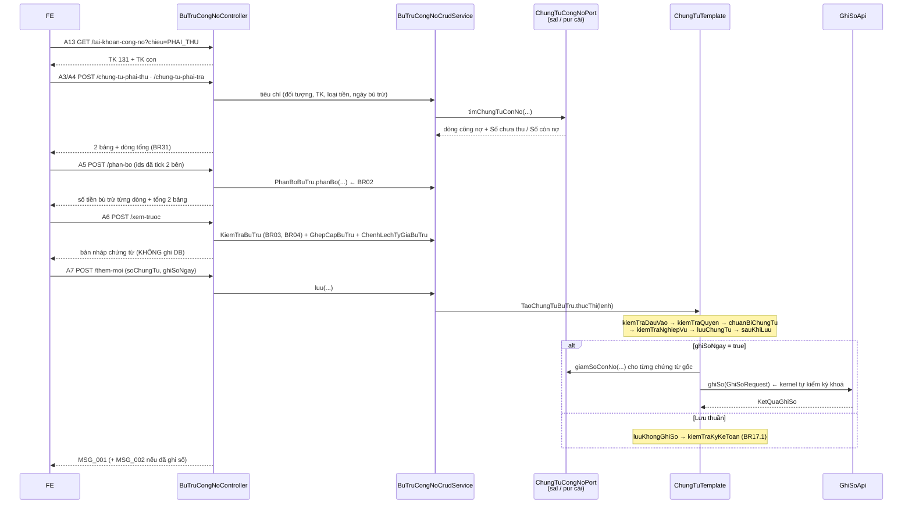
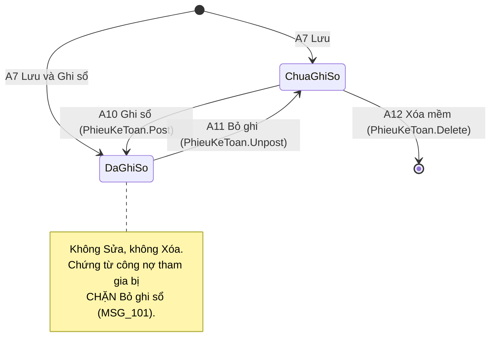

# PMKT-E-14294 — Kế hoạch tổng thể API Bù trừ công nợ

> **Trạng thái:** BẢN NHÁP CHỜ REVIEW — chưa code một dòng nào.
> **Ngày khảo sát code:** 2026-08-11 (vòng 1) · **rà soát bổ sung cùng ngày (vòng 2)** — xem §2.4
> **Người review cần có:** 1 BA (chốt §12 — Q1…Q16) + 1 Dev BE/DBA (chốt [09-thiet-ke-db.md](09-thiet-ke-db.md), §7 migration, §9 rủi ro)

| Mục | Nội dung |
|---|---|
| Epic | `PMKT-E-14294_BuTruCongNo` — 5 use case, 5 màn hình |
| Use case | PMKT-U-14688 (danh sách) · U-14690 (thêm mới) · U-14691 (xem chi tiết) · U-14692 (xóa) · U-14693 (ghi sổ / bỏ ghi) |
| Màn hình | `SCR_BTCN_DanhSach` · `SCR_BTCN_BuTru` · `SCR_BTCN_ChungTu_ThemMoi` · `SCR_BTCN_ChungTu_XemChiTiet` · `SCR_BTCN_PopupXacNhanXoa` |
| Tài liệu nguồn | `pmkt-docs/ba/PMKT-E-14294_BuTruCongNo/` + `pmkt-docs/ba/Common/business_rules.md` + `pmkt-docs/ba/Common/TaiLieuMappingSoCai.md` + `pmkt-docs/ba/Common/ldm/ldm-KTTH.puml` |
| Module BE | `cell-app/src/main/java/vn/vtt/pmkt/cell/ke_toan_tong_hop/` — **module cấp 1 MỚI**, tiền tố bảng `ktth_` (xem D1) |
| Bảng DB | `ktth_phieu_ke_toan_tong_hop`, `ktth_chi_tiet_phieu_ktth_hach_toan`, `ktth_chung_tu_lien_quan` — **đã có sẵn từ V202, đang rỗng, phải vá schema**; `ktth_bu_tru_cong_no`, `ktth_chi_tiet_bu_tru_cong_no_chung_tu` — **tạo mới** |
| Mã chức năng | `BuTruCongNo` (`common/constant/MaChucNang.java:366`) · `PhieuKeToan` (`MaChucNang.java:354`) — **quyền đã seed đủ**, xem §10 |
| Base path | `/api/ke-toan-tong-hop/bu-tru-cong-no` và `/api/ke-toan-tong-hop/phieu-ke-toan` |

---

## 0. Các quyết định đã chốt (đề xuất — chờ review)

| # | Quyết định | Hệ quả cụ thể lên code · vì sao KHÔNG chọn phương án kia |
|---|---|---|
| **D1** | Mở **module cấp 1 mới** `cell/ke_toan_tong_hop/` (tiền tố `ktth_`), chia 2 sub-module: `phieu/` và `bu_tru_cong_no/` | Bốn bảng `ktth_*` đã tồn tại từ `V202__ktth_phieu_ke_toan_tong_hop.sql:35,97,159,237` và **thuộc epic PMKT-E-09980** (Phiếu KTTH). Nếu mở module cấp 1 `bu_tru_cong_no/` riêng thì module đó sở hữu bảng master của phiếu KTTH → khi E-09980 ra đời sẽ có **hai module cấp 1 cùng ghi một bảng**, đúng kiểu nợ ranh giới mà `docs/be-khung-kien-truc-chuan.md:232-241` cấm với module mới. **Không chọn** nhét vào `accounting_core/`: nơi đó là kernel dùng chung (`hach_toan`, `chung_tu`), không chứa màn hình nghiệp vụ. **Không chọn** `chung_tu_ban_hang/`: bù trừ mở từ CẢ menu Bán hàng lẫn Mua hàng (`SCR_BTCN_BuTru.md:7-8`) |
| **D2** | Đợt này cài **phần tối thiểu** của sub-module `phieu/`: entity + repository + `POST /search`, `GET /cot`, `GET /{id}`. **Không** cài Thêm mới/Sửa phiếu KTTH loại 1–4 | UC-14688 nói rõ danh sách bù trừ **dùng chung** danh sách Phiếu KTTH, "không xây màn hình danh sách độc lập" (`SCR_BTCN_DanhSach.md:5`), nên buộc phải chạm phần đó. Nhưng nút Thêm mới của danh sách "**KHÔNG tạo được** Chứng từ bù trừ công nợ" (`SCR_BTCN_DanhSach.md:24`) ⇒ luồng tạo phiếu KTTH thường thuộc E-09980, không kéo vào đây. Xem §1.2 và **Q1** |
| **D3** | Chứng từ bù trừ đi qua `ChungTuTemplate` với **4 luồng: TAO · GHI_SO · BO_GHI_SO · XOA**. KHÔNG có luồng SUA | `accounting_core/chung_tu/service/ChungTuTemplate.java:115-136` cưỡng chế trình tự "gỡ bút toán cũ → lưu → sinh bút toán mới → kiểm kỳ khoá". BA: "Không có nút **Sửa** ở mọi trạng thái" (`SCR_BTCN_ChungTu_XemChiTiet.md:56`) ⇒ lớp `SuaChungTuBuTru` không tồn tại. **Không chọn** `BaseCrudService`: `cell-app/CLAUDE.md:63-65` cấm dùng nó cho thêm/sửa/xoá chứng từ kế toán |
| **D4** | Hai bảng chứng từ công nợ = **hai endpoint riêng**, mỗi bảng phân trang + tìm kiếm + dòng tổng độc lập | `SCR_BTCN_BuTru.md:40,45,71,76` — mỗi bảng có ô tìm kiếm riêng, dòng Tổng riêng, phân trang riêng theo BR1/BR31. Một endpoint trả cả hai bảng thì không phân trang độc lập được. **Không chọn** gộp: FE sẽ phải tự cắt trang phía client, vỡ BR1 |
| **D5** | Nguồn dữ liệu 2 bảng lấy qua **SPI đảo chiều** `ChungTuCongNoPort` — mỗi module chứng từ tự cài một bean, `bu_tru_cong_no` không import `internal` của ai | Cùng khuôn `quan_he_chung_tu/api/DongChungTuPort.java` đang dùng cho quan hệ chứng từ. Số dư công nợ nằm trên bảng chứng từ của module khác (`sal_chung_tu_ban_hang`, `pur_chung_tu_mua_hang`) — chỉ chủ sở hữu bảng mới được ghi. **Không chọn** đọc thẳng `acc_so_cai`: sổ cái không có `Số hóa đơn`, `Hạn thanh toán`, `Số chưa thu`; và nó chỉ có dòng của chứng từ ĐÃ ghi sổ. **Hệ quả phải nói thẳng:** hôm nay chỉ có 2 entity chứng từ công nợ ở tầng Java ⇒ đợt 1 chỉ phủ 2/4 loại BA yêu cầu — xem §1.2, R2 và **Q2** |
| **D6** | Thuật toán phân bổ BR02 chạy **ở server** (`POST /phan-bo`), không ở FE | BR02 duyệt chứng từ phải trả "theo thứ tự sắp xếp **trên toàn bộ danh sách đã nạp** (từ trên xuống, không giới hạn trong trang hiện tại)" (`SCR_BTCN_BuTru.md:123`), trong khi FE chỉ giữ trang hiện tại (20 dòng — BR1). **Không chọn** bắt FE tải toàn bộ danh sách: vỡ BR1 và đối tượng lớn có thể có hàng nghìn chứng từ chưa thu |
| **D7** | Nút **Bù trừ** gọi `POST /xem-truoc` — **không ghi gì xuống DB**, chỉ trả bản nháp chứng từ để FE dựng màn `SCR_BTCN_ChungTu_ThemMoi` | LP4 của UC-14690: bấm **Hủy** ở màn chứng từ phải "quay về `SCR_BTCN_BuTru` giữ nguyên dữ liệu đã thiết lập; **không lưu chứng từ**" (`UC_BTCN_ThemMoi.md:99-101`). Tạo bản ghi ngay lúc bấm Bù trừ sẽ để lại chứng từ rác mỗi lần người dùng đổi ý — đúng lý lẽ đã ghi cho nút Nhân bản ở `BaseChungTuController.java:112-118` |
| **D8** | Số chứng từ do **người dùng tự nhập**, KHÔNG gọi `ChungTuTemplate.sinhSoChungTu` | `SCR_BTCN_ChungTu_ThemMoi.md:26` — giá trị mặc định "**Để trống**", "Người dùng tự nhập". `ChungTuTemplate.java:322-324` chỉ dùng khi "người dùng không tự nhập số". Chống trùng dựa vào unique index `uq_ktth_phieu_tenant_so_ct` (`V202:70-74`) **cộng** một lượt kiểm ở service để trả `MSG_PMKT-E-14294_015` đọc được thay vì constraint-violation |
| **D9** | Bảng cặp ghép lưu **snapshot** số liệu tại thời điểm bù trừ (`SoChuaThu`, `SoConNo`, `TyGiaPhaiThu`, `TyGiaPhaiTra`, số bù trừ, chênh lệch tỷ giá) | Đúng theo LDM `ldm-KTTH.puml:164-188` ("Lưu số liệu snapshot tại thời điểm bù trừ để hiển thị và hoàn trả khi Bỏ ghi/Xóa"). **Không chọn** tính lại khi xem chi tiết: số dư chứng từ gốc thay đổi liên tục, tính lại sẽ ra số khác số đã hạch toán |
| **D10** | Ghi sổ đi qua `GhiSoApi` với **1 hoặc 2 định khoản**; `DinhKhoan.soTien` mang **số đã quy đổi**, phần nguyên tệ gắn bằng `voiNgoaiTe(...)` | `DinhKhoan.java:71-78` nói rõ "`soTien` VẪN là số đã quy đổi VND". `accounting_core/hach_toan/api/GhiSoApi.java:8-14` là "đường DUY NHẤT được chạm vào `acc_so_cai`" — `cell-app/CLAUDE.md:61` |
| **D11** | Chặn Bỏ ghi sổ chứng từ công nợ đang tham gia bù trừ (`MSG_PMKT-E-14294_101`) làm bằng **`bu_tru_cong_no/api/BuTruCongNoApi`** (`@NamedInterface`), 2 module chứng từ gọi vào trong `kiemTraNghiepVu` | Mẫu tương đương: `quan_he_chung_tu/api/QuanHeChungTuApi.java:69` `coLienKet(...)` làm guard xoá cho các module chứng từ. **Không chọn** thêm SPI vào kernel `accounting_core`: đổi chữ ký kernel chạm mọi module chứng từ hiện có, blast radius lớn hơn hẳn cho một luật của đúng một nghiệp vụ. Chi tiết [08-chan-bo-ghi-chung-tu-goc.md](08-chan-bo-ghi-chung-tu-goc.md) |
| **D12** | Loại phiếu `Bù trừ công nợ` KHÔNG hiện trong danh sách loại người dùng chọn được ở màn Thêm mới phiếu KTTH | `V202:41` đã ghi chú đúng điều này: "'Bù trừ công nợ' (enum ldm-KTTH.puml, hệ thống tự tạo từ PMKT-E-14294 — KHÔNG hiển thị chọn)". Hệ quả: enum `LoaiPhieuKTTH` phải có cờ `nguoiDungChonDuoc()` |

> ⚠️ **Cảnh báo môi trường:**
> 1. Số migration lớn nhất lúc khảo sát là **V357** (`V357__chung_tu_tra_ten_cot_stt_ve_thu_tu.sql`). Con số này trôi nhanh — chạy `ls cell-app/src/main/resources/db/migration | sort -V | tail -1` ngay trước khi đặt tên file mới, đừng tin số ghi ở đây.
> 2. `accounting_core/hach_toan/**` là kernel dùng chung. Nếu chốt sửa `DinhKhoan` để tách đối tượng Nợ/Có (xem **R1**, **Q9**) thì phải đọc lại chữ ký ngay trước khi code và chạy hồi quy cả `chung_tu_ban_hang` lẫn `chung_tu_mua_hang`.
> 3. Bảng `ktth_*` bị **hai đợt migration chồng lên nhau** (V202 rồi V348/V351/V357) và còn cột trùng chức năng (`trang_thai` vs `status`). Đọc [09-thiet-ke-db.md §1](09-thiet-ke-db.md) trước khi viết entity.

---

## 1. Phạm vi

### 1.1 Trong phạm vi — bộ tài liệu con

| Mã | Chức năng | UC / SCR nguồn | Tài liệu |
|---|---|---|---|
| **F01** | Danh sách chứng từ bù trừ (tìm kiếm, lọc, sắp xếp, phân trang, metadata nút thao tác) | U-14688 · `SCR_BTCN_DanhSach` | [01-danh-sach-chung-tu-bu-tru.md](01-danh-sach-chung-tu-bu-tru.md) |
| **F02** | Thiết lập điều kiện + Lấy dữ liệu 2 bảng chứng từ phải thu / phải trả | U-14690 AC2 · `SCR_BTCN_BuTru` BR01 | [02-lay-du-lieu-cong-no.md](02-lay-du-lieu-cong-no.md) |
| **F03** | Phân bổ tự động (BR02) + phân bổ thủ công + validate Bù trừ (BR03/BR04) + dựng bản nháp chứng từ (gồm dòng chênh lệch tỷ giá) | U-14690 AC3, AC4, LP1–LP3 · `SCR_BTCN_BuTru` BR02–BR04, `SCR_BTCN_ChungTu_ThemMoi` BR02 | [03-phan-bo-va-thuc-hien-bu-tru.md](03-phan-bo-va-thuc-hien-bu-tru.md) |
| **F04** | Lưu / Lưu và Ghi sổ chứng từ bù trừ | U-14690 AC5 · `SCR_BTCN_ChungTu_ThemMoi` BR01, BR03, BR04 | [04-luu-chung-tu-bu-tru.md](04-luu-chung-tu-bu-tru.md) |
| **F05** | Xem chi tiết chứng từ bù trừ | U-14691 · `SCR_BTCN_ChungTu_XemChiTiet` | [05-xem-chi-tiet-chung-tu-bu-tru.md](05-xem-chi-tiet-chung-tu-bu-tru.md) |
| **F06** | Ghi sổ / Bỏ ghi sổ chứng từ bù trừ | U-14693 · `SCR_BTCN_ChungTu_XemChiTiet` BR01 | [06-ghi-so-bo-ghi-so.md](06-ghi-so-bo-ghi-so.md) |
| **F07** | Xóa chứng từ bù trừ | U-14692 · `SCR_BTCN_PopupXacNhanXoa` BR01 | [07-xoa-chung-tu-bu-tru.md](07-xoa-chung-tu-bu-tru.md) |
| **F08** | Chặn Bỏ ghi sổ chứng từ công nợ đang tham gia bù trừ (`MSG_..._101`) + SPI `ChungTuCongNoPort` | U-14693 AC3 · `SCR_BTCN_ChungTu_ThemMoi` BR04 dòng cuối | [08-chan-bo-ghi-chung-tu-goc.md](08-chan-bo-ghi-chung-tu-goc.md) |
| **F09** | Thiết kế DB + migration — **chốt trước mọi PR chạm DB** | — | [09-thiet-ke-db.md](09-thiet-ke-db.md) |

### 1.2 NGOÀI phạm vi (không cài lần này)

| Hạng mục | Vì sao loại | Ai chịu trách nhiệm / API sẽ trả gì |
|---|---|---|
| **Thêm mới / Chỉnh sửa Phiếu kế toán tổng hợp loại 1–4** (Hạch toán thuế TNDN, Chi phí lương, Khác, Kết chuyển lãi lỗ đầu năm) | Thuộc epic **PMKT-E-09980_PhieuKTTH**. BA của epic này ghi rõ nút Thêm mới của danh sách "KHÔNG tạo được Chứng từ bù trừ công nợ" (`SCR_BTCN_DanhSach.md:24`) | E-09980. Đợt này controller `phieu-ke-toan` **không** khai `POST /them-moi` / `PUT /{id}`; kế thừa `BaseCrudController` thì phải override trả `400 CHUA_HO_TRO` **sau** khi gọi `quyen.require(...)` — xem §4.x |
| **Tab Hóa đơn của Phiếu KTTH** + ghi `acc_so_thue_dau_ra` / `acc_so_thue_dau_vao` | Chứng từ bù trừ không có tab Hóa đơn (`SCR_BTCN_ChungTu_ThemMoi.md` chỉ có 2 tab: Hạch toán, Chứng từ công nợ) | E-09980. Bảng `ktth_chi_tiet_phieu_ktth_hoa_don` (`V202:159`) không được đụng đợt này |
| **Chứng từ bán dịch vụ** (`ENT_ChungTuBanDichVu`) làm nguồn phải thu | Bảng `sal_chung_tu_ban_dich_vu` tồn tại ở DB nhưng **không có module Java nào** — `find cell/ -type d` không có `chung_tu_ban_dich_vu` | Epic PMKT-E-06195. Khi module đó ra đời, chỉ cần cài thêm một bean `ChungTuCongNoPort` — xem [08 §3](08-chan-bo-ghi-chung-tu-goc.md). **Q2** |
| **Chứng từ mua dịch vụ** (`ENT_ChungTuMuaDichVu`) làm nguồn phải trả | **Không có bảng nào** trong `db/migration` (danh sách bảng `pur_*` không có `pur_chung_tu_mua_dich_vu`) | Epic PMKT-E-00519. **Q2** |
| **Phiếu thu / Phiếu chi, Phiếu nhập kho / xuất kho** làm nguồn công nợ | `SCR_BTCN_BuTru.md:42,73` nêu "phiếu chi,…", "phiếu nhập kho,…" bằng dấu ba chấm, không liệt kê đủ; các bảng `cb_phieu_thu`/`cb_phieu_chi` có ở DB nhưng chưa có module Java | **Q3** — cần BA chốt danh sách ĐÍCH DANH loại chứng từ tham gia bù trừ |
| **Nút In · Tiện ích** trên màn xem chi tiết | BA tự ghi: "Nghiệp vụ in sẽ được mô tả ở tài liệu riêng (chưa xử lý trong phạm vi này)" (`SCR_BTCN_ChungTu_XemChiTiet.md:38`) | Epic in ấn |
| **Điều hướng trước/sau** trên màn xem chi tiết | Không có endpoint nào của base phục vụ việc này; FE có sẵn kết quả `POST /search` để tự điều hướng | Đề xuất FE tự xử lý từ tập kết quả danh sách. **Q10** nếu BA muốn server hỗ trợ |
| **Thao tác hàng loạt** (ghi sổ / bỏ ghi / xóa nhiều dòng) | Không màn hình nào của epic mô tả; `SCR_BTCN_DanhSach.md:31-35` chỉ nói nút trên **từng dòng** | Endpoint `/ghi-so-hang-loat`, `/bo-ghi-so-hang-loat`, `/xoa-hang-loat` **vẫn hiện diện** nếu kế thừa `BaseChungTuController` (`BaseChungTuController.java:159-184`) ⇒ xem §4.x và **Q11** |
| **Xuất Excel / Nhập Excel danh sách** | Không có trong `SCR_BTCN_DanhSach.md` | Endpoint `POST /export`, `POST /import` của `BaseCrudController.java:171-198` **vẫn hiện diện** ⇒ trả `400 CHUA_HO_TRO`. Quyền `PhieuKeToan.Export` **chưa seed** (§10) |
| **Ghi Sổ công nợ** (`SoTongHopCongNo` / `SoChiTietCongNo`) theo `TaiLieuMappingSoCongNo.md §6.5` | **Không có bảng sổ công nợ nào** trong `db/migration` | Epic Sổ công nợ. Đợt này chỉ ghi `acc_so_cai` theo `TaiLieuMappingSoCai.md:1858-1876`. **Q4** |

---

## 2. Hiện trạng đã khảo sát

### 2.1 Code hiện có — **greenfield về Java, brownfield về DB**

```bash
cd cell-app && grep -rln "BuTru\|buTru" src/main/java | grep -v master_data
```
```
src/main/java/vn/vtt/pmkt/cell/common/constant/MaChucNang.java
```

```bash
cd cell-app && grep -rln "bu_tru" src/main/resources/db/migration/
```
```
(rỗng)
```

```bash
cd cell-app && grep -rln "ktth\|ke_toan_tong_hop" src/main/resources/db/migration/
```
```
V202__ktth_phieu_ke_toan_tong_hop.sql   V258__ktth_loai_phieu_them_chenh_lech_ty_gia.sql
V318__pv_don_vi_mac_dinh_theo_pham_vi.sql   V321__pv_bat_chung_tu_ban_do_ro_rang.sql
V348__chung_tu_chuan_cot_cb_cst_cptt_ktth.sql   V351__…   V357__…
```

**Kết luận:** không có một dòng Java nào cho Phiếu KTTH hay Bù trừ công nợ (`find cell/ -maxdepth 1 -type d` → `accounting_core, chung_tu_ban_hang, chung_tu_mua_hang, common, core, integration_ops, master_data, platform_iam, quan_he_chung_tu, reporting`). Nhưng **4 bảng `ktth_*` đã tồn tại và đã bị 4 migration chuẩn hoá đè lên** ⇒ không được `CREATE TABLE` lại, phải `ALTER`.

### 2.2 Hiện trạng DB

**Số hiệu migration lớn nhất hiện tại: `V357` ⇒ file mới là `V358` trở đi** (311 file trong thư mục, đánh số tới 357).

| Bảng | Vai trò | Trạng thái |
|---|---|---|
| `ktth_phieu_ke_toan_tong_hop` | Master chứng từ bù trừ (`loai_phieu = 'Bù trừ công nợ'`) | Có từ `V202:35`; CHECK loại phiếu `V202:38-42` **đã gồm** `'Bù trừ công nợ'`; unique số chứng từ `V202:70-74`; V348 thêm bộ cột chứng từ chuẩn (`V348:67-105`) ⇒ **có 2 cột trạng thái chồng nhau** — xem [09 §1](09-thiet-ke-db.md) |
| `ktth_chi_tiet_phieu_ktth_hach_toan` | Dòng tab Hạch toán | Có từ `V202:97`; `thu_tu` trả tên ở `V357` |
| `ktth_chung_tu_lien_quan` | Tab Tham chiếu (BR41) | Có từ `V202:237`; có `phieu_ktth_id` (ARCH-ADD) + `chung_tu_id`/`loai_chung_tu_id` polymorphic |
| `ktth_chi_tiet_phieu_ktth_hoa_don` | Tab Hóa đơn | Có từ `V202:159` — **ngoài phạm vi**, không đụng |
| `ktth_bu_tru_cong_no` | Mở rộng 1-1 của phiếu bù trừ | **CHƯA CÓ — tạo mới** |
| `ktth_chi_tiet_bu_tru_cong_no_chung_tu` | Cặp ghép phải thu ↔ phải trả | **CHƯA CÓ — tạo mới** |
| `acc_so_cai` | Sổ cái | Có; ghi/gỡ chỉ qua `GhiSoApi` |
| `mst_loai_chung_tu` | Danh mục loại chứng từ | Có; **mã `PBT` CHƯA seed** — `db/seed/20_loai_chung_tu.sql:8-30` chỉ có 20 mã, không có `PBT` ⇒ `LoaiChungTuLookup.idTheoMa("PBT")` sẽ ném 400 (`LoaiChungTuLookup.java:38-48`). **Bắt buộc seed ở migration mới** |

**Số dư công nợ của chứng từ gốc — nguồn sự thật hôm nay:**

| Chứng từ | Cột "phải thu/phải trả" | Cột "đã thu/đã trả" | Java map chưa? |
|---|---|---|---|
| `sal_chung_tu_ban_hang` | `tong_tien_thanh_toan` / `…_quy_doi` (`ChungTuBanHang.java:184,211`) | `so_tien_da_thanh_toan` / `…_quy_doi` (`ChungTuBanHang.java:214,217`) | ✅ có, kèm `trang_thai_thanh_toan` (`:229`) |
| `sal_chi_tiet_chung_tu_ban_hang` | `tong_no_phai_thu_vnd/_nt` (`V163:29-31`) | `so_con_no_vnd/_nt` (`V163:25-27`) | ❌ **không map dòng nào** — `grep -rni "con_no" chung_tu_ban_hang/` rỗng |
| `pur_chung_tu_mua_hang` | `tong_no_phai_tra_vnd` (`ChungTuMuaHang.java:151`) | `so_con_no_vnd` (`ChungTuMuaHang.java:155-156`) | ⚠️ chỉ VND — DB có `so_con_no_nt` (`V154:18`) nhưng **entity không map** |

> ⚠️ Bán hàng có **hai nguồn số dư song song** (header đã-thanh-toán vs per-line `so_con_no`), trong đó per-line chưa có code nào đọc/ghi. Mua hàng thiếu số dư **nguyên tệ** ở tầng Java. Cả hai là điều kiện tiên quyết của F02/F04/F06 — xem **R2**, **R3**, **Q5**.

### 2.3 Hạ tầng base đã có sẵn những gì

| Cần | Đã có ở base | Vị trí |
|---|---|---|
| 8 endpoint CRUD + tìm kiếm động | `BaseCrudController` | `core/controller/BaseCrudController.java:67,121-198` |
| Ghi sổ / bỏ ghi sổ / nhân bản / hàng loạt / thông tin hạch toán | `BaseChungTuController` | `accounting_core/chung_tu/controller/BaseChungTuController.java:57,93-108,139-151,159-184` |
| Trình tự bất biến của chứng từ (4 luồng cần dùng) | `ChungTuTemplate` | `accounting_core/chung_tu/service/ChungTuTemplate.java:70,149-243` |
| Ghi/gỡ sổ cái (đường DUY NHẤT) | `GhiSoApi.ghiSo` / `.boGhiSo` / `.daGhiSo` | `accounting_core/hach_toan/api/GhiSoApi.java:31,48,51` |
| Đọc sổ cái đã ghi (tab Hạch toán màn xem chi tiết) | `SoCaiApi.theoChungTu` | `accounting_core/hach_toan/api/SoCaiApi.java:31` |
| Định khoản có ngoại tệ + đối tượng công nợ | `DinhKhoan.voiNgoaiTe` / `.voiDoiTuong` / `.voiChiTiet` | `accounting_core/hach_toan/api/dto/DinhKhoan.java:56-78` |
| Kiểm kỳ khoá sổ (BR17) | `KyKeToanApi.kiemTraKyMo`, kernel tự gọi khi ghi/gỡ | `ChungTuTemplate.java:56-61,509-511` |
| Khoá chứng từ chống tranh chấp | `ChungTuKhoaApi` qua `ChungTuTemplate.khoaChungTu` | `ChungTuTemplate.java:376-378` |
| Optimistic lock | `phien_ban` trên `AggregateRootEntity` | `ChungTuTemplate.java:370-374` |
| Kiểm quyền `<MaChucNang>.<Action>` | `QuyenChecker` — `View`, `View.Detail`, `Create`, `Delete`, `Post`, `Unpost` | `core/controller/QuyenChecker.java:27-43,61` |
| Body tìm kiếm chuẩn + phân trang 1-based + whitelist page size | `SearchRequest` | `core/request/SearchRequest.java:33-40,47-53` |
| Whitelist lọc / sắp xếp | `@Searchable` + `DynamicSpecification` | `core/shared/search/Searchable.java:33-50`, `core/shared/search/DynamicSpecification.java` |
| Bộ cột chứng từ chuẩn (`so_chung_tu`, `ngay_chung_tu`, `ngay_hach_toan`, `status`, `nguoi_ghi_so`, `thoi_gian_ghi_so`) | `BaseChungTuEntity` | `core/entity/BaseChungTuEntity.java:40-85` |
| Trạng thái vòng đời chứng từ | `TrangThaiChungTu` (`NHAP`…`DA_GHI_SO`) | `core/entity/TrangThaiChungTu.java:17-31` |
| Đọc danh mục `mst_*` không phá ranh giới Modulith | Repository native query | `chung_tu_ban_hang/internal/repository/TraCuuDanhMucRepository.java:42-60` |
| Đọc tham số cấu hình (TK lãi/lỗ tỷ giá) | `CauHinhHeThongApi.theoMa` / `.giaTri` | `common/cau_hinh_he_thong/api/CauHinhHeThongApi.java:22-26` |
| Wrapper response + lỗi tập trung | `ApiResponse<T>` = `{data, message, messageId}`, `PageResponse<T>` = `{data, pagination, summary}`, `ApiError` = `{code, message, messageId, details}` | `core/response/ApiResponse.java:21`, `core/response/PageResponse.java:20-23`, `core/shared/error/ApiError.java:11-15` |
| **Dòng tổng toàn cục** cho màn danh sách (BR31) | `PageResponse.summary` — đã có sẵn slot, **không phải sửa `core`** | `core/response/PageResponse.java:20,31-36` |
| Guard "còn liên kết không" cho luồng xoá | `QuanHeChungTuApi.coLienKet` | `quan_he_chung_tu/api/QuanHeChungTuApi.java:69` |
| Token optimistic-lock cho `DELETE /{id}` | `DeleteRequest(Instant updatedAt)` — so với `ngayCapNhat`, lệch → 409 `STALE_DATA` | `core/request/DeleteRequest.java:17`, `core/controller/BaseCrudController.java:159-166` |
| **Bắt lỗi map entity ⇄ cột mà không cần DB** | `JpaMetamodelArchTest` — dựng metamodel Hibernate + `validate()`, chạy trong làn `unitTest` | `src/test/java/vn/vtt/pmkt/cell/arch/JpaMetamodelArchTest.java:25-48` |

**Kết luận: không viết lại bất kỳ thứ nào ở bảng trên.** Phần phải viết mới là: entity/repository của 5 bảng `ktth_*`, thuật toán phân bổ BR02, bộ dựng định khoản bù trừ + chênh lệch tỷ giá, SPI `ChungTuCongNoPort`, và guard `BuTruCongNoApi`.

### 2.4 Đính chính sau rà soát vòng 2

> Tám khẳng định của vòng 1 đã được kiểm lại bằng lệnh thật và **sai hoặc thiếu**. Đã vá vào các file con tương ứng; ghi lại đây để người review vòng 1 biết chỗ nào đã đổi.

| # | Vòng 1 viết | Sự thật (đã kiểm) | File đã vá |
|---|---|---|---|
| **Đ1** | `ApiResponse` có `code` + `timestamp` | **Không có.** Record đúng 3 field: `ApiResponse<T>(T data, String message, String messageId)` — `core/response/ApiResponse.java:21`. Lỗi đi qua `ApiError(code, message, messageId, details)` — `core/shared/error/ApiError.java:11-15`. ⚠ Root `CLAUDE.md` mô tả `ApiResponse` là `(code, message, data, timestamp)` — **tài liệu đang lệch code**, xem **Q15** | 01, 02, 03, 04, 05, 06, 07 |
| **Đ2** | "Nếu `PageResponse` chưa có chỗ cho dòng tổng thì cân nhắc sửa `core`" | **Đã có sẵn**: `PageResponse<T>(List<T> data, PageInfo pagination, Object summary)`, `PageInfo(page, pageSize, totalItems, totalPages)` — `core/response/PageResponse.java:20-23`. Javadoc nói thẳng `summary` sinh ra cho "tổng footer TOÀN CỤC theo bộ lọc". **Không sửa `core`** | 01 §8.4, 02 §8.4 |
| **Đ3** | `DELETE /{id}` chống lost-update bằng `phienBan` | Bằng **`ngayCapNhat`**: `DeleteRequest(Instant updatedAt)` — `core/request/DeleteRequest.java:17`; base so với `ngayCapNhat` hiện tại → 409 `STALE_DATA` (`BaseCrudController.java:159-166`) | 07 §2, §7 |
| **Đ4** | "`soHoaDon` — cột chưa xác định trên `sal_chung_tu_ban_hang`" | **Cả hai bảng chứng từ đều KHÔNG có cột `so_hoa_don`.** Nó là giá trị **dẫn xuất** từ chứng từ hoá đơn: mua hàng đã có `@Formula` gom từ `pur_hoa_don_mua` (`chung_tu_mua_hang/internal/model/CongThucSql.java:145-156`); bán hàng phải gom tương tự từ `sal_hoa_don_ban_hang` (`V77:48,130,134`) | 02 §4, 08 §3.3 |
| **Đ5** | "Cờ *có theo dõi khách hàng/NCC* trên `mst_he_thong_tai_khoan` chưa xác minh" | **Có**: `la_tk_cong_no boolean` và `doi_tuong_lien_quan varchar(20)` (`V1__baseline.sql`, khối `CREATE TABLE public.mst_he_thong_tai_khoan`), cùng `tk_cha_id`, `cap`, `cho_phep_hach_toan`, `trang_thai = 'ACTIVE'` | 02 §2.1, §5 |
| **Đ6** | "Cờ *vừa là KH vừa là NCC* — cần BA xác nhận cách kiểm" | **Có cột thật**: `mst_doi_tuong.la_khach_hang` + `.la_nha_cung_cap` (`V1__baseline.sql`, khối `CREATE TABLE public.mst_doi_tuong`). Đối tượng còn có **TK công nợ mặc định riêng** `tk_cong_no_phai_thu_id` / `tk_cong_no_phai_tra_id` ⇒ phát sinh **Q16** | 02 §5 V4 |
| **Đ7** | Trích `SchemaConventionTest` như một test đang chạy | **Không tồn tại file test nào tên đó** (`find src/test -name "*Convention*"` rỗng). Nó chỉ là quy ước nêu trong comment migration (vd `V202:236`). Bộ arch test thật: `HandlerAuthorizationArchTest`, `JpaMetamodelArchTest`, `ProxyArchTest`, `ProxyModularityTest` (`src/test/java/vn/vtt/pmkt/cell/arch/`) | 09 §4, §9 |
| **Đ8** | R9 "`ddl-auto=none` ⇒ sai tên cột chỉ vỡ khi mở màn hình" | Vẫn đúng về nguyên tắc, **nhưng đã có lưới an toàn**: `JpaMetamodelArchTest` dựng metamodel + `Metadata.validate()` không cần DB, gắn `@Tag("unit")` (`JpaMetamodelArchTest.java:25-48`). Javadoc kể đúng tiền lệ 48 entity chết lúc boot. ⇒ R9 hạ từ **Trung bình** xuống **Thấp** | 00 §9 R9, 01, 04, 09 |

---

## 3. Kiến trúc

### 3.1 Phân tầng

```
BuTruCongNoController                 (internal/controller, package-private)
  extends BaseChungTuController<PhieuKeToanTongHop, ChungTuBuTruDto, …>
        ▼
BuTruCongNoCrudService                (internal/service, @Transactional)
  extends AbstractChungTuCrudService
        │  ├── uỷ quyền → TaoChungTuBuTru      extends ChungTuTemplate  (HanhDongChungTu.TAO)
        │  ├── uỷ quyền → GhiSoChungTuBuTru    extends ChungTuTemplate  (GHI_SO)
        │  ├── uỷ quyền → BoGhiSoChungTuBuTru  extends ChungTuTemplate  (BO_GHI_SO)
        │  └── uỷ quyền → XoaChungTuBuTru      extends ChungTuTemplate  (XOA)
        ▼
internal/service/business/            PhanBoBuTru · DinhKhoanBuTru · KiemTraBuTru
                                      ChenhLechTyGiaBuTru · BuTruCongNoMapper
        ▼
BuTruCongNoRepository · ChiTietBuTruRepository · PhieuKeToanTongHopRepository
  extends BaseRepository<…>           (+ TraCuuDanhMucBuTruRepository — native query mst_*)
        ▼
PhieuKeToanTongHop · BuTruCongNo · ChiTietBuTruCongNoChungTu · ChiTietPhieuKtthHachToan
  extends BaseChungTuEntity / AggregateRootEntity
```

Ra ngoài module:
```
bu_tru_cong_no/api/ChungTuCongNoPort   ◄── cài bởi chung_tu_ban_hang, chung_tu_mua_hang   (SPI đảo chiều)
bu_tru_cong_no/api/BuTruCongNoApi      ──► gọi bởi chung_tu_ban_hang, chung_tu_mua_hang   (guard MSG_101)
                                       ──► GhiSoApi, SoCaiApi, KyKeToanApi (accounting_core)
                                       ──► CauHinhHeThongApi (common)
```

### 3.2 Lựa chọn kiến trúc + lý do

| | Phương án A — module cấp 1 `bu_tru_cong_no/` | **Phương án B (CHỌN) — `ke_toan_tong_hop/{phieu, bu_tru_cong_no}/`** |
|---|---|---|
| Ai sở hữu `ktth_phieu_ke_toan_tong_hop` | `bu_tru_cong_no` — nhưng E-09980 cũng cần ghi bảng này | `ke_toan_tong_hop.phieu` — một chủ sở hữu duy nhất, E-09980 mở rộng chính sub-module đó |
| Ranh giới Modulith khi E-09980 ra đời | Vi phạm: 2 module cấp 1 cùng ghi 1 bảng, phải mở `api/` để module kia ghi hộ | Sạch: hai sub-module trong CÙNG một application module, truy cập nhau tự do (`cell-app/CLAUDE.md:43-45`) |
| Khối lượng đợt này | Nhỏ hơn ~1 lớp | Thêm 1 sub-module `phieu/` với entity + repository + controller đọc |
| Tiền tố bảng | Phải chọn tiền tố mới (`btcn_`?) trong khi bảng đã tên `ktth_` | Giữ nguyên `ktth_` — khai ở `package-info.java` theo `docs/be-khung-kien-truc-chuan.md:184-193` |
| Rủi ro | Nợ ranh giới ngay ngày đầu — đúng thứ `be-khung-kien-truc-chuan.md:241` cấm với module mới | E-09980 có thể sinh xung đột merge ở `phieu/`. Chốt an toàn: đợt này `phieu/` **chỉ đọc**, không có luồng ghi nào để E-09980 phải sửa lại |

**Vì sao `phieu/` cần `api/`, `bu_tru_cong_no/` cần `api/`:** cả hai đều có module KHÁC gọi vào thật (`chung_tu_ban_hang`, `chung_tu_mua_hang` cài `ChungTuCongNoPort` và gọi `BuTruCongNoApi`). Không tạo `api/` "cho chắc" ở `phieu/` — đợt này không ai gọi vào nó, nên `phieu/` **chỉ có `internal/`** (`cell-app/CLAUDE.md:35-37`).

### 3.3 Cấu trúc thư mục

```
cell/ke_toan_tong_hop/
├── package-info.java                  @ApplicationModule(displayName = "ke_toan_tong_hop")
│                                      dòng đầu: "ke toan tong hop ({@code ktth_}) — …"
├── phieu/
│   └── internal/
│       ├── controller/                PhieuKeToanTongHopController   (danh sách chung — F01)
│       ├── dto/                       PhieuKeToanTongHopDto · DongHachToanDto · ChungTuLienQuanDto
│       ├── entity/                    PhieuKeToanTongHop · ChiTietPhieuKtthHachToan · ChungTuLienQuan
│       ├── model/                     LoaiPhieuKTTH · MaLoiPhieuKTTH
│       ├── repository/                PhieuKeToanTongHopRepository · ChiTietHachToanRepository
│       │                              ChungTuLienQuanRepository
│       └── service/                   PhieuKeToanTongHopDocService
│           └── business/              PhieuKtthMapper
└── bu_tru_cong_no/
    ├── api/
    │   ├── package-info.java          @NamedInterface("bu-tru-cong-no")
    │   ├── BuTruCongNoApi.java        guard MSG_101 — module khác gọi vào
    │   ├── ChungTuCongNoPort.java     SPI đảo chiều — module khác CÀI
    │   └── dto/
    │       ├── package-info.java      @NamedInterface("bu-tru-cong-no-dto")
    │       ├── DongCongNoDto.java · TieuChiCongNoDto.java · LoaiChungTuCongNo.java
    │       └── LenhCapNhatCongNo.java
    └── internal/
        ├── controller/                BuTruCongNoController      (package-private)
        ├── dto/                       LayDuLieuRequest · PhanBoRequest/Response · XemTruocResponse
        │                              LuuBuTruRequest · ChungTuBuTruDto · CapGhepDto
        ├── entity/                    BuTruCongNo · ChiTietBuTruCongNoChungTu
        ├── model/                     MaLoiBuTruCongNo · MaMessageBuTruCongNo · ChieuCongNo
        ├── repository/                BuTruCongNoRepository · ChiTietBuTruRepository
        │                              TraCuuDanhMucBuTruRepository (native query mst_*)
        └── service/
            ├── BuTruCongNoCrudService.java
            └── business/              PhanBoBuTru · KiemTraBuTru · ChenhLechTyGiaBuTru
                                       DinhKhoanBuTru · BuTruCongNoMapper · GhepCapBuTru
                                       TaoChungTuBuTru · GhiSoChungTuBuTru
                                       BoGhiSoChungTuBuTru · XoaChungTuBuTru
```

Test đặt **song ánh** cây `main` dưới `src/test/java/…/ke_toan_tong_hop/…`, gắn `@Tag("unit")` cho test thuần JVM (`docs/be-khung-kien-truc-chuan.md:176-179`).

---

## 4. Danh mục API mục tiêu

**Envelope (đã kiểm — xem §2.4-Đ1, Đ2):**

- Thành công: `ApiResponse<T>` = `{ data, message, messageId }` — **đúng 3 field**, không có `code`, không có `timestamp` (`core/response/ApiResponse.java:21`). Ba factory: `ok(data)` · `ok(message, messageId)` · `ok(data, message, messageId)` (`:23-34`).
- Danh sách: `PageResponse<T>` = `{ data, pagination: {page, pageSize, totalItems, totalPages}, summary }` — **không** bọc trong `ApiResponse` (`core/response/PageResponse.java:20-23`, `BaseCrudController.java:121-129`). `summary` là slot dành sẵn cho **dòng tổng toàn cục** (BR31).
- Lỗi: `ApiError` = `{ code, message, messageId, details }` (`core/shared/error/ApiError.java:11-15`), phát sinh từ `ApiException.badRequest/forbidden/notFound/conflict(code, messageId, message)` (`core/shared/error/ApiException.java:33-45`), xử lý tập trung ở `core/config/GlobalExceptionHandler.java`.

| # | Nguồn | Method | Path | Quyền | Trả về | Chức năng · Tài liệu |
|---|---|---|---|---|---|---|
| **A1** | base | `POST` | `/api/ke-toan-tong-hop/phieu-ke-toan/search` | `PhieuKeToan.View` | `PageResponse<PhieuKeToanTongHopDto>` | F01 · [01](01-danh-sach-chung-tu-bu-tru.md) |
| **A2** | base | `GET` | `/api/ke-toan-tong-hop/phieu-ke-toan/cot` | `PhieuKeToan.View` | `ApiResponse<List<CotMoTa>>` | F01 · [01](01-danh-sach-chung-tu-bu-tru.md) |
| **A3** | mới | `POST` | `/api/ke-toan-tong-hop/bu-tru-cong-no/chung-tu-phai-thu` | `BuTruCongNo.Create` | `PageResponse<DongCongNoDto>` + dòng tổng | F02 · [02](02-lay-du-lieu-cong-no.md) |
| **A4** | mới | `POST` | `/api/ke-toan-tong-hop/bu-tru-cong-no/chung-tu-phai-tra` | `BuTruCongNo.Create` | `PageResponse<DongCongNoDto>` + dòng tổng | F02 · [02](02-lay-du-lieu-cong-no.md) |
| **A5** | mới | `POST` | `/api/ke-toan-tong-hop/bu-tru-cong-no/phan-bo` | `BuTruCongNo.Create` | `ApiResponse<PhanBoResponse>` | F03 · [03](03-phan-bo-va-thuc-hien-bu-tru.md) |
| **A6** | mới | `POST` | `/api/ke-toan-tong-hop/bu-tru-cong-no/xem-truoc` | `BuTruCongNo.Create` | `ApiResponse<ChungTuBuTruDto>` (bản nháp, KHÔNG ghi DB) | F03 · [03](03-phan-bo-va-thuc-hien-bu-tru.md) |
| **A7** | mới | `POST` | `/api/ke-toan-tong-hop/bu-tru-cong-no/them-moi` | `BuTruCongNo.Create` (+ `PhieuKeToan.Post` khi `ghiSoNgay=true`) | `ApiResponse<ChungTuBuTruDto>` | F04 · [04](04-luu-chung-tu-bu-tru.md) |
| **A8** | mới | `GET` | `/api/ke-toan-tong-hop/bu-tru-cong-no/{id}` | `PhieuKeToan.View.Detail` | `ApiResponse<ChungTuBuTruDto>` | F05 · [05](05-xem-chi-tiet-chung-tu-bu-tru.md) |
| **A9** | base | `GET` | `/api/ke-toan-tong-hop/bu-tru-cong-no/{id}/thong-tin-hach-toan` | `PhieuKeToan.View.Detail` | `ApiResponse<List<DongSoCaiDto>>` | F05 · [05](05-xem-chi-tiet-chung-tu-bu-tru.md) |
| **A10** | base | `POST` | `/api/ke-toan-tong-hop/bu-tru-cong-no/{id}/ghi-so` | `PhieuKeToan.Post` | `ApiResponse<ChungTuBuTruDto>` | F06 · [06](06-ghi-so-bo-ghi-so.md) |
| **A11** | base | `POST` | `/api/ke-toan-tong-hop/bu-tru-cong-no/{id}/bo-ghi-so` | `PhieuKeToan.Unpost` | `ApiResponse<ChungTuBuTruDto>` | F06 · [06](06-ghi-so-bo-ghi-so.md) |
| **A12** | base | `DELETE` | `/api/ke-toan-tong-hop/bu-tru-cong-no/{id}` | `PhieuKeToan.Delete` | `ApiResponse<Void>` | F07 · [07](07-xoa-chung-tu-bu-tru.md) |
| **A13** | mới | `GET` | `/api/ke-toan-tong-hop/bu-tru-cong-no/tai-khoan-cong-no?chieu=PHAI_THU\|PHAI_TRA` | `BuTruCongNo.Create` | `ApiResponse<List<TaiKhoanRefDto>>` | F02 (dropdown TK 131/331 + TK con) · [02](02-lay-du-lieu-cong-no.md) |

**Quy ước giá trị enum trên wire:** dùng **tên hằng Java** (`PHAI_THU`, `SAL_CHUNG_TU_BAN_HANG`, `DA_GHI_SO`), giống `LoaiChungTu` của `quan_he_chung_tu/api/LoaiChungTu.java:19-32` và `TrangThaiChungTu` (`core/entity/TrangThaiChungTu.java:8-11`). Áp cho **cả `filters` lẫn `data`** — vì `DynamicSpecification` chuyển giá trị lọc bằng `ValueConverter` trên đúng kiểu Java của field; nếu wire dùng chuỗi tiếng Việt thì mọi bộ lọc enum phải có bảng dịch riêng. **Ngoại lệ:** `loai_phieu` của `ktth_phieu_ke_toan_tong_hop` lưu chuỗi tiếng Việt ở DB do CHECK constraint `V202:38-42` — dùng `AttributeConverter` như `GiaTriDb` của bán hàng (`chung_tu_ban_hang/internal/model/GiaTriDb.java`), wire vẫn là tên hằng.

### 4.x — Endpoint bị base làm lộ nhưng NGOÀI phạm vi

| Endpoint | Lộ do | Hành vi đợt này |
|---|---|---|
| `POST /phieu-ke-toan/them-moi`, `PUT /phieu-ke-toan/{id}` | `BaseCrudController.java:143-157` | Override: gọi `quyen.require(maChucNang(), CREATE/EDIT)` **trước**, rồi ném `400 CHUA_HO_TRO` kèm "thuộc PMKT-E-09980". Gọi `quyen.require` trước là bắt buộc, nếu không `HandlerAuthorizationArchTest` đỏ build |
| `POST /export`, `POST /import` (cả 2 controller) | `BaseCrudController.java:171-198` | Như trên — `400 CHUA_HO_TRO`. Quyền `.Export`/`.Import` chưa seed (§10) |
| `GET /bu-tru-cong-no/{id}/nhan-ban` | `BaseChungTuController.java:119-125` | `400 CHUA_HO_TRO` — BA không có nút Nhân bản; quyền `BuTruCongNo.Clone` chưa seed |
| `POST /bu-tru-cong-no/them-moi` (chữ ký base) | `BaseCrudController.java:143` | **Trùng path với A7** — A7 chính là override của nó với command riêng `LuuBuTruRequest`. Không có endpoint thứ hai |
| `PUT /bu-tru-cong-no/{id}` | `BaseCrudController.java:149` | `400 CHUA_HO_TRO` — "Chứng từ bù trừ không cho chỉnh sửa" (`SCR_BTCN_ChungTu_XemChiTiet.md:56`) |
| `POST /ghi-so-hang-loat`, `/bo-ghi-so-hang-loat`, `/xoa-hang-loat` | `BaseChungTuController.java:159-184` | **Q11** — hoặc cài đầy đủ (rẻ, `HangLoatChungTuService` đã có), hoặc `400 CHUA_HO_TRO`. Đề xuất: **cài**, vì BR45 là quy chuẩn chung và chi phí gần bằng 0 |

---

## 5. Ma trận UC → endpoint → tài liệu

| UC | Tên | Endpoint | Chức năng | Tài liệu |
|---|---|---|---|---|
| **PMKT-U-14688** | Xem danh sách chứng từ bù trừ | A1, A2 | F01 | [01](01-danh-sach-chung-tu-bu-tru.md) |
| **PMKT-U-14690** | Thêm mới Bù trừ công nợ | A3, A4, A5, A6, A7, A13 | F02, F03, F04 | [02](02-lay-du-lieu-cong-no.md) · [03](03-phan-bo-va-thuc-hien-bu-tru.md) · [04](04-luu-chung-tu-bu-tru.md) |
| **PMKT-U-14691** | Xem chi tiết chứng từ bù trừ | A8, A9 | F05 | [05](05-xem-chi-tiet-chung-tu-bu-tru.md) |
| **PMKT-U-14692** | Xóa chứng từ bù trừ | A12 | F07 | [07](07-xoa-chung-tu-bu-tru.md) |
| **PMKT-U-14693** | Ghi sổ / Bỏ ghi sổ chứng từ bù trừ | A10, A11 (+ guard `BuTruCongNoApi` cho AC3) | F06, F08 | [06](06-ghi-so-bo-ghi-so.md) · [08](08-chan-bo-ghi-chung-tu-goc.md) |

Mọi UC trong `4.usecases/` xuất hiện đúng một lần. UC-14690 AC3 (chênh lệch tỷ giá) nằm ở F03; hệ quả ghi sổ của nó nằm ở F04/F06.

---

## 6. Luồng tổng thể

### 6.1 Từ màn Bù trừ tới chứng từ đã ghi sổ



### 6.2 Vòng đời chứng từ bù trừ



---

## 7. Migration dự kiến

Số hiệu lớn nhất hiện tại **V357** ⇒ file mới bắt đầu từ **V358**. Chi tiết SQL đầy đủ ở [09-thiet-ke-db.md §5](09-thiet-ke-db.md).

| # | File | Nội dung |
|---|---|---|
| 1 | `V358__ktth_chuan_hoa_phieu_ke_toan_tong_hop.sql` | Vá 3 bảng `ktth_*` đã có: hợp nhất `trang_thai`/`status`, `ngay_hach_toan timestamptz → date`, backfill, siết NOT NULL, thêm index sắp xếp mặc định BR2 |
| 2 | `V359__ktth_bu_tru_cong_no.sql` | Tạo 2 bảng mới `ktth_bu_tru_cong_no`, `ktth_chi_tiet_bu_tru_cong_no_chung_tu` (kèm RLS + FORCE + policy + `trg_audit_*` + GRANT `pmkt_app` theo mẫu `V202`) |
| 3 | `V360__mst_seed_loai_chung_tu_pbt.sql` | Seed `('PBT','Chứng từ bù trừ công nợ')` vào `mst_loai_chung_tu` — **bắt buộc**, thiếu là `LoaiChungTuLookup.java:44-47` ném 400 ở mọi lần ghi sổ |
| 4 | `V361__ktth_seed_quyen_phieu_ke_toan_export.sql` | *(chỉ khi chốt Q11/Q12)* seed `PhieuKeToan.Export`, `PhieuKeToan.Clone` nếu quyết định bật export / nhân bản |

**File có sẵn phải sửa kèm:** không có hằng mới ở `common/constant/MaChucNang.java` (cả `BuTruCongNo` lẫn `PhieuKeToan` đã có). `quan_he_chung_tu/api/LoaiChungTu.java:19-32` **có thể** phải thêm `KTTH_BU_TRU_CONG_NO` nếu chốt dùng `ctu_quan_he_chung_tu` cho tham chiếu chéo thay vì `ktth_chung_tu_lien_quan` — xem **Q6**.

---

## 8. Thứ tự thực hiện

1. **Chốt §12 với BA** (đặc biệt Q2, Q3, Q5, Q9) và [09-thiet-ke-db.md](09-thiet-ke-db.md) với DBA — trước khi gõ dòng code nào.
2. `ls cell-app/src/main/resources/db/migration | sort -V | tail -1` → chốt số migration thật.
3. **Migration V358–V360** + chạy Flyway trên DB dev; kiểm dữ liệu trước/sau theo [09 §6](09-thiet-ke-db.md).
4. `package-info.java` của module + sub-module; `ProxyModularityTest` phải xanh ngay từ commit đầu (`cell-app/CLAUDE.md:167-179`).
5. **`phieu/internal/`**: entity + `@Searchable` whitelist + repository + `PhieuKeToanTongHopController` (A1, A2) → F01 xong, test pin whitelist xanh.
6. **`bu_tru_cong_no/api/`**: `ChungTuCongNoPort`, `BuTruCongNoApi`, DTO + `@NamedInterface` — **trước** phần internal, vì 2 module chứng từ cần nó để cài bean.
7. **Cài `ChungTuCongNoPort` ở `chung_tu_ban_hang` và `chung_tu_mua_hang`** (F08 §3) + bù cột số dư còn thiếu (R2, R3).
8. **`bu_tru_cong_no/internal/`**: entity → repository → `business/PhanBoBuTru` (unit test BR02 trước) → `KiemTraBuTru`, `ChenhLechTyGiaBuTru`, `DinhKhoanBuTru` (unit test) → 4 lớp `ChungTuTemplate` → `BuTruCongNoCrudService` → controller (A3…A13).
9. **Guard `MSG_101`** ở 2 module chứng từ (F08 §4).
10. `cd cell-app && ./gradlew unitTest` → xanh; `./gradlew build` nếu có Docker; xuất Postman; PR.

**Phụ thuộc giữa các file con:** F02 chặn F03 chặn F04; F04 chặn F06; F06 chặn F08 §4. F01 độc lập, làm song song được. F09 chặn tất cả.

---

## 9. Rủi ro kỹ thuật

| # | Rủi ro | Mức | Giảm thiểu |
|---|---|---|---|
| **R1** | **Kernel gán CÙNG một `doiTuongId` cho cả vế Nợ lẫn vế Có** (`accounting_core/hach_toan/internal/ghi_so/GhiSoService.java:152,158`), trong khi mapping yêu cầu dòng chênh lệch tỷ giá chỉ gắn đối tượng ở **phía tài khoản công nợ**, còn phía 635/515 **không gắn** (`TaiLieuMappingSoCai.md:1874-1875`) | **Cao** | Ba lựa chọn, chốt ở **Q9**: (a) mở rộng `DinhKhoan` thêm `doiTuongNoId`/`doiTuongCoId` — đúng nhất nhưng chạm kernel + 2 module hiện có; (b) chấp nhận lệch cho MVP (dòng 635/515 có đối tượng thừa) — phải BA ký; (c) tách dòng 2 thành định khoản không đối tượng và bù riêng — sai cân đối. Đề xuất (a), làm ở PR riêng trước |
| **R2** | **Số dư công nợ phải thu chưa có nguồn sự thật ở tầng Java.** DB có `sal_chi_tiet_chung_tu_ban_hang.so_con_no_vnd/_nt` (`V163:25-27`) nhưng `grep -rni "con_no" chung_tu_ban_hang/` **rỗng** — không dòng code nào đọc/ghi | **Cao** | Chốt **Q5**: dùng cặp header `tong_tien_thanh_toan` − `so_tien_da_thanh_toan` (`ChungTuBanHang.java:184,214`) hay per-line `so_con_no` (`V163`). Đề xuất: **per-line**, vì bù trừ giảm nợ theo chứng từ và `TrangThaiThanhToan.cua(...)` (`TrangThaiThanhToan.java:36-42`) suy được từ tổng dòng. Việc bù cột này là **điều kiện tiên quyết** của F02/F04/F06 |
| **R3** | **Mua hàng thiếu số dư nguyên tệ ở Java**: `ChungTuMuaHang.java:155-156` chỉ map `so_con_no_vnd`; DB có `so_con_no_nt` (`V154:18`) | **Cao** | Bù `@Column(name = "so_con_no_nt")` vào entity ở bước 7. Không bù thì bù trừ ngoại tệ tính sai gốc, và cột "Số còn nợ" của bảng phải trả sẽ hiển thị VND trong khi BA yêu cầu nguyên tệ (`SCR_BTCN_BuTru.md:92`) |
| **R4** | **Chỉ 2/4 loại chứng từ BA yêu cầu có module Java** — thiếu Bán dịch vụ (có bảng, không có module) và Mua dịch vụ (**không có cả bảng**) | **Cao** | Ghi rõ ở §1.2; SPI `ChungTuCongNoPort` cho phép cắm thêm sau mà không sửa `bu_tru_cong_no`. BA phải biết đợt 1 chỉ bù trừ được Chứng từ bán hàng ↔ Chứng từ mua hàng — **Q2** |
| **R5** | **Tỷ giá của dòng hạch toán 1 không xác định**: BR02 đặt `Số tiền quy đổi = MIN(quy đổi phải thu, quy đổi phải trả)` (`SCR_BTCN_ChungTu_ThemMoi.md:122`) trong khi nguyên tệ là tổng bù trừ ⇒ tỷ giá suy ra ≠ tỷ giá của bên nào cả | Trung bình | `DinhKhoanValidator.java:80-95` **không** kiểm `soTien = soTienNguyenTe × tyGia`, nên ghi sổ vẫn chạy. Đề xuất `tyGia = soTienQuyDoi / soTienNguyenTe` làm tròn 6 chữ số (BR7 §7.1) và ghi rõ vào tài liệu — chốt ở **Q8** |
| **R6** | **Số dư chứng từ gốc đổi giữa lúc Lưu và lúc Ghi sổ** (`MSG_..._018`) | Trung bình | Ghi sổ khoá chứng từ bù trừ qua `ChungTuTemplate.khoaChungTu` (`ChungTuTemplate.java:376-378`), rồi `ChungTuCongNoPort.giamSoConNo` phải chạy `SELECT … FOR UPDATE` trên chứng từ gốc **trước** khi trừ — cùng khuôn `QuanHeChungTuApi` mô tả ở `QuanHeChungTuApi.java:25-33`. Chi tiết [06 §7](06-ghi-so-bo-ghi-so.md) |
| **R7** | **Hai cột trạng thái chồng nhau** trên `ktth_phieu_ke_toan_tong_hop`: `trang_thai` (`'Chưa ghi sổ'`/`'Đã ghi sổ'`, `V202:52-53`) và `status` (`NHAP…DA_GHI_SO`, `V348:75,100-104`) | Trung bình | Chốt ở [09 §2](09-thiet-ke-db.md): giữ `status` (BaseChungTuEntity map nó), backfill từ `trang_thai`, deprecate `trang_thai` ở migration **sau** khi E-09980 cũng chuyển. Không DROP trong cùng migration với việc backfill |
| **R8** | **`ngay_hach_toan` là `timestamptz`** ở `ktth_phieu_ke_toan_tong_hop` (`V202:47`) trong khi `BaseChungTuEntity.java:65-66` map `LocalDate`. `V348:74` có `ADD COLUMN IF NOT EXISTS ngay_hach_toan date` nhưng cột đã tồn tại ⇒ **no-op** | Trung bình | `ALTER … TYPE date USING ngay_hach_toan::date` ở V358. Bảng đang rỗng (chưa module nào ghi) nên an toàn — kiểm bằng `SELECT count(*)` trước, xem [09 §6](09-thiet-ke-db.md) |
| **R9** | **`ddl-auto=none`** ⇒ Hibernate không đối chiếu cột lúc khởi động; sai tên cột thì app vẫn boot, test vẫn xanh, chỉ vỡ khi người dùng mở màn hình (đúng ca đã xảy ra, ghi ở `V351:11-16`) | ~~Trung bình~~ → **Thấp** | **Đã có lưới an toàn sẵn** (§2.4-Đ8): `JpaMetamodelArchTest` dựng metamodel Hibernate của **toàn bộ** entity rồi chạy `Metadata.validate()` — không cần DB, gắn `@Tag("unit")` (`src/test/java/vn/vtt/pmkt/cell/arch/JpaMetamodelArchTest.java:25-48`). Nó bắt được lỗi khai trùng cột / lệch kiểu. **Vẫn bổ sung** một integration test đọc/ghi thật mỗi entity mới, vì metamodel không đối chiếu được **tên cột với schema thật** |
| **R10** | **Không có Docker trên máy dev** ⇒ `./gradlew build` đỏ ở ~25 test Testcontainers | Thấp | Dùng `./gradlew unitTest` làm cổng xanh và **nói rõ cho user** đã đổi cổng (`cell-app/CLAUDE.md:162-165`) |
| **R11** | **Xung đột merge với PMKT-E-09980** ở sub-module `phieu/` | Thấp | Đợt này `phieu/` **chỉ đọc** (không luồng ghi nào) ⇒ E-09980 thêm chứ không sửa. Trao đổi trước với chủ epic đó |

---

## 10. Quyền

| Mã quyền | Dùng ở | Đã seed chưa | Bằng chứng |
|---|---|---|---|
| `BuTruCongNo.Create` | A3, A4, A5, A6, A7, A13 | ✅ **đã seed** | `db/migration/V45__seed_iam_quyen_639_ba.sql:47` · `db/seed/iam_quyen_full_639_ba.sql:205` |
| `PhieuKeToan.View` | A1, A2 | ✅ | `V10__seed_iam_quyen_573_full.sql:429` |
| `PhieuKeToan.View.Detail` | A8, A9 | ✅ | `V10:430` |
| `PhieuKeToan.Post` | A10 (+ A7 khi `ghiSoNgay`) | ✅ | `V10:434` |
| `PhieuKeToan.Unpost` | A11 | ✅ | `V10:435` |
| `PhieuKeToan.Delete` | A12 | ✅ | `V10:433` |
| `PhieuKeToan.Create`, `PhieuKeToan.Edit` | endpoint base ngoài phạm vi (§4.x) | ✅ | `V10:431,432` |
| `PhieuKeToan.Export` / `.Import` / `.Clone` | endpoint base ngoài phạm vi | ❌ **chưa seed** | `grep "PhieuKeToan.Export" db/` → rỗng |
| `BuTruCongNo.Clone` / `.Export` | `GET /nhan-ban`, `POST /export` của base | ❌ **chưa seed** | seed chỉ có `BuTruCongNo.Create` |

**Hệ quả (BR25):** ba nhóm chưa seed sẽ trả **403 cho mọi người dùng kể cả Admin**. Vì các endpoint đó đều nằm ngoài phạm vi và trả `400 CHUA_HO_TRO`, **403-trước-400 là hành vi chấp nhận được** và không cần seed thêm — trừ khi Q11 chốt bật thao tác hàng loạt/export, khi đó phải seed ở V361.

Ngoài ra `quyen.require(...)` phải xuất hiện ở **mọi** handler, kể cả handler ném `CHUA_HO_TRO`, nếu không `HandlerAuthorizationArchTest` đỏ build (`docs/_bieu-mau-plan-api.md:482`).

---

## 11. Mã thông báo

Lấy **nguyên văn** từ `pmkt-docs/ba/PMKT-E-14294_BuTruCongNo/6.messages.md`. Giữ nguyên tiếng Việt để FE dùng làm giá trị `vi.ts`.

| messageId | Nội dung (nguyên văn BA) | Loại | Dùng ở |
|---|---|---|---|
| `MSG_PMKT-E-14294_001` | Lưu chứng từ bù trừ công nợ thành công | Success | A7 · [04](04-luu-chung-tu-bu-tru.md) |
| `MSG_PMKT-E-14294_002` | Ghi sổ chứng từ bù trừ công nợ thành công | Success | A7 (`ghiSoNgay`), A10 · [04](04-luu-chung-tu-bu-tru.md) · [06](06-ghi-so-bo-ghi-so.md) |
| `MSG_PMKT-E-14294_003` | Bỏ ghi chứng từ bù trừ công nợ thành công | Success | A11 · [06](06-ghi-so-bo-ghi-so.md) |
| `MSG_PMKT-E-14294_004` | Xóa chứng từ bù trừ công nợ thành công | Success | A12 · [07](07-xoa-chung-tu-bu-tru.md) |
| `MSG_PMKT-E-14294_005` | Bạn không có quyền truy cập chức năng này | 403 | Mọi endpoint — `QuyenChecker.require` |
| `MSG_PMKT-E-14294_006` | Vui lòng nhập đầy đủ các trường bắt buộc | 400 | A3, A4 · [02](02-lay-du-lieu-cong-no.md) |
| `MSG_PMKT-E-14294_007` | Tổng số tiền bù trừ ở 2 bảng (Chứng từ phải thu và Chứng từ phải trả) phải bằng nhau | 400 | A6, A7 · [03](03-phan-bo-va-thuc-hien-bu-tru.md) |
| `MSG_PMKT-E-14294_008` | Vui lòng chọn ít nhất 1 chứng từ phải thu | 400 | A6, A7 · [03](03-phan-bo-va-thuc-hien-bu-tru.md) |
| `MSG_PMKT-E-14294_009` | Vui lòng chọn ít nhất 1 chứng từ phải trả | 400 | A6, A7 · [03](03-phan-bo-va-thuc-hien-bu-tru.md) |
| `MSG_PMKT-E-14294_010` | Số tiền bù trừ không được vượt quá Số chưa thu | 400 | A5, A6, A7 · [03](03-phan-bo-va-thuc-hien-bu-tru.md) |
| `MSG_PMKT-E-14294_011` | Số tiền bù trừ không được vượt quá Số còn nợ | 400 | A5, A6, A7 · [03](03-phan-bo-va-thuc-hien-bu-tru.md) |
| `MSG_PMKT-E-14294_012` | Số tiền bù trừ không được âm | 400 | A5, A6, A7 · [03](03-phan-bo-va-thuc-hien-bu-tru.md) |
| `MSG_PMKT-E-14294_013` | Vui lòng bấm "Lấy dữ liệu" để nạp chứng từ | 400 | A6 (FE-first; BE vẫn kiểm) · [03](03-phan-bo-va-thuc-hien-bu-tru.md) |
| `MSG_PMKT-E-14294_014` | Vui lòng nhập Số chứng từ | 400 | A7 · [04](04-luu-chung-tu-bu-tru.md) |
| `MSG_PMKT-E-14294_015` | Số chứng từ đã tồn tại. Vui lòng nhập số khác | 409 | A7 · [04](04-luu-chung-tu-bu-tru.md) |
| `MSG_PMKT-E-14294_016` | Chưa cấu hình tài khoản xử lý chênh lệch tỷ giá lãi/lỗ. Vui lòng kiểm tra cấu hình | 400 | A6, A7 · [03](03-phan-bo-va-thuc-hien-bu-tru.md) |
| `MSG_PMKT-E-14294_017` | Lỗi khi xử lý chứng từ bù trừ công nợ | 500 | A7, A10, A11 |
| `MSG_PMKT-E-14294_018` | Số dư công nợ của chứng từ đã thay đổi. Vui lòng lấy lại dữ liệu và thực hiện lại | 409 | A7 (`ghiSoNgay`), A10 · [06](06-ghi-so-bo-ghi-so.md) |
| `MSG_PMKT-E-14294_019` | Chứng từ thuộc kỳ đã khóa sổ {ngày khóa sổ}. Không thể thực hiện | 409 | A7, A10, A11 — map từ `PeriodLockedException` (`core/shared/error/PeriodLockedException.java`) |
| `MSG_PMKT-E-14294_020` | Lỗi khi xóa chứng từ bù trừ công nợ | 500 | A12 · [07](07-xoa-chung-tu-bu-tru.md) |
| `MSG_PMKT-E-14294_021` | Không tìm thấy chứng từ bù trừ công nợ | 404 | A8, A10, A11, A12 |
| `MSG_PMKT-E-14294_022` | Lỗi khi tải danh sách chứng từ bù trừ công nợ | 500 | A1 · [01](01-danh-sach-chung-tu-bu-tru.md) |
| `MSG_PMKT-E-14294_101` | Chứng từ đã tham gia bù trừ công nợ. Vui lòng xử lý chứng từ bù trừ công nợ trước khi bỏ ghi sổ | 409 | Guard ở `chung_tu_ban_hang` / `chung_tu_mua_hang` · [08](08-chan-bo-ghi-chung-tu-goc.md) |
| `MSG_PMKT-E-14294_102` | Bạn có chắc chắn muốn bỏ ghi sổ chứng từ bù trừ công nợ? Hệ thống sẽ hoàn trả số dư công nợ của các chứng từ liên quan | Warning | FE-only (popup xác nhận) — BE không trả |
| `MSG_PMKT-E-14294_103` | Bạn có chắc chắn muốn xóa chứng từ bù trừ công nợ '{Số chứng từ}'? Thao tác này không thể hoàn tác | Warning | FE-only (popup xác nhận) — BE không trả |
| `MSG_PMKT-E-14294_201` | Không có dữ liệu | Info | A3, A4 khi rỗng — BE trả `PageResponse` rỗng, FE hiển thị |

Hằng đặt ở `bu_tru_cong_no/internal/model/MaMessageBuTruCongNo.java` (SCREAMING_SNAKE_CASE + `static final`), **không** hardcode chuỗi mã trong service (luật 1 của `CLAUDE.md`).

---

## 12. ⚠️ Điểm cần BA xác nhận

| # | Vấn đề | Bằng chứng CẢ HAI phía | Xử lý tạm để code tiếp |
|---|---|---|---|
| **Q1** | Danh sách chứng từ bù trừ dùng chung màn Phiếu KTTH của **epic khác chưa làm**. Đợt này có được cài phần đọc của Phiếu KTTH không, hay chờ E-09980? | (a) `SCR_BTCN_DanhSach.md:5` — "hiển thị chung trên danh sách Phiếu kế toán tổng hợp… không xây màn hình danh sách độc lập"; (b) toàn bộ `1.function-breakdown.md:8` liệt kê UC-14688 là chức năng **của epic này** | Cài phần **chỉ đọc** theo D2. Nếu BA/PO chốt chờ E-09980 thì F01 bỏ, A1/A2 chuyển sang §1.2 |
| **Q2** | Đợt 1 chỉ bù trừ được **Chứng từ bán hàng ↔ Chứng từ mua hàng**. Bán dịch vụ chưa có module Java, Mua dịch vụ **chưa có cả bảng**. BA chấp nhận không? | (a) `3.crud-matrix.md:13-16` liệt kê đủ 4 loại; (b) repo: `find cell/ -maxdepth 1 -type d` không có `chung_tu_ban_dich_vu`; `grep "pur_chung_tu_mua_dich_vu" db/migration/` rỗng | Cài SPI cho 2 loại có sẵn; 2 loại còn lại cắm thêm sau, không sửa `bu_tru_cong_no` |
| **Q3** | Danh sách **đích danh** loại chứng từ được tham gia bù trừ. BA viết bằng dấu ba chấm | (a) `SCR_BTCN_BuTru.md:42` — "chứng từ bán hàng, bán dịch vụ, phiếu chi,**…**"; (b) `SCR_BTCN_BuTru.md:73` — "chứng từ mua hàng, mua dịch vụ, phiếu nhập kho,**…**"; (c) `3.crud-matrix.md` chỉ liệt kê 4 entity | Đợt 1 whitelist đúng 2 loại; enum `LoaiChungTuCongNo` mở rộng được. **Câu hỏi phụ:** Phiếu chi có phải nguồn *phải thu*? Ghi ở bảng phải thu là bất thường về nghiệp vụ |
| **Q4** | Ghi **Sổ công nợ** (`SoTongHopCongNo`/`SoChiTietCongNo`) có thuộc đợt này không? | (a) `TaiLieuMappingSoCongNo.md:129-146` mô tả đầy đủ nghiệp vụ bù trừ ghi sổ công nợ; (b) `3.crud-matrix.md:19` chỉ liệt kê `ENT_SoCai`, **không** có sổ công nợ; (c) repo không có bảng sổ công nợ nào | Đợt này chỉ ghi `acc_so_cai`. Nếu BA yêu cầu, tách epic riêng |
| **Q5** | Nguồn sự thật của **"Số chưa thu"** trên chứng từ bán hàng: header hay per-line? | (a) `SCR_BTCN_BuTru.md:43` — "Số chưa thu = Số tiền phải thu trên chứng từ − Số tiền đã thu" (ngôn ngữ **cấp chứng từ**); (b) repo có cả `sal_chung_tu_ban_hang.so_tien_da_thanh_toan` (cấp header, `ChungTuBanHang.java:214`) lẫn `sal_chi_tiet_chung_tu_ban_hang.so_con_no_vnd` (cấp dòng, `V163:25`), **không cái nào là nguồn duy nhất đang chạy** | Đề xuất per-line, tổng lên header khi hiển thị. Cần Dev BE của epic bán hàng cùng chốt |
| **Q6** | Tham chiếu đối ứng lưu ở `ktth_chung_tu_lien_quan` (V202) hay `ctu_quan_he_chung_tu` (V356)? | (a) `SCR_BTCN_ChungTu_ThemMoi.md:142` — "cập nhật tham chiếu đối ứng 2 chiều (**lưu tại ENT_ChungTuLienQuan**)"; (b) repo có `quan_he_chung_tu` là hạ tầng quan hệ chứng từ dùng chung, có sẵn guard `coLienKet` (`QuanHeChungTuApi.java:69`) và CHECK whitelist loại (`V356:73-86`) | Theo BA: dùng `ktth_chung_tu_lien_quan`. Nêu rõ hệ quả: có **hai** cơ chế quan hệ chứng từ song song trong hệ thống |
| **Q7** | BR41 nói tham chiếu mềm **không chặn** Xóa/Bỏ ghi, nhưng UC-14693 AC3 lại **chặn** Bỏ ghi chứng từ công nợ đang bù trừ | (a) `business_rules.md` BR41 — "Không chặn / Không cảnh báo… tự động gỡ"; (b) `UC_BTCN_GhiSoBoGhi.md:21` — "hệ thống **chặn** và hiển thị popup MSG_101"; (c) chính BR41 tự trừ: "đối trừ/bù trừ công nợ" thuộc "quan hệ ràng buộc dữ liệu nghiệp vụ" ⇒ **ngoài** phạm vi BR41 | Theo epic: **chặn**. Ghi rõ đang áp ngoại lệ do chính BR41 mở |
| **Q8** | Tỷ giá ghi vào `acc_so_cai` cho dòng hạch toán 1 khi bù trừ ngoại tệ | (a) `SCR_BTCN_ChungTu_ThemMoi.md:122` — số tiền quy đổi dòng 1 = MIN(2 bên); (b) `SCR_BTCN_BuTru.md:63` — mỗi chứng từ có tỷ giá riêng ⇒ không có một tỷ giá chung nào cho dòng gộp | Đề xuất `tyGia = soTienQuyDoi / soTienNguyenTe`, làm tròn 6 chữ số (BR7 §7.1) |
| **Q9** | Dòng chênh lệch tỷ giá: chấp nhận đối tượng bù trừ xuất hiện **cả** ở dòng 635/515 không? | (a) `TaiLieuMappingSoCai.md:1875` — "dòng phát sinh bên tài khoản xử lý chênh lệch (635/515) **không gắn** đối tượng"; (b) kernel `GhiSoService.java:152,158` gán cùng `doiTuongId` cho cả hai vế — không có đường nào phân biệt | Chốt R1 phương án (a): mở rộng `DinhKhoan`. Nếu BA chấp nhận lệch tạm thì ghi vào biên bản |
| **Q10** | Nút **Điều hướng trước/sau** trên màn xem chi tiết: FE tự xử lý từ kết quả danh sách, hay cần endpoint riêng? | (a) `SCR_BTCN_ChungTu_XemChiTiet.md:37` liệt kê nút này; (b) không có endpoint nào của base phục vụ, và BA không mô tả tiêu chí "liền trước/liền sau" khi danh sách đang lọc | FE tự xử lý trong tập kết quả hiện hành |
| **Q11** | Có cần **thao tác hàng loạt** (ghi sổ / bỏ ghi / xóa nhiều dòng) không? | (a) `SCR_BTCN_DanhSach.md:31-35` chỉ mô tả nút trên **từng dòng**; (b) BR45 + BR13.1 (`business_rules.md`) coi "Hành động hàng loạt" là quy chuẩn chung của mọi màn danh sách | Đề xuất **bật** (chi phí ~0 vì `HangLoatChungTuService` đã có). Nếu tắt thì trả `400 CHUA_HO_TRO` |
| **Q12** | Xuất Excel danh sách chứng từ bù trừ (BR39) | (a) `SCR_BTCN_DanhSach.md` không nhắc; (b) BR39 là quy chuẩn chung cho mọi màn danh sách | Đợt này **tắt**; bật thì phải seed `PhieuKeToan.Export` (§10) |
| **Q13** | "Ngày bù trừ" có ràng buộc gì với ngày chứng từ gốc không (chỉ lấy chứng từ có `NgayChungTu ≤ NgayBuTru`)? | (a) `SCR_BTCN_BuTru.md:31` chỉ nói "Ngày thực hiện bù trừ", mặc định ngày hiện tại; (b) không có luật lọc theo ngày nào ở BR01–BR04 của màn đó | Đề xuất **lọc `NgayHachToan ≤ NgayBuTru`** — bù trừ một chứng từ chưa phát sinh là vô nghĩa về kế toán. Cần BA xác nhận |
| **Q14** | Mã cấu hình của **TK xử lý chênh lệch tỷ giá lãi/lỗ** là gì, và lưu ở đâu? | (a) `SCR_BTCN_BuTru.md:145` — "TK xử lý chênh lệch tỷ giá lãi (515 — **theo cấu hình**) / lỗ (635 — theo cấu hình)"; (b) `ldm-KTTH.puml:56` gọi tên khác và đặt ở cấp **Tenant**: `Tenant.TaiKhoanLaiCLTGXuatQuyId` / `TaiKhoanLoCLTGXuatQuyId`; (c) repo (**đã kiểm vòng 2**): bảng `cfg_cau_hinh_he_thong` dựng ở `V300:15`, seed đúng **8 mã** ở `V300:95-118` — `TEN_DON_VI`, `DINH_DANG_NGAY`, `SO_LE_TIEN_TE`, `SO_LE_SO_LUONG`, `NGAY_BAT_DAU_NAM_TC`, `CHO_PHEP_TON_KHO_AM`, `SO_NGAY_LUU_LOG`, `EMAIL_NHAN_THONG_BAO` — **không mã nào liên quan tỷ giá**; nhóm hợp lệ: `HE_THONG/KE_TOAN/KHO_VAT_TU/BAO_MAT/THONG_BAO` | Đề xuất seed 2 tham số nhóm `KE_TOAN`, `kieu_du_lieu = 'CHUOI'` (lưu **id tài khoản** dạng text), `la_he_thong = true` — theo đúng khuôn `V300:95-118`. Mã đề xuất: `TK_LAI_CHENH_LECH_TY_GIA` / `TK_LO_CHENH_LECH_TY_GIA`. Đọc qua `CauHinhHeThongApi.theoMa(...)`; thiếu / `trang_thai = false` ⇒ `MSG_..._016` |
| **Q15** | Tài liệu `CLAUDE.md` mô tả `ApiResponse<T>` gồm `code`, `message`, `data`, `timestamp` — **code thật chỉ có 3 field** | (a) `CLAUDE.md` §"8 luật không được vi phạm" điểm 6 + `cell-app/CLAUDE.md:118` — "`ApiResponse<T>` (`code`, `message`, `data`, `timestamp`)"; (b) `core/response/ApiResponse.java:21` — `record ApiResponse<T>(T data, String message, String messageId)`; `code` chỉ có ở `ApiError` (`core/shared/error/ApiError.java:11-15`) | Code là nguồn sự thật ⇒ plan dùng shape thật. **Đề xuất mở ticket sửa `CLAUDE.md`** — đây là tài liệu bắt buộc đọc trước khi code, sai ở đó là sai cho mọi epic sau |
| **Q16** | Dropdown TK phải thu / phải trả nên mặc định theo **131/331** hay theo **TK công nợ riêng của đối tượng**? | (a) `SCR_BTCN_BuTru.md:29-30` — "mặc định 131; nếu 131 có TK con thì TK con đầu tiên" / "mặc định 331…"; (b) repo (**đã kiểm vòng 2**): `mst_doi_tuong` có sẵn `tk_cong_no_phai_thu_id` và `tk_cong_no_phai_tra_id` — tức hệ thống đã cho phép khai TK công nợ **riêng theo từng đối tượng** | Theo BA: mặc định 131/331. Nhưng nếu đối tượng đã khai TK riêng mà màn bù trừ vẫn ép 131 thì sẽ **không lấy được chứng từ nào**. Đề xuất: ưu tiên `tk_cong_no_phai_thu_id` của đối tượng khi có, lùi về 131/331 khi trống — **cần BA phán quyết** |

---

## 13. Điều kiện nghiệm thu

### BA xác nhận
- [ ] Đủ cột của 2 bảng chứng từ công nợ theo `SCR_BTCN_BuTru.md:50-97`, đúng điều kiện ẩn/hiện cột quy đổi theo `Matrix/…/SCR_BTCN_BuTru_MaTranAnHien.md:41-49`.
- [ ] Thuật toán phân bổ BR02 khớp ví dụ trong `SCR_BTCN_BuTru.md:129-132` (5.000.000 → A 3.000.000, B 2.000.000, C 0).
- [ ] Quy tắc dựng dòng tab Chứng từ công nợ khớp ví dụ `SCR_BTCN_ChungTu_ThemMoi.md:59` (A—X 3.000.000, A—Y 2.000.000).
- [ ] Hai ví dụ chênh lệch tỷ giá `SCR_BTCN_ChungTu_ThemMoi.md:129-137` ra đúng số (lỗ 50.000 / lãi 50.000, dòng 1 = MIN = 2.450.000).
- [ ] Bộ nút hiển thị đúng theo trạng thái (`Matrix/…/SCR_BTCN_ChungTu_XemChiTiet_MaTranAnHien.md:43-46`).
- [ ] Đủ 26 mã message của `6.messages.md`, **nguyên văn** tiếng Việt.
- [ ] Q1…Q16 đã có phán quyết.

### Dev BE xác nhận
- [ ] Controller không gọi Repository; business logic ở `service/business/`; Entity không lọt ra ngoài.
- [ ] Dùng lại `core` + `accounting_core` (`SearchRequest`, `@Searchable`, `PageResponse`, `ApiResponse`, `QuyenChecker`, `ChungTuTemplate`, `GhiSoApi`, `SoCaiApi`) thay vì tự viết.
- [ ] Mọi filter/sort đều whitelist bằng `@Searchable`; tenant / soft-delete / phạm vi dữ liệu **không** nhận từ client.
- [ ] Mọi handler gọi `quyen.require(...)` — kể cả handler ném `CHUA_HO_TRO`.
- [ ] `acc_so_cai` chỉ bị chạm qua `GhiSoApi`; không có `insert`/`delete` nào khác.
- [ ] Không hardcode magic value (mã message, mã loại chứng từ `PBT`, mã cấu hình TK lãi/lỗ đều là hằng có tên).
- [ ] Không N+1 khi nạp 2 bảng công nợ và khi dựng cặp ghép; dòng tổng là query riêng.
- [ ] Bốn arch test xanh: `ProxyModularityTest` (module mới **không thêm vi phạm ranh giới nào** — `cell-app/CLAUDE.md:179`), `JpaMetamodelArchTest` (metamodel hợp lệ), `HandlerAuthorizationArchTest` (mọi handler gọi `quyen.require`), `ProxyArchTest`.
- [ ] Có ít nhất một integration test đọc/ghi thật cho mỗi entity mới — metamodel test không đối chiếu được tên cột với schema thật (R9).
- [ ] `./gradlew unitTest` xanh; `./gradlew build` xanh nếu có Docker — **báo trung thực** mục nào chưa đạt.

---

## 14. Quy chuẩn nghiệp vụ (BR) áp dụng

| BR | Áp ở đâu |
|---|---|
| **BR1** phân trang | A1, A3, A4 — `SearchRequest.pageSizeOrDefault()` (`core/request/SearchRequest.java:51-53`), mặc định 20 · [01](01-danh-sach-chung-tu-bu-tru.md) §8, [02](02-lay-du-lieu-cong-no.md) §8 |
| **BR2** hiển thị & sắp xếp mặc định | A1 sort mặc định `ngayHachToan desc, soChungTu asc`; A3/A4 sort `ngayChungTu asc, soChungTu asc` (BA ghi đè) · [01](01-danh-sach-chung-tu-bu-tru.md) §8 |
| **BR3** popup | Popup xác nhận xóa / bỏ ghi là FE-only; BE chỉ cấp `MSG_..._102`, `_103` |
| **BR4**, **BR09** loại chứng từ | Mã `PBT` cho chứng từ bù trừ (`business_rules.md` BR09 bảng mã); seed ở V360 · [09](09-thiet-ke-db.md) §5 |
| **BR7** precision & làm tròn | `money_vnd` = `numeric(18,2)`, `money_foreign` = `numeric(18,4)`, `exchange_rate` = `numeric(18,6)` · [09](09-thiet-ke-db.md) §3; làm tròn quy đổi ở [03](03-phan-bo-va-thuc-hien-bu-tru.md) §5 |
| **BR11** tìm kiếm / lọc / sắp xếp | A1 qua `@Searchable` + `DynamicSpecification`; A3/A4 keyword "Tìm theo số chứng từ, số hóa đơn" · [01](01-danh-sach-chung-tu-bu-tru.md) §8, [02](02-lay-du-lieu-cong-no.md) §8 |
| **BR12** trạng thái chứng từ | `TrangThaiChungTu` (`core/entity/TrangThaiChungTu.java:17-31`); chỉ `DA_GHI_SO` mới bỏ ghi, chỉ chưa ghi sổ mới xóa · [06](06-ghi-so-bo-ghi-so.md), [07](07-xoa-chung-tu-bu-tru.md) |
| **BR13.1/13.2** hiển thị nút | Field phụ trong DTO để FE ẩn/hiện (`choPhepGhiSo`, `choPhepBoGhi`, `choPhepXoa`) · [01](01-danh-sach-chung-tu-bu-tru.md) §4, [05](05-xem-chi-tiet-chung-tu-bu-tru.md) §4 |
| **BR15** validation trường | Ma trận validation đầy đủ ở mỗi file con §5 |
| **BR16** cảnh báo nghiệp vụ | `MSG_..._018`, `_101`, `_102` · [06](06-ghi-so-bo-ghi-so.md), [08](08-chan-bo-ghi-chung-tu-goc.md) |
| **BR17** kỳ kế toán | Kernel tự kiểm (`ChungTuTemplate.java:56-61`); `PeriodLockedException` → `MSG_..._019` · [04](04-luu-chung-tu-bu-tru.md) §5, [06](06-ghi-so-bo-ghi-so.md) §5 |
| **BR18** ngoại tệ | Cột `*_quy_doi` = gốc × tỷ giá; ẩn cột quy đổi khi loại tiền = đồng tiền hạch toán · [02](02-lay-du-lieu-cong-no.md) §4, [03](03-phan-bo-va-thuc-hien-bu-tru.md) §5 |
| **BR19.1**, **BR20** số chứng từ | Unique `(tenant_id, so_chung_tu) WHERE da_xoa=false` (`V202:70-74`); max 50 ký tự, không dấu tiếng Việt · [04](04-luu-chung-tu-bu-tru.md) §5 |
| **BR21** grid chi tiết con | Tab Chứng từ công nợ là **chỉ xem**, không thêm/xóa dòng (`SCR_BTCN_ChungTu_ThemMoi.md:52`) ⇒ BR21 không áp dụng phần thêm/xóa dòng |
| **BR25** phân quyền | §10; `quyen.require` ở mọi handler |
| **BR26** toast | messageId ở §11, FE hiển thị |
| **BR28** multi-tenant | RLS + FORCE + policy `tenant_isolation` trên 2 bảng mới, theo mẫu `V202:75-80` · [09](09-thiet-ke-db.md) §3 |
| **BR29.1/29.2** xóa mềm + cascade | Xóa mềm cha kéo theo chi tiết; `orphanRemoval` + `da_xoa` · [07](07-xoa-chung-tu-bu-tru.md) §6 |
| **BR31** dòng tổng | Dòng Tổng của 2 bảng công nợ, tính trên **toàn bộ** tập sau lọc (không chỉ trang hiện tại) · [02](02-lay-du-lieu-cong-no.md) §8 |
| **BR33** màu trạng thái | DTO trả `status` để FE tô màu |
| **BR36** ghi sổ không gộp bút toán | Mỗi dòng hạch toán → một `DinhKhoan` → kernel tách 2 dòng sổ cái (`DinhKhoan.java:9-13`) · [06](06-ghi-so-bo-ghi-so.md) §6 |
| **BR37** ngày hạch toán ⇄ ngày chứng từ | Đồng bộ ở FE; BE nhận cả hai và không tự suy · [04](04-luu-chung-tu-bu-tru.md) §5 |
| **BR41** tham chiếu chéo | Ngoại lệ do chính BR41 mở (quan hệ ràng buộc nghiệp vụ) — xem **Q7** · [08](08-chan-bo-ghi-chung-tu-goc.md) §2 |
| **BR42** bỏ ghi sổ | Chỉ chứng từ `DA_GHI_SO`; gọi ép qua API với chứng từ chưa ghi sổ → `MSG_COMMON_001` · [06](06-ghi-so-bo-ghi-so.md) §5 |
| **BR43** trim | Trim `soChungTu`, `lyDo`, `dienGiai` **trước** khi kiểm bắt buộc và kiểm trùng · [04](04-luu-chung-tu-bu-tru.md) §5 |
| **BR45** thao tác hàng loạt | Chỉ khi Q11 chốt bật |
| **BR46** trường hệ thống | `da_xoa/ngay_xoa/nguoi_xoa`, `ngay_tao/nguoi_tao`, `ngay_cap_nhat/nguoi_cap_nhat`, `nguoi_ghi_so/thoi_gian_ghi_so` — do `BaseChungTuEntity` + `SoftDeletableEntity` quản · [09](09-thiet-ke-db.md) §3 |

**BR chưa xử lý được đợt này:** BR30 (ẩn/hiện cột — thuộc `common/ui_config`, ngoài phạm vi), BR38 (nhóm cột — tiện ích báo cáo), BR39 (xuất Excel — **Q12**), BR44 (truncate text — FE), BR22/BR40 (dữ liệu cây — không áp dụng), BR5/BR10 (combogrid/chọn nguồn — FE, BE chỉ cấp A13).

---

## 15. Tài liệu tham chiếu

- `pmkt-docs/ba/PMKT-E-14294_BuTruCongNo/1.function-breakdown.md`, `2.usecase.puml`, `3.crud-matrix.md`, `6.messages.md`
- `pmkt-docs/ba/PMKT-E-14294_BuTruCongNo/4.usecases/**` — UC_BTCN_DanhSach, ThemMoi, XemChiTiet, Xoa, GhiSoBoGhi
- `pmkt-docs/ba/PMKT-E-14294_BuTruCongNo/5.screens/**` — SCR_BTCN_BuTru, ChungTu_ThemMoi, ChungTu_XemChiTiet, DanhSach, PopupXacNhanXoa
- `pmkt-docs/ba/PMKT-E-14294_BuTruCongNo/Matrix/PMKT-E-14294_BuTruCongNo/**` — 3 ma trận ẩn/hiện + `_scope.md`
- `pmkt-docs/ba/Common/business_rules.md` — BR1, BR2, BR3, BR4, BR7, BR09, BR11, BR12, BR13, BR15, BR16, BR17, BR18, BR19, BR20, BR21, BR25, BR26, BR28, BR29, BR31, BR33, BR36, BR37, BR41, BR42, BR43, BR46
- `pmkt-docs/ba/Common/TaiLieuMappingSoCai.md:1858-1876` — mục "Chứng từ bù trừ công nợ"
- `pmkt-docs/ba/Common/TaiLieuMappingSoCongNo.md:129-146, 662-686` — nghiệp vụ bù trừ trên sổ công nợ (**Q4**)
- `pmkt-docs/ba/Common/ldm/ldm-KTTH.puml:9-24, 30-45, 133-142, 147-156, 164-188`
- `docs/be-khung-kien-truc-chuan.md`, `docs/conventions.md`, `docs/_bieu-mau-plan-api.md`, `CLAUDE.md`, `cell-app/CLAUDE.md`
- Mẫu code tham khảo: `cell-app/src/main/java/vn/vtt/pmkt/cell/chung_tu_ban_hang/` (module chứng từ đầy đủ nhất), `…/accounting_core/`, `…/quan_he_chung_tu/`
