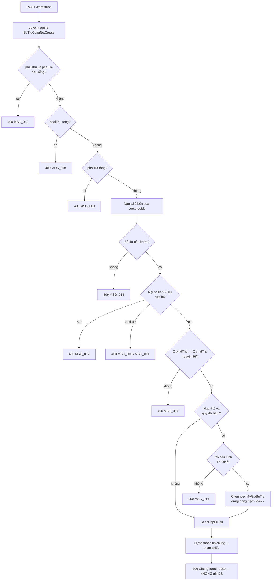

# F03 — Phân bổ số tiền bù trừ & Thực hiện Bù trừ (dựng bản nháp chứng từ)

| Mục | Nội dung |
|---|---|
| Mã chức năng | **F03** |
| Use case | **PMKT-U-14690** AC3, AC4 · LP1 (phân bổ tự động), LP2 (phân bổ thủ công), LP3 (chênh lệch tỷ giá) — `UC_BTCN_ThemMoi.md:20-26, 74-96` |
| Màn hình | `SCR_BTCN_BuTru.md` BR02, BR03, BR04 · `SCR_BTCN_ChungTu_ThemMoi.md` BR02 + "Quy tắc dựng dòng" tab Chứng từ công nợ |
| Endpoint phụ trách | **A5** `POST /phan-bo` · **A6** `POST /xem-truoc` |
| Quyết định liên quan | **D6** (phân bổ ở server), **D7** (xem trước không ghi DB), **D9** (snapshot) — [00 §0](00-ke-hoach-tong.md) |

---

## 1. Quyết định riêng của chức năng

| # | Quyết định | Lý do · vì sao không chọn cách kia |
|---|---|---|
| **F03-a** | Phân bổ BR02 chạy **ở server** (D6) | BR02 duyệt "trên **toàn bộ danh sách đã nạp** (từ trên xuống, không giới hạn trong trang hiện tại)" (`SCR_BTCN_BuTru.md:123`) trong khi FE chỉ giữ 20 dòng/trang. **Không chọn** FE tải hết: vỡ BR1 và không có trần |
| **F03-b** | A5 nhận **id + số tiền của mọi dòng đang tick** (cả 2 bảng), không nhận "trang hiện tại" | BA: trạng thái tick giữ nguyên khi chuyển trang (`SCR_BTCN_BuTru.md:46,77`) ⇒ tập lựa chọn là **toàn cục**, không phải theo trang |
| **F03-c** | Server **tự nạp lại** thứ tự chuẩn của các chứng từ phải trả đã tick, không tin thứ tự FE gửi | Thứ tự quyết định kết quả phân bổ (BR02 bước 2). Tin thứ tự client là mở đường cho hai người dùng cùng dữ liệu ra hai kết quả khác nhau |
| **F03-d** | A5 và A6 tách rời | A5 chạy mỗi lần tick/untick (nhiều lần, nhẹ); A6 chạy một lần khi bấm **Bù trừ** (validate đầy đủ + dựng chứng từ). Gộp thì mỗi lần tick phải chịu chi phí dựng chứng từ + kiểm cấu hình TK chênh lệch |
| **F03-e** | A6 **không ghi gì xuống DB** (D7) | LP4: bấm Hủy ở màn chứng từ phải quay lại giữ nguyên dữ liệu, "không lưu chứng từ" (`UC_BTCN_ThemMoi.md:99-101`) |
| **F03-f** | Ghép cặp (`GhepCapBuTru`) và phân bổ (`PhanBoBuTru`) là **hai thuật toán khác nhau**, tách 2 lớp | BR02 quyết định **mỗi chứng từ phải trả nhận bao nhiêu**; "Quy tắc dựng dòng" của tab Chứng từ công nợ (`SCR_BTCN_ChungTu_ThemMoi.md:54-57`) quyết định **cặp (phải thu, phải trả) nào ghép với nhau**. Hai bài toán, hai bộ test |

---

## 2. Ba thuật toán của chức năng này

| Tên | Nguồn BA | Lớp cài | Chạy ở |
|---|---|---|---|
| **Phân bổ tự động** — chia tổng nguồn phải thu cho các chứng từ phải trả | `SCR_BTCN_BuTru.md:118-134` (BR02) | `business/PhanBoBuTru` | A5 |
| **Ghép cặp** — dựng các dòng (phải thu ↔ phải trả) cho tab Chứng từ công nợ | `SCR_BTCN_ChungTu_ThemMoi.md:54-59` | `business/GhepCapBuTru` | A6 |
| **Chênh lệch tỷ giá** — dựng dòng hạch toán 2 | `SCR_BTCN_ChungTu_ThemMoi.md:117-137` (BR02) | `business/ChenhLechTyGiaBuTru` | A6 |

---

## 3. Hợp đồng API

### 3.1 A5 — `POST /api/ke-toan-tong-hop/bu-tru-cong-no/phan-bo`

**Quyền:** `BuTruCongNo.Create`.

```jsonc
// Request
{
  "doiTuongId": "5f3a…",
  "taiKhoanPhaiThuId": "…",
  "taiKhoanPhaiTraId": "…",
  "loaiTienId": "…",
  "ngayBuTru": "2026-08-11",
  "phaiThu": [
    { "chungTuId": "a1…", "loaiChungTu": "SAL_CHUNG_TU_BAN_HANG", "soTienBuTru": 5000000.0000 },
    { "chungTuId": "a2…", "loaiChungTu": "SAL_CHUNG_TU_BAN_HANG", "soTienBuTru": 0 }
  ],
  "phaiTraDaTick": [
    { "chungTuId": "b1…", "loaiChungTu": "PUR_CHUNG_TU_MUA_HANG" },
    { "chungTuId": "b2…", "loaiChungTu": "PUR_CHUNG_TU_MUA_HANG" },
    { "chungTuId": "b3…", "loaiChungTu": "PUR_CHUNG_TU_MUA_HANG" }
  ]
}
```

| Field | Kiểu | Bắt buộc | Ràng buộc | Nguồn BA |
|---|---|---|---|---|
| 4 trường Header Filter | — | **Y** | Như A3/A4 | `SCR_BTCN_BuTru.md:28-32` |
| `phaiThu[]` | list | **Y** | Các dòng **đang tick** kèm số tiền bù trừ hiện tại (đã tự điền hoặc người dùng sửa tay) | `SCR_BTCN_BuTru.md:63` |
| `phaiThu[].soTienBuTru` | decimal(18,4) | **Y** | `≥ 0` (`MSG_012`), `≤ Số chưa thu` (`MSG_010`) | `SCR_BTCN_BuTru.md:63` |
| `phaiTraDaTick[]` | list | **Y** | Chỉ **id** — số tiền do server phân bổ; **không** nhận số tiền từ client | BR02 |

> **Vì sao `phaiThu` mang số tiền còn `phaiTraDaTick` thì không:** BR02 coi phải thu là **nguồn** (tick → tự điền = Số chưa thu, người dùng được sửa tay), phải trả là **đích phân bổ** (server tính). Đúng theo `SCR_BTCN_BuTru.md:120`: "Chứng từ phải thu là **nguồn**; chứng từ phải trả là **đích phân bổ**."
>
> LP2 (phân bổ thủ công bên phải trả) **không** đi qua A5: BA nói "sau khi sửa tay, hệ thống **không tự phân bổ lại** cho đến lần tick/untick tiếp theo" (`SCR_BTCN_BuTru.md:126`). FE giữ số đã sửa; server chỉ validate lại ở A6.

```jsonc
// Response 200
{
  // ApiResponse<T> = { data, message, messageId } — core/response/ApiResponse.java:21
  "message": null, "messageId": null,
  "data": {
    "phaiTra": [
      { "chungTuId": "b1…", "soTienBuTru": 3000000.0000, "soTienBuTruQuyDoi": 3000000.00 },
      { "chungTuId": "b2…", "soTienBuTru": 2000000.0000, "soTienBuTruQuyDoi": 2000000.00 },
      { "chungTuId": "b3…", "soTienBuTru": 0,            "soTienBuTruQuyDoi": 0 }
    ],
    "tongBuTruPhaiThu": 5000000.0000,
    "tongBuTruPhaiTra": 5000000.0000,
    "tongBuTruPhaiThuQuyDoi": 5000000.00,
    "tongBuTruPhaiTraQuyDoi": 5000000.00,
    "soTienBuTru": 5000000.0000,
    "canBang": true
  }
}
```

`soTienBuTru` = ô "Số tiền bù trừ" góc phải màn hình = **`MIN(tổng bù trừ phải thu, tổng bù trừ phải trả)`** (`SCR_BTCN_BuTru.md:34`).

**Lỗi:**

| HTTP | messageId | Khi nào |
|---|---|---|
| 400 | `MSG_..._006` | Thiếu trường Header Filter |
| 400 | `MSG_..._012` | Có `soTienBuTru < 0` |
| 400 | `MSG_..._010` | `soTienBuTru > Số chưa thu` của chứng từ đó |
| 403 | `MSG_..._005` | Thiếu quyền |
| 409 | `MSG_..._018` | Một chứng từ trong danh sách không còn số dư như FE đang thấy — xem §5 V8 |

### 3.2 A6 — `POST /api/ke-toan-tong-hop/bu-tru-cong-no/xem-truoc`

**Quyền:** `BuTruCongNo.Create`. **Không ghi gì xuống DB.**

```jsonc
// Request
{
  "doiTuongId": "5f3a…",
  "taiKhoanPhaiThuId": "…",
  "taiKhoanPhaiTraId": "…",
  "loaiTienId": "…",
  "ngayBuTru": "2026-08-11",
  "phaiThu":  [ { "chungTuId": "a1…", "loaiChungTu": "SAL_CHUNG_TU_BAN_HANG", "soTienBuTru": 5000000.0000 } ],
  "phaiTra":  [ { "chungTuId": "b1…", "loaiChungTu": "PUR_CHUNG_TU_MUA_HANG", "soTienBuTru": 3000000.0000 },
                { "chungTuId": "b2…", "loaiChungTu": "PUR_CHUNG_TU_MUA_HANG", "soTienBuTru": 2000000.0000 } ]
}
```

```jsonc
// Response 200 — bản nháp chứng từ để FE dựng SCR_BTCN_ChungTu_ThemMoi
{
  // ApiResponse<T> = { data, message, messageId } — core/response/ApiResponse.java:21
  "message": null, "messageId": null,
  "data": {
    "thongTinChung": {
      "doiTuongId": "5f3a…", "tenDoiTuong": "Công ty TNHH ABC",
      "lyDo": "Bù trừ công nợ phải thu, phải trả với Công ty TNHH ABC",
      "taiKhoanPhaiThuId": "…", "soTaiKhoanPhaiThu": "1311",
      "taiKhoanPhaiTraId": "…", "soTaiKhoanPhaiTra": "3311",
      "ngayBuTru": "2026-08-11",
      "ngayHachToan": "2026-08-11",
      "ngayChungTu": "2026-08-11",
      "soChungTu": null,
      "soTienBuTru": 5000000.0000,
      "soTienBuTruQuyDoi": 5000000.00,
      "loaiTienId": "…", "maLoaiTien": "VND", "dongTienHachToan": true
    },
    "dongHachToan": [
      { "thuTu": 1, "moTa": "Bù trừ công nợ phải thu, phải trả",
        "taiKhoanNoId": "…3311", "taiKhoanCoId": "…1311",
        "soTien": 5000000.0000, "soTienQuyDoi": 5000000.00, "tyGia": 1 }
    ],
    "capGhep": [
      { "thuTu": 1,
        "phaiThu": { "chungTuId": "a1…", "loaiChungTu": "SAL_CHUNG_TU_BAN_HANG",
                     "ngayChungTu": "2026-07-02", "soChungTu": "PBH-000045", "soHoaDon": "HD-0012",
                     "hanThanhToan": "2026-08-02", "soTien": 10000000.0000, "soChuaThu": 8000000.0000,
                     "tyGia": 1, "soTienBuTru": 3000000.0000, "soTienBuTruQuyDoi": 3000000.00 },
        "phaiTra": { "chungTuId": "b1…", "loaiChungTu": "PUR_CHUNG_TU_MUA_HANG",
                     "ngayChungTu": "2026-06-20", "soChungTu": "PMH-000031", "soHoaDon": "HD-9911",
                     "hanThanhToan": "2026-07-20", "soTien": 4000000.0000, "soConNo": 3000000.0000,
                     "tyGia": 1, "soTienBuTru": 3000000.0000, "soTienBuTruQuyDoi": 3000000.00 },
        "chenhLechTyGia": 0 }
    ],
    "thamChieu": [
      { "chungTuId": "a1…", "loaiChungTu": "SAL_CHUNG_TU_BAN_HANG", "soChungTu": "PBH-000045" },
      { "chungTuId": "b1…", "loaiChungTu": "PUR_CHUNG_TU_MUA_HANG", "soChungTu": "PMH-000031" }
    ],
    "tongChenhLechTyGiaQuyDoi": 0,
    "loaiChenhLech": null
  }
}
```

`loaiChenhLech`: `null` \| `LO_TY_GIA` \| `LAI_TY_GIA` (§5.4).

**Lỗi:**

| HTTP | messageId | Khi nào | Nguồn BA |
|---|---|---|---|
| 400 | `MSG_..._008` | `phaiThu` rỗng | BR03 · `SCR_BTCN_BuTru.md:140` |
| 400 | `MSG_..._009` | `phaiTra` rỗng | BR03 · `SCR_BTCN_BuTru.md:140` |
| 400 | `MSG_..._007` | Tổng bù trừ 2 bảng **không bằng nhau** (nguyên tệ) | BR03 · `SCR_BTCN_BuTru.md:141` |
| 400 | `MSG_..._010` / `_011` / `_012` | Số tiền bù trừ vượt số dư / âm | `SCR_BTCN_BuTru.md:63,94` |
| 400 | `MSG_..._016` | Ngoại tệ lệch quy đổi nhưng **chưa cấu hình** TK xử lý chênh lệch | BR04 · `SCR_BTCN_BuTru.md:143-145` |
| 400 | `MSG_..._013` | Cả `phaiThu` lẫn `phaiTra` rỗng ⇒ coi như chưa Lấy dữ liệu | `SCR_BTCN_BuTru.md:116` |
| 409 | `MSG_..._018` | Số dư chứng từ gốc đã đổi so với dữ liệu FE gửi | §5 V8 |

---

## 4. Ánh xạ cột: BA ↔ DB ↔ DTO

Bản nháp A6 **chưa có DB row nào**; cột dưới đây là ánh xạ **sẽ ghi** ở [04](04-luu-chung-tu-bu-tru.md), liệt kê ở đây để review công thức.

### 4.1 Thông tin chung (`SCR_BTCN_ChungTu_ThemMoi.md:17-30`)

| Cột BA | Field DTO | Cột DB (sẽ ghi) | Công thức / nguồn |
|---|---|---|---|
| Đối tượng | `doiTuongId` | `ktth_bu_tru_cong_no.doi_tuong_id` | Từ Header Filter |
| Lý do | `lyDo` | `ktth_phieu_ke_toan_tong_hop.mo_ta` | **Mặc định** `"Bù trừ công nợ phải thu, phải trả với " + [Tên đối tượng]` (`:20`) — server sinh, người dùng sửa được |
| TK phải thu / phải trả | `taiKhoanPhaiThuId` / `taiKhoanPhaiTraId` | `ktth_bu_tru_cong_no.tai_khoan_phai_thu_id` / `…_phai_tra_id` | Header Filter |
| Ngày bù trừ | `ngayBuTru` | `ktth_bu_tru_cong_no.ngay_bu_tru` | Header Filter |
| Ngày hạch toán | `ngayHachToan` | `ktth_phieu_ke_toan_tong_hop.ngay_hach_toan` | **Mặc định = Ngày bù trừ** (`:24`), người dùng sửa được |
| Ngày chứng từ | `ngayChungTu` | `.ngay_chung_tu` | **Mặc định = Ngày bù trừ** (`:25`) |
| Số chứng từ | `soChungTu` | `.so_chung_tu` | **`null` ở bản nháp** (`:26` — "Để trống") |
| Số tiền bù trừ | `soTienBuTru` | `ktth_bu_tru_cong_no.so_tien_bu_tru` | = `MIN(tổng 2 bảng)`; sau validate BR03 thì 2 tổng bằng nhau nên = tổng bất kỳ bên nào |
| Số tiền bù trừ quy đổi | `soTienBuTruQuyDoi` | `…so_tien_bu_tru_quy_doi` | `ldm-KTTH.puml:155` |
| Loại tiền | `loaiTienId` | `.loai_tien_id` | Header Filter |
| Tham chiếu | `thamChieu[]` | `ktth_chung_tu_lien_quan` | Số chứng từ **cả 2 bên** (`:27`) |

### 4.2 Tab Hạch toán (`SCR_BTCN_ChungTu_ThemMoi.md:39-47`)

| Dòng | TK Nợ | TK Có | Số tiền (nguyên tệ) | Số tiền quy đổi | Diễn giải |
|---|---|---|---|---|---|
| **1** — luôn có | TK **phải trả** | TK **phải thu** | Tổng số tiền bù trừ | `MIN(tổng quy đổi phải thu, tổng quy đổi phải trả)` (`:46,122`) | "Bù trừ công nợ phải thu, phải trả" (`:42`) |
| **2** — chỉ khi ngoại tệ lệch quy đổi | Lỗ: TK **635** (cấu hình) · Lãi: TK **phải trả** | Lỗ: TK **phải thu** · Lãi: TK **515** (cấu hình) | **0** (`:45`) | \|chênh lệch quy đổi\| (`:121`) | "Xử lý chênh lệch tỷ giá" (`:42`) |

Ghi vào `ktth_chi_tiet_phieu_ktth_hach_toan` (`V202:97`): `tai_khoan_no_id`, `tai_khoan_co_id`, `so_tien`, `so_tien_quy_doi`, `loai_tien_id`, `ty_gia`, `mo_ta`, `thu_tu`.

### 4.3 Tab Chứng từ công nợ — cặp ghép

Mỗi phần tử `capGhep[]` → một dòng `ktth_chi_tiet_bu_tru_cong_no_chung_tu`, theo `ldm-KTTH.puml:164-188`. Toàn bộ là **snapshot** (D9):

| Cột BA (nhóm phải thu) | Cột DB | Cột BA (nhóm phải trả) | Cột DB |
|---|---|---|---|
| Loại chứng từ | `loai_chung_tu_phai_thu` | Loại chứng từ | `loai_chung_tu_phai_tra` |
| Số chứng từ (link) | `chung_tu_phai_thu_id` | Số chứng từ (link) | `chung_tu_phai_tra_id` |
| Số hóa đơn | `so_hoa_don_phai_thu` | Số hóa đơn | `so_hoa_don_phai_tra` |
| *(tỷ giá dùng để quy đổi)* | `ty_gia_phai_thu` | *(tỷ giá)* | `ty_gia_phai_tra` |
| Số chưa thu | `so_chua_thu` | Số còn nợ | `so_con_no` |
| Số bù trừ | `so_tien_bu_tru_phai_thu` | Số bù trừ | `so_tien_bu_tru_phai_tra` |
| Số bù trừ quy đổi | `so_tien_bu_tru_phai_thu_quy_doi` | Số bù trừ quy đổi | `so_tien_bu_tru_phai_tra_quy_doi` |
| **Cột cuối:** Chênh lệch tỷ giá | `chenh_lech_ty_gia` = `so_tien_bu_tru_phai_thu_quy_doi − so_tien_bu_tru_phai_tra_quy_doi` (dấu đại số: **dương = lỗ**, **âm = lãi**) — `SCR_BTCN_ChungTu_ThemMoi.md:91` | | |

Cột **Ngày chứng từ**, **Hạn thanh toán**, **Số tiền** của mỗi bên **không** lưu snapshot — BA ghi "Lấy theo chứng từ gốc" (`:68,71,72`). Đọc join khi xem chi tiết ([05 §4](05-xem-chi-tiet-chung-tu-bu-tru.md)).

> ⚠️ **Bất biến cấp dòng:** `so_tien_bu_tru_phai_thu = so_tien_bu_tru_phai_tra` (nguyên tệ) — "hai nhóm cột trên cùng dòng luôn có Số bù trừ (nguyên tệ) bằng nhau" (`SCR_BTCN_ChungTu_ThemMoi.md:56`). Cưỡng chế bằng CHECK ở DB, xem [09 §4](09-thiet-ke-db.md).

---

## 5. Validation — ma trận đầy đủ

| # | Luật | Điều kiện | Thời điểm | Thông báo | BR nguồn |
|---|---|---|---|---|---|
| V1 | Quyền | `BuTruCongNo.Create` | Đầu handler A5, A6 | 403 · `MSG_..._005` | BR25 |
| V2 | Header Filter đủ | 4 trường ≠ null | `@Valid` | 400 · `MSG_..._006` | `SCR_BTCN_BuTru.md:116` |
| V3 | Chưa Lấy dữ liệu | `phaiThu` **và** `phaiTra` đều rỗng | A6 | 400 · `MSG_..._013` | BR01 · `SCR_BTCN_BuTru.md:116` |
| V4 | ≥ 1 chứng từ phải thu | `phaiThu` có ít nhất 1 dòng `soTienBuTru > 0` | A6 | 400 · `MSG_..._008` | BR03 · `:140` |
| V5 | ≥ 1 chứng từ phải trả | `phaiTra` có ít nhất 1 dòng `soTienBuTru > 0` | A6 | 400 · `MSG_..._009` | BR03 · `:140` |
| V6 | Số tiền bù trừ ≥ 0 | mọi dòng 2 bảng | A5, A6 | 400 · `MSG_..._012` | `:63,94` |
| V7a | ≤ Số chưa thu | dòng phải thu | A5, A6 | 400 · `MSG_..._010` | `:63` |
| V7b | ≤ Số còn nợ | dòng phải trả | A6 | 400 · `MSG_..._011` | `:94` |
| V8 | Số dư còn khớp | So `soDuConLai` server nạp lại với ràng buộc V7 | A5, A6 | 409 · `MSG_..._018` | `MSG` mô tả "Số dư thay đổi bởi giao dịch khác" |
| V9 | **Cân bằng 2 bảng** | `Σ soTienBuTru(phaiThu) == Σ soTienBuTru(phaiTra)` **nguyên tệ**, so bằng `compareTo` | A6 | 400 · `MSG_..._007` | BR03 · `:141` |
| V10 | Cấu hình TK chênh lệch | Chỉ khi ngoại tệ **và** `Σ quy đổi phải thu ≠ Σ quy đổi phải trả` | A6 | 400 · `MSG_..._016` | BR04 · `:143-145` |
| V11 | Chứng từ thuộc đúng đối tượng / TK / loại tiền | Nạp lại qua port, đối chiếu | A5, A6 | 400 | Chống client gửi id lạ |
| V12 | Không trùng id trong một bảng | `phaiThu`/`phaiTra` không có `chungTuId` lặp | A5, A6 | 400 | Chống cộng đôi số dư |
| V13 | Trim `lyDo` | Trước khi dùng | A6 | — | BR43 |

> **V9 so nguyên tệ, không so quy đổi.** BR03 nói "Tổng Số tiền bù trừ 2 bảng bằng nhau"; cột đó là nguyên tệ (`:63,94`). Nếu so quy đổi thì mọi giao dịch ngoại tệ có 2 tỷ giá khác nhau đều bị chặn — mâu thuẫn trực tiếp với BR04 vốn **giả định** quy đổi lệch nhau là bình thường (`:143-145`).
>
> **So bằng `compareTo`, không `equals`:** `BigDecimal("100")` ≠ `BigDecimal("100.00")` theo `equals`. Đúng cái bẫy đã được ghi ở `chung_tu_ban_hang/internal/model/TrangThaiThanhToan.java:30-34`.

### 5.1 Thuật toán phân bổ tự động (BR02) — `PhanBoBuTru`

Nguyên văn `SCR_BTCN_BuTru.md:120-125`:

```
1. nguonConLai = Σ soTienBuTru của các chứng từ phải thu ĐÃ TICK
2. FOR each chứng từ phải trả ĐÃ TICK, theo thứ tự (NgayChungTu ASC, SoChungTu ASC)
       trên TOÀN BỘ danh sách đã nạp:
       phanBo      = MIN(nguonConLai, soConNo)
       soTienBuTru = phanBo
       nguonConLai = nguonConLai − phanBo
3. DỪNG khi nguonConLai == 0 hoặc hết chứng từ đã tick
4. Bất biến sau bước 3: Σ soTienBuTru(phaiTra) == MIN(nguon, Σ soConNo các dòng đã tick)
```

Ví dụ kiểm chứng (`SCR_BTCN_BuTru.md:129-132`): nguồn 5.000.000 → A (còn nợ 3.000.000) nhận 3.000.000 · B (2.500.000) nhận 2.000.000 · C (1.000.000) nhận 0.

> **Bất biến bước 4 KHÔNG bằng "2 tổng luôn bằng nhau".** BA nói "Luôn đảm bảo Tổng Số tiền bù trừ ở 2 bảng bằng nhau sau mỗi lần phân bổ tự động" (`:125`), nhưng thuật toán chỉ đảm bảo điều đó khi `Σ soConNo (đã tick) ≥ nguồn`. Nếu tick ít chứng từ phải trả hơn thì tổng phải trả **nhỏ hơn** nguồn ⇒ 2 tổng lệch, và người dùng bị chặn ở BR03 (`MSG_..._007`) khi bấm Bù trừ. **Đây là mâu thuẫn nội bộ trong BA** — xử lý tạm: thuật toán chạy đúng nguyên văn bước 1–3, tổng lệch thì `canBang = false` và FE hiển thị cảnh báo; chặn thật ở A6. Nêu ở [00 §12](00-ke-hoach-tong.md).

### 5.2 Phân bổ thủ công (LP2)

`SCR_BTCN_BuTru.md:126` — "sau khi sửa tay, hệ thống **không tự phân bổ lại** cho đến lần tick/untick tiếp theo."

⇒ Không có endpoint riêng. FE giữ số người dùng sửa; ràng buộc V6/V7 kiểm ở FE (tức thời) **và lại ở A6** (không tin client).

### 5.3 Ghép cặp — `GhepCapBuTru`

Nguyên văn `SCR_BTCN_ChungTu_ThemMoi.md:54-57`:

```
conLaiPhaiTra[j] = soTienBuTru của chứng từ phải trả thứ j     (theo thứ tự hiển thị)
j = 0
FOR each chứng từ phải thu i theo thứ tự hiển thị:
    conLaiPhaiThu = soTienBuTru[i]
    WHILE conLaiPhaiThu > 0 AND j < n:
        ghep = MIN(conLaiPhaiThu, conLaiPhaiTra[j])
        IF ghep > 0: tạo MỘT dòng (i, j, ghep)
        conLaiPhaiThu    -= ghep
        conLaiPhaiTra[j] -= ghep
        IF conLaiPhaiTra[j] == 0: j++
```

Ví dụ kiểm chứng (`:59`): A có 5.000.000, X còn 3.000.000, Y còn 2.000.000 → 2 dòng `(A—X: 3.000.000)`, `(A—Y: 2.000.000)`.

Thuật toán chạy đúng **chỉ khi** V9 đã xanh (2 tổng bằng nhau) — nếu không sẽ còn dư một bên. ⇒ **`GhepCapBuTru` chạy SAU `KiemTraBuTru`**, thứ tự này là bắt buộc.

### 5.4 Chênh lệch tỷ giá — `ChenhLechTyGiaBuTru` (BR02 màn Thêm mới)

Áp dụng khi `loaiTien ≠ đồng tiền hạch toán` **và** `Σ quy đổi phải thu ≠ Σ quy đổi phải trả` (`SCR_BTCN_ChungTu_ThemMoi.md:119`):

```
qdThu = Σ (soTienBuTru[i] × tyGia chứng từ phải thu i)      ← làm tròn BR7 tại từng dòng
qdTra = Σ (soTienBuTru[j] × tyGia chứng từ phải trả j)
chenhLech = |qdThu − qdTra|
soTienQuyDoiDong1 = MIN(qdThu, qdTra)                       ← :122

qdThu > qdTra  →  LO_TY_GIA  : dòng 2 = Nợ TK_LO (635)   / Có TK phải thu     ← :123
qdThu < qdTra  →  LAI_TY_GIA : dòng 2 = Nợ TK phải trả   / Có TK_LAI (515)    ← :124
dòng 2: soTien (nguyên tệ) = 0 · soTienQuyDoi = chenhLech                     ← :125
```

Kiểm chứng bằng 2 ví dụ của BA (`:129-137`):

| Ca | qdThu | qdTra | Dòng 1 quy đổi | Dòng 2 | Phát sinh Nợ 331 | Phát sinh Có 131 |
|---|---|---|---|---|---|---|
| Lỗ | 2.500.000 | 2.450.000 | **2.450.000** | Nợ 635 / Có 131 = 50.000 | 2.450.000 ✓ | 2.450.000 + 50.000 = **2.500.000** ✓ |
| Lãi | 2.450.000 | 2.500.000 | **2.450.000** | Nợ 331 / Có 515 = 50.000 | 2.450.000 + 50.000 = **2.500.000** ✓ | 2.450.000 ✓ |

**Nguồn TK lãi/lỗ:** `CauHinhHeThongApi.theoMa(...)` (`common/cau_hinh_he_thong/api/CauHinhHeThongApi.java:22`). Mã tham số **chưa xác định trong repo** (`grep -rn "515\|635\|CLTG" common/cau_hinh_he_thong/` rỗng) và LDM lại nói cấu hình nằm ở cấp **Tenant** (`ldm-KTTH.puml:56`) — xem **Q14**. Không tra được / tham số ngừng hoạt động → `MSG_..._016`.

**Làm tròn (BR7 §7.1–7.2):** quy đổi làm tròn **tại từng dòng** đến 2 chữ số (`money_vnd = numeric(18,2)`) rồi mới cộng; không cộng nguyên tệ trước rồi mới nhân. Lý do: `chenh_lech_ty_gia` của từng dòng cặp ghép phải cộng lại đúng bằng `tongChenhLechTyGiaQuyDoi` (`SCR_BTCN_ChungTu_ThemMoi.md:95` — "Tổng đại số cột Chênh lệch tỷ giá của các dòng = chênh lệch ròng"). Cộng trước rồi nhân sẽ lệch xu.

---

## 6. Luồng xử lý

### 6.1 A5 — Phân bổ

```
 1. quyen.require("BuTruCongNo", "Create")
 2. @Valid + KiemTraBuTru.kiemTraTieuChi()                          → V2
 3. nạp lại phải thu đã tick qua port.theoIds()                     → V6, V7a, V8, V11, V12
 4. nạp lại phải trả đã tick qua port.theoIds(), sắp NgayCT ASC     ← F03-c: KHÔNG tin thứ tự client
 5. PhanBoBuTru.phanBo(nguon = Σ phaiThu.soTienBuTru, dsPhaiTra)    ← BR02 §5.1
 6. quy đổi từng dòng theo tỷ giá riêng, làm tròn BR7
 7. tính tongBuTru*, soTienBuTru = MIN(2 tổng), canBang
 8. trả PhanBoResponse
```

### 6.2 A6 — Xem trước (Bù trừ)



**Bước gọi base / viết mới:**

| Bước | Base có sẵn? |
|---|---|
| `quyen.require` | ✅ `core/controller/QuyenChecker.java:61` |
| Nạp lại chứng từ | ✅ SPI `ChungTuCongNoPort.theoIds` — do 2 module chứng từ cài ([08 §3](08-chan-bo-ghi-chung-tu-goc.md)) |
| Đọc cấu hình TK lãi/lỗ | ✅ `CauHinhHeThongApi.theoMa` (`common/cau_hinh_he_thong/api/CauHinhHeThongApi.java:22`) |
| `PhanBoBuTru`, `GhepCapBuTru`, `ChenhLechTyGiaBuTru`, `KiemTraBuTru` | ❌ **viết mới**, hàm thuần, không Spring, không DB — test được từng luật một (cùng khuôn `DinhKhoanValidator.java:20-21`) |
| Ghi DB | — **không có** ở A6 |

---

## 7. Tương tranh & transaction

| Khía cạnh | Quyết định |
|---|---|
| Transaction | `@Transactional(readOnly = true)` cho cả A5 và A6 — chỉ đọc |
| Khoá | **Không khoá.** Khoá chứng từ gốc ở bước xem trước sẽ giữ khoá suốt thời gian người dùng ngồi nhìn màn hình chứng từ. Khoá thật ở bước **Ghi sổ** ([06 §7](06-ghi-so-bo-ghi-so.md)) |
| Idempotency | Không cần — A5/A6 không tạo trạng thái |
| Cửa sổ đua | Giữa A6 và A7 số dư có thể đổi ⇒ A7/A10 **kiểm lại lần nữa** dưới khoá, trả `MSG_..._018`. Đây là thiết kế có chủ đích của BA, không phải khe hở |

---

## 8. Phân trang · sắp xếp · lọc · dòng tổng

Không áp dụng — A5/A6 không phải màn danh sách. Thứ tự chứng từ **có** ý nghĩa nghiệp vụ (đầu vào BR02 và quy tắc ghép cặp) nhưng do server tự áp `NgayChungTu ASC, SoChungTu ASC`, không nhận từ client (F03-c).

---

## 9. Kiểm thử

### 9.1 Unit test (`@Tag("unit")`) — trọng tâm của chức năng này

| Lớp test | Input → Kỳ vọng |
|---|---|
| `PhanBoBuTruTest` | **Ví dụ BA** `:129-132`: nguồn 5.000.000; A 3.000.000, B 2.500.000, C 1.000.000 → A=3.000.000, B=2.000.000, C=0 |
| `PhanBoBuTruTest` | Nguồn 0 → mọi dòng phải trả = 0 |
| `PhanBoBuTruTest` | Nguồn > Σ số còn nợ → mọi dòng nhận full, tổng phải trả < nguồn, `canBang=false` |
| `PhanBoBuTruTest` | Nguồn khớp đúng dòng cuối → dòng cuối nhận phần dư, không âm |
| `PhanBoBuTruTest` | Thứ tự đầu vào bị đảo → kết quả **vẫn theo** `NgayChungTu ASC` (F03-c) |
| `PhanBoBuTruTest` | `BigDecimal("100")` vs `("100.00")` → coi là bằng (`compareTo`) |
| `GhepCapBuTruTest` | **Ví dụ BA** `:59`: A=5.000.000; X=3.000.000, Y=2.000.000 → 2 dòng (A,X,3tr), (A,Y,2tr) |
| `GhepCapBuTruTest` | 2 phải thu (3tr, 2tr) × 1 phải trả (5tr) → 2 dòng, cùng chứng từ phải trả |
| `GhepCapBuTruTest` | Mọi dòng: `soTienBuTruPhaiThu == soTienBuTruPhaiTra` |
| `GhepCapBuTruTest` | Σ số bù trừ các dòng = tổng bù trừ; không sinh dòng số tiền 0 |
| `ChenhLechTyGiaBuTruTest` | **Ví dụ lỗ** `:130-133`: qdThu=2.500.000, qdTra=2.450.000 → `LO_TY_GIA`, dòng1 quy đổi=2.450.000, dòng2 = Nợ 635/Có 131 = 50.000, nguyên tệ 0 |
| `ChenhLechTyGiaBuTruTest` | **Ví dụ lãi** `:134-137`: qdThu=2.450.000, qdTra=2.500.000 → `LAI_TY_GIA`, dòng2 = Nợ 331/Có 515 = 50.000 |
| `ChenhLechTyGiaBuTruTest` | qdThu == qdTra → **không sinh dòng 2**, `loaiChenhLech = null` |
| `ChenhLechTyGiaBuTruTest` | Đồng tiền hạch toán → không bao giờ có dòng 2 kể cả khi tỷ giá lẻ |
| `ChenhLechTyGiaBuTruTest` | Σ `chenhLechTyGia` các dòng cặp ghép == `tongChenhLechTyGiaQuyDoi` (kiểm làm tròn từng dòng — §5.4) |
| `KiemTraBuTruTest` | `phaiThu` rỗng → `MSG_..._008`; `phaiTra` rỗng → `_009`; cả hai rỗng → `_013` |
| `KiemTraBuTruTest` | Tổng lệch 0.01 → `MSG_..._007` |
| `KiemTraBuTruTest` | Ngoại tệ lệch quy đổi + chưa cấu hình TK → `MSG_..._016` |
| `KiemTraBuTruTest` | Ngoại tệ **không** lệch quy đổi + chưa cấu hình TK → **không** ném (BR04 chỉ áp khi lệch) |
| `KiemTraBuTruTest` | Trùng `chungTuId` trong `phaiThu` → 400 (V12) |

### 9.2 Test tích hợp (cần Docker)

| Lớp test | Kiểm gì |
|---|---|
| `PhanBoApiIT` | A5 với 3 chứng từ phải trả thật trong DB → đúng ví dụ BA |
| `XemTruocApiIT` | A6 ngoại tệ 2 tỷ giá khác nhau → response có `dongHachToan` 2 dòng, `loaiChenhLech` đúng |
| `XemTruocApiIT` | A6 **không** tạo bản ghi nào: `count(ktth_phieu_ke_toan_tong_hop)` trước = sau (D7) |
| `XemTruocApiIT` | Số dư chứng từ gốc bị thay đổi giữa 2 lần gọi → 409 `MSG_..._018` |
| `XemTruocApiIT` | Thiếu cấu hình TK lãi/lỗ → 400 `MSG_..._016` |

---

## 10. BR đã áp dụng

| BR | Áp ở bước nào |
|---|---|
| BR7 | §5.4 làm tròn quy đổi 2 chữ số tại **từng dòng**, tỷ giá 6 chữ số |
| BR09 | `loaiChungTu` theo bảng mã BR09 |
| BR15.1/15.3 | §5 V2, V6, V7, V9 |
| BR16 | `MSG_..._018` cảnh báo số dư đổi |
| BR18.2 | Quy đổi = gốc × tỷ giá |
| BR18.4 | `dongTienHachToan` điều khiển ẩn/hiện cột quy đổi + dòng hạch toán 2 |
| BR25 | V1 `quyen.require` |
| BR28 | Port khai `MANDATORY`, RLS |
| BR43 | V13 trim `lyDo` |

**BR bị epic ghi đè:** BR2 (thứ tự hiển thị) — xem [02 §8.2](02-lay-du-lieu-cong-no.md).
**Chưa áp được:** BR21 (tab Chứng từ công nợ chỉ xem, không thêm/xóa dòng), BR31 (dòng tổng ở [02](02-lay-du-lieu-cong-no.md)).
