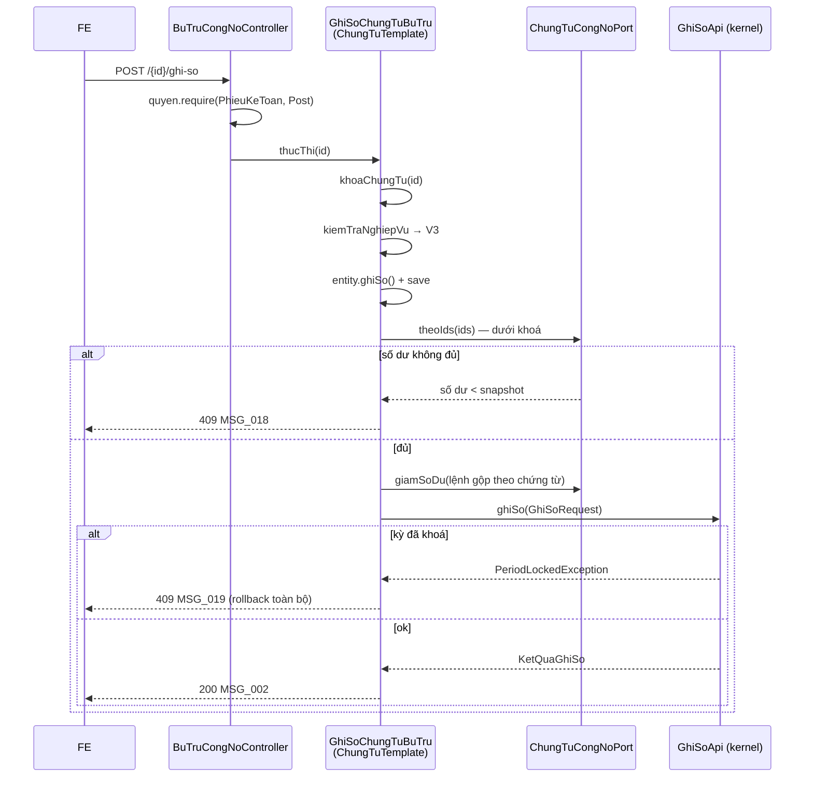

# F06 — Ghi sổ / Bỏ ghi sổ chứng từ bù trừ công nợ

| Mục | Nội dung |
|---|---|
| Mã chức năng | **F06** |
| Use case | **PMKT-U-14693** — `4.usecases/PMKT-U-14693_BTCN_GhiSoBoGhi/UC_BTCN_GhiSoBoGhi.md` (AC1, AC2; AC3 ở [08](08-chan-bo-ghi-chung-tu-goc.md)) |
| Màn hình | `SCR_BTCN_ChungTu_XemChiTiet.md` BR01 · `SCR_BTCN_ChungTu_ThemMoi.md` BR04 · `SCR_BTCN_DanhSach.md` BR4 |
| Endpoint phụ trách | **A10** `POST /{id}/ghi-so` · **A11** `POST /{id}/bo-ghi-so` |
| Quyết định liên quan | **D3** (ChungTuTemplate), **D5** (SPI cập nhật công nợ), **D10** (định khoản) |

---

## 1. Quyết định riêng của chức năng

| # | Quyết định | Lý do · vì sao không chọn cách kia |
|---|---|---|
| **F06-a** | Dùng **nguyên** 2 endpoint của `BaseChungTuController` (`/{id}/ghi-so`, `/{id}/bo-ghi-so`), chỉ override `messageId(...)` | `BaseChungTuController.java:93-108` đã cấp sẵn kèm `quyen.require(Post/Unpost)`. Việc riêng của epic chỉ là mã message (`ThaoTacChungTu.messageIdMacDinh()` → `MSG_CORE_*`, phải map sang `MSG_PMKT-E-14294_002/003` — mẫu ở `BaseChungTuController.java:86-88`) |
| **F06-b** | **Không** popup xác nhận ở phía BE | Popup `MSG_..._102` là FE (`UC_BTCN_GhiSoBoGhi.md:57`). BR13.2 cũng nói Ghi sổ/Bỏ ghi "không hiển thị popup xác nhận" ở mức chung — epic ghi đè cho Bỏ ghi. BE nhận request là đã coi như người dùng xác nhận |
| **F06-c** | Cập nhật số dư + trạng thái thanh toán chứng từ gốc qua **`ChungTuCongNoPort.giamSoDu` / `.hoanTraSoDu`**, không UPDATE trực tiếp | Bảng `sal_*` / `pur_*` thuộc module khác — chỉ chủ sở hữu được ghi (Modulith). Cùng khuôn `DongChungTuPort` của `quan_he_chung_tu` |
| **F06-d** | Số tiền giảm/hoàn trả lấy từ **snapshot cặp ghép** (`so_tien_bu_tru_phai_thu` / `…_phai_tra`), không tính lại | D9. LDM ghi rõ snapshot dùng "để hiển thị **và hoàn trả** khi Bỏ ghi/Xóa" (`ldm-KTTH.puml:160-161`). Tính lại lúc bỏ ghi sẽ hoàn trả sai nếu số dư gốc đã đổi |
| **F06-e** | Bỏ ghi **không** kiểm lại số dư gốc | Bỏ ghi chỉ **cộng trả**, không tiêu thụ gì. Kiểm số dư ở đây sẽ chặn nhầm thao tác gỡ hợp lệ — đúng lý lẽ base ghi ở `ChungTuTemplate.java:223-230` |
| **F06-f** | Bỏ ghi **giữ nguyên** chứng từ + cặp ghép + tham chiếu, chỉ đổi `status` và hoàn trả công nợ | `UC_BTCN_GhiSoBoGhi.md:62` — sau Bỏ ghi thì "enable nút Ghi sổ, Xóa" ⇒ chứng từ vẫn tồn tại đầy đủ để ghi sổ lại. Gỡ tham chiếu là việc của **Xóa** ([07](07-xoa-chung-tu-bu-tru.md)) |

---

## 2. Hợp đồng API

### 2.1 A10 — `POST /api/ke-toan-tong-hop/bu-tru-cong-no/{id}/ghi-so`

**Quyền:** `PhieuKeToan.Post` (`UC_BTCN_GhiSoBoGhi.md:12`, `QuyenChecker.java:34`).

Request: **không có body** (chữ ký base — `BaseChungTuController.java:93-99`).

```jsonc
// Response 200 — ApiResponse<ChungTuBuTruDto> = { data, message, messageId }
{
  "data": { /* ChungTuBuTruDto — như A8, status = DA_GHI_SO */ },
  "message": "Ghi sổ chứng từ bù trừ công nợ thành công",
  "messageId": "MSG_PMKT-E-14294_002"
}
```

| HTTP | Mã lỗi | messageId | Khi nào | Nguồn BA |
|---|---|---|---|---|
| 403 | `FORBIDDEN` | `MSG_..._005` | Thiếu `PhieuKeToan.Post` | `:77` |
| 404 | `KHONG_TIM_THAY` | `MSG_..._021` | Không tồn tại / đã xóa / không phải loại bù trừ | `:80` |
| 409 | `TRANG_THAI_KHONG_HOP_LE` | `MSG_COMMON_001` | Chứng từ đã ở `DA_GHI_SO` | BR12 "Ghi sổ duy nhất" |
| 409 | `SO_DU_DA_THAY_DOI` | `MSG_..._018` | Số dư chứng từ gốc không còn đủ | `:44,79` |
| 409 | `KY_DA_KHOA` | `MSG_..._019` | Kỳ đã khoá — `PeriodLockedException` | `:43,78` |
| 500 | `INTERNAL_ERROR` | `MSG_..._017` | Lỗi hệ thống, giữ nguyên trạng thái | `:81` |

### 2.2 A11 — `POST /api/ke-toan-tong-hop/bu-tru-cong-no/{id}/bo-ghi-so`

**Quyền:** `PhieuKeToan.Unpost` (`:16`, `QuyenChecker.java:35`). Không body.

```jsonc
// Response 200 — ApiResponse<ChungTuBuTruDto> = { data, message, messageId }
{
  "data": { /* ChungTuBuTruDto — status = NHAP, choPhepGhiSo/choPhepXoa = true */ },
  "message": "Bỏ ghi sổ chứng từ bù trừ công nợ thành công",
  "messageId": "MSG_PMKT-E-14294_003"
}
```

| HTTP | Mã lỗi | messageId | Khi nào |
|---|---|---|---|
| 403 | `FORBIDDEN` | `MSG_..._005` | Thiếu `PhieuKeToan.Unpost` |
| 404 | `KHONG_TIM_THAY` | `MSG_..._021` | Không tồn tại |
| 409 | `TRANG_THAI_KHONG_HOP_LE` | `MSG_COMMON_001` | Chứng từ **chưa** ghi sổ — BR42.1 nói rõ trả `MSG_COMMON_001` |
| 409 | `KY_DA_KHOA` | `MSG_..._019` | Kỳ đã khoá (`:18,59`) |
| 500 | `INTERNAL_ERROR` | `MSG_..._017` | Lỗi hệ thống |

> ⚠️ **Bỏ ghi sổ = XOÁ VẬT LÝ dòng sổ cái** (chốt tại migration V56 — `GhiSoApi.java:34-36`, `ChungTuTemplate.java:51-53`), **không** sinh bút toán đảo. Hệ quả trực tiếp: chứng từ thuộc kỳ đã khoá **không bỏ ghi được**; muốn gỡ phải mở kỳ trước (`GhiSoApi.java:41-43`). Trùng khớp `UC_BTCN_GhiSoBoGhi.md:18`.

---

## 3. Ánh xạ dữ liệu bị thay đổi

### 3.1 Ghi sổ (A10)

| Đối tượng | Thay đổi | Nguồn BA |
|---|---|---|
| `acc_so_cai` | **+2 dòng** (VND) hoặc **+4 dòng** (ngoại tệ có chênh lệch) qua `GhiSoApi.ghiSo` | `:45` · `TaiLieuMappingSoCai.md:1858-1876` |
| `ktth_phieu_ke_toan_tong_hop.status` | `NHAP` → `DA_GHI_SO` | `:47` |
| `.nguoi_ghi_so`, `.thoi_gian_ghi_so` | gán — `BaseChungTuEntity.ghiSo()` (`core/entity/BaseChungTuEntity.java:166-174`) | BR46 |
| Chứng từ gốc: số dư | **giảm** `so_tien_bu_tru_*` (nguyên tệ + quy đổi) từng cặp ghép | `:46` |
| Chứng từ gốc: `trang_thai_thanh_toan` | `Thanh toán một phần` (dư > 0) hoặc `Đã thanh toán` (dư = 0) | `:46` · `SCR_BTCN_ChungTu_ThemMoi.md:151` |
| `aud_audit_log` | +1 dòng, **trong** transaction | `ChungTuTemplate.java:521-530` |

> ⚠️ **Số tiền giảm gộp theo chứng từ, không theo cặp ghép.** Một chứng từ gốc có thể xuất hiện ở **nhiều** cặp ghép (`SCR_BTCN_ChungTu_ThemMoi.md:57`). ⇒ `giamSoDu` nhận danh sách đã **gộp theo `chungTuId`**: `Σ so_tien_bu_tru` của mọi cặp ghép có chứng từ đó. Gọi N lần cho N cặp sẽ trừ đúng tổng nhưng tốn N khoá và N lần tính lại `trang_thai_thanh_toan`.

Enum trạng thái thanh toán đã có sẵn ở mỗi module. Port **dùng lại** hai enum đó, **không** định nghĩa enum thứ ba — nhưng phải biết chúng **không giống nhau** (đã kiểm vòng 2):

| Module | Enum | Hằng | Giá trị lưu DB |
|---|---|---|---|
| Bán hàng | `chung_tu_ban_hang/internal/model/TrangThaiThanhToan.java:20-22` | `CHUA_THANH_TOAN` · `THANH_TOAN_MOT_PHAN` · `DA_THANH_TOAN` | `"Chưa thanh toán"` · `"Đã thanh toán một phần"` · `"Đã thanh toán"` — **tiếng Việt có dấu, có khoảng trắng** |
| Mua hàng | `chung_tu_mua_hang/internal/model/TrangThaiThanhToanMuaHang.java:18-24` | `CHUA_THANH_TOAN` · **`DA_THANH_TOAN_MOT_PHAN`** · `DA_THANH_TOAN` | `"ChuaThanhToan"` · `"DaThanhToanMotPhan"` · `"DaThanhToan"` — **PascalCase, không dấu** |

⚠️ Hai điểm lệch: (a) tên hằng của trạng thái giữa khác nhau (`THANH_TOAN_MOT_PHAN` vs `DA_THANH_TOAN_MOT_PHAN`); (b) **giá trị lưu DB khác hẳn nhau**. ⇒ `LenhCapNhatCongNo` **không** mang trạng thái thanh toán; mỗi adapter tự suy và tự ghi bằng enum của module mình. Bán hàng có sẵn hàm suy `TrangThaiThanhToan.cua(daThanhToan, phaiThu)` (`:36-42`) so bằng `compareTo` để tránh bẫy `BigDecimal.equals` (`:30-34`); mua hàng phải kiểm xem có hàm tương đương chưa, chưa có thì viết theo đúng khuôn đó.

### 3.2 Bỏ ghi (A11)

| Đối tượng | Thay đổi | Nguồn BA |
|---|---|---|
| `acc_so_cai` | **xoá vật lý** toàn bộ dòng của chứng từ — `GhiSoApi.boGhiSo` | `:60` |
| `ktth_phieu_ke_toan_tong_hop.status` | `DA_GHI_SO` → `NHAP` | `:62` |
| `.nguoi_ghi_so`, `.thoi_gian_ghi_so` | **xoá về `null`** — `BaseChungTuEntity.boGhiSo()` (`:176-180`) | BR46.3 |
| Chứng từ gốc: số dư | **cộng trả** đúng số đã trừ (snapshot, F06-d) | `:61` |
| Chứng từ gốc: `trang_thai_thanh_toan` | tính lại từ số dư mới | `:61` |
| Cặp ghép · tham chiếu · dòng hạch toán | **giữ nguyên** (F06-f) | `:62` |

---

## 4. Validation — ma trận đầy đủ

### 4.1 Ghi sổ (A10)

| # | Luật | Thời điểm | Thông báo | BR nguồn |
|---|---|---|---|---|
| V1 | Quyền `PhieuKeToan.Post` | `BaseChungTuController.java:95` | 403 · `MSG_..._005` | BR25 · `:77` |
| V2 | Chứng từ tồn tại, đúng loại `Bù trừ công nợ` | `chuanBiChungTu` | 404 · `MSG_..._021` | `:80` |
| V3 | `status != DA_GHI_SO` | `kiemTraNghiepVu` | 409 · `MSG_COMMON_001` | BR12 "Ghi sổ duy nhất" |
| V4 | Kỳ kế toán mở | **kernel tự kiểm** với đúng cặp (ngày hạch toán, mã loại) nó sắp INSERT | 409 · `MSG_..._019` | BR17.1 · `ChungTuTemplate.java:56-61` |
| V5 | Số dư chứng từ gốc **còn đủ** | `sauKhiLuu`, dưới khoá, **trước** khi gọi kernel | 409 · `MSG_..._018` | `:44` · BR04 màn Thêm mới `:149` |
| V6 | Chứng từ gốc còn tồn tại (chưa xóa) | như V5 | 409 · `MSG_..._018` | suy từ V5 |
| V7 | Tenant | RLS | — | BR28 |

### 4.2 Bỏ ghi (A11)

| # | Luật | Thời điểm | Thông báo | BR nguồn |
|---|---|---|---|---|
| V8 | Quyền `PhieuKeToan.Unpost` | `BaseChungTuController.java:104` | 403 · `MSG_..._005` | BR25 · `:77` |
| V9 | Chứng từ tồn tại, đúng loại | `chuanBiChungTu` | 404 · `MSG_..._021` | `:80` |
| V10 | `status == DA_GHI_SO` | `kiemTraNghiepVu` | 409 · `MSG_COMMON_001` | BR42.1 |
| V11 | Kỳ kế toán mở | **kernel tự kiểm theo TỪNG ngày hạch toán của dòng đang gỡ** | 409 · `MSG_..._019` | `ChungTuTemplate.java:227-230` · `:59` |
| V12 | **Không** kiểm số dư | — | — | F06-e |

---

## 5. Luồng xử lý

### 5.1 Ghi sổ — `GhiSoChungTuBuTru extends ChungTuTemplate`, `hanhDong() = GHI_SO`

Trình tự do `ChungTuTemplate.luongGhiSo` cưỡng chế (`ChungTuTemplate.java:212-221`):

```
thucThi(id)                                       @Transactional
 1. kiemTraDauVao      [base]
 2. kiemTraQuyen       [base]  maChucNang() = "PhieuKeToan" → PhieuKeToan.Post
                                (HanhDongChungTu.GHI_SO → QuyenChecker.POST — HanhDongChungTu.java:19)
 3. chuanBiChungTu     [OVERRIDE] nạp aggregate + cặp ghép; ctx.ghiNhanChungTu(...)  → V2
 ── luongGhiSo ───────────────────────────────────────────────────────────
 4. doiHoiDinhDanh     [base]  (ChungTuTemplate.java:356-363)
 5. khoaChungTu        [base]  khoá chứng từ bù trừ tới hết transaction (:376-378)
 6. kiemTraNghiepVu    [CÀI]   V3
 7. luuChungTu → truocKhiLuu   [OVERRIDE] entity.ghiSo() ⇒ status/nguoi_ghi_so/thoi_gian_ghi_so
                  luuEntity    [CÀI]      save + ctx.ghiNhanChungTu(...)
 8. sauKhiLuu          [OVERRIDE]
        a. gom cặp ghép theo chungTuId (2 bên)    ← §3.1
        b. port.theoIds(...) dưới khoá → kiểm V5, V6  → MSG_018 nếu thiếu
        c. port.giamSoDu(lenh)                     ← trừ số dư + cập nhật trạng thái thanh toán
        d. dựng DinhKhoan từ dòng hạch toán, voiChiTiet(id dòng)
 9. phanGhiSo          [base]  → GhiSoApi.ghiSo(...)   → V4 (kernel kiểm kỳ)
10. ghiNhatKyTacDong   [base]
11. taoKetQua          [CÀI]   → ChungTuBuTruDto
```

> **Thứ tự bước 8c trước 9 là có chủ đích:** trừ công nợ **trước** khi đẩy sổ cái. Nếu kernel từ chối (kỳ khoá, payload mismatch) thì cả transaction rollback, công nợ trả về nguyên trạng. Ngược lại — ghi sổ trước rồi trừ công nợ — cũng rollback được, nhưng khi đó lỗi công nợ mới lộ sau khi đã tính xong bút toán, tốn công vô ích.

### 5.2 Bỏ ghi — `BoGhiSoChungTuBuTru`, `hanhDong() = BO_GHI_SO`

Trình tự `ChungTuTemplate.luongBoGhiSo` (`ChungTuTemplate.java:231-243`):

```
 1–3. như trên, quyền = PhieuKeToan.Unpost (HanhDongChungTu.java:20)
 4. doiHoiDinhDanh   [base]
 5. khoaChungTu      [base]
 6. kiemTraNghiepVu  [CÀI]   V10
 7. xoaButToanSoCai  [base]  → GhiSoApi.boGhiSo(chungTuId)   → V11 (kernel kiểm kỳ từng dòng)
                              XOÁ VẬT LÝ; idempotent (trả 0 nếu chưa ghi sổ)
 8. (coAnhHuongTonKho = false ⇒ bỏ qua hoanTacTonKho)
 9. luuChungTu → truocKhiLuu [OVERRIDE] entity.boGhiSo() ⇒ status = NHAP, xoá dấu ghi sổ
10. sauKhiLuu       [OVERRIDE]
        a. gom cặp ghép theo chungTuId
        b. port.hoanTraSoDu(lenh)    ← cộng trả snapshot + tính lại trạng thái thanh toán
11. ghiNhatKyTacDong [base]
12. taoKetQua        [CÀI]
```

> **Gỡ sổ cái TRƯỚC, đổi trạng thái SAU, tất cả trong một transaction** — "không tồn tại khoảnh khắc cờ nói 'chưa ghi sổ' mà sổ cái còn dòng" (`ChungTuTemplate.java:224-226`). Đây là bất biến của base, lớp con không đảo được.

### 5.3 Sơ đồ



**Bảng gọi base / override / viết mới:**

| Bước | Trạng thái |
|---|---|
| Endpoint, kiểm quyền, khoá, gỡ/ghi sổ cái, kiểm kỳ, audit | ✅ **kế thừa nguyên** |
| `chuanBiChungTu`, `truocKhiLuu`, `sauKhiLuu` | 🔁 **override** |
| `kiemTraNghiepVu`, `luuEntity`, `taoKetQua`, `bangGoc`, `maChucNang`, `maLoaiChungTu`, `hanhDong` | 🆕 **cài** |
| `messageId(ThaoTacChungTu)` ở controller | 🔁 **override** → `MSG_..._002` / `_003` |
| `port.giamSoDu` / `.hoanTraSoDu` | 🆕 cài ở 2 module chứng từ — [08 §3](08-chan-bo-ghi-chung-tu-goc.md) |

> ⚠️ `maChucNang()` của 2 template này là **`"PhieuKeToan"`**, khác `TaoChungTuBuTru` (`"BuTruCongNo"`). Đây là lý do phải có **bốn lớp template riêng** thay vì một lớp có cờ — mỗi lớp trả một `maChucNang()` và một `hanhDong()`. Trùng khuôn `chung_tu_ban_hang` (5 lớp: `TaoChungTuBanHang`, `SuaChungTuBanHang`, `XoaChungTuBanHang`, `GhiSoChungTuBanHang`, `BoGhiSoChungTuBanHang`).

---

## 6. Định khoản gửi kernel (BR36)

Giống [04 §6](04-luu-chung-tu-bu-tru.md) — **dựng lại** từ `ktth_chi_tiet_phieu_ktth_hach_toan` đã lưu, không tính lại từ cặp ghép. Lý do: dòng hạch toán là số liệu đã chốt lúc Lưu; tính lại ở bước ghi sổ có thể ra số khác nếu tỷ giá danh mục đổi.

Kernel **idempotent theo nội dung** (`GhiSoApi.java:20-24`): bấm Ghi sổ hai lần với cùng nội dung → không sinh dòng mới, `KetQuaGhiSo.laLapLai() = true`. Nội dung khác → `409 POSTING_PAYLOAD_MISMATCH`. Kết hợp với V3 (`status != DA_GHI_SO`) thì lần bấm thứ hai đã bị chặn ở tầng nghiệp vụ trước khi tới kernel.

---

## 7. Tương tranh & transaction

| Khía cạnh | Quyết định | Bằng chứng |
|---|---|---|
| Ranh giới transaction | Một `@Transactional` ở `ChungTuTemplate.thucThi` bao trọn: đổi trạng thái + cập nhật công nợ + ghi/gỡ sổ cái + audit | `ChungTuTemplate.java:102` |
| Khoá chứng từ bù trừ | **Bắt buộc**, ngay bước 5: "hai người cùng bấm Ghi sổ thì người sau đợi người trước commit" | `ChungTuTemplate.java:205-208,376-378` |
| Khoá chứng từ **gốc** | `port.giamSoDu` / `.hoanTraSoDu` phải `SELECT … FOR UPDATE` **theo `ORDER BY id`** | Thứ tự cố định chống deadlock — cùng khuôn `QuanHeChungTuApi.java:25-27` |
| Thứ tự khoá | Luôn **chứng từ bù trừ trước, chứng từ gốc sau** | Ngược thứ tự ở hai luồng khác nhau là công thức deadlock |
| Optimistic lock | `phien_ban` trên phiếu và trên chứng từ gốc; lệch → 409 `STALE_DATA` | `ChungTuTemplate.java:370-374` |
| Idempotency | Ghi sổ: kernel theo nội dung. Bỏ ghi: `GhiSoApi.boGhiSo` idempotent (trả 0). `port.hoanTraSoDu` **phải** idempotent | `GhiSoApi.java:20-24,37-39` |
| Nhật ký | Trong transaction, nguyên tử với dữ liệu | `ChungTuTemplate.java:521-527` |

**Cửa sổ đua đã đóng:** giữa lúc Lưu (`NHAP`) và lúc Ghi sổ, một phiếu thu/phiếu chi khác có thể đã dùng hết số dư. Bước 8b nạp lại **dưới khoá** và trả `MSG_..._018`. Đây chính là ca BA mô tả ở `UC_BTCN_ThemMoi.md:122`.

---

## 8. Phân trang · sắp xếp · lọc · dòng tổng

**Không áp dụng** — endpoint ghi trên một chứng từ.

Thao tác hàng loạt (`/ghi-so-hang-loat`, `/bo-ghi-so-hang-loat`) do `BaseChungTuController.java:159-175` cấp sẵn: **Q11**. Nếu bật thì `HangLoatChungTuService` tự bỏ qua chứng từ sai trạng thái và trả `KetQuaHangLoatDto` (BR42.3, BR45).

---

## 9. Kiểm thử

### 9.1 Unit test (`@Tag("unit")`)

| Lớp test | Input → Kỳ vọng |
|---|---|
| `GhiSoChungTuBuTruTest` | `status = DA_GHI_SO` → 409 `MSG_COMMON_001`, **không** gọi kernel |
| `GhiSoChungTuBuTruTest` | `maChucNang() == "PhieuKeToan"`, `hanhDong() == GHI_SO` ⇒ quyền kiểm là `PhieuKeToan.Post` |
| `GhiSoChungTuBuTruTest` | Số dư gốc < snapshot → 409 `MSG_..._018`, **không** gọi `giamSoDu`, **không** gọi kernel |
| `GomLenhCapNhatCongNoTest` | 1 chứng từ ở 3 cặp ghép (1tr + 2tr + 500k) → **1** lệnh, số tiền 3.500.000 (§3.1) |
| `GomLenhCapNhatCongNoTest` | Gộp riêng theo chiều: chứng từ phải thu và phải trả không lẫn nhau |
| `BoGhiSoChungTuBuTruTest` | `status = NHAP` → 409 `MSG_COMMON_001` (BR42.1) |
| `BoGhiSoChungTuBuTruTest` | `maChucNang() == "PhieuKeToan"`, `hanhDong() == BO_GHI_SO` ⇒ `PhieuKeToan.Unpost` |
| `BoGhiSoChungTuBuTruTest` | **Không** gọi `port.theoIds` để kiểm số dư (F06-e) |
| `BoGhiSoChungTuBuTruTest` | `hoanTraSoDu` nhận đúng snapshot, không phải số tính lại (F06-d) |
| `BoGhiSoChungTuBuTruTest` | Cặp ghép và tham chiếu **không** bị xoá (F06-f) |
| `MessageIdBuTruTest` | `messageId(GHI_SO) == "MSG_PMKT-E-14294_002"`, `messageId(BO_GHI_SO) == "MSG_PMKT-E-14294_003"` |

### 9.2 Test tích hợp (cần Docker)

| Lớp test | Kiểm gì |
|---|---|
| `GhiSoBuTruIT` | Ghi sổ VND → `acc_so_cai` **2 dòng**; `ma_doi_tuong_id` = đối tượng bù trừ ở **cả** Nợ 331 và Có 131 (`TaiLieuMappingSoCai.md:1873`) |
| `GhiSoBuTruIT` | Ghi sổ ngoại tệ có chênh lệch → **4 dòng**; dòng 635/515 mang số tiền = \|chênh lệch\| |
| `GhiSoBuTruIT` | Số dư chứng từ gốc giảm đúng; `trang_thai_thanh_toan` = `Đã thanh toán` khi dư về 0, `Thanh toán một phần` khi còn dư |
| `GhiSoBuTruIT` | Kỳ đã khoá → 409 `MSG_..._019`, **rollback**: `status` vẫn `NHAP`, công nợ không đổi |
| `GhiSoBuTruIT` | Số dư bị dùng hết bởi giao dịch khác → 409 `MSG_..._018`, rollback sạch |
| `GhiSoBuTruIT` | Ghi sổ 2 lần → lần 2 bị chặn ở V3, `acc_so_cai` vẫn đúng số dòng |
| `BoGhiSoBuTruIT` | Bỏ ghi → `acc_so_cai` **0 dòng** (xoá vật lý), `status = NHAP`, `nguoi_ghi_so`/`thoi_gian_ghi_so` = `null` |
| `BoGhiSoBuTruIT` | Số dư gốc **trở về đúng** giá trị trước khi ghi sổ; `trang_thai_thanh_toan` khôi phục |
| `BoGhiSoBuTruIT` | Cặp ghép + tham chiếu vẫn còn; ghi sổ lại được ngay |
| `BoGhiSoBuTruIT` | Kỳ đã khoá → 409 `MSG_..._019`, `acc_so_cai` **không mất dòng nào** |
| `BoGhiSoBuTruIT` | Ghi sổ → bỏ ghi → ghi sổ lại: số dư gốc và sổ cái về đúng trạng thái sau lần ghi đầu |
| `GhiSoBuTruConcurrencyIT` | Hai request ghi sổ đồng thời → đúng **một** thành công, cái còn lại 409 |

---

## 10. BR đã áp dụng

| BR | Áp ở bước nào |
|---|---|
| BR7 | Số tiền giảm/hoàn trả giữ nguyên precision snapshot |
| BR12 | V3 ghi sổ duy nhất · V10 chưa ghi sổ không bỏ ghi được |
| BR13.1/13.2 | Nút hiển thị theo trạng thái ([05 §3.3](05-xem-chi-tiet-chung-tu-bu-tru.md)) |
| BR16 | `MSG_..._018` cảnh báo số dư đổi · `MSG_..._102` popup xác nhận (FE) |
| BR17.1 | V4, V11 — kernel kiểm kỳ khi ghi và khi gỡ |
| BR18 | Cập nhật cả số dư nguyên tệ lẫn quy đổi |
| BR25 | V1, V8 |
| BR28 | RLS; port khai `MANDATORY` |
| BR36 | §6 không gộp bút toán |
| BR41 | Quan hệ ràng buộc nghiệp vụ ⇒ **ngoài** phạm vi BR41 (**Q7**) — [08 §2](08-chan-bo-ghi-chung-tu-goc.md) |
| BR42.1 | V10 + `MSG_COMMON_001` khi gọi ép qua API |
| BR42.2 | Nút Bỏ ghi ẩn với chứng từ chưa ghi sổ |
| BR46 | `nguoi_ghi_so`/`thoi_gian_ghi_so` gán khi ghi sổ, **xoá về null** khi bỏ ghi (BR46.3) |

**Chưa áp được:** BR42.3 + BR45 (thao tác hàng loạt — **Q11**) · BR26 (toast — FE).
