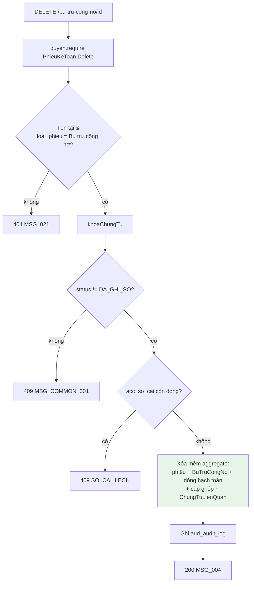

# F07 — Xóa chứng từ bù trừ công nợ

| Mục | Nội dung |
|---|---|
| Mã chức năng | **F07** |
| Use case | **PMKT-U-14692** — `4.usecases/PMKT-U-14692_BTCN_Xoa/UC_BTCN_Xoa.md` |
| Màn hình | `5.screens/SCR_BTCN_PopupXacNhanXoa.md` BR01 · `SCR_BTCN_ChungTu_XemChiTiet.md:51` · `SCR_BTCN_DanhSach.md:34` |
| Endpoint phụ trách | **A12** `DELETE /api/ke-toan-tong-hop/bu-tru-cong-no/{id}` |
| Quyết định liên quan | **D3** (ChungTuTemplate, luồng XOA) |

---

## 1. Quyết định riêng của chức năng

| # | Quyết định | Lý do · vì sao không chọn cách kia |
|---|---|---|
| **F07-a** | Dùng **nguyên** endpoint `DELETE /{id}` của `BaseCrudController.java:159-169`, chỉ override để gắn `messageId` | Base đã có chữ ký + kiểm quyền. Việc riêng là mã message `MSG_..._004` / `_020` |
| **F07-b** | Xóa **mềm** cả aggregate: phiếu + `BuTruCongNo` + dòng hạch toán + cặp ghép + tham chiếu | BR29.1 "chỉ được phép thực hiện xóa mềm"; `UC_BTCN_Xoa.md:40` liệt kê đích danh 4 entity. Cascade xóa mềm theo BR29.2 |
| **F07-c** | Popup xác nhận (`MSG_..._103`) là **FE-only** | `SCR_BTCN_PopupXacNhanXoa.md:23` — popup mở trước khi gọi API. BE nhận request DELETE là đã coi như đã xác nhận |
| **F07-d** | Xóa **không** chạm số dư công nợ, **không** gọi `port` | `UC_BTCN_Xoa.md:72` — "Số dư công nợ không thay đổi thêm (chứng từ ở trạng thái Chưa ghi sổ nên công nợ chưa bị ảnh hưởng, hoặc đã được hoàn trả khi Bỏ ghi)". Gọi `hoanTraSoDu` ở đây sẽ **cộng trả hai lần** với chứng từ đã Bỏ ghi trước đó |
| **F07-e** | **Gỡ tham chiếu đối ứng** (`ktth_chung_tu_lien_quan`) — xóa mềm các dòng | `UC_BTCN_Xoa.md:17,40` — "gỡ tham chiếu đối ứng trên các chứng từ công nợ liên quan". Khác F06-f (Bỏ ghi **giữ** tham chiếu) |
| **F07-f** | **Không** có endpoint xóa vĩnh viễn | BR29.1. Hệ quả: số chứng từ của bản đã xóa **được dùng lại** vì unique index có `WHERE da_xoa = false` (`V202:70-74`) |

---

## 2. Hợp đồng API

### A12 — `DELETE /api/ke-toan-tong-hop/bu-tru-cong-no/{id}`

**Quyền:** `PhieuKeToan.Delete` (`UC_BTCN_Xoa.md:12,29`, `QuyenChecker.java:31`).

**Body optional** — chữ ký base đã kiểm (§2.4-Đ3 ở [00](00-ke-hoach-tong.md)): `DeleteRequest(Instant updatedAt)` (`core/request/DeleteRequest.java:17`). Token optimistic-lock là **`ngayCapNhat`**, **không phải `phienBan`**:

> `DeleteRequest.java:8-12` — *"FE gửi `{ "updatedAt": "<ngayCapNhat của bản ghi đang xem>" }`; BE so với `ngayCapNhat` hiện tại và trả 409 `STALE_DATA` nếu lệch… Không gửi body (hoặc `updatedAt = null`) → **bỏ qua kiểm tra**"*

```jsonc
// Request (optional)
{ "updatedAt": "2026-08-11T09:12:33Z" }
```

```jsonc
// Response 200 — ApiResponse<Void> = { data, message, messageId }
{
  "data": null,
  "message": "Xóa chứng từ bù trừ công nợ thành công",
  "messageId": "MSG_PMKT-E-14294_004"
}
```

> ⚠️ Base trả sẵn `ApiResponse.ok("Xoá thành công", "MSG_CORE_DELETE_SUCCESS")` (`BaseCrudController.java:164`) ⇒ **phải override** `delete` để đổi sang câu và mã của epic. Override vẫn gọi `quyen.require(maChucNang(), QuyenChecker.DELETE)` trước, nếu không `HandlerAuthorizationArchTest` đỏ build.
>
> ⚠️ FE **phải** gửi `updatedAt` — không gửi thì base **bỏ qua** kiểm tra và BR12 "Chống sửa đổi đồng thời" mất hiệu lực ở luồng xoá. Giá trị lấy từ `ngayCapNhat` mà A1/A8 đã trả ([01 §3.1](01-danh-sach-chung-tu-bu-tru.md)).

| HTTP | `code` | `messageId` | Khi nào | Nguồn BA |
|---|---|---|---|---|
| 403 | `FORBIDDEN` | `MSG_..._005` | Thiếu `PhieuKeToan.Delete` | `UC_BTCN_Xoa.md:61` |
| 404 | `KHONG_TIM_THAY` | `MSG_..._021` | Không tồn tại / đã xóa bởi người khác / không phải loại bù trừ | `:63` |
| 409 | `TRANG_THAI_KHONG_HOP_LE` | `MSG_COMMON_001` | `status == DA_GHI_SO` | `:62` · BR12 |
| 409 | `STALE_DATA` | — | `updatedAt` lệch `ngayCapNhat` hiện tại | BR12 "Chống sửa đổi đồng thời" · `DeleteRequest.java:8-12` |
| 409 | `SO_CAI_LECH` | `MSG_CORE_CT_002` | Cờ nói chưa ghi sổ mà `acc_so_cai` còn dòng — §4 V5 | `accounting_core/chung_tu/model/MaLoiChungTu.java:42-43` |
| 500 | `INTERNAL_ERROR` | `MSG_..._020` | Lỗi hệ thống khi xóa — giữ nguyên chứng từ | `:64` |

> BA ghi "Chứng từ ở trạng thái Đã ghi sổ → **Không hiển thị nút Xóa**" và cột Message để trống (`:62`). Nhưng nút ẩn ở FE không chặn được gọi thẳng API ⇒ BE **vẫn phải** chặn, và mã hợp lý nhất là `MSG_COMMON_001` ("Thao tác không hợp lệ với trạng thái hiện tại của chứng từ/phiếu" — `business_rules.md` BR16.1), đúng khuôn BR42.1 đã dùng cho ca tương tự.

---

## 3. Ánh xạ dữ liệu bị thay đổi

| Bảng | Thay đổi | Nguồn BA |
|---|---|---|
| `ktth_phieu_ke_toan_tong_hop` | `da_xoa = true`, `ngay_xoa`, `nguoi_xoa` | BR29.1, BR46 |
| `ktth_bu_tru_cong_no` | như trên (cascade) | `UC_BTCN_Xoa.md:40` |
| `ktth_chi_tiet_phieu_ktth_hach_toan` | như trên (cascade) | `:40` |
| `ktth_chi_tiet_bu_tru_cong_no_chung_tu` | như trên (cascade) | `:40` |
| `ktth_chung_tu_lien_quan` | như trên (cascade) — **gỡ tham chiếu đối ứng** | `:17,40` · F07-e |
| `acc_so_cai` | **không đụng** — chứng từ chưa ghi sổ thì không có dòng nào | `:72` · `ChungTuTemplate.java:187-192` |
| Chứng từ gốc (số dư, trạng thái thanh toán) | **không đụng** | `:72` · F07-d |
| `aud_audit_log` | +1 dòng, trong transaction | `ChungTuTemplate.java:521-530` |

---

## 4. Validation — ma trận đầy đủ

| # | Luật | Điều kiện | Thời điểm | Thông báo | BR nguồn |
|---|---|---|---|---|---|
| V1 | Quyền | `PhieuKeToan.Delete` | Đầu handler | 403 · `MSG_..._005` | BR25 · `:61` |
| V2 | Chứng từ tồn tại, `da_xoa = false` | | `chuanBiChungTu` | 404 · `MSG_..._021` | `:63` · BR29.1 |
| V3 | Đúng loại `'Bù trừ công nợ'` | `loai_phieu` | `chuanBiChungTu` | 404 · `MSG_..._021` | F05-c ([05](05-xem-chi-tiet-chung-tu-bu-tru.md)) |
| V4 | **Chưa ghi sổ** | `status != DA_GHI_SO` | `kiemTraNghiepVu` | 409 · `MSG_COMMON_001` | BR12 · `SCR_BTCN_PopupXacNhanXoa.md:32` |
| V5 | Sổ cái **không còn dòng nào** | `GhiSoApi.daGhiSo(id) == false` | `doiSoatVoiSoCai` — **base tự chạy** (`ChungTuTemplate.java:397-406`) | 409 `SO_CAI_LECH` / `MSG_CORE_CT_002` (`MaLoiChungTu.java:42-43`) | Lưới an toàn khi cờ trạng thái và sổ cái nói ngược nhau |
| V6 | `updatedAt` khớp `ngayCapNhat` | Chỉ khi client **có gửi** body; không gửi → base bỏ qua | Trong `service().delete(id, updatedAt)` | 409 `STALE_DATA` | BR12 · `DeleteRequest.java:8-12` |
| V6b | `phien_ban` khớp | `@Version` trên `AggregateRootEntity` (`core/entity/AggregateRootEntity.java:20-22`) | Lúc flush | 409 `STALE_DATA` | BR12 — **lớp bảo vệ thứ hai**, độc lập với V6 |
| V7 | Tenant | RLS | DB | — | BR28 |
| V8 | **Không** kiểm ràng buộc "đang được nghiệp vụ khác dùng" | — | — | — | Chứng từ bù trừ là **đích cuối**, không có chứng từ nào phát sinh từ nó |

> **V5 là bước base tặng miễn phí.** `doiSoatVoiSoCai` chạy ngay sau `kiemTraNghiepVu` trong `luongXoa` (`ChungTuTemplate.java:194-203`) và chỉ nổ ở ca **lệch**: cờ nói chưa ghi sổ mà `acc_so_cai` còn dòng. Base giải thích rõ vì sao cần: hai luồng SUA/XOA không còn gọi kernel bỏ ghi vô điều kiện nữa, mà `delete from acc_so_cai` là đường xoá **duy nhất** của hệ thống — để lệch trôi qua là bút toán mồ côi vĩnh viễn (`ChungTuTemplate.java:386-391`).

---

## 5. Luồng xử lý

`XoaChungTuBuTru extends ChungTuTemplate<UUID, Void>`, `hanhDong() = XOA` → quyền `PhieuKeToan.Delete` (`HanhDongChungTu.java:18`).

Trình tự `ChungTuTemplate.luongXoa` (`ChungTuTemplate.java:194-203`):

```
thucThi(id)                                        @Transactional
 1. kiemTraDauVao      [base]
 2. kiemTraQuyen       [base]   maChucNang() = "PhieuKeToan" → PhieuKeToan.Delete
 3. chuanBiChungTu     [OVERRIDE] nạp phiếu + con; ctx.ghiNhanChungTu(...)   → V2, V3
 ── luongXoa ─────────────────────────────────────────────────────────────
 4. doiHoiDinhDanh     [base]   (ChungTuTemplate.java:356-363)
 5. khoaChungTu        [base]   (:376-378)
 6. kiemTraNghiepVu    [CÀI]    V4
 7. doiSoatVoiSoCai    [base]   V5 — GhiSoApi.daGhiSo(id) (:397-406)
 8. luuChungTu → truocKhiLuu [OVERRIDE]
                      đánh dấu xóa mềm aggregate: phiếu + BuTruCongNo
                      + dòng hạch toán + cặp ghép + ChungTuLienQuan
                 luuEntity   [CÀI]  save + ctx.ghiNhanChungTu(...)
 9. sauKhiLuu          [OVERRIDE] KHÔNG LÀM GÌ  ← F07-d: không chạm công nợ
10. ghiNhatKyTacDong   [base]
11. taoKetQua          [CÀI]    → null
```

> **`luongXoa` không có bước ghi/gỡ sổ cái** — base giải thích: "chỉ xoá được chứng từ chưa ghi sổ… nên **không có bút toán để gỡ**", và cũng không kiểm kỳ kế toán vì "luồng này không tạo ra trạng thái sổ sách mới, và cũng không gỡ dòng nào để phải hỏi kỳ" (`ChungTuTemplate.java:187-192`).
>
> ⇒ **Xóa chứng từ bù trừ trong kỳ đã khoá vẫn chạy được.** BA không nhắc kỳ kế toán ở UC-14692 (bảng Ngoại lệ `:59-65` **không** có `MSG_..._019`), khớp với hành vi base. Nếu BA muốn chặn thì đó là thay đổi hành vi của kernel dùng chung — nêu ở [00 §12](00-ke-hoach-tong.md).

### 5.1 Sơ đồ



**Bảng gọi base / override / viết mới:**

| Bước | Trạng thái |
|---|---|
| Endpoint, kiểm quyền, khoá, đối soát sổ cái, audit | ✅ **kế thừa nguyên** |
| `chuanBiChungTu`, `truocKhiLuu`, `sauKhiLuu` | 🔁 **override** (`sauKhiLuu` rỗng có chủ đích) |
| `kiemTraNghiepVu`, `luuEntity`, `taoKetQua`, `hanhDong`, `maChucNang` | 🆕 **cài** |
| `messageId` ở controller | 🔁 override → `MSG_..._004` |

---

## 6. Xóa mềm cascade — cách cài

`PhieuKeToanTongHop` là aggregate root ([04 §1](04-luu-chung-tu-bu-tru.md) F04-e). Quan hệ khai `cascade = ALL, orphanRemoval = true` (`docs/be-khung-kien-truc-chuan.md:201-202`).

Nhưng **`cascade = REMOVE` của JPA là xóa cứng**, còn BR29.1 chỉ cho xóa mềm ⇒ **không** dùng `entityManager.remove()`. Cách cài:

**Chữ ký thật (đã kiểm vòng 2):**

| Lớp / interface | Nội dung | Vị trí |
|---|---|---|
| `BaseEntity implements SoftDeletable` | giữ `da_xoa` (`boolean daXoa = false`), `ngay_xoa`, `nguoi_xoa`, `ngay_tao`, `ngay_cap_nhat`, `nguoi_tao`, `nguoi_cap_nhat` | `core/entity/BaseEntity.java:18-43` |
| `SoftDeletable` | `boolean isDaXoa()` · **`void danhDauXoa()`** | `core/shared/domain/SoftDeletable.java:17-21` |
| `SoftDeletableEntity extends TenantedEntity` | **lớp rỗng** — chỉ là marker, không thêm cột nào | `core/entity/SoftDeletableEntity.java:14` |
| `AggregateRootEntity extends TenantedEntity` | thêm `@Version @Column("phien_ban")` | `core/entity/AggregateRootEntity.java:18-22` |

⇒ Tên hàm đúng là **`danhDauXoa()`**, không phải `xoaMem(...)`; và nó **không nhận tham số** — `nguoi_xoa`/`ngay_xoa` do tầng audit gán.

Cách cài:

1. `truocKhiLuu` gọi `phieu.danhDauXoa()` rồi duyệt 4 collection con gọi `danhDauXoa()` trên từng dòng — `cascade = REMOVE` của JPA là **xóa cứng**, không dùng được (BR29.1 chỉ cho xóa mềm);
2. `luuEntity` gọi `repository.save(phieu)` → Hibernate flush `UPDATE … SET da_xoa = true, ngay_xoa = …, nguoi_xoa = …` cho cha và mọi con;
3. Mọi query đọc đã lọc `da_xoa = false` sẵn (`SoftDeleteAttribute` khai ở mức class để tầng truy vấn build đúng predicate — `core/shared/domain/SoftDeletable.java:15`).

**Mẫu tham chiếu:** luồng xóa của `chung_tu_ban_hang/internal/service/business/XoaChungTuBanHang.java`.

Chi tiết chính sách cascade + `ON DELETE RESTRICT` ở [09 §4](09-thiet-ke-db.md).

---

## 7. Tương tranh & transaction

| Khía cạnh | Quyết định | Bằng chứng |
|---|---|---|
| Transaction | Một `@Transactional` ở `thucThi` | `ChungTuTemplate.java:102` |
| Khoá | `khoaChungTu` ở bước 5 — hai người cùng bấm Xóa thì người sau đợi | `:376-378` |
| Optimistic lock | **Hai lớp độc lập**: (1) `DeleteRequest.updatedAt` so với `ngayCapNhat` — chỉ chạy khi client gửi body (`DeleteRequest.java:8-12`); (2) `@Version phien_ban` của `AggregateRootEntity` — luôn chạy lúc flush (`core/entity/AggregateRootEntity.java:20-22`). Cả hai → 409 `STALE_DATA` | `ChungTuTemplate.java:370-374` |
| Idempotency | Xóa lần 2 → 404 `MSG_..._021` (bản ghi đã `da_xoa = true`). Khớp BA: "Chứng từ không tồn tại (đã bị xóa bởi người khác)" (`UC_BTCN_Xoa.md:63`) | |
| Đua với Ghi sổ | `khoaChungTu` + V4 + V5: nếu người khác vừa ghi sổ xong thì V4 (cờ đã cũ) có thể lọt, nhưng V5 hỏi thẳng sổ cái nên chặn được → 409 | `:392-395` |

---

## 8. Phân trang · sắp xếp · lọc · dòng tổng

**Không áp dụng** — endpoint ghi trên một chứng từ.

BR29.4 (giữ nguyên vị trí trang sau khi xóa) là **luật FE**: BE không trả thông tin trang. Ghi rõ để FE không kỳ vọng.

Xóa hàng loạt (`POST /xoa-hang-loat` — `BaseChungTuController.java:177-184`): **Q11**.

---

## 9. Kiểm thử

### 9.1 Unit test (`@Tag("unit")`)

| Lớp test | Input → Kỳ vọng |
|---|---|
| `XoaChungTuBuTruTest` | `status = DA_GHI_SO` → 409 `MSG_COMMON_001` |
| `XoaChungTuBuTruTest` | `hanhDong() == XOA`, `maChucNang() == "PhieuKeToan"` ⇒ quyền `PhieuKeToan.Delete` |
| `XoaChungTuBuTruTest` | `sauKhiLuu` **không** gọi `ChungTuCongNoPort` (F07-d) |
| `XoaChungTuBuTruTest` | `truocKhiLuu` đánh dấu `da_xoa` trên **cả 5** loại bản ghi (phiếu, BuTruCongNo, dòng hạch toán, cặp ghép, ChungTuLienQuan) |
| `XoaChungTuBuTruTest` | `loai_phieu != 'Bù trừ công nợ'` → 404 |
| `MessageIdBuTruTest` | `messageId(XOA) == "MSG_PMKT-E-14294_004"` |

### 9.2 Test tích hợp (cần Docker)

| Lớp test | Kiểm gì |
|---|---|
| `XoaBuTruIT` | Xóa chứng từ `NHAP` → cả 5 bảng có `da_xoa = true`, `ngay_xoa`/`nguoi_xoa` ≠ null (BR46) |
| `XoaBuTruIT` | **Không** dòng nào bị xóa cứng: `SELECT count(*)` (bỏ filter `da_xoa`) không đổi |
| `XoaBuTruIT` | Số dư chứng từ gốc **không đổi** trước/sau xóa (F07-d) |
| `XoaBuTruIT` | Chứng từ `DA_GHI_SO` → 409, không bản ghi nào bị đánh dấu xóa |
| `XoaBuTruIT` | Xóa xong → chứng từ gốc **xuất hiện lại** ở A3/A4 (`UC_BTCN_Xoa.md:72`) |
| `XoaBuTruIT` | Xóa xong → **dùng lại được** số chứng từ cũ (unique partial index `WHERE da_xoa = false` — `V202:70-74`) |
| `XoaBuTruIT` | Xóa 2 lần → lần 2 trả 404 `MSG_..._021` |
| `XoaBuTruIT` | Bỏ ghi → Xóa: số dư gốc giữ nguyên giá trị **sau khi đã hoàn trả**, không cộng trả lần hai (F07-d) |
| `XoaBuTruIT` | Chứng từ có cờ `NHAP` nhưng `acc_so_cai` còn dòng (dựng thủ công) → 409 `SO_CAI_LECH` (V5) |
| `XoaBuTruIT` | A8 sau khi xóa → 404 |

---

## 10. BR đã áp dụng

| BR | Áp ở bước nào |
|---|---|
| BR3 | Popup xác nhận `MSG_..._103` — FE, nội dung nguyên văn ở [00 §11](00-ke-hoach-tong.md) |
| BR12 | V4 — chứng từ đã ghi sổ không cho xóa |
| BR13.1/13.2 | Nút Xóa chỉ hiện khi chưa ghi sổ — field `choPhepXoa` ([05 §3.3](05-xem-chi-tiet-chung-tu-bu-tru.md)) |
| BR25 | V1 `quyen.require(PhieuKeToan, Delete)` |
| BR28 | RLS |
| BR29.1 | §6 chỉ xóa mềm |
| BR29.2 | §6 cascade xóa mềm xuống 4 bảng con |
| BR29.4 | **Luật FE** — ghi rõ ở §8 |
| BR41 | Gỡ tham chiếu đối ứng (F07-e) — đúng hình thức "ngắt liên kết dữ liệu" BR29.2 |
| BR46 | `da_xoa`, `ngay_xoa`, `nguoi_xoa` do base gán |

**Chưa áp được:** BR45 (xóa hàng loạt — **Q11**) · BR17 (kỳ kế toán — base cố ý **không** kiểm ở luồng XOA, §5; BA cũng không yêu cầu).
