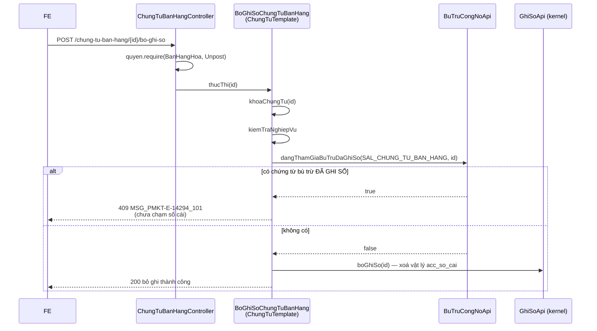

# F08 — SPI công nợ & Chặn Bỏ ghi sổ chứng từ gốc đang tham gia bù trừ

| Mục | Nội dung |
|---|---|
| Mã chức năng | **F08** |
| Use case | **PMKT-U-14693** AC3 — `UC_BTCN_GhiSoBoGhi.md:20-22` |
| Màn hình | `SCR_BTCN_ChungTu_ThemMoi.md` BR04 dòng cuối (`:152`) |
| Endpoint phụ trách | **Không có endpoint mới.** Đây là 2 hợp đồng `api/` + phần tích hợp vào `chung_tu_ban_hang` / `chung_tu_mua_hang` |
| Quyết định liên quan | **D5** (SPI đảo chiều), **D11** (guard qua `BuTruCongNoApi`) — [00 §0](00-ke-hoach-tong.md) |

---

## 1. Hai hợp đồng, hai chiều ngược nhau

```
                       ke_toan_tong_hop/bu_tru_cong_no/api/
                                  │
   ┌──────────────────────────────┴──────────────────────────────┐
   │                                                             │
ChungTuCongNoPort  (SPI đảo chiều)                    BuTruCongNoApi  (API xuôi)
   ▲ CÀI ĐẶT bởi                                          │ GỌI bởi
   │                                                      ▼
chung_tu_ban_hang ─┐                              ┌─ chung_tu_ban_hang
chung_tu_mua_hang ─┘                              └─ chung_tu_mua_hang
```

| | `ChungTuCongNoPort` | `BuTruCongNoApi` |
|---|---|---|
| Ai định nghĩa | `bu_tru_cong_no` | `bu_tru_cong_no` |
| Ai cài đặt | module chứng từ | `bu_tru_cong_no` |
| Ai gọi | `bu_tru_cong_no` | module chứng từ |
| Dùng cho | F02 (lấy dữ liệu), F04/F06 (trừ/hoàn trả công nợ) | F08 §4 — chặn Bỏ ghi (`MSG_..._101`) |
| Mẫu tương đương | `quan_he_chung_tu/api/DongChungTuPort.java` | `quan_he_chung_tu/api/QuanHeChungTuApi.java:69` `coLienKet(...)` |

Cả hai đặt trong **cùng** package `…/bu_tru_cong_no/api/` với `package-info.java` khai `@NamedInterface("bu-tru-cong-no")`; DTO ở `api/dto/` khai `@NamedInterface("bu-tru-cong-no-dto")` **riêng** — lộ `x.api` không tự động lộ `x.api.dto`, đã có đúng một lỗi kiểu này bị `ProxyModularityTest` bắt (`cell-app/CLAUDE.md:38-40`).

---

## 2. Quyết định riêng của chức năng

| # | Quyết định | Lý do · vì sao không chọn cách kia |
|---|---|---|
| **F08-a** | Guard đặt ở `BuTruCongNoApi`, module chứng từ **gọi vào** trong `kiemTraNghiepVu` của luồng BO_GHI_SO (D11) | Mẫu có sẵn: `QuanHeChungTuApi.coLienKet` là guard xoá cho các module chứng từ, javadoc ghi rõ "Luồng xóa chứng từ nguồn **phải** gọi hàm này; bỏ sót thì DB không còn gì chặn" (`quan_he_chung_tu/api/QuanHeChungTuApi.java:62-69`). **Không chọn** thêm SPI vào kernel `accounting_core`: đổi chữ ký kernel chạm mọi module chứng từ hiện có, blast radius lớn hơn hẳn cho một luật của đúng một nghiệp vụ |
| **F08-b** | Một bean `ChungTuCongNoPort` **cho một loại chứng từ**, không phải một bean cho một module | Một module có thể sở hữu nhiều loại (mua hàng có cả chứng từ mua hàng lẫn hoá đơn mua). `loai()` + `chieu()` cho phép `bu_tru_cong_no` chọn đúng nhóm mà không cần biết module nào |
| **F08-c** | `ChungTuCongNoPort` khai `Propagation.MANDATORY` cho mọi method | Đọc: chạy ngoài transaction thì GUC tenant chưa bind, RLS trả tập rỗng "một cách khó hiểu" (`TraCuuDanhMucRepository.java:37-41`). Ghi: phải cùng sống cùng chết với chứng từ bù trừ, đúng lý lẽ `GhiSoApi.java:9-14` |
| **F08-d** | `giamSoDu` / `hoanTraSoDu` nhận **danh sách đã gộp theo chứng từ**, không nhận từng cặp ghép | Một chứng từ gốc có thể ở nhiều cặp ghép (`SCR_BTCN_ChungTu_ThemMoi.md:57`). Gọi N lần = N khoá + N lần tính lại trạng thái thanh toán — xem [06 §3.1](06-ghi-so-bo-ghi-so.md) |
| **F08-e** | Guard chặn theo `status` của **chứng từ bù trừ**: chỉ chặn khi có chứng từ bù trừ **`DA_GHI_SO`** tham chiếu tới | BA: "Khi chứng từ bù trừ **Đã ghi sổ**: người dùng Bỏ ghi sổ một chứng từ công nợ đang tham gia bù trừ → chặn" (`UC_BTCN_GhiSoBoGhi.md:21`). Chứng từ bù trừ chưa ghi sổ thì chưa động vào công nợ ⇒ không có lý do chặn |
| **F08-f** | Guard **chỉ** áp cho thao tác **Bỏ ghi sổ**, không áp cho Xóa chứng từ gốc | BA chỉ nêu Bỏ ghi (`UC_BTCN_GhiSoBoGhi.md` AC3). Mà chứng từ gốc đã ghi sổ thì vốn không xoá được (BR12) ⇒ ca "xoá chứng từ gốc đang bù trừ" không tồn tại. Ghi rõ để không cài thừa |

---

## 3. `ChungTuCongNoPort` — hợp đồng đầy đủ

### 3.1 Interface

```java
package vn.dopai.pmkt.cell.ke_toan_tong_hop.bu_tru_cong_no.api;

/**
 * Cổng ĐẢO CHIỀU: mỗi module chứng từ tự cài một bean để bù trừ công nợ đọc và
 * cập nhật số dư của chứng từ do module đó sở hữu.
 *
 * <p>Mọi method chạy TRONG transaction của người gọi ({@code Propagation.MANDATORY}).
 */
public interface ChungTuCongNoPort {

    LoaiChungTuCongNo loai();

    ChieuCongNo chieu();                    // PHAI_THU | PHAI_TRA

    List<DongCongNoDto> timChungTuConNo(TieuChiCongNoDto tieuChi);

    List<DongCongNoDto> theoIds(Collection<UUID> chungTuIds);

    void giamSoDu(List<LenhCapNhatCongNo> lenh);

    void hoanTraSoDu(List<LenhCapNhatCongNo> lenh);
}
```

| Method | Hợp đồng · điều kiện | Dùng ở |
|---|---|---|
| `loai()` | Hằng, một bean một loại (F08-b) | Định tuyến |
| `chieu()` | `PHAI_THU` = chứng từ hạch toán **Nợ** TK 131 · `PHAI_TRA` = **Có** TK 331 (`SCR_BTCN_BuTru.md:42,73`) | Định tuyến A3/A4 |
| `timChungTuConNo` | Trả **toàn bộ** dòng thoả (không phân trang — F02-c). Lọc sẵn: `status = DA_GHI_SO`, `da_xoa = false`, số dư > 0, khớp đối tượng + TK + loại tiền, keyword trên `soChungTu`/`soHoaDon` | A3, A4 ([02](02-lay-du-lieu-cong-no.md)) |
| `theoIds` | Trả dòng **hiện tại** theo id, kể cả số dư = 0. Id không tồn tại/đã xóa → **không** xuất hiện trong kết quả (caller tự phát hiện thiếu) | A5, A6, A7, A10, A8 |
| `giamSoDu` | Trừ `soTien`/`soTienQuyDoi`, cập nhật `trang_thai_thanh_toan`. **Phải** `SELECT … FOR UPDATE ORDER BY id` trước khi trừ. Số dư không đủ → ném `SoDuKhongDuException` (mang mã `MSG_PMKT-E-14294_018`) | A7 (`ghiSoNgay`), A10 |
| `hoanTraSoDu` | Cộng trả, cập nhật lại `trang_thai_thanh_toan`. **Idempotent** | A11 |

### 3.2 DTO

```java
public record DongCongNoDto(
        UUID chungTuId, LoaiChungTuCongNo loaiChungTu,
        LocalDate ngayChungTu, String soChungTu, String soHoaDon,
        LocalDate hanThanhToan, String dienGiai,
        UUID loaiTienId, BigDecimal tyGia,
        BigDecimal soTien,        BigDecimal soTienQuyDoi,      // tổng phải thu / phải trả
        BigDecimal soDuConLai,    BigDecimal soDuConLaiQuyDoi,  // Số chưa thu / Số còn nợ
        Integer phienBan) {}

public record TieuChiCongNoDto(
        UUID doiTuongId, UUID taiKhoanCongNoId, UUID loaiTienId,
        LocalDate ngayBuTru, String keyword) {}

public record LenhCapNhatCongNo(
        UUID chungTuId, BigDecimal soTien, BigDecimal soTienQuyDoi) {}
```

Đơn vị: `soTien*` **nguyên tệ** (`money_foreign` = `numeric(18,4)`), `*QuyDoi` **đồng tiền hạch toán** (`money_vnd` = `numeric(18,2)`) — BR7 §7.1 + quy ước `docs/be-khung-kien-truc-chuan.md:279-281`.

### 3.3 Bên cài đặt — việc phải làm ở 2 module chứng từ

#### `chung_tu_ban_hang` — `ChungTuBanHangCongNoAdapter` (`internal/adapter/`)

| Việc | Chi tiết | Rủi ro |
|---|---|---|
| Chọn nguồn số dư | **Q5** — cặp header `tong_tien_thanh_toan` − `so_tien_da_thanh_toan` (`ChungTuBanHang.java:184,214`) **hay** per-line `sal_chi_tiet_chung_tu_ban_hang.so_con_no_nt/_vnd` (`V163:25-27`) | **R2** — per-line **chưa có dòng Java nào** đọc/ghi (`grep -rni "con_no" chung_tu_ban_hang/` rỗng) |
| Nếu chọn per-line | Bù `@Column` cho 4 cột (`so_con_no_vnd/_nt`, `tong_no_phai_thu_vnd/_nt`) vào `ChiTietChungTuBanHang`; `timChungTuConNo` cộng dồn lên cấp chứng từ; `giamSoDu` **phân bổ ngược xuống dòng** theo `thu_tu` | Bất đối xứng với mua hàng — [02 §4.2](02-lay-du-lieu-cong-no.md) |
| Lọc theo TK phải thu | Chứng từ có dòng hạch toán Nợ TK đã chọn — `sal_chi_tiet_chung_tu_ban_hang.tai_khoan_no_id` (`ChiTietChungTuBanHang.java:126`) | |
| Đối tượng | `khach_hang_id` (`ChungTuBanHang.java:71-72`) | |
| Trạng thái thanh toán | Dùng lại `TrangThaiThanhToan.cua(daThanhToan, phaiThu)` (`TrangThaiThanhToan.java:36-42`) — giá trị DB **tiếng Việt có dấu** | [06 §3.1](06-ghi-so-bo-ghi-so.md) |
| **Số hóa đơn** | ⚠ **KHÔNG có cột** — phải viết `@Formula` gom từ `sal_hoa_don_ban_hang.so_hoa_don` (`V77:48`) qua **hai** đường: `chung_tu_ban_hang_id` (`V77:130`) và `sal_chi_tiet_hd_ban_hang.chi_tiet_chung_tu_ban_hang_id` (`V77:134`) | [02 §4.3](02-lay-du-lieu-cong-no.md) — mẫu là `CongThucSql.SO_HOA_DON` của mua hàng |

#### `chung_tu_mua_hang` — `ChungTuMuaHangCongNoAdapter`

| Việc | Chi tiết | Rủi ro |
|---|---|---|
| Bù cột nguyên tệ | `@Column(name = "so_con_no_nt")` vào `ChungTuMuaHang` — DB đã có (`V154:18`), entity chỉ map `so_con_no_vnd` (`ChungTuMuaHang.java:155-156`) | **R3** — không bù thì bù trừ ngoại tệ tính sai gốc |
| Nguồn số dư | Header `so_con_no_nt` / `so_con_no_vnd`; tổng phải trả `tong_no_phai_tra_vnd` (`:151`) | |
| Lọc theo TK phải trả | Dòng hạch toán Có TK đã chọn trên `pur_chi_tiet_chung_tu_mua_hang` | |
| Đối tượng | `nha_cung_cap_id` (`ChungTuMuaHang.java:80-81`) | |
| Trạng thái thanh toán | `TrangThaiThanhToanMuaHang` (`…/model/TrangThaiThanhToanMuaHang.java:18-24`) — hằng giữa tên `DA_THANH_TOAN_MOT_PHAN`, giá trị DB **PascalCase không dấu** (`"DaThanhToanMotPhan"`) — **khác hẳn bán hàng** | [06 §3.1](06-ghi-so-bo-ghi-so.md) |
| Số hóa đơn | ✅ **Đã có sẵn** — `@Formula(CongThucSql.SO_HOA_DON)` + `@Searchable(sortable, keyword)` (`ChungTuMuaHang.java:195-197`); công thức ở `CongThucSql.java:145-156`. Dùng lại, không viết mới | [02 §4.3](02-lay-du-lieu-cong-no.md) |

> ⚠️ Hai module này **đã có code đang chạy**. Bù cột / đổi nguồn số dư là thay đổi có rủi ro hồi quy ⇒ làm ở **PR riêng, trước** PR bù trừ, kèm test hồi quy của chính module đó. Đây là bước 7 trong [00 §8](00-ke-hoach-tong.md).

---

## 4. `BuTruCongNoApi` — guard `MSG_PMKT-E-14294_101`

### 4.1 Interface

```java
package vn.dopai.pmkt.cell.ke_toan_tong_hop.bu_tru_cong_no.api;

/**
 * Cổng công khai của Bù trừ công nợ. Module chứng từ gọi vào TRƯỚC khi Bỏ ghi sổ.
 */
public interface BuTruCongNoApi {

    /**
     * Chứng từ công nợ này có đang tham gia một chứng từ bù trừ ĐÃ GHI SỔ không.
     *
     * <p>Chỉ tính chứng từ bù trừ {@code status = DA_GHI_SO} và {@code da_xoa = false}.
     * Chứng từ bù trừ chưa ghi sổ KHÔNG chặn — nó chưa động vào công nợ.
     */
    boolean dangThamGiaBuTruDaGhiSo(LoaiChungTuCongNo loai, UUID chungTuId);

    /** Bản nhiều-id để luồng hàng loạt không gọi N lần. */
    Set<UUID> locChungTuBiChanBoGhi(LoaiChungTuCongNo loai, Collection<UUID> chungTuIds);
}
```

Truy vấn: tồn tại dòng `ktth_chi_tiet_bu_tru_cong_no_chung_tu` có `chung_tu_phai_thu_id = :id` **hoặc** `chung_tu_phai_tra_id = :id` (khớp `loai_chung_tu_*`), `da_xoa = false`, join phiếu cha có `status = 'DA_GHI_SO'` và `da_xoa = false`. Cần index hỗ trợ — [09 §4](09-thiet-ke-db.md).

### 4.2 Tích hợp vào module chứng từ

Trong `BoGhiSoChungTuBanHang.kiemTraNghiepVu(ctx)` (và bản mua hàng tương ứng), thêm:

```java
if (buTruCongNo.dangThamGiaBuTruDaGhiSo(LoaiChungTuCongNo.SAL_CHUNG_TU_BAN_HANG, ctx.chungTuId())) {
    throw ApiException.conflict(
            MaLoiBanHang.DANG_THAM_GIA_BU_TRU,
            MaMessageBuTruCongNo.MSG_101,   // "MSG_PMKT-E-14294_101"
            "Chứng từ " + ctx.soChungTu() + " đang tham gia chứng từ bù trừ công nợ đã ghi sổ");
}
```

| Điểm chèn | Vì sao |
|---|---|
| `kiemTraNghiepVu` của luồng **BO_GHI_SO** | Đó là hook lớp con dùng để "ném đúng mã lỗi của mình cho ca thường gặp" (`ChungTuTemplate.java:381-385`) |
| **Sau** khi `khoaChungTu` đã chạy | `luongBoGhiSo` gọi `khoaChungTu` trước `kiemTraNghiepVu` (`ChungTuTemplate.java:231-237`) ⇒ kiểm chạy dưới khoá, không có cửa sổ đua |
| **Trước** `xoaButToanSoCai` | Chặn trước khi chạm sổ cái |

**HTTP 409** — đây là xung đột trạng thái, không phải lỗi đầu vào. FE hiển thị popup chặn "không cho tiếp tục" (`6.messages.md` mô tả `MSG_..._101`).

> ⚠️ **Đây là ngoại lệ của BR41** — xem **Q7** ở [00 §12](00-ke-hoach-tong.md). BR41 nói tham chiếu mềm **không chặn** Xóa/Bỏ ghi, nhưng chính BR41 tự loại trừ "quan hệ ràng buộc dữ liệu nghiệp vụ (… **đối trừ/bù trừ công nợ** …)" khỏi phạm vi của nó và trả về "quy tắc riêng của từng nghiệp vụ tại epic tương ứng". Epic này chọn **chặn** — ghi rõ đang áp ngoại lệ do chính BR41 mở, không phải lệch BR.

### 4.3 Phụ thuộc mới giữa các module

```
chung_tu_ban_hang  ──► ke_toan_tong_hop.bu_tru_cong_no.api            (mới)
chung_tu_mua_hang  ──► ke_toan_tong_hop.bu_tru_cong_no.api            (mới)
ke_toan_tong_hop   ──► accounting_core.chung_tu / .hach_toan.api       (như mọi module chứng từ)
ke_toan_tong_hop   ──► core, common.cau_hinh_he_thong.api             (như mọi module)
```

Hợp lệ với Modulith **miễn là** `api/` và `api/dto/` đều khai `@NamedInterface`. `bu_tru_cong_no` **không bao giờ** import `chung_tu_*.internal` — đó là toàn bộ lý do SPI đảo chiều tồn tại.

`ProxyModularityTest` (`src/test/java/vn/dopai/pmkt/cell/arch/ProxyModularityTest.java`) chỉ soi vi phạm **có nhắc tới module mình** ⇒ phải xanh ngay từ commit đầu; module mới "phải sạch tuyệt đối về ranh giới" (`cell-app/CLAUDE.md:179`).

---

## 5. Validation

| # | Luật | Thời điểm | Thông báo | BR nguồn |
|---|---|---|---|---|
| V1 | Chứng từ công nợ đang tham gia bù trừ **đã ghi sổ** → chặn Bỏ ghi | `kiemTraNghiepVu` của luồng BO_GHI_SO, dưới khoá | 409 · `MSG_..._101` | `UC_BTCN_GhiSoBoGhi.md:21` |
| V2 | Chứng từ bù trừ **chưa** ghi sổ → **không** chặn | như trên | — | F08-e |
| V3 | Chứng từ bù trừ đã **xóa mềm** → **không** chặn | như trên | — | BR29.1 |
| V4 | `giamSoDu`: số dư không đủ | Trong port, sau `FOR UPDATE` | ném `SoDuKhongDuException` → 409 `MSG_..._018` | `UC_BTCN_GhiSoBoGhi.md:44` |
| V5 | `hoanTraSoDu`: idempotent | Trong port | — | Kernel bỏ ghi cũng idempotent (`GhiSoApi.java:37-39`) |
| V6 | Tenant | RLS ở DB | — | BR28 |

---

## 6. Luồng xử lý



**Bảng gọi base / viết mới:**

| Phần | Trạng thái |
|---|---|
| Trình tự luồng BO_GHI_SO, khoá, gỡ sổ cái, kiểm kỳ | ✅ **kế thừa nguyên** `ChungTuTemplate.java:231-243` |
| `ChungTuCongNoPort`, `BuTruCongNoApi` + DTO | 🆕 **viết mới** ở `bu_tru_cong_no/api/` |
| `BuTruCongNoApiImpl` | 🆕 `bu_tru_cong_no/internal/adapter/` |
| `ChungTuBanHangCongNoAdapter`, `ChungTuMuaHangCongNoAdapter` | 🆕 **viết mới** ở 2 module chứng từ |
| Chèn guard vào `BoGhiSoChungTuBanHang` / `BoGhiSoChungTuMuaHang` | 🔁 **sửa file có sẵn** — diff nhỏ, đúng phạm vi |
| Bù `@Column` số dư nguyên tệ / per-line | 🔁 **sửa entity có sẵn** — R2, R3, PR riêng |

---

## 7. Tương tranh & transaction

| Khía cạnh | Quyết định |
|---|---|
| Transaction | Mọi method của cả 2 interface khai `Propagation.MANDATORY` (F08-c) |
| Thứ tự khoá | Luôn **chứng từ bù trừ trước, chứng từ gốc sau** ở luồng bù trừ. Luồng bỏ ghi chứng từ gốc chỉ khoá chứng từ gốc rồi **đọc** bảng bù trừ (không khoá) ⇒ không tạo chu trình |
| `FOR UPDATE ORDER BY id` | Bắt buộc trong `giamSoDu`/`hoanTraSoDu` — thứ tự cố định chống deadlock, cùng khuôn `QuanHeChungTuApi.java:25-27` |
| Đua guard vs. ghi sổ bù trừ | Người A bỏ ghi chứng từ gốc, người B ghi sổ chứng từ bù trừ cùng lúc: B khoá chứng từ bù trừ rồi mới `port.giamSoDu` → khoá chứng từ gốc; A đã khoá chứng từ gốc và đang đọc bảng bù trừ. **Không** chu trình khoá, nhưng có thể ra kết quả: A qua guard (bù trừ chưa `DA_GHI_SO`) và B trừ số dư sau đó. Kết quả cuối vẫn đúng — B nạp lại số dư dưới khoá và ném `MSG_..._018` nếu A đã cộng trả xong. **Không** cần khoá thêm |
| Idempotency | `hoanTraSoDu` idempotent (V5). `giamSoDu` **không** idempotent — được bảo vệ bởi `status != DA_GHI_SO` ở tầng nghiệp vụ ([06 §4.1](06-ghi-so-bo-ghi-so.md) V3) |

---

## 8. Phân trang · sắp xếp · lọc · dòng tổng

**Không áp dụng** — không có endpoint.

`locChungTuBiChanBoGhi` tồn tại để luồng **bỏ ghi hàng loạt** (`BaseChungTuController.java:168-175`) của các module chứng từ không phải gọi N lần. BR42.3 nói thao tác hàng loạt "tự động bỏ qua" chứng từ không hợp lệ và báo `"Bỏ ghi sổ thành công X/Y chứng từ. Đã bỏ qua Z chứng từ…"`.

> ⚠️ Câu thông báo mẫu của BR42.3 chỉ nói tới lý do "chưa ghi sổ". Chứng từ bị bỏ qua vì **đang tham gia bù trừ** cần một câu riêng, hoặc gộp vào danh sách lỗi chi tiết của `KetQuaHangLoatDto`. **Cần BA xác nhận** — nêu ở [00 §12](00-ke-hoach-tong.md).

---

## 9. Kiểm thử

### 9.1 Unit test (`@Tag("unit")`)

| Lớp test | Input → Kỳ vọng |
|---|---|
| `BuTruCongNoApiImplTest` | Có cặp ghép trỏ tới chứng từ, phiếu `DA_GHI_SO` → `true` |
| `BuTruCongNoApiImplTest` | Phiếu `NHAP` → `false` (F08-e) |
| `BuTruCongNoApiImplTest` | Phiếu `da_xoa = true` → `false` (V3) |
| `BuTruCongNoApiImplTest` | Khớp `chung_tu_phai_thu_id` **hoặc** `chung_tu_phai_tra_id` — kiểm cả 2 chiều |
| `BuTruCongNoApiImplTest` | Sai `loaiChungTu` (cùng UUID, khác loại) → `false` |
| `BuTruCongNoApiImplTest` | `locChungTuBiChanBoGhi` với 5 id, 2 bị chặn → trả đúng 2 |
| `BoGhiSoChungTuBanHangTest` | Guard trả `true` → ném 409 `MSG_..._101`, **không** gọi `GhiSoApi.boGhiSo` |
| `BoGhiSoChungTuBanHangTest` | Guard trả `false` → luồng chạy tiếp bình thường |
| `ChungTuBanHangCongNoAdapterTest` | Cộng dồn số dư per-line lên cấp chứng từ đúng tổng (nếu Q5 chốt per-line) |
| `ChungTuBanHangCongNoAdapterTest` | `giamSoDu` phân bổ ngược xuống dòng theo `thu_tu`, không để dòng nào âm |
| `ChungTuMuaHangCongNoAdapterTest` | Trả **cả** `so_con_no_nt` và `so_con_no_vnd` (R3) |
| `ChungTuMuaHangCongNoAdapterTest` | `giamSoDu` vượt số dư → ném `SoDuKhongDuException` |
| `ChungTuMuaHangCongNoAdapterTest` | `hoanTraSoDu` gọi 2 lần cùng lệnh → số dư **không** cộng đôi (V5) |
| `TrangThaiThanhToanTest` | Số dư về 0 → `DA_THANH_TOAN`; còn dư → `THANH_TOAN_MOT_PHAN`; cộng trả về đủ → `CHUA_THANH_TOAN` |

### 9.2 Test tích hợp (cần Docker)

| Lớp test | Kiểm gì |
|---|---|
| `ChanBoGhiChungTuGocIT` | Ghi sổ chứng từ bù trừ → bỏ ghi chứng từ bán hàng tham gia → **409** `MSG_..._101`, `acc_so_cai` của chứng từ bán hàng **còn nguyên** |
| `ChanBoGhiChungTuGocIT` | Bỏ ghi chứng từ bù trừ trước → bỏ ghi chứng từ bán hàng → **200** |
| `ChanBoGhiChungTuGocIT` | Xóa chứng từ bù trừ → bỏ ghi chứng từ bán hàng → **200** (V3) |
| `ChanBoGhiChungTuGocIT` | Bù trừ ở trạng thái `NHAP` → bỏ ghi chứng từ gốc → **200** (F08-e) |
| `ChanBoGhiChungTuGocIT` | Áp cho **cả** chứng từ mua hàng (chiều phải trả) |
| `CongNoPortIT` | `timChungTuConNo` khớp đủ 4 tiêu chí (đối tượng, TK, loại tiền, số dư > 0) |
| `CongNoPortIT` | `giamSoDu` → `hoanTraSoDu` → số dư và `trang_thai_thanh_toan` về đúng giá trị ban đầu |
| `CongNoPortIT` | Hai transaction cùng `giamSoDu` một chứng từ → cái sau đợi, không âm số dư |
| `ProxyModularityTest` | **Không** vi phạm ranh giới nào nhắc tới `ke_toan_tong_hop` |

---

## 10. BR đã áp dụng

| BR | Áp ở bước nào |
|---|---|
| BR7 | DTO tách rõ nguyên tệ (`18,4`) / quy đổi (`18,2`) |
| BR12 | Guard chỉ chặn khi bù trừ `DA_GHI_SO` |
| BR16 | `MSG_..._101` popup chặn |
| BR18 | Cập nhật cả nguyên tệ lẫn quy đổi |
| BR25 | Kiểm quyền ở luồng gọi (`BanHangHoa.Unpost` / `MuaHang.Unpost`), guard không kiểm quyền lại |
| BR28 | `MANDATORY` + RLS |
| BR29.1 | V3 — bản ghi xóa mềm không chặn |
| BR41 | **Ngoại lệ do chính BR41 mở** — quan hệ ràng buộc nghiệp vụ, xem §4.2 và **Q7** |
| BR42.1 | Guard chạy trong luồng bỏ ghi, trước khi chạm sổ cái |
| BR42.3 | `locChungTuBiChanBoGhi` phục vụ bỏ ghi hàng loạt — câu thông báo cần BA chốt (§8) |
