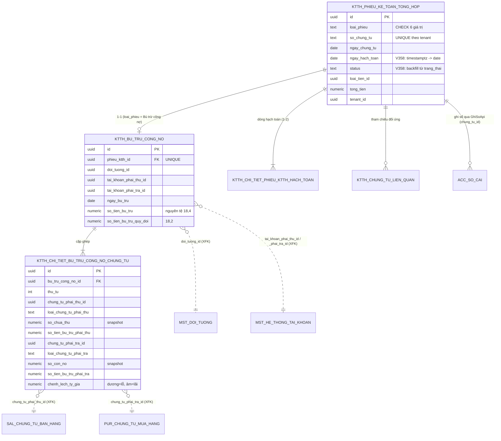

# F09 — Thiết kế DB & Migration — Bù trừ công nợ

> **Mục này phải được DBA/Dev BE ký duyệt TRƯỚC khi code.** §5 (migration) chỉ là bản dịch của §2–§4 sang SQL — nếu §5 có thứ gì không xuất hiện ở §2–§4 thì §2–§4 chưa xong.
>
> **Số migration lớn nhất lúc khảo sát: `V357`** (`ls cell-app/src/main/resources/db/migration | sort -V | tail -1`). Con số này trôi nhanh — chạy lại lệnh trên ngay trước khi đặt tên file.

---

## 1. Hiện trạng bảng (nguồn sự thật)

### 1.1 Bốn bảng `ktth_*` đã tồn tại

Dựng ở **`V202__ktth_phieu_ke_toan_tong_hop.sql`** (PMKT-E-09980), sau đó bị 4 migration chuẩn hoá đè lên: `V258`, `V348`, `V351`, `V357`.

| Bảng | Dòng tạo | Vai trò | Đợt này |
|---|---|---|---|
| `ktth_phieu_ke_toan_tong_hop` | `V202:35` | Master phiếu KTTH — bù trừ là `loai_phieu = 'Bù trừ công nợ'` | **dùng + vá schema** |
| `ktth_chi_tiet_phieu_ktth_hach_toan` | `V202:97` | Dòng tab Hạch toán | **dùng** |
| `ktth_chung_tu_lien_quan` | `V202:237` | Tab Tham chiếu | **dùng** |
| `ktth_chi_tiet_phieu_ktth_hoa_don` | `V202:159` | Tab Hóa đơn | ❌ **không đụng** — ngoài phạm vi ([00 §1.2](00-ke-hoach-tong.md)) |

**Bảng đang RỖNG** — không module Java nào ghi vào (`find cell/ -maxdepth 1 -type d` không có module KTTH; xem [00 §2.1](00-ke-hoach-tong.md)). ⇒ ALTER phá huỷ vẫn an toàn, nhưng **phải kiểm bằng query** trước khi chạy (§6).

### 1.2 `ktth_phieu_ke_toan_tong_hop` — bộ cột hiện có

| Nhóm | Cột | Do đâu | Ghi chú |
|---|---|---|---|
| Nghiệp vụ (V202) | `loai_phieu`, `so_chung_tu`, `ngay_chung_tu`, `ngay_hach_toan`, `nam`, `mo_ta`, `loai_tien_id`, `ty_gia`, `tong_tien`, `trang_thai` | `V202:36-54` | `trang_thai` CHECK `('Chưa ghi sổ','Đã ghi sổ')` (`V202:52-53`) |
| Chuẩn chứng từ (V348) | `chi_nhanh_id`, `loai_chung_tu_id`, `giao_dich_chung_tu_id`, **`status`**, `nguoi_duyet_id`, `ngay_duyet`, `nguoi_ghi_so`, `thoi_gian_ghi_so` | `V348:68-77` | `status` CHECK `NHAP/CHO_DUYET/DA_DUYET/DA_GHI_SO/HUY` **NOT VALID** (`V348:100-104`) |
| Tenant / audit / xóa mềm | `tenant_id`, `phien_ban`, `ngay_tao`, `nguoi_tao`, `ngay_cap_nhat`, `nguoi_cap_nhat`, `da_xoa`, `ngay_xoa`, `nguoi_xoa` | `V202:56-64`, `V348:79-87` | BR28, BR46 — base entity quản, **không khai lại** |
| Hạ tầng | PK (`V202:64-65`), index `(tenant_id, ngay_chung_tu) WHERE da_xoa=false` (`V202:66-68`), unique `(tenant_id, so_chung_tu) WHERE da_xoa=false` (`V202:70-74`), RLS ENABLE+FORCE+policy (`V202:75-79`), `trg_audit_*` (`V202:80`), GRANT `pmkt_app` (`V202:95`) | | |

### 1.3 Ba khiếm khuyết phải vá

| # | Vấn đề | Bằng chứng | Hệ quả nếu bỏ qua |
|---|---|---|---|
| **K1** | **Hai cột trạng thái chồng nhau**: `trang_thai` (tiếng Việt) và `status` (tên hằng) | `V202:52-53` vs `V348:75,100-104` | `BaseChungTuEntity.java:72-73` map `status`; `trang_thai` `NOT NULL` **không default** ⇒ INSERT qua entity **vỡ ngay** vì thiếu giá trị. R7 |
| **K2** | **`ngay_hach_toan` là `timestamptz`**, base map `LocalDate` | `V202:47` vs `core/entity/BaseChungTuEntity.java:65-66`. `V348:74` có `ADD COLUMN IF NOT EXISTS ngay_hach_toan date` nhưng cột đã tồn tại ⇒ **no-op** | Lệch kiểu; `ddl-auto=none` nên **không** lộ lúc khởi động, chỉ vỡ khi người dùng mở màn hình (R8, R9 — đúng ca đã ghi ở `V351:11-16`) |
| **K3** | **Không có index phủ sort mặc định** `(ngay_hach_toan DESC, so_chung_tu ASC)` | `V202:66-68` chỉ có `(tenant_id, ngay_chung_tu)` | Danh sách (F01) sort mặc định theo BR2 sẽ full-scan + sort |

### 1.4 `mst_loai_chung_tu` — thiếu mã `PBT`

```bash
grep -n "PBT" cell-app/src/main/resources/db/seed/20_loai_chung_tu.sql
```
```
(rỗng — file chỉ seed 20 mã: PT, PC, BCTG, BNTG, PNK, PXK, PXDC, PNDC, CTMH, CTMDV,
 HDMH, CTBH, CTBDV, HDBH, PKT, KC, GTTS, GGTS, KHTS, PBCC — dòng 8-30)
```

BR09 quy định mã `PBT` = "Chứng từ bù trừ công nợ"; `TaiLieuMappingSoCai.md:1869` cũng dùng `PBT`. Thiếu ⇒ `LoaiChungTuLookup.idTheoMa("PBT")` ném **400 `UNKNOWN_VOUCHER_TYPE`** ở **mọi** lần ghi sổ (`LoaiChungTuLookup.java:41-47`).

### 1.5 Kết luận — thiếu gì so với BA

| Cần | Có chưa |
|---|---|
| Master phiếu bù trừ | ✅ dùng `ktth_phieu_ke_toan_tong_hop` (sau khi vá K1, K2, K3) |
| Dòng hạch toán | ✅ `ktth_chi_tiet_phieu_ktth_hach_toan` |
| Tham chiếu đối ứng | ✅ `ktth_chung_tu_lien_quan` |
| **Mở rộng 1-1 thông tin bù trừ** (`ENT_BuTruCongNo`) | ❌ **tạo mới** `ktth_bu_tru_cong_no` — §3.1 |
| **Cặp ghép** (`ENT_ChiTietBuTruCongNo_ChungTu`) | ❌ **tạo mới** `ktth_chi_tiet_bu_tru_cong_no_chung_tu` — §3.2 |
| Mã loại chứng từ `PBT` | ❌ **seed mới** — §5.3 |
| Tham số cấu hình TK lãi/lỗ tỷ giá | ❌ **chưa xác định** — **Q14**, §5.4 |

---

## 2. Cột sửa trên bảng đã có

### 2.1 `ktth_phieu_ke_toan_tong_hop`

| # | Cột | Việc | Kiểu sau | NULL | Default | Ai ghi | Vì sao |
|---|---|---|---|---|---|---|---|
| 1 | `status` | Backfill từ `trang_thai`, siết `NOT NULL DEFAULT 'NHAP'`, `VALIDATE CONSTRAINT` | `text` | N | `'NHAP'` | base (`BaseChungTuEntity`) | K1 — cột base map |
| 2 | `trang_thai` | **Nới `NOT NULL`** + thêm `DEFAULT 'Chưa ghi sổ'` (giữ CHECK) | `text` | Y | `'Chưa ghi sổ'` | *(deprecate)* | K1 — không DROP cùng migration với việc thêm cột thay thế (`docs/_bieu-mau-plan-api.md:321-323`); E-09980 cũng phải chuyển sang `status` trước khi DROP |
| 3 | `ngay_hach_toan` | `ALTER … TYPE date USING ngay_hach_toan::date` | `date` | N | — | client | K2 |
| 4 | `nam` | Giữ `NOT NULL`; entity gán `year(ngay_hach_toan)` | `integer` | N | — | server tính | `V202:43,87` — với bù trừ không có nghĩa nghiệp vụ |
| 5 | `loai_chung_tu_id` | Giữ nullable ở DB; **service bắt buộc** gán id của `PBT` | `uuid` | Y | — | server tính | Siết `NOT NULL` sẽ chặn phiếu KTTH loại khác chưa có code (E-09980) |
| 6 | `ty_gia` | Giữ nguyên | `exchange_rate` (`numeric(18,6)`) | Y | — | server tính | BR7 §7.1 · **Q8** cho công thức |
| 7 | `tong_tien` | Giữ nguyên | `money_vnd` (`numeric(18,2)`) | Y | — | server tính | ⚠ xem cảnh báo dưới |

> ⚠️ **`tong_tien` là `money_vnd` nhưng BA muốn giá trị NGUYÊN TỆ.** `SCR_BTCN_DanhSach.md:20` — "Tổng tiền với chứng từ loại 'Bù trừ công nợ' = Tổng(Số tiền tab Hạch toán)", mà cột "Số tiền" của tab Hạch toán là nguyên tệ (`SCR_BTCN_ChungTu_ThemMoi.md:45`). Nguyên tệ cần `numeric(18,4)` (BR7 §7.1) nhưng cột đang `numeric(18,2)` ⇒ **mất 2 chữ số thập phân** với ngoại tệ.
>
> **Đề xuất:** đổi `tong_tien` sang `money_foreign` (`numeric(18,4)`) và thêm cột `tong_tien_quy_doi money_vnd`. Bảng đang rỗng nên đổi kiểu không mất dữ liệu. **Ảnh hưởng E-09980** ⇒ cần trao đổi với chủ epic đó trước — nêu ở [00 §12](00-ke-hoach-tong.md).

### 2.2 `ktth_chi_tiet_phieu_ktth_hach_toan`

| # | Cột | Việc | Vì sao |
|---|---|---|---|
| 1 | `thu_tu` | Không đổi (đã có từ `V357`) | Thứ tự dòng 1 (bù trừ) / dòng 2 (chênh lệch tỷ giá) |
| 2 | `so_tien` | Không đổi — `money_vnd NOT NULL` (`V202:106`) | ⚠ Cùng vấn đề nguyên tệ như `tong_tien`; và dòng 2 có `so_tien = 0` mà cột `NOT NULL` không có CHECK `> 0` ⇒ hợp lệ |
| 3 | `so_tien_quy_doi` | Không đổi — `money_vnd` nullable | Dòng 2 mang số chênh lệch |
| 4 | `doi_tuong_no_id` / `doi_tuong_co_id` | **Không dùng** cho bù trừ | Mapping sổ cái lấy đối tượng từ `BuTruCongNo.DoiTuongId` chứ không từ dòng hạch toán (`TaiLieuMappingSoCai.md:1870`) |

### 2.3 `ktth_chung_tu_lien_quan`

Không đổi. Dùng `phieu_ktth_id` (`V202:241`), `chung_tu_id` + `loai_chung_tu_id`, `chung_tu_lien_quan_id` + `loai_chung_tu_lien_quan_id` (`V202:242-245`). Xem [04 §3.5](04-luu-chung-tu-bu-tru.md) và **Q6**.

---

## 3. Bảng mới

### 3.1 `ktth_bu_tru_cong_no` — mở rộng 1-1 (LDM `ldm-KTTH.puml:147-156`)

| Cột | Kiểu | NULL | Default | Ai ghi | Ghi chú |
|---|---|---|---|---|---|
| `id` | `uuid` | N | `gen_random_uuid()` | base | PK |
| `phieu_ktth_id` | `uuid` | N | — | server | FK → `ktth_phieu_ke_toan_tong_hop(id)`, **UNIQUE** (quan hệ 1-1) |
| `doi_tuong_id` | `uuid` | N | — | client | XFK → `mst_doi_tuong.id`, không enforce (ADR-05, `V202:93`) |
| `tai_khoan_phai_thu_id` | `uuid` | N | — | client | XFK → `mst_he_thong_tai_khoan.id` |
| `tai_khoan_phai_tra_id` | `uuid` | N | — | client | XFK → `mst_he_thong_tai_khoan.id` |
| `ngay_bu_tru` | `date` | N | — | client | `ldm:153` |
| `so_tien_bu_tru` | `money_foreign` | N | — | server tính | **Nguyên tệ** (`numeric(18,4)`, BR7) — `ldm:154` |
| `so_tien_bu_tru_quy_doi` | `money_vnd` | Y | — | server tính | `numeric(18,2)` — `ldm:155` |
| `tenant_id` | `uuid` | N | — | base | BR28, RLS |
| `phien_ban` | `integer` | N | `1` | base | Optimistic lock |
| `ngay_tao`, `nguoi_tao`, `ngay_cap_nhat`, `nguoi_cap_nhat`, `da_xoa`, `ngay_xoa`, `nguoi_xoa` | | | | base | BR46 — theo `SoftDeletableEntity`, **không khai lại ở entity** |

Cascade: **xóa mềm theo cha** (BR29.2) — `PhieuKeToanTongHop` là aggregate root, quan hệ `@OneToOne(cascade = ALL, orphanRemoval = true)`.

**Vì sao không nhét thẳng 6 cột này vào `ktth_phieu_ke_toan_tong_hop`:** bảng master phục vụ **6 loại phiếu** (`V202:38-42` + `V258:8-13`); thêm 6 cột chỉ có nghĩa với đúng một loại sẽ để 5 loại kia mang cột `NULL` vĩnh viễn và không đặt được ràng buộc `NOT NULL` nào. LDM cũng tách thành entity riêng (`ldm-KTTH.puml:142-156`).

### 3.2 `ktth_chi_tiet_bu_tru_cong_no_chung_tu` — cặp ghép (LDM `ldm-KTTH.puml:164-188`)

| Cột | Kiểu | NULL | Ai ghi | Nguồn LDM |
|---|---|---|---|---|
| `id` | `uuid` | N | base | PK |
| `bu_tru_cong_no_id` | `uuid` | N | server | FK → `ktth_bu_tru_cong_no(id)` · `:166` |
| `thu_tu` | `integer` | N | server | `:167` — thứ tự ghép cặp |
| **Bên phải thu** | | | | |
| `chung_tu_phai_thu_id` | `uuid` | N | server | `:168` — XFK polymorphic theo `loai_chung_tu_phai_thu` |
| `loai_chung_tu_phai_thu` | `text` | N | server | `:169` — tên hằng `LoaiChungTuCongNo`, có CHECK |
| `so_hoa_don_phai_thu` | `text` | Y | server | `:170` |
| `ty_gia_phai_thu` | `exchange_rate` | Y | server | `:172` |
| `so_chua_thu` | `money_foreign` | N | server | `:173` — **snapshot** |
| `so_tien_bu_tru_phai_thu` | `money_foreign` | N | server | `:175` |
| `so_tien_bu_tru_phai_thu_quy_doi` | `money_vnd` | Y | server | `:176` |
| **Bên phải trả** | | | | |
| `chung_tu_phai_tra_id` | `uuid` | N | server | `:178` |
| `loai_chung_tu_phai_tra` | `text` | N | server | `:179` |
| `so_hoa_don_phai_tra` | `text` | Y | server | `:180` |
| `ty_gia_phai_tra` | `exchange_rate` | Y | server | `:182` |
| `so_con_no` | `money_foreign` | N | server | `:183` — **snapshot** |
| `so_tien_bu_tru_phai_tra` | `money_foreign` | N | server | `:184` |
| `so_tien_bu_tru_phai_tra_quy_doi` | `money_vnd` | Y | server | `:185` |
| **Cột cuối** | | | | |
| `chenh_lech_ty_gia` | `money_vnd` | Y | server | `:187` — dấu đại số: **dương = lỗ**, **âm = lãi** |
| `tenant_id`, `phien_ban`, audit, xóa mềm | | | base | BR28, BR46 |

**Vì sao bảng riêng chứ không JSONB trên `ktth_bu_tru_cong_no`:** (a) cần truy vấn ngược theo `chung_tu_phai_thu_id`/`chung_tu_phai_tra_id` cho guard `MSG_..._101` ([08 §4.1](08-chan-bo-ghi-chung-tu-goc.md)) — JSONB cần GIN index và query khó đọc; (b) cần CHECK cấp dòng (`so_tien_bu_tru_phai_thu = so_tien_bu_tru_phai_tra`); (c) LDM định nghĩa là entity (`:164`); (d) RLS + audit trigger áp trên bảng, không áp trên trường JSONB.

---

## 4. Ràng buộc · index · khóa ngoại

| # | Loại | Định nghĩa | Vì sao | Query nào dùng |
|---|---|---|---|---|
| 1 | **unique** | `ktth_bu_tru_cong_no (phieu_ktth_id) WHERE da_xoa = false` | Cưỡng chế quan hệ **1-1** với phiếu (`ldm:149`) | Nạp aggregate ở A8 |
| 2 | **FK** | `ktth_bu_tru_cong_no.phieu_ktth_id → ktth_phieu_ke_toan_tong_hop(id)` **ON DELETE RESTRICT** | FK nội-module được enforce (`V202:130-132` cùng khuôn); RESTRICT vì xóa là **mềm**, không bao giờ DELETE thật | |
| 3 | **FK** | `ktth_chi_tiet_bu_tru_cong_no_chung_tu.bu_tru_cong_no_id → ktth_bu_tru_cong_no(id)` **ON DELETE RESTRICT** | như trên | |
| 4 | **index** | `ktth_chi_tiet_bu_tru_cong_no_chung_tu (tenant_id, bu_tru_cong_no_id) WHERE da_xoa = false` | Nạp cặp ghép theo phiếu | A8 §5 bước 2 ([05](05-xem-chi-tiet-chung-tu-bu-tru.md)) |
| 5 | **index** | `… (tenant_id, chung_tu_phai_thu_id) WHERE da_xoa = false` | **Guard `MSG_..._101`** chiều phải thu | `BuTruCongNoApi.dangThamGiaBuTruDaGhiSo` ([08 §4.1](08-chan-bo-ghi-chung-tu-goc.md)) |
| 6 | **index** | `… (tenant_id, chung_tu_phai_tra_id) WHERE da_xoa = false` | Guard chiều phải trả | như trên |
| 7 | **check** | `ck_…_so_bu_tru_bang_nhau`: `so_tien_bu_tru_phai_thu = so_tien_bu_tru_phai_tra` | Bất biến BA: "hai nhóm cột trên cùng dòng luôn có Số bù trừ (nguyên tệ) bằng nhau" (`SCR_BTCN_ChungTu_ThemMoi.md:56`) | — |
| 8 | **check** | `ck_…_so_tien_duong`: `so_tien_bu_tru_phai_thu > 0 AND so_chua_thu >= 0 AND so_con_no >= 0` | BR: số tiền bù trừ không âm (`MSG_..._012`); dòng ghép 0 đồng là dòng rác | — |
| 9 | **check** | `ck_…_loai_chung_tu_phai_thu` / `…_phai_tra`: whitelist tên hằng `LoaiChungTuCongNo` | Cùng khuôn `ck_ctu_qhct_loai_nguon`/`_dich` (`V356:73-86`) — **có test đồng bộ đọc `pg_constraint`** để enum Java lệch CHECK là đỏ build | — |
| 10 | **check** | `ck_…_khac_chung_tu`: `chung_tu_phai_thu_id <> chung_tu_phai_tra_id` | Một chứng từ không tự bù trừ với chính nó | — |
| 11 | **index** | `ktth_phieu_ke_toan_tong_hop (tenant_id, ngay_hach_toan DESC, so_chung_tu) WHERE da_xoa = false` | **K3** — sort mặc định BR2 | A1 `POST /search` ([01 §8.2](01-danh-sach-chung-tu-bu-tru.md)) |
| 12 | **index** | `ktth_phieu_ke_toan_tong_hop (tenant_id, loai_phieu) WHERE da_xoa = false` | Lọc `loaiPhieu in [BU_TRU_CONG_NO]` — bộ lọc chính của màn | A1 |
| 13 | **RLS** | ENABLE + FORCE + policy `tenant_isolation USING (tenant_id = fn_current_tenant())` trên **cả 2 bảng mới** | BR28 · quy ước "mọi bảng nghiệp vụ có tenant_id + RLS" nêu ở `V202:236` | mọi query |
| 14 | **trigger** | `trg_audit_<bang>` AFTER INSERT/UPDATE/DELETE → `fn_audit()` | Đồng bộ `V202:80,150` | |
| 15 | **grant** | `GRANT SELECT, INSERT, UPDATE, DELETE … TO pmkt_app` | `V202:95,157` | |

> **Unique/partial index phải khớp đúng điều kiện soft-delete** — mọi index ở trên đều có `WHERE da_xoa = false`, nếu không bản ghi đã xóa sẽ chặn bản ghi mới (đúng cách `uq_ktth_phieu_tenant_so_ct` làm ở `V202:70-74`).
>
> **Không enforce FK liên-module** (`chung_tu_phai_thu_id`, `chung_tu_phai_tra_id`, `doi_tuong_id`, `tai_khoan_*_id`) — nhất quán ADR-05 đã ghi ở `V202:26-27`; chỉ ghi ở `COMMENT` dạng `XFK`.

---

## 5. Migration

### 5.1 `V358__ktth_chuan_hoa_phieu_ke_toan_tong_hop.sql`

```sql
-- =====================================================================
-- V358 — Chuẩn hoá ktth_phieu_ke_toan_tong_hop cho module Kế toán tổng hợp (PMKT-E-14294).
--
-- Ba việc (docs/doing/PMKT-E-14294-bu-tru-cong-no-api/09-thiet-ke-db.md §1.3):
--   K1: hợp nhất 2 cột trạng thái — giữ `status` (BaseChungTuEntity map), backfill từ
--       `trang_thai`, nới NOT NULL của `trang_thai` để INSERT qua entity không vỡ.
--       KHÔNG drop `trang_thai` ở đây: PMKT-E-09980 cũng phải chuyển sang `status` trước.
--   K2: ngay_hach_toan timestamptz -> date (BaseChungTuEntity map LocalDate).
--       V348:74 đã có ADD COLUMN IF NOT EXISTS ... date nhưng cột đã tồn tại => no-op.
--   K3: index phủ sort mặc định BR2 (ngay_hach_toan DESC, so_chung_tu) và bộ lọc loai_phieu.
--
-- An toàn: bảng đang RỖNG (chưa module Java nào ghi) — xem §6 để kiểm trước khi chạy.
-- Tuân DESIGN-COMPLIANCE-CONTRACT §B: bảng đã có RLS + FORCE + trg_audit + GRANT từ V202,
-- ALTER TABLE không cần khai lại.
-- =====================================================================

-- ---- K1: backfill status từ trang_thai ------------------------------------
UPDATE public.ktth_phieu_ke_toan_tong_hop
   SET status = CASE trang_thai
                    WHEN 'Đã ghi sổ' THEN 'DA_GHI_SO'
                    ELSE 'NHAP'
                END
 WHERE status IS NULL;

ALTER TABLE public.ktth_phieu_ke_toan_tong_hop
    ALTER COLUMN status SET DEFAULT 'NHAP',
    ALTER COLUMN status SET NOT NULL;

-- CHECK ck_..._status do V348:100-104 đặt NOT VALID — nay dữ liệu đã sạch thì validate.
ALTER TABLE public.ktth_phieu_ke_toan_tong_hop
    VALIDATE CONSTRAINT ck_ktth_phieu_ke_toan_tong_hop_status;

-- trang_thai: nới NOT NULL + thêm DEFAULT để entity (chỉ map `status`) INSERT được.
-- Cột deprecate — DROP ở migration riêng sau khi PMKT-E-09980 chuyển sang `status`.
ALTER TABLE public.ktth_phieu_ke_toan_tong_hop
    ALTER COLUMN trang_thai DROP NOT NULL,
    ALTER COLUMN trang_thai SET DEFAULT 'Chưa ghi sổ';
COMMENT ON COLUMN public.ktth_phieu_ke_toan_tong_hop.trang_thai IS
    'DEPRECATED (V358) — dùng cột `status`. Giữ lại tới khi PMKT-E-09980 chuyển xong.';

-- ---- K2: ngay_hach_toan timestamptz -> date --------------------------------
DO $$
BEGIN
    IF EXISTS (SELECT 1 FROM information_schema.columns
                WHERE table_schema = 'public'
                  AND table_name = 'ktth_phieu_ke_toan_tong_hop'
                  AND column_name = 'ngay_hach_toan'
                  AND data_type = 'timestamp with time zone') THEN
        ALTER TABLE public.ktth_phieu_ke_toan_tong_hop
            ALTER COLUMN ngay_hach_toan TYPE date USING ngay_hach_toan::date;
    END IF;
END $$;
COMMENT ON COLUMN public.ktth_phieu_ke_toan_tong_hop.ngay_hach_toan IS
    'Ngày hạch toán (date — khớp BaseChungTuEntity.ngayHachToan). Kiểm kỳ khoá khi ghi sổ.';

-- ---- K3: index phục vụ danh sách -------------------------------------------
CREATE INDEX IF NOT EXISTS idx_ktth_phieu_tenant_ngay_ht_so_ct
    ON public.ktth_phieu_ke_toan_tong_hop (tenant_id, ngay_hach_toan DESC, so_chung_tu)
    WHERE da_xoa = false;

CREATE INDEX IF NOT EXISTS idx_ktth_phieu_tenant_loai_phieu
    ON public.ktth_phieu_ke_toan_tong_hop (tenant_id, loai_phieu)
    WHERE da_xoa = false;

-- ---- Kiểm chứng: thiếu là FAIL migration, không im lặng --------------------
DO $$
BEGIN
    IF EXISTS (SELECT 1 FROM information_schema.columns
                WHERE table_schema = 'public' AND table_name = 'ktth_phieu_ke_toan_tong_hop'
                  AND column_name = 'ngay_hach_toan' AND data_type <> 'date') THEN
        RAISE EXCEPTION 'K2 chưa áp: ngay_hach_toan vẫn không phải kiểu date';
    END IF;
    IF EXISTS (SELECT 1 FROM public.ktth_phieu_ke_toan_tong_hop WHERE status IS NULL) THEN
        RAISE EXCEPTION 'K1 chưa áp: còn dòng status IS NULL';
    END IF;
END $$;
```

> ⚠️ **Tên constraint `ck_ktth_phieu_ke_toan_tong_hop_status`** được `V348:100-104` sinh bằng `'ck_' || t || '_status'`. Xác minh lại bằng `SELECT conname FROM pg_constraint WHERE conrelid = 'public.ktth_phieu_ke_toan_tong_hop'::regclass;` trước khi chạy — sai tên là migration đỏ.
>
> **Đổi kiểu `tong_tien` → `money_foreign` + thêm `tong_tien_quy_doi`** (§2.1) **chưa** đưa vào migration này — chờ chốt với chủ epic E-09980 ([00 §12](00-ke-hoach-tong.md)).

### 5.2 `V359__ktth_bu_tru_cong_no.sql`

```sql
-- =====================================================================
-- V359 — Bù trừ công nợ (PMKT-E-14294): 2 bảng mở rộng của Phiếu KTTH.
--   ktth_bu_tru_cong_no                    — LDM BuTruCongNo (1-1 với phiếu KTTH)
--   ktth_chi_tiet_bu_tru_cong_no_chung_tu  — LDM ChiTietBuTruCongNo_ChungTu (cặp ghép)
-- Canonical: pmkt-docs/ba/Common/ldm/ldm-KTTH.puml:147-188.
-- Quy ước hạ tầng tenant: mirror V202 (PK + index dẫn đầu tenant_id WHERE da_xoa=false +
--   RLS ENABLE+FORCE + policy tenant_isolation->fn_current_tenant() + trg_audit_*->fn_audit
--   + GRANT pmkt_app).
-- FK liên-module (mst_*, sal_*, pur_*) KHÔNG enforce ở DB (ADR-05, như V202:26-27) —
--   ghi ở COMMENT (XFK). Chỉ FK nội-module ktth_ được enforce.
-- =====================================================================

-- -----------------------------------------------------------------------------
-- ktth_bu_tru_cong_no
-- -----------------------------------------------------------------------------
CREATE TABLE IF NOT EXISTS public.ktth_bu_tru_cong_no (
    id                      uuid DEFAULT gen_random_uuid() NOT NULL,
    phieu_ktth_id           uuid NOT NULL,
    doi_tuong_id            uuid NOT NULL,
    tai_khoan_phai_thu_id   uuid NOT NULL,
    tai_khoan_phai_tra_id   uuid NOT NULL,
    ngay_bu_tru             date NOT NULL,
    so_tien_bu_tru          public.money_foreign NOT NULL,
    so_tien_bu_tru_quy_doi  public.money_vnd,
    tenant_id               uuid NOT NULL,
    phien_ban               integer NOT NULL DEFAULT 1,
    ngay_tao                timestamptz DEFAULT now() NOT NULL,
    nguoi_tao               uuid,
    ngay_cap_nhat           timestamptz,
    nguoi_cap_nhat          uuid,
    da_xoa                  boolean NOT NULL DEFAULT false,
    ngay_xoa                timestamptz,
    nguoi_xoa               uuid
);
ALTER TABLE ONLY public.ktth_bu_tru_cong_no
    ADD CONSTRAINT ktth_bu_tru_cong_no_pkey PRIMARY KEY (id);
ALTER TABLE ONLY public.ktth_bu_tru_cong_no
    ADD CONSTRAINT ktth_btcn_phieu_fk FOREIGN KEY (phieu_ktth_id)
        REFERENCES public.ktth_phieu_ke_toan_tong_hop(id) ON DELETE RESTRICT;
-- Quan hệ 1-1 (ldm-KTTH.puml:149); soft-delete aware để bản đã xoá không chặn bản mới.
CREATE UNIQUE INDEX IF NOT EXISTS uq_ktth_btcn_phieu
    ON public.ktth_bu_tru_cong_no (phieu_ktth_id) WHERE da_xoa = false;
CREATE INDEX IF NOT EXISTS idx_ktth_btcn_tenant_doi_tuong
    ON public.ktth_bu_tru_cong_no (tenant_id, doi_tuong_id) WHERE da_xoa = false;

ALTER TABLE public.ktth_bu_tru_cong_no ENABLE ROW LEVEL SECURITY;
ALTER TABLE ONLY public.ktth_bu_tru_cong_no FORCE ROW LEVEL SECURITY;
CREATE POLICY tenant_isolation ON public.ktth_bu_tru_cong_no
    USING ((tenant_id = public.fn_current_tenant()))
    WITH CHECK ((tenant_id = public.fn_current_tenant()));
CREATE TRIGGER trg_audit_ktth_bu_tru_cong_no
    AFTER INSERT OR DELETE OR UPDATE ON public.ktth_bu_tru_cong_no
    FOR EACH ROW EXECUTE FUNCTION public.fn_audit();

COMMENT ON TABLE  public.ktth_bu_tru_cong_no IS
    'LDM BuTruCongNo — mở rộng 1-1 của Phiếu KTTH loại "Bù trừ công nợ"; ldm-KTTH.puml:147; PMKT-E-14294.';
COMMENT ON COLUMN public.ktth_bu_tru_cong_no.so_tien_bu_tru IS
    'Tổng số tiền bù trừ NGUYÊN TỆ (BR7: money_foreign 18,4).';
COMMENT ON COLUMN public.ktth_bu_tru_cong_no.so_tien_bu_tru_quy_doi IS
    'Tổng bù trừ quy đổi = MIN(Σ quy đổi phải thu, Σ quy đổi phải trả) — SCR_BTCN_ChungTu_ThemMoi.md:122.';
COMMENT ON COLUMN public.ktth_bu_tru_cong_no.da_xoa IS 'Cờ xóa mềm (BR29.1).';
COMMENT ON COLUMN public.ktth_bu_tru_cong_no.tenant_id IS 'Khóa phân vùng đa đơn vị (BR28).';
-- XFK: doi_tuong_id -> mst_doi_tuong.id; tai_khoan_phai_thu_id/tai_khoan_phai_tra_id
--      -> mst_he_thong_tai_khoan.id (không enforce, ADR-05).
GRANT SELECT, INSERT, UPDATE, DELETE ON TABLE public.ktth_bu_tru_cong_no TO pmkt_app;

-- -----------------------------------------------------------------------------
-- ktth_chi_tiet_bu_tru_cong_no_chung_tu
-- -----------------------------------------------------------------------------
CREATE TABLE IF NOT EXISTS public.ktth_chi_tiet_bu_tru_cong_no_chung_tu (
    id                                uuid DEFAULT gen_random_uuid() NOT NULL,
    bu_tru_cong_no_id                 uuid NOT NULL,
    thu_tu                            integer NOT NULL,

    chung_tu_phai_thu_id              uuid NOT NULL,
    loai_chung_tu_phai_thu            text NOT NULL,
    so_hoa_don_phai_thu               text,
    ty_gia_phai_thu                   public.exchange_rate,
    so_chua_thu                       public.money_foreign NOT NULL,
    so_tien_bu_tru_phai_thu           public.money_foreign NOT NULL,
    so_tien_bu_tru_phai_thu_quy_doi   public.money_vnd,

    chung_tu_phai_tra_id              uuid NOT NULL,
    loai_chung_tu_phai_tra            text NOT NULL,
    so_hoa_don_phai_tra               text,
    ty_gia_phai_tra                   public.exchange_rate,
    so_con_no                         public.money_foreign NOT NULL,
    so_tien_bu_tru_phai_tra           public.money_foreign NOT NULL,
    so_tien_bu_tru_phai_tra_quy_doi   public.money_vnd,

    chenh_lech_ty_gia                 public.money_vnd,

    tenant_id                         uuid NOT NULL,
    phien_ban                         integer NOT NULL DEFAULT 1,
    ngay_tao                          timestamptz DEFAULT now() NOT NULL,
    nguoi_tao                         uuid,
    ngay_cap_nhat                     timestamptz,
    nguoi_cap_nhat                    uuid,
    da_xoa                            boolean NOT NULL DEFAULT false,
    ngay_xoa                          timestamptz,
    nguoi_xoa                         uuid
);
ALTER TABLE ONLY public.ktth_chi_tiet_bu_tru_cong_no_chung_tu
    ADD CONSTRAINT ktth_ct_btcn_pkey PRIMARY KEY (id);
ALTER TABLE ONLY public.ktth_chi_tiet_bu_tru_cong_no_chung_tu
    ADD CONSTRAINT ktth_ct_btcn_cha_fk FOREIGN KEY (bu_tru_cong_no_id)
        REFERENCES public.ktth_bu_tru_cong_no(id) ON DELETE RESTRICT;

-- Bất biến BA: hai nhóm cột trên cùng dòng luôn có Số bù trừ (nguyên tệ) bằng nhau
-- (SCR_BTCN_ChungTu_ThemMoi.md:56).
ALTER TABLE ONLY public.ktth_chi_tiet_bu_tru_cong_no_chung_tu
    ADD CONSTRAINT ck_ktth_ct_btcn_so_bu_tru_bang_nhau
        CHECK (so_tien_bu_tru_phai_thu = so_tien_bu_tru_phai_tra);
ALTER TABLE ONLY public.ktth_chi_tiet_bu_tru_cong_no_chung_tu
    ADD CONSTRAINT ck_ktth_ct_btcn_so_tien_duong
        CHECK (so_tien_bu_tru_phai_thu > 0 AND so_chua_thu >= 0 AND so_con_no >= 0);
ALTER TABLE ONLY public.ktth_chi_tiet_bu_tru_cong_no_chung_tu
    ADD CONSTRAINT ck_ktth_ct_btcn_khac_chung_tu
        CHECK (chung_tu_phai_thu_id <> chung_tu_phai_tra_id);
-- Whitelist loại chứng từ — đồng bộ enum LoaiChungTuCongNo bằng test đọc pg_constraint,
-- cùng khuôn ck_ctu_qhct_loai_nguon/_dich (V356:73-86). Đợt 1 chỉ 2 loại có module Java
-- (PMKT-E-14294 §1.2, Q2); thêm loại mới = thêm migration sửa CHECK.
ALTER TABLE ONLY public.ktth_chi_tiet_bu_tru_cong_no_chung_tu
    ADD CONSTRAINT ck_ktth_ct_btcn_loai_phai_thu
        CHECK (loai_chung_tu_phai_thu IN ('SAL_CHUNG_TU_BAN_HANG'));
ALTER TABLE ONLY public.ktth_chi_tiet_bu_tru_cong_no_chung_tu
    ADD CONSTRAINT ck_ktth_ct_btcn_loai_phai_tra
        CHECK (loai_chung_tu_phai_tra IN ('PUR_CHUNG_TU_MUA_HANG'));

CREATE INDEX IF NOT EXISTS idx_ktth_ct_btcn_cha
    ON public.ktth_chi_tiet_bu_tru_cong_no_chung_tu (tenant_id, bu_tru_cong_no_id)
    WHERE da_xoa = false;
-- Hai index dưới phục vụ guard MSG_PMKT-E-14294_101 (chặn Bỏ ghi chứng từ gốc).
CREATE INDEX IF NOT EXISTS idx_ktth_ct_btcn_ct_phai_thu
    ON public.ktth_chi_tiet_bu_tru_cong_no_chung_tu (tenant_id, chung_tu_phai_thu_id)
    WHERE da_xoa = false;
CREATE INDEX IF NOT EXISTS idx_ktth_ct_btcn_ct_phai_tra
    ON public.ktth_chi_tiet_bu_tru_cong_no_chung_tu (tenant_id, chung_tu_phai_tra_id)
    WHERE da_xoa = false;

ALTER TABLE public.ktth_chi_tiet_bu_tru_cong_no_chung_tu ENABLE ROW LEVEL SECURITY;
ALTER TABLE ONLY public.ktth_chi_tiet_bu_tru_cong_no_chung_tu FORCE ROW LEVEL SECURITY;
CREATE POLICY tenant_isolation ON public.ktth_chi_tiet_bu_tru_cong_no_chung_tu
    USING ((tenant_id = public.fn_current_tenant()))
    WITH CHECK ((tenant_id = public.fn_current_tenant()));
CREATE TRIGGER trg_audit_ktth_chi_tiet_bu_tru_cong_no_chung_tu
    AFTER INSERT OR DELETE OR UPDATE ON public.ktth_chi_tiet_bu_tru_cong_no_chung_tu
    FOR EACH ROW EXECUTE FUNCTION public.fn_audit();

COMMENT ON TABLE  public.ktth_chi_tiet_bu_tru_cong_no_chung_tu IS
    'LDM ChiTietBuTruCongNo_ChungTu — cặp ghép phải thu ↔ phải trả; ldm-KTTH.puml:164; PMKT-E-14294.';
COMMENT ON COLUMN public.ktth_chi_tiet_bu_tru_cong_no_chung_tu.so_chua_thu IS
    'SNAPSHOT Số chưa thu tại thời điểm bù trừ — dùng hiển thị và HOÀN TRẢ khi Bỏ ghi/Xóa.';
COMMENT ON COLUMN public.ktth_chi_tiet_bu_tru_cong_no_chung_tu.so_con_no IS
    'SNAPSHOT Số còn nợ tại thời điểm bù trừ — dùng hiển thị và HOÀN TRẢ khi Bỏ ghi/Xóa.';
COMMENT ON COLUMN public.ktth_chi_tiet_bu_tru_cong_no_chung_tu.chenh_lech_ty_gia IS
    'Số bù trừ quy đổi phải thu − phải trả (dấu đại số: dương = lỗ tỷ giá, âm = lãi tỷ giá).';
COMMENT ON COLUMN public.ktth_chi_tiet_bu_tru_cong_no_chung_tu.tenant_id IS
    'Khóa phân vùng đa đơn vị (BR28).';
-- XFK: chung_tu_phai_thu_id -> sal_chung_tu_ban_hang.id (theo loai_chung_tu_phai_thu);
--      chung_tu_phai_tra_id -> pur_chung_tu_mua_hang.id (theo loai_chung_tu_phai_tra).
GRANT SELECT, INSERT, UPDATE, DELETE ON TABLE public.ktth_chi_tiet_bu_tru_cong_no_chung_tu TO pmkt_app;
```

### 5.3 `V360__mst_seed_loai_chung_tu_pbt.sql`

```sql
-- =====================================================================
-- V360 — Seed mã loại chứng từ PBT (Chứng từ bù trừ công nợ) — BR09.
-- Thiếu mã này thì LoaiChungTuLookup.idTheoMa("PBT") ném 400 UNKNOWN_VOUCHER_TYPE
-- ở MỌI lần ghi sổ chứng từ bù trừ (LoaiChungTuLookup.java:41-47).
-- mst_loai_chung_tu là danh mục TOÀN CỤC (không tenant, không RLS).
-- Idempotent: ON CONFLICT (code) DO NOTHING — cùng khuôn db/seed/20_loai_chung_tu.sql:8.
-- =====================================================================
INSERT INTO public.mst_loai_chung_tu (id, code, ten) VALUES
  (gen_random_uuid(), 'PBT', 'Chứng từ bù trừ công nợ')
ON CONFLICT (code) DO NOTHING;

DO $$
BEGIN
    IF NOT EXISTS (SELECT 1 FROM public.mst_loai_chung_tu WHERE code = 'PBT') THEN
        RAISE EXCEPTION 'Seed PBT thất bại — ghi sổ bù trừ công nợ sẽ luôn 400';
    END IF;
END $$;
```

> **Sửa kèm file seed gốc** `db/seed/20_loai_chung_tu.sql` — thêm dòng `PBT` để môi trường dựng mới từ seed cũng có mã này. Migration và seed phải khớp nhau.

### 5.4 `V361__cfg_seed_tai_khoan_chenh_lech_ty_gia.sql` — **chờ Q14**

**Hiện trạng đã kiểm (vòng 2):** bảng `cfg_cau_hinh_he_thong` dựng ở `V300:15` (tenant-scoped, có `da_xoa`, `phien_ban`, unique `(tenant_id, lower(ma_cau_hinh)) WHERE da_xoa = false` ở `V300:~53`). CHECK `kieu_du_lieu IN ('CHUOI','SO','NGAY','BOOLEAN','JSON')` (`V300:36-37`). Seed hiện có đúng **8 mã** (`V300:95-118`): `TEN_DON_VI`, `DINH_DANG_NGAY`, `SO_LE_TIEN_TE`, `SO_LE_SO_LUONG`, `NGAY_BAT_DAU_NAM_TC`, `CHO_PHEP_TON_KHO_AM`, `SO_NGAY_LUU_LOG`, `EMAIL_NHAN_THONG_BAO` — **không mã nào liên quan tỷ giá** ⇒ Q14 được xác nhận bằng bằng chứng cứng.

Khuôn seed để dùng lại (`V300:95-118`) — chèn cho **mọi tenant đang có**, idempotent, `la_he_thong = true` (cấm xoá, chỉ đổi giá trị/trạng thái — `V300:~28`):

```sql
INSERT INTO public.cfg_cau_hinh_he_thong
    (tenant_id, ma_cau_hinh, ten_cau_hinh, nhom, kieu_du_lieu, gia_tri, gia_tri_mac_dinh, mo_ta,
     la_he_thong, trang_thai)
SELECT t.id, s.ma, s.ten, s.nhom, s.kieu, s.gia_tri, s.gia_tri, s.mo_ta, true, true
FROM public.iam_tenant t
CROSS JOIN (VALUES
    ('TK_LAI_CHENH_LECH_TY_GIA', 'Tài khoản lãi chênh lệch tỷ giá', 'KE_TOAN', 'CHUOI', '',
     'Id tài khoản ghi lãi chênh lệch tỷ giá (thường 515) — dùng khi bù trừ/đối trừ ngoại tệ'),
    ('TK_LO_CHENH_LECH_TY_GIA',  'Tài khoản lỗ chênh lệch tỷ giá',  'KE_TOAN', 'CHUOI', '',
     'Id tài khoản ghi lỗ chênh lệch tỷ giá (thường 635) — dùng khi bù trừ/đối trừ ngoại tệ')
) AS s(ma, ten, nhom, kieu, gia_tri, mo_ta)
WHERE t.da_xoa = false
  AND NOT EXISTS (
    SELECT 1 FROM public.cfg_cau_hinh_he_thong c
    WHERE c.tenant_id = t.id AND lower(c.ma_cau_hinh) = lower(s.ma) AND c.da_xoa = false);
```

**Ba điểm chờ BA/DBA chốt trước khi viết file này:**

1. **Nơi lưu:** `cfg_cau_hinh_he_thong` (như trên) hay cấp **Tenant** như LDM nói (`ldm-KTTH.puml:56` — `Tenant.TaiKhoanLaiCLTGXuatQuyId` / `TaiKhoanLoCLTGXuatQuyId`)? Hai nơi ⇒ hai thiết kế khác nhau, **không đoán**.
2. **Kiểu giá trị:** lưu **id tài khoản** (`CHUOI` chứa UUID) hay **số hiệu tài khoản** (`"635"`)? Lưu số hiệu thì phải tra `mst_he_thong_tai_khoan` mỗi lần và nhập nhằng khi có TK con.
3. **Giá trị mặc định:** seed rỗng (buộc người dùng cấu hình, gặp `MSG_..._016` cho tới khi khai) hay tự trỏ vào TK `515`/`635` nếu tenant có? Seed rỗng an toàn hơn nhưng chặn ngay lần bù trừ ngoại tệ đầu tiên.

> `V300` seed cho tenant **đang có**; tenant tạo mới sau đó chưa có bộ này (`V300:~90` ghi rõ, và gợi ý "khi nào cần seed tự động thì nối vào `TenantMasterDataSeeder`"). ⇒ Nếu chốt dùng `cfg_cau_hinh_he_thong` thì phải **nối vào `TenantMasterDataSeeder`**, không thì tenant mới sẽ luôn gặp `MSG_..._016`.

### 5.5 Ghi chú kỹ thuật

| Vấn đề | Xử lý |
|---|---|
| `CREATE INDEX CONCURRENTLY` | **Không dùng** — Flyway chạy trong transaction; hai bảng mới rỗng nên index dựng tức thì. `V358` chạy trên bảng rỗng nên cũng không cần |
| Idempotent | `CREATE TABLE IF NOT EXISTS`, `CREATE INDEX IF NOT EXISTS`, `ON CONFLICT DO NOTHING`, khối `DO $$` kiểm kiểu trước khi ALTER |
| `flyway repair` | **Không** cần — 3 file đều mới, không sửa file đã merge |
| `ALTER … TYPE` trong transaction | Được, PostgreSQL cho phép; khoá `ACCESS EXCLUSIVE` nhưng bảng rỗng nên tức thì |
| Tên constraint `ck_..._status` | **Xác minh bằng `pg_constraint`** trước khi chạy `VALIDATE` — §5.1 |
| Thứ tự chạy | V358 → V359 → V360. V359 phụ thuộc V358 chỉ về mặt logic (không FK trực tiếp), nhưng giữ đúng thứ tự để test schema đọc được trạng thái nhất quán |

**File có sẵn phải sửa kèm:**

| File | Sửa gì |
|---|---|
| `db/seed/20_loai_chung_tu.sql` | Thêm dòng `('PBT','Chứng từ bù trừ công nợ')` |
| `common/constant/MaChucNang.java` | **Không sửa** — `BU_TRU_CONG_NO:366` và `PHIEU_KE_TOAN:354` đã có |
| `quan_he_chung_tu/api/LoaiChungTu.java` | **Chỉ khi Q6 chốt** dùng `ctu_quan_he_chung_tu` thay cho `ktth_chung_tu_lien_quan` |

---

## 6. Kiểm dữ liệu trước khi chạy · backfill · tương thích ngược

| # | Vấn đề | Query kiểm TRƯỚC khi chạy | Cách xử lý |
|---|---|---|---|
| 1 | Bảng có thật sự rỗng không (giả định của K1, K2) | `SELECT count(*) FROM ktth_phieu_ke_toan_tong_hop;`<br>`SELECT count(*) FROM ktth_chi_tiet_phieu_ktth_hach_toan;` | Rỗng → chạy thẳng. **Có dữ liệu** → dừng, báo DBA: `ALTER TYPE` mất phần giờ của `ngay_hach_toan`, và backfill `status` phải rà tay |
| 2 | `status` còn NULL sau backfill | `SELECT count(*) FROM ktth_phieu_ke_toan_tong_hop WHERE status IS NULL;` | Khối `DO $$` cuối V358 tự `RAISE EXCEPTION` |
| 3 | Giá trị `trang_thai` ngoài whitelist | `SELECT DISTINCT trang_thai FROM ktth_phieu_ke_toan_tong_hop;` | CHECK `V202:52-53` đã chặn; nếu vẫn có giá trị lạ → map về `NHAP` và **báo BA**, không tự đoán |
| 4 | Tên constraint `ck_..._status` | `SELECT conname FROM pg_constraint WHERE conrelid='public.ktth_phieu_ke_toan_tong_hop'::regclass AND conname LIKE '%status%';` | Sai tên → sửa V358 trước khi chạy |
| 5 | `PBT` đã tồn tại chưa | `SELECT * FROM mst_loai_chung_tu WHERE code='PBT';` | `ON CONFLICT DO NOTHING` |
| 6 | Số dư công nợ nguyên tệ của mua hàng | `SELECT count(*) FROM pur_chung_tu_mua_hang WHERE so_con_no_nt IS NULL AND status='DA_GHI_SO';` | **R3** — nếu có dòng thì phải backfill `so_con_no_nt` trước khi bật bù trừ ngoại tệ. Backfill nằm ở PR của module mua hàng, **không** ở migration này |
| 7 | Số dư công nợ per-line của bán hàng | `SELECT count(*) FROM sal_chi_tiet_chung_tu_ban_hang WHERE so_con_no_nt IS NULL;` | **R2 + Q5** — `V163:42-58` đã backfill một lượt, nhưng chưa có code nào duy trì. Chốt Q5 trước |

**Cột deprecate:** `ktth_phieu_ke_toan_tong_hop.trang_thai` — còn ai đọc: **không ai** (chưa có module Java). Bao giờ gỡ: sau khi PMKT-E-09980 xác nhận dùng `status`. **Không** DROP trong cùng migration với việc thêm cột thay thế.

**Tương thích ngược:** 2 bảng mới không ảnh hưởng module nào đang chạy. V358 chỉ chạm bảng rỗng. V360 thêm một dòng danh mục toàn cục — an toàn.

---

## 7. Ánh xạ Entity ↔ bảng

**Cây lớp base (đã kiểm vòng 2):**

```
BaseEntity implements SoftDeletable            core/entity/BaseEntity.java:18-43
  ├─ id · ngay_tao · ngay_cap_nhat · nguoi_tao · nguoi_cap_nhat
  └─ da_xoa (boolean, default false) · ngay_xoa · nguoi_xoa          ← BR46
     ▲
TenantedEntity                                 core/entity/TenantedEntity.java:15-18
  └─ tenant_id (nullable = false, updatable = false)                 ← BR28
     ▲                              ▲
SoftDeletableEntity                 AggregateRootEntity              core/entity/AggregateRootEntity.java:18-22
  (lớp RỖNG — marker,                └─ @Version phien_ban
   SoftDeletableEntity.java:14)
     ▲
BaseChiTietChungTuEntity                       core/entity/BaseChiTietChungTuEntity.java:31-33
  └─ thu_tu
```

`SoftDeletable` khai đúng 2 method: `boolean isDaXoa()` · `void danhDauXoa()` (`core/shared/domain/SoftDeletable.java:17-21`).

| Bảng | Entity | Package | Kế thừa | Quan hệ JPA | Fetch |
|---|---|---|---|---|---|
| `ktth_phieu_ke_toan_tong_hop` | `PhieuKeToanTongHop` | `ke_toan_tong_hop/phieu/internal/entity/` | `BaseChungTuEntity` (`core/entity/BaseChungTuEntity.java:40`) → `AggregateRootEntity` | `@OneToOne(mappedBy="phieu", cascade=ALL, orphanRemoval=true)` → `BuTruCongNo`<br>`@OneToMany(cascade=ALL, orphanRemoval=true) @OrderBy("thuTu")` → `ChiTietPhieuKtthHachToan`<br>`@OneToMany(cascade=ALL, orphanRemoval=true)` → `ChungTuLienQuan` | LAZY |
| `ktth_chi_tiet_phieu_ktth_hach_toan` | `ChiTietPhieuKtthHachToan` | `…/phieu/internal/entity/` | `BaseChiTietChungTuEntity` (`:31`) — **đã có `thu_tu`, không khai lại** | `@ManyToOne` → phiếu | LAZY |
| `ktth_chung_tu_lien_quan` | `ChungTuLienQuan` | `…/phieu/internal/entity/` | `SoftDeletableEntity` (`:14`) | `@ManyToOne` → phiếu | LAZY |
| `ktth_bu_tru_cong_no` | `BuTruCongNo` | `…/bu_tru_cong_no/internal/entity/` | `AggregateRootEntity` (`:18`) — có `phien_ban` | `@OneToOne` → phiếu<br>`@OneToMany(cascade=ALL, orphanRemoval=true) @OrderBy("thuTu")` → cặp ghép | LAZY |
| `ktth_chi_tiet_bu_tru_cong_no_chung_tu` | `ChiTietBuTruCongNoChungTu` | `…/bu_tru_cong_no/internal/entity/` | `AggregateRootEntity` (bảng có `phien_ban` — §3.2) | `@ManyToOne` → `BuTruCongNo` | LAZY |

> ⚠️ **Không khai lại cột của lớp cha.** Javadoc `JpaMetamodelArchTest` kể đúng tai nạn này: khi `da_xoa` được đưa xuống `BaseEntity`, **48 entity cũ vẫn tự khai cột đó nên app chết ngay lúc khởi động** trong khi mọi cổng xanh đều báo ổn (`JpaMetamodelArchTest.java:18-22`). Test đó nay bắt được lỗi này trong làn `unitTest`.

**Aggregate root: `PhieuKeToanTongHop`.** Chỉ nó có repository của aggregate (`PhieuKeToanTongHopRepository extends BaseRepository<…>`). `BuTruCongNoRepository` và `ChiTietBuTruRepository` tồn tại **chỉ** cho truy vấn đọc chuyên biệt (guard `MSG_..._101`, nạp cặp ghép) — không dùng để ghi độc lập.

**Khoá lạc quan:** `phien_ban` trên `PhieuKeToanTongHop` (`AggregateRootEntity`). Sửa chỉ chạm dòng con thì gọi `touch()` — "không thì hai người sửa hai dòng sẽ ghi đè nhau im lặng" (`docs/be-khung-kien-truc-chuan.md:202`). Với bù trừ thì không có luồng SUA nên rủi ro này thấp, nhưng vẫn giữ đúng khuôn.

**Whitelist `@Searchable`** khai trên `PhieuKeToanTongHop`: `soChungTu` (sortable, keyword), `loaiPhieu` (sortable), `ngayChungTu` (sortable), `ngayHachToan` (sortable), `moTa` (keyword), `tongTien` (sortable), `status` (sortable) — xem [01 §4](01-danh-sach-chung-tu-bu-tru.md). Cột **không khai = không lọc được**, đó là hàng rào chứ không phải thiếu sót (`docs/be-khung-kien-truc-chuan.md:203-204`).

**Converter enum ⇄ giá trị DB:**

| Enum Java | Cột | Giá trị lưu thật | Converter | Giá trị lạ thì sao |
|---|---|---|---|---|
| `LoaiPhieuKTTH` | `loai_phieu` | Chuỗi **tiếng Việt** (`'Bù trừ công nợ'`…) do CHECK `V202:38-42` + `V258:8-13` | `AttributeConverter` theo khuôn `chung_tu_ban_hang/internal/model/GiaTriDb.java` | **Ném** — CHECK ở DB đã chặn, giá trị lạ nghĩa là schema và code lệch |
| `TrangThaiChungTu` | `status` | Tên hằng (`NHAP`, `DA_GHI_SO`) | `@Enumerated(STRING)` — `core/entity/TrangThaiChungTu.java:8-11` | Ném |
| `LoaiChungTuCongNo` | `loai_chung_tu_phai_thu` / `…_phai_tra` | Tên hằng | `@Enumerated(STRING)` | Ném; **có test đọc `pg_constraint`** đồng bộ enum ⇄ CHECK (§4 #9) |

---

## 8. ERD



---

## 9. Kiểm thử dữ liệu

| Lớp test | Kiểm gì |
|---|---|
| `KtthSchemaMigrationIT` | Sau V358: `ngay_hach_toan` là `date`; `status` `NOT NULL DEFAULT 'NHAP'`; CHECK `ck_..._status` đã `VALIDATED`; `trang_thai` nullable + có DEFAULT |
| `KtthSchemaMigrationIT` | Sau V359: 2 bảng tồn tại, có RLS **ENABLE + FORCE**, có policy `tenant_isolation`, có `trg_audit_*`, có GRANT `pmkt_app` |
| `KtthSchemaMigrationIT` | Sau V360: `mst_loai_chung_tu` có `code = 'PBT'` |
| `KtthSchemaMigrationIT` | 2 bảng mới thoả quy ước chung: có `tenant_id`, RLS ENABLE+FORCE, policy `tenant_isolation`, trigger `trg_audit_*`, bộ cột soft-delete — **kiểm bằng `pg_class`/`pg_policy`/`pg_trigger` trong chính IT này** |
| `JpaMetamodelArchTest` | ✅ **đã có sẵn**, tự phủ 5 entity mới ngay khi chúng mang `@Entity` — dựng metamodel + `Metadata.validate()` không cần DB (`src/test/java/vn/dopai/pmkt/cell/arch/JpaMetamodelArchTest.java:25-48`). **Không phải viết thêm** |

> ⚠️ **Đính chính vòng 2 (§2.4-Đ7 ở [00](00-ke-hoach-tong.md)):** bản trước trích `SchemaConventionTest` như một test đang chạy. **Không có file test nào tên đó** — `find src/test -name "*Convention*"` rỗng; chuỗi "SchemaConvention" chỉ xuất hiện trong **comment migration** (`V202`, `V132`, `V194`, `V245`…). Bộ arch test thật của repo: `HandlerAuthorizationArchTest`, `JpaMetamodelArchTest`, `ProxyArchTest`, `ProxyModularityTest` (`src/test/java/vn/dopai/pmkt/cell/arch/`). ⇒ Quy ước schema phải **tự kiểm trong IT của module**, không có ai kiểm hộ.
| `BuTruConstraintIT` | INSERT cặp ghép có `so_tien_bu_tru_phai_thu ≠ so_tien_bu_tru_phai_tra` → **vi phạm CHECK** |
| `BuTruConstraintIT` | INSERT `so_tien_bu_tru_phai_thu = 0` → vi phạm CHECK |
| `BuTruConstraintIT` | INSERT `chung_tu_phai_thu_id = chung_tu_phai_tra_id` → vi phạm CHECK |
| `BuTruConstraintIT` | INSERT `loai_chung_tu_phai_thu = 'PUR_CHUNG_TU_MUA_HANG'` → vi phạm CHECK whitelist |
| `BuTruConstraintIT` | INSERT 2 `ktth_bu_tru_cong_no` cùng `phieu_ktth_id` → vi phạm unique |
| `BuTruConstraintIT` | Xóa mềm bản ghi 1 rồi INSERT bản ghi 2 cùng `phieu_ktth_id` → **thành công** (partial index `WHERE da_xoa = false`) |
| `BuTruConstraintIT` | Xóa mềm phiếu rồi tạo phiếu mới cùng `so_chung_tu` → **thành công** (`V202:70-74`) |
| `BuTruRlsIT` | Tenant A không SELECT/UPDATE được dòng của tenant B trên cả 2 bảng mới |
| `LoaiChungTuCongNoSyncTest` | Enum Java ⇄ whitelist CHECK `ck_ktth_ct_btcn_loai_phai_thu`/`_phai_tra` khớp **chính xác** — đọc `pg_constraint`, cùng khuôn test đồng bộ của `V356` |
| `PrecisionIT` | `so_tien_bu_tru` giữ đủ 4 chữ số thập phân; `so_tien_bu_tru_quy_doi` 2 chữ số; `ty_gia_*` 6 chữ số (BR7 §7.1) |

---

## 10. Tóm tắt cho người ký duyệt

| Hạng mục | Nội dung |
|---|---|
| **Bảng mới** | 2 — `ktth_bu_tru_cong_no` (7 cột nghiệp vụ), `ktth_chi_tiet_bu_tru_cong_no_chung_tu` (17 cột nghiệp vụ) |
| **Bảng sửa** | 1 — `ktth_phieu_ke_toan_tong_hop`: đổi kiểu `ngay_hach_toan`, backfill + siết `status`, nới `trang_thai`, +2 index |
| **Bảng chỉ dùng, không sửa** | `ktth_chi_tiet_phieu_ktth_hach_toan`, `ktth_chung_tu_lien_quan`, `acc_so_cai` (qua `GhiSoApi`), `mst_*` (chỉ đọc) |
| **Seed** | 1 dòng `mst_loai_chung_tu` = `PBT`; sửa kèm `db/seed/20_loai_chung_tu.sql` |
| **Quyền** | **Không seed thêm** — `BuTruCongNo.Create` và `PhieuKeToan.*` đã có ([00 §10](00-ke-hoach-tong.md)) |
| **Migration** | `V358`, `V359`, `V360` (+ `V361` chờ **Q14**) — số hiệu xác nhận lại ngay trước khi đặt tên |
| **Rủi ro dữ liệu** | Thấp: 3 bảng `ktth_*` đang **rỗng**. Điều kiện: query §6 #1 phải trả 0 |
| **Điểm chờ chốt** | **Q5** nguồn "Số chưa thu" · **Q6** bảng tham chiếu · **Q14** cấu hình TK lãi/lỗ (3 điểm con ở §5.4) · **Q16** TK công nợ riêng theo đối tượng · `tong_tien` nguyên tệ vs quy đổi (§2.1) · trao đổi với chủ epic **PMKT-E-09980** trước khi vá `ktth_phieu_ke_toan_tong_hop` |
| **Đã đính chính vòng 2** | `SchemaConventionTest` **không tồn tại** — quy ước schema phải tự kiểm trong IT của module (§9) · chữ ký base entity + `danhDauXoa()` đã xác minh (§7) · `acc_so_cai` phân vùng theo năm + `_default` (`V1__baseline.sql:2838-2873`), khoá idempotency ở `:4065` |
| **BR đã áp** | BR7 (precision: `money_foreign 18,4` / `money_vnd 18,2` / `exchange_rate 18,6`) · BR19+BR20 (unique số chứng từ theo tenant, soft-delete aware) · BR28 (tenant_id + RLS ENABLE/FORCE + policy trên mọi bảng mới) · BR29 (xóa mềm, FK `ON DELETE RESTRICT`, cascade mềm theo cha) · BR46 (bộ trường hệ thống đầy đủ, do base entity quản) |
