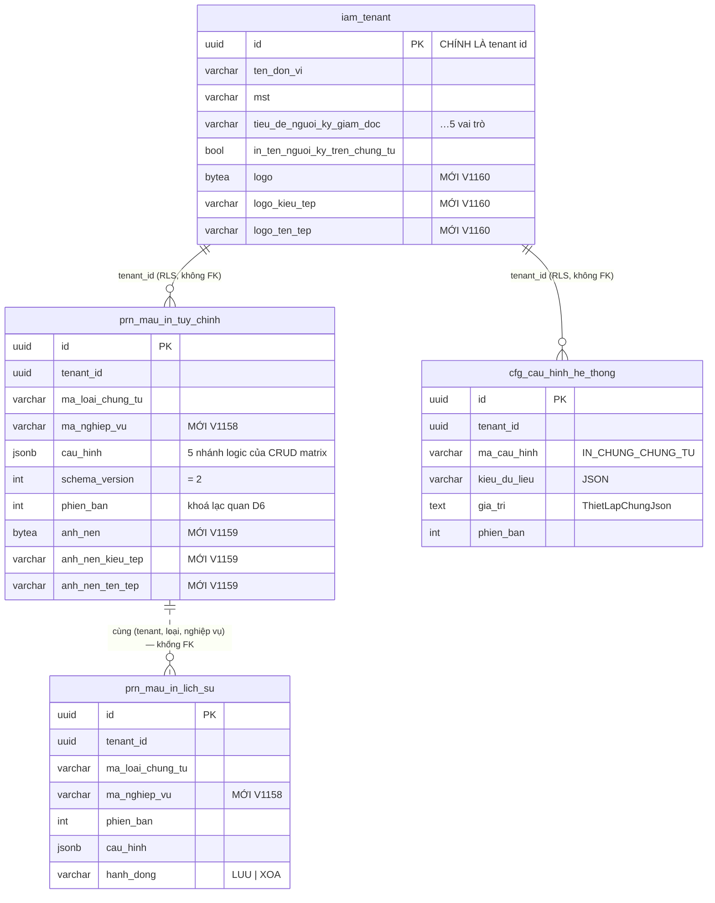

# 08 · Thiết kế DB và migration `V1158` … `V1160`

| | |
|---|---|
| Quyết định gốc | `D1` (một `jsonb`) · `D2` (khoá theo cặp, migration MỚI) · `D7` (nhị phân là `bytea`) · `D8` (thiết lập chung dùng bảng sẵn có) · `D11` (schema v2) |
| BR bắt buộc | BR7 · BR20 · BR28 · BR29 · BR46 |

> ⛔ **KHÔNG SỬA `V1148` `V1149` `V1150`.** Ba file này đã nằm trên `origin/develop` và `origin/staging` (commit `018d444f`). Flyway đã ghi checksum; sửa tại chỗ ⇒ `Migration checksum mismatch` và môi trường chết ở lần deploy kế tiếp. Mọi thay đổi đi bằng **migration mới**.
>
> Số lớn nhất trên develop (`86cada67`, 2026-09-21): `V1157__cst_phan_bo_chi_phi_them_co_da_luu_thiet_lap.sql` ⇒ bắt đầu từ **`V1158`**. (`V1153` khuyết trong dãy — không phải việc của phiếu này.)

---

## §1. Hiện trạng bảng

### 1.1 `public.prn_mau_in_tuy_chinh` — `V1148__prn_mau_in_tuy_chinh.sql:11-50`

**15 cột:**

| Cột | Kiểu | Ghi chú |
|---|---|---|
| `id` | `uuid` PK `DEFAULT gen_random_uuid()` | |
| `tenant_id` | `uuid NOT NULL` | RLS |
| `ma_loai_chung_tu` | `varchar(20) NOT NULL` | `mst_loai_chung_tu.code` |
| `cau_hinh` | **`jsonb NOT NULL`** | JSON mẫu đã kiểm + chuẩn hoá |
| `schema_version` | `integer NOT NULL` | trùng `cau_hinh.schemaVersion` |
| `mac_dinh_nguon` | `varchar(30)` + CHECK `ck_prn_mau_in_mac_dinh_nguon` | ⚠ **thành cột chết** sau `D13` |
| `mac_dinh_phien_ban` | `integer` | ⚠ **thành cột chết** sau `D13` |
| `phien_ban` | `integer NOT NULL DEFAULT 0` | khoá lạc quan (`D6`) |
| `ngay_tao` `ngay_cap_nhat` `da_xoa` `ngay_xoa` `nguoi_tao` `nguoi_cap_nhat` `nguoi_xoa` | audit chuẩn của `AggregateRootEntity` | BR46 |

- Unique một phần: `uq_prn_mau_in_tuy_chinh_song (tenant_id, ma_loai_chung_tu) WHERE da_xoa = false` (`:40-42`).
- RLS: `ENABLE` + `FORCE`, policy `tenant_isolation` theo `public.fn_current_tenant()` (`:44-48`).
- `GRANT SELECT, INSERT, UPDATE, DELETE … TO pmkt_app` (`:50`).
- ⚠ Comment header ghi nhầm `V1147` trong khi tên file là `V1148` (`:2`) — **không sửa được** (đã lên develop); ghi nhận ở `V1158`.

### 1.2 `public.prn_mau_in_lich_su` — `V1150__prn_mau_in_lich_su.sql:14-53`

16 cột; index `idx_prn_mau_in_lich_su_loai_ngay (tenant_id, ma_loai_chung_tu, ngay_tao DESC, phien_ban DESC)` (`:44-45`); RLS + GRANT như trên (`:47-53`).

### 1.3 `public.iam_tenant`

Hồ sơ doanh nghiệp + 5 người ký (`V203__iam_tenant_cau_hinh_columns.sql`). Entity `platform_iam/tenant/internal/entity/Tenant.java:26-27`. **Không có RLS** — `id` **chính là** tenant id, cô lập ở tầng code qua `TenantContext.requireTenantId()` (ghi rõ ở `Tenant.java:13-15`).

### 1.4 `public.cfg_cau_hinh_he_thong` — `V1__create_database.sql:6134-6157`

Key-value cấp tenant, có sẵn `kieu_du_lieu` cho phép `'JSON'` (`:6154`) và `gia_tri text` (`:6140`). **Không đổi cấu trúc** — dùng nguyên (`D8`).

### 1.5 `cfg_chi_nhanh` — **không tồn tại**

`grep "cfg_chi_nhanh"` trên `cell-app/src`, `super-admin-service/src`, `tenant-provisioning/src` ⇒ 0 kết quả. `chi_nhanh_id` chỉ tồn tại như **cột UUID** trên chứng từ/sổ. ⇒ `HoSoDonViPort` (`D9`).

---

## §2. Cột thêm mới / sửa trên bảng đã có

### 2.1 `prn_mau_in_tuy_chinh`

| Cột | Kiểu | Null | Default | Lý do |
|---|---|---|---|---|
| `ma_nghiep_vu` | `varchar(50)` | `NOT NULL` | `'MAC_DINH'` | `R-TLMI-004` — khoá duy nhất theo **cặp** (loại, nghiệp vụ); loại không chia nghiệp vụ dùng `'MAC_DINH'` (`R-TLMI-003`) |
| `anh_nen` | `bytea` | NULL | — | `R-TLMI-069` · quyết định **C08** — ảnh nền của mẫu, ≤ 1 MB |
| `anh_nen_kieu_tep` | `varchar(30)` | NULL | — | `image/jpeg` · `image/png` |
| `anh_nen_ten_tep` | `varchar(255)` | NULL | — | tên tệp gốc để trả `Content-Disposition` |

**Index đổi:**

| Bỏ | Thêm |
|---|---|
| `uq_prn_mau_in_tuy_chinh_song (tenant_id, ma_loai_chung_tu) WHERE da_xoa = false` | `uq_prn_mau_in_tuy_chinh_song (tenant_id, ma_loai_chung_tu, ma_nghiep_vu) WHERE da_xoa = false` |

### 2.2 `prn_mau_in_lich_su`

| Cột | Kiểu | Null | Default | Lý do |
|---|---|---|---|---|
| `ma_nghiep_vu` | `varchar(50)` | `NOT NULL` | `'MAC_DINH'` | Lịch sử phải khoá cùng cặp với bản chính |

Index `idx_prn_mau_in_lich_su_loai_ngay` dựng lại có thêm `ma_nghiep_vu`.

### 2.3 `iam_tenant`

| Cột | Kiểu | Null | Lý do |
|---|---|---|---|
| `logo` | `bytea` | NULL | Q-03 — repo **chưa có** trường logo (`CompanyInfoResponse.java:11-36` không có); một logo cho cả pháp nhân (`R-TLMI-078` Ghi chú) |
| `logo_kieu_tep` | `varchar(30)` | NULL | |
| `logo_ten_tep` | `varchar(255)` | NULL | |

### 2.4 Cột **chết** — giữ lại, ngừng dùng

| Cột | Vì sao chết | Xử lý |
|---|---|---|
| `prn_mau_in_tuy_chinh.mac_dinh_nguon` | `D13` — bỏ tầng "mặc định hệ thống" qua super-admin | **Không DROP.** `V1158` chỉ gỡ `NOT NULL`-ness (vốn đã nullable) và thêm `COMMENT` đánh dấu *ngừng dùng*. Entity bỏ mapping |
| `prn_mau_in_tuy_chinh.mac_dinh_phien_ban` | như trên | như trên |

**Vì sao không `DROP COLUMN`:** hai cột này nằm trong `V1148` đã lên staging. `DROP` là thao tác không lùi được và không mang lại lợi ích gì (cột nullable, không index). Nếu sau này chắc chắn không dùng thì dọn bằng một phiếu dọn dẹp riêng.

---

## §3. Bảng mới

**KHÔNG CÓ.** Đây là hệ quả trực tiếp của quyết định `[USER]` Q-01 và `D8`.

| Tài liệu BA đòi | Thay bằng |
|---|---|
| `cfg_mau_in_chung_tu` | `prn_mau_in_tuy_chinh` (đã có) |
| `cfg_mau_in_khoi` · `_khoi_cot` · `_khoi_o` · `_khoi_chu_ky` | nhánh trong `cau_hinh jsonb` — [01](01-hop-dong-json-mau-in.md) |
| `cfg_tenant` (thiết lập chung) | `cfg_cau_hinh_he_thong` dòng `IN_CHUNG_CHUNG_TU` + `iam_tenant` (hồ sơ, người ký, logo) |
| `cfg_chi_nhanh` | **chưa có** → `HoSoDonViPort` trả hồ sơ tenant (`L-7` · `Q-14`) |

---

## §4. Ràng buộc · index · khoá ngoại

| Đối tượng | Định nghĩa | Lý do |
|---|---|---|
| `uq_prn_mau_in_tuy_chinh_song` | UNIQUE `(tenant_id, ma_loai_chung_tu, ma_nghiep_vu)` `WHERE da_xoa = false` | `INV-TLMI-001` — một tenant + một nghiệp vụ ⇒ tối đa một mẫu. Một phần vì `AggregateRootEntity` mang `da_xoa` |
| `idx_prn_mau_in_lich_su_loai_ngay` | `(tenant_id, ma_loai_chung_tu, ma_nghiep_vu, ngay_tao DESC, phien_ban DESC)` | Truy vấn lịch sử theo cặp khoá, mới nhất trước |
| `ck_prn_mau_in_anh_nen_kieu_tep` | CHECK `anh_nen_kieu_tep IS NULL OR anh_nen_kieu_tep IN ('image/jpeg','image/png')` | `R-TLMI-069` — chặn ở tầng DB, không chỉ tin tầng ứng dụng |
| `ck_iam_tenant_logo_kieu_tep` | CHECK tương tự trên `iam_tenant.logo_kieu_tep` | như trên |
| **Không** khoá ngoại sang `mst_loai_chung_tu` | — | `mau_in` **không** được phụ thuộc `master_data` (vùng đóng băng). Tính hợp lệ của mã loại được `DangKyProvider` chốt **lúc khởi động** (fail-fast), chặt hơn FK vì bắt sớm hơn |
| **Không** index trên `cau_hinh` | — | Không có truy vấn nào lọc theo nội dung JSON trong 271 luật. Thêm GIN index cho một nhu cầu chưa có là trả phí ghi vô ích |
| **Không** cột `chi_nhanh_id` | — | `INV-TLMI-011` — mẫu **không** mang phạm vi chi nhánh (`R-TLMI-005` · `035`) |

---

## §5. Migration — SQL đầy đủ

### 5.1 `V1158__prn_mau_in_khoa_nghiep_vu.sql`

```sql
-- =====================================================================================
-- V1158 — prn_mau_in_*: khoá nghiệp vụ + nâng schema JSON lên v2.
-- Phiếu yêu cầu: PMKT-E-14549_21 Thiết lập mẫu in chứng từ.
-- Đặc tả: docs/doing/PMKT-E-14549-21-thiet-lap-mau-in-chung-tu-spec/02-rules.md
--   (R-TLMI-002, R-TLMI-003, R-TLMI-004, INV-TLMI-001) và 04-quyet-dinh-ban-giao.md §1 Q-01.
-- Kế hoạch: docs/doing/PMKT-E-14549-21-thiet-lap-mau-in-chung-tu-api/08-thiet-ke-db.md
--
-- V1148/V1149/V1150 ĐÃ nằm trên origin/develop và origin/staging (commit 018d444f) —
-- KHÔNG sửa tại chỗ được, mọi thay đổi đi bằng migration mới.
-- (Ghi chú: comment header của V1148 ghi nhầm số "V1147"; không sửa được nữa.)
--
-- XOÁ SẠCH dữ liệu v1: toàn bộ code Java của module `mau_in` chưa từng được commit
-- (git status 2026-09-19: cả thư mục cell/mau_in/ ở trạng thái '??') ⇒ develop/staging có
-- bảng nhưng KHÔNG endpoint nào ghi vào ⇒ không có bản ghi thật để mất.
-- Schema JSON v2 khác v1 về cấu trúc khối và lưới ô khối tự do, không có đường nâng cấp.
-- =====================================================================================

-- ---- 1. Xoá dữ liệu schema v1 -------------------------------------------------------
DELETE FROM public.prn_mau_in_lich_su;
DELETE FROM public.prn_mau_in_tuy_chinh;

-- ---- 2. prn_mau_in_tuy_chinh: thêm ma_nghiep_vu -------------------------------------
ALTER TABLE public.prn_mau_in_tuy_chinh
    ADD COLUMN ma_nghiep_vu varchar(50) NOT NULL DEFAULT 'MAC_DINH';

COMMENT ON COLUMN public.prn_mau_in_tuy_chinh.ma_nghiep_vu IS
    'R-TLMI-002/003/004 — nghiệp vụ của loại chứng từ; loại không chia nghiệp vụ dùng MAC_DINH';

-- INV-TLMI-001 — một bản sống cho mỗi (tenant, loại, nghiệp vụ).
DROP INDEX IF EXISTS public.uq_prn_mau_in_tuy_chinh_song;
CREATE UNIQUE INDEX uq_prn_mau_in_tuy_chinh_song
    ON public.prn_mau_in_tuy_chinh (tenant_id, ma_loai_chung_tu, ma_nghiep_vu)
    WHERE da_xoa = false;

-- ---- 3. prn_mau_in_lich_su: thêm ma_nghiep_vu ---------------------------------------
ALTER TABLE public.prn_mau_in_lich_su
    ADD COLUMN ma_nghiep_vu varchar(50) NOT NULL DEFAULT 'MAC_DINH';

COMMENT ON COLUMN public.prn_mau_in_lich_su.ma_nghiep_vu IS
    'R-TLMI-004 — khoá cùng cặp với bản chính';

DROP INDEX IF EXISTS public.idx_prn_mau_in_lich_su_loai_ngay;
CREATE INDEX idx_prn_mau_in_lich_su_loai_ngay
    ON public.prn_mau_in_lich_su
       (tenant_id, ma_loai_chung_tu, ma_nghiep_vu, ngay_tao DESC, phien_ban DESC);

-- ---- 4. Hai cột của tầng "mặc định hệ thống" qua super-admin: NGỪNG DÙNG ------------
-- Quyết định D13 của kế hoạch: R-TLMI-006 nói mẫu chuẩn hệ thống là dữ liệu cố định sinh
-- từ đặc tả form, KHÔNG có entity riêng ⇒ không còn tầng mặc định nào để tách bản.
-- Giữ cột (không DROP) vì V1148 đã lên staging; chỉ đánh dấu.
COMMENT ON COLUMN public.prn_mau_in_tuy_chinh.mac_dinh_nguon IS
    'NGỪNG DÙNG từ PMKT-E-14549_21 (D13) — không còn tầng mẫu mặc định qua super-admin';
COMMENT ON COLUMN public.prn_mau_in_tuy_chinh.mac_dinh_phien_ban IS
    'NGỪNG DÙNG từ PMKT-E-14549_21 (D13)';

-- ---- 5. schema_version mặc định 2 ---------------------------------------------------
ALTER TABLE public.prn_mau_in_tuy_chinh ALTER COLUMN schema_version SET DEFAULT 2;
ALTER TABLE public.prn_mau_in_lich_su   ALTER COLUMN schema_version SET DEFAULT 2;

COMMENT ON COLUMN public.prn_mau_in_tuy_chinh.cau_hinh IS
    'JSON mẫu in v2 đã kiểm (KiemTraMau) + chuẩn hoá (ChuanHoaMau) — INV-TLMI-003/005/012. '
    'Ô theo thiết lập chung ⇒ KHOÁ VẮNG MẶT, tuyệt đối không ghi null (R-TLMI-037)';

-- RLS và GRANT giữ nguyên từ V1148/V1150 — ALTER TABLE ADD COLUMN không đụng tới policy
-- (tenant_isolation) hay quyền của role pmkt_app.
```

### 5.2 `V1159__prn_mau_in_anh_nen.sql`

```sql
-- =====================================================================================
-- V1159 — prn_mau_in_tuy_chinh: ảnh nền của mẫu.
-- Đặc tả: R-TLMI-069, R-TLMI-071, R-TLMI-073, R-TLMI-074 · quyết định C08 của
--   docs/doing/PMKT-E-14549-21-thiet-lap-mau-in-chung-tu-spec/04-quyet-dinh-ban-giao.md
--
-- Vì sao cột bytea chứ không base64 trong `cau_hinh`: ảnh 1 MB thành ~1,37 MB base64 và
-- `cau_hinh` bị đọc MỖI LẦN nạp mẫu, kể cả khi chỉ cần bố cục. Đây là dữ liệu nhị phân,
-- không phải cấu hình. Vì sao không bảng riêng: quan hệ 1-1, bảng riêng chỉ thêm một JOIN,
-- và user đã quyết không dựng bảng mới.
-- =====================================================================================

ALTER TABLE public.prn_mau_in_tuy_chinh
    ADD COLUMN anh_nen          bytea,
    ADD COLUMN anh_nen_kieu_tep varchar(30),
    ADD COLUMN anh_nen_ten_tep  varchar(255);

ALTER TABLE public.prn_mau_in_tuy_chinh
    ADD CONSTRAINT ck_prn_mau_in_anh_nen_kieu_tep
    CHECK (anh_nen_kieu_tep IS NULL OR anh_nen_kieu_tep IN ('image/jpeg', 'image/png'));

COMMENT ON COLUMN public.prn_mau_in_tuy_chinh.anh_nen IS
    'R-TLMI-069 — ảnh nền của mẫu, jpg/png ≤ 1MB; JSON chỉ giữ cờ trang.nen.kieu = ANH';
COMMENT ON COLUMN public.prn_mau_in_tuy_chinh.anh_nen_kieu_tep IS 'image/jpeg | image/png';
COMMENT ON COLUMN public.prn_mau_in_tuy_chinh.anh_nen_ten_tep IS 'Tên tệp gốc, để trả Content-Disposition';
```

### 5.3 `V1160__iam_tenant_logo.sql`

```sql
-- =====================================================================================
-- V1160 — iam_tenant: logo đơn vị.
-- Đặc tả: R-TLMI-077 (Logo là ô tick thứ 7), R-TLMI-082 (quyết định C03), R-TLMI-078 Ghi chú
--   (logo LUÔN của pháp nhân — chi nhánh KHÔNG có logo riêng).
-- Phạm vi: phần "thiết lập chung tối thiểu" của Q-03 — repo chưa có trường logo
--   (CompanyInfoResponse.java không có trường nào cho logo).
--
-- Vì sao trên iam_tenant: đây đã là chỗ ở của toàn bộ hồ sơ doanh nghiệp từ V203.
-- Vì sao không cfg_cau_hinh_he_thong: cột gia_tri là text ⇒ lại quay về base64.
-- iam_tenant KHÔNG có RLS (id CHÍNH LÀ tenant id — xem ghi chú thiết kế ở V203);
-- cô lập ở tầng code qua TenantContext.requireTenantId(), nên migration này không thêm policy.
-- =====================================================================================

ALTER TABLE public.iam_tenant
    ADD COLUMN logo          bytea,
    ADD COLUMN logo_kieu_tep varchar(30),
    ADD COLUMN logo_ten_tep  varchar(255);

ALTER TABLE public.iam_tenant
    ADD CONSTRAINT ck_iam_tenant_logo_kieu_tep
    CHECK (logo_kieu_tep IS NULL OR logo_kieu_tep IN ('image/jpeg', 'image/png'));

COMMENT ON COLUMN public.iam_tenant.logo IS
    'R-TLMI-082 — logo đơn vị kế toán, jpg/png ≤ 1MB; MỘT logo cho cả pháp nhân, chi nhánh không có logo riêng';
COMMENT ON COLUMN public.iam_tenant.logo_kieu_tep IS 'image/jpeg | image/png';
COMMENT ON COLUMN public.iam_tenant.logo_ten_tep IS 'Tên tệp gốc';
```

> **Không có migration cho thiết lập chung.** Dùng `cfg_cau_hinh_he_thong` sẵn có, **không seed** — thiếu dòng = mọi khoá theo mặc định hệ thống (`D8`).

---

## §6. BR29 (chính sách xoá) — lệch có chủ ý, đây là lý do

| | |
|---|---|
| **BR29** | Xoá mềm bằng `da_xoa` là mặc định của repo |
| **`R-TLMI-021` + `INV-TLMI-002`** | *Mẫu bằng mẫu chuẩn ⇒ **không tồn tại** bản ghi* — và `R-TLMI-007`: *không có bản ghi **chính là** trạng thái "đang dùng mẫu chuẩn"* |
| **Xung đột** | Xoá mềm để lại một dòng `da_xoa = true`. Truy vấn đọc mẫu vẫn phải lọc `da_xoa = false` nên **nghiệp vụ vẫn đúng**, nhưng lần Lưu sau `INSERT` một dòng mới ⇒ mỗi vòng *tuỳ chỉnh → đặt lại → tuỳ chỉnh* đẻ thêm một dòng chết |
| **Quyết định** | **Hard delete** (`DELETE FROM prn_mau_in_tuy_chinh WHERE …`). Dấu vết không mất: `prn_mau_in_lich_su` ghi một dòng `hanh_dong = 'XOA'` mang **JSON ngay trước khi xoá** |
| **Vì sao không giữ xoá mềm** | Unique index một phần `WHERE da_xoa = false` cho phép nhiều dòng chết cùng cặp khoá ⇒ bảng phình theo số lần người dùng bấm Đặt lại, mà không ai đọc chúng. Lịch sử đã có chỗ riêng, đúng chỗ hơn |

Cột `da_xoa` **vẫn giữ** trên bảng (thuộc `AggregateRootEntity`) và unique index **vẫn** mang mệnh đề `WHERE da_xoa = false` — để tương thích nếu sau này đổi ý.

---

## §7. Ánh xạ Entity ↔ bảng

```java
@Entity
@Table(name = "prn_mau_in_tuy_chinh")
public class MauInTuyChinh extends AggregateRootEntity {
    @Column(name = "ma_loai_chung_tu", nullable = false, length = 20) private String maLoaiChungTu;
    @Column(name = "ma_nghiep_vu",     nullable = false, length = 50) private String maNghiepVu;   // MỚI
    @JdbcTypeCode(SqlTypes.JSON)
    @Column(name = "cau_hinh", nullable = false)                      private String cauHinh;
    @Column(name = "schema_version", nullable = false)                private Integer schemaVersion;
    @Version
    @Column(name = "phien_ban", nullable = false)                     private Integer phienBan;    // D6
    @Column(name = "anh_nen")                                         private byte[] anhNen;       // MỚI
    @Column(name = "anh_nen_kieu_tep", length = 30)                   private String anhNenKieuTep;
    @Column(name = "anh_nen_ten_tep",  length = 255)                  private String anhNenTenTep;
    // mac_dinh_nguon, mac_dinh_phien_ban: KHÔNG map nữa (D13)
}
```

**Hai điểm phải chú ý:**

1. `cauHinh` giữ kiểu **`String`** (JSON thô) chứ không map sang `MauInJson`: `MauInService` cần **chính chuỗi đã chuẩn hoá** để so sánh với mẫu chuẩn (`D5`). Map sang object rồi serialize lại có thể đổi thứ tự khoá và phá phép so sánh.
2. `anhNen` là `byte[]` — bật `@Basic(fetch = LAZY)` **không** hiệu quả với Hibernate mặc định; dùng **projection riêng** ở repository để `A1` không kéo 1 MB ảnh mỗi lần mở màn:

```java
interface MauInTuyChinhRepository extends JpaRepository<MauInTuyChinh, UUID> {

    /** A1/A2/A9 — KHÔNG kéo ảnh. */
    @Query("select new …MauInBanGon(m.id, m.cauHinh, m.schemaVersion, m.phienBan, "
         + "  case when m.anhNen is null then false else true end) "
         + "from MauInTuyChinh m "
         + "where m.maLoaiChungTu = :ma and m.maNghiepVu = :nv and m.daXoa = false")
    Optional<MauInBanGon> timBanGon(String ma, String nv);

    /** A6 — chỉ khi thật sự cần bytes. */
    @Query("select m.anhNen, m.anhNenKieuTep, m.anhNenTenTep from MauInTuyChinh m where …")
    Optional<AnhNenBanGhi> timAnhNen(String ma, String nv);
}
```

`tenant_id` **không** xuất hiện trong bất kỳ `@Query` nào — RLS `tenant_isolation` lo việc đó (BR28). Và **không** có điều kiện `chi_nhanh_id` ở bất kỳ đâu (`INV-TLMI-011`).

---

## §8. ERD



**Không có FK nào** giữa các bảng trên: `tenant_id` được RLS cưỡng chế, và `prn_mau_in_lich_su` cố tình **không** FK sang bản chính vì bản chính **bị xoá thật** khi mẫu về bằng mẫu chuẩn (§6) trong khi lịch sử phải sống tiếp.

---

## §9. Kiểm dữ liệu trước khi chạy · backfill · tương thích ngược

| Bước | Lệnh / hành động | Ngưỡng dừng |
|---|---|---|
| **Trước khi chạy `V1158`** | `SELECT count(*) FROM prn_mau_in_tuy_chinh;` trên **mỗi** môi trường | Kết quả `> 0` ⇒ **DỪNG, hỏi user**. `V1158` xoá dữ liệu; giả định "chưa có bản ghi thật" dựa trên việc module Java chưa commit. Nếu ai đó đã deploy một bản khác thì giả định sai |
| Backfill `ma_nghiep_vu` | **Không cần** — `DEFAULT 'MAC_DINH'` + bảng đã rỗng sau bước 1 | |
| Backfill `anh_nen` / `logo` | **Không cần** — nullable, chưa từng có nguồn dữ liệu | |
| Tương thích ngược | Không có client nào đang gọi `/api/mau-in/**` (chưa deploy) ⇒ **không cần** giai đoạn đọc-được-cả-hai-schema | |
| Thứ tự chạy | `V1158` → `V1159` → `V1160`, Flyway tự lo. `V1159` phụ thuộc `V1158` chỉ ở mức "cùng bảng", không ràng buộc dữ liệu | |
| Rollback | Flyway community **không** rollback. Tình huống xấu nhất: `ALTER TABLE … DROP COLUMN ma_nghiep_vu` + dựng lại index cũ bằng một migration mới. Dữ liệu đã `DELETE` thì **không** khôi phục được — đây là lý do bước kiểm đầu tiên là bắt buộc |

---

## §10. Kiểm thử dữ liệu

`MauInMigrationTest` (`@Tag("unit")`) đọc **nội dung file `.sql`** — chạy được không cần Docker, đúng cách bản cũ đã làm.

| Test | Khẳng định |
|---|---|
| `V1158_themCotMaNghiepVuChoCaHaiBang` | Cả hai `ALTER TABLE … ADD COLUMN ma_nghiep_vu` có mặt |
| `V1158_unique_index_gom_du_ba_cot` | `uq_prn_mau_in_tuy_chinh_song` chứa `(tenant_id, ma_loai_chung_tu, ma_nghiep_vu)` và `WHERE da_xoa = false` |
| `V1158_xoa_du_lieu_v1_truoc_khi_doi_khoa` | `DELETE FROM` đứng **trước** `ALTER TABLE` trong file |
| `V1159_ba_cot_anh_nen_va_check_kieu_tep` | 3 cột + `ck_prn_mau_in_anh_nen_kieu_tep` với đúng hai giá trị |
| `V1160_ba_cot_logo_tren_iam_tenant` | 3 cột + CHECK |
| `V115x_khong_sua_V1148_V1149_V1150` | Ba file cũ **không** bị sửa: so `git diff origin/develop -- db/migration/V114*.sql` rỗng |
| `V115x_khong_tao_bang_moi` | Không file nào chứa `CREATE TABLE` |
| `V115x_khong_co_cot_chi_nhanh` | Không file nào chứa `chi_nhanh` (`INV-TLMI-011`) |

Kiểm RLS/GRANT thật (policy còn hiệu lực sau `ADD COLUMN`, `pmkt_app` vẫn `SELECT` được) **cần Postgres thật** ⇒ là test Testcontainers, **máy này không chạy được** (cấm Docker). Phải **báo rõ** khi bàn giao.

---

## §11. Tóm tắt cho người ký duyệt

| Câu hỏi | Trả lời |
|---|---|
| Có bảng mới không? | **Không.** |
| Có sửa migration đã lên develop/staging không? | **Không.** 3 file mới `V1158` `V1159` `V1160`. |
| Có xoá dữ liệu không? | **Có** — `V1158` xoá sạch `prn_mau_in_tuy_chinh` và `prn_mau_in_lich_su`. An toàn vì chưa endpoint nào ghi vào (module Java chưa commit). **Phải đếm bản ghi trên từng môi trường trước khi chạy** (§9). |
| Có cột nào bị `DROP` không? | **Không.** Hai cột `mac_dinh_*` chỉ bị đánh dấu *ngừng dùng* bằng `COMMENT`. |
| RLS có bị ảnh hưởng không? | **Không.** `ADD COLUMN` không đụng policy `tenant_isolation` hay `GRANT` của `pmkt_app`. |
| Dữ liệu ảnh lưu ở đâu? | Cột `bytea` trên **bảng đã có**, không phải base64 trong JSON, không phải bảng mới. |
| Thiết lập chung lưu ở đâu? | `cfg_cau_hinh_he_thong` (bảng đã có), một dòng JSON mỗi tenant, **không seed**. |
