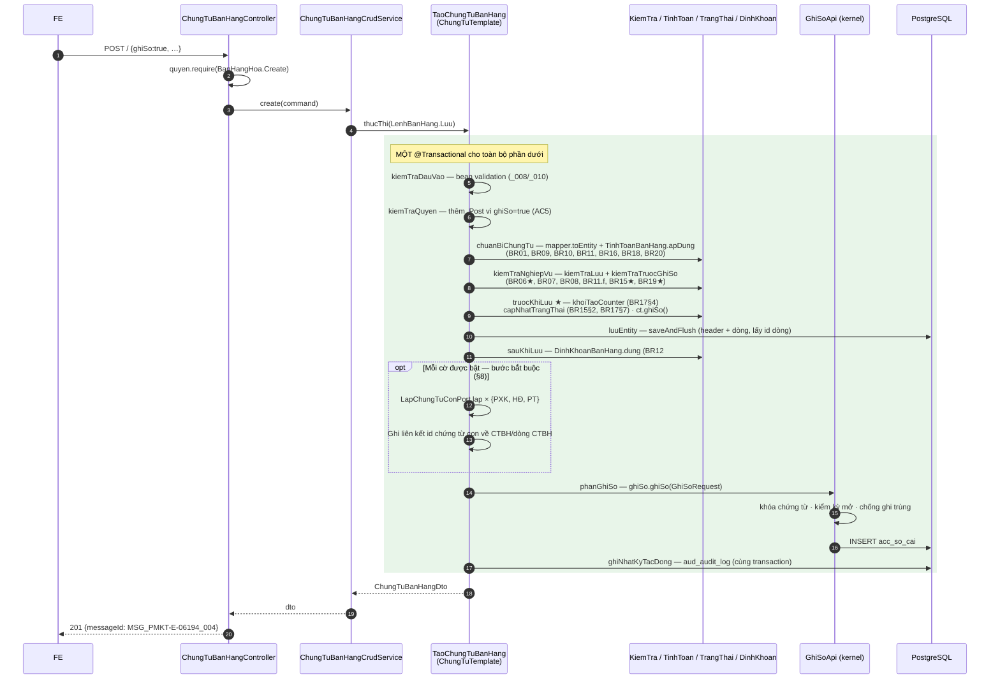
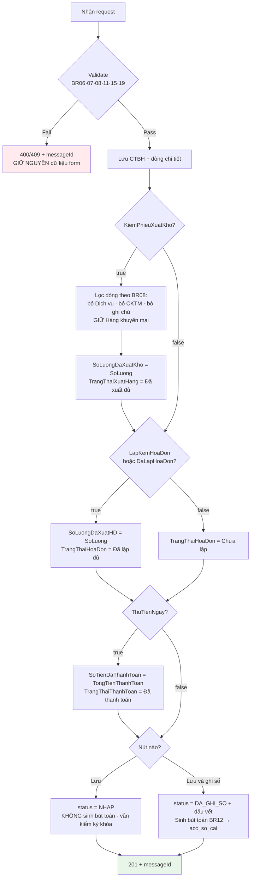

# Chứng từ bán hàng — Thêm mới: kế hoạch hoàn thiện API

> **Trạng thái:** `BẢN NHÁP CHỜ REVIEW`
> **Ngày cập nhật:** 2026-08-07
> **Người review cần có:** 1 BA (chốt §11) + 1 Dev BE (chốt §3.2, §9, §10)

| Mục | Nội dung |
|---|---|
| Use case | `PMKT-U-06397 / 06398 / 06399 / 06461 / 06982 — Thêm mới Chứng từ bán hàng` |
| Màn hình | `SCR_CTBH_ThemMoi.md` (dùng chung cho `SCR_CTBH_CapNhat`) |
| Tài liệu nguồn | `pmkt-docs/ba/PMKT-E-06194_ChungTuBanHang/` (`4.usecases/ThemMoi`, `5.screens/SCR_CTBH_ThemMoi.md`, `6.messages.md`) |
| Module BE | `cell-app/src/main/java/vn/vtt/pmkt/cell/chung_tu_ban_hang/` (**đã tồn tại — brownfield**) |
| Bảng DB | `sal_chung_tu_ban_hang` (~70 cột, V75 → V349) · `sal_chi_tiet_chung_tu_ban_hang` (~50 cột) |
| Migration mới | **`V354`** (V352 là số lớn nhất hiện tại; **V353 đã được `docs/doing/ghi-so-kho-kernel-plan.md` giữ chỗ**) |
| Không đụng | `master_data/**` (vùng đóng băng) |

---

## 0. Các quyết định đã chốt

| # | Quyết định | Hệ quả lên code |
|---|---|---|
| **D1** | **Không tạo module mới.** Luồng Thêm mới đã có sẵn ở `chung_tu_ban_hang` và đi qua `ChungTuTemplate`; việc còn lại là **vá lỗ hổng**, không phải dựng lại | Không có file `Controller`/`Service`/`Entity` mới cho CTBH. Diff tập trung ở `service/business/**` + 1 migration |
| **D2** | **PR-1 sửa `ChungTuTemplate` (base) trước mọi thứ khác.** Hook `truocKhiLuu` đang bị comment ở CẢ 5 luồng (`ChungTuTemplate.java:151,177,201,219,243`) ⇒ `LuuChungTuBanHangTemplate.truocKhiLuu` (`:92-103`) là **code chết** | Không sửa base thì AC5 sai bản chất: chứng từ "Lưu và ghi sổ" đã ghi sổ cái nhưng `status` vẫn `NHAP`. Xem §7 |
| **D3** | **Khôi phục 2 validate đang tắt tạm** (`KiemTraBanHang.java:78-80` và `:220-225`, marker `TAM-TAT-VALIDATE-DE-TEST`) | BR19 (`MSG_..._107`) và tổng CKTM (`MSG_..._045`) hoạt động trở lại. Chính comment trong file đã ghi **"KHÔNG ĐƯỢC MERGE"** |
| **D4** | **Không gộp snapshot khách hàng của Tab Hóa đơn vào bộ khách hàng của Tab Chứng từ ghi nợ khi chưa có BA xác nhận.** BR07 §3.2 mô tả rõ trường hợp hai tab có `KhachHangId` khác nhau | Q1 là **điểm chặn migration/DTO**. Nếu BA xác nhận được phép khác khách hàng, V354 phải thêm nhóm cột `hd_*`; không được triển khai theo giả định cùng khách hàng vì sẽ làm mất dữ liệu người dùng |
| **D5** | **Tab PXK và Tab Phiếu thu/Giấy báo có chỉ lệch số & ngày chứng từ** với Tab Chứng từ ghi nợ (BR07 §3.1 nói mọi trường KH đồng bộ hai chiều) | V354 thêm 3 cột cho PXK + 3 cột cho Phiếu thu, KHÔNG nhân bản bộ trường khách hàng |
| **D6** | **Sinh chứng từ con (PXK / HĐ / Phiếu thu) là giai đoạn tích hợp bắt buộc của chính phạm vi hoàn thành**, nối qua SPI công khai của `accounting_core/chung_tu` | Có thể chia PR để giảm rủi ro, nhưng chưa có adapter sinh đủ chứng từ con thì AC4/AC5 **chưa đạt** và ticket chưa được nghiệm thu. Xem §8 |
| **D7** | **Tạm đề xuất số chứng từ con do người dùng nhập**; BA phải chốt Q2 trước khi khóa hợp đồng request | Đặc tả ghi đồng thời "Điền thủ công / Tự động sinh theo quy tắc". Nếu BA chọn tự sinh, adapter phải dùng dịch vụ cấp số chuẩn; không tự tạo bộ đếm riêng |
| **D8** | **Giao ước "gửi gì giữ nấy"** của `TinhToanBanHang` được giữ nguyên, không đổi | BR09/BR10 §3/BR18 phụ thuộc vào nó: `null` = server tính, có giá trị = giữ nguyên của người dùng (`TinhToanBanHang.java:15-23`) |

> ⚠️ **Cảnh báo môi trường:** `ChungTuTemplate` đang có 6 khối comment-out kèm `Todo` (dòng 151, 177, 201, 219, 243, 416) do một luồng refactor khác đang dở — cùng file mà `docs/doing/ghi-so-kho-kernel-plan.md` §0 cũng cảnh báo. **Đọc lại file ngay trước khi code PR-1** và thống nhất với chủ nhánh refactor để tránh hai PR sửa ngược nhau.

---

## 1. Phạm vi

### 1.1 Trong phạm vi (GIAI ĐOẠN 1 — hoàn thiện aggregate và hợp đồng API)

| # | Chức năng | Nguồn | Hiện trạng |
|---|---|---|---|
| F1 | Chốt trạng thái chứng từ khi lưu: "Lưu" → `NHAP`, "Lưu và ghi sổ" → `DA_GHI_SO` + dấu vết `nguoi_ghi_so`/`thoi_gian_ghi_so` | AC4, AC5, BR13 §1-2 | **HỎNG** — §7 |
| F2 | Khởi tạo counter `SoLuongDaXuatHD` / `SoLuongDaXuatKho` và suy ra `TrangThaiHoaDon` / `TrangThaiXuatHang` | BR17 §4, §7 · BR15 §2 | **HỎNG** (code có, không được gọi) — §7 |
| F3 | Khôi phục validate BR19 (tài khoản cấp cuối) và tổng CKTM | BR19 · Validation table | **ĐANG TẮT** — D3 |
| F4 | Tab Hóa đơn: lưu Mẫu số / Ký hiệu / Số / Ngày hóa đơn + Hình thức TT hóa đơn | SCR §Tab Hóa đơn · BR14 | **THIẾU HOÀN TOÀN** |
| F5 | BR06 — chặn trùng hóa đơn theo `(Số HĐ + Ký hiệu + Mẫu số)` trong cùng tenant, `MSG_..._101` | BR06 | **THIẾU** |
| F6 | Tab Phiếu xuất kho: lưu Số / Ngày chứng từ / Ngày hạch toán riêng + diễn giải riêng | SCR §Tab Phiếu xuất kho | **THIẾU** |
| F7 | Tab Phiếu thu / Giấy báo có: lưu Số / Ngày chứng từ / Ngày hạch toán riêng | SCR §Tab Phiếu thu, §Tab Giấy báo có | **THIẾU** |
| F8 | BR15 §1 — ràng buộc `DaLapHoaDon` ⊕ `LapKemHoaDon` (không được cùng `true`) | BR15 §1 | **THIẾU** |
| F9 | BR14 — mặc định & đồng bộ Hình thức TT của Tab Hóa đơn theo Header | BR14 | **THIẾU** |
| F10 | BR07 §2.c1 — diễn giải đầy đủ 3 tab (kèm `theo hóa đơn số {SoHoaDon}`) | BR07 §2.c1 | **MỘT PHẦN** (`TinhToanBanHang.java:86-89` thiếu vế số HĐ và 2 tab kia) |
| F11 | Ràng buộc phụ thuộc ngữ cảnh: `hinhThucThanhToan` + `taiKhoanTienId` bắt buộc khi `ThuTienNgay = true` | SCR Header Options · Tab Phiếu thu | **THIẾU** (chỉ bắt buộc ở bước ghi sổ, `KiemTraBanHang.java:110-112`) |
| F12 | Trả về `messageId` đúng epic cho mọi nhánh lỗi/thành công của Thêm mới | `6.messages.md` | **PHẦN LỚN ĐÃ CÓ** — bổ sung `_101` |

### 1.2 Trong phạm vi (GIAI ĐOẠN 2 — tích hợp bắt buộc để nghiệm thu ticket)

| # | Chức năng | Phụ thuộc |
|---|---|---|
| F13 | Sinh **Phiếu xuất kho** liên kết (`ENT_PhieuXuatKhoModuleKho`), lọc dòng theo BR08 | Module `inv_phieu_xuat_kho` (PMKT-E-03646) + kernel ghi sổ kho (`docs/doing/ghi-so-kho-kernel-plan.md`) |
| F14 | Sinh **Hóa đơn bán hàng** liên kết (`ENT_HoaDonBanHang`) | Module `sal_hoa_don_ban_hang` (PMKT-E-06196) |
| F15 | Sinh **Phiếu thu** liên kết (`ENT_PhieuThu`) — Tiền mặt / Chuyển khoản | Module `cb_phieu_thu` (PMKT-E-06219 / 06222) |
| F16 | Rollback toàn phần khi bất kỳ bước nào lỗi (AC5, Hậu điều kiện) | Đã có sẵn: cả luồng nằm trong **một** `@Transactional` (`ChungTuTemplate.java:102-103`) |

> **Mốc nghiệm thu:** Giai đoạn 1 chỉ là mốc kỹ thuật nội bộ, không phải bản hoàn thành nghiệp vụ.
> AC4/AC5 chỉ đạt sau khi F13-F16 chạy end-to-end. Nếu một module chứng từ con chưa sẵn sàng, phải
> ghi ticket ở trạng thái bị chặn hoặc tách feature flag không cho người dùng chọn cờ tương ứng;
> không được trả thành công và tạo trạng thái `Đã ... đủ` khi bản ghi chứng từ con chưa tồn tại.

### 1.3 NGOÀI phạm vi (không cài lần này)

- **UC_CTBH_ChinhSua** (PMKT-U-06400), **UC_CTBH_Xoa**, **UC_CTBH_GhiSo** (PMKT-U-06430), **UC_CTBH_BoGhiSo** (PMKT-U-06431), **UC_CTBH_DanhSach**, **UC_CTBH_XemChiTiet** — đã có code chạy, ticket này **chỉ hưởng lợi gián tiếp** từ F1-F3 (dùng chung `LuuChungTuBanHangTemplate`).
  > Lưu ý: F1/F2 sửa ở `LuuChungTuBanHangTemplate` nên **Chỉnh sửa cũng được vá theo** — không tách được, vì hai màn dùng chung template (`SCR_CTBH_CapNhat` "tham chiếu toàn bộ BR trong SCR_CTBH_ThemMoi").
- **PMKT-U-06462** (Lập CTBH từ Phiếu xuất kho), **PMKT-U-06463** (Lập CTBH từ Hóa đơn) — cần module nguồn, chưa có.
- **Popup phân bổ chiết khấu** `SCR_CTBH_PBCK` / `SCR_CTBH_PBCK_MHHD` — **thuần FE**: mọi thuật toán phân bổ chạy trên lưới rồi kết thúc ở 2 cột `chietKhau` + `chietKhauPhanTram` mà server đã nhận (`TinhToanBanHang.java:136-143`). BE chỉ đối chiếu tổng (`MSG_..._046`).
- **Tính giá xuất kho** (PMKT-E-03629, BR21) — epic riêng; ở giai đoạn aggregate `DonGiaVon` nhận theo giá trị người dùng nhập.
- **Kết nối API hóa đơn điện tử với CQT** — đặc tả ghi rõ "chưa kết nối API" (SCR dòng 9).
- **Ẩn/hiện/disable trường** (`SCR_CTBH_ThemMoi_MaTranAnHien.md`) — thuần FE. BE chỉ **dọn dữ liệu mâu thuẫn** (ví dụ dòng dịch vụ bị xóa `khoId`, `soLo`, `hanSuDung` — `KiemTraBanHang.java:298-303`).

---

## 2. Hiện trạng đã khảo sát

### 2.1 Code hiện có — **BROWNFIELD**

```bash
find cell-app/src/main/java/vn/vtt/pmkt/cell/chung_tu_ban_hang -name "*.java" | wc -l
# → 41 file
```

```bash
grep -rl "inv_phieu_xuat_kho\|sal_hoa_don_ban_hang\|cb_phieu_thu" \
  --include="*.java" cell-app/src/main/java/vn/vtt/pmkt/cell/
# → chỉ 2 file, đều thuộc master_data (không liên quan)
```

**Kết luận:** module CTBH đã dựng gần đủ (Controller kế thừa `BaseChungTuController`, 5 template nghiệp vụ, `TinhToanBanHang` cài BR09/10/11/16/18, `DinhKhoanBanHang` cài đủ 7 bút toán BR12, `TrangThaiBanHang` cài BR17). **Ba module chứng từ con thì chưa tồn tại** — bảng DB có (V57, V70, V77) nhưng **không có một entity Java nào**. Đây là lý do của D6, và cũng đúng như `package-info.java` của module đã tự khai:

> *"Các cờ `kiem_phieu_xuat_kho` / `lap_kem_hoa_don` / `thu_tien_ngay` được LƯU và tham gia hạch toán + tính trạng thái, nhưng KHÔNG sinh chứng từ con […] vì ba module đó chưa tồn tại trong `cell-app`."*

### 2.2 Hiện trạng DB

`sal_chung_tu_ban_hang` dựng ở **V75**, bổ sung ở **V343** (`tai_khoan_tien_id`, `mo_ta`/`dien_giai_thue`/`khong_tong_hop_to_khai_gtgt` cho dòng), chuẩn hóa bộ cột chứng từ ở **V349** (`status` thay `trang_thai_chung_tu`, `thu_tu` → `stt`), đổi tên cột thời gian ở **V351**.

**Số hiệu migration lớn nhất hiện tại: `V352` ⇒ file mới là `V354`** (V353 do plan ghi sổ kho giữ chỗ — xem bảng đầu tài liệu).

| Cột đã có, dùng cho tab nào | Vai trò |
|---|---|
| `nguoi_mua_hang`, `ma_so_dvqhns`, `cccd`, `ho_chieu`, `so_dien_thoai` | Thực chất là trường của **Tab Hóa đơn** (SCR §Tab Hóa đơn) — đã nằm sẵn ở header ⇒ D4 |
| `nguoi_nhan` | **Tab Phiếu xuất kho** |
| `nguoi_nop`, `mieu_ta_phieu_thu`, `tai_khoan_ngan_hang_thu_id`, `tai_khoan_tien_id` | **Tab Phiếu thu / Giấy báo có** |
| `phieu_xuat_kho_id`, `phieu_thu_id` | Khóa nối chứng từ con — **hiện luôn NULL** (`ChungTuBanHang.java:145-151`) |
| `sal_chi_tiet_chung_tu_ban_hang.hoa_don_ban_hang_id` | Khóa nối dòng ↔ hóa đơn (BR17 §3.1) — hiện luôn NULL |

**Chưa có cột nào cho:** Mẫu số / Ký hiệu / Số / Ngày hóa đơn · Hình thức TT của Tab Hóa đơn · Số & ngày chứng từ riêng của PXK và Phiếu thu.

### 2.3 Hạ tầng base đã có sẵn những gì

| Cần | Đã có ở base | Vị trí |
|---|---|---|
| Trình tự bất biến của chứng từ kế toán (5 luồng, bước chạm sổ cái là `private`) | `ChungTuTemplate` | `accounting_core/chung_tu/service/ChungTuTemplate.java:70` |
| Một `@Transactional` cho cả "Lưu và ghi sổ" | `thucThi` | `ChungTuTemplate.java:102-103` |
| Ghi sổ cái + chống ghi trùng + kiểm kỳ khóa | `GhiSoApi` | `accounting_core/hach_toan/api/GhiSoApi.java` |
| Khóa chứng từ (advisory lock) chống hai request đồng thời | `ChungTuKhoaApi` | `accounting_core/hach_toan/api/ChungTuKhoaApi.java` |
| Cấp số chứng từ theo quyển số (`SELECT … FOR UPDATE`) | `sinhSoChungTu` | `ChungTuTemplate.java:327` |
| Bean validation trên lệnh đầu vào | `kiemTraDauVao` | `ChungTuTemplate.java:287` |
| Endpoint CRUD + ghi sổ / bỏ ghi sổ / nhân bản / hàng loạt | `BaseChungTuController` | `accounting_core/chung_tu/controller/BaseChungTuController.java` |
| Optimistic lock `@Version phien_ban` + trạng thái vòng đời | `BaseChungTuEntity` | `core/entity/BaseChungTuEntity.java:39,73` |
| `ghiSo()` đóng dấu vết `nguoi_ghi_so` + `thoi_gian_ghi_so` | `BaseChungTuEntity.ghiSo()` | `core/entity/BaseChungTuEntity.java:167` |
| Envelope `ApiResponse<T>` + `@RestControllerAdvice` | `core/response`, `core/shared/error` | `core/response/ApiResponse.java` |
| Kiểm quyền theo mã chức năng | `QuyenChecker` | `core/controller/QuyenChecker.java` |
| Nhật ký kiểm toán trong cùng transaction | `NhatKyKiemToan` | `accounting_core/chung_tu/service/NhatKyKiemToan.java` |

---

## 3. Kiến trúc

### 3.1 Phân tầng (giữ nguyên, không đổi)

```
ChungTuBanHangController              extends BaseChungTuController
        ▼                             (chỉ gắn messageId + lookup enum + cột Excel)
ChungTuBanHangCrudService             extends AbstractChungTuCrudService
        │   ├── ĐỌC   : kế thừa AbstractCrudService (search, phân trang, export)
        │   └── GHI   : ủy quyền sang 6 template nghiệp vụ
        ▼
TaoChungTuBanHang                     extends LuuChungTuBanHangTemplate
        │                             extends ChungTuTemplate  ← PR-1 sửa ở đây
        │   ├── chuanBiChungTu : mapper.toEntity + TinhToanBanHang.apDung
        │   ├── kiemTraNghiepVu: KiemTraBanHang.kiemTraLuu (+ kiemTraTruocGhiSo)
        │   ├── truocKhiLuu    : TrangThaiBanHang + ct.ghiSo()/setStatus  ← đang CHẾT
        │   ├── luuEntity      : repository.saveAndFlush
        │   └── sauKhiLuu      : DinhKhoanBanHang → ctx.themDinhKhoan
        ▼
ChungTuBanHangRepository              extends BaseRepository
        ▼
ChungTuBanHang / ChiTietChungTuBanHang → @Table("sal_chung_tu_ban_hang")
```

### 3.2 Lựa chọn kiến trúc + lý do

#### 3.2.a Lưu thông tin 3 tab chứng từ con ở đâu

| | Phương án A — 3 bảng phụ 1-1 | Phương án B — JSONB `thong_tin_tab` | **Phương án C — cột prefix trên header (đề xuất)** |
|---|---|---|---|
| Số bảng / cột mới | 3 bảng × ~10 cột | 1 cột | **12 cột tối thiểu; thêm nhóm `hd_*` nếu Q1 xác nhận KH hóa đơn được phép khác** |
| BR06 (unique số HĐ) | Index trên bảng phụ — được | **Không index thẳng được** | Partial unique index thẳng trên header — đơn giản nhất |
| Đọc màn Xem chi tiết | +3 JOIN mỗi lần | 1 lần đọc, phải parse | 1 lần đọc, không JOIN |
| Khi có module chứng từ con | Bảng phụ thành dữ liệu thừa, phải migrate | Như A | Cột thành **snapshot ý định của người dùng**, vẫn dùng để dựng chứng từ con |
| Chi phí nếu BA chốt Tab Hóa đơn được khác khách hàng (§11-Q1) | Rẻ | Rẻ | Thêm nhóm snapshot `hd_*` ngay trong V354; **không để migration sau** vì BR07 §3.2 đã mô tả luồng này |
| Rủi ro | Vòng đời 3 bảng phải đồng bộ tay | Không validate được ở tầng DB, không lọc/sort được | Header phình thêm cột snapshot |
| **Chốt an toàn cho rủi ro** | — | — | Đặt prefix `hd_` / `pxk_` / `pt_` để nhóm cột đọc được ngay; comment cột nói rõ tab nào |

**Vì sao không chọn A:** ba bảng phụ chỉ để chứa snapshot nhập liệu của ba tab tạo thêm ba vòng đời phải đồng bộ tay ở mọi nhánh ghi — đúng loại lỗi chỉ lộ ra khi số liệu đã sai.
**Vì sao không chọn B:** BR06 bắt buộc chặn trùng `(Số HĐ + Ký hiệu + Mẫu số)`; với JSONB thì hoặc mất chốt chặn ở tầng DB, hoặc phải dựng expression index mà `mst_mau_so_hoa_don` lại là khóa ngoài.

#### 3.2.b Sinh chứng từ con — cổng nối (giai đoạn tích hợp bắt buộc)

| | Phương án A — CTBH gọi thẳng service 3 module | **Phương án B — SPI port ở `accounting_core` (chọn)** |
|---|---|---|
| Modulith | CTBH phải `import` `inv_*`, `sal_hoa_don_*`, `cb_*` → phụ thuộc chéo 3 chiều | CTBH chỉ biết `LapChungTuConPort`; module con `@Component` cài đặt |
| Chạy được khi module con chưa có | Không biên dịch nổi | **Có thể khởi động**, nhưng request bật cờ thiếu adapter phải fail-fast và rollback |
| Thêm loại chứng từ con thứ 4 | Sửa CTBH | Không sửa CTBH |
| Rủi ro | — | Bean cài đặt vắng mặt trong prod mà không ai biết |
| **Chốt an toàn** | — | Registry kiểm đúng một adapter cho từng loại; thiếu/trùng adapter thì request bật cờ tương ứng trả lỗi cấu hình và rollback. Integration test khẳng định đủ 3 adapter trước nghiệm thu |

### 3.3 Cấu trúc thư mục sau khi xong (chỉ đánh dấu phần đụng tới)

```
accounting_core/chung_tu/
├── service/ChungTuTemplate.java                    ← SỬA (PR-1, D2)
└── api/LapChungTuConPort.java                      ← MỚI (giai đoạn tích hợp bắt buộc, D6)

chung_tu_ban_hang/internal/
├── dto/
│   ├── LuuChungTuBanHangRequest.java               ← SỬA (F4, F6, F7)
│   └── ChungTuBanHangDto.java                      ← SỬA (trả lại các trường mới)
├── entity/ChungTuBanHang.java                      ← SỬA (12+ cột mới, phụ thuộc Q1)
├── model/MaLoiBanHang.java                         ← SỬA (mã _101)
├── repository/ChungTuBanHangRepository.java        ← SỬA (query BR06)
└── service/business/
    ├── KiemTraBanHang.java                         ← SỬA (F3, F5, F8, F11)
    ├── TinhToanBanHang.java                        ← SỬA (F9, F10)
    └── ChungTuBanHangMapper.java                   ← SỬA (map trường mới)
```

---

## 4. Hợp đồng API

Base path: **`/api/ban-hang/chung-tu-ban-hang`**. Mã chức năng: **`BanHangHoa`** (`common/constant/MaChucNang.java`).

| # | Nguồn | Method | Path | Quyền | Trả về | Mục |
|---|---|---|---|---|---|---|
| A1 | **sửa** | `POST` | `/` | `.Create` (+ `.Post` khi `ghiSo=true`) | `ApiResponse<ChungTuBanHangDto>` | §4.1 |
| A2 | custom hiện có | `POST` | `/lookup` | `.View` | `ApiResponse<Map<String,List<String>>>` | §4.2 |
| A3 | base | `GET` | `/{id}` | `.View.Detail` | `ApiResponse<ChungTuBanHangDto>` | §4.3 |
| A4 | base | `GET` | `/{id}/thong-tin-hach-toan` | `.View.Detail` | `ApiResponse<List<DinhKhoanDto>>` | §4.4 |
| A5 | base | `POST` | `/{id}/nhan-ban` | `.Clone` | `ApiResponse<ChungTuBanHangDto>` | §4.5 |

**Envelope lỗi** (`core/shared/error`): `{ "code": "<MÃ_MÁY_ĐỌC>", "messageId": "MSG_PMKT-E-06194_nnn", "message": "<tiếng Việt>", "timestamp": "…" }`. FE rẽ nhánh theo `code`, hiển thị theo `messageId`.

**Quy ước enum trên wire:** **chuỗi tiếng Việt đúng như `CHECK` constraint của DB** (`"Bán hàng trong nước"`, `"Tiền mặt"`, `"Theo % hóa đơn"`…). Lý do: chúng nằm trong `CHECK` constraint, lệch một dấu là chứng từ không lưu được mà lỗi chỉ lộ lúc COMMIT — nên FE **phải** lấy bộ giá trị từ `A2 /lookup` chứ không hardcode (`ChungTuBanHangController.java:159-177`).

### 4.1 A1 — `POST /api/ban-hang/chung-tu-ban-hang`

Một request cho **cả hai nút**: `ghiSo=false` là "Lưu", `ghiSo=true` là "Lưu và ghi sổ". **Không** tách thành 2 request — tách đôi thì tồn tại khoảnh khắc chứng từ đã lưu mà bút toán chưa ghi, và request thứ hai hỏng sẽ để lại đúng trạng thái đó vĩnh viễn (`LuuChungTuBanHangTemplate.java:19-21`).

```jsonc
// Request — các trường ➕ là MỚI thêm ở ticket này
{
  "ghiSo": false,

  // ---- Header Options ----
  "loaiNghiepVu": "Bán hàng trong nước",
  "kiemPhieuXuatKho": true,
  "lapKemHoaDon": true,
  "daLapHoaDon": false,
  "thuTienNgay": true,
  "hinhThucThanhToan": "Tiền mặt",

  // ---- Tab Chứng từ ghi nợ ----
  "khachHangId": "…", "tenKhachHang": "Công ty TNHH ABC",
  "maSoThue": "0101234567", "diaChi": "…", "nguoiLienHe": "…",
  "nhanVienBanHangId": "…", "moTa": "bán hàng Công ty TNHH ABC theo hóa đơn số 0000123",
  "dieuKhoanThanhToanId": "…", "soNgayDuocNo": 30, "hanThanhToan": "2026-09-05",
  "soChungTu": "BH-000124", "ngayChungTu": "2026-08-06", "ngayHachToan": "2026-08-06",

  // ---- Tab Phiếu xuất kho (chỉ khi kiemPhieuXuatKho = true) ----
  "nguoiNhan": "Nguyễn Văn A",
  "soChungTuXuatKho":    "PXK-000088",   // ➕ F6
  "ngayChungTuXuatKho":  "2026-08-06",   // ➕ F6
  "ngayHachToanXuatKho": "2026-08-06",   // ➕ F6
  "moTaXuatKho": "Xuất kho bán hàng Công ty TNHH ABC", // ➕ F6

  // ---- Tab Hóa đơn (chỉ khi lapKemHoaDon = true) ----
  "nguoiMuaHang": "…", "maSoDvqhns": "…", "cccd": "…", "hoChieu": "…", "soDienThoai": "…",
  "mauSoHoaDonId":          "…",          // ➕ F4  (mst_mau_so_hoa_don)
  "kyHieuHoaDon":           "1C26TAA",    // ➕ F4  (max 6)
  "soHoaDon":               "0000123",    // ➕ F4  (max 8)
  "ngayHoaDon":             "2026-08-06", // ➕ F4
  "hinhThucThanhToanHoaDon":"Tiền mặt",   // ➕ F4/F9 (Tiền mặt | Chuyển khoản | TM/CK | nhập tay)

  // ---- Tab Phiếu thu / Giấy báo có (chỉ khi thuTienNgay = true) ----
  "nguoiNop": "…", "mieuTaPhieuThu": "Thu tiền bán hàng Công ty TNHH ABC",
  "taiKhoanTienId": "…",                  // 111x (TM) / 112x (CK) — BẮT BUỘC, F11
  "taiKhoanNganHangThuId": "…",           // chỉ khi Chuyển khoản
  "soChungTuPhieuThu":    "PT-000045",    // ➕ F7
  "ngayChungTuPhieuThu":  "2026-08-06",   // ➕ F7
  "ngayHachToanPhieuThu": "2026-08-06",   // ➕ F7

  // ---- Section 2 ----
  "loaiTienId": "…", "tyGia": 1,
  "loaiChietKhau": "Theo mặt hàng", "giaTriChietKhau": null,
  "tongTienChietKhau": 50000,             // FE tính, server đối chiếu (MSG _046)

  // ---- Thông tin bổ sung ----
  "soHopDong": "…", "ngayHopDong": "…", "diaDiemGiao": "…", "diaDiemNhan": "…",
  "soVanDon": "…", "soContainer": "…", "donViVanChuyen": "…",

  // ---- Lưới Chi tiết hàng hóa ----
  "chiTiet": [
    {
      "stt": 1, "loaiDongHang": true,
      "maHangId": "…", "tenHang": "Xi măng PC40", "donViTinhId": "…", "khoId": "…",
      "hangKhuyenMai": false, "chietKhauThuongMai": false,
      "soLuong": 10, "donGia": 100000, "thanhTien": null,   // null ⇒ server tính (D8)
      "chietKhauPhanTram": 5, "chietKhau": null,
      "thueSuatGtgt": "10", "giaTriThueGtgt": null, "tienThueGtgt": null,
      "dienGiaiThue": null, "khongTongHopToKhaiGtgt": false,
      "taiKhoanNoId": "…", "taiKhoanCoId": "…", "taiKhoanChietKhauId": "…",
      "taiKhoanThueGtgtId": "…", "taiKhoanGiaVonId": "…", "taiKhoanKhoId": "…",
      "tuNhapDonGiaVon": false, "donGiaVon": 0
    },
    { "stt": 2, "loaiDongHang": false, "tenHang": "— Giao hàng trước 15/08 —" }
  ]
}
```

```jsonc
// Response 201
{
  "code": "SUCCESS",
  "messageId": "MSG_PMKT-E-06194_001",   // "…_004" khi ghiSo = true
  "message": "Thêm mới chứng từ bán hàng thành công",
  "data": {
    "id": "…", "soChungTu": "BH-000124",
    "status": "NHAP",                     // "DA_GHI_SO" khi ghiSo = true  ← F1
    "trangThaiHoaDon": "Đã lập đủ",       // ← F2 (BR15 §2)
    "trangThaiXuatHang": "Đã xuất đủ",    // ← F2 (BR17 §4)
    "trangThaiThanhToan": "Đã thanh toán",
    "tongTienHangHoa": 1000000, "tongTienChietKhau": 50000,
    "tongTienThueGtgt": 95000, "tongTienThanhToan": 1045000,
    "tongTienHangHoaQuyDoi": 1000000, "…QuyDoi": "…",
    "ngayCapNhat": "2026-08-06T09:12:33Z",  // token optimistic-lock cho lần sửa sau
    "chiTiet": [ { "id": "…", "stt": 1, "soLuongDaXuatHd": 10, "soLuongDaXuatKho": 10, … } ]
  }
}
```

**Lỗi có thể gặp** — bảng đầy đủ ở §14:

| HTTP | `code` | `messageId` | Khi nào |
|---|---|---|---|
| 400 | `VALIDATION_FAILED` / `INVALID_VALUE` | `_008` / `_010` | Thiếu trường bắt buộc (bean validation hoặc theo ngữ cảnh) |
| 400 | `INVALID_DATE` | `_036` | Ngày chứng từ > hôm nay |
| 400 | `NEGATIVE_QUANTITY` / `NEGATIVE_PRICE` | `_040` / `_041` | Số lượng / đơn giá âm |
| 400 | `INVALID_DISCOUNT` | `_043` / `_044` / `_045` / `_046` | Chiết khấu vượt giới hạn |
| 400 | `ALL_SERVICE_LINES` | `_109` | Kiêm PXK khi toàn dòng dịch vụ |
| 400 | `ACCOUNT_NOT_LEAF` | `_107` | TK không phải cấp cuối (**F3**) |
| 400 | `INVALID_TAX_CODE` | `_050` | MST tổ chức sai định dạng |
| 409 | `DUPLICATE_SO_CHUNG_TU` | `_035` | Trùng số chứng từ |
| 409 | `DUPLICATE_HOA_DON` | `_101` | Trùng hóa đơn (**F5**) |
| 403 | — | `_007` | Thiếu `.Create`, hoặc `ghiSo=true` mà thiếu `.Post` |

### 4.2 A2 — `POST /lookup`

Không đổi. Trả `{ loaiNghiepVu[], loaiChietKhau[], hinhThucThanhToan[], thueSuatGtgt[] }`.
➕ Bổ sung khóa `hinhThucThanhToanHoaDon` (3 giá trị: `Tiền mặt`, `Chuyển khoản`, `TM/CK`) cho F9.

### 4.3 A3 — `GET /{id}` · 4.4 A4 — `GET /{id}/thong-tin-hach-toan` · 4.5 A5 — `POST /{id}/nhan-ban`

Kế thừa nguyên từ `BaseChungTuController`, **không sửa**. Ba endpoint này chỉ cần trả thêm 11 trường mới của §5.1 (qua `ChungTuBanHangDto` + mapper).

> A4 phục vụ **Tab Hạch toán** của màn Thêm mới: FE gọi sau khi lưu để hiển thị bút toán đã gộp theo cặp `[TK Nợ] - [TK Có]` (BR12). Với chứng từ đang nhập dở (chưa lưu), Tab Hạch toán do FE tự dựng — `DinhKhoanBanHang.dung()` cố ý **bỏ qua** nghiệp vụ thiếu tài khoản thay vì ném lỗi để dùng được cho cả hai ca (`DinhKhoanBanHang.java:66-72`).

---

## 5. Ánh xạ cột: BA ↔ DB ↔ DTO

### 5.1 Trường MỚI tối thiểu (12 cột — nội dung nền của migration V354)

| # | Trường BA | Tab | Cột DB mới | Field DTO | Kiểu | Bắt buộc |
|---|---|---|---|---|---|---|
| 1 | Mẫu số hóa đơn | Hóa đơn | `mau_so_hoa_don_id` | `mauSoHoaDonId` | `uuid` → `mst_mau_so_hoa_don` | Y khi `lapKemHoaDon` |
| 2 | Ký hiệu hóa đơn | Hóa đơn | `ky_hieu_hoa_don` | `kyHieuHoaDon` | `varchar(6)` | Y khi `lapKemHoaDon` |
| 3 | Số hóa đơn | Hóa đơn | `so_hoa_don` | `soHoaDon` | `varchar(8)` | Y khi `lapKemHoaDon` |
| 4 | Ngày hóa đơn | Hóa đơn | `ngay_hoa_don` | `ngayHoaDon` | `date` | Y khi `lapKemHoaDon` |
| 5 | Hình thức TT (HĐ) | Hóa đơn | `hinh_thuc_thanh_toan_hoa_don` | `hinhThucThanhToanHoaDon` | `text` (cho nhập ngoài combo — BR14) | Y khi `lapKemHoaDon` |
| 6 | Số chứng từ (PXK) | Phiếu xuất kho | `so_chung_tu_xuat_kho` | `soChungTuXuatKho` | `varchar(50)` | Y khi `kiemPhieuXuatKho` |
| 7 | Ngày chứng từ (PXK) | Phiếu xuất kho | `ngay_chung_tu_xuat_kho` | `ngayChungTuXuatKho` | `date` | Y khi `kiemPhieuXuatKho` |
| 8 | Ngày hạch toán (PXK) | Phiếu xuất kho | `ngay_hach_toan_xuat_kho` | `ngayHachToanXuatKho` | `date` | Y khi `kiemPhieuXuatKho` |
| 9 | Diễn giải (PXK) | Phiếu xuất kho | `mo_ta_xuat_kho` | `moTaXuatKho` | `varchar(500)` | N |
| 10 | Số chứng từ (PT/GBC) | Phiếu thu | `so_chung_tu_phieu_thu` | `soChungTuPhieuThu` | `varchar(50)` | Y khi `thuTienNgay` |
| 11 | Ngày chứng từ + Ngày hạch toán (PT/GBC) | Phiếu thu | `ngay_chung_tu_phieu_thu`, `ngay_hach_toan_phieu_thu` | `ngayChungTuPhieuThu`, `ngayHachToanPhieuThu` | `date` | Y khi `thuTienNgay` |

> Đếm cột: 11 dòng ở trên tương ứng **12 cột DB** (dòng 11 gộp 2 cột). Đây chỉ là bộ tối thiểu.
> Nếu BA xác nhận đúng hành vi đã mô tả tại BR07 §3.2 (khách hàng Tab Hóa đơn được phép khác),
> bổ sung ngay trong V354 các snapshot tối thiểu: `hd_khach_hang_id`, `hd_ten_khach_hang`,
> `hd_ma_so_thue`, `hd_dia_chi` và tài khoản ngân hàng hóa đơn riêng nếu trường đó không cùng nghĩa
> với `tai_khoan_ngan_hang_thu_id`. Entity, request, response và mapper phải bổ sung tương ứng.

### 5.2 Trường BA đã có sẵn (không cần đụng) — trích các cột dễ map nhầm

| Trường BA | Cột DB thật | Ghi chú |
|---|---|---|
| `ChungTuBanHang.MoTa` (Diễn giải) | `mo_ta` | — |
| `ChiTietChungTuBanHang.ThuTu` | **`stt`** | ⚠️ Đã đổi tên ở V349; entity map `stt`, BA gọi `ThuTu` |
| `ChiTietChungTuBanHang.ThueSuatGTGTMacDinh` | **`thue_suat_gtgt_mac_dinh`** | ⚠️ Field DTO là `thueSuatGtgt` (ngắn hơn tên BA) |
| `TrangThaiChungTu` | **`status`** | ⚠️ Cột `trang_thai_chung_tu` đã bị **DROP** ở V349; giá trị đổi từ tiếng Việt sang `NHAP`/`DA_GHI_SO` |
| `ChiTietChungTuBanHang.TongGiaTriVon` (Tiền vốn) | `tong_gia_tri_von` | — |
| `PhieuThu.TaiKhoanNhanId` (Tab GBC) | `tai_khoan_ngan_hang_thu_id` | ⚠️ Là **danh mục TK ngân hàng của KH**, KHÔNG phải TK kế toán |
| `ChiTietPhieuThu.TaiKhoanNoId` (Tài khoản tiền) | `tai_khoan_tien_id` | TK kế toán 111x/112x, vế Nợ bút toán BR12 #7 (V343) |

**Không tạo migration đổi tên cột nào** — mọi lệch tên ở trên đều đã có comment giải thích trong migration/entity, đổi thêm chỉ làm hỏng code đang chạy.

### 5.3 Field trong DTO để FE ẩn/hiện nút (SCR §Chức năng)

| Nút | Điều kiện | Field DTO cần có |
|---|---|---|
| "Lưu và ghi sổ" | Có `BanHangHoa.Create` **và** `BanHangHoa.Post` | FE đọc từ API quyền; BE **vẫn chặn lại** ở `LuuChungTuBanHangTemplate.kiemTraQuyen` (`:70-75`) — ẩn nút là tiện lợi, không phải hàng rào |
| Hiển thị "SL đã xuất HĐ / kho" | Chỉ ở màn Sửa & Xem chi tiết | `chiTiet[].soLuongDaXuatHd`, `chiTiet[].soLuongDaXuatKho` — luôn trả, FE tự ẩn ở màn Thêm mới (SCR §Ghi chú dòng 240) |
| Tab Hạch toán | Luôn | Gọi A4 sau khi lưu |

---

## 6. Lọc · sắp xếp · phân trang · dòng tổng

**Không áp dụng cho Thêm mới** — các mục này thuộc `SCR_CTBH_DanhSach` và đã cài xong ở `ChungTuBanHangCrudService` (sắp xếp mặc định `ngayHachToan DESC` — `:78-87`; dòng tổng tính trên **toàn bộ** tập khớp bộ lọc bằng một query aggregate riêng — `:170-174`).

---

## 7. Lỗ hổng nghiêm trọng nhất: `truocKhiLuu` là code chết

> Đây là mục quan trọng nhất của tài liệu. Không sửa nó thì AC4/AC5 **sai bản chất**, và mọi việc còn lại chỉ là trang trí.

### 7.1 Bằng chứng

```bash
grep -rn "truocKhiLuu" cell-app/src/main/java/vn/vtt/pmkt/cell/
```

```
accounting_core/chung_tu/service/ChungTuTemplate.java:151://  truocKhiLuu(ctx); Todo: bỏ truocKhiLuu để lại 1 cái   ← luongTao
accounting_core/chung_tu/service/ChungTuTemplate.java:177://  truocKhiLuu(ctx); Todo: …                            ← luongSua
accounting_core/chung_tu/service/ChungTuTemplate.java:201://  truocKhiLuu(ctx); Todo: …                            ← luongXoa
accounting_core/chung_tu/service/ChungTuTemplate.java:219://  truocKhiLuu(ctx); Todo: …                            ← luongGhiSo
accounting_core/chung_tu/service/ChungTuTemplate.java:243://  truocKhiLuu(ctx); Todo: …                            ← luongBoGhiSo
chung_tu_ban_hang/…/LuuChungTuBanHangTemplate.java:92:  protected void truocKhiLuu(…)   ← KHÔNG AI GỌI
chung_tu_ban_hang/…/GhiSoChungTuBanHang.java:79:        protected void truocKhiLuu(…)   ← KHÔNG AI GỌI
```

`LuuChungTuBanHangTemplate.truocKhiLuu` (`:90-103`) là nơi duy nhất làm 3 việc:

```java
bh.trangThai().khoiTaoCounter(ct);      // BR17 §4
bh.trangThai().capNhatTrangThai(ct);    // BR15 §2 + BR17 §7
if (coGhiSoNgay(ctx)) { ct.ghiSo(); } else { ct.setStatus(TrangThaiChungTu.NHAP); }
```

### 7.2 Hậu quả cụ thể hôm nay

| Kịch bản | Hành vi thật hiện tại | Đúng theo BA |
|---|---|---|
| "Lưu và ghi sổ" (AC5) | Bút toán **ĐÃ** vào `acc_so_cai`, nhưng `status` giữ mặc định `NHAP` (`BaseChungTuEntity.java:74`), `nguoi_ghi_so`/`thoi_gian_ghi_so` = NULL | `status = DA_GHI_SO` + đủ dấu vết |
| Sửa/Xóa chứng từ vừa "Lưu và ghi sổ" | `kiemTraNghiepVu` thấy `NHAP` → cho qua; `doiSoatVoiSoCai` (`ChungTuTemplate.java:402`) hỏi sổ cái thấy còn dòng → **409 `SO_CAI_LECH`**. Người dùng bị kẹt | 400/409 "phải Bỏ ghi sổ trước" ngay từ đầu |
| Bỏ ghi sổ chứng từ đó | `kiemTraNghiepVu` thấy `NHAP` → ném `_023` "Không thể bỏ ghi sổ chứng từ chưa ghi sổ" → **bút toán mồ côi vĩnh viễn** | Gỡ được |
| `LapKemHoaDon = true` | `trang_thai_hoa_don` giữ mặc định `Chưa lập` | `Đã lập đủ` (BR15 §2) |
| `KiemPhieuXuatKho = true` | `so_luong_da_xuat_kho` = NULL, `trang_thai_xuat_hang` = `Chưa xuất` | `= SoLuong`, `Đã xuất đủ` (BR17 §4) |
| Hệ quả dây chuyền BR17 | "Số lượng còn lại" tính sai ⇒ người dùng lập **thêm** HĐ/PXK cho hàng đã xuất → **xuất trùng** | Chặn |

### 7.3 Phương án sửa (PR-1)

| | Phương án A — bỏ hook, dồn vào `luuEntity` của từng module | **Phương án B — bỏ comment, khôi phục hook (chọn)** |
|---|---|---|
| Diff | Sửa 5 luồng base + mọi lớp con (CTBH 6 template, CTMH…) | **Bỏ 5 dấu `//`** ở base |
| Đúng ý `Todo` gốc? | Có ("bỏ truocKhiLuu để lại 1 cái") | Không hẳn — nhưng `Todo` không nói **cái nào** giữ |
| Rủi ro làm hỏng module khác | Cao — `chung_tu_mua_hang` cũng kế thừa base | Thấp — chỉ khôi phục hành vi đã thiết kế |
| Kiểm chứng | Khó | `VongDoiChungTuBanHangTest` đã có sẵn, thêm case là đủ |

**Chốt:** khôi phục hook ở **cả 5 luồng** + bỏ comment `kiemTraDaGhiNhanChungTu` (`ChungTuTemplate.java:416`) — chốt chặn "quên gọi `ghiNhanChungTu`" cũng đang bị tắt, nghĩa là `GhiSoRequest` có thể mang `chungTuId = null` mà không ai biết.

> **Trước khi code:** đọc lại file và hỏi chủ nhánh refactor (§0 cảnh báo môi trường). Nếu `Todo` đó là bước đầu của một refactor có chủ đích, PR-1 phải là **thống nhất phương án**, không phải revert đơn phương.

---

## 8. Sinh chứng từ con — giai đoạn tích hợp bắt buộc

### 8.1 Quy tắc nghiệp vụ đã đọc từ BA

| Chứng từ con | Điều kiện | Dòng nào được đưa vào | Trạng thái CTBH sau khi sinh |
|---|---|---|---|
| **Phiếu xuất kho** (`ENT_PhieuXuatKhoModuleKho`) | `KiemPhieuXuatKho = true` | **Chỉ** dòng `Loại hàng hóa = Hàng hóa`; **bỏ** dòng Dịch vụ, dòng `ChietKhauThuongMai = true`, dòng ghi chú. Dòng `HangKhuyenMai` **VẪN vào** (BR08, BR02) | `TrangThaiXuatHang = "Đã xuất đủ"` |
| **Hóa đơn bán hàng** (`ENT_HoaDonBanHang`) | `LapKemHoaDon = true` | Mọi dòng hàng | `TrangThaiHoaDon = "Đã lập đủ"` |
| **Phiếu thu** (`ENT_PhieuThu`) | `ThuTienNgay = true` | — (chỉ header + số tiền) | `TrangThaiThanhToan = "Đã thanh toán"` |

Cả ba đều phải lưu **liên kết theo DÒNG** (`ChiTietChungTuBanHangId`), không chỉ theo header — BR17 §3.1: cần thiết vì một mã hàng có thể xuất hiện trên nhiều dòng CTBH (khác kho / đơn giá).

### 8.2 Hợp đồng SPI đề xuất

```java
// accounting_core/chung_tu/api/LapChungTuConPort.java
public interface LapChungTuConPort {
    LoaiChungTuCon loai();                        // PHIEU_XUAT_KHO | HOA_DON | PHIEU_THU
    UUID lap(LapChungTuConRequest request);       // trả id chứng từ con vừa tạo
}
```

- `Propagation.MANDATORY` trên `lap(...)` — gọi ngoài transaction thì ném ngay, để chứng từ con **không bao giờ** commit tách khỏi CTBH (AC5: "lỗi ở bất kỳ bước nào → không lưu bất kỳ chứng từ liên quan nào"). Cùng nguyên tắc D5 của `ghi-so-kho-kernel-plan.md`.
- CTBH gọi ở `sauKhiLuu` (sau `saveAndFlush` — cần id của từng dòng chi tiết), rồi ghi `phieu_xuat_kho_id` / `phieu_thu_id` / `chiTiet[].hoa_don_ban_hang_id` ngược lại.
- Registry chọn adapter theo `LoaiChungTuCon`; mỗi loại phải có **đúng một** adapter.
- Khi request bật cờ nhưng thiếu adapter: ném lỗi cấu hình nghiệp vụ trước khi trả thành công; toàn bộ
  transaction rollback. Tuyệt đối không chỉ log `WARN` rồi vẫn lưu, vì như vậy hệ thống trả trạng
  thái `Đã lập đủ`/`Đã xuất đủ`/`Đã thanh toán` trong khi chứng từ con không tồn tại, trái AC4/AC5.
- Có thể cho ứng dụng khởi động khi adapter chưa được triển khai để không chặn các module khác,
  nhưng feature flag/UI phải ẩn lựa chọn tương ứng và integration test môi trường nghiệm thu phải
  xác nhận đủ ba adapter.

### 8.3 Phụ thuộc chéo

| Chứng từ con | Module cần có | Epic | Ghi chú |
|---|---|---|---|
| Phiếu xuất kho | `inv_phieu_xuat_kho` (bảng V70) | PMKT-E-03646 | Còn phụ thuộc **kernel ghi sổ kho** đang thiết kế ở `docs/doing/ghi-so-kho-kernel-plan.md` |
| Hóa đơn bán hàng | `sal_hoa_don_ban_hang` (bảng V77) | PMKT-E-06196 | — |
| Phiếu thu | `cb_phieu_thu` (bảng V57) | PMKT-E-06219 / 06222 | Hai hình thức dùng chung `ENT_PhieuThu`, phân biệt bằng `HinhThucThanhToan` (AC3) |

---

## 9. Migration `V354`

File: `cell-app/src/main/resources/db/migration/V354__sal_ctbh_thong_tin_chung_tu_con.sql`

| # | Việc | Vì sao bắt buộc |
|---|---|---|
| 1 | `ALTER TABLE sal_chung_tu_ban_hang ADD COLUMN IF NOT EXISTS` 12 cột nền của §5.1 và nhóm `hd_*` theo kết luận Q1 | Không có cột thì dữ liệu Tab Hóa đơn / PXK / Phiếu thu người dùng nhập bị **mất im lặng** khi lưu |
| 2 | `COMMENT ON COLUMN` cho từng cột, ghi rõ **tab nào** và **BR nào** | Quy ước của V343/V349; không có comment thì 6 tháng sau không ai biết `so_chung_tu_xuat_kho` khác `so_chung_tu` chỗ nào |
| 3 | **Partial unique index** BR06: `CREATE UNIQUE INDEX … ON sal_chung_tu_ban_hang (tenant_id, mau_so_hoa_don_id, ky_hieu_hoa_don, so_hoa_don) WHERE da_xoa = false AND so_hoa_don IS NOT NULL` | Chốt chặn ở **tầng DB**. Kiểm ở tầng Java (F5) chống được ca thường gặp, nhưng hai request đồng thời vẫn lọt — index là thứ duy nhất chặn được |
| 4 | Index phụ trợ `(tenant_id, so_chung_tu_xuat_kho) WHERE …` và `(tenant_id, so_chung_tu_phieu_thu) WHERE …` | Giai đoạn 2 tra ngược "PXK nào sinh từ CTBH nào" (`MSG_..._029`) |
| 5 | **Rà quyền** `BanHangHoa.Create` / `.Post` trên môi trường đích | Hai quyền đã được seed ở **V10** và file seed tổng; `.Clone` / `.Export` bổ sung ở V350. Cần smoke-test dữ liệu role/permission sau migration, không tạo thêm seed trùng |

**Ghi chú kỹ thuật:**
- Bảng đã có RLS + FORCE + `trg_audit` + GRANT từ V75 ⇒ `ALTER TABLE` **không cần khai lại** (DESIGN-COMPLIANCE-CONTRACT §B, đúng như V343 đã làm).
- Toàn bộ script idempotent (`IF NOT EXISTS`); `CREATE UNIQUE INDEX CONCURRENTLY` **không dùng được** vì phải chạy ngoài transaction mà Flyway bọc transaction — dùng `CREATE UNIQUE INDEX` thường, bảng còn nhỏ.
- Trước khi tạo unique index: chạy query đếm bản ghi trùng trên DB dev. **Có trùng thì migration fail** — hiện `so_hoa_don` chưa tồn tại nên toàn NULL, an toàn, nhưng vẫn phải kiểm.

**File có sẵn phải sửa kèm:**
- `chung_tu_ban_hang/internal/model/MaLoiBanHang.java` — thêm `TRUNG_HOA_DON = "DUPLICATE_HOA_DON"` + `MSG_TRUNG_HOA_DON = "MSG_PMKT-E-06194_101"`.
- `chung_tu_ban_hang/internal/model/HinhThucThanhToanHoaDon.java` (**mới**) — 3 giá trị `Tiền mặt / Chuyển khoản / TM/CK`, **cho phép giá trị ngoài combo** (BR14) ⇒ lưu `text` thô, không dùng `CHECK` constraint. Xem §13.

---

## 10. Rủi ro kỹ thuật

| # | Rủi ro | Mức | Giảm thiểu |
|---|---|---|---|
| **R1** | PR-1 sửa `ChungTuTemplate` (base dùng chung) **đụng nhánh refactor đang dở** — cùng file mà plan ghi sổ kho cũng cảnh báo | **Cao** | Hỏi chủ nhánh trước khi code (D2, §0). PR-1 đứng **độc lập**, không gộp với F4-F11 để revert được riêng |
| **R2** | Sửa base làm **`chung_tu_mua_hang`** đổi hành vi (nó cũng kế thừa `ChungTuTemplate`) | **Cao** | Rà `truocKhiLuu` của CTMH trước khi bỏ comment; chạy `unitTest` toàn module, không chỉ CTBH |
| **R3** | Khôi phục 2 validate (D3) làm **FE đang test tay bị chặn** — chính comment trong file nói chúng bị tắt để pha nối API | TB | Thông báo FE trước 1 sprint. Ưu tiên `_107` (BR19) vì nó chặn dữ liệu kế toán sai; `_045` có thể tạm để sau |
| **R4** | Unique index BR06 fail vì DB dev có dữ liệu trùng | TB | Query đếm trùng trước (§9); nếu có, dọn tay rồi mới apply |
| **R5** | **Số hiệu migration đụng nhau**: plan ghi sổ kho giữ V353, ticket này V354 — hai plan chạy song song | TB | Chốt số ngay khi mở PR; nếu plan kia merge sau thì đổi số **của plan kia** (nó chưa code) |
| **R6** | `ngayHachToan` là `LocalDate` (`BaseChungTuRequest.java:43`, DB `date`) nhưng SCR yêu cầu **`DateTime`** ("khóa sắp xếp thứ tự tính giá xuất kho — PMKT-E-03629 BR-10") | TB | **Không sửa ở ticket này**: đổi kiểu chạm mọi module chứng từ. Ghi vào §11-Q3, xử lý cùng epic tính giá xuất kho |
| **R7** | Máy dev **chưa có Docker** ⇒ `./gradlew build` luôn đỏ ở test Testcontainers | TB | Chạy `./gradlew unitTest` để xác nhận không hồi quy; **đối chiếu danh sách lớp lỗi** trước khi kết luận, và **báo trung thực** trong PR |
| **R8** | Giai đoạn tích hợp bị chặn vì 3 module con mới có schema DB, chưa có tầng Java/owner triển khai | **Cao** | Chốt owner và adapter cho PMKT-E-03646/06196/06219-06222 ngay khi duyệt plan; chưa đủ adapter thì ticket chưa đạt AC4/AC5 |

---

## 11. ⚠️ Điểm cần BA xác nhận

| # | Vấn đề | Bằng chứng mâu thuẫn | Xử lý tạm |
|---|---|---|---|
| **Q1** | **Tab Hóa đơn có được phép khác khách hàng với Tab Chứng từ ghi nợ không?** | BR07 §3.2 (SCR:582-590) mô tả kỹ ca *"Nếu Mã KH của Tab Hóa đơn ≠ Mã KH của các tab khác → khi sửa ở tab khác, không cập nhật Tab Hóa đơn"* ⇒ **có** lệch. Nhưng DB V75 chỉ có **một** bộ trường KH | **Chặn khóa V354/DTO.** Mặc định thiết kế an toàn là snapshot riêng `hd_*`; chỉ được lược bỏ nếu BA sửa/chốt rõ rằng hai tab luôn cùng khách hàng |
| **Q2** | **Số chứng từ con: người dùng nhập hay hệ thống sinh?** | SCR Tab PXK (:75) và Tab Phiếu thu (:120) ghi *"Điền thủ công / **Tự động sinh theo quy tắc**"* — hai vế mâu thuẫn. Tab Chứng từ ghi nợ (:55) thì dứt khoát *"Điền thủ công"* | Giai đoạn 1 **nhận từ người dùng** (D7). Base đã có `sinhSoChungTu` (`ChungTuTemplate.java:327`) nếu BA chọn tự sinh |
| **Q3** | **`NgayHachToan` lưu `Date` hay `DateTime`?** | SCR (:53, :73) nhấn mạnh **`DateTime`** ("ngày + giờ local… khóa sắp xếp thứ tự tính giá xuất kho"). DB V75 `ngay_hach_toan date`, base `LocalDate` | Giữ `date`. Cần chốt cùng epic PMKT-E-03629 trước khi tính giá xuất kho lên production (R6) |
| **Q4** | **[CXM] của chính BA:** ghi sổ kho + bút toán giá vốn do **CTBH** hay do **PXK liên kết** thực hiện? | BA tự ghi ở BR21 §5 (SCR:1043): *"Chờ BA xác nhận…"*. `UC_CTBH_GhiSo` ghi "cập nhật sổ công nợ / kho / thuế", còn `UC_CTBH_BoGhiSo` đòi PXK liên kết phải "Chưa ghi sổ" — mà 03629 BR-02 chỉ đưa chứng từ **"Đã ghi sổ"** vào batch tính giá | Chặn F13 và nghiệm thu AC5. Giai đoạn aggregate có thể phát triển độc lập nhưng chưa được coi là hoàn thành |
| **Q5** | **BR11 §f — cảnh báo Yes/No với dòng KM/CKTM có Tiền CK > Thành tiền**: BE có phải cài không? | BR11 §f (SCR:741) nói *"hệ thống **chỉ cảnh báo** (Yes/No: tiếp tục / hủy), **không chặn lưu**"*. Đây là tương tác 2 bước, nhưng API `POST` là một lần gọi | Giai đoạn 1: BE **cho qua** (đúng "không chặn lưu"), FE tự hiện popup trước khi gọi API. Nếu BA muốn BE tham gia ⇒ cần cờ `xacNhanChietKhauAm` trong request |
| **Q6** | **`MSG_..._042` "Tồn kho không đủ để xuất"** có áp ở màn Thêm mới không? | UC AC (Luồng ngoại lệ, UC:84) liệt kê `_042`/`_103` cho ca kiêm PXK. Nhưng chưa có kernel tồn kho, và BR08 không mô tả ngưỡng chặn | Giai đoạn 1 **không kiểm tồn**. Chuyển sang F13 khi có kernel kho |

---

## 12. Luồng xử lý

### 12.1 "Lưu và ghi sổ" — luồng đầy đủ sau khi vá (AC5)



> ★ = phần ticket này thêm/vá.

### 12.2 Rẽ nhánh theo 3 cờ header



---

## 13. Quy ước dữ liệu đặc thù

**Enum ⇄ chuỗi DB.** Mọi enum của module lưu **chuỗi tiếng Việt** khớp `CHECK` constraint, qua `AttributeConverter` riêng (`LoaiNghiepVuBanHang.JpaConverter`, `HinhThucThanhToan.JpaConverter`…). FE lấy bộ giá trị từ `/lookup` (§4.2) chứ không hardcode.

**`HinhThucThanhToanHoaDon` — ngoại lệ có chủ đích.** BR14 cho phép *"nhập tay giá trị ngoài combo"* ⇒ trường này **KHÔNG** dùng enum + `CHECK` constraint mà lưu `text` thô. Enum Java chỉ dùng để dựng combo và tính giá trị mặc định (BR14: `ThuTienNgay=false` → `TM/CK`; `=true` → đồng bộ theo Header). **Vì sao không dùng lại `HinhThucThanhToan` sẵn có:** nó chỉ có 2 giá trị (Tiền mặt / Chuyển khoản) và nằm trong `CHECK` của cột header — mở rộng nó sẽ nới lỏng ràng buộc của một cột đang chặt.

**Dấu của dòng Chiết khấu thương mại (BR03).** Lưới hiển thị `Thành tiền` **dương**, giá trị tham gia tổng và bút toán là **âm**. Quy ước này chỉ tồn tại ở **một** chỗ: `TinhToanBanHang.giaTriHachToan()` (`:50-53`) — mọi nơi khác gọi qua nó thay vì đọc thẳng `thanhTien`. **Đừng phá quy ước này khi thêm code mới.**

**Giao ước "gửi gì giữ nấy" (D8).** Với trường **dẫn xuất mức dòng**: `null` = server tính theo công thức, có giá trị = giữ nguyên. Đây là cách duy nhất thỏa đồng thời BR18 ("Thành tiền = SL × Đơn giá") và BR10 §3 + BR09 ("sửa tay ô kết quả thì KHÔNG tính ngược"). **Ngược lại, TỔNG của header luôn được tính lại từ dòng** bất kể client gửi gì — chúng readonly trên màn hình, và tổng lệch chi tiết là dữ liệu kế toán sai.

**Dòng ghi chú (`loaiDongHang = false`).** Được miễn **toàn bộ** ràng buộc bắt buộc; server còn chủ động **dọn sạch** mọi trường số nếu client lỡ gửi kèm (`TinhToanBanHang.donDongGhiChu`, `:314-341`) để nó không lọt vào tổng hay bút toán.

---

## 14. Mã thông báo

| Hằng `MaLoiBanHang` | `code` | messageId | Nội dung | Dùng ở |
|---|---|---|---|---|
| `MSG_TAO_THANH_CONG` | — | `MSG_PMKT-E-06194_001` | Thêm mới chứng từ bán hàng thành công | A1, `ghiSo=false` |
| `MSG_GHI_SO_THANH_CONG` | — | `MSG_PMKT-E-06194_004` | Ghi sổ chứng từ bán hàng thành công | A1, `ghiSo=true` |
| `MSG_THIEU_TRUONG_BAT_BUOC` | `INVALID_VALUE` | `MSG_PMKT-E-06194_008` | Vui lòng nhập đầy đủ các trường bắt buộc | Bean validation |
| `MSG_VALIDATE_TRUONG` | `INVALID_VALUE` | `MSG_PMKT-E-06194_010` | Vui lòng nhập `{tenTruong}` | F11, BR10, BR19 |
| `MSG_TRUNG_SO_CHUNG_TU` | `DUPLICATE_SO_CHUNG_TU` | `MSG_PMKT-E-06194_035` | Số chứng từ bán hàng đã tồn tại | `KiemTraBanHang:149-156` |
| `MSG_NGAY_CHUNG_TU_TUONG_LAI` | `INVALID_DATE` | `MSG_PMKT-E-06194_036` | Ngày chứng từ không được lớn hơn ngày hiện tại | `KiemTraBanHang:144-148` |
| `MSG_KHONG_TIM_THAY_KHACH_HANG` | `CUSTOMER_NOT_FOUND` | `MSG_PMKT-E-06194_037` | Mã khách hàng không tồn tại | BR07 |
| `MSG_KHONG_TIM_THAY_HANG` | `ITEM_NOT_FOUND` | `MSG_PMKT-E-06194_038` | Mã hàng hóa `{maHang}` không tồn tại | BR08 |
| `MSG_KHONG_TIM_THAY_KHO` | `WAREHOUSE_NOT_FOUND` | `MSG_PMKT-E-06194_039` | Mã kho `{maKho}` không tồn tại | BR08 |
| `MSG_SO_LUONG_AM` / `MSG_DON_GIA_AM` | `NEGATIVE_QUANTITY` / `NEGATIVE_PRICE` | `_040` / `_041` | Số lượng / Đơn giá không được âm | BR18 |
| `MSG_PHAN_TRAM_CK_VUOT_100` | `INVALID_DISCOUNT` | `MSG_PMKT-E-06194_043` | % Chiết khấu không được vượt quá 100% | BR11 |
| `MSG_TIEN_CK_VUOT_THANH_TIEN` | `INVALID_DISCOUNT` | `MSG_PMKT-E-06194_044` | Tiền CK không được vượt quá thành tiền của dòng | BR11.f |
| `MSG_TONG_CKTM_VUOT_HANG_HOA` | `INVALID_DISCOUNT` | `MSG_PMKT-E-06194_045` | Tổng CKTM không được lớn hơn tổng giá trị hàng hóa | **F3 — khôi phục** |
| `MSG_TONG_CK_KHONG_KHOP` | `INVALID_DISCOUNT` | `MSG_PMKT-E-06194_046` | Tổng tiền CK các dòng không khớp tổng của chứng từ | `KiemTraBanHang:270-280` |
| `MSG_MST_KHONG_HOP_LE` | `INVALID_TAX_CODE` | `MSG_PMKT-E-06194_050` | Mã số thuế không hợp lệ | BR07 §2.d |
| **`MSG_TRUNG_HOA_DON`** ➕ | **`DUPLICATE_HOA_DON`** | **`MSG_PMKT-E-06194_101`** | Hóa đơn đã tồn tại (`{soHD}`-`{kyHieuHD}`-`{mauSoHD}`) | **F5 — MỚI (BR06)** |
| `MSG_TAI_KHOAN_KHONG_CAP_CUOI` | `ACCOUNT_NOT_LEAF` | `MSG_PMKT-E-06194_107` | Tài khoản `{tenTK}` không phải tài khoản cấp cuối | **F3 — khôi phục (BR19)** |
| `MSG_KIEM_PXK_TOAN_DICH_VU` | `ALL_SERVICE_LINES` | `MSG_PMKT-E-06194_109` | Không thể kiêm PXK khi tất cả mặt hàng đều là dịch vụ | BR08 |

> Nhân bản (A5) **không có mã riêng** — epic chưa có UC nhân bản nên `6.messages.md` không cấp mã. Rơi về mã chung `MSG_CORE_*` của base là đúng; bịa mã `MSG_PMKT-E-06194_xxx` ở đây là tạo mã FE không bao giờ tra được (`ChungTuBanHangController.java:107-113`).

---

## 15. Kiểm thử

### 15.1 Unit test (`@Tag("unit")`, không cần Docker)

| Lớp test | Kiểm gì |
|---|---|
| `VongDoiChungTuBanHangTest` (**sửa**) | **F1** — "Lưu" ⇒ `status = NHAP`; "Lưu và ghi sổ" ⇒ `status = DA_GHI_SO` **và** `nguoiGhiSo`/`thoiGianGhiSo` ≠ null. Đây là test hồi quy trực tiếp của §7 |
| `TrangThaiBanHangTest` (**mới**) | **F2** — BR17 §4 (counter theo 3 cờ) · BR17 §7 (3 trạng thái HĐ, 3 trạng thái xuất hàng) · BR15 §2 · **`MAX` chứ không tổng** khi so 2 counter (BR17 §2) |
| `TinhToanVaDinhKhoanBanHangTest` (**sửa**) | Bổ sung: BR10 §3 KHAC/KCT/KKKNT · BR11.d thứ tự CK mặt hàng → CK hóa đơn · BR03 dấu âm CKTM · BR12 gộp + **bù trừ cặp ngược chiều** · BR12 #5 thuế XK không cộng vào tổng thanh toán |
| `KiemTraBanHangTest` (**mới**) | **F3** `_045`+`_107` · **F5** BR06 · **F8** BR15 §1 · **F11** bắt buộc theo ngữ cảnh · BR11.f (chặn dòng thường, **cho qua** dòng KM/CKTM) · BR07 §2.d MST 10 số / 13 ký tự / CCCD 12 số |
| `DienGiaiBanHangTest` (**mới**) | **F10** — 9 ô của bảng BR07 §2.c1 (3 tab × 3 điều kiện) |

### 15.2 Test tích hợp (cần Docker — chạy ở CI)

| Lớp | Chỉ chạy được trên DB thật |
|---|---|
| `ChungTuBanHangThemMoiIT` (**mới**) | Toàn luồng `POST` với `ghiSo=true`: khẳng định `acc_so_cai` có đúng bộ bút toán BR12 **và** `status = DA_GHI_SO` — đây là ca §7.2 mà unit test không bắt được vì nó là **tương tác** giữa base và module |
| `ChungTuBanHangTrungHoaDonIT` (**mới**) | **F5** — unique index V354 chặn được cả khi 2 request đồng thời qua mặt kiểm tra ở tầng Java |
| `V354MigrationTest` (**mới**) | Migration idempotent; index tạo được trên DB có dữ liệu sẵn |
| `ChungTuBanHangRollbackIT` (**mới**) | AC5 Hậu điều kiện — ném lỗi ở bước ghi sổ ⇒ **không** còn dòng nào ở `sal_chung_tu_ban_hang` lẫn `acc_so_cai` |

### 15.3 Lệnh chạy trước khi báo hoàn thành

```bash
cd cell-app && ./gradlew unitTest
```

```bash
cd cell-app && ./gradlew build
```

> `cell-app/` là Gradle project độc lập (wrapper riêng); repo root **không có** `gradlew`, nên `./gradlew :cell-app:build` sẽ báo "no such file or directory" — lệnh ghi trong `CLAUDE.md` gốc sai ở điểm này. Máy chưa cài Docker thì `build` **luôn đỏ** ở các test Testcontainers: đối chiếu danh sách lớp lỗi với baseline trước khi kết luận hồi quy, và **báo trung thực** mục nào chưa chạy được.

---

## 16. Sản phẩm bàn giao

### PR-1 — Vá base (§7). Độc lập, revert được riêng.

| # | File | Loại |
|---|---|---|
| 1 | `accounting_core/chung_tu/service/ChungTuTemplate.java` | **sửa** (bỏ 6 comment) |
| 2 | `core/entity/VongDoiChungTuBanHangTest.java` | **sửa** |

### PR-2 — Validate + BR còn thiếu (F3, F5, F8, F9, F10, F11)

| # | File | Loại |
|---|---|---|
| 3 | `chung_tu_ban_hang/internal/service/business/KiemTraBanHang.java` | **sửa** |
| 4 | `chung_tu_ban_hang/internal/service/business/TinhToanBanHang.java` | **sửa** |
| 5 | `chung_tu_ban_hang/internal/model/MaLoiBanHang.java` | **sửa** |
| 6 | `chung_tu_ban_hang/internal/repository/ChungTuBanHangRepository.java` | **sửa** |
| 7-10 | 4 lớp unit test §15.1 | mới |

### PR-3 — Trường 3 tab chứng từ con (F4, F6, F7)

| # | File | Loại |
|---|---|---|
| 11 | `db/migration/V354__sal_ctbh_thong_tin_chung_tu_con.sql` | mới |
| 12 | `chung_tu_ban_hang/internal/entity/ChungTuBanHang.java` | **sửa** |
| 13 | `chung_tu_ban_hang/internal/dto/LuuChungTuBanHangRequest.java` | **sửa** |
| 14 | `chung_tu_ban_hang/internal/dto/ChungTuBanHangDto.java` | **sửa** |
| 15 | `chung_tu_ban_hang/internal/service/business/ChungTuBanHangMapper.java` | **sửa** |
| 16 | `chung_tu_ban_hang/internal/model/HinhThucThanhToanHoaDon.java` | mới |
| 17 | `chung_tu_ban_hang/internal/controller/ChungTuBanHangController.java` | **sửa** (`/lookup`) |
| 18-21 | 4 lớp IT §15.2 | mới |

**Ước lượng giai đoạn aggregate:** **7 file mới + 10 file sửa** (chưa tính test, chưa tính nhóm
`hd_*` sau Q1 và các adapter chứng từ con). **Không đụng:** `master_data/**` (vùng đóng băng),
`chung_tu_mua_hang/**` (chỉ đọc để kiểm hồi quy R2).

### PR-4 — Tích hợp chứng từ con và rollback end-to-end (bắt buộc trước nghiệm thu)

| # | Hạng mục | Loại |
|---|---|---|
| 22 | `accounting_core/chung_tu/api/LapChungTuConPort.java` + request/result/registry | mới |
| 23 | Adapter Phiếu xuất kho trong module sở hữu PMKT-E-03646 | mới |
| 24 | Adapter Hóa đơn bán hàng trong module sở hữu PMKT-E-06196 | mới |
| 25 | Adapter Phiếu thu tiền mặt/chuyển khoản trong module sở hữu PMKT-E-06219/06222 | mới |
| 26 | Orchestrator gọi adapter sau `saveAndFlush`, cập nhật khóa liên kết | sửa |
| 27 | Integration test sinh con, liên kết dòng và rollback cả 4 aggregate | mới |

### Bộ Postman sẽ có

| Nhóm | Request |
|---|---|
| Lookup | `POST /lookup` |
| Thêm mới — hạnh phúc | Lưu (`ghiSo=false`) · Lưu và ghi sổ (`ghiSo=true`) · Đủ 3 cờ · Chỉ Kiêm PXK · Chỉ Lập kèm HĐ · Thu tiền ngay Tiền mặt / Chuyển khoản · Xuất khẩu |
| Thêm mới — chiết khấu | 5 loại CK (Không / Theo mặt hàng / Theo % HĐ / Theo số tiền tổng / Theo mặt hàng và HĐ) |
| Thêm mới — dòng đặc biệt | Hàng khuyến mại · Chiết khấu thương mại · Dòng ghi chú · Dòng dịch vụ |
| Thêm mới — lỗi | Đủ 18 mã ở §14 |
| Sau khi lưu | `GET /{id}` · `GET /{id}/thong-tin-hach-toan` |

**Biến môi trường:** `{{baseUrl}}`, `{{token}}`, `{{tenantId}}`, `{{khachHangId}}`, `{{vatTuHangHoaId}}`, `{{vatTuDichVuId}}`, `{{khoId}}`, `{{loaiTienVndId}}`, `{{mauSoHoaDonId}}`, `{{tk131Id}}`, `{{tk511Id}}`, `{{tk33311Id}}`, `{{tk632Id}}`, `{{tk156Id}}`, `{{tk1111Id}}`.

---

## 17. Thứ tự thực hiện

1. **Đọc lại `ChungTuTemplate.java`** và thống nhất với chủ nhánh refactor (§0, R1) — **chặn mọi bước sau**.
2. **BA chốt Q1-Q6**, tối thiểu Q1/Q2/Q4 trước khi khóa migration, request và adapter; đồng thời
   chỉ định owner cho ba module chứng từ con.
3. **PR-1**: bỏ comment `truocKhiLuu` × 5 + `kiemTraDaGhiNhanChungTu` → chạy `unitTest` **toàn `cell-app`** (không chỉ CTBH) để bắt R2 → sửa `VongDoiChungTuBanHangTest`.
4. **PR-2a**: khôi phục 2 validate (D3), báo FE trước (R3) → `KiemTraBanHangTest`.
5. **PR-2b**: F8, F9, F10, F11 → `DienGiaiBanHangTest`.
6. **PR-3a**: viết `V354` theo kết luận Q1 → **query đếm trùng trên DB dev trước** (R4) → chạy Flyway trên dev → kiểm cột & index.
7. **PR-3b**: `HinhThucThanhToanHoaDon` + unit test enum/converter.
8. **PR-3c**: entity + request + DTO + mapper + `/lookup`.
9. **PR-2c**: F5 (BR06) — làm **sau** bước 6 vì cần cột `so_hoa_don` mới tra trùng được.
10. Smoke-test phần aggregate trên DB thật: 3 cờ × 2 nút; đối chiếu `acc_so_cai` với bảng BR12.
11. `./gradlew unitTest` → xuất Postman → PR.
12. **PR-4**: triển khai đủ 3 adapter; dùng chung transaction, ghi liên kết header/dòng, fail-fast
    nếu thiếu adapter; kiểm thử rollback tại từng adapter và tại bước ghi sổ.
13. Chạy ma trận E2E `3 cờ × 2 nút` và các tổ hợp cờ; chỉ chuyển ticket sang Done sau khi DB có
    đúng CTBH + chứng từ con + liên kết, hoặc không có bản ghi nào khi một bước lỗi.

---

## 18. Điều kiện hoàn thành để nghiệm thu

### BA xác nhận

- [ ] "Lưu" ⇒ trạng thái **Chưa ghi sổ**, không có bút toán trong Sổ cái (AC4, BR13 §1).
- [ ] "Lưu và ghi sổ" ⇒ trạng thái **Đã ghi sổ** + đủ bút toán BR12, gộp đúng theo cặp `[TK Nợ] - [TK Có]` (AC5).
- [ ] Nút "Lưu và ghi sổ" chỉ khả dụng khi có **đồng thời** `BanHangHoa.Create` + `.Post`; gọi thẳng API thiếu quyền ⇒ **403** (AC5).
- [ ] 3 cờ header cho ra đúng 3 trạng thái: `Đã xuất đủ` / `Đã lập đủ` / `Đã thanh toán` (BR15 §2, BR17 §4).
- [ ] Khi bật từng cờ, DB có chứng từ con thật và liên kết đúng: CTBH → PXK/PT ở header; dòng HĐ/PXK
  → đúng `ChiTietChungTuBanHangId`; trạng thái không được chỉ cập nhật bằng counter giả.
- [ ] Lỗi sinh PXK/HĐ/PT hoặc lỗi ghi sổ ⇒ rollback toàn bộ CTBH, dòng chi tiết, chứng từ con, liên
  kết và Sổ cái (AC5/Hậu điều kiện).
- [ ] Trùng hóa đơn `(Số + Ký hiệu + Mẫu số)` bị chặn với `MSG_..._101` (BR06).
- [ ] Kiêm PXK khi toàn dòng dịch vụ bị chặn với `MSG_..._109` (BR08).
- [ ] Tài khoản không phải cấp cuối bị chặn với `MSG_..._107` (BR19).
- [ ] Validate thất bại ⇒ **giữ nguyên toàn bộ dữ liệu form**, không tạo bản ghi rác nào (UC §Trạng thái biểu mẫu sau lỗi).
- [ ] Đã phán quyết **Q1-Q6** ở §11.

### Dev BE xác nhận

- [ ] Controller không gọi repository; business logic nằm ở service; Entity không lọt ra ngoài.
- [ ] Dùng lại hạ tầng `core`/`accounting_core` (`ChungTuTemplate`, `GhiSoApi`, `ChungTuKhoaApi`, `SearchRequest`, `ApiResponse`, `QuyenChecker`, tenant RLS) thay vì tự viết.
- [ ] **Không còn marker `TAM-TAT-VALIDATE-DE-TEST`** trong `cell-app/src/main` (`grep -rn` phải rỗng).
- [ ] **Không còn `truocKhiLuu` bị comment** trong `ChungTuTemplate`.
- [ ] Mọi handler gọi `quyen.require(...)` (nếu không `HandlerAuthorizationArchTest` đỏ build).
- [ ] Không hardcode magic value — hằng đặt gần nơi dùng; mã thông báo lấy từ `MaLoiBanHang`.
- [ ] Toàn bộ "Lưu" và "Lưu và ghi sổ" nằm trong **một** transaction khi có chứng từ con; adapter dùng `Propagation.MANDATORY`.
- [ ] Migration idempotent, có `COMMENT ON COLUMN`, không khai lại RLS/GRANT (đã có từ V75).
- [ ] Registry có đúng một adapter cho mỗi loại; ca thiếu/trùng adapter đã có test fail-fast và rollback.
- [ ] Unit test, integration test, migration test, arch test đều xanh — **báo trung thực** mục nào chưa đạt (R7: máy không có Docker).

---

## 19. Tài liệu tham chiếu

**BA**
- `pmkt-docs/ba/PMKT-E-06194_ChungTuBanHang/4.usecases/ThemMoi/UC_CTBH_ThemMoi.md` — AC1-AC5, luồng chính, luồng ngoại lệ, hậu điều kiện
- `pmkt-docs/ba/PMKT-E-06194_ChungTuBanHang/4.usecases/ThemMoi/AD_CTBH_ThemMoi.puml` — cơ sở của §12.2
- `pmkt-docs/ba/PMKT-E-06194_ChungTuBanHang/5.screens/SCR_CTBH_ThemMoi.md` — **BR01 → BR21**, bảng trường 6 tab, bảng Validation
- `pmkt-docs/ba/PMKT-E-06194_ChungTuBanHang/6.messages.md` — nguồn duy nhất của §14
- `pmkt-docs/ba/PMKT-E-06194_ChungTuBanHang/Matrix/.../SCR_CTBH_ThemMoi_MaTranAnHien.md` — ma trận ẩn/hiện (FE)
- `pmkt-docs/ba/Common/TaiLieuMappingSoCai.md` — mapping trường vào entity Sổ cái (BR12)
- `pmkt-docs/ba/Common/business_rules.md#br6` — trường thông tin tự do
- `pmkt-docs/ba/PMKT-E-03629-TinhGiaXuatKho/` — BR21 (§11-Q4, giai đoạn tích hợp)

**Code**
- `accounting_core/chung_tu/service/ChungTuTemplate.java` — 5 luồng, §7
- `accounting_core/hach_toan/api/{GhiSoApi,ChungTuKhoaApi,KyKeToanApi,SoChungTuApi}.java` — kernel
- `chung_tu_ban_hang/**` — module đích
- `core/entity/BaseChungTuEntity.java` — vòng đời chứng từ

**Kế hoạch liên quan**
- `docs/doing/ghi-so-kho-kernel-plan.md` — kernel ghi sổ kho (**giữ V353**; chặn F13)
- `docs/done/chung-tu-template-tach-luong-plan.md` — bối cảnh của 5 luồng
- `docs/done/base-chung-tu-entity-plan.md` — bối cảnh `status` thay `trang_thai_chung_tu`

**Quy ước**
- `docs/conventions.md` · `CLAUDE.md` · `cell-app/CLAUDE.md`
