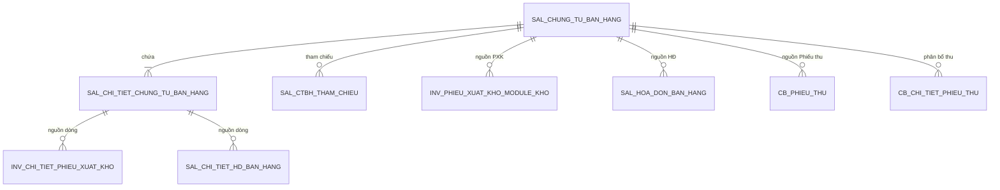

# Chứng từ bán hàng — Thêm mới: thiết kế chi tiết bảng và entity

> **Trạng thái:** `BẢN NHÁP CHỜ BA/DEV BE/DBA REVIEW`
> **Ngày cập nhật:** 2026-08-07
> **Phạm vi:** PMKT-E-06194 — `4.usecases/ThemMoi` và `SCR_CTBH_ThemMoi`

## 0. Nguồn thiết kế và ranh giới khảo sát

Tài liệu này được lập từ:

- `docs/doing/ctbh-them-moi-api-plan.md`;
- đặc tả BA `UC_CTBH_ThemMoi.md`, `SCR_CTBH_ThemMoi.md`, `6.messages.md` và màn Tham chiếu dùng chung;
- schema thực tế qua các migration V57, V70, V75, V77, V163, V269, V343, V349 và V351;
- các lớp nền `BaseEntity`, `TenantedEntity`, `AggregateRootEntity`, `BaseChungTuEntity`,
  `BaseChiTietChungTuEntity` trong `core`;
- hợp đồng luồng chứng từ trong `accounting_core`.

> **Ranh giới bắt buộc:** Không đọc, không đối chiếu và không dùng làm nguồn thiết kế bất kỳ Java
> code nào trong module/package `chung_tu_ban_hang` hiện có. Tên entity và field dưới đây là thiết
> kế độc lập từ BA + schema + base architecture, không phải bản mô tả ngược implementation cũ.

## 1. Mục tiêu và nguyên tắc

### 1.1 Mục tiêu

Thiết kế phải lưu được đầy đủ dữ liệu của màn Thêm mới, bảo đảm:

1. Một aggregate Chứng từ bán hàng gồm header, dòng hàng và chứng từ tham chiếu.
2. Có snapshot đủ để tạo đồng thời Phiếu xuất kho, Hóa đơn bán hàng và Phiếu thu.
3. Liên kết chứng từ con tới đúng dòng CTBH gốc theo BR17.
4. Một transaction rollback toàn bộ khi lưu một aggregate hoặc chứng từ con thất bại.
5. Không tin các tổng tiền, trạng thái, tenant, audit và counter do client gửi lên.
6. Tương thích với RLS, soft delete, audit và optimistic lock của BE.

### 1.2 Quyết định thiết kế

| # | Quyết định | Hệ quả |
|---|---|---|
| D1 | Header kế thừa `BaseChungTuEntity` | Dùng bộ cột chuẩn số/ngày/status/audit/tenant/version; không khai lại trong entity con |
| D2 | Dòng hàng kế thừa `BaseChiTietChungTuEntity` | Optimistic lock ở header; khi đổi dòng phải `touch()` header |
| D3 | Header là aggregate root, cascade tới dòng hàng và tham chiếu | Không repository ghi trực tiếp dòng con trong luồng Thêm mới |
| D4 | Thông tin Hóa đơn là snapshot riêng prefix `hd_*` | Bảo toàn trường hợp khách hàng Hóa đơn khác khách hàng Chứng từ ghi nợ theo BR07 §3.2 |
| D5 | Thông tin PXK/PT dùng snapshot prefix `pxk_*`/`pt_*`; thông tin khách hàng chung không nhân bản | BR07 §3.1 yêu cầu các tab Chứng từ ghi nợ/PXK/PT/GBC đồng bộ hai chiều |
| D6 | Tổng và counter là server-owned | Không có setter/request field có thể ghi trực tiếp status, tổng, số lượng đã xuất hoặc dấu vết audit |
| D7 | Dòng ghi chú vẫn dùng chung bảng dòng hàng, phân biệt bằng `loai_dong_hang=false` | Giữ đúng thứ tự xen kẽ; các cột nghiệp vụ còn lại phải NULL/0 và không tham gia tính toán |
| D8 | Tab Tham chiếu dùng bảng con riêng | Một CTBH có nhiều chứng từ nguồn; không lưu JSONB/UUID array |
| D9 | Chứng từ con thuộc module sở hữu của nó | CTBH chỉ gọi port; không map entity PXK/HĐ/PT vào cùng aggregate JPA của CTBH |
| D10 | Tiền nguyên tệ và tiền hạch toán dùng cặp field rõ nghĩa | Hậu tố `QuyDoi` = tiền hạch toán; field không hậu tố = nguyên tệ theo loại tiền chọn |

## 2. Sơ đồ dữ liệu



### 2.1 Aggregate và ownership

| Aggregate | Root | Child thuộc aggregate | Module sở hữu |
|---|---|---|---|
| Chứng từ bán hàng | `sal_chung_tu_ban_hang` | `sal_chi_tiet_chung_tu_ban_hang`, `sal_ctbh_tham_chieu` | Chứng từ bán hàng |
| Phiếu xuất kho | `inv_phieu_xuat_kho_module_kho` | `inv_chi_tiet_phieu_xuat_kho` | Kho |
| Hóa đơn bán hàng | `sal_hoa_don_ban_hang` | `sal_chi_tiet_hd_ban_hang` | Hóa đơn bán hàng |
| Phiếu thu | `cb_phieu_thu` | `cb_chi_tiet_phieu_thu`, bảng tham chiếu của Phiếu thu nếu dùng | Tiền mặt/Tiền gửi |

Không dùng cascade JPA xuyên bốn aggregate. Orchestrator gọi ba port trong cùng transaction.

Trong UC Thêm mới, mỗi cờ chỉ sinh tối đa một chứng từ con. Cardinality tổng thể vẫn là 1-n vì
BR17 cho phép lập nhiều HĐ/PXK/Phiếu thu từng phần về sau. Do đó FK từ child về nguồn mới là liên
kết canonical; các cột `phieu_xuat_kho_id`, `phieu_thu_id` trên CTBH chỉ là liên kết tới chứng từ
được **lập kèm lần đầu**, không được dùng để suy rằng CTBH chỉ có một chứng từ con.

## 3. Bảng `sal_chung_tu_ban_hang`

### 3.1 Cột kế thừa từ base

Entity `ChungTuBanHangEntity extends BaseChungTuEntity`, nhận các field sau từ base:

| Cột DB | Java | Kiểu | Null | Ghi chú |
|---|---|---|---|---|
| `id` | `UUID id` | `uuid` | N | PK; server sinh |
| `tenant_id` | `UUID tenantId` | `uuid` | N | `TenantedEntity` lấy từ `TenantContext`; không nhận từ body |
| `chi_nhanh_id` | `UUID chiNhanhId` | `uuid` | Y* | Bắt buộc nghiệp vụ sau khi BA chốt nguồn chi nhánh |
| `loai_chung_tu_id` | `UUID loaiChungTuId` | `uuid` | Y* | FK logic tới danh mục loại chứng từ |
| `giao_dich_chung_tu_id` | `UUID giaoDichChungTuId` | `uuid` | Y* | Giao dịch `SAL_BAN_HANG` |
| `so_chung_tu` | `String soChungTu` | `varchar(50)` | N | Unique theo tenant khi chưa xóa |
| `ngay_chung_tu` | `LocalDate ngayChungTu` | `date` | N | Không lớn hơn ngày hiện tại |
| `ngay_hach_toan` | `LocalDate ngayHachToan` | `date` | N | Xem Q3 về yêu cầu BA `DateTime` |
| `status` | `TrangThaiChungTu status` | `varchar` | N | `NHAP` hoặc `DA_GHI_SO` trong UC này |
| `nguoi_duyet_id` | `UUID nguoiDuyetId` | `uuid` | Y | Server-owned |
| `ngay_duyet` | `Instant ngayDuyet` | `timestamptz` | Y | Server-owned |
| `nguoi_ghi_so` | `UUID nguoiGhiSo` | `uuid` | Y | Chỉ có khi đã ghi sổ |
| `thoi_gian_ghi_so` | `Instant thoiGianGhiSo` | `timestamptz` | Y | Chỉ có khi đã ghi sổ |
| `phien_ban` | `Integer phienBan` | `integer` | N | `@Version`, default 1 |
| `da_xoa` | `boolean daXoa` | `boolean` | N | Soft delete, default false |
| `ngay_tao` | `Instant ngayTao` | `timestamptz` | N | Server-owned |
| `ngay_cap_nhat` | `Instant ngayCapNhat` | `timestamptz` | Y | Token optimistic lock trả cho FE |
| `ngay_xoa` | `Instant ngayXoa` | `timestamptz` | Y | Server-owned |
| `nguoi_tao` | `UUID nguoiTao` | `uuid` | Y | Server-owned |
| `nguoi_cap_nhat` | `UUID nguoiCapNhat` | `uuid` | Y | Server-owned |
| `nguoi_xoa` | `UUID nguoiXoa` | `uuid` | Y | Server-owned |

`Y*`: schema hiện cho phép NULL để tương thích dữ liệu cũ; service Thêm mới phải điền nếu đã có
nguồn dữ liệu chắc chắn. Việc `SET NOT NULL` cần migration/backfill riêng.

### 3.2 Header options và thông tin chứng từ ghi nợ

| Cột DB | Field entity | Kiểu DB / Java | Null/default | Quy tắc |
|---|---|---|---|---|
| `loai_nghiep_vu` | `LoaiNghiepVuBanHang loaiNghiepVu` | `varchar` / enum | N / `TRONG_NUOC` | Chỉ `Bán hàng trong nước`, `Bán hàng xuất khẩu` |
| `kiem_phieu_xuat_kho` | `boolean kiemPhieuXuatKho` | `boolean` | N / true | Điều khiển snapshot và sinh PXK |
| `lap_kem_hoa_don` | `boolean lapKemHoaDon` | `boolean` | N / true | Loại trừ với `da_lap_hoa_don` |
| `da_lap_hoa_don` | `boolean daLapHoaDon` | `boolean` | N / false | Không sinh HĐ; vẫn khởi tạo counter HĐ đủ |
| `thu_tien_ngay` | `boolean thuTienNgay` | `boolean` | N / false | Điều khiển sinh Phiếu thu |
| `hinh_thuc_thanh_toan` | `HinhThucThanhToan hinhThucThanhToan` | `varchar` / enum | N / `TIEN_MAT` | Chỉ có ý nghĩa khi `thu_tien_ngay=true` |
| `khach_hang_id` | `UUID khachHangId` | `uuid` | N | Đối tượng phải tồn tại và là khách hàng |
| `ten_khach_hang` | `String tenKhachHang` | `varchar(255)` | N | Snapshot, không join tên động khi đọc lại |
| `ma_so_thue` | `String maSoThue` | `varchar(14)` | Y | MST 10 số/10-3 hoặc CCCD chủ hộ 12 số |
| `nguoi_lien_he` | `String nguoiLienHe` | `varchar(50)` | Y | Snapshot cho tab chung |
| `dia_chi` | `String diaChi` | `varchar(400)` | Y | Snapshot cho tab chung |
| `nhan_vien_ban_hang_id` | `UUID nhanVienBanHangId` | `uuid` | Y | Danh mục nhân viên |
| `mo_ta` | `String moTa` | `varchar(500)` | Y | Diễn giải chứng từ ghi nợ |
| `dieu_khoan_thanh_toan_id` | `UUID dieuKhoanThanhToanId` | `uuid` | Y | Chỉ dùng khi không thu ngay |
| `so_ngay_duoc_no` | `Integer soNgayDuocNo` | `integer` | Y | `>= 0`; BA ghi max length 50 nhưng bản chất là số |
| `han_thanh_toan` | `LocalDate hanThanhToan` | `date` | Y | Mặc định ngày CT + số ngày nợ; cho sửa tay |

### 3.3 Snapshot Tab Hóa đơn — bắt buộc tách `hd_*`

BR07 §3.2 cho phép Mã khách hàng Hóa đơn khác các tab khác. Vì vậy không dùng lại
`khach_hang_id/ten_khach_hang/ma_so_thue/dia_chi` cho Hóa đơn.

| Cột DB đề xuất | Field entity | Kiểu | Null | Điều kiện/validation |
|---|---|---|---|---|
| `hd_khach_hang_id` | `UUID hoaDonKhachHangId` | `uuid` | Y | Bắt buộc khi `lap_kem_hoa_don=true` |
| `hd_ten_khach_hang` | `String hoaDonTenKhachHang` | `varchar(255)` | Y | Bắt buộc theo màn Hóa đơn |
| `hd_ma_so_thue` | `String hoaDonMaSoThue` | `varchar(14)` | Y | Validate riêng, không dùng MST tab chung |
| `nguoi_mua_hang` *(đã có)* | `String hoaDonNguoiMuaHang` | `varchar(100)` | Y | Snapshot riêng HĐ; giữ tên DB cũ để không tạo cột trùng |
| `ma_so_dvqhns` *(đã có)* | `String hoaDonMaSoDvqhns` | `varchar(7)` | Y | Snapshot tổ chức |
| `cccd` *(đã có)* | `String hoaDonCccd` | `varchar(12)` | Y | Chỉ chữ số nếu có |
| `ho_chieu` *(đã có)* | `String hoaDonHoChieu` | `varchar(20)` | Y | Snapshot |
| `so_dien_thoai` *(đã có)* | `String hoaDonSoDienThoai` | `varchar(20)` | Y | Snapshot HĐ; tab chung không có field điện thoại |
| `hd_dia_chi` | `String hoaDonDiaChi` | `varchar(400)` | Y | Bắt buộc khi lập kèm HĐ |
| `hd_hinh_thuc_thanh_toan` | `String hoaDonHinhThucThanhToan` | `varchar(50)` | Y | `Tiền mặt`, `Chuyển khoản`, `TM/CK` hoặc text BA cho phép nhập ngoài combo |
| `hd_tai_khoan_ngan_hang_id` | `UUID hoaDonTaiKhoanNganHangId` | `uuid` | Y | Tham chiếu danh mục nếu chọn từ danh sách |
| `hd_tai_khoan_ngan_hang_text` | `String hoaDonTaiKhoanNganHangText` | `varchar(50)` | Y | Giữ giá trị nhập ngoài danh mục; xem Q4 |
| `hd_mau_so_hoa_don_id` | `UUID hoaDonMauSoId` | `uuid` | Y | Bắt buộc khi lập kèm HĐ |
| `hd_ky_hieu_hoa_don` | `String hoaDonKyHieu` | `varchar(6)` | Y | Bắt buộc khi lập kèm HĐ |
| `hd_so_hoa_don` | `String hoaDonSo` | `varchar(8)` | Y | Bắt buộc; giữ dạng chuỗi để không mất số 0 đầu |
| `hd_ngay_hoa_don` | `LocalDate hoaDonNgay` | `date` | Y | Bắt buộc khi lập kèm HĐ |

Không đặt `NOT NULL` vô điều kiện cho nhóm này vì tab bị ẩn khi `lap_kem_hoa_don=false`. Ràng buộc
điều kiện đặt ở service; DB bổ sung `CHECK` cho phép hai trạng thái “đủ nhóm hoặc không lập kèm”.

### 3.4 Snapshot Tab Phiếu xuất kho

Thông tin khách hàng/tên/địa chỉ/nhân viên dùng snapshot chung ở §3.2 theo BR07 §3.1.

| Cột DB | Field entity | Kiểu | Null | Quy tắc |
|---|---|---|---|---|
| `pxk_so_chung_tu` | `String phieuXuatKhoSoChungTu` | `varchar(50)` | Y | Bắt buộc khi kiêm PXK; cơ chế nhập/sinh chờ BA |
| `pxk_ngay_chung_tu` | `LocalDate phieuXuatKhoNgayChungTu` | `date` | Y | Bắt buộc khi kiêm PXK |
| `pxk_ngay_hach_toan` | `LocalDate phieuXuatKhoNgayHachToan` | `date` | Y | Bắt buộc khi kiêm PXK |
| `nguoi_nhan` *(đã có)* | `String phieuXuatKhoNguoiNhan` | `varchar(100)` | Y | Snapshot riêng của Tab PXK; field Java vẫn nằm trong embeddable PXK |
| `pxk_mo_ta` | `String phieuXuatKhoMoTa` | `varchar(500)` | Y | Diễn giải theo BR07 c.1, cho sửa tay |
| `phieu_xuat_kho_id` | `UUID phieuXuatKhoId` | `uuid` | Y | Server gán sau khi adapter sinh PXK; client không được gửi |

### 3.5 Snapshot Tab Phiếu thu/Giấy báo có

| Cột DB | Field entity | Kiểu | Null | Quy tắc |
|---|---|---|---|---|
| `pt_so_chung_tu` | `String phieuThuSoChungTu` | `varchar(50)` | Y | Bắt buộc khi thu ngay |
| `pt_ngay_chung_tu` | `LocalDate phieuThuNgayChungTu` | `date` | Y | Bắt buộc khi thu ngay |
| `pt_ngay_hach_toan` | `LocalDate phieuThuNgayHachToan` | `date` | Y | Bắt buộc khi thu ngay |
| `nguoi_nop` *(đã có)* | `String phieuThuNguoiNopTien` | `varchar(100)` | Y | Snapshot; field Java thuộc embeddable PT |
| `mieu_ta_phieu_thu` *(đã có)* | `String phieuThuLyDoThu` | `varchar(500)` | Y | Diễn giải theo BR07 c.1 |
| `tai_khoan_tien_id` *(đã có)* | `UUID phieuThuTaiKhoanTienId` | `uuid` | Y | Bắt buộc; tài khoản cấp cuối 111x/112x tùy hình thức |
| `tai_khoan_ngan_hang_thu_id` *(đã có)* | `UUID phieuThuTaiKhoanNhanId` | `uuid` | Y | Bắt buộc khi chuyển khoản; danh mục tài khoản ngân hàng nhận |
| `pt_ten_ngan_hang_nhan` | `String phieuThuTenNganHangNhan` | `varchar(255)` | Y | Snapshot readonly từ tài khoản nhận |
| `phieu_thu_id` | `UUID phieuThuId` | `uuid` | Y | Server gán sau khi adapter sinh Phiếu thu |

Không tái dùng tài khoản ngân hàng Hóa đơn cho field Java `phieuThuTaiKhoanNhanId`: một bên là thông tin thanh
toán thể hiện trên HĐ, bên còn lại là tài khoản thực nhận trên Giấy báo có.

### 3.6 Quy tắc tương thích tên cột hiện hữu

Thiết kế Java được phép nhóm field bằng embeddable nhưng **không tạo cột DB trùng nghĩa**. Các cột
đã có sau V75/V343 được giữ và map qua `@AttributeOverride`:

| Nhóm Java | Cột DB giữ nguyên |
|---|---|
| Hóa đơn | `nguoi_mua_hang`, `ma_so_dvqhns`, `cccd`, `ho_chieu`, `so_dien_thoai` |
| Phiếu xuất kho | `nguoi_nhan`, `phieu_xuat_kho_id` |
| Phiếu thu | `nguoi_nop`, `mieu_ta_phieu_thu`, `tai_khoan_tien_id`, `tai_khoan_ngan_hang_thu_id`, `phieu_thu_id` |

Chỉ field chưa có nơi lưu mới thêm prefix. Không đổi tên cột đã apply chỉ để làm tên đẹp.

### 3.7 Tiền tệ, chiết khấu và tổng

| Cột DB | Field entity | Kiểu | Owner | Công thức/ghi chú |
|---|---|---|---|---|
| `loai_tien_id` | `UUID loaiTienId` | `uuid` | Client chọn | Bắt buộc |
| `ty_gia` | `BigDecimal tyGia` | `exchange_rate` | Client/server default | `> 0`; 1 nếu tiền hạch toán |
| `loai_chiet_khau` | `LoaiChietKhau loaiChietKhau` | enum text | Client chọn | 5 giá trị BR11 |
| `gia_tri_chiet_khau` | `BigDecimal giaTriChietKhau` | `numeric(18,2)` hiện hữu | Client | Cột đa nghĩa theo loại CK; chỉ dùng tạm khi Q5 chưa tách field |
| `tong_tien_hang_hoa` | `BigDecimal tongTienHangHoa` | `money_foreign` | Server | Σ thành tiền nguyên tệ |
| `tong_tien_chiet_khau` | `BigDecimal tongTienChietKhau` | `money_foreign` | Server | Σ chiết khấu nguyên tệ |
| `tong_tien_chiet_khau_hang` | `BigDecimal tongTienChietKhauHang` | `money_foreign` | Server | Σ CK mặt hàng |
| `tong_tien_chiet_khau_hoa_don` | `BigDecimal tongTienChietKhauHoaDon` | `money_foreign` | Server | Σ CK hóa đơn |
| `tong_tien_thue_gtgt` | `BigDecimal tongTienThueGtgt` | `money_foreign` | Server | Σ VAT, chỉ bán trong nước |
| `tong_tien_thue_xk` | `BigDecimal tongTienThueXk` | `money_foreign` | Server | **Cột cần bổ sung**; Σ thuế XK |
| `tong_tien_sau_thue` | `BigDecimal tongTienSauThue` | `money_foreign` | Server | Giữ nếu báo cáo cần; không phải tổng thanh toán xuất khẩu |
| `tong_tien_thanh_toan` | `BigDecimal tongTienThanhToan` | `money_foreign` | Server | Trong nước: hàng − CK + VAT; xuất khẩu: hàng − CK |
| `tong_tien_hang_hoa_quy_doi` | `BigDecimal tongTienHangHoaQuyDoi` | `money_vnd` | Server | Σ dòng quy đổi |
| `tong_tien_chiet_khau_quy_doi` | `BigDecimal tongTienChietKhauQuyDoi` | `money_vnd` | Server | — |
| `tong_tien_chiet_khau_hang_quy_doi` | `BigDecimal tongTienChietKhauHangQuyDoi` | `money_vnd` | Server | — |
| `tong_tien_chiet_khau_hoa_don_quy_doi` | `BigDecimal tongTienChietKhauHoaDonQuyDoi` | `money_vnd` | Server | — |
| `tong_tien_thue_gtgt_quy_doi` | `BigDecimal tongTienThueGtgtQuyDoi` | `money_vnd` | Server | — |
| `tong_tien_thue_xk_quy_doi` | `BigDecimal tongTienThueXkQuyDoi` | `money_vnd` | Server | **Cột cần bổ sung** |
| `tong_tien_sau_thue_quy_doi` | `BigDecimal tongTienSauThueQuyDoi` | `money_vnd` | Server | — |
| `tong_tien_thanh_toan_quy_doi` | `BigDecimal tongTienThanhToanQuyDoi` | `money_vnd` | Server | — |
| `so_tien_da_thanh_toan` | `BigDecimal soTienDaThanhToan` | `money_foreign` | Server | = tổng thanh toán nếu thu ngay, ngược lại 0 |
| `so_tien_da_thanh_toan_quy_doi` | `BigDecimal soTienDaThanhToanQuyDoi` | `money_vnd` | Server | Cặp quy đổi |

Các cột gốc đang dùng `money_vnd` trong migration cũ cần DBA xác nhận lại semantics. Nếu
`money_vnd` chỉ là `numeric(18,2)` thì có thể giữ vật lý; Java/comment phải khẳng định đây là
nguyên tệ. Nếu domain cưỡng chế VND, đổi cột gốc sang `money_foreign`.

### 3.8 Trạng thái nghiệp vụ và thông tin bổ sung

| Cột DB | Field entity | Kiểu/default | Owner | Quy tắc |
|---|---|---|---|---|
| `trang_thai_hoa_don` | `TrangThaiHoaDon trangThaiHoaDon` | enum / `CHUA_LAP` | Server | Chưa lập / một phần / đủ theo counter |
| `trang_thai_thanh_toan` | `TrangThaiThanhToan trangThaiThanhToan` | enum / `CHUA_THANH_TOAN` | Server | Dựa trên tổng nợ và đã thanh toán |
| `trang_thai_xuat_hang` | `TrangThaiXuatHang trangThaiXuatHang` | enum / `CHUA_XUAT` | Server | Chưa xuất / một phần / đủ |
| `so_hop_dong` | `String soHopDong` | `varchar(50)` | Client | Tự do |
| `ngay_hop_dong` | `LocalDate ngayHopDong` | `date` | Client | — |
| `dia_diem_giao` | `String diaDiemGiao` | `varchar(255)` | Client | Cho chọn hoặc nhập tự do |
| `dia_diem_nhan` | `String diaDiemNhan` | `varchar(255)` | Client | — |
| `so_van_don` | `String soVanDon` | `varchar(50)` | Client | — |
| `so_container` | `String soContainer` | `varchar(50)` | Client | — |
| `don_vi_van_chuyen` | `String donViVanChuyen` | `varchar(255)` | Client | — |
| `la_giao_dich_noi_bo_tap_doan` | `boolean giaoDichNoiBo` | false | Server/client theo rule | Phải có `doi_tac_tenant_id` khi true |
| `doi_tac_tenant_id` | `UUID doiTacTenantId` | nullable | Client | Không thay `tenant_id` sở hữu dữ liệu |

Ba trạng thái nghiệp vụ phải được chuẩn hóa giữa BA, enum và CHECK constraint. Đặc biệt schema V75
dùng `Đã xuất hàng`, trong khi BA/AC dùng `Đã xuất đủ`. Migration mới phải backfill
`Đã xuất hàng → Đã xuất đủ` rồi thay CHECK constraint; không để converter Java viết một chuỗi mà DB
chỉ chấp nhận chuỗi khác.

## 4. Bảng `sal_chi_tiet_chung_tu_ban_hang`

### 4.1 Quan hệ và lifecycle

```java
@Entity
@Table(name = "sal_chi_tiet_chung_tu_ban_hang")
class ChiTietChungTuBanHangEntity extends BaseChiTietChungTuEntity {
    @ManyToOne(fetch = LAZY, optional = false)
    @JoinColumn(name = "chung_tu_ban_hang_id", nullable = false)
    private ChungTuBanHangEntity chungTu;

    @Override
    public UUID getChungTuId() { return chungTu == null ? null : chungTu.getId(); }
}
```

- Header map `@OneToMany(mappedBy="chungTu", cascade=ALL, orphanRemoval=true)`.
- Không đặt `@Version` riêng trên dòng; header là version của aggregate.
- Unique đề xuất: `(tenant_id, chung_tu_ban_hang_id, stt) WHERE da_xoa=false`.

### 4.2 Định danh dòng và hàng hóa

| Cột DB | Field entity | Kiểu | Null/default | Quy tắc |
|---|---|---|---|---|
| `id` | kế thừa | `uuid` | N | PK |
| `tenant_id` | kế thừa | `uuid` | N | Luôn bằng tenant header |
| `chung_tu_ban_hang_id` | `ChungTuBanHangEntity chungTu` | `uuid` | N | FK parent |
| `stt` | kế thừa `Integer stt` | `integer` | N | Thứ tự xen dòng hàng/ghi chú |
| `loai_dong_hang` | `boolean loaiDongHang` | `boolean` | N / true | false = dòng ghi chú |
| `ma_hang_id` | `UUID maHangId` | `uuid` | Y | Bắt buộc chỉ với dòng hàng |
| `ten_hang` | `String tenHang` | `varchar(255)` | Y | Dòng hàng: snapshot tên; dòng ghi chú: nội dung ghi chú |
| `mo_ta` | `String moTa` | `varchar(500)` | Y | Dòng hàng mặc định = tên; ghi chú = NULL |
| `don_vi_tinh_id` | `UUID donViTinhId` | `uuid` | Y | Bắt buộc với dòng hàng |
| `kho_id` | `UUID khoId` | `uuid` | Y | Bắt buộc với hàng quản lý kho khi kiêm PXK |
| `so_lo` | `String soLo` | `varchar(100)` | Y | Không áp dụng dịch vụ/CKTM |
| `han_su_dung` | `LocalDate hanSuDung` | `date` | Y | Không trước ngày chứng từ nếu BA yêu cầu |
| `hang_khuyen_mai` | `boolean hangKhuyenMai` | `boolean` | N / false | Loại trừ với CKTM |
| `chiet_khau_thuong_mai` | `boolean chietKhauThuongMai` | `boolean` | N / false | Loại trừ với khuyến mại |

`heSoQuyDoi`, `soLuongQuyDoi`, `donGiaTheoDvtChinh` là field `@Transient`/DTO tính từ danh mục theo
BR16; BA nói không lưu DB. Riêng số lượng đã xuất kho quy đổi vẫn lưu để bảo vệ counter lịch sử.

### 4.3 Số lượng, giá bán và counter

| Cột DB | Field entity | Kiểu | Owner | Quy tắc |
|---|---|---|---|---|
| `so_luong` | `BigDecimal soLuong` | `quantity` | Client | `>=0`; mặc định 1 |
| `don_gia` | `BigDecimal donGia` | `money_foreign` | Client/server | `>=0`; BR18 |
| `don_gia_quy_doi` | `BigDecimal donGiaQuyDoi` | `money_vnd` | Server | `donGia × tyGia` hoặc theo contract quy đổi được BA chốt |
| `thanh_tien` | `BigDecimal thanhTien` | `money_foreign` | Server hoặc client override | BR18; CKTM hiển thị dương nhưng giá trị hạch toán âm ở domain |
| `thanh_tien_quy_doi` | `BigDecimal thanhTienQuyDoi` | `money_vnd` | Server | `thanhTien × tyGia` |
| `so_luong_da_xuat_hd` | `BigDecimal soLuongDaXuatHoaDon` | `quantity` | Server | Default 0; không nhận từ create request |
| `so_luong_da_xuat_kho` | `BigDecimal soLuongDaXuatKho` | `quantity` | Server | Default 0 |
| `so_luong_da_xuat_kho_quy_doi` | `BigDecimal soLuongDaXuatKhoQuyDoi` | `quantity` | Server | Default 0 |

Counter update phải khóa dòng hoặc dùng optimistic lock header; không thực hiện theo chuỗi
“đọc counter → kiểm → ghi” ngoài transaction.

### 4.4 Chiết khấu

| Cột DB | Field entity | Kiểu | Owner |
|---|---|---|---|
| `chiet_khau_phan_tram` | `BigDecimal chietKhauPhanTram` | `percent_rate` | Client/server theo loại CK |
| `chiet_khau` | `BigDecimal chietKhau` | `money_foreign` | Client/server |
| `chiet_khau_quy_doi` | `BigDecimal chietKhauQuyDoi` | `money_vnd` | Server |
| `phan_tram_chiet_khau_hang` | `BigDecimal phanTramChietKhauHang` | `percent_rate` | Server hoặc client qua popup |
| `tien_chiet_khau_hang` | `BigDecimal tienChietKhauHang` | `money_foreign` | Server |
| `tien_chiet_khau_hang_quy_doi` | `BigDecimal tienChietKhauHangQuyDoi` | `money_vnd` | Server |
| `phan_tram_chiet_khau_hoa_don` | `BigDecimal phanTramChietKhauHoaDon` | `percent_rate` | Server hoặc client qua popup |
| `tien_chiet_khau_hoa_don` | `BigDecimal tienChietKhauHoaDon` | `money_foreign` | Server |
| `tien_chiet_khau_hoa_don_quy_doi` | `BigDecimal tienChietKhauHoaDonQuyDoi` | `money_vnd` | Server |
| `tai_khoan_chiet_khau_id` | `UUID taiKhoanChietKhauId` | `uuid` | Client/default danh mục |

Tất cả phần trăm phải trong `[0,100]`. Tổng `chiet_khau` phải bằng CK mặt hàng + CK hóa đơn theo
loại chiết khấu; server tính lại trước khi persist.

### 4.5 Thuế GTGT và thuế xuất khẩu

| Cột DB | Field entity | Kiểu | Điều kiện |
|---|---|---|---|
| `thue_suat_gtgt_mac_dinh` | `ThueSuatGtgt thueSuatGtgt` | enum text | 0/5/8/10/KCT/KKKNT/KHAC |
| `gia_tri_thue_gtgt` | `BigDecimal giaTriThueGtgt` | `percent_rate` | Chỉ khi KHAC |
| `tien_thue_gtgt` | `BigDecimal tienThueGtgt` | `money_foreign` | Trong nước |
| `tien_thue_gtgt_quy_doi` | `BigDecimal tienThueGtgtQuyDoi` | `money_vnd` | Trong nước |
| `tai_khoan_thue_gtgt_id` | `UUID taiKhoanThueGtgtId` | `uuid` | Bắt buộc khi phát sinh VAT |
| `dien_giai_thue` | `String dienGiaiThue` | `varchar(500)` | Mặc định `Thuế GTGT - {Tên hàng}` |
| `khong_tong_hop_to_khai_gtgt` | `boolean khongTongHopToKhaiGtgt` | `boolean` | true + khóa với KHAC/KKKNT |
| `don_gia_thue_xk` | `BigDecimal giaTriTinhThueXk` | `money_vnd` | Tên cột lịch sử lệch nghĩa; chỉ xuất khẩu |
| `phan_tram_thue_xk` | `BigDecimal phanTramThueXk` | `percent_rate` | Xuất khẩu |
| `tien_thue_xk` | `BigDecimal tienThueXk` | `money_foreign` | Xuất khẩu |
| `tien_thue_xk_quy_doi` | `BigDecimal tienThueXkQuyDoi` | `money_vnd` | Xuất khẩu |
| `tai_khoan_thue_xk_id` | `UUID taiKhoanThueXkId` | `uuid` | Khi có thuế XK |

Không đổi tên `don_gia_thue_xk` ngay trong ticket nếu đã có dữ liệu; map field Java đúng nghĩa và
ghi comment DB. Migration đổi tên chỉ thực hiện sau impact analysis toàn repository.

### 4.6 Giá vốn và tài khoản

| Cột DB | Field entity | Kiểu | Quy tắc |
|---|---|---|---|
| `tu_nhap_don_gia_von` | `boolean tuNhapDonGiaVon` | `boolean` | Default false; không áp dụng dịch vụ/CKTM |
| `don_gia_von` | `BigDecimal donGiaVon` | `money_vnd` | 0 trước tính giá hoặc giá nhập tay |
| `don_gia_von_quy_doi` | `BigDecimal donGiaVonQuyDoi` | `money_vnd` | Chỉ giữ nếu báo cáo hiện dùng; cần làm rõ nghĩa |
| `tong_gia_tri_von` | `BigDecimal tongGiaTriVon` | `money_vnd` | SL quy đổi × đơn giá vốn |
| `tong_gia_tri_von_quy_doi` | `BigDecimal tongGiaTriVonQuyDoi` | `money_vnd` | Xem Q6 |
| `tai_khoan_no_id` | `UUID taiKhoanCongNoId` | `uuid` | TK công nợ cấp cuối |
| `tai_khoan_co_id` | `UUID taiKhoanDoanhThuId` | `uuid` | TK doanh thu cấp cuối |
| `tai_khoan_gia_von_id` | `UUID taiKhoanGiaVonId` | `uuid` | Khi phát sinh giá vốn |
| `tai_khoan_kho_id` | `UUID taiKhoanKhoId` | `uuid` | Khi phát sinh giá vốn |

Mọi tài khoản được chọn phải tồn tại, hoạt động và là tài khoản cấp cuối theo BR19.

### 4.7 Công nợ theo dòng và chiều phân tích

| Cột DB | Field entity | Kiểu | Owner |
|---|---|---|---|
| `tong_no_phai_thu_nt` | `BigDecimal tongNoPhaiThuNguyenTe` | `money_foreign` | Server khi ghi sổ |
| `tong_no_phai_thu_vnd` | `BigDecimal tongNoPhaiThuQuyDoi` | `money_vnd` | Server khi ghi sổ |
| `so_con_no_nt` | `BigDecimal soConNoNguyenTe` | `money_foreign` | Server/Phiếu thu cập nhật |
| `so_con_no_vnd` | `BigDecimal soConNoQuyDoi` | `money_vnd` | Server/Phiếu thu cập nhật |
| `hop_dong_id` | `UUID hopDongId` | `uuid` | Chiều phân tích |
| `don_vi_id` | `UUID donViId` | `uuid` | Chiều phân tích |
| `khoan_muc_chi_phi_id` | `UUID khoanMucChiPhiId` | `uuid` | Chiều phân tích |
| `vu_viec_id` | `UUID vuViecId` | `uuid` | Chiều phân tích |

Các field công nợ không có trong create request. Khi `Lưu` nháp: NULL. Khi ghi sổ: khởi tạo từ
giá trị Nợ công nợ của dòng; Phiếu thu giảm `so_con_no_*`, không thay `tong_no_phai_thu_*`.

### 4.8 Dữ liệu chỉ dẫn xuất, không tạo thêm cột/bảng

| Dữ liệu trên màn | Nguồn trả về | Không lưu vì |
|---|---|---|
| Hệ số/Số lượng/Đơn giá quy đổi theo ĐVT | Danh mục đơn vị quy đổi + dòng hàng | BA xác định là field hiển thị; tránh snapshot trùng nếu chưa chốt yêu cầu lịch sử |
| Tab Thuế tổng hợp theo mức thuế | Group các dòng chi tiết theo thuế suất | Có thể dựng lại hoàn toàn từ detail |
| Tab Hạch toán | Bút toán dựng trước lưu hoặc đọc `acc_so_cai` sau ghi sổ | Sổ cái là nguồn sự thật; không lưu thêm JSON/table hạch toán trong CTBH |
| Trạng thái ẩn/hiện, tab đang chọn, popup phân bổ | FE state | Không phải dữ liệu nghiệp vụ |
| Số lượng còn lại xuất HĐ/kho | `soLuong - counter` | Calculated, không lưu cột |

## 5. Bảng mới `sal_ctbh_tham_chieu`

Tab Tham chiếu đã có trong `SCR_CTBH_ThemMoi` nhưng schema CTBH hiện chưa có nơi lưu.

| Cột | Java | Kiểu | Null/default | Mô tả |
|---|---|---|---|---|
| `id` | `UUID id` | `uuid` | N | PK |
| `tenant_id` | `UUID tenantId` | `uuid` | N | RLS key |
| `chung_tu_ban_hang_id` | `ChungTuBanHangEntity chungTu` | `uuid` | N | FK parent |
| `stt` | `Integer stt` | `integer` | N | Thứ tự hiển thị |
| `loai_chung_tu_nguon` | `String loaiChungTuNguon` | `varchar(50)` | N | Mã theo Common BR09 |
| `chung_tu_nguon_id` | `UUID chungTuNguonId` | `uuid` | Y | FK polymorphic logic, không FK vật lý cross-table |
| `so_chung_tu_nguon` | `String soChungTuNguon` | `varchar(50)` | N | Snapshot để đọc ổn định |
| `ngay_chung_tu_nguon` | `LocalDate ngayChungTuNguon` | `date` | N | Màn Tab Tham chiếu yêu cầu |
| `dien_giai` | `String dienGiai` | `varchar(500)` | Y | Snapshot |
| `tu_dong` | `boolean tuDong` | `boolean` | N / false | Phân biệt chọn tay và hệ thống sinh |
| audit/soft-delete | kế thừa | — | — | Như `BaseEntity` |

Entity đề xuất `ChungTuBanHangThamChieuEntity extends BaseChiTietChungTuEntity`; header cascade và
orphan removal như dòng hàng. Unique:

```sql
CREATE UNIQUE INDEX uq_sal_ctbh_tc_nguon
ON sal_ctbh_tham_chieu (tenant_id, chung_tu_ban_hang_id,
                        loai_chung_tu_nguon, chung_tu_nguon_id)
WHERE da_xoa = false AND chung_tu_nguon_id IS NOT NULL;
```

## 6. Liên kết với chứng từ con

### 6.1 Phiếu xuất kho

Schema Phiếu xuất kho cần bổ sung:

| Bảng/cột | Kiểu | Mục đích |
|---|---|---|
| `inv_phieu_xuat_kho_module_kho.nguon_chung_tu_ban_hang_id` | `uuid` | FK CTBH gốc; unique khi chưa xóa để chống sinh trùng |
| `inv_chi_tiet_phieu_xuat_kho.chi_tiet_chung_tu_ban_hang_id` | `uuid` | FK đúng dòng CTBH gốc theo BR17 §3.1 |
| `inv_chi_tiet_phieu_xuat_kho.tu_nhap_don_gia` | `boolean` | Mapping BR21 nếu schema chưa có |

Chỉ sinh dòng: dòng hàng, không dịch vụ, không CKTM; hàng khuyến mại vẫn sinh.

### 6.2 Hóa đơn bán hàng

Schema Hóa đơn đã có liên kết ở dòng; đề xuất siết thêm:

| Bảng/cột | Kiểu | Mục đích |
|---|---|---|
| `sal_hoa_don_ban_hang.nguon_chung_tu_ban_hang_id` | `uuid` | FK header nguồn, unique khi chưa xóa cho ca lập kèm |
| `sal_chi_tiet_hd_ban_hang.chi_tiet_chung_tu_ban_hang_id` | `uuid` | Đã có; bắt buộc cho dòng sinh từ CTBH |
| `sal_chi_tiet_hd_ban_hang.chung_tu_ban_hang_id` | `uuid` | Đã có; phải khớp parent của dòng nguồn |

Cột `sal_chi_tiet_chung_tu_ban_hang.hoa_don_ban_hang_id` hiện hữu không thể biểu diễn nhiều hóa
đơn từng phần cho cùng một dòng. Không dùng nó làm nguồn sự thật; có thể giữ như liên kết tới HĐ lập
kèm đầu tiên để tương thích, còn quan hệ canonical luôn tra từ `sal_chi_tiet_hd_ban_hang` về nguồn.

Unique hóa đơn của use case này theo BA là `(tenant_id, mẫu số, ký hiệu, số HĐ)` khi chưa xóa.
Schema Hóa đơn hiện có index thêm `khach_hang_id`; DBA/BA phải thống nhất một quy tắc duy nhất.

### 6.3 Phiếu thu

| Bảng/cột | Kiểu | Mục đích |
|---|---|---|
| `cb_phieu_thu.nguon_chung_tu_ban_hang_id` | `uuid` | FK header nguồn, unique khi chưa xóa cho ca thu ngay |
| `cb_chi_tiet_phieu_thu.chung_tu_ban_hang_id` | `uuid` | Đã có; phân bổ thu về CTBH |
| `cb_chi_tiet_phieu_thu.chi_tiet_chung_tu_ban_hang_id` | `uuid` | **Cần bổ sung** nếu công nợ được quản lý per-line như V163 |

Vì công nợ CTBH lưu theo dòng, chỉ liên kết Phiếu thu tới header là không đủ khi một chứng từ dùng
nhiều tài khoản 131. Adapter phải tạo phân bổ theo dòng và giảm đúng `so_con_no_*`.

## 7. Thiết kế entity Java

### 7.1 Aggregate root

```java
@Entity
@Table(name = "sal_chung_tu_ban_hang")
public class ChungTuBanHangEntity extends BaseChungTuEntity {
    // Header options + thông tin chung
    private LoaiNghiepVuBanHang loaiNghiepVu;
    private boolean kiemPhieuXuatKho;
    private boolean lapKemHoaDon;
    private boolean daLapHoaDon;
    private boolean thuTienNgay;
    private HinhThucThanhToan hinhThucThanhToan;

    // Nhóm snapshot có @AttributeOverride prefix hd_/pxk_/pt_
    @Embedded private ThongTinHoaDonSnapshot hoaDon;
    @Embedded private ThongTinPhieuXuatKhoSnapshot phieuXuatKho;
    @Embedded private ThongTinPhieuThuSnapshot phieuThu;

    @OneToMany(mappedBy = "chungTu", cascade = ALL, orphanRemoval = true)
    private List<ChiTietChungTuBanHangEntity> chiTiet;

    @OneToMany(mappedBy = "chungTu", cascade = ALL, orphanRemoval = true)
    private List<ChungTuBanHangThamChieuEntity> thamChieu;
}
```

Embeddable chỉ là cách nhóm field Java; dữ liệu vẫn nằm trên header, không tạo bảng riêng.

### 7.2 Hành vi domain bắt buộc trên entity/aggregate

Không expose setter công khai cho tổng, counter và trạng thái. Cung cấp hành vi có tên:

```java
void thayTheChiTiet(List<ChiTietChungTuBanHangEntity> moi);
void tinhLaiTong();
void khoiTaoTheoChungTuConDaLap();
void ganPhieuXuatKho(UUID id);
void ganHoaDonChoDong(UUID chiTietId, UUID hoaDonId);
void ganPhieuThu(UUID id);
void capNhatTrangThaiHoaDon();
void capNhatTrangThaiXuatHang();
void capNhatTrangThaiThanhToan();
```

Mọi method thêm dòng phải set quan hệ hai chiều và tenant do callback/base quản lý; không cho caller
set `tenantId`, `id`, audit/status/counter từ request.

### 7.3 Enum và converter

| Enum | Giá trị domain | Giá trị DB/wire |
|---|---|---|
| `LoaiNghiepVuBanHang` | `TRONG_NUOC`, `XUAT_KHAU` | `Bán hàng trong nước`, `Bán hàng xuất khẩu` |
| `HinhThucThanhToan` | `TIEN_MAT`, `CHUYEN_KHOAN` | `Tiền mặt`, `Chuyển khoản` |
| `LoaiChietKhau` | 5 hằng theo BR11 | Chuỗi tiếng Việt BA |
| `ThueSuatGtgt` | `ZERO`, `FIVE`, `EIGHT`, `TEN`, `KCT`, `KKKNT`, `KHAC` | `0`, `5`, `8`, `10`, `KCT`, `KKKNT`, `KHAC` |
| `TrangThaiHoaDon` | `CHUA_LAP`, `MOT_PHAN`, `DA_LAP_DU` | Chuỗi DB thống nhất |
| `TrangThaiXuatHang` | `CHUA_XUAT`, `MOT_PHAN`, `DA_XUAT_DU` | Chuỗi DB thống nhất |
| `TrangThaiThanhToan` | `CHUA_THANH_TOAN`, `MOT_PHAN`, `DA_THANH_TOAN` | Chuỗi DB thống nhất |

Không dùng `EnumType.STRING` nếu tên hằng Java khác chuỗi tiếng Việt đang lưu; dùng
`AttributeConverter` và test round-trip từng giá trị.

## 8. Request/DTO ownership matrix

| Nhóm field | Create request | Response DTO | Entity |
|---|---:|---:|---:|
| Trường người dùng nhập ở header/tab/dòng | Có | Có | Có |
| `id`, `tenantId`, audit, `phienBan` | Không | Có phần cần thiết | Có |
| `status`, trạng thái HĐ/XK/TT | Không | Có | Có |
| Tổng tiền và tiền quy đổi | Không tin giá trị gửi; có thể nhận một tổng đối chiếu riêng | Có | Có |
| Counter đã xuất HĐ/kho | Không | Có | Có |
| `phieuXuatKhoId`, `phieuThuId`, id HĐ | Không | Có | Có/liên kết dòng |
| Công nợ `tongNo/soConNo` | Không | Có ở màn cần dùng | Có |

Request nên tách nested object:

```text
LuuChungTuBanHangRequest
├── header chung
├── hoaDon: ThongTinHoaDonRequest?
├── phieuXuatKho: ThongTinPhieuXuatKhoRequest?
├── phieuThu: ThongTinPhieuThuRequest?
├── chiTiet: List<LuuChiTietChungTuBanHangRequest>
└── thamChieu: List<ChungTuThamChieuRequest>
```

Nullability của nested object phải khớp cờ:

- `kiemPhieuXuatKho=true` ⇒ `phieuXuatKho != null`;
- `lapKemHoaDon=true` ⇒ `hoaDon != null`;
- `thuTienNgay=true` ⇒ `phieuThu != null`;
- cờ false ⇒ server bỏ qua/xóa snapshot của tab ẩn, không giữ dữ liệu stale.

## 9. Ràng buộc DB và index

### 9.1 Header

```sql
CREATE UNIQUE INDEX uq_sal_ctbh_so_ct
ON sal_chung_tu_ban_hang (tenant_id, so_chung_tu)
WHERE da_xoa = false AND so_chung_tu <> '';

CREATE UNIQUE INDEX uq_sal_ctbh_hoa_don
ON sal_chung_tu_ban_hang
   (tenant_id, hd_mau_so_hoa_don_id, hd_ky_hieu_hoa_don, hd_so_hoa_don)
WHERE da_xoa = false AND lap_kem_hoa_don = true;

CREATE INDEX idx_sal_ctbh_tenant_ngay
ON sal_chung_tu_ban_hang (tenant_id, ngay_hach_toan DESC, ngay_chung_tu DESC);
```

### 9.2 Detail và tham chiếu

```sql
CREATE UNIQUE INDEX uq_sal_ctbh_detail_stt
ON sal_chi_tiet_chung_tu_ban_hang (tenant_id, chung_tu_ban_hang_id, stt)
WHERE da_xoa = false;

CREATE INDEX idx_sal_ctbh_detail_item
ON sal_chi_tiet_chung_tu_ban_hang (tenant_id, ma_hang_id)
WHERE da_xoa = false AND loai_dong_hang = true;

CREATE INDEX idx_sal_ctbh_tc_parent
ON sal_ctbh_tham_chieu (tenant_id, chung_tu_ban_hang_id, stt)
WHERE da_xoa = false;
```

### 9.3 Check constraints đề xuất

- `ty_gia > 0`.
- `so_ngay_duoc_no IS NULL OR so_ngay_duoc_no >= 0`.
- Không đồng thời `lap_kem_hoa_don=true` và `da_lap_hoa_don=true`.
- `hang_khuyen_mai` và `chiet_khau_thuong_mai` không đồng thời true.
- Các phần trăm trong `[0,100]`.
- Các counter `>=0` và không vượt số lượng trong trạng thái ổn định.
- `thu_tien_ngay=false` ⇒ không bắt buộc nhóm `pt_*`; true ⇒ đủ số/ngày/TK tiền.
- `lap_kem_hoa_don=false` ⇒ không áp unique HĐ; true ⇒ đủ định danh HĐ.

Các constraint phụ thuộc danh mục (dịch vụ, tài khoản cấp cuối, kho tồn tại) đặt ở service, không thể
diễn tả bằng CHECK nội bảng.

## 10. RLS, audit và xóa

Mọi bảng mới phải có:

```sql
ALTER TABLE ... ENABLE ROW LEVEL SECURITY;
ALTER TABLE ... FORCE ROW LEVEL SECURITY;
CREATE POLICY tenant_isolation ON ...
  USING (tenant_id = public.fn_current_tenant())
  WITH CHECK (tenant_id = public.fn_current_tenant());
CREATE TRIGGER trg_audit_...
  AFTER INSERT OR UPDATE OR DELETE ON ...
  FOR EACH ROW EXECUTE FUNCTION public.fn_audit();
GRANT SELECT, INSERT, UPDATE, DELETE ON ... TO pmkt_app;
```

- Xóa CTBH là soft delete và chỉ khi chưa ghi sổ, chưa có chứng từ con liên kết.
- `orphanRemoval` chỉ dùng khi sửa aggregate hợp lệ; không hard delete dữ liệu đã có lịch sử.
- FK từ chứng từ con dùng `ON DELETE RESTRICT`; không cascade xóa xuyên aggregate.

## 11. Migration dự kiến

Số migration phải được kiểm tra lại ngay khi mở PR; `V354` hiện chỉ là số giữ chỗ trong kế hoạch.

### 11.1 Migration A — hoàn thiện aggregate CTBH

1. Chuẩn hóa nullable/default boolean.
2. Thêm **chỉ các cột snapshot còn thiếu**:
   - HĐ: `hd_khach_hang_id`, `hd_ten_khach_hang`, `hd_ma_so_thue`, `hd_dia_chi`,
     `hd_hinh_thuc_thanh_toan`, `hd_tai_khoan_ngan_hang_id`,
     `hd_tai_khoan_ngan_hang_text`, `hd_mau_so_hoa_don_id`, `hd_ky_hieu_hoa_don`,
     `hd_so_hoa_don`, `hd_ngay_hoa_don`;
   - PXK: `pxk_so_chung_tu`, `pxk_ngay_chung_tu`, `pxk_ngay_hach_toan`, `pxk_mo_ta`;
   - PT: `pt_so_chung_tu`, `pt_ngay_chung_tu`, `pt_ngay_hach_toan`,
     `pt_ten_ngan_hang_nhan`.
   Các snapshot đã có tên cột lịch sử dùng bảng §3.6, không tạo lại.
3. Thêm `tong_tien_thue_xk`, `tong_tien_thue_xk_quy_doi`.
4. Tạo `sal_ctbh_tham_chieu`.
5. Thêm index/check/comment cột.
6. Không khai lại RLS/audit của hai bảng CTBH đã có; chỉ khai cho bảng tham chiếu mới.

### 11.2 Migration B — liên kết chứng từ con

1. Thêm source header/line FK cho PXK.
2. Thêm source header cho Hóa đơn; giữ FK dòng đã có.
3. Thêm source header và line allocation cho Phiếu thu.
4. Tạo unique partial index chống sinh trùng.
5. Backfill chỉ khi có dữ liệu cũ xác định được nguồn; không đoán bằng số chứng từ.

## 12. Quy tắc mapping khi sinh chứng từ con

### 12.1 CTBH → PXK

| Nguồn CTBH | Đích PXK |
|---|---|
| `id` | `nguon_chung_tu_ban_hang_id` |
| snapshot chung KH | khách hàng/tên/địa chỉ/nhân viên |
| `pxk_*` | số/ngày/ngày hạch toán/người nhận/mô tả |
| dòng `ma_hang_id` | vật tư |
| dòng `don_vi_tinh_id` | đơn vị tính |
| dòng `kho_id` | kho xuất |
| số lượng quy đổi | số lượng xuất quy đổi |
| `tu_nhap_don_gia_von` | tự nhập đơn giá |
| `don_gia_von` | đơn giá xuất |
| `tong_gia_tri_von` | thành tiền xuất |
| `tai_khoan_gia_von_id/tai_khoan_kho_id` | TK Nợ/TK Có |
| dòng CTBH `id` | `chi_tiet_chung_tu_ban_hang_id` |

### 12.2 CTBH → Hóa đơn

Header lấy nhóm `hd_*` và toàn bộ tổng/loại tiền/chiết khấu phù hợp. Mỗi dòng HĐ lưu cả
`chung_tu_ban_hang_id` và `chi_tiet_chung_tu_ban_hang_id`.

### 12.3 CTBH → Phiếu thu

Phiếu thu lấy nhóm `pt_*`, hình thức thanh toán, khách hàng chung, loại tiền, tỷ giá và tổng thanh
toán. Dòng Phiếu thu phân bổ theo từng dòng công nợ; TK Nợ là `tai_khoan_tien_id` của snapshot PT, TK Có là TK
công nợ của dòng CTBH.

## 13. Các điểm BA/DBA phải chốt trước khi code

| # | Vấn đề | Đề xuất mặc định |
|---|---|---|
| Q1 | Ngày hạch toán BA yêu cầu DateTime nhưng base/schema là Date | Giữ `LocalDate` trong ticket; tạo quyết định chung với PMKT-E-03629 trước production tính giá |
| Q2 | Số PXK/PT nhập tay hay cấp tự động | Request nhận số ở bản đầu; nếu tự sinh phải dùng dịch vụ quyển số chuẩn |
| Q3 | Ghi sổ kho/giá vốn do CTBH hay PXK | PXK sở hữu tồn kho/giá xuất; CTBH không ghi trùng bút toán giá vốn |
| Q4 | Tài khoản ngân hàng HĐ vừa có `Id` vừa cho nhập ngoài danh mục | Lưu cả `hd_tai_khoan_ngan_hang_id` và snapshot text; ít nhất một có giá trị khi chuyển khoản |
| Q5 | `gia_tri_chiet_khau` có lúc là phần trăm, có lúc là số tiền | Tách `ty_le_chiet_khau_hoa_don` và `so_tien_chiet_khau_hoa_don` để không dùng cột đa nghĩa |
| Q6 | Ý nghĩa `don_gia_von_quy_doi`/`tong_gia_tri_von_quy_doi` khi giá vốn vốn đã là tiền hạch toán | Không tạo/ghi thêm nếu không có báo cáo sử dụng; DBA xác nhận dữ liệu hiện hữu trước khi bỏ |
| Q7 | Unique HĐ có bao gồm khách hàng không | Theo BR06 của CTBH: không gồm khách hàng; đồng bộ lại với rule của bảng HĐ |
| Q8 | Tab Đính kèm xuất hiện trong UC nhưng không có bảng trường ở SCR | Chưa thiết kế bảng mới; cần xác nhận dùng attachment service chung và quan hệ polymorphic nào |

## 14. Checklist review và nghiệm thu thiết kế

### BA

- [ ] Mọi trường trên 6 tab có nơi lưu hoặc được đánh dấu rõ là transient/read-only.
- [ ] Snapshot Hóa đơn cho phép khách hàng khác tab chung.
- [ ] Chốt Q1-Q8.
- [ ] Xác nhận công thức tổng, đặc biệt Thuế XK không cộng vào Tổng thanh toán.

### Dev BE/DBA

- [ ] Header kế thừa `BaseChungTuEntity`; detail/tham chiếu kế thừa base phù hợp.
- [ ] Không có request field cho tenant/audit/status/tổng/counter/id chứng từ con.
- [ ] Header/dòng có quan hệ hai chiều, cascade và orphan removal đúng aggregate.
- [ ] Có unique STT, unique số CT, unique HĐ và idempotency nguồn chứng từ con.
- [ ] Có FK dòng PXK/HĐ/PT về đúng dòng CTBH nguồn.
- [ ] Mọi bảng mới có RLS FORCE, audit trigger, soft delete, GRANT và comment.
- [ ] Migration kiểm dữ liệu trùng trước khi tạo unique index.
- [ ] Test mapping enum/converter, nullable theo cờ, precision tiền/tỷ lệ/số lượng.
- [ ] Test rollback không để lại CTBH hoặc chứng từ con mồ côi.
