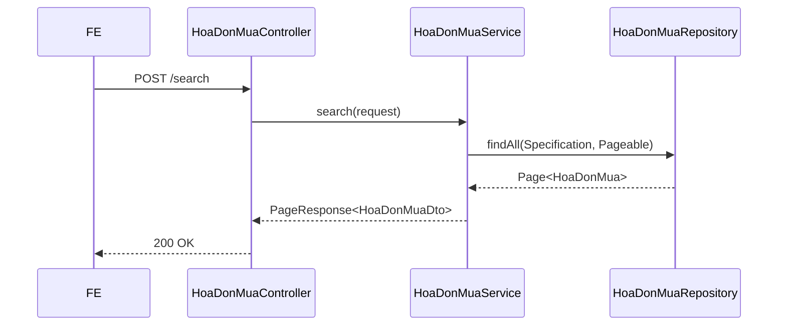

# Chi tiết triển khai - PMKT-U-01161_XemDanhSach

## 1. Hợp đồng API (Base search)

**Endpoint:** `POST /api/mua-hang/hoa-don-mua/search`
**Quyền:** `NhanHoaDon.View`

```jsonc
// Request (Kế thừa SearchRequest)
{
  "page": 0,
  "size": 20,
  "filters": {
     "nhaCungCapId": "uuid",
     "ngayChungTuFrom": "YYYY-MM-DD",
     "ngayChungTuTo": "YYYY-MM-DD",
     "trangThaiChungTu": "CHUA_GHI_SO",
     "laHDVeSau": true
  },
  "keyword": "soHoaDon, tenNhaCungCap"
}

// Response
{
  "code": 200,
  "data": {
    "content": [
      {
        "id": "uuid",
        "soHoaDon": "HD-1234",
        "ngayHoaDon": "2023-10-01",
        "tenNhaCungCap": "Công ty ABC",
        "laHDVeSau": true,
        "trangThaiChungTu": "CHUA_GHI_SO",
        "tongTienThanhToan": 15000000
      }
    ]
  }
}
```

## 2. Luồng xử lý



## 3. Đặc thù nghiệp vụ

- Nếu **LaHDVeSau = true**: Trả về đủ nút.
- Nếu **LaHDVeSau = false**: FE xử lý ẩn nút "Sửa", "Ghi sổ/Bỏ ghi sổ", "Xóa", chỉ giữ "Xem chi tiết" (chuyển sang màn hình chứng từ gốc). Trạng thái các cờ `canEdit`, `canDelete`, `canPost`, `canUnpost` cần được tính toán trong Mapper của BE để hỗ trợ FE ẩn hiện nút trên danh sách.

## 4. Message sử dụng
- `MSG_PMKT-E-00542_011`: Không có dữ liệu hiển thị (khi trả về page rỗng).
- `MSG_PMKT-E-00542_999`: Lỗi hệ thống.
